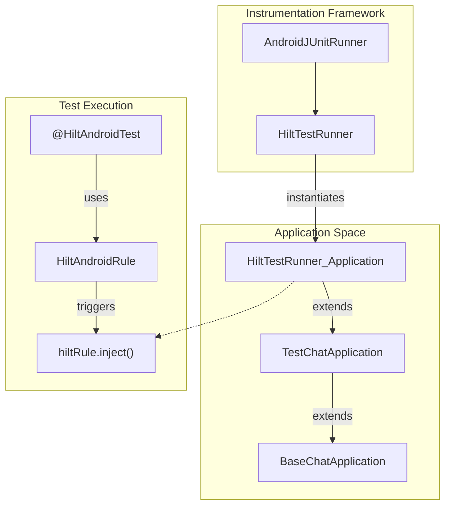
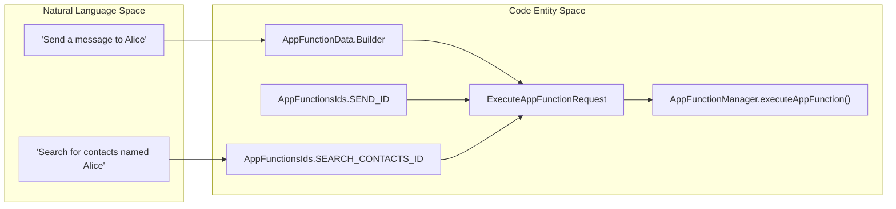

<!-- source: DeepWiki mcp.deepwiki.com · repo android/appfunctions · page 5.2 Instrumentation Tests and Hilt Test Infrastructure · fetched 2026-10-23 -->

# Instrumentation Tests and Hilt Test Infrastructure

Relevant source files

The following files were used as context for generating this wiki page:

- [ChatApp/app/src/androidTest/kotlin/com/example/chatapp/AppFunctionsViewModelTest.kt](ChatApp/app/src/androidTest/kotlin/com/example/chatapp/AppFunctionsViewModelTest.kt)
- [ChatApp/app/src/androidTest/kotlin/com/example/chatapp/HiltTestRunner.kt](ChatApp/app/src/androidTest/kotlin/com/example/chatapp/HiltTestRunner.kt)
- [ChatApp/app/src/androidTest/kotlin/com/example/chatapp/TestChatApplication.kt](ChatApp/app/src/androidTest/kotlin/com/example/chatapp/TestChatApplication.kt)
- [ChatApp/app/src/androidTest/kotlin/com/example/chatapp/appfunctions/AppFunctionInstrumentationTest.kt](ChatApp/app/src/androidTest/kotlin/com/example/chatapp/appfunctions/AppFunctionInstrumentationTest.kt)

This page documents the instrumentation testing strategy and the underlying Hilt infrastructure used to test the ChatApp sample. The testing suite focuses on end-to-end verification of AppFunctions via the system service and lifecycle testing of ViewModels within an instrumented environment.

## Hilt Test Infrastructure

To support Dependency Injection in instrumented tests, the project implements a custom Hilt test runner and application pattern. This ensures that tests can inject real or mock dependencies while maintaining the same lifecycle as the production application.

### HiltTestRunner and Custom Application
The `HiltTestRunner` extends `AndroidJUnitRunner` and is configured to use a specialized test application class. This is achieved using the `@CustomTestApplication` annotation, which instructs Hilt to generate a base class for testing.

*   **`HiltTestRunner`**: Overrides `newApplication` to instantiate the Hilt-generated application class [ChatApp/app/src/androidTest/kotlin/com/example/chatapp/HiltTestRunner.kt:27-36]().
*   **`TestChatApplication`**: A simple class extending `BaseChatApplication` used as the base for the generated Hilt test application [ChatApp/app/src/androidTest/kotlin/com/example/chatapp/TestChatApplication.kt:18-18]().
*   **`BaseChatApplication`**: Provides the foundation for both production and test applications, ensuring consistency in how `AppFunctionConfiguration` is provided [ChatApp/app/src/androidTest/kotlin/com/example/chatapp/TestChatApplication.kt:18-18]().

### Hilt Test Setup Diagram
The following diagram illustrates how the custom runner initializes the Hilt-enabled test environment.

**Hilt Test Initialization Flow**

**Sources:** [ChatApp/app/src/androidTest/kotlin/com/example/chatapp/HiltTestRunner.kt:27-36](), [ChatApp/app/src/androidTest/kotlin/com/example/chatapp/TestChatApplication.kt:18-18](), [ChatApp/app/src/androidTest/kotlin/com/example/chatapp/appfunctions/AppFunctionInstrumentationTest.kt:45-63]().

---

## AppFunction Instrumentation Tests

The `AppFunctionInstrumentationTest` class performs end-to-end validation of AppFunctions. Unlike unit tests that call methods directly, these tests interact with `AppFunctionManager` to simulate how the Android system agent executes functions.

### Key Components
*   **`AppFunctionManager`**: The system service used to observe and execute functions [ChatApp/app/src/androidTest/kotlin/com/example/chatapp/appfunctions/AppFunctionInstrumentationTest.kt:57-58]().
*   **`ExecuteAppFunctionRequest`**: Encapsulates the target package, function ID, and parameters [ChatApp/app/src/androidTest/kotlin/com/example/chatapp/appfunctions/AppFunctionInstrumentationTest.kt:78-89]().
*   **`AppFunctionData.Builder`**: Used to construct the parameters for the request, utilizing the metadata (parameters and components) retrieved from the manager [ChatApp/app/src/androidTest/kotlin/com/example/chatapp/appfunctions/AppFunctionInstrumentationTest.kt:81-84]().

### Test Flow: Natural Language to Code Entity
This diagram maps the conceptual "execute a function" flow to the specific classes and methods used in the instrumentation tests.

**AppFunction Execution Mapping**

**Sources:** [ChatApp/app/src/androidTest/kotlin/com/example/chatapp/appfunctions/AppFunctionInstrumentationTest.kt:75-91](), [ChatApp/app/src/androidTest/kotlin/com/example/chatapp/appfunctions/AppFunctionInstrumentationTest.kt:147-162]().

### Verified Behaviors
1.  **Successful Execution**: Tests like `testSend_success` verify that calling the `SEND_ID` function returns a success response and that the side effect (message storage) is reflected in the `MessageRepository` [ChatApp/app/src/androidTest/kotlin/com/example/chatapp/appfunctions/AppFunctionInstrumentationTest.kt:66-103]().
2.  **Validation Logic**: `testSend_emptyContent_fails` confirms that the app correctly throws an `AppFunctionInvalidArgumentException` when mandatory parameters are invalid [ChatApp/app/src/androidTest/kotlin/com/example/chatapp/appfunctions/AppFunctionInstrumentationTest.kt:106-135]().
3.  **Search Functionality**: `testSearchContacts_success` validates that searching via `AppFunctionManager` returns the expected list of `ContactSearchResult` objects [ChatApp/app/src/androidTest/kotlin/com/example/chatapp/appfunctions/AppFunctionInstrumentationTest.kt:138-163]().

**Sources:** [ChatApp/app/src/androidTest/kotlin/com/example/chatapp/appfunctions/AppFunctionInstrumentationTest.kt:47-163]().

---

## AppFunctionsViewModel Tests

The `AppFunctionsViewModelTest` focuses on the UI logic responsible for managing the state of AppFunctions within the application settings.

### Test Coverage
*   **Initial State**: Verifies that the `uiState` is properly initialized upon ViewModel creation [ChatApp/app/src/androidTest/kotlin/com/example/chatapp/AppFunctionsViewModelTest.kt:40-44]().
*   **Toggle Logic**: Ensures that calling `toggleFunction` with a valid function ID (e.g., `...#searchContacts`) does not cause crashes and interacts with the underlying system safely [ChatApp/app/src/androidTest/kotlin/com/example/chatapp/AppFunctionsViewModelTest.kt:47-51]().
*   **Flow Collection**: Confirms that the `StateFlow` provided by the ViewModel can be successfully collected by UI observers [ChatApp/app/src/androidTest/kotlin/com/example/chatapp/AppFunctionsViewModelTest.kt:54-59]().

### Implementation Details
The ViewModel is instantiated manually using `ApplicationProvider.getApplicationContext()` to provide the necessary `Application` context [ChatApp/app/src/androidTest/kotlin/com/example/chatapp/AppFunctionsViewModelTest.kt:34-37](). Tests use `runTest` to handle the asynchronous nature of `StateFlow` updates [ChatApp/app/src/androidTest/kotlin/com/example/chatapp/AppFunctionsViewModelTest.kt:41-51]().

**Sources:** [ChatApp/app/src/androidTest/kotlin/com/example/chatapp/AppFunctionsViewModelTest.kt:29-60]().

---

