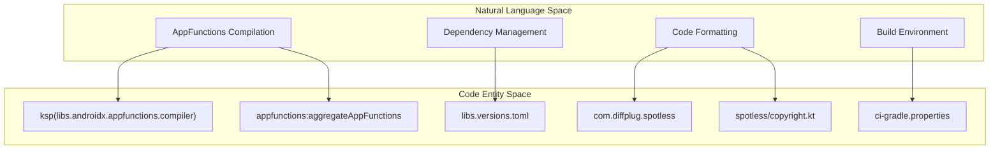
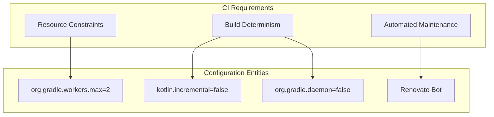

<!-- source: DeepWiki mcp.deepwiki.com · repo android/appfunctions · page 6 Build System and CI · fetched 2026-10-23 -->

# Build System and CI

Relevant source files

The following files were used as context for generating this wiki page:

- [.github/ci-gradle.properties](.github/ci-gradle.properties)
- [ChatApp/app/build.gradle.kts](ChatApp/app/build.gradle.kts)
- [ChatApp/build.gradle.kts](ChatApp/build.gradle.kts)

This section provides a high-level overview of the build infrastructure and continuous integration pipelines used in the AppFunctions samples repository. The project utilizes a modern Android build stack centered around Gradle, Kotlin Symbol Processing (KSP), and GitHub Actions to ensure code quality and seamless integration of the AppFunctions SDK.

## Build Infrastructure Overview

The repository's build system is designed to manage the complexities of the AppFunctions compilation process while maintaining strict code style standards. It leverages the Android Gradle Plugin (AGP) and a centralized dependency management system to provide a consistent environment for both local development and automated CI environments.

### Code-to-System Mapping: Build Stack
The following diagram illustrates how high-level build requirements map to specific Gradle configurations and plugins within the codebase.

"Build System Mapping"

Sources: [ChatApp/app/build.gradle.kts:16-21](), [ChatApp/app/build.gradle.kts:71-75](), [ChatApp/app/build.gradle.kts:88-89](), [ChatApp/build.gradle.kts:42-55](), [.github/ci-gradle.properties:17-23]()

## Gradle Build Configuration

The ChatApp sample is configured as a standalone Android application module. The build configuration handles the integration of Jetpack Compose, Hilt for dependency injection, and the AppFunctions SDK.

Key characteristics of the build setup include:
*   **SDK Targets**: The project targets `compileSdk` 37 and `targetSdk` 37, with a `minSdk` of 24 [[ChatApp/app/build.gradle.kts:25-30]]().
*   **AppFunctions Compiler**: Integration requires the `androidx.appfunctions.compiler` via KSP [[ChatApp/app/build.gradle.kts:74-74]](). A specific KSP argument `appfunctions:aggregateAppFunctions` is enabled to facilitate function discovery [[ChatApp/app/build.gradle.kts:89-89]]().
*   **Code Quality**: The `Spotless` plugin is applied globally to enforce `ktlint` formatting and ensure every Kotlin file contains the standard license header [[ChatApp/build.gradle.kts:42-55]]().
*   **Dependency Management**: All library versions and plugins are centralized in `gradle/libs.versions.toml`.

For details, see [Gradle Build Configuration](#6.1).

Sources: [ChatApp/app/build.gradle.kts:16-35](), [ChatApp/app/build.gradle.kts:71-75](), [ChatApp/build.gradle.kts:19-28](), [ChatApp/build.gradle.kts:42-55]()

## CI/CD and Tooling

The repository uses GitHub Actions for automated verification of pull requests. The CI environment is tuned for stability and performance through specialized Gradle properties.

### CI Environment Configuration
The following diagram bridges the CI requirements to the configuration entities defined in the repository.

"CI Configuration Mapping"

Sources: [.github/ci-gradle.properties:17-23](), [ChatApp/app/build.gradle.kts:34-34]()

The CI pipeline focuses on:
*   **Resource Management**: To prevent runner exhaustion, the CI uses `ci-gradle.properties` to disable the Gradle daemon and limit worker threads [[.github/ci-gradle.properties:17-19]]().
*   **Build Optimization**: The configuration cache is enabled to speed up subsequent build phases [[.github/ci-gradle.properties:20-21]]().
*   **Verification**: The standard workflow executes `testDebug` for unit/instrumentation tests and `spotlessApply` to verify code style.
*   **Dependency Updates**: Renovate bot is utilized to keep the AppFunctions SDK and other libraries up to date.

For details, see [CI/CD and Tooling](#6.2).

Sources: [.github/ci-gradle.properties:17-29](), [ChatApp/app/build.gradle.kts:34-35]()

---

