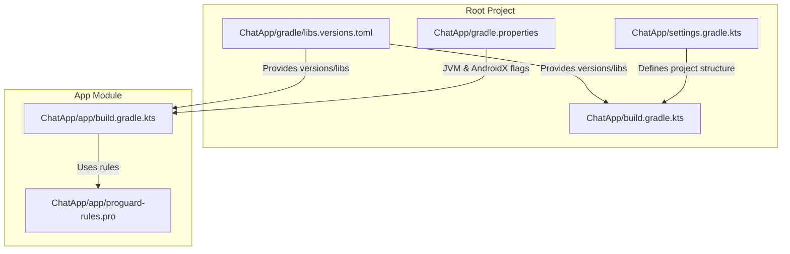
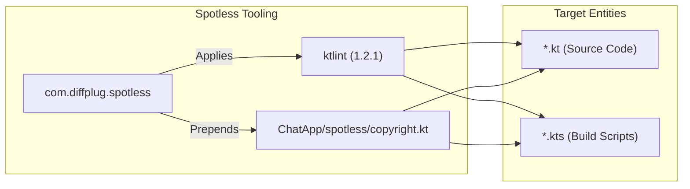

<!-- source: DeepWiki mcp.deepwiki.com · repo android/appfunctions · page 6.1 Gradle Build Configuration · fetched 2026-10-23 -->

# Gradle Build Configuration

Relevant source files

The following files were used as context for generating this wiki page:

- [ChatApp/app/build.gradle.kts](ChatApp/app/build.gradle.kts)
- [ChatApp/app/proguard-rules.pro](ChatApp/app/proguard-rules.pro)
- [ChatApp/build.gradle.kts](ChatApp/build.gradle.kts)
- [ChatApp/gradle.properties](ChatApp/gradle.properties)
- [ChatApp/gradle/libs.versions.toml](ChatApp/gradle/libs.versions.toml)
- [ChatApp/settings.gradle.kts](ChatApp/settings.gradle.kts)
- [ChatApp/spotless/copyright.kt](ChatApp/spotless/copyright.kt)

This page documents the Gradle build system configuration for the ChatApp sample. The build setup leverages the Android Gradle Plugin (AGP) 9.2.1, Kotlin Symbol Processing (KSP) for code generation, and specialized AppFunctions compiler plugins to facilitate the integration of Android AppFunctions.

## Project Structure and Settings

The project is structured as a single-module Android application named `ChatApp`. The `settings.gradle.kts` file defines the repository strategy and module inclusion.

*   **Repository Management**: Uses `RepositoriesMode.FAIL_ON_PROJECT_REPOS` to ensure all repositories are declared centrally in `settings.gradle.kts` [ChatApp/settings.gradle.kts:30-30]().
*   **Module Inclusion**: Includes the primary application module `:app` [ChatApp/settings.gradle.kts:38-38]().
*   **Plugin Management**: Configures specific repository blocks for Google, Maven Central, and the Gradle Plugin Portal to resolve dependencies and plugins [ChatApp/settings.gradle.kts:17-27]().

### Project-Level Data Flow

The following diagram illustrates how the build configuration files interact to provide the final build environment for the application.

**Build Configuration Hierarchy**

**Sources:** [ChatApp/settings.gradle.kts:1-39](), [ChatApp/build.gradle.kts:1-55](), [ChatApp/app/build.gradle.kts:1-90]().

## Dependency Catalog (libs.versions.toml)

The project uses a Version Catalog to manage all dependencies and plugin versions in a centralized location.

| Category | Key Libraries / Plugins | Version |
| :--- | :--- | :--- |
| **AppFunctions** | `androidx.appfunctions` | `1.0.0-alpha09` |
| **Android SDK** | `compileSdk`, `targetSdk` | `37` |
| **Android SDK** | `minSdk` | `24` |
| **Kotlin** | `kotlin` | `2.3.21` |
| **AGP** | `com.android.application` | `9.2.1` |
| **Hilt** | `com.google.dagger.hilt.android` | `2.59.2` |
| **KSP** | `com.google.devtools.ksp` | `2.3.6` |

**Sources:** [ChatApp/gradle/libs.versions.toml:1-60](), [ChatApp/app/build.gradle.kts:25-30]().

## App Module Configuration

The `app/build.gradle.kts` file contains the specific instructions for compiling the ChatApp, including the integration of the AppFunctions compiler and Hilt.

### AppFunctions and KSP Integration
The build uses KSP to process `@AppFunction` and `@AppFunctionSerializable` annotations. A critical configuration requirement is the aggregation of functions, enabled via a KSP argument.

*   **Compiler Dependency**: The `androidx-appfunctions-compiler` is added via the `ksp` configuration [ChatApp/app/build.gradle.kts:74-74]().
*   **Function Aggregation**: The KSP argument `appfunctions:aggregateAppFunctions` is set to `true` to ensure the compiler generates the necessary metadata for all functions within the module [ChatApp/app/build.gradle.kts:89-89]().

### Build Features and Dependencies
*   **Jetpack Compose**: Enabled via `buildFeatures { compose = true }` [ChatApp/app/build.gradle.kts:51-51]().
*   **Hilt**: Integrated using the Hilt Gradle plugin and KSP for annotation processing [ChatApp/app/build.gradle.kts:20-20](), [ChatApp/app/build.gradle.kts:69-69]().
*   **Testing**: Configures `HiltTestRunner` as the `testInstrumentationRunner` for UI and integration tests [ChatApp/app/build.gradle.kts:34-34]().

**Sources:** [ChatApp/app/build.gradle.kts:16-90]().

## Code Quality and Style (Spotless)

The project enforces code style and copyright headers using the Spotless plugin. This is configured at the root level and applied to all subprojects.

*   **Kotlin Files**: Targets all `.kt` files excluding the `build` directory [ChatApp/build.gradle.kts:43-45](). It applies `ktlint` and ensures the `ChatApp/spotless/copyright.kt` header is present [ChatApp/build.gradle.kts:46-47]().
*   **Gradle Scripts**: Targets `.kts` files to maintain consistent formatting in build scripts [ChatApp/build.gradle.kts:49-54]().

**Code Style Mapping**

**Sources:** [ChatApp/build.gradle.kts:30-55](), [ChatApp/spotless/copyright.kt:1-16]().

## Release and Optimization

The release build type is configured for production-readiness using R8/ProGuard.

*   **Minification**: `isMinifyEnabled = true` and `isShrinkResources = true` are set to reduce APK size [ChatApp/app/build.gradle.kts:39-40]().
*   **ProGuard Rules**: Uses the default Android optimize rules and a project-specific `proguard-rules.pro` [ChatApp/app/build.gradle.kts:41-44]().
*   **Custom Rules**: The project-specific rules include `-dontwarn` directives for Guava's `MoreExecutors` and `Uninterruptibles` to prevent build warnings related to optional dependencies [ChatApp/app/proguard-rules.pro:23-24]().

**Sources:** [ChatApp/app/build.gradle.kts:37-46](), [ChatApp/app/proguard-rules.pro:1-25]().

---

