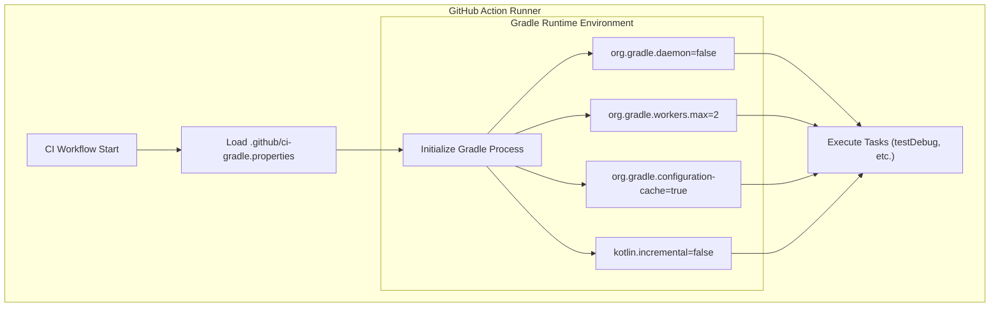
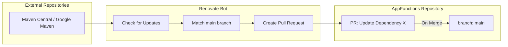

<!-- source: DeepWiki mcp.deepwiki.com · repo android/appfunctions · page 6.2 CI/CD and Tooling · fetched 2026-10-23 -->

# CI/CD and Tooling

Relevant source files

The following files were used as context for generating this wiki page:

- [.github/ci-gradle.properties](.github/ci-gradle.properties)
- [.github/pull_request_template.md](.github/pull_request_template.md)
- [.github/renovate.json](.github/renovate.json)

This page documents the Continuous Integration (CI) configuration, dependency management automation, and the pull request workflow for the AppFunctions Samples repository. The project utilizes GitHub Actions and specialized Gradle properties to ensure build stability, performance, and code quality across a distributed development environment.

## Gradle CI Configuration

The repository uses a dedicated properties file, `.github/ci-gradle.properties`, to override standard Gradle behavior during CI runs. This configuration is optimized for the ephemeral nature of CI runners where persistent daemons are inefficient and resource constraints (CPU/Memory) are strictly defined.

### Performance and Resource Management
The CI environment is configured with the following constraints:
*   **Daemon Disabled**: `org.gradle.daemon=false` is set to ensure that each build starts in a fresh process, preventing memory leaks or state pollution between sequential CI jobs [ .github/ci-gradle.properties:17-17]().
*   **Parallel Execution**: `org.gradle.parallel=true` enables Gradle to execute decoupled projects in parallel, maximizing the utility of available CPU cores [ .github/ci-gradle.properties:18-18]().
*   **Worker Limitation**: `org.gradle.workers.max=2` restricts the number of concurrent worker processes to 2, preventing the CI runner from being overwhelmed by excessive context switching or memory exhaustion [ .github/ci-gradle.properties:19-19]().
*   **Configuration Caching**: Both `org.gradle.configuration-cache=true` and `org.gradle.configuration-cache.parallel=true` are enabled to skip the configuration phase for subsequent builds with identical inputs [ .github/ci-gradle.properties:20-21]().

### Build Stability
To ensure deterministic builds, incremental compilation is disabled in the CI environment via `kotlin.incremental=false` [ .github/ci-gradle.properties:23-23](). This forces a full clean build of Kotlin sources, which is safer for CI verification than relying on incremental state that may not persist across runner instances.

Additionally, the `warningsAsErrors` property is currently set to `false` in CI [ .github/ci-gradle.properties:29-29](). This allows the build to proceed even if the Kotlin compiler emits warnings, though developers are encouraged to enable this locally for stricter enforcement [ .github/ci-gradle.properties:25-28]().

### Gradle CI Property Flow
The following diagram illustrates how the `ci-gradle.properties` file influences the Gradle execution environment during a GitHub Action run.

**Gradle CI Environment Initialization**

Sources: [ .github/ci-gradle.properties:17-29]()

---

## Dependency Management with Renovate

The repository employs **Renovate** to automate the updating of library dependencies and Gradle plugins. This ensures the ChatApp sample remains compatible with the latest versions of the AppFunctions SDK and Jetpack libraries.

### Configuration Details
The bot is configured via `.github/renovate.json`:
*   **Schema**: It follows the standard Renovate JSON schema [ .github/renovate.json:2-2]().
*   **Base Config**: It extends a centralized Android configuration [ .github/renovate.json:3-5]().
*   **Targeting**: The bot specifically monitors the `main` branch for dependency updates [ .github/renovate.json:6-8]().
*   **Ignored Authors**: To prevent recursive update loops or conflicts with other bots, Renovate ignores commits from itself and the standard GitHub Actions bot [ .github/renovate.json:9-13]().

### Dependency Update Lifecycle

Sources: [ .github/renovate.json:1-15]()

---

## Pull Request Workflow

The repository enforces a specific workflow for all contributors to maintain code quality and architectural consistency. This is guided by the `.github/pull_request_template.md`.

### Pre-submission Requirements
Before a Pull Request is considered for review, contributors must perform the following actions:
1.  **CLA Agreement**: Sign the Google Contributors License Agreement (CLA) [ .github/pull_request_template.md:8-8]().
2.  **Verification Tests**: Execute local unit tests on the debug variant using `./gradlew testDebug` [ .github/pull_request_template.md:12-12]().
3.  **Code Formatting**: Apply the project's code style rules using the Spotless plugin via `./gradlew spotlessApply` [ .github/pull_request_template.md:13-13]().

### PR Structure
The template requires contributors to provide a clear description of the changes ("What I have done and why") and link to any relevant issue trackers [ .github/pull_request_template.md:17-23]().

### Workflow Enforcement Table

| Requirement | Command / Action | Purpose |
| :--- | :--- | :--- |
| **Legal** | [CLA Signing](https://cla.developers.google.com/) | Granting license for contributions. |
| **Logic** | `./gradlew testDebug` | Ensure no regressions in AppFunctions or ViewModels. |
| **Style** | `./gradlew spotlessApply` | Enforce copyright headers and Kotlin formatting. |
| **Context** | PR Description | Explain the rationale behind the implementation. |

Sources: [ .github/pull_request_template.md:1-24]()

---

