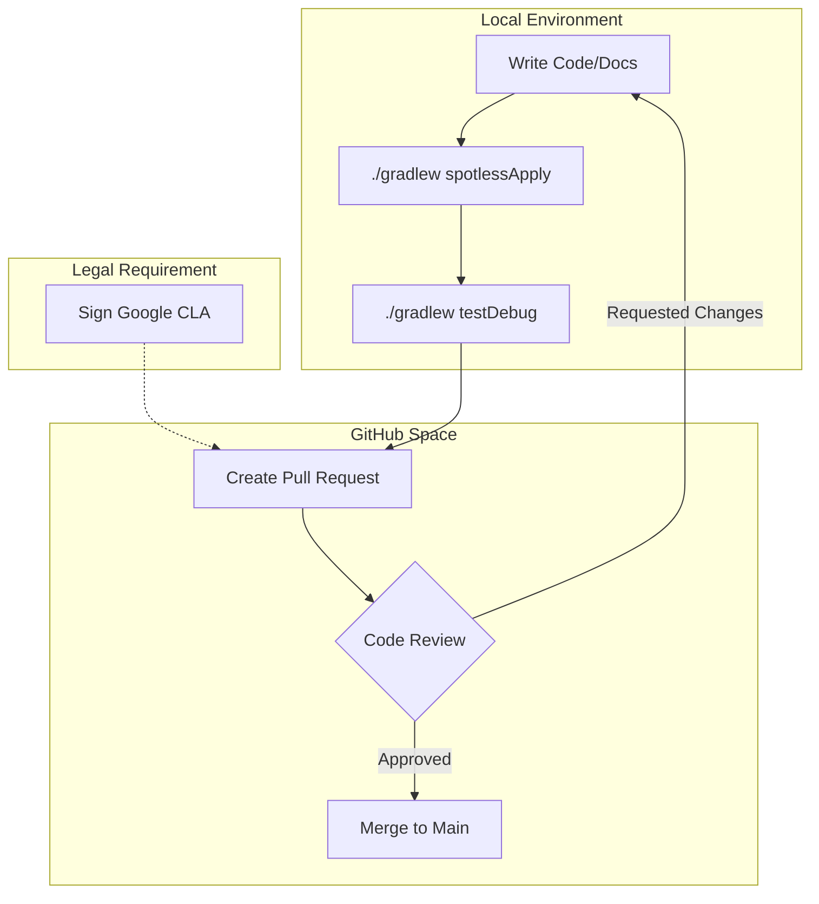

<!-- source: DeepWiki mcp.deepwiki.com · repo android/appfunctions · page 7 Contributing and Community · fetched 2026-10-23 -->

# Contributing and Community

<details>
<summary>Relevant source files</summary>

The following files were used as context for generating this wiki page:

- [CODE_OF_CONDUCT.md](CODE_OF_CONDUCT.md)
- [CONTRIBUTING.md](CONTRIBUTING.md)
- [ChatApp/CONTRIBUTING.md](ChatApp/CONTRIBUTING.md)

</details>


This page provides a high-level overview of how to engage with the AppFunctions Samples repository. It covers the legal requirements for contributors, the technical workflow for submitting code, and the community standards that govern interactions within the project.

The project relies on GitHub for version control, issue tracking, and code reviews. All contributions—whether they are bug fixes, new features, or documentation improvements—must follow the standardized process outlined in this section.

## Contribution Workflow

To maintain code quality and legal compliance, all contributors must complete a set of prerequisites before their code can be merged into the repository.

### Legal and Quality Standards
*   **Contributor License Agreement (CLA):** All contributors must sign the Google CLA to grant permission for the redistribution of their contributions [CONTRIBUTING.md:7-13]().
*   **Code Reviews:** The project enforces a strict code review policy. Every submission, including those from core project members, must be submitted via a GitHub Pull Request and undergo review [CONTRIBUTING.md:28-33]().
*   **Pre-submission Checks:** Contributors are expected to validate their changes locally. This includes ensuring the project builds correctly and adheres to the defined code style using Gradle tasks.

For a detailed step-by-step guide on the technical submission process, see [Contribution Guidelines](#7.1).

### Technical Contribution Flow
The following diagram illustrates the transition from a local developer environment to the shared codebase.

**Developer Contribution Pipeline**

Sources: [CONTRIBUTING.md:7-33](), [ChatApp/CONTRIBUTING.md:7-33]()

## Community Standards and Reporting

The AppFunctions Samples project is an inclusive environment governed by the Google Open Source Community Guidelines. We prioritize respectful behavior and constructive collaboration.

### Code of Conduct
The community guidelines emphasize being kind, helpful, and avoiding any form of discriminatory or harassing behavior [CODE_OF_CONDUCT.md:15-21](). The project values healthy debate but maintains a zero-tolerance policy for disrespect [CODE_OF_CONDUCT.md:31-33]().

### Issue Management
Technical issues, feature requests, and documentation gaps are managed through GitHub Issues. The repository provides specific templates to ensure that reports contain the necessary context for maintainers to act upon them.

### Governance and Support
*   **Project Steward:** A designated Google employee acts as the Project Steward to handle reports of conduct violations [CODE_OF_CONDUCT.md:44-48]().
*   **Reporting:** Violations can be reported directly to the steward or via email to `opensource@google.com` [CODE_OF_CONDUCT.md:47-48]().

For details on the specific issue templates and the full text of the community guidelines, see [Issue Reporting and Code of Conduct](#7.2).

### Community Interaction Mapping
The following diagram maps community roles and reporting mechanisms to the project's governance entities.

**Community Governance Map**
```mermaid
graph LR
    subgraph "Natural Language Space"
        "Contributor" -- "Reports Bug" --> "GitHub Issue"
        "Contributor" -- "Reports Misconduct" --> "Project Steward"
        "Contributor" -- "Proposes Change" --> "Pull Request"
    end

    subgraph "Code Entity Space"
        "GitHub Issue" --> "bug_report.yml"
        "GitHub Issue" --> "feature_request.yml"
        "Project Steward" --> "CODE_OF_CONDUCT.md"
        "Pull Request" --> "CONTRIBUTING.md"
    end
```
Sources: [CODE_OF_CONDUCT.md:1-61](), [CONTRIBUTING.md:1-33]()

## Summary of Child Pages

*   **[Contribution Guidelines](#7.1):** Detailed instructions on the CLA, running tests (`./gradlew testDebug`), applying code formatting (`./gradlew spotlessApply`), and the PR lifecycle.
*   **[Issue Reporting and Code of Conduct](#7.2):** Information on using the YAML-based issue templates and a comprehensive overview of the Google Open Source Community Guidelines.

---

