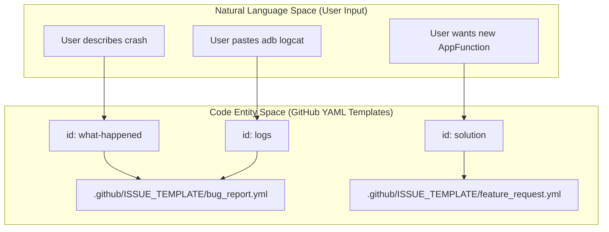
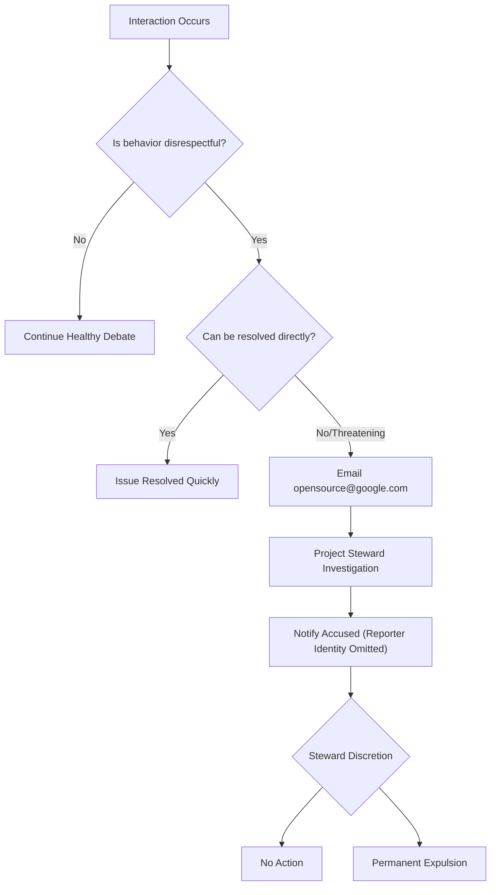

<!-- source: DeepWiki mcp.deepwiki.com · repo android/appfunctions · page 7.2 Issue Reporting and Code of Conduct · fetched 2026-10-23 -->

# Issue Reporting and Code of Conduct

Relevant source files

The following files were used as context for generating this wiki page:

- [.github/ISSUE_TEMPLATE/bug_report.yml](.github/ISSUE_TEMPLATE/bug_report.yml)
- [.github/ISSUE_TEMPLATE/docs_issue.yml](.github/ISSUE_TEMPLATE/docs_issue.yml)
- [.github/ISSUE_TEMPLATE/feature_request.yml](.github/ISSUE_TEMPLATE/feature_request.yml)
- [CODE_OF_CONDUCT.md](CODE_OF_CONDUCT.md)

This page documents the formal processes for reporting technical issues, requesting enhancements, and maintaining community standards within the AppFunctions Samples repository. It details the structured GitHub Issue templates and the Google Open Source Community Guidelines that govern contributor interactions.

## GitHub Issue Templates

The repository utilizes structured YAML templates for GitHub Issues to ensure that maintainers receive the necessary technical context for triage. All issue submissions require the reporter to acknowledge the Code of Conduct.

### Bug Report (`bug_report.yml`)
Used for reporting unexpected behavior or defects in the ChatApp sample or AppFunctions implementation.

*   **Labels**: `bug`, `triage me` [ .github/ISSUE_TEMPLATE/bug_report.yml:4-4 ]()
*   **Required Fields**:
    *   **Existing Issue Search**: Confirmation that the user searched existing GitHub issues [ .github/ISSUE_TEMPLATE/bug_report.yml:12-16 ]().
    *   **StackOverflow Search**: Confirmation that the user checked for existing solutions on StackOverflow [ .github/ISSUE_TEMPLATE/bug_report.yml:19-23 ]().
    *   **What happened?**: A detailed description of the observed vs. expected behavior [ .github/ISSUE_TEMPLATE/bug_report.yml:25-32 ]().
    *   **Logcat Output**: A dedicated `textarea` for raw Android logcat data, which is automatically rendered as a shell code block [ .github/ISSUE_TEMPLATE/bug_report.yml:34-38 ]().

### Documentation Issue (`docs_issue.yml`)
Used for suggesting improvements or reporting errors in the project documentation (including this wiki).

*   **Labels**: `documentation` [ .github/ISSUE_TEMPLATE/docs_issue.yml:4-4 ]()
*   **Required Fields**:
    *   **Page URL**: The specific URL of the documentation page or "NEW" for new content suggestions [ .github/ISSUE_TEMPLATE/docs_issue.yml:17-22 ]().
    *   **Improvement Description**: Detailed text area for the documentation problem [ .github/ISSUE_TEMPLATE/docs_issue.yml:23-30 ]().

### Feature Request (`feature_request.yml`)
Used for proposing new capabilities for the ChatApp or additional AppFunction examples.

*   **Labels**: `enhancement`, `triage me` [ .github/ISSUE_TEMPLATE/feature_request.yml:4-4 ]()
*   **Required Fields**:
    *   **Problem Description**: Explanation of the friction or gap the feature intends to solve [ .github/ISSUE_TEMPLATE/feature_request.yml:18-24 ]().
    *   **Solution Description**: Concise description of the requested behavior [ .github/ISSUE_TEMPLATE/feature_request.yml:26-31 ]().
    *   **Additional Context**: Optional field for screenshots or supplementary data [ .github/ISSUE_TEMPLATE/feature_request.yml:33-38 ]().

### Data Flow: Issue Submission to Triage
The following diagram illustrates how the YAML templates structure the data for the repository maintainers.

**Issue Template Data Mapping**

**Sources:** [ .github/ISSUE_TEMPLATE/bug_report.yml:1-47 ](), [ .github/ISSUE_TEMPLATE/docs_issue.yml:1-39 ](), [ .github/ISSUE_TEMPLATE/feature_request.yml:1-47 ]()

---

## Code of Conduct

The project adheres to the **Google Open Source Community Guidelines**. These guidelines ensure the community remains inclusive and respectful [ CODE_OF_CONDUCT.md:1-11 ]().

### Expected Behavior
Contributors are expected to:
*   Be considerate, kind, and constructive [ CODE_OF_CONDUCT.md:17-17 ]().
*   Avoid demeaning, discriminatory, or harassing behavior and speech [ CODE_OF_CONDUCT.md:18-19 ]().
*   Engage in healthy debate while maintaining respect for diverse opinions [ CODE_OF_CONDUCT.md:31-33 ]().

### Enforcement and Reporting
The project emphasizes peaceful resolution. If a conflict cannot be resolved directly between parties, it should be reported [ CODE_OF_CONDUCT.md:35-40 ]().

*   **Project Steward**: A designated Google employee responsible for handling reports. If no specific steward is identified, reports are directed to `opensource@google.com` [ CODE_OF_CONDUCT.md:44-48 ]().
*   **Investigation Process**:
    1.  The complaint is investigated [ CODE_OF_CONDUCT.md:50-50 ]().
    2.  The accused is notified and given an opportunity to discuss the report [ CODE_OF_CONDUCT.md:53-54 ]().
    3.  The reporter's identity is kept confidential from the accused [ CODE_OF_CONDUCT.md:55-56 ]().
*   **Outcomes**: Actions range from no action to permanent expulsion from the project. In cases of immediate harm or harassment, action may be taken without prior notice [ CODE_OF_CONDUCT.md:51-58 ]().

### Conflict Resolution Logic
The following diagram maps the community guidelines to the procedural steps for handling violations.

**Violation Handling Process**

**Sources:** [ CODE_OF_CONDUCT.md:29-59 ]()

---

