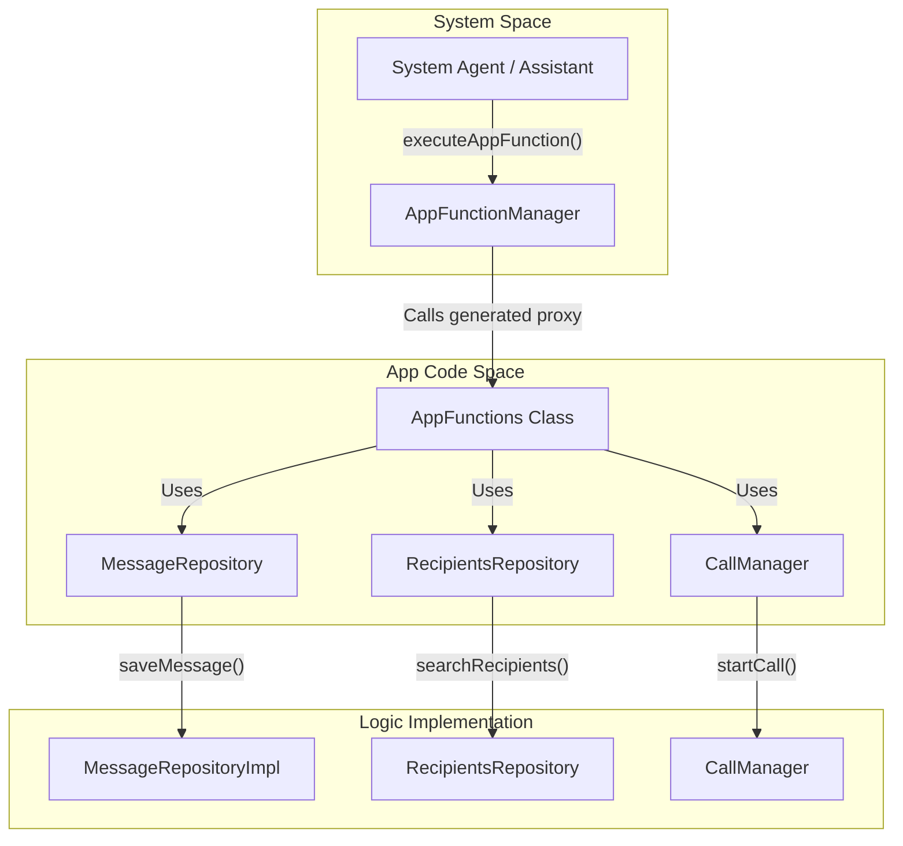
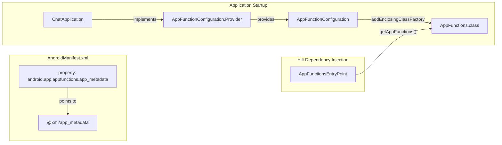

<!-- source: DeepWiki mcp.deepwiki.com · repo android/appfunctions · page 8 Glossary · fetched 2026-10-23 -->

# Glossary

Relevant source files

The following files were used as context for generating this wiki page:

- [ChatApp/app/src/main/AndroidManifest.xml](ChatApp/app/src/main/AndroidManifest.xml)
- [ChatApp/app/src/main/kotlin/com/example/chatapp/AppFunctionsViewModel.kt](ChatApp/app/src/main/kotlin/com/example/chatapp/AppFunctionsViewModel.kt)
- [ChatApp/app/src/main/kotlin/com/example/chatapp/ChatApplication.kt](ChatApp/app/src/main/kotlin/com/example/chatapp/ChatApplication.kt)
- [ChatApp/app/src/main/kotlin/com/example/chatapp/appfunctions/AppFunctions.kt](ChatApp/app/src/main/kotlin/com/example/chatapp/appfunctions/AppFunctions.kt)
- [ChatApp/app/src/main/kotlin/com/example/chatapp/data/CallManager.kt](ChatApp/app/src/main/kotlin/com/example/chatapp/data/CallManager.kt)
- [ChatApp/app/src/main/kotlin/com/example/chatapp/data/MessageRepository.kt](ChatApp/app/src/main/kotlin/com/example/chatapp/data/MessageRepository.kt)
- [ChatApp/app/src/main/kotlin/com/example/chatapp/data/RecipientsRepository.kt](ChatApp/app/src/main/kotlin/com/example/chatapp/data/RecipientsRepository.kt)
- [ChatApp/gradle/libs.versions.toml](ChatApp/gradle/libs.versions.toml)

This page provides definitions for codebase-specific terms, Android API concepts, and architectural patterns used within the AppFunctions ChatApp sample. It serves as a technical reference for onboarding engineers to understand the terminology used in the code and documentation.

## Core Concepts and Terms

### AppFunctions API
The primary framework used to expose app capabilities to the Android system (and potentially system assistants or agents).
*   **AppFunction**: A specific capability of the app annotated with `@AppFunction`. In this repository, these are defined in the `AppFunctions` class [ChatApp/app/src/main/kotlin/com/example/chatapp/appfunctions/AppFunctions.kt:52-151]().
*   **AppFunctionManager**: The system service used to interact with AppFunctions. The app uses it to observe function status and toggle their enabled state [ChatApp/app/src/main/kotlin/com/example/chatapp/AppFunctionsViewModel.kt:66-113]().
*   **AppFunctionContext**: A parameter required by every `@AppFunction` that provides execution context [ChatApp/app/src/main/kotlin/com/example/chatapp/appfunctions/AppFunctions.kt:53-53]().

### Data Modeling
*   **AppFunctionSerializable**: An annotation used on data classes (like `ContactSearchResult` or `Recipient`) to allow the AppFunctions compiler to generate serialization logic for passing data across process boundaries [ChatApp/app/src/main/kotlin/com/example/chatapp/appfunctions/AppFunctions.kt:25-25]().
*   **EndpointValue**: A unique identifier (typically a string ID) used by the system to refer to a specific contact or group within an AppFunction call [ChatApp/app/src/main/kotlin/com/example/chatapp/appfunctions/AppFunctions.kt:109-109]().

### Infrastructure
*   **AppFunctionConfiguration**: A class used to register the classes containing `@AppFunction` methods with the library's internal factory system [ChatApp/app/src/main/kotlin/com/example/chatapp/ChatApplication.kt:33-35]().
*   **Hilt EntryPoint**: A pattern used in `BaseChatApplication` to bridge Hilt-managed dependencies (like `AppFunctions`) into the non-Hilt-managed `AppFunctionConfiguration` [ChatApp/app/src/main/kotlin/com/example/chatapp/ChatApplication.kt:41-45]().

---

## Architectural Mapping: Natural Language to Code

The following diagrams bridge the gap between high-level system concepts and the specific code entities that implement them.

### Diagram 1: Function Execution Flow
This diagram maps the flow from a system-level request to the execution of logic in the repository.

**Sources:** [ChatApp/app/src/main/kotlin/com/example/chatapp/appfunctions/AppFunctions.kt:36-42](), [ChatApp/app/src/main/kotlin/com/example/chatapp/AppFunctionsViewModel.kt:66-66](), [ChatApp/app/src/main/kotlin/com/example/chatapp/data/MessageRepository.kt:76-78]()

### Diagram 2: Registration and Metadata
This diagram shows how the app identifies itself and its functions to the Android OS.

**Sources:** [ChatApp/app/src/main/AndroidManifest.xml:52-54](), [ChatApp/app/src/main/kotlin/com/example/chatapp/ChatApplication.kt:27-36](), [ChatApp/app/src/main/kotlin/com/example/chatapp/ChatApplication.kt:41-45]()

---

## Technical Abbreviations and Definitions

| Term | Full Name | Definition |
| :--- | :--- | :--- |
| **AGP** | Android Gradle Plugin | The build system plugin used to compile the Android application [ChatApp/gradle/libs.versions.toml:2-2](). |
| **KSP** | Kotlin Symbol Processing | Used by the `androidx.appfunctions-compiler` to generate code for annotated classes [ChatApp/gradle/libs.versions.toml:16-16](), [ChatApp/gradle/libs.versions.toml:25-25](). |
| **MVVM** | Model-View-ViewModel | The architectural pattern used in the app, where `AppFunctionsViewModel` manages the UI state for the settings screen [ChatApp/app/src/main/kotlin/com/example/chatapp/AppFunctionsViewModel.kt:61-61](). |
| **BOM** | Bill of Materials | A Maven artifact that controls versions of multiple dependencies (e.g., `compose-bom`) [ChatApp/gradle/libs.versions.toml:11-11](). |
| **Hilt** | Dagger Hilt | The dependency injection library used for scoping repositories as `@Singleton` [ChatApp/app/src/main/kotlin/com/example/chatapp/data/MessageRepository.kt:75-75](). |
| **StateFlow** | Kotlin StateFlow | A state-holding observable flow used in ViewModels to emit `AppFunctionsUiState` [ChatApp/app/src/main/kotlin/com/example/chatapp/AppFunctionsViewModel.kt:68-68](). |

---

## Key Data Structures

### ContactSearchResult
Returned by `searchContacts`. It encapsulates how the system should display a search result and the underlying value used for subsequent actions.
*   **endpointValue**: The ID used to target the entity [ChatApp/app/src/main/kotlin/com/example/chatapp/appfunctions/AppFunctions.kt:63-63]().
*   **endpointType**: Either "INDIVIDUAL" or "GROUP" [ChatApp/app/src/main/kotlin/com/example/chatapp/appfunctions/AppFunctions.kt:64-64]().

### AppFunctionInfo
A UI-layer data class used by the `AppFunctionsViewModel` to represent the state of a registered function in the settings screen.
*   **isEnabled**: Reflects whether the system is allowed to invoke this function [ChatApp/app/src/main/kotlin/com/example/chatapp/AppFunctionsViewModel.kt:41-41]().

**Sources:**
*   [ChatApp/app/src/main/kotlin/com/example/chatapp/appfunctions/AppFunctions.kt:16-151]()
*   [ChatApp/app/src/main/kotlin/com/example/chatapp/AppFunctionsViewModel.kt:39-52]()
*   [ChatApp/app/src/main/kotlin/com/example/chatapp/data/MessageRepository.kt:16-156]()
*   [ChatApp/app/src/main/kotlin/com/example/chatapp/data/RecipientsRepository.kt:16-165]()
*   [ChatApp/gradle/libs.versions.toml:1-60]()