# Page: Overview

# Overview

<details>
<summary>Relevant source files</summary>

The following files were used as context for generating this wiki page:

- [ChatApp/README.md](ChatApp/README.md)
- [LICENSE](LICENSE)
- [README.md](README.md)

</details>


The **AppFunctions Samples** repository provides a reference implementation for developers to integrate their Android applications with system-level intelligence services using the **AppFunctions API**. By exposing application logic as discrete, discoverable functions, apps can empower system agents to perform actions on behalf of the user within the app's own context.

The primary demonstration in this repository is the **ChatApp**, a fully functional communication client built with modern Android technologies including **Jetpack Compose** for the UI, **Hilt** for dependency injection, and the **AppFunctions** library for system integration.

## Purpose and Core Capabilities

The repository serves as a blueprint for:
1.  **Defining Functions**: How to use the `@AppFunction` annotation to mark methods as executable by the system [ChatApp/README.md:21-27]().
2.  **Data Modeling**: Utilizing `@AppFunctionSerializable` to pass complex data structures between the system and the application [ChatApp/README.md:29-38]().
3.  **System Interaction**: Registering functions so they can be discovered and triggered via system commands or AI agents [ChatApp/README.md:41-52]().

### Conceptual Mapping: Natural Language to Code

The following diagram illustrates how high-level user intents are mapped to specific code entities within the ChatApp.

**Intent-to-Code Mapping**
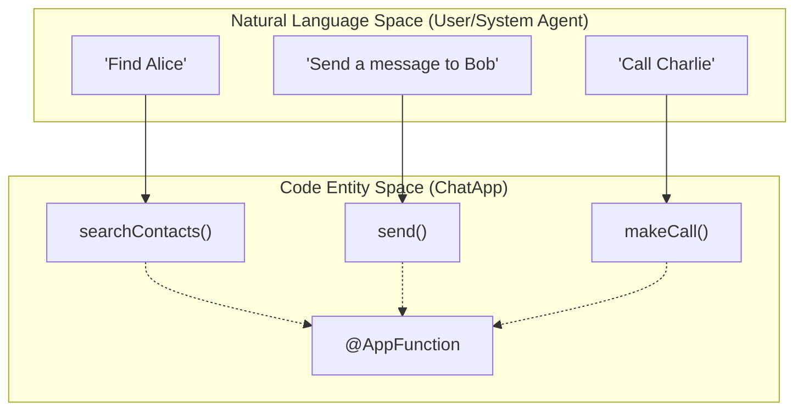
Sources: [ChatApp/README.md:21-27]()

## Key Technologies

The sample leverages the following stack to demonstrate a production-ready implementation:

| Technology | Role in Sample |
| :--- | :--- |
| **AppFunctions API** | The bridge between the app logic and the Android System [README.md:3-4](). |
| **Jetpack Compose** | Declarative UI framework used for all screens (Chat, Contacts, Settings) [README.md:10-11](). |
| **Hilt** | Dependency injection for managing repositories and ViewModels [README.md:10-11](). |
| **Kotlin Coroutines** | Asynchronous execution for message sending and search operations. |

### System Integration Architecture

This diagram shows how the `AppFunctions` class acts as the entry point for the Android system to interact with the application's internal data layer.

**System-App Bridge**
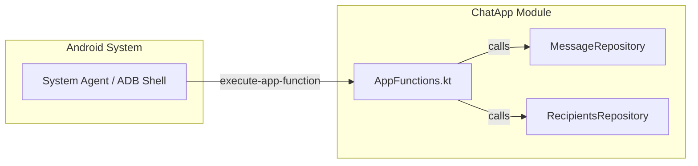
Sources: [ChatApp/README.md:41-52](), [ChatApp/README.md:21-25]()

## Wiki Navigation

To understand the full implementation, the wiki is organized into the following detailed sections:

### 1.1 [Getting Started](#1.1)
Covers the prerequisites for running the sample, including **Android SDK 36** and **Android 16 (API 36)** requirements. It provides the steps for cloning, building, and verifying the installation using `adb` commands.
For details, see [Getting Started](#1.1).

### 1.2 [Repository Structure](#1.2)
Explains the organization of the codebase, from the root-level configuration and governance files to the specific internal structure of the `ChatApp` module.
For details, see [Repository Structure](#1.2).

### 2.0 [AppFunctions Integration](#2)
A deep dive into how the API is implemented, including function definitions, serialization of custom data types, and the runtime configuration that allows the system to see the app's capabilities.
For details, see [AppFunctions Integration](#2).

### 3.0 [Application Architecture](#3)
Describes the MVVM (Model-View-ViewModel) pattern used in the app, the Hilt dependency graph, and how navigation is handled between different app states (e.g., moving from a "makeCall" function call to the UI Call Screen).
For details, see [Application Architecture](#3).

### 4.0 [UI Layer](#4)
Details the Compose-based UI, including the theme system and the specific components used to build the chat and contact management interfaces.
For details, see [UI Layer](#4).

### 5.0 [Testing](#5)
Outlines the strategy for both unit testing the logic within `AppFunctions.kt` and instrumentation testing to ensure the system-level integration works as expected.
For details, see [Testing](#5).

### 6.0 [Build System and CI](#6)
Technical details on the Gradle configuration, versioning via version catalogs, and the automated workflows used for code quality.
For details, see [Build System and CI](#6).

### 7.0 [Contributing and Community](#7)
Guidelines for developers looking to contribute to the repository, covering the Google CLA, code style enforcement via Spotless, and issue reporting.
For details, see [Contributing and Community](#7).

### 8.0 [Glossary](#8)
Definitions of terms and abbreviations used throughout the codebase and documentation.
For details, see [Glossary](#8).

---

# Page: Getting Started

# Getting Started

<details>
<summary>Relevant source files</summary>

The following files were used as context for generating this wiki page:

- [ChatApp/README.md](ChatApp/README.md)
- [ChatApp/gradle/wrapper/gradle-wrapper.properties](ChatApp/gradle/wrapper/gradle-wrapper.properties)
- [ChatApp/gradlew](ChatApp/gradlew)
- [ChatApp/gradlew.bat](ChatApp/gradlew.bat)
- [README.md](README.md)

</details>


This guide provides step-by-step instructions for setting up the **AppFunctions Samples** repository, with a focus on building and running the **ChatApp** sample. The ChatApp serves as a reference implementation for integrating the Android AppFunctions API, allowing system agents to interact with application features like messaging and contact searching [ChatApp/README.md:1-13]().

## Prerequisites

Before proceeding, ensure your development environment meets the following requirements:

*   **Android Studio**: Latest stable version [README.md:20]().
*   **Android SDK**: Version 36 or higher [README.md:21]().
*   **Device/Emulator**: A physical device or Android Virtual Device (AVD) running **Android 16 (API 36)** or higher [README.md:22]().
*   **Gradle**: The project uses Gradle 9.4.1 as specified in the wrapper [ChatApp/gradle/wrapper/gradle-wrapper.properties:20]().

## Setup and Installation

### 1. Clone the Repository
Clone the source code from GitHub to your local machine:

```bash
git clone https://github.com/android/appfunctions.git
```
[README.md:24-26]()

### 2. Open the Project
1.  Launch Android Studio.
2.  Select **Open**.
3.  Navigate to the `ChatApp` subdirectory within the cloned repository and click **OK** [README.md:28-29]().
    *   *Note: Do not open the root repository directory; open the specific sample folder to ensure the Android project structure is recognized correctly.*

### 3. Gradle Sync and Build
Wait for Android Studio to finish the initial Gradle sync. Once complete, build the project by navigating to **Build > Make Project** [README.md:30]().

### 4. Run the Application
Select your API 36+ device in the run configuration dropdown and click **Run > Run 'app'** [README.md:31]().

---

## First-Run Verification

Once the app is running on your device, you can verify that the AppFunctions are correctly registered and executable by the system. The sample provides three primary functions: `searchContacts`, `send`, and `makeCall` [ChatApp/README.md:21-25]().

### Verification via ADB
You can simulate a system agent calling your app's functions using the `adb shell cmd app_function` tool. This bypasses the UI and executes the logic defined in the `AppFunctions` class directly [ChatApp/README.md:39-43]().

#### Testing the `send` Function
The following command triggers the message sending logic. It simulates the system providing a recipient name, an ID (`endpointValue`), and the message text.

```bash
adb shell "cmd app_function execute-app-function \
  --package com.example.chatapp \
  --function 'com.example.chatapp.appfunctions.AppFunctions#send' \
  --parameters '{\"name\": \"Alice\", \"endpointValue\": \"1\", \"messageBody\": \"Hello Alice!\"}'"
```
[ChatApp/README.md:46-50]()

#### Testing the `searchContacts` Function
To verify the search capability and the `filterType` constraint:

```bash
adb shell "cmd app_function execute-app-function \
  --package com.example.chatapp \
  --function 'com.example.chatapp.appfunctions.AppFunctions#searchContacts' \
  --parameters '{\"query\": \"Alice\", \"filterType\": \"INDIVIDUAL\"}'"
```
[ChatApp/README.md:57-61]()

---

## Data Flow and Execution Architecture

The diagram below illustrates the flow of a command from the terminal (System Agent space) into the ChatApp's internal logic (Code Entity space).

**System-to-App Execution Flow**
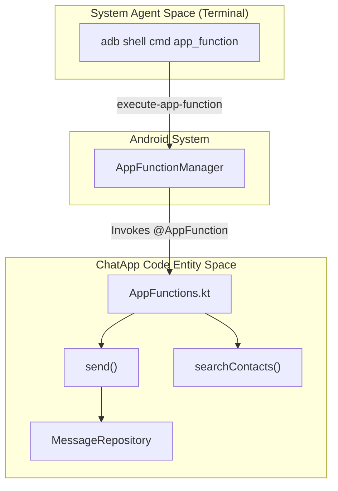
**Sources:** [ChatApp/README.md:41-52](), [ChatApp/README.md:21-27]()

---

## Integration Mapping

The following table maps the conceptual AppFunctions defined in the documentation to their specific implementation signatures in the codebase.

| Function Name | Code Entity | Parameters | Return Type |
| :--- | :--- | :--- | :--- |
| **Search** | `searchContacts` | `query: String`, `filterType: String` | `List<ContactSearchResult>` |
| **Send** | `send` | `name`, `endpointValue`, `messageBody`, `imageUri?` | `Result` |
| **Call** | `makeCall` | `contactName?`, `endpointValue?` | `Void` |

**Sources:** [ChatApp/README.md:23-25]()

**Code-to-System Mapping**
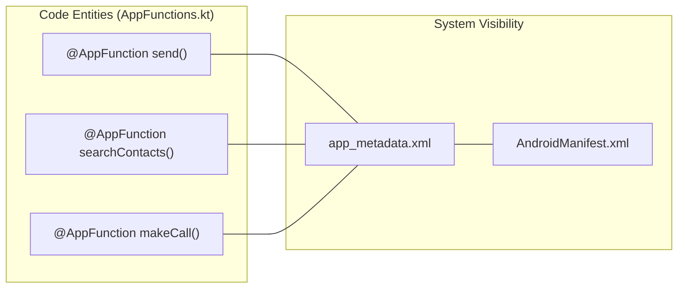
**Sources:** [ChatApp/README.md:27](), [README.md:13-14]()

---

# Page: Repository Structure

# Repository Structure

<details>
<summary>Relevant source files</summary>

The following files were used as context for generating this wiki page:

- [.gitignore](.gitignore)
- [ChatApp/build.gradle.kts](ChatApp/build.gradle.kts)
- [ChatApp/gradle.properties](ChatApp/gradle.properties)
- [ChatApp/settings.gradle.kts](ChatApp/settings.gradle.kts)

</details>


This page describes the physical and logical layout of the `appfunctions` repository. The project is structured as a standalone Android application project contained within a sub-directory of the root repository, utilizing modern Android build tools and governance configurations.

## Root Directory

The root of the repository contains governance files, CI/CD configurations, and the primary sample application.

| Path | Purpose |
| :--- | :--- |
| `.github/` | Contains GitHub-specific configurations, including issue templates and CI workflow definitions. |
| `ChatApp/` | The main project directory containing the Android sample application. |
| `spotless/` | Contains code formatting rules and the license header template (`copyright.kt`) used by the Spotless plugin. |
| `.gitignore` | Defines files and directories ignored by Git, such as `.gradle/`, `.idea/`, and build artifacts [ .gitignore:1-8 ](). |
| `CONTRIBUTING.md` | Guidelines for external contributors, including CLA requirements. |
| `LICENSE` | The Apache 2.0 license governing the project. |

### Governance and Formatting
The repository enforces strict coding standards using the Spotless Gradle plugin. The configuration is defined in the root build script [ ChatApp/build.gradle.kts:27-32 ]() and applied to all subprojects [ ChatApp/build.gradle.kts:34-40 ](). It targets all Kotlin (`.kt`) and Kotlin Script (`.kts`) files, ensuring they adhere to `ktlint` rules and include the standard Apache license header [ ChatApp/build.gradle.kts:42-55 ]().

**Sources:**
- [ .gitignore:1-8 ]()
- [ ChatApp/build.gradle.kts:27-55 ]()

---

## ChatApp Project Layout

The `ChatApp` directory is organized as a standard multi-module-ready Android project, currently consisting of a single `:app` module.

### Build Configuration Files
*   **`settings.gradle.kts`**: Configures the project name as "ChatApp" and includes the `:app` module [ ChatApp/settings.gradle.kts:37-38 ](). It also defines the repository strategy, enforcing `FAIL_ON_PROJECT_REPOS` to ensure all dependencies are resolved through the central `dependencyResolutionManagement` block [ ChatApp/settings.gradle.kts:29-35 ]().
*   **`build.gradle.kts` (Project Level)**: Acts as the central point for plugin management. it declares versions for the Android Application, Kotlin, Compose, Hilt, and KSP plugins without applying them to the root [ ChatApp/build.gradle.kts:19-28 ]().
*   **`gradle.properties`**: Sets JVM arguments for the Gradle daemon (`-Xmx2048m`), enables AndroidX, and enforces the "official" Kotlin code style [ ChatApp/gradle.properties:16-26 ]().

### The `:app` Module
The core logic resides in the `app/` directory (referred to as the `:app` module in Gradle).

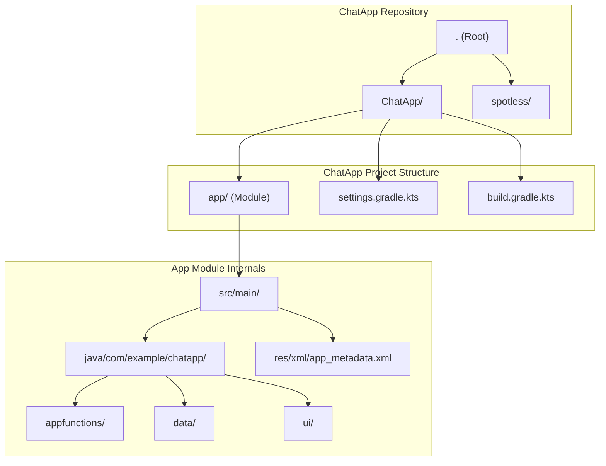

**Sources:**
- [ ChatApp/settings.gradle.kts:1-39 ]()
- [ ChatApp/build.gradle.kts:1-56 ]()
- [ ChatApp/gradle.properties:1-30 ]()

---

## Code Organization (Natural Language to Code Entity Space)

The repository bridges the gap between system-level AppFunction requests and application-specific logic through a tiered directory structure.

### AppFunctions Integration Space
This space handles the interaction between the Android System and the application. Logic is primarily contained within the `appfunctions/` package.

| System Concept | Code Entity / Directory | Role |
| :--- | :--- | :--- |
| **Function Definition** | `AppFunctions.kt` | Contains methods annotated with `@AppFunction`. |
| **Serialization** | `AppFunctions.kt` (Inner Classes) | Data classes annotated with `@AppFunctionSerializable`. |
| **System Registration** | `res/xml/app_metadata.xml` | XML resource declaring available functions to the system. |
| **Runtime Control** | `AppFunctionsViewModel.kt` | Interacts with `AppFunctionManager` to toggle function availability. |

### Application Logic Space
This space follows the MVVM (Model-View-ViewModel) pattern to manage chat data and UI state.

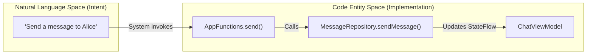

**Sources:**
- [ ChatApp/settings.gradle.kts:37-38 ]()
- [ ChatApp/build.gradle.kts:19-28 ]()

---

## Key Directories Summary

| Directory | Description |
| :--- | :--- |
| `ChatApp/app/src/main/java/.../appfunctions/` | Contains the `AppFunctions` class, which serves as the entry point for the Android AppFunctions API. |
| `ChatApp/app/src/main/java/.../data/` | Contains the Data Layer, including `MessageRepository` for chat history and `RecipientsRepository` for contact management. |
| `ChatApp/app/src/main/java/.../ui/` | Contains the UI Layer, organized into `screens/`, `components/`, and `theme/`. |
| `ChatApp/app/src/test/` | Contains local unit tests for AppFunctions and ViewModels. |
| `ChatApp/app/src/androidTest/` | Contains instrumentation tests that run on-device to verify `AppFunctionManager` integration. |

**Sources:**
- [ ChatApp/settings.gradle.kts:38 ]()
- [ ChatApp/build.gradle.kts:44-45 ]()

---

# Page: AppFunctions Integration

# AppFunctions Integration

<details>
<summary>Relevant source files</summary>

The following files were used as context for generating this wiki page:

- [ChatApp/app/src/main/AndroidManifest.xml](ChatApp/app/src/main/AndroidManifest.xml)
- [ChatApp/app/src/main/kotlin/com/example/chatapp/appfunctions/AppFunctions.kt](ChatApp/app/src/main/kotlin/com/example/chatapp/appfunctions/AppFunctions.kt)
- [ChatApp/app/src/main/res/xml/app_metadata.xml](ChatApp/app/src/main/res/xml/app_metadata.xml)

</details>


This page provides a high-level overview of how the Android AppFunctions API is integrated into the ChatApp. The integration allows the Android system and its agents to discover and execute specific capabilities within the app, such as searching for contacts, sending messages, and initiating calls.

The integration consists of function definitions, serializable data models, system registration, and a runtime management UI.

## Integration Architecture

The following diagram illustrates how the AppFunctions framework bridges the gap between natural language requests from the system and the concrete code entities within ChatApp.

**System to Code Mapping**
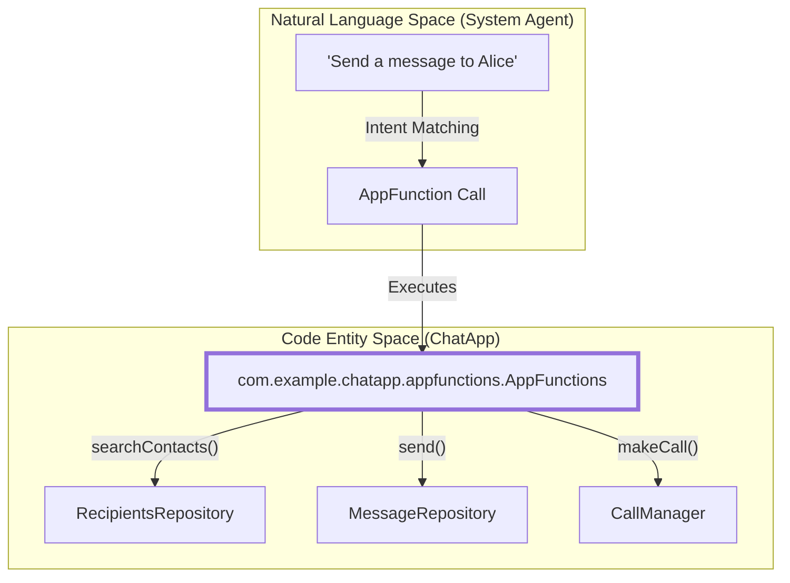
Sources: [ChatApp/app/src/main/kotlin/com/example/chatapp/appfunctions/AppFunctions.kt:36-42]()

## AppFunction Definitions

The core logic for system-exposed features resides in the `AppFunctions` class. This class uses the `@AppFunction` annotation to mark specific methods as entry points for the system.

- **`searchContacts`**: Used to resolve names into unique identifiers. It supports filtering by `INDIVIDUAL` or `GROUP` using the `@AppFunctionStringValueConstraint`.
- **`send`**: Handles the transmission of text and optional image attachments via `Uri`.
- **`makeCall`**: Initiates a voice call by returning a `PendingIntent` that navigates the user to the call screen.

For details, see [AppFunction Definitions](#2.1).

Sources: [ChatApp/app/src/main/kotlin/com/example/chatapp/appfunctions/AppFunctions.kt:51-175]()

## AppFunctionSerializable Data Models

Data exchanged between the app and the system must be serializable by the AppFunctions compiler. The ChatApp defines several `@AppFunctionSerializable` classes within the `AppFunctions.kt` file to structure these exchanges.

| Model | Purpose |
| :--- | :--- |
| `ContactSearchResult` | Returns found entities with their `endpointValue` and `displayName`. |
| `Result` | Provides a status message and ID after a successful message send. |
| `Recipient` | Represents an individual contact for serialization. |
| `ChatGroup` | Represents a group chat entity for serialization. |

For details, see [AppFunctionSerializable Data Models](#2.2).

Sources: [ChatApp/app/src/main/kotlin/com/example/chatapp/appfunctions/AppFunctions.kt:182-226]()

## AppFunction Configuration and Registration

For the Android system to "see" these functions, the app must register them through specific metadata and provider interfaces.

1.  **Metadata**: The `AndroidManifest.xml` points to an `app_metadata.xml` resource which provides a high-level description of the app's capabilities to the system agent.
2.  **Provider**: The `BaseChatApplication` implements `AppFunctionConfiguration.Provider`, allowing the system to instantiate the `AppFunctions` class via Hilt dependency injection.

**Registration Flow**
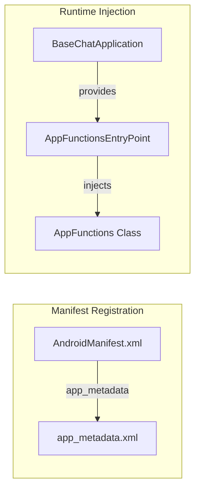

For details, see [AppFunctionConfiguration and Registration](#2.3).

Sources: [ChatApp/app/src/main/AndroidManifest.xml:52-54](), [ChatApp/app/src/main/res/xml/app_metadata.xml:17-26]()

## AppFunctions Settings Screen

ChatApp provides a user-facing UI to manage these integrations. Using the `AppFunctionManager` API, the app allows users to view which functions are registered and toggle their enabled state at runtime.

- **`AppFunctionsViewModel`**: Interacts with `AppFunctionManager` to observe the list of `AppFunctionInfo` and handle toggle logic.
- **`AppFunctionsScreen`**: A Compose-based UI that displays the functions and their current status.

For details, see [AppFunctions Settings Screen](#2.4).

Sources: [ChatApp/app/src/main/kotlin/com/example/chatapp/ui/AppFunctionsViewModel.kt:38-50](), [ChatApp/app/src/main/kotlin/com/example/chatapp/ui/AppFunctionsScreen.kt:40-60]()

---

# Page: AppFunction Definitions

# AppFunction Definitions

<details>
<summary>Relevant source files</summary>

The following files were used as context for generating this wiki page:

- [ChatApp/app/src/main/kotlin/com/example/chatapp/appfunctions/AppFunctions.kt](ChatApp/app/src/main/kotlin/com/example/chatapp/appfunctions/AppFunctions.kt)

</details>


The `AppFunctions` class serves as the primary entry point for the Android system to interact with the ChatApp's core capabilities. It defines the contract between the application and the system agent using the `@AppFunction` annotation. This page details the implementation of these functions, their data flow, and the constraints applied to their parameters.

## Overview of the AppFunctions Class

The `AppFunctions` class is a Hilt-injectable component [ChatApp/app/src/main/kotlin/com/example/chatapp/appfunctions/AppFunctions.kt:36-38]() that leverages the application's data layer—specifically `MessageRepository`, `RecipientsRepository`, and `CallManager` [ChatApp/app/src/main/kotlin/com/example/chatapp/appfunctions/AppFunctions.kt:39-41]()—to execute user requests.

Each method intended for system exposure is annotated with `@AppFunction(isDescribedByKDoc = true)`, which instructs the AppFunctions compiler to use the method's KDoc as the metadata description for the system agent [ChatApp/app/src/main/kotlin/com/example/chatapp/appfunctions/AppFunctions.kt:51]().

### Data Flow: System to Code Entity

The following diagram illustrates how a natural language request is mapped to the specific code entities within the `AppFunctions` class.

**Natural Language to AppFunction Mapping**
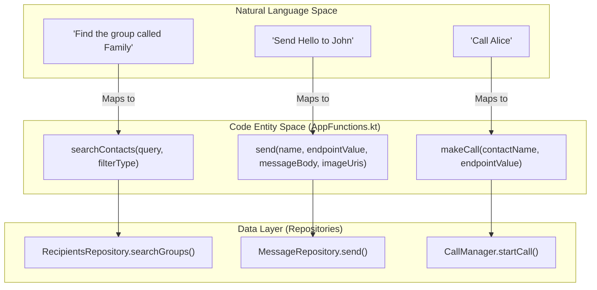
Sources: [ChatApp/app/src/main/kotlin/com/example/chatapp/appfunctions/AppFunctions.kt:52-57](), [ChatApp/app/src/main/kotlin/com/example/chatapp/appfunctions/AppFunctions.kt:106-112](), [ChatApp/app/src/main/kotlin/com/example/chatapp/appfunctions/AppFunctions.kt:147-151]()

---

## Annotated Methods

### 1. searchContacts
Used to find individuals or groups by name. It supports partial matches and provides a filtered list based on the entity type.

*   **Parameters**:
    *   `query`: A search string for the name. If blank, the implementation is designed to return recent entities [ChatApp/app/src/main/kotlin/com/example/chatapp/appfunctions/AppFunctions.kt:54]().
    *   `filterType`: A constrained string that limits results to either "INDIVIDUAL" or "GROUP" [ChatApp/app/src/main/kotlin/com/example/chatapp/appfunctions/AppFunctions.kt:55-56]().
*   **Return Type**: `List<ContactSearchResult>` [ChatApp/app/src/main/kotlin/com/example/chatapp/appfunctions/AppFunctions.kt:57]().
*   **Implementation Logic**:
    *   If `filterType` is "INDIVIDUAL", it calls `recipientsRepository.searchRecipients` [ChatApp/app/src/main/kotlin/com/example/chatapp/appfunctions/AppFunctions.kt:60-61]().
    *   If `filterType` is "GROUP", it calls `recipientsRepository.searchGroups` [ChatApp/app/src/main/kotlin/com/example/chatapp/appfunctions/AppFunctions.kt:69-70]().
    *   The results are mapped to `ContactSearchResult` objects containing `endpointValue`, `endpointType`, and `displayName` [ChatApp/app/src/main/kotlin/com/example/chatapp/appfunctions/AppFunctions.kt:62-66]().

### 2. send
Dispatches a text message, optionally including image attachments.

*   **Parameters**:
    *   `endpointValue`: The unique ID of the recipient [ChatApp/app/src/main/kotlin/com/example/chatapp/appfunctions/AppFunctions.kt:109]().
    *   `messageBody`: The text content. This cannot be empty [ChatApp/app/src/main/kotlin/com/example/chatapp/appfunctions/AppFunctions.kt:110]().
    *   `imageUris`: An optional list of `android.net.Uri` for attachments [ChatApp/app/src/main/kotlin/com/example/chatapp/appfunctions/AppFunctions.kt:111]().
*   **Return Type**: `Result` (containing the `sentMessageId` and a confirmation string) [ChatApp/app/src/main/kotlin/com/example/chatapp/appfunctions/AppFunctions.kt:112]().
*   **Implementation Logic**:
    *   Validates that `messageBody` is not blank [ChatApp/app/src/main/kotlin/com/example/chatapp/appfunctions/AppFunctions.kt:113-115]().
    *   Resolves the `displayName` by checking both individual and group repositories [ChatApp/app/src/main/kotlin/com/example/chatapp/appfunctions/AppFunctions.kt:116-121]().
    *   Calls `messageRepository.send` to persist the message [ChatApp/app/src/main/kotlin/com/example/chatapp/appfunctions/AppFunctions.kt:125-129]().

### 3. makeCall
Initiates a voice call to a specific recipient.

*   **Parameters**:
    *   `contactName`: Optional name of the contact [ChatApp/app/src/main/kotlin/com/example/chatapp/appfunctions/AppFunctions.kt:149]().
    *   `endpointValue`: Optional unique ID [ChatApp/app/src/main/kotlin/com/example/chatapp/appfunctions/AppFunctions.kt:150]().
*   **Return Type**: `PendingIntent` [ChatApp/app/src/main/kotlin/com/example/chatapp/appfunctions/AppFunctions.kt:151]().
*   **Implementation Logic**:
    *   Requires at least one identifier (`contactName` or `endpointValue`) [ChatApp/app/src/main/kotlin/com/example/chatapp/appfunctions/AppFunctions.kt:152-156]().
    *   Resolves the recipient via `recipientsRepository` [ChatApp/app/src/main/kotlin/com/example/chatapp/appfunctions/AppFunctions.kt:158-171]().
    *   Constructs a `PendingIntent` that points to a specific navigation route (`app://com.example.chatapp/call/{id}`) [ChatApp/app/src/main/kotlin/com/example/chatapp/appfunctions/AppFunctions.kt:176-184]().

Sources: [ChatApp/app/src/main/kotlin/com/example/chatapp/appfunctions/AppFunctions.kt:52-185]()

---

## String Value Constraints

The `@AppFunctionStringValueConstraint` annotation is used to enforce a strict schema for string parameters at the system level. In the `searchContacts` method, it restricts the `filterType` to a specific set of allowed values [ChatApp/app/src/main/kotlin/com/example/chatapp/appfunctions/AppFunctions.kt:55-56]().

| Parameter | Allowed Values | Purpose |
| :--- | :--- | :--- |
| `filterType` | `"INDIVIDUAL"`, `"GROUP"` | Ensures the system agent only provides valid entity types supported by the repository search logic. |

Sources: [ChatApp/app/src/main/kotlin/com/example/chatapp/appfunctions/AppFunctions.kt:55-56]()

---

## Error Handling

The `AppFunctions` implementation uses specific subtypes of `AppFunctionException` to communicate failures back to the system. This allows the system agent to provide meaningful feedback or ask for clarification.

| Exception Type | Triggering Condition |
| :--- | :--- |
| `AppFunctionInvalidArgumentException` | Thrown when `messageBody` is blank [ChatApp/app/src/main/kotlin/com/example/chatapp/appfunctions/AppFunctions.kt:114](), when both call identifiers are null [ChatApp/app/src/main/kotlin/com/example/chatapp/appfunctions/AppFunctions.kt:153](), or when search results are empty [ChatApp/app/src/main/kotlin/com/example/chatapp/appfunctions/AppFunctions.kt:89](). |
| `AppFunctionElementNotFoundException` | Thrown when an `endpointValue` or `contactName` does not match any known recipient in the database [ChatApp/app/src/main/kotlin/com/example/chatapp/appfunctions/AppFunctions.kt:119](), [ChatApp/app/src/main/kotlin/com/example/chatapp/appfunctions/AppFunctions.kt:162](). |
| `AppFunctionAppUnknownException` | Thrown when an unexpected error occurs during repository operations, such as a database write failure [ChatApp/app/src/main/kotlin/com/example/chatapp/appfunctions/AppFunctions.kt:131](). |

### Execution Flow and Exception Handling
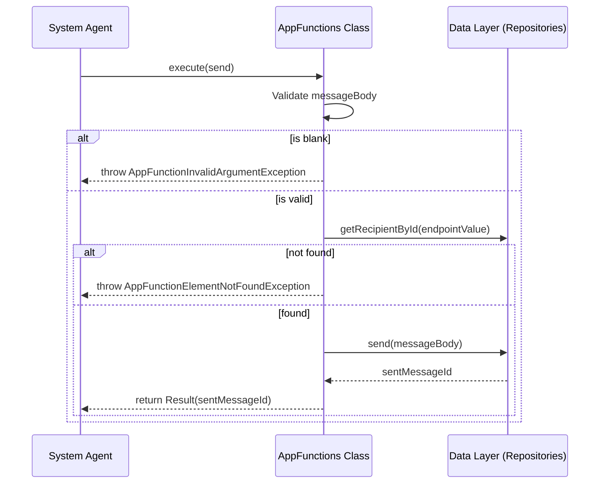
Sources: [ChatApp/app/src/main/kotlin/com/example/chatapp/appfunctions/AppFunctions.kt:113-137]()

---

# Page: AppFunctionSerializable Data Models

# AppFunctionSerializable Data Models

<details>
<summary>Relevant source files</summary>

The following files were used as context for generating this wiki page:

- [ChatApp/app/src/main/kotlin/com/example/chatapp/appfunctions/AppFunctions.kt](ChatApp/app/src/main/kotlin/com/example/chatapp/appfunctions/AppFunctions.kt)
- [ChatApp/app/src/main/kotlin/com/example/chatapp/data/RecipientsRepository.kt](ChatApp/app/src/main/kotlin/com/example/chatapp/data/RecipientsRepository.kt)

</details>


The AppFunctions framework uses the `@AppFunctionSerializable` annotation to define data structures that can be passed between the system agent (Natural Language Space) and the application's code (Code Entity Space). These models are automatically handled by the AppFunctions compiler to manage serialization and deserialization, ensuring type safety and structural integrity during cross-process communication.

## Overview of @AppFunctionSerializable

In the ChatApp, several data classes are marked with `@AppFunctionSerializable` [ChatApp/app/src/main/kotlin/com/example/chatapp/appfunctions/AppFunctions.kt:25-25](). This annotation signals the AppFunctions compiler to generate the necessary mapping logic to convert these Kotlin objects into a format that the Android System can understand and vice versa.

These models serve three primary purposes:
1.  **Search Results**: Providing structured data back to the system after a search query.
2.  **Action Confirmation**: Returning status information after an operation like sending a message.
3.  **Entity Representation**: Modeling complex entities like recipients and chat groups that exist within the app's data layer.

### Data Flow: System to App

The following diagram illustrates how natural language requests are mapped to these serializable models and how they flow through the system.

**Natural Language to Code Entity Mapping**
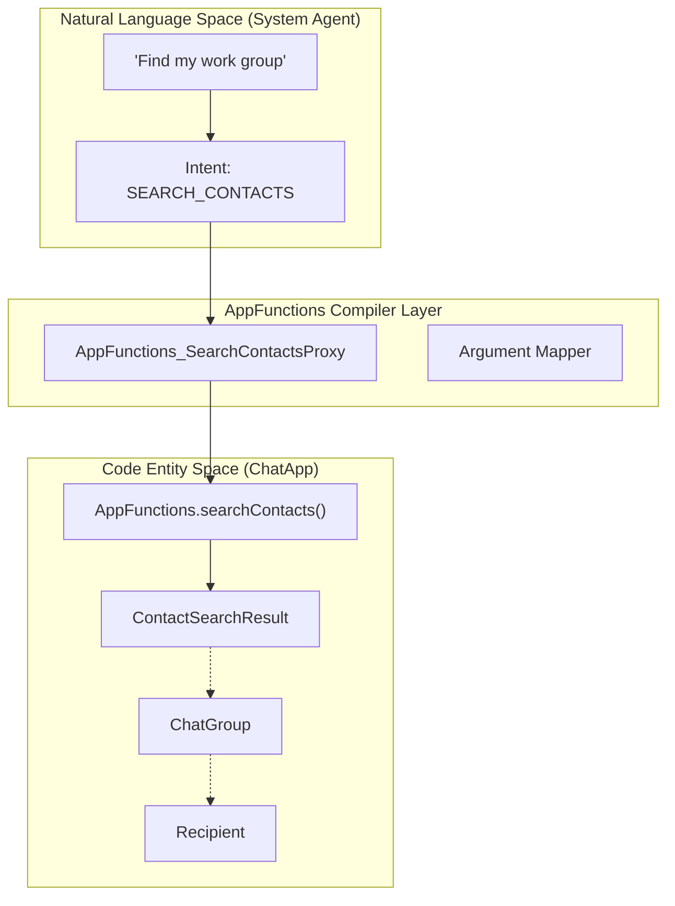
**Sources:** [ChatApp/app/src/main/kotlin/com/example/chatapp/appfunctions/AppFunctions.kt:52-57](), [ChatApp/app/src/main/kotlin/com/example/chatapp/data/RecipientsRepository.kt:18-20]()

---

## Core Data Models

The ChatApp defines four key serializable models within the `AppFunctions` class scope.

### 1. ContactSearchResult
Used by `searchContacts` to return a unified list of potential message targets. It abstracts the difference between an individual and a group.

| Field | Type | Description |
| :--- | :--- | :--- |
| `endpointValue` | `String` | The unique ID of the contact or group. |
| `endpointType` | `String` | Either "INDIVIDUAL" or "GROUP". |
| `displayName` | `String` | The name to be shown to the user or used by the agent. |

**Sources:** [ChatApp/app/src/main/kotlin/com/example/chatapp/appfunctions/AppFunctions.kt:173-177]()

### 2. Result
A generic wrapper used to provide feedback to the system agent after an action is performed, such as `send`.

| Field | Type | Description |
| :--- | :--- | :--- |
| `id` | `String?` | The unique ID of the created entity (e.g., message ID). |
| `message` | `String?` | A human-readable confirmation message. |

**Sources:** [ChatApp/app/src/main/kotlin/com/example/chatapp/appfunctions/AppFunctions.kt:183-186]()

### 3. Recipient
Represents an individual contact within the application.

| Field | Type | Description |
| :--- | :--- | :--- |
| `id` | `String` | Unique identifier for the recipient. |
| `name` | `String` | Full name of the contact. |
| `email` | `String` | Email address associated with the contact. |

**Sources:** [ChatApp/app/src/main/kotlin/com/example/chatapp/appfunctions/AppFunctions.kt:192-196]()

### 4. ChatGroup
Represents a collection of recipients. This demonstrates the support for nested `@AppFunctionSerializable` objects, as it contains a list of `Recipient` objects.

| Field | Type | Description |
| :--- | :--- | :--- |
| `id` | `String` | Unique identifier for the group. |
| `name` | `String` | Name of the group. |
| `recipients` | `List<Recipient>` | List of members in the group. |

**Sources:** [ChatApp/app/src/main/kotlin/com/example/chatapp/appfunctions/AppFunctions.kt:202-206]()

---

## Implementation and Serialization

The serialization process is handled by the AppFunctions KSP (Kotlin Symbol Processing) plugin. When a class is annotated with `@AppFunctionSerializable`, the compiler ensures that all fields are of supported types (primitives, Strings, Uris, or other serializable classes).

### Internal Serialization Flow
The following diagram shows how a `ChatGroup` object is processed when returned by an AppFunction.

**Object Serialization Flow**
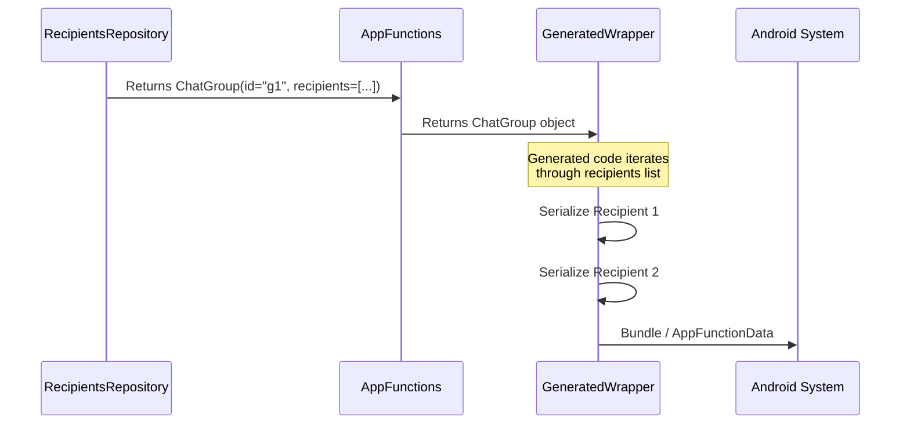
**Sources:** [ChatApp/app/src/main/kotlin/com/example/chatapp/data/RecipientsRepository.kt:46-56](), [ChatApp/app/src/main/kotlin/com/example/chatapp/appfunctions/AppFunctions.kt:52-57]()

### Usage in Repository
The `RecipientsRepository` utilizes these models as the primary data format for contact management, allowing the `AppFunctions` class to return them directly without additional mapping in most cases.

*   **Static Data**: The repository initializes a static list of `Recipient` and `ChatGroup` objects [ChatApp/app/src/main/kotlin/com/example/chatapp/data/RecipientsRepository.kt:34-56]().
*   **Search Logic**: The `searchAny` function maps internal repository results into `ContactSearchResult` objects specifically for the AppFunctions interface [ChatApp/app/src/main/kotlin/com/example/chatapp/data/RecipientsRepository.kt:134-158]().

**Sources:** [ChatApp/app/src/main/kotlin/com/example/chatapp/data/RecipientsRepository.kt:31-165]()

---

# Page: AppFunctionConfiguration and Registration

# AppFunctionConfiguration and Registration

<details>
<summary>Relevant source files</summary>

The following files were used as context for generating this wiki page:

- [ChatApp/app/src/main/AndroidManifest.xml](ChatApp/app/src/main/AndroidManifest.xml)
- [ChatApp/app/src/main/kotlin/com/example/chatapp/ChatApplication.kt](ChatApp/app/src/main/kotlin/com/example/chatapp/ChatApplication.kt)
- [ChatApp/app/src/main/res/xml/app_metadata.xml](ChatApp/app/src/main/res/xml/app_metadata.xml)

</details>


This page details the mechanisms used by the ChatApp to register its functions with the Android system. Registration involves both static declarations in XML for system discovery and runtime configuration to link the system's execution requests to the application's dependency-injected code.

## Static Registration and Metadata

For the Android system to discover that an application provides AppFunctions, the app must declare specific metadata in its manifest and provide a resource file describing its capabilities.

### Manifest Declarations
The `AndroidManifest.xml` uses the `appfn` namespace to provide high-level descriptions of the app's function capabilities. These strings are used by the system to understand the general purpose of the app's functions.

The app also registers a specific property, `android.app.appfunctions.app_metadata`, which points to an XML resource containing detailed metadata [ChatApp/app/src/main/AndroidManifest.xml:52-54]().

### App Metadata Resource
The `app_metadata.xml` file provides the "Operational Patterns" and "Constraints" for the AI or system agent interacting with the app [ChatApp/app/src/main/res/xml/app_metadata.xml:18-25](). This metadata informs the system how to sequence function calls (e.g., calling `searchContacts` before `send`) and what constraints apply to parameters [ChatApp/app/src/main/res/xml/app_metadata.xml:20-25]().

### Metadata Association Diagram
The following diagram illustrates how the system attributes in the Manifest link to the specific metadata definitions.

**Metadata to System Mapping**
```mermaid
graph TD
    subgraph "AndroidManifest.xml"
        ["AndroidManifest.xml"] --> ["appfn:description"]
        ["AndroidManifest.xml"] --> ["appfn:displayDescription"]
        ["AndroidManifest.xml"] --> ["android.app.appfunctions.app_metadata"]
    end

    subgraph "app_metadata.xml"
        ["android.app.appfunctions.app_metadata"] -- "points to" --> ["AppFunctionAppMetadata"]
        ["AppFunctionAppMetadata"] --> D["appfn:description (Operational Patterns)"]
        ["AppFunctionAppMetadata"] --> E["appfn:displayDescription"]
    end

    subgraph "Code Entities"
        D -- "Describes" --> F["searchContacts"]
        D -- "Describes" --> G["send"]
        D -- "Describes" --> H["makeCall"]
    end
```
**Sources:** [ChatApp/app/src/main/AndroidManifest.xml:17-31](), [ChatApp/app/src/main/AndroidManifest.xml:52-54](), [ChatApp/app/src/main/res/xml/app_metadata.xml:17-26]()

---

## Runtime Configuration with Hilt

When the system triggers an AppFunction, the app must provide an instance of the class containing the `@AppFunction` methods. The ChatApp uses Hilt to manage these dependencies and provide them to the AppFunctions framework.

### AppFunctionConfiguration.Provider
The `BaseChatApplication` class implements the `AppFunctionConfiguration.Provider` interface [ChatApp/app/src/main/kotlin/com/example/chatapp/ChatApplication.kt:27](). This interface requires the implementation of the `appFunctionConfiguration` property, which the system accesses to learn how to instantiate the function classes [ChatApp/app/src/main/kotlin/com/example/chatapp/ChatApplication.kt:28-36]().

### Hilt Entry Point
Because the AppFunctions framework may operate outside the standard lifecycle of a `HiltViewModel` or `Activity`, a Hilt `@EntryPoint` is used to bridge the `SingletonComponent` to the AppFunctions configuration [ChatApp/app/src/main/kotlin/com/example/chatapp/ChatApplication.kt:41-45]().

1.  **AppFunctionsEntryPoint**: Defines a method `getAppFunctions()` to retrieve the Hilt-managed `AppFunctions` instance [ChatApp/app/src/main/kotlin/com/example/chatapp/ChatApplication.kt:43-45]().
2.  **Configuration Building**: In `BaseChatApplication`, `EntryPointAccessors.fromApplication` is used to access the entry point [ChatApp/app/src/main/kotlin/com/example/chatapp/ChatApplication.kt:30]().
3.  **Enclosing Class Factory**: The `AppFunctionConfiguration.Builder` uses `addEnclosingClassFactory` to register a lambda that returns the `AppFunctions` instance whenever the system needs to execute a function defined in that class [ChatApp/app/src/main/kotlin/com/example/chatapp/ChatApplication.kt:33-35]().

### Registration Data Flow
This diagram shows how a system request for an AppFunction is routed through the Application class to the Hilt-injected logic.

**Registration and Execution Flow**
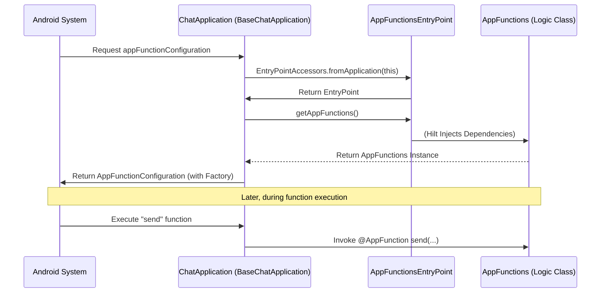
**Sources:** [ChatApp/app/src/main/kotlin/com/example/chatapp/ChatApplication.kt:27-37](), [ChatApp/app/src/main/kotlin/com/example/chatapp/ChatApplication.kt:41-45]()

---

## Summary of Registration Components

| Component | Role | Location |
| :--- | :--- | :--- |
| `AndroidManifest.xml` | Declares the metadata resource and app-level descriptions. | [ChatApp/app/src/main/AndroidManifest.xml]() |
| `app_metadata.xml` | Provides semantic guidance (patterns/constraints) to the system agent. | [ChatApp/app/src/main/res/xml/app_metadata.xml]() |
| `AppFunctionConfiguration.Provider` | Interface implemented by `Application` to provide the runtime config. | [ChatApp/app/src/main/kotlin/com/example/chatapp/ChatApplication.kt:27]() |
| `AppFunctionsEntryPoint` | Hilt interface allowing the Application to pull the `AppFunctions` instance. | [ChatApp/app/src/main/kotlin/com/example/chatapp/ChatApplication.kt:41-45]() |
| `addEnclosingClassFactory` | Links the `AppFunctions` class type to the instance provided by Hilt. | [ChatApp/app/src/main/kotlin/com/example/chatapp/ChatApplication.kt:34]() |

**Sources:** [ChatApp/app/src/main/AndroidManifest.xml:52-54](), [ChatApp/app/src/main/kotlin/com/example/chatapp/ChatApplication.kt:27-45](), [ChatApp/app/src/main/res/xml/app_metadata.xml:17-26]()

---

# Page: AppFunctions Settings Screen

# AppFunctions Settings Screen

<details>
<summary>Relevant source files</summary>

The following files were used as context for generating this wiki page:

- [ChatApp/app/src/main/kotlin/com/example/chatapp/AppFunctionsViewModel.kt](ChatApp/app/src/main/kotlin/com/example/chatapp/AppFunctionsViewModel.kt)
- [ChatApp/app/src/main/kotlin/com/example/chatapp/uicomponents/AppFunctionsScreen.kt](ChatApp/app/src/main/kotlin/com/example/chatapp/uicomponents/AppFunctionsScreen.kt)

</details>


The **AppFunctions Settings Screen** provides a runtime interface for users to inspect and control the availability of registered AppFunctions within the ChatApp. It utilizes the `AppFunctionManager` to dynamically observe the state of functions defined in the application and allows toggling their enabled/disabled status.

## Overview and Purpose

This screen serves as a bridge between the system's function registry and the user's preferences. It allows the application to:
1.  **Discover** all functions registered under the app's package name.
2.  **Display** metadata such as function IDs and descriptions.
3.  **Manage** runtime availability, enabling or disabling specific functions via the `AppFunctionManager`.

### Data Flow Architecture

The following diagram illustrates how the `AppFunctionsViewModel` coordinates between the UI and the Android System's `AppFunctionManager`.

**AppFunctions State and Control Flow**
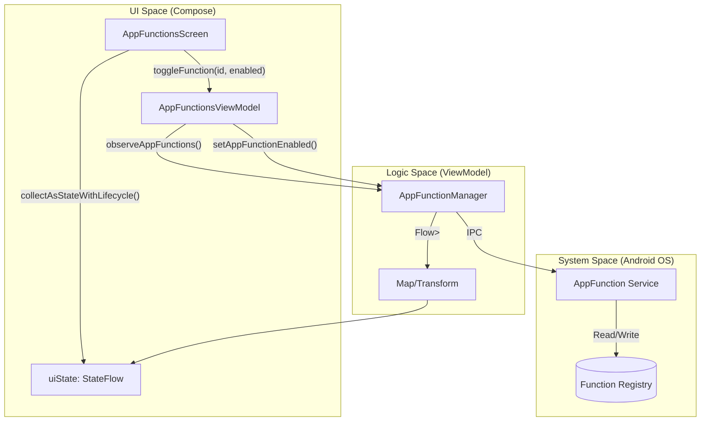
Sources: [ChatApp/app/src/main/kotlin/com/example/chatapp/AppFunctionsViewModel.kt:55-114](), [ChatApp/app/src/main/kotlin/com/example/chatapp/uicomponents/AppFunctionsScreen.kt:48-58]()

---

## Data Models

The settings screen relies on two primary data structures to represent the state of functions.

### AppFunctionInfo
A simple data class representing the state of a single function.
*   `id`: The unique identifier (e.g., `com.example.chatapp#send`). [ChatApp/app/src/main/kotlin/com/example/chatapp/AppFunctionsViewModel.kt:40-40]()
*   `isEnabled`: Boolean flag indicating if the function can currently be invoked by the system. [ChatApp/app/src/main/kotlin/com/example/chatapp/AppFunctionsViewModel.kt:41-41]()
*   `description`: An optional human-readable string describing the function's purpose. [ChatApp/app/src/main/kotlin/com/example/chatapp/AppFunctionsViewModel.kt:42-42]()

### AppFunctionsUiState
The state container emitted by the ViewModel to the Composable screen. It contains a `List<AppFunctionInfo>` which is sorted by function ID for consistent display. [ChatApp/app/src/main/kotlin/com/example/chatapp/AppFunctionsViewModel.kt:50-52](), [ChatApp/app/src/main/kotlin/com/example/chatapp/AppFunctionsViewModel.kt:84-84]()

Sources: [ChatApp/app/src/main/kotlin/com/example/chatapp/AppFunctionsViewModel.kt:39-52]()

---

## AppFunctionsViewModel Implementation

The `AppFunctionsViewModel` is a `@HiltViewModel` that manages an instance of `AppFunctionManager`. [ChatApp/app/src/main/kotlin/com/example/chatapp/AppFunctionsViewModel.kt:60-66]()

### Observing Functions
The ViewModel initializes the `uiState` by calling `appFunctionManager.observeAppFunctions`. It uses an `AppFunctionSearchSpec` restricted to the application's own package name. [ChatApp/app/src/main/kotlin/com/example/chatapp/AppFunctionsViewModel.kt:68-70]()

The transformation logic performs the following:
1.  Filters the returned `packageMetadataList` for the current package. [ChatApp/app/src/main/kotlin/com/example/chatapp/AppFunctionsViewModel.kt:73-75]()
2.  Maps the system's internal function representation to `AppFunctionInfo` objects. [ChatApp/app/src/main/kotlin/com/example/chatapp/AppFunctionsViewModel.kt:78-83]()
3.  Sorts the list alphabetically by ID. [ChatApp/app/src/main/kotlin/com/example/chatapp/AppFunctionsViewModel.kt:84-84]()
4.  Converts the result into a `StateFlow` using `stateIn`, maintaining the subscription for 5 seconds after the UI is no longer visible. [ChatApp/app/src/main/kotlin/com/example/chatapp/AppFunctionsViewModel.kt:87-91]()

### Toggling Function State
When a user interacts with a toggle switch, the `toggleFunction` method is invoked. It maps the boolean `enabled` parameter to `AppFunctionManager` constants:
*   `true` -> `APP_FUNCTION_STATE_ENABLED` [ChatApp/app/src/main/kotlin/com/example/chatapp/AppFunctionsViewModel.kt:107-107]()
*   `false` -> `APP_FUNCTION_STATE_DISABLED` [ChatApp/app/src/main/kotlin/com/example/chatapp/AppFunctionsViewModel.kt:109-109]()

The update is performed asynchronously within the `viewModelScope` via `appFunctionManager.setAppFunctionEnabled(id, newState)`. [ChatApp/app/src/main/kotlin/com/example/chatapp/AppFunctionsViewModel.kt:104-111]()

Sources: [ChatApp/app/src/main/kotlin/com/example/chatapp/AppFunctionsViewModel.kt:60-114]()

---

## UI Components

The UI is built using Jetpack Compose and Material3 components.

### AppFunctionsScreen
The main entry point for the settings UI. It uses a `Scaffold` with a `TopAppBar` and handles two primary states:
1.  **Empty State**: Displays a message if no functions are found or supported. [ChatApp/app/src/main/kotlin/com/example/chatapp/uicomponents/AppFunctionsScreen.kt:80-92]()
2.  **List State**: Uses a `LazyColumn` to render the "Declared AppFunctions" header and a list of `AppFunctionItem` composables. [ChatApp/app/src/main/kotlin/com/example/chatapp/uicomponents/AppFunctionsScreen.kt:94-115]()

### AppFunctionItem
A row component representing a single function.
*   **Name Parsing**: It extracts a "short name" from the function ID by stripping the package and namespace prefixes (e.g., `com.example.chatapp#send` becomes `send`). [ChatApp/app/src/main/kotlin/com/example/chatapp/uicomponents/AppFunctionsScreen.kt:142-146]()
*   **Interaction**: Contains a `Switch` that reflects the current `isEnabled` state and triggers `onToggle` when clicked. [ChatApp/app/src/main/kotlin/com/example/chatapp/uicomponents/AppFunctionsScreen.kt:153-156]()

**Code Entity Mapping: UI to ViewModel**
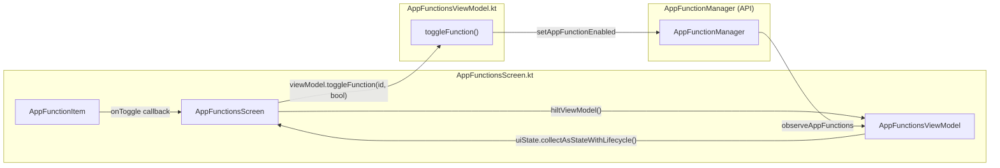
Sources: [ChatApp/app/src/main/kotlin/com/example/chatapp/uicomponents/AppFunctionsScreen.kt:55-59](), [ChatApp/app/src/main/kotlin/com/example/chatapp/uicomponents/AppFunctionsScreen.kt:108-113](), [ChatApp/app/src/main/kotlin/com/example/chatapp/AppFunctionsViewModel.kt:68-71]()

### Component Summary

| Component | Role | Key Code Reference |
| :--- | :--- | :--- |
| `AppFunctionsScreen` | Root Composable for the settings screen. | [AppFunctionsScreen.kt:55]() |
| `AppFunctionItem` | Individual list row with toggle. | [AppFunctionsScreen.kt:129]() |
| `AppFunctionsViewModel` | Business logic and StateFlow provider. | [AppFunctionsViewModel.kt:61]() |
| `AppFunctionsUiState` | Immutable snapshot of function list. | [AppFunctionsViewModel.kt:50]() |

Sources: [ChatApp/app/src/main/kotlin/com/example/chatapp/uicomponents/AppFunctionsScreen.kt:1-158](), [ChatApp/app/src/main/kotlin/com/example/chatapp/AppFunctionsViewModel.kt:1-114]()

---

# Page: Application Architecture

# Application Architecture

<details>
<summary>Relevant source files</summary>

The following files were used as context for generating this wiki page:

- [ChatApp/app/src/main/kotlin/com/example/chatapp/ChatApplication.kt](ChatApp/app/src/main/kotlin/com/example/chatapp/ChatApplication.kt)
- [ChatApp/app/src/main/kotlin/com/example/chatapp/MainActivity.kt](ChatApp/app/src/main/kotlin/com/example/chatapp/MainActivity.kt)

</details>


The ChatApp sample follows a modern Android architecture based on the **MVVM (Model-View-ViewModel)** pattern, leveraging **Jetpack Compose** for the UI and **Hilt** for dependency injection. This architecture ensures a clear separation of concerns, making the codebase testable and maintainable while integrating seamlessly with the Android AppFunctions API.

### High-Level Architecture Overview

The application is structured into three primary layers:
1.  **UI Layer**: Built with Jetpack Compose, consisting of Screens and ViewModels that manage UI state.
2.  **Domain/Data Layer**: Contains repositories and managers that handle business logic, data persistence (in-memory for this sample), and external interactions like bot simulations.
3.  **AppFunctions Integration**: A specialized entry point that allows the Android system to execute app logic directly via the `AppFunctionManager`.

### System Component Diagram

The following diagram illustrates how the core components interact, bridging the "Natural Language Space" (where the system agent operates) to the "Code Entity Space."

#### Component Interaction and Data Flow
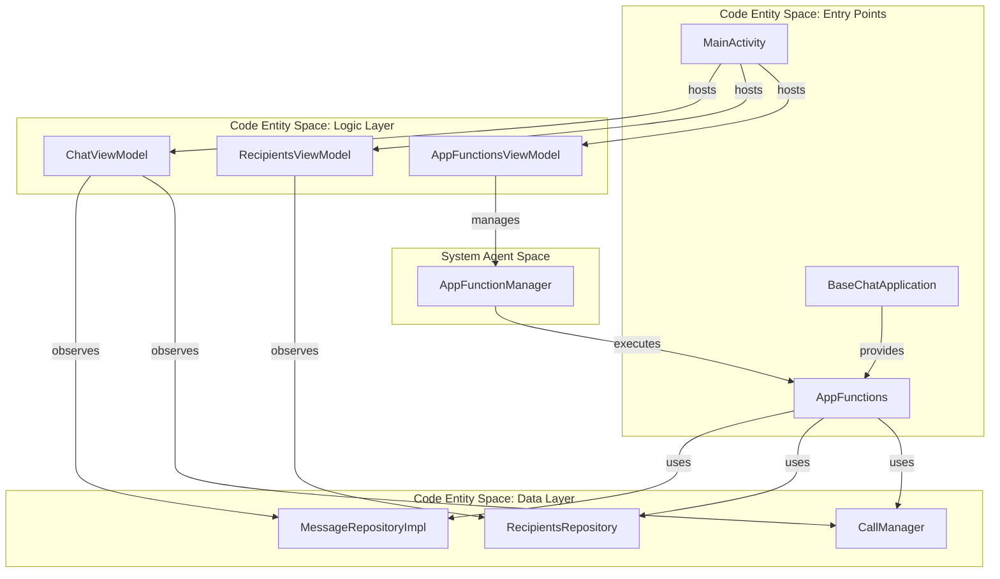
**Sources:** [ChatApp/app/src/main/kotlin/com/example/chatapp/ChatApplication.kt:27-37](), [ChatApp/app/src/main/kotlin/com/example/chatapp/MainActivity.kt:38-102]()

---

### Dependency Injection with Hilt

ChatApp uses Hilt to manage the lifecycle of its dependencies. A critical aspect of this setup is the integration with AppFunctions, which requires a factory to instantiate the `AppFunctions` class when the system calls it.

*   **`BaseChatApplication`**: Implements `AppFunctionConfiguration.Provider` to supply the configuration needed for the system to discover and execute the app's functions [ChatApp/app/src/main/kotlin/com/example/chatapp/ChatApplication.kt:27-37]().
*   **`AppFunctionsEntryPoint`**: An `@EntryPoint` interface that allows the application to retrieve the Hilt-managed `AppFunctions` instance even outside of standard Activity/ViewModel injection [ChatApp/app/src/main/kotlin/com/example/chatapp/ChatApplication.kt:41-45]().

### Navigation Graph

The application's navigation is managed by a `NavHost` in `MainActivity`. It defines four primary destinations and supports deep linking for system-level integration.

| Route | Composable | Deep Link Pattern |
| :--- | :--- | :--- |
| `recipients` | `RecipientsScreen` | `app://com.example.chatapp/recipients` |
| `functions` | `AppFunctionsScreen` | `app://com.example.chatapp/functions` |
| `chat/{recipientId}` | `ChatScreen` | `app://com.example.chatapp/chat/{recipientId}` |
| `call/{recipientId}` | `CallScreen` | `app://com.example.chatapp/call/{recipientId}` |

**Sources:** [ChatApp/app/src/main/kotlin/com/example/chatapp/MainActivity.kt:56-98]()

#### Navigation and Deep Link Structure
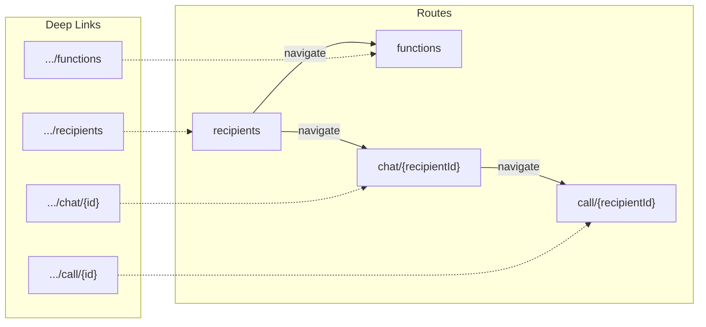
**Sources:** [ChatApp/app/src/main/kotlin/com/example/chatapp/MainActivity.kt:56-98]()

---

### Child Pages

For a deeper dive into specific layers of the architecture, refer to the following pages:

*   **[Data Layer](#3.1)**: Details on `MessageRepository`, `RecipientsRepository`, and `CallManager`, including Hilt singleton scoping.
*   **[ViewModels](#3.2)**: Exploration of `ChatViewModel`, `RecipientsViewModel`, and `AppFunctionsViewModel`, focusing on `StateFlow` and `SavedStateHandle`.
*   **[Navigation and Entry Point](#3.3)**: Detailed breakdown of `MainActivity`, the Compose `NavHost`, and how intent extras drive navigation from AppFunctions.

---

# Page: Data Layer

# Data Layer

<details>
<summary>Relevant source files</summary>

The following files were used as context for generating this wiki page:

- [ChatApp/app/src/main/kotlin/com/example/chatapp/data/CallManager.kt](ChatApp/app/src/main/kotlin/com/example/chatapp/data/CallManager.kt)
- [ChatApp/app/src/main/kotlin/com/example/chatapp/data/MessageRepository.kt](ChatApp/app/src/main/kotlin/com/example/chatapp/data/MessageRepository.kt)
- [ChatApp/app/src/main/kotlin/com/example/chatapp/data/RecipientsRepository.kt](ChatApp/app/src/main/kotlin/com/example/chatapp/data/RecipientsRepository.kt)

</details>


The Data Layer of the ChatApp provides the fundamental business logic and state management for messages, contacts, and active calls. It is designed around three primary components: `MessageRepository` for communication history, `RecipientsRepository` for contact management, and `CallManager` for session state. All components are managed via Hilt for dependency injection and scoped as singletons to ensure consistency across the application.

## Message Management

The messaging system handles both local state persistence and simulated network interactions. It supports sending text, attaching images, and interacting with a simulated chatbot.

### MessageRepository Interface
The `MessageRepository` interface defines the contract for message operations [ChatApp/app/src/main/kotlin/com/example/chatapp/data/MessageRepository.kt:38-73]().

| Function | Description |
| :--- | :--- |
| `getMessages` | Returns a `Flow` of messages for a specific recipient ID [ChatApp/app/src/main/kotlin/com/example/chatapp/data/MessageRepository.kt:42-42](). |
| `saveMessage` | Persists a `DisplayMessage` to the in-memory store [ChatApp/app/src/main/kotlin/com/example/chatapp/data/MessageRepository.kt:47-50](). |
| `send` | Simulates sending a message to one or more recipients with optional image URIs [ChatApp/app/src/main/kotlin/com/example/chatapp/data/MessageRepository.kt:60-64](). |
| `sendToBot` | Forwards a message to a simulated bot and returns a generated response [ChatApp/app/src/main/kotlin/com/example/chatapp/data/MessageRepository.kt:72-72](). |

### MessageRepositoryImpl Implementation
The implementation uses a `MutableStateFlow` to maintain an in-memory map where keys are recipient IDs and values are lists of `DisplayMessage` objects [ChatApp/app/src/main/kotlin/com/example/chatapp/data/MessageRepository.kt:83-83]().

*   **In-Memory Store**: Data is volatile and reset on app restart. New messages are prepended to the list to facilitate UI observation [ChatApp/app/src/main/kotlin/com/example/chatapp/data/MessageRepository.kt:98-99]().
*   **Network Simulation**: The `randomDelay()` function uses `kotlin.random.Random` to simulate latency during `send` and `sendToBot` operations [ChatApp/app/src/main/kotlin/com/example/chatapp/data/MessageRepository.kt:104-112]().
*   **Chatbot Logic**: The `sendToBot` method selects a random string from a static list of predefined responses [ChatApp/app/src/main/kotlin/com/example/chatapp/data/MessageRepository.kt:133-146]().

**Message Data Flow**
The following diagram illustrates how messages flow from the repository to the UI space.

Title: Message Data Flow (Repository to UI)
```mermaid
graph TD
    subgraph "Code Entity Space: Data Layer"
        [MessageRepositoryImpl] -- "manages" --> [inMemoryMessages:MutableStateFlow]
        [MessageRepositoryImpl] -- "saveMessage()" --> [inMemoryMessages:MutableStateFlow]
    end

    subgraph "Code Entity Space: UI / ViewModel"
        [ChatViewModel] -- "collects" --> [getMessages()]
        [getMessages()] -- "returns Flow" --> [DisplayMessage]
    end

    [inMemoryMessages:MutableStateFlow] -- "emits updates" --> [getMessages()]
```
Sources: [ChatApp/app/src/main/kotlin/com/example/chatapp/data/MessageRepository.kt:76-148]()

## Contact and Group Management

The `RecipientsRepository` serves as the source of truth for all contactable entities, including individual recipients and chat groups.

### Data Structures
The repository initializes with static data for demonstration purposes:
*   **Recipients**: A list of six `Recipient` objects with IDs, names, and emails [ChatApp/app/src/main/kotlin/com/example/chatapp/data/RecipientsRepository.kt:34-42]().
*   **Groups**: Two `ChatGroup` objects ("Work Friends" and "Family") composed of subsets of the recipients list [ChatApp/app/src/main/kotlin/com/example/chatapp/data/RecipientsRepository.kt:44-56]().

### Search and Retrieval
The repository provides several methods to filter and find contacts:
*   **`searchRecipients`**: Performs case-insensitive matching against name and email fields [ChatApp/app/src/main/kotlin/com/example/chatapp/data/RecipientsRepository.kt:86-102]().
*   **`searchGroups`**: Performs case-insensitive matching against group names [ChatApp/app/src/main/kotlin/com/example/chatapp/data/RecipientsRepository.kt:117-125]().
*   **`searchAny`**: A unified search function used by AppFunctions to return a list of `ContactSearchResult` objects, mapping entities to `INDIVIDUAL` or `GROUP` types [ChatApp/app/src/main/kotlin/com/example/chatapp/data/RecipientsRepository.kt:134-158]().

Sources: [ChatApp/app/src/main/kotlin/com/example/chatapp/data/RecipientsRepository.kt:31-165]()

## Call Session State

The `CallManager` class handles the lifecycle of an active call. It tracks which `Recipient` is currently being called and provides methods to initiate or terminate the session.

### Active Call State
The state is exposed via `activeCall`, a `StateFlow<Recipient?>` [ChatApp/app/src/main/kotlin/com/example/chatapp/data/CallManager.kt:32-32](). 

### Call Initiation Logic
Calls can be started by passing a `Recipient` object directly or by providing a `recipientId` string [ChatApp/app/src/main/kotlin/com/example/chatapp/data/CallManager.kt:34-38](). When a `recipientId` is provided, the manager attempts to resolve the entity in the following order:
1.  Match by Individual ID [ChatApp/app/src/main/kotlin/com/example/chatapp/data/CallManager.kt:40-40]().
2.  Match by Group ID (converted to a `Recipient` object) [ChatApp/app/src/main/kotlin/com/example/chatapp/data/CallManager.kt:41-43]().
3.  Match by Name [ChatApp/app/src/main/kotlin/com/example/chatapp/data/CallManager.kt:44-44]().
4.  Fallback to a new `Recipient` object using the ID as the name [ChatApp/app/src/main/kotlin/com/example/chatapp/data/CallManager.kt:45-45]().

**Call State Transition**
The following diagram bridges the Natural Language concept of "Making a Call" to the internal entity transitions.

Title: Call Initiation Entity Mapping
```mermaid
graph LR
    subgraph "Natural Language Space"
        [User Request] -- "Call Alice" --> [AppFunction: makeCall]
    end

    subgraph "Code Entity Space: Data Layer"
        [AppFunction: makeCall] -- "calls" --> [CallManager: startCall]
        [CallManager: startCall] -- "queries" --> [RecipientsRepository]
        [RecipientsRepository] -- "returns" --> [Recipient: Alice]
        [CallManager: startCall] -- "updates" --> [_activeCall: MutableStateFlow]
    end
```
Sources: [ChatApp/app/src/main/kotlin/com/example/chatapp/data/CallManager.kt:26-52]()

## Dependency Injection

The data layer is integrated into the Hilt dependency graph using singleton scoping and interface binding.

### Hilt Scoping
*   `MessageRepositoryImpl`, `RecipientsRepository`, and `CallManager` are all annotated with `@Singleton`, ensuring a single instance exists for the lifetime of the application [ChatApp/app/src/main/kotlin/com/example/chatapp/data/MessageRepository.kt:75](), [ChatApp/app/src/main/kotlin/com/example/chatapp/data/RecipientsRepository.kt:30](), [ChatApp/app/src/main/kotlin/com/example/chatapp/data/CallManager.kt:25]().

### MessageModule
The `MessageModule` handles the binding of the `MessageRepository` interface to its implementation.

| Module Component | Description |
| :--- | :--- |
| `@Module` | Declares the class as a Hilt module [ChatApp/app/src/main/kotlin/com/example/chatapp/data/MessageRepository.kt:150](). |
| `@InstallIn(SingletonComponent::class)` | Installs the module in the `SingletonComponent` for app-wide availability [ChatApp/app/src/main/kotlin/com/example/chatapp/data/MessageRepository.kt:151](). |
| `bindMessageRepository` | Uses `@Binds` to provide `MessageRepositoryImpl` whenever the `MessageRepository` interface is requested [ChatApp/app/src/main/kotlin/com/example/chatapp/data/MessageRepository.kt:153-154](). |

Sources: [ChatApp/app/src/main/kotlin/com/example/chatapp/data/MessageRepository.kt:150-155]()

---

# Page: ViewModels

# ViewModels

<details>
<summary>Relevant source files</summary>

The following files were used as context for generating this wiki page:

- [ChatApp/app/src/main/kotlin/com/example/chatapp/AppFunctionsViewModel.kt](ChatApp/app/src/main/kotlin/com/example/chatapp/AppFunctionsViewModel.kt)
- [ChatApp/app/src/main/kotlin/com/example/chatapp/ChatViewModel.kt](ChatApp/app/src/main/kotlin/com/example/chatapp/ChatViewModel.kt)
- [ChatApp/app/src/main/kotlin/com/example/chatapp/RecipientsViewModel.kt](ChatApp/app/src/main/kotlin/com/example/chatapp/RecipientsViewModel.kt)

</details>


This page documents the `ViewModel` layer of the ChatApp. The application utilizes three primary `@HiltViewModel` classes to manage UI state, handle user interactions, and interface with the underlying data repositories and the Android `AppFunctionManager`.

## Overview of ViewModels

The architecture follows the MVVM pattern, where ViewModels expose `StateFlow` objects to the Compose UI layer. Dependency injection is handled by Hilt, and `SavedStateHandle` is utilized for retrieving navigation parameters.

| ViewModel | Responsibility | Data Sources |
| :--- | :--- | :--- |
| `ChatViewModel` | Manages active chat sessions, message sending, bot simulation, and call lifecycle. | `MessageRepository`, `CallManager`, `RecipientsRepository` |
| `RecipientsViewModel` | Provides lists of contacts and groups, and tracks the last message for the main list. | `RecipientsRepository`, `MessageRepository` |
| `AppFunctionsViewModel` | Manages the visibility and enabled/disabled state of registered AppFunctions. | `AppFunctionManager` |

---

## ChatViewModel

`ChatViewModel` [ChatApp/app/src/main/kotlin/com/example/chatapp/ChatViewModel.kt:69-76]() is the central hub for the messaging experience. It handles the state for individual chat threads, including communication with the "Assistant" bot.

### UI State and Bot Lifecycle
The UI state is encapsulated in `ChatbotUiState` [ChatApp/app/src/main/kotlin/com/example/chatapp/ChatViewModel.kt:61-66](), which includes a list of `DisplayMessage` and a `BotMessageState`. The `BotMessageState` sealed interface tracks the asynchronous nature of bot responses:
*   `WaitingForMessage`: Idle state [ChatApp/app/src/main/kotlin/com/example/chatapp/ChatViewModel.kt:43-43]().
*   `Generating`: Bot is processing a response [ChatApp/app/src/main/kotlin/com/example/chatapp/ChatViewModel.kt:48-48]().
*   `Error`: Communication failure [ChatApp/app/src/main/kotlin/com/example/chatapp/ChatViewModel.kt:55-55]().

### Message Data Flow
When `sendMessage` [ChatApp/app/src/main/kotlin/com/example/chatapp/ChatViewModel.kt:124-169]() is called:
1.  The UI state is set to `Generating`.
2.  The user's message (and optional image URIs) is saved to the `MessageRepository` [ChatApp/app/src/main/kotlin/com/example/chatapp/ChatViewModel.kt:139-139]().
3.  `messageRepository.sendToBot(message)` is invoked to simulate a response [ChatApp/app/src/main/kotlin/com/example/chatapp/ChatViewModel.kt:141-141]().
4.  The bot's response is saved back to the repository [ChatApp/app/src/main/kotlin/com/example/chatapp/ChatViewModel.kt:155-155](), triggering an update to the `messages` Flow [ChatApp/app/src/main/kotlin/com/example/chatapp/ChatViewModel.kt:97-101]().

### Call Management
The ViewModel bridges the UI to the `CallManager` to start [ChatApp/app/src/main/kotlin/com/example/chatapp/ChatViewModel.kt:104-106]() and end calls [ChatApp/app/src/main/kotlin/com/example/chatapp/ChatViewModel.kt:108-122](). When a call ends, it automatically generates a "📞 Call ended" log message in the chat history [ChatApp/app/src/main/kotlin/com/example/chatapp/ChatViewModel.kt:113-121]().

**Sources:**
*   [ChatApp/app/src/main/kotlin/com/example/chatapp/ChatViewModel.kt]()

---

## RecipientsViewModel

`RecipientsViewModel` [ChatApp/app/src/main/kotlin/com/example/chatapp/RecipientsViewModel.kt:30-35]() provides the data required for the main recipient list screen. It fetches static data from the `RecipientsRepository` and combines it with dynamic message data.

### Key Functions
*   **Recipients/Groups List**: Exposes lists of `Recipient` and `ChatGroup` objects [ChatApp/app/src/main/kotlin/com/example/chatapp/RecipientsViewModel.kt:36-37]().
*   **Last Message Flow**: `getLastMessage(recipientId)` [ChatApp/app/src/main/kotlin/com/example/chatapp/RecipientsViewModel.kt:39-43]() returns a `Flow<DisplayMessage?>`. This allows the UI to reactively display the most recent snippet of conversation for each contact in the list.

**Sources:**
*   [ChatApp/app/src/main/kotlin/com/example/chatapp/RecipientsViewModel.kt]()

---

## AppFunctionsViewModel

`AppFunctionsViewModel` [ChatApp/app/src/main/kotlin/com/example/chatapp/AppFunctionsViewModel.kt:61-65]() manages the integration with the Android `AppFunctionManager`. It allows users to view and toggle the availability of the app's defined functions (e.g., `send`, `searchContacts`) at runtime.

### AppFunction Observation
The `uiState` [ChatApp/app/src/main/kotlin/com/example/chatapp/AppFunctionsViewModel.kt:68-91]() is derived by observing `appFunctionManager.observeAppFunctions`.
1.  It searches for functions within the app's own package [ChatApp/app/src/main/kotlin/com/example/chatapp/AppFunctionsViewModel.kt:70-70]().
2.  It maps the system's metadata into `AppFunctionInfo` [ChatApp/app/src/main/kotlin/com/example/chatapp/AppFunctionsViewModel.kt:77-84](), which includes the function ID, its enabled status, and description.
3.  The result is exposed as a `StateFlow<AppFunctionsUiState>`.

### Toggling Functions
The `toggleFunction(id, enabled)` [ChatApp/app/src/main/kotlin/com/example/chatapp/AppFunctionsViewModel.kt:100-113]() method updates the system state of an AppFunction. It converts the boolean `enabled` parameter into `APP_FUNCTION_STATE_ENABLED` or `APP_FUNCTION_STATE_DISABLED` and persists the change via `appFunctionManager.setAppFunctionEnabled` [ChatApp/app/src/main/kotlin/com/example/chatapp/AppFunctionsViewModel.kt:111-111]().

**Sources:**
*   [ChatApp/app/src/main/kotlin/com/example/chatapp/AppFunctionsViewModel.kt]()

---

## Architecture Diagrams

### Chat Data Flow: Natural Language to Code Entity
This diagram illustrates how a user message moves from the UI through the ViewModel to the Repository and triggers a bot response.

**Chat Data Flow**
```mermaid
graph TD
    subgraph "UI Layer (Compose)"
        A["InputBar.onSendMessage"] -- "calls" --> B["ChatViewModel.sendMessage(message)"]
    end

    subgraph "ViewModel Layer (HiltViewModel)"
        B -- "updates state" --> C["BotMessageState.Generating"]
        B -- "calls" --> D["MessageRepository.saveMessage(userMsg)"]
        B -- "calls" --> E["MessageRepository.sendToBot(message)"]
        E -- "returns" --> F["botResponse: String"]
        F -- "calls" --> G["MessageRepository.saveMessage(botMsg)"]
        G -- "triggers update" --> H["_uiState.update"]
    end

    subgraph "Data Layer"
        D -- "stores in" --> I["MessageRepositoryImpl.messages (MutableMap)"]
        G -- "stores in" --> I
    end
```
**Sources:**
*   [ChatApp/app/src/main/kotlin/com/example/chatapp/ChatViewModel.kt:124-169]()
*   [ChatApp/app/src/main/kotlin/com/example/chatapp/ChatViewModel.kt:97-102]()

### AppFunction Management Flow
This diagram shows the relationship between the system's `AppFunctionManager` and the application's settings UI.

**AppFunction State Management**
```mermaid
graph LR
    subgraph "Android System"
        AFM["AppFunctionManager"]
    end

    subgraph "AppFunctionsViewModel"
        VS["uiState: StateFlow"]
        TF["toggleFunction(id, enabled)"]
    end

    AFM -- "observeAppFunctions()" --> VS
    TF -- "setAppFunctionEnabled()" --> AFM

    subgraph "UI Layer"
        Screen["AppFunctionsScreen"]
        Toggle["Switch Component"]
    end

    VS -- "collectAsState" --> Screen
    Toggle -- "onCheckedChange" --> TF
```
**Sources:**
*   [ChatApp/app/src/main/kotlin/com/example/chatapp/AppFunctionsViewModel.kt:68-91]()
*   [ChatApp/app/src/main/kotlin/com/example/chatapp/AppFunctionsViewModel.kt:100-113]()

### SavedStateHandle Usage
The `ChatViewModel` uses `SavedStateHandle` to retrieve the `recipientId` passed during navigation, ensuring state persistence across process death.

| Variable | Source | Default Value | Usage |
| :--- | :--- | :--- | :--- |
| `recipientId` | `savedStateHandle.get<String>("recipientId")` | `"bot"` | Used to filter messages and identify the chat partner. |

**Sources:**
*   [ChatApp/app/src/main/kotlin/com/example/chatapp/ChatViewModel.kt:77-77]()
*   [ChatApp/app/src/main/kotlin/com/example/chatapp/ChatViewModel.kt:98-98]()

---

# Page: Navigation and Entry Point

# Navigation and Entry Point

<details>
<summary>Relevant source files</summary>

The following files were used as context for generating this wiki page:

- [ChatApp/app/src/main/AndroidManifest.xml](ChatApp/app/src/main/AndroidManifest.xml)
- [ChatApp/app/src/main/kotlin/com/example/chatapp/MainActivity.kt](ChatApp/app/src/main/kotlin/com/example/chatapp/MainActivity.kt)

</details>


This page describes the navigation architecture and entry points of the ChatApp sample. The application utilizes Jetpack Compose Navigation to manage transitions between screens and supports deep linking and intent-based navigation, particularly for integrating with system-level AppFunctions.

## Navigation Architecture

The `MainActivity` serves as the single entry point for the application UI, hosting a `NavHost` that defines the navigation graph [ChatApp/app/src/main/kotlin/com/example/chatapp/MainActivity.kt:39-40](). The navigation graph is composed of four primary routes, each supporting deep link patterns for external invocation.

### Navigation Routes and Destinations

The `NavHost` uses `recipients` as the `startDestination` [ChatApp/app/src/main/kotlin/com/example/chatapp/MainActivity.kt:56]().

| Route | Composable Destination | Arguments | Deep Link Pattern |
| :--- | :--- | :--- | :--- |
| `recipients` | `RecipientsScreen` | None | `app://com.example.chatapp/recipients` |
| `functions` | `AppFunctionsScreen` | None | `app://com.example.chatapp/functions` |
| `chat/{recipientId}` | `ChatScreen` | `recipientId` (String) | `app://com.example.chatapp/chat/{recipientId}` |
| `call/{recipientId}` | `CallScreen` | `recipientId` (String) | `app://com.example.chatapp/call/{recipientId}` |

### Data Flow: Navigation Graph
The following diagram illustrates the relationship between navigation routes and their corresponding UI components.

**Navigation Graph Mapping**
```mermaid
graph TD
    subgraph "Compose NavHost"
        [MainActivity] -- "startDestination" --> R["route: recipients"]
        R -- "navController.navigate" --> F["route: functions"]
        R -- "navController.navigate" --> C["route: chat/{recipientId}"]
        C -- "navController.navigate" --> CL["route: call/{recipientId}"]
    end

    subgraph "UI Entities"
        R -.-> RS["RecipientsScreen"]
        F -.-> AS["AppFunctionsScreen"]
        C -.-> CS["ChatScreen"]
        CL -.-> LS["CallScreen"]
    end

    subgraph "Deep Links"
        DL1["app://com.example.chatapp/recipients"] --> R
        DL2["app://com.example.chatapp/functions"] --> F
        DL3["app://com.example.chatapp/chat/{recipientId}"] --> C
        DL4["app://com.example.chatapp/call/{recipientId}"] --> CL
    end
```
Sources: [ChatApp/app/src/main/kotlin/com/example/chatapp/MainActivity.kt:56-98]()

## Intent-Based Entry Points

Beyond standard Compose navigation, `MainActivity` handles external intents to facilitate direct navigation to specific screens, particularly when triggered by AppFunctions.

### Intent Extra: `nav_route`
The `MainActivity` uses a `LaunchedEffect` to observe the `intent` that started the activity [ChatApp/app/src/main/kotlin/com/example/chatapp/MainActivity.kt:47](). If the intent contains a String extra named `"nav_route"`, the `navController` immediately navigates to that route [ChatApp/app/src/main/kotlin/com/example/chatapp/MainActivity.kt:48-53]().

This mechanism is specifically utilized by the `makeCall` AppFunction. When a call is initiated via the system agent, the app provides a `PendingIntent` containing the `nav_route` (e.g., `call/contact_id_123`), allowing the system to bring the user directly to the `CallScreen`.

### Manifest Configuration
To support deep links and external intents, the `MainActivity` is configured in `AndroidManifest.xml` with an `<intent-filter>` for the `VIEW` action [ChatApp/app/src/main/xml/AndroidManifest.xml:41-42]().

*   **Scheme**: `app` [ChatApp/app/src/main/xml/AndroidManifest.xml:48]()
*   **Host**: `com.example.chatapp` [ChatApp/app/src/main/xml/AndroidManifest.xml:49]()

**Intent Processing Logic**
```mermaid
sequenceDiagram
    participant S as System / AppFunction
    participant MA as MainActivity
    participant NC as NavController
    participant UI as CallScreen

    S->>MA: Start Activity (Intent with nav_route="call/123")
    MA->>MA: onCreate() / setContent()
    MA->>MA: LaunchedEffect(intent)
    rect rgb(240, 240, 240)
        MA->>NC: navigate("call/123")
    end
    NC->>UI: Render CallScreen(recipientId=123)
```
Sources: [ChatApp/app/src/main/kotlin/com/example/chatapp/MainActivity.kt:47-54](), [ChatApp/app/src/main/xml/AndroidManifest.xml:32-51]()

## Deep Link Implementation

Deep links are integrated directly into the `NavHost` using `navDeepLink` builders [ChatApp/app/src/main/kotlin/com/example/chatapp/MainActivity.kt:59](). This allows the Android system to map URI patterns to specific routes in the Compose navigation graph.

*   **Static Routes**: Routes like `recipients` and `functions` use fixed URI patterns [ChatApp/app/src/main/kotlin/com/example/chatapp/MainActivity.kt:59,72]().
*   **Dynamic Routes**: Routes like `chat/{recipientId}` and `call/{recipientId}` use placeholders in the `uriPattern` [ChatApp/app/src/main/kotlin/com/example/chatapp/MainActivity.kt:81,92](). The `navController` automatically extracts these parameters and provides them to the destination composable via the `backStackEntry` [ChatApp/app/src/main/kotlin/com/example/chatapp/MainActivity.kt:82-83]().

Sources: [ChatApp/app/src/main/kotlin/com/example/chatapp/MainActivity.kt:56-98](), [ChatApp/app/src/main/xml/AndroidManifest.xml:41-50]()

---

# Page: UI Layer

# UI Layer

<details>
<summary>Relevant source files</summary>

The following files were used as context for generating this wiki page:

- [ChatApp/app/src/main/kotlin/com/example/chatapp/uicomponents/AppFunctionsScreen.kt](ChatApp/app/src/main/kotlin/com/example/chatapp/uicomponents/AppFunctionsScreen.kt)
- [ChatApp/app/src/main/kotlin/com/example/chatapp/uicomponents/CallScreen.kt](ChatApp/app/src/main/kotlin/com/example/chatapp/uicomponents/CallScreen.kt)
- [ChatApp/app/src/main/kotlin/com/example/chatapp/uicomponents/ChatScreen.kt](ChatApp/app/src/main/kotlin/com/example/chatapp/uicomponents/ChatScreen.kt)
- [ChatApp/app/src/main/kotlin/com/example/chatapp/uicomponents/RecipientsScreen.kt](ChatApp/app/src/main/kotlin/com/example/chatapp/uicomponents/RecipientsScreen.kt)

</details>


The UI layer of the ChatApp sample is built entirely using **Jetpack Compose**. It follows a reactive programming model where the UI observes state emitted by ViewModels and propagates user events back to them. The layer is organized into functional screens, shared components (like the photo-picker integrated input bar), and a centralized Material3 theming system.

### Component Overview

The UI is structured around four primary screens, each corresponding to a major feature area. These components leverage Material3 components such as `Scaffold`, `TopAppBar`, and `LazyColumn` to provide a modern Android experience.

#### Relationship between UI Components and ViewModels

The following diagram illustrates how the Compose screens map to their respective Hilt-injected ViewModels and the primary data entities they handle.

**UI to Code Entity Mapping**
```mermaid
graph TD
    subgraph "Compose Screens"
        RS["RecipientsScreen"]
        CS["ChatScreen"]
        CallS["CallScreen"]
        AFS["AppFunctionsScreen"]
    end

    subgraph "ViewModels"
        RVM["RecipientsViewModel"]
        CVM["ChatViewModel"]
        AFVM["AppFunctionsViewModel"]
    end

    subgraph "Data Entities"
        RE["Recipient / ChatGroup"]
        MSG["Message / BotMessageState"]
        AFI["AppFunctionInfo"]
    end

    RS -- observes --> RVM
    CS -- observes --> CVM
    CallS -- observes --> CVM
    AFS -- observes --> AFVM

    RVM -- provides --> RE
    CVM -- provides --> MSG
    AFVM -- provides --> AFI
```
**Sources:** [ChatApp/app/src/main/kotlin/com/example/chatapp/uicomponents/RecipientsScreen.kt:65-69](), [ChatApp/app/src/main/kotlin/com/example/chatapp/uicomponents/ChatScreen.kt:76-80](), [ChatApp/app/src/main/kotlin/com/example/chatapp/uicomponents/AppFunctionsScreen.kt:55-58](), [ChatApp/app/src/main/kotlin/com/example/chatapp/uicomponents/CallScreen.kt:54-57]()

---

### Screens and Shared Widgets

The application consists of specialized screens for contact management, messaging, active calling, and system settings. A significant shared component is the `InputBar`, which handles text input and media selection via the Android Photo Picker.

*   **`RecipientsScreen`**: Displays a searchable list of `Recipient` and `ChatGroup` entities using `RecipientListItem` and `GroupListItem` [ChatApp/app/src/main/kotlin/com/example/chatapp/uicomponents/RecipientsScreen.kt:65-115]().
*   **`ChatScreen`**: Manages the message thread. It utilizes `MessageList` and `MessageBubble` to render conversations and supports displaying image attachments via the Coil library [ChatApp/app/src/main/kotlin/com/example/chatapp/uicomponents/ChatScreen.kt:141-149]().
*   **`CallScreen`**: A full-screen UI for active calls, featuring a profile icon and an end-call button [ChatApp/app/src/main/kotlin/com/example/chatapp/uicomponents/CallScreen.kt:54-132]().
*   **`AppFunctionsScreen`**: Provides a management interface to toggle the enabled state of individual AppFunctions using `AppFunctionItem` [ChatApp/app/src/main/kotlin/com/example/chatapp/uicomponents/AppFunctionsScreen.kt:129-158]().

For detailed implementation of these components, see **[Screens and UI Components](#4.1)**.

---

### Theme and Resources

The visual identity of the app is defined by the `ChatAppTheme`, which configures the Material3 color schemes, typography, and shapes.

**Theme Hierarchy**
```mermaid
graph TD
    subgraph "Theme Configuration"
        CAT["ChatAppTheme (Theme.kt)"]
        CSY["ColorScheme (Color.kt)"]
        TYP["Typography (Type.kt)"]
    end

    subgraph "Android Resources"
        XML["colors.xml / strings.xml"]
        ICN["Launcher Icons (mipmap)"]
    end

    CAT --> CSY
    CAT --> TYP
    CAT -- uses --> XML
```
**Sources:** [ChatApp/app/src/main/kotlin/com/example/chatapp/uicomponents/ChatScreen.kt:92-95](), [ChatApp/app/src/main/kotlin/com/example/chatapp/uicomponents/AppFunctionsScreen.kt:73-76]()

*   **Dynamic Theming**: The app uses Material3 `colorScheme` to adapt to system light/dark modes.
*   **Resources**: Strings and basic colors are externalized in XML for localization and maintainability.
*   **App Iconography**: Includes standard launcher icons across all density buckets (hdpi, xhdpi, etc.).

For details on the theming system and resource organization, see **[Theme and Resources](#4.2)**.

---

### Child Pages
- **[Screens and UI Components](#4.1)** — Detailed documentation of `RecipientsScreen`, `ChatScreen`, `CallScreen`, `AppFunctionsScreen`, and the `InputBar`.
- **[Theme and Resources](#4.2)** — Deep dive into `ChatAppTheme`, Material3 configuration, and XML resource management.

---

# Page: Screens and UI Components

# Screens and UI Components

<details>
<summary>Relevant source files</summary>

The following files were used as context for generating this wiki page:

- [ChatApp/app/src/main/kotlin/com/example/chatapp/InputBar.kt](ChatApp/app/src/main/kotlin/com/example/chatapp/InputBar.kt)
- [ChatApp/app/src/main/kotlin/com/example/chatapp/uicomponents/CallScreen.kt](ChatApp/app/src/main/kotlin/com/example/chatapp/uicomponents/CallScreen.kt)
- [ChatApp/app/src/main/kotlin/com/example/chatapp/uicomponents/ChatScreen.kt](ChatApp/app/src/main/kotlin/com/example/chatapp/uicomponents/ChatScreen.kt)
- [ChatApp/app/src/main/kotlin/com/example/chatapp/uicomponents/DisplayMessage.kt](ChatApp/app/src/main/kotlin/com/example/chatapp/uicomponents/DisplayMessage.kt)
- [ChatApp/app/src/main/kotlin/com/example/chatapp/uicomponents/RecipientsScreen.kt](ChatApp/app/src/main/kotlin/com/example/chatapp/uicomponents/RecipientsScreen.kt)

</details>


This page documents the UI layer of the ChatApp sample, focusing on the Jetpack Compose implementations of the primary screens and shared components. The architecture follows a reactive pattern where Composables observe state from Hilt-injected ViewModels and propagate user events back through callbacks.

## Shared Components

### InputBar
The `InputBar` is a specialized internal Composable used in the `ChatScreen` to handle message composition and media selection [ChatApp/app/src/main/kotlin/com/example/chatapp/InputBar.kt:62-70]().

**Key Features:**
*   **Photo Picker Integration:** Uses `rememberLauncherForActivityResult` with `PickMultipleVisualMedia` to allow users to select images from the device gallery [ChatApp/app/src/main/kotlin/com/example/chatapp/InputBar.kt:71-75]().
*   **Media Preview:** Selected images are displayed in a `LazyRow` above the text field using Coil's `AsyncImage` [ChatApp/app/src/main/kotlin/com/example/chatapp/InputBar.kt:82-99]().
*   **Dynamic State:** The "Send" button's enabled state is controlled by the parent screen, typically based on whether a bot response is currently generating [ChatApp/app/src/main/kotlin/com/example/chatapp/InputBar.kt:66-66]().

**Data Flow: InputBar to ViewModel**
| Action | Implementation |
| :--- | :--- |
| **Select Image** | `photoPickerLauncher.launch()` is called via the "Add" icon [ChatApp/app/src/main/kotlin/com/example/chatapp/InputBar.kt:107-118](). |
| **Type Text** | `onInputChanged` callback updates the parent's message state [ChatApp/app/src/main/kotlin/com/example/chatapp/InputBar.kt:121-123](). |
| **Send Message** | `onSendClick` passes the list of `Uri` objects and the current text, then clears the local `selectedImages` state [ChatApp/app/src/main/kotlin/com/example/chatapp/InputBar.kt:148-152](). |

**Sources:** [ChatApp/app/src/main/kotlin/com/example/chatapp/InputBar.kt:16-164]()

---

## RecipientsScreen

The `RecipientsScreen` serves as the landing page of the application, displaying a list of available chat threads (individual contacts and groups) [ChatApp/app/src/main/kotlin/com/example/chatapp/uicomponents/RecipientsScreen.kt:65-69]().

### UI Entities Mapping
The following diagram maps UI components to the underlying data models defined in the AppFunctions logic.

**UI to Code Entity Mapping: Recipients**
```mermaid
graph TD
    subgraph "RecipientsScreen [Composable]"
        RS_List["LazyColumn"]
    end

    subgraph "Code Entities (Data Layer)"
        direction LR
        RC["Recipient (AppFunctionSerializable)"]
        CG["ChatGroup (AppFunctionSerializable)"]
    end

    RS_List -->|"renders items via"| GLI["GroupListItem"]
    RS_List -->|"renders items via"| RLI["RecipientListItem"]
    
    GLI -->|"maps to"| CG
    RLI -->|"maps to"| RC
```
**Sources:** [ChatApp/app/src/main/kotlin/com/example/chatapp/uicomponents/RecipientsScreen.kt:92-114](), [ChatApp/app/src/main/kotlin/com/example/chatapp/uicomponents/RecipientsScreen.kt:53-54]()

### Implementation Details
*   **List Rendering:** Uses a `LazyColumn` to render `groups` followed by individual `recipients` [ChatApp/app/src/main/kotlin/com/example/chatapp/uicomponents/RecipientsScreen.kt:92-95]().
*   **Dynamic Preview:** Each list item observes the last message for its specific ID using `collectAsStateWithLifecycle` to show a snippet of the conversation [ChatApp/app/src/main/kotlin/com/example/chatapp/uicomponents/RecipientsScreen.kt:97-101]().
*   **Navigation:** Clicking an item triggers `onRecipientClick(id)`, which navigates the user to the specific chat thread [ChatApp/app/src/main/kotlin/com/example/chatapp/uicomponents/RecipientsScreen.kt:102-112]().

**Sources:** [ChatApp/app/src/main/kotlin/com/example/chatapp/uicomponents/RecipientsScreen.kt:16-116]()

---

## ChatScreen

The `ChatScreen` manages the conversation interface, including message history, bot status indicators, and the input interface [ChatApp/app/src/main/kotlin/com/example/chatapp/uicomponents/ChatScreen.kt:76-80]().

### Message Components
*   **MessageList:** A `LazyColumn` that iterates through `DisplayMessage` objects [ChatApp/app/src/main/kotlin/com/example/chatapp/uicomponents/ChatScreen.kt:141-148]().
*   **DisplayMessage Data Class:** Holds content, timestamp, sender info, and a list of image `Uri` attachments [ChatApp/app/src/main/kotlin/com/example/chatapp/uicomponents/DisplayMessage.kt:23-48]().
*   **State Handling:**
    *   **BotMessageState.Generating:** Displays a `CircularProgressIndicator` while the simulated bot is "typing" [ChatApp/app/src/main/kotlin/com/example/chatapp/uicomponents/ChatScreen.kt:151-157]().
    *   **BotMessageState.Error:** Displays an `AlertDialog` if a message fails to send [ChatApp/app/src/main/kotlin/com/example/chatapp/uicomponents/ChatScreen.kt:159-170]().

**UI to Code Entity Mapping: Chat State**
```mermaid
graph TD
    subgraph "ChatScreen [UI Space]"
        CS_Loading["CircularProgressIndicator"]
        CS_Error["AlertDialog"]
        CS_Input["InputBar"]
    end

    subgraph "ChatViewModel [Logic Space]"
        BMS_G["BotMessageState.Generating"]
        BMS_E["BotMessageState.Error"]
        VM_SM["sendMessage(text, uris)"]
    end

    BMS_G -.->|"triggers"| CS_Loading
    BMS_E -.->|"triggers"| CS_Error
    CS_Input -->|"calls"| VM_SM
```
**Sources:** [ChatApp/app/src/main/kotlin/com/example/chatapp/uicomponents/ChatScreen.kt:150-171](), [ChatApp/app/src/main/kotlin/com/example/chatapp/uicomponents/ChatScreen.kt:124-127]()

---

## CallScreen

The `CallScreen` provides a full-screen interface for active voice/video calls. It is often reached via the `makeCall` AppFunction [ChatApp/app/src/main/kotlin/com/example/chatapp/uicomponents/CallScreen.kt:54-57]().

### Call Lifecycle
1.  **Entry:** On composition, `LaunchedEffect(Unit)` calls `viewModel.startCall()` to initialize the call state [ChatApp/app/src/main/kotlin/com/example/chatapp/uicomponents/CallScreen.kt:60-62]().
2.  **Display:** Observes `activeCall` state to display the name of the recipient [ChatApp/app/src/main/kotlin/com/example/chatapp/uicomponents/CallScreen.kt:58-58](). If no data is available, it defaults to "Unknown" [ChatApp/app/src/main/kotlin/com/example/chatapp/uicomponents/CallScreen.kt:99-99]().
3.  **Termination:** The "End Call" button calls `viewModel.endCall()` and executes the `onEndCall` navigation callback [ChatApp/app/src/main/kotlin/com/example/chatapp/uicomponents/CallScreen.kt:115-119]().

**Sources:** [ChatApp/app/src/main/kotlin/com/example/chatapp/uicomponents/CallScreen.kt:16-132]()

---

## AppFunctionsScreen

This screen allows users to manage the visibility and availability of the app's registered AppFunctions [ChatApp/app/src/main/kotlin/com/example/chatapp/uicomponents/AppFunctionsScreen.kt (referenced in purpose)]().

*   **Function List:** Iterates through `AppFunctionInfo` objects provided by the `AppFunctionsViewModel`.
*   **Toggle Logic:** Provides a switch for each function (e.g., `searchContacts`, `send`, `makeCall`). When toggled, it communicates with the `AppFunctionManager` to enable or disable the function at the system level.

**Sources:** [Section 4.1 Purpose Statement]()

---

# Page: Theme and Resources

# Theme and Resources

<details>
<summary>Relevant source files</summary>

The following files were used as context for generating this wiki page:

- [ChatApp/app/src/main/kotlin/com/example/chatapp/ui/theme/Color.kt](ChatApp/app/src/main/kotlin/com/example/chatapp/ui/theme/Color.kt)
- [ChatApp/app/src/main/kotlin/com/example/chatapp/ui/theme/Theme.kt](ChatApp/app/src/main/kotlin/com/example/chatapp/ui/theme/Theme.kt)
- [ChatApp/app/src/main/kotlin/com/example/chatapp/ui/theme/Type.kt](ChatApp/app/src/main/kotlin/com/example/chatapp/ui/theme/Type.kt)
- [ChatApp/app/src/main/res/values/colors.xml](ChatApp/app/src/main/res/values/colors.xml)
- [ChatApp/app/src/main/res/values/strings.xml](ChatApp/app/src/main/res/values/strings.xml)
- [ChatApp/app/src/main/res/values/themes.xml](ChatApp/app/src/main/res/values/themes.xml)
- [ChatApp/app/src/main/res/xml/backup_rules.xml](ChatApp/app/src/main/res/xml/backup_rules.xml)
- [ChatApp/app/src/main/res/xml/data_extraction_rules.xml](ChatApp/app/src/main/res/xml/data_extraction_rules.xml)

</details>


This page details the visual configuration and resource management of the ChatApp. The application utilizes a **Material 3** design system implemented via Jetpack Compose for its UI components, while maintaining standard Android XML resources for legacy compatibility, string localization, and system-level configurations like backup rules.

## Material 3 Theme System

The ChatApp's visual identity is defined through a Material 3 implementation centered around the `ChatAppTheme` composable. This system manages colors, typography, and supports modern Android features like Dynamic Color.

### Color Palettes
The application defines specific hex values in `Color.kt` which are then organized into `lightColorScheme` and `darkColorScheme` within `Theme.kt`.

| Palette Type | Primary | Secondary | Tertiary |
|:---|:---|:---|:---|
| **Dark** | `Purple80` (0xFFD0BCFF) | `PurpleGrey80` (0xFFCCC2DC) | `Pink80` (0xFFEFB8C8) |
| **Light** | `Purple40` (0xFF6650a4) | `PurpleGrey40` (0xFF625b71) | `Pink40` (0xFF7D5260) |

**Sources:**
* [ChatApp/app/src/main/kotlin/com/example/chatapp/ui/theme/Color.kt:20-25]()
* [ChatApp/app/src/main/kotlin/com/example/chatapp/ui/theme/Theme.kt:28-40]()

### Typography
The typography system is unified in `Type.kt`. It currently overrides the `bodyLarge` style to use the default font family with a size of 16sp and a line height of 24sp.

**Sources:**
* [ChatApp/app/src/main/kotlin/com/example/chatapp/ui/theme/Type.kt:24-34]()

### Theme Implementation and Dynamic Color
The `ChatAppTheme` function serves as the root wrapper for the Compose UI. It includes logic to support **Dynamic Color** (Material You) on devices running Android 12 (API 31) or higher.

**Theme Logic Flow:**
1. Check if `dynamicColor` is enabled and the SDK version is >= `Build.VERSION_CODES.S`.
2. If true, use `dynamicDarkColorScheme` or `dynamicLightColorScheme` based on the system theme.
3. If false or unsupported, fallback to the hardcoded `DarkColorScheme` or `LightColorScheme`.
4. Apply the resulting `colorScheme` and `Typography` to the `MaterialTheme` provider.

#### Diagram: Theme Resolution Logic
```mermaid
graph TD
    subgraph "Natural Language Space"
        A["User System Settings"]
        B["Material 3 Specs"]
    end

    subgraph "Code Entity Space"
        C["ChatAppTheme"]
        D["isSystemInDarkTheme()"]
        E["dynamicDarkColorScheme"]
        F["dynamicLightColorScheme"]
        G["DarkColorScheme"]
        H["LightColorScheme"]
        I["MaterialTheme"]
    end

    A --> D
    D --> C
    C -->| "SDK >= 31 & dynamicColor=true" | E
    C -->| "SDK >= 31 & dynamicColor=true" | F
    C -->| "Dark Mode" | G
    C -->| "Light Mode" | H
    E --> I
    F --> I
    G --> I
    H --> I
```

**Sources:**
* [ChatApp/app/src/main/kotlin/com/example/chatapp/ui/theme/Theme.kt:43-65]()

## XML Resources

While the UI is built with Compose, several aspects of the application rely on traditional XML resource files for system integration and static content.

### Strings and Localization
The `strings.xml` file contains all user-facing text. Notably, it includes descriptions used by the AppFunctions system to describe the app's capabilities to the Android system agent.

* **App Name:** `app_name` ("ChatApp") [ChatApp/app/src/main/res/values/strings.xml:18]()
* **AppFunction Description:** `app_function_app_description` provides context for the system agent (e.g., "Use this when a user says they want to KakaoTalk with someone.") [ChatApp/app/src/main/res/values/strings.xml:25-26]()

### Legacy Theme and Colors
* **colors.xml**: Defines a set of legacy colors (e.g., `purple_500`, `teal_200`) used primarily for non-Compose elements or system-level views. [ChatApp/app/src/main/res/values/colors.xml:18-24]()
* **themes.xml**: Defines `Theme.ChatApp`, which inherits from `Theme.Material.Light.NoActionBar`. This ensures the Activity has a valid theme during the cold start before Compose takes over. [ChatApp/app/src/main/res/values/themes.xml:19]()

**Sources:**
* [ChatApp/app/src/main/res/values/strings.xml:17-28]()
* [ChatApp/app/src/main/res/values/colors.xml:17-25]()
* [ChatApp/app/src/main/res/values/themes.xml:17-20]()

## Data Management and Backup Rules

The application defines rules for how Android should handle app data during backups and device transfers.

### Backup Rules
Defined in `backup_rules.xml`, these rules govern the **Auto Backup** feature. The current implementation uses a default `<full-backup-content>` tag, which can be customized to include or exclude specific shared preferences or files.

### Data Extraction Rules
Defined in `data_extraction_rules.xml`, these rules specify what data can be extracted from the device via cloud backups or device-to-device transfers (introduced in Android 12).

#### Diagram: Resource to System Mapping
```mermaid
graph LR
    subgraph "Code Entity Space"
        R1["strings.xml"]
        R2["themes.xml"]
        R3["backup_rules.xml"]
        R4["data_extraction_rules.xml"]
    end

    subgraph "System/Agent Space"
        S1["AppFunctionManager"]
        S2["Android Framework (Cold Start)"]
        S3["Google Drive Backup"]
        S4["Device Migration Tool"]
    end

    R1 -- "app_function_app_description" --> S1
    R2 -- "Theme.ChatApp" --> S2
    R3 -- "full-backup-content" --> S3
    R4 -- "cloud-backup" --> S3
    R4 -- "device-transfer" --> S4
```

**Sources:**
* [ChatApp/app/src/main/res/xml/backup_rules.xml:24-29]()
* [ChatApp/app/src/main/res/xml/data_extraction_rules.xml:22-35]()

---

# Page: Testing

# Testing

<details>
<summary>Relevant source files</summary>

The following files were used as context for generating this wiki page:

- [ChatApp/app/src/androidTest/kotlin/com/example/chatapp/AppFunctionsViewModelTest.kt](ChatApp/app/src/androidTest/kotlin/com/example/chatapp/AppFunctionsViewModelTest.kt)
- [ChatApp/app/src/androidTest/kotlin/com/example/chatapp/appfunctions/AppFunctionInstrumentationTest.kt](ChatApp/app/src/androidTest/kotlin/com/example/chatapp/appfunctions/AppFunctionInstrumentationTest.kt)
- [ChatApp/app/src/androidTest/kotlin/com/example/chatapp/appfunctions/AppFunctionsTest.kt](ChatApp/app/src/androidTest/kotlin/com/example/chatapp/appfunctions/AppFunctionsTest.kt)

</details>


The ChatApp sample employs a multi-layered testing strategy to ensure the reliability of its AppFunctions integration, business logic, and UI state management. Testing is divided between local unit tests for core function logic and instrumentation tests that exercise the full Android `AppFunctionManager` stack and Hilt-injected components.

## Testing Strategy Overview

The testing architecture bridges the gap between the high-level Natural Language Space (how a user or agent invokes functions) and the Code Entity Space (how the app processes those requests).

### Natural Language to Code Entity Mapping

The following diagram illustrates how testing validates the transition from a system-level function execution request to the internal repository calls.

**Function Execution Flow Validation**
```mermaid
graph TD
    subgraph "Natural Language Space (System Agent)"
        A["'Send Hello to Alice'"]
    end

    subgraph "Code Entity Space (ChatApp)"
        B["ExecuteAppFunctionRequest"]
        C["AppFunctionManager"]
        D["AppFunctions.send()"]
        E["MessageRepository.send()"]
    end

    A -- "System Interpretation" --> B
    B -- "Instrumentation Test" --> C
    C -- "Framework Dispatch" --> D
    D -- "Unit Test Boundary" --> E
```
**Sources:**
- [ChatApp/app/src/androidTest/kotlin/com/example/chatapp/appfunctions/AppFunctionInstrumentationTest.kt:77-103]()
- [ChatApp/app/src/androidTest/kotlin/com/example/chatapp/appfunctions/AppFunctionsTest.kt:134-144]()

## Unit Testing AppFunctions

Local unit tests focus on the `AppFunctions` class, which contains the `@AppFunction` annotated methods. These tests use a `MockMessageRepository` to isolate the business logic of the functions from the actual data layer.

*   **Logic Verification**: Validates search logic (partial matches, group vs. individual filtering), message validation (empty body checks), and error mapping.
*   **Error Handling**: Ensures that internal exceptions are correctly mapped to `AppFunctionException` subtypes like `AppFunctionInvalidArgumentException` or `AppFunctionElementNotFoundException`.
*   **Concurrency**: Utilizes `runBlocking` and `runTest` to handle the suspendable nature of repository calls.

For details, see [AppFunctions Unit Tests](#5.1).

**Sources:**
- [ChatApp/app/src/androidTest/kotlin/com/example/chatapp/appfunctions/AppFunctionsTest.kt:47-80]()
- [ChatApp/app/src/androidTest/kotlin/com/example/chatapp/appfunctions/AppFunctionsTest.kt:90-213]()

## Instrumentation and Hilt Infrastructure

Instrumentation tests run on an Android device or emulator to verify the integration with the system service `AppFunctionManager`. This layer ensures that the metadata generated by the AppFunctions compiler is correctly registered and that the system can successfully invoke the app's code.

### Hilt Test Environment
The project uses a specialized Hilt configuration for testing to allow dependency injection within the `androidTest` source set. This includes:
*   **HiltTestRunner**: A custom runner to initialize the `TestChatApplication`.
*   **HiltAndroidRule**: Manages the injection lifecycle for each test case.

### Component Interaction Mapping
This diagram shows how the test infrastructure interacts with the Hilt-managed application components.

**Hilt Test Infrastructure**
```mermaid
graph LR
    subgraph "Test Environment"
        TR["HiltTestRunner"]
        TApp["TestChatApplication"]
    end

    subgraph "Test Case"
        Rule["HiltAndroidRule"]
        IT["AppFunctionInstrumentationTest"]
    end

    subgraph "Production Components"
        AM["AppFunctionManager"]
        AF["AppFunctions"]
        MR["MessageRepository"]
    end

    TR -- "Instantiates" --> TApp
    Rule -- "Injects" --> IT
    IT -- "Invokes" --> AM
    AM -- "Calls" --> AF
    AF -- "Uses" --> MR
```

For details, see [Instrumentation Tests and Hilt Test Infrastructure](#5.2).

**Sources:**
- [ChatApp/app/src/androidTest/kotlin/com/example/chatapp/appfunctions/AppFunctionInstrumentationTest.kt:45-63]()
- [ChatApp/app/src/androidTest/kotlin/com/example/chatapp/AppFunctionsViewModelTest.kt:28-37]()

## UI and ViewModel Testing

Testing also extends to the presentation layer, specifically the `AppFunctionsViewModel`. These tests verify that the `uiState` correctly reflects the availability and enabled status of AppFunctions as reported by the system.

*   **ViewModel Lifecycle**: Tests initial state population and ensures that toggling function availability via `AppFunctionManager` does not cause crashes.
*   **Flow Collection**: Validates that `StateFlow` updates are emitted correctly for the UI to consume.

**Sources:**
- [ChatApp/app/src/androidTest/kotlin/com/example/chatapp/AppFunctionsViewModelTest.kt:39-59]()

---

# Page: AppFunctions Unit Tests

# AppFunctions Unit Tests

<details>
<summary>Relevant source files</summary>

The following files were used as context for generating this wiki page:

- [ChatApp/app/src/androidTest/kotlin/com/example/chatapp/appfunctions/AppFunctionsTest.kt](ChatApp/app/src/androidTest/kotlin/com/example/chatapp/appfunctions/AppFunctionsTest.kt)

</details>


The `AppFunctionsTest` class provides comprehensive unit testing for the `@AppFunction` annotated methods defined in the `AppFunctions` class. These tests ensure that the logic for searching contacts, sending messages, and initiating calls behaves correctly under various conditions, including success paths and error scenarios.

## Testing Infrastructure

The unit tests utilize a mix of real and mock components to isolate the logic of the `AppFunctions` class.

### MockMessageRepository Pattern
To avoid dependencies on the actual message storage and network simulation, a `MockMessageRepository` is implemented within the test file. This mock allows for:
*   **State Tracking**: It maintains an in-memory `MutableStateFlow` of messages [ChatApp/app/src/androidTest/kotlin/com/example/chatapp/appfunctions/AppFunctionsTest.kt:49-53]().
*   **Failure Simulation**: A `shouldFail` flag can be toggled to trigger a `RuntimeException`, simulating repository-level failures [ChatApp/app/src/androidTest/kotlin/com/example/chatapp/appfunctions/AppFunctionsTest.kt:48-75]().

### Coroutine Handling
The tests use specific coroutine builders depending on the requirement:
*   **`runBlocking`**: Used for functions that are simple suspending calls where timing control isn't strictly necessary [ChatApp/app/src/androidTest/kotlin/com/example/chatapp/appfunctions/AppFunctionsTest.kt:92-94]().
*   **`runTest`**: Used for more complex asynchronous flows to provide improved control over virtual time and ensuring all child jobs complete [ChatApp/app/src/androidTest/kotlin/com/example/chatapp/appfunctions/AppFunctionsTest.kt:135-145]().

### Test Setup Diagram: Code Entity Space
This diagram illustrates how the test class instantiates the system under test (SUT) using mock and real data layer entities.

**AppFunctions Test Dependency Graph**
```mermaid
graph TD
    subgraph "Test Suite"
        A["AppFunctionsTest"]
    end

    subgraph "System Under Test (SUT)"
        B["AppFunctions"]
    end

    subgraph "Data Layer (Mocks & Real)"
        C["MockMessageRepository"]
        D["RecipientsRepository (Real)"]
        E["CallManager (Real)"]
    end

    A --> B
    B --> C
    B --> D
    B --> E
    E --> D
```
**Sources:** [ChatApp/app/src/androidTest/kotlin/com/example/chatapp/appfunctions/AppFunctionsTest.kt:82-88]()

---

## Test Cases: searchContacts

The `searchContacts` tests verify the filtering logic for retrieving individuals and groups from the `RecipientsRepository`.

| Test Case | Scenario | Expected Outcome |
| :--- | :--- | :--- |
| `searchContacts_returnsEmptyList` | Query for "nonexistent" | Throws `AppFunctionInvalidArgumentException` [ChatApp/app/src/androidTest/kotlin/com/example/chatapp/appfunctions/AppFunctionsTest.kt:90-95]() |
| `searchContacts_returnsMatches` | Query "Alice" with `INDIVIDUAL` filter | Returns 1 contact: "Alice Smith" [ChatApp/app/src/androidTest/kotlin/com/example/chatapp/appfunctions/AppFunctionsTest.kt:97-104]() |
| `searchContacts_groups_returnsMatches` | Query "Work" with `GROUP` filter | Returns 1 contact: "Work Friends" [ChatApp/app/src/androidTest/kotlin/com/example/chatapp/appfunctions/AppFunctionsTest.kt:106-113]() |
| `searchContacts_emptyQuery_returnsRecent` | Empty query string | Returns list of 3 recent contacts [ChatApp/app/src/androidTest/kotlin/com/example/chatapp/appfunctions/AppFunctionsTest.kt:116-121]() |
| `searchContacts_anyType_returnsMatches` | Query "Alice" with `ANY` filter | Returns matches regardless of type [ChatApp/app/src/androidTest/kotlin/com/example/chatapp/appfunctions/AppFunctionsTest.kt:123-131]() |

**Sources:** [ChatApp/app/src/androidTest/kotlin/com/example/chatapp/appfunctions/AppFunctionsTest.kt:90-131]()

---

## Test Cases: send

The `send` tests evaluate the message dispatching logic, including attachment handling and error propagation.

### Success Scenarios
*   **Basic Send**: Verifies that a standard text message returns a `Result` object with the correct message ID and status string [ChatApp/app/src/androidTest/kotlin/com/example/chatapp/appfunctions/AppFunctionsTest.kt:134-145]().
*   **Image URIs**: Ensures that passing a list of `Uri` objects (e.g., `content://media/1`) is handled correctly by the function [ChatApp/app/src/androidTest/kotlin/com/example/chatapp/appfunctions/AppFunctionsTest.kt:148-166]().
*   **Group Send**: Validates that messages can be addressed to group IDs (e.g., "g1") [ChatApp/app/src/androidTest/kotlin/com/example/chatapp/appfunctions/AppFunctionsTest.kt:169-180]().

### Failure Scenarios
*   **Empty Content**: Sending a message with an empty string throws `AppFunctionInvalidArgumentException` [ChatApp/app/src/androidTest/kotlin/com/example/chatapp/appfunctions/AppFunctionsTest.kt:182-187]().
*   **Invalid Recipient**: Providing a recipient ID that does not exist in the repository throws `AppFunctionElementNotFoundException` [ChatApp/app/src/androidTest/kotlin/com/example/chatapp/appfunctions/AppFunctionsTest.kt:189-194]().
*   **Repository Failure**: When `MockMessageRepository.shouldFail` is true, the function wraps the internal error into an `AppFunctionAppUnknownException` [ChatApp/app/src/androidTest/kotlin/com/example/chatapp/appfunctions/AppFunctionsTest.kt:196-202]().

**Sources:** [ChatApp/app/src/androidTest/kotlin/com/example/chatapp/appfunctions/AppFunctionsTest.kt:134-202]()

---

## Test Cases: makeCall

The `makeCall` tests focus on the generation of `PendingIntent` objects for navigating to the call screen.

*   **By ID**: Verifies that providing an `endpointValue` (recipient ID) returns a valid `PendingIntent` [ChatApp/app/src/androidTest/kotlin/com/example/chatapp/appfunctions/AppFunctionsTest.kt:205-210]().
*   **By Name**: Verifies that providing an `endpointValue` (contact name) also results in a successful intent generation [ChatApp/app/src/androidTest/kotlin/com/example/chatapp/appfunctions/AppFunctionsTest.kt:213-215]().

### Logic Flow: Natural Language to Code Entity Space
This diagram maps the high-level test intent to the specific code components invoked during the `makeCall` execution.

**makeCall Execution Flow**
```mermaid
sequenceDiagram
    participant Test as "AppFunctionsTest"
    participant AF as "AppFunctions.makeCall()"
    participant CM as "CallManager"
    participant RR as "RecipientsRepository"

    Test->>AF: call with endpointValue="1"
    AF->>RR: getRecipientById("1")
    RR-->>AF: Recipient(id="1", name="Alice")
    AF->>CM: startCall(Recipient)
    AF-->>Test: return PendingIntent (nav_route="call/1")
```
**Sources:** [ChatApp/app/src/androidTest/kotlin/com/example/chatapp/appfunctions/AppFunctionsTest.kt:205-215]()

---

# Page: Instrumentation Tests and Hilt Test Infrastructure

# Instrumentation Tests and Hilt Test Infrastructure

<details>
<summary>Relevant source files</summary>

The following files were used as context for generating this wiki page:

- [ChatApp/app/src/androidTest/kotlin/com/example/chatapp/AppFunctionsViewModelTest.kt](ChatApp/app/src/androidTest/kotlin/com/example/chatapp/AppFunctionsViewModelTest.kt)
- [ChatApp/app/src/androidTest/kotlin/com/example/chatapp/HiltTestRunner.kt](ChatApp/app/src/androidTest/kotlin/com/example/chatapp/HiltTestRunner.kt)
- [ChatApp/app/src/androidTest/kotlin/com/example/chatapp/TestChatApplication.kt](ChatApp/app/src/androidTest/kotlin/com/example/chatapp/TestChatApplication.kt)
- [ChatApp/app/src/androidTest/kotlin/com/example/chatapp/appfunctions/AppFunctionInstrumentationTest.kt](ChatApp/app/src/androidTest/kotlin/com/example/chatapp/appfunctions/AppFunctionInstrumentationTest.kt)

</details>


This page documents the instrumentation testing strategy and the underlying Hilt infrastructure used to test the ChatApp sample. The testing suite focuses on end-to-end verification of AppFunctions via the system service and lifecycle testing of ViewModels within an instrumented environment.

## Hilt Test Infrastructure

To support Dependency Injection in instrumented tests, the project implements a custom Hilt test runner and application pattern. This ensures that tests can inject real or mock dependencies while maintaining the same lifecycle as the production application.

### HiltTestRunner and Custom Application
The `HiltTestRunner` extends `AndroidJUnitRunner` and is configured to use a specialized test application class. This is achieved using the `@CustomTestApplication` annotation, which instructs Hilt to generate a base class for testing.

*   **`HiltTestRunner`**: Overrides `newApplication` to instantiate the Hilt-generated application class [ChatApp/app/src/androidTest/kotlin/com/example/chatapp/HiltTestRunner.kt:27-36]().
*   **`TestChatApplication`**: A simple class extending `BaseChatApplication` used as the base for the generated Hilt test application [ChatApp/app/src/androidTest/kotlin/com/example/chatapp/TestChatApplication.kt:18-18]().
*   **`BaseChatApplication`**: Provides the foundation for both production and test applications, ensuring consistency in how `AppFunctionConfiguration` is provided [ChatApp/app/src/androidTest/kotlin/com/example/chatapp/TestChatApplication.kt:18-18]().

### Hilt Test Setup Diagram
The following diagram illustrates how the custom runner initializes the Hilt-enabled test environment.

**Hilt Test Initialization Flow**
```mermaid
graph TD
    subgraph "Instrumentation Framework"
        A["AndroidJUnitRunner"] --> B["HiltTestRunner"]
    end

    subgraph "Application Space"
        B -- "instantiates" --> C["HiltTestRunner_Application"]
        C -- "extends" --> D["TestChatApplication"]
        D -- "extends" --> E["BaseChatApplication"]
    end

    subgraph "Test Execution"
        F["@HiltAndroidTest"] -- "uses" --> G["HiltAndroidRule"]
        G -- "triggers" --> H["hiltRule.inject()"]
    end

    C -.-> H
```
**Sources:** [ChatApp/app/src/androidTest/kotlin/com/example/chatapp/HiltTestRunner.kt:27-36](), [ChatApp/app/src/androidTest/kotlin/com/example/chatapp/TestChatApplication.kt:18-18](), [ChatApp/app/src/androidTest/kotlin/com/example/chatapp/appfunctions/AppFunctionInstrumentationTest.kt:45-63]().

---

## AppFunction Instrumentation Tests

The `AppFunctionInstrumentationTest` class performs end-to-end validation of AppFunctions. Unlike unit tests that call methods directly, these tests interact with `AppFunctionManager` to simulate how the Android system agent executes functions.

### Key Components
*   **`AppFunctionManager`**: The system service used to observe and execute functions [ChatApp/app/src/androidTest/kotlin/com/example/chatapp/appfunctions/AppFunctionInstrumentationTest.kt:57-58]().
*   **`ExecuteAppFunctionRequest`**: Encapsulates the target package, function ID, and parameters [ChatApp/app/src/androidTest/kotlin/com/example/chatapp/appfunctions/AppFunctionInstrumentationTest.kt:78-89]().
*   **`AppFunctionData.Builder`**: Used to construct the parameters for the request, utilizing the metadata (parameters and components) retrieved from the manager [ChatApp/app/src/androidTest/kotlin/com/example/chatapp/appfunctions/AppFunctionInstrumentationTest.kt:81-84]().

### Test Flow: Natural Language to Code Entity
This diagram maps the conceptual "execute a function" flow to the specific classes and methods used in the instrumentation tests.

**AppFunction Execution Mapping**
```mermaid
graph LR
    subgraph "Natural Language Space"
        NL1["'Send a message to Alice'"]
        NL2["'Search for contacts named Alice'"]
    end

    subgraph "Code Entity Space"
        REQ["ExecuteAppFunctionRequest"]
        MGR["AppFunctionManager.executeAppFunction()"]
        DATA["AppFunctionData.Builder"]
        ID1["AppFunctionsIds.SEND_ID"]
        ID2["AppFunctionsIds.SEARCH_CONTACTS_ID"]
    end

    NL1 --> DATA
    DATA --> REQ
    ID1 --> REQ
    REQ --> MGR
    NL2 --> ID2
    ID2 --> REQ
```
**Sources:** [ChatApp/app/src/androidTest/kotlin/com/example/chatapp/appfunctions/AppFunctionInstrumentationTest.kt:75-91](), [ChatApp/app/src/androidTest/kotlin/com/example/chatapp/appfunctions/AppFunctionInstrumentationTest.kt:147-162]().

### Verified Behaviors
1.  **Successful Execution**: Tests like `testSend_success` verify that calling the `SEND_ID` function returns a success response and that the side effect (message storage) is reflected in the `MessageRepository` [ChatApp/app/src/androidTest/kotlin/com/example/chatapp/appfunctions/AppFunctionInstrumentationTest.kt:66-103]().
2.  **Validation Logic**: `testSend_emptyContent_fails` confirms that the app correctly throws an `AppFunctionInvalidArgumentException` when mandatory parameters are invalid [ChatApp/app/src/androidTest/kotlin/com/example/chatapp/appfunctions/AppFunctionInstrumentationTest.kt:106-135]().
3.  **Search Functionality**: `testSearchContacts_success` validates that searching via `AppFunctionManager` returns the expected list of `ContactSearchResult` objects [ChatApp/app/src/androidTest/kotlin/com/example/chatapp/appfunctions/AppFunctionInstrumentationTest.kt:138-163]().

**Sources:** [ChatApp/app/src/androidTest/kotlin/com/example/chatapp/appfunctions/AppFunctionInstrumentationTest.kt:47-163]().

---

## AppFunctionsViewModel Tests

The `AppFunctionsViewModelTest` focuses on the UI logic responsible for managing the state of AppFunctions within the application settings.

### Test Coverage
*   **Initial State**: Verifies that the `uiState` is properly initialized upon ViewModel creation [ChatApp/app/src/androidTest/kotlin/com/example/chatapp/AppFunctionsViewModelTest.kt:40-44]().
*   **Toggle Logic**: Ensures that calling `toggleFunction` with a valid function ID (e.g., `...#searchContacts`) does not cause crashes and interacts with the underlying system safely [ChatApp/app/src/androidTest/kotlin/com/example/chatapp/AppFunctionsViewModelTest.kt:47-51]().
*   **Flow Collection**: Confirms that the `StateFlow` provided by the ViewModel can be successfully collected by UI observers [ChatApp/app/src/androidTest/kotlin/com/example/chatapp/AppFunctionsViewModelTest.kt:54-59]().

### Implementation Details
The ViewModel is instantiated manually using `ApplicationProvider.getApplicationContext()` to provide the necessary `Application` context [ChatApp/app/src/androidTest/kotlin/com/example/chatapp/AppFunctionsViewModelTest.kt:34-37](). Tests use `runTest` to handle the asynchronous nature of `StateFlow` updates [ChatApp/app/src/androidTest/kotlin/com/example/chatapp/AppFunctionsViewModelTest.kt:41-51]().

**Sources:** [ChatApp/app/src/androidTest/kotlin/com/example/chatapp/AppFunctionsViewModelTest.kt:29-60]().

---

# Page: Build System and CI

# Build System and CI

<details>
<summary>Relevant source files</summary>

The following files were used as context for generating this wiki page:

- [.github/ci-gradle.properties](.github/ci-gradle.properties)
- [ChatApp/app/build.gradle.kts](ChatApp/app/build.gradle.kts)
- [ChatApp/build.gradle.kts](ChatApp/build.gradle.kts)

</details>


This section provides a high-level overview of the build infrastructure and continuous integration pipelines used in the AppFunctions samples repository. The project utilizes a modern Android build stack centered around Gradle, Kotlin Symbol Processing (KSP), and GitHub Actions to ensure code quality and seamless integration of the AppFunctions SDK.

## Build Infrastructure Overview

The repository's build system is designed to manage the complexities of the AppFunctions compilation process while maintaining strict code style standards. It leverages the Android Gradle Plugin (AGP) and a centralized dependency management system to provide a consistent environment for both local development and automated CI environments.

### Code-to-System Mapping: Build Stack
The following diagram illustrates how high-level build requirements map to specific Gradle configurations and plugins within the codebase.

"Build System Mapping"
```mermaid
graph TD
    subgraph "Natural Language Space"
        A["AppFunctions Compilation"]
        B["Dependency Management"]
        C["Code Formatting"]
        D["Build Environment"]
    end

    subgraph "Code Entity Space"
        A --> A1["ksp(libs.androidx.appfunctions.compiler)"]
        A --> A2["appfunctions:aggregateAppFunctions"]
        B --> B1["libs.versions.toml"]
        C --> C1["com.diffplug.spotless"]
        C --> C2["spotless/copyright.kt"]
        D --> D1["ci-gradle.properties"]
    end
```
Sources: [ChatApp/app/build.gradle.kts:16-21](), [ChatApp/app/build.gradle.kts:71-75](), [ChatApp/app/build.gradle.kts:88-89](), [ChatApp/build.gradle.kts:42-55](), [.github/ci-gradle.properties:17-23]()

## Gradle Build Configuration

The ChatApp sample is configured as a standalone Android application module. The build configuration handles the integration of Jetpack Compose, Hilt for dependency injection, and the AppFunctions SDK.

Key characteristics of the build setup include:
*   **SDK Targets**: The project targets `compileSdk` 37 and `targetSdk` 37, with a `minSdk` of 24 [[ChatApp/app/build.gradle.kts:25-30]]().
*   **AppFunctions Compiler**: Integration requires the `androidx.appfunctions.compiler` via KSP [[ChatApp/app/build.gradle.kts:74-74]](). A specific KSP argument `appfunctions:aggregateAppFunctions` is enabled to facilitate function discovery [[ChatApp/app/build.gradle.kts:89-89]]().
*   **Code Quality**: The `Spotless` plugin is applied globally to enforce `ktlint` formatting and ensure every Kotlin file contains the standard license header [[ChatApp/build.gradle.kts:42-55]]().
*   **Dependency Management**: All library versions and plugins are centralized in `gradle/libs.versions.toml`.

For details, see [Gradle Build Configuration](#6.1).

Sources: [ChatApp/app/build.gradle.kts:16-35](), [ChatApp/app/build.gradle.kts:71-75](), [ChatApp/build.gradle.kts:19-28](), [ChatApp/build.gradle.kts:42-55]()

## CI/CD and Tooling

The repository uses GitHub Actions for automated verification of pull requests. The CI environment is tuned for stability and performance through specialized Gradle properties.

### CI Environment Configuration
The following diagram bridges the CI requirements to the configuration entities defined in the repository.

"CI Configuration Mapping"
```mermaid
graph TD
    subgraph "CI Requirements"
        R1["Resource Constraints"]
        R2["Build Determinism"]
        R3["Automated Maintenance"]
    end

    subgraph "Configuration Entities"
        R1 --> E1["org.gradle.workers.max=2"]
        R2 --> E2["kotlin.incremental=false"]
        R2 --> E3["org.gradle.daemon=false"]
        R3 --> E4["Renovate Bot"]
    end
```
Sources: [.github/ci-gradle.properties:17-23](), [ChatApp/app/build.gradle.kts:34-34]()

The CI pipeline focuses on:
*   **Resource Management**: To prevent runner exhaustion, the CI uses `ci-gradle.properties` to disable the Gradle daemon and limit worker threads [[.github/ci-gradle.properties:17-19]]().
*   **Build Optimization**: The configuration cache is enabled to speed up subsequent build phases [[.github/ci-gradle.properties:20-21]]().
*   **Verification**: The standard workflow executes `testDebug` for unit/instrumentation tests and `spotlessApply` to verify code style.
*   **Dependency Updates**: Renovate bot is utilized to keep the AppFunctions SDK and other libraries up to date.

For details, see [CI/CD and Tooling](#6.2).

Sources: [.github/ci-gradle.properties:17-29](), [ChatApp/app/build.gradle.kts:34-35]()

---

# Page: Gradle Build Configuration

# Gradle Build Configuration

<details>
<summary>Relevant source files</summary>

The following files were used as context for generating this wiki page:

- [ChatApp/app/build.gradle.kts](ChatApp/app/build.gradle.kts)
- [ChatApp/app/proguard-rules.pro](ChatApp/app/proguard-rules.pro)
- [ChatApp/build.gradle.kts](ChatApp/build.gradle.kts)
- [ChatApp/gradle.properties](ChatApp/gradle.properties)
- [ChatApp/gradle/libs.versions.toml](ChatApp/gradle/libs.versions.toml)
- [ChatApp/settings.gradle.kts](ChatApp/settings.gradle.kts)
- [ChatApp/spotless/copyright.kt](ChatApp/spotless/copyright.kt)

</details>


This page documents the Gradle build system configuration for the ChatApp sample. The build setup leverages the Android Gradle Plugin (AGP) 9.2.1, Kotlin Symbol Processing (KSP) for code generation, and specialized AppFunctions compiler plugins to facilitate the integration of Android AppFunctions.

## Project Structure and Settings

The project is structured as a single-module Android application named `ChatApp`. The `settings.gradle.kts` file defines the repository strategy and module inclusion.

*   **Repository Management**: Uses `RepositoriesMode.FAIL_ON_PROJECT_REPOS` to ensure all repositories are declared centrally in `settings.gradle.kts` [ChatApp/settings.gradle.kts:30-30]().
*   **Module Inclusion**: Includes the primary application module `:app` [ChatApp/settings.gradle.kts:38-38]().
*   **Plugin Management**: Configures specific repository blocks for Google, Maven Central, and the Gradle Plugin Portal to resolve dependencies and plugins [ChatApp/settings.gradle.kts:17-27]().

### Project-Level Data Flow

The following diagram illustrates how the build configuration files interact to provide the final build environment for the application.

**Build Configuration Hierarchy**
```mermaid
graph TD
    subgraph "Root Project"
        ROOT_GRADLE["ChatApp/build.gradle.kts"]
        SETTINGS["ChatApp/settings.gradle.kts"]
        CATALOG["ChatApp/gradle/libs.versions.toml"]
        PROPS["ChatApp/gradle.properties"]
    end

    subgraph "App Module"
        APP_GRADLE["ChatApp/app/build.gradle.kts"]
        PROGUARD["ChatApp/app/proguard-rules.pro"]
    end

    CATALOG -->|"Provides versions/libs"| ROOT_GRADLE
    CATALOG -->|"Provides versions/libs"| APP_GRADLE
    SETTINGS -->|"Defines project structure"| ROOT_GRADLE
    PROPS -->|"JVM & AndroidX flags"| APP_GRADLE
    APP_GRADLE -->|"Uses rules"| PROGUARD
```
**Sources:** [ChatApp/settings.gradle.kts:1-39](), [ChatApp/build.gradle.kts:1-55](), [ChatApp/app/build.gradle.kts:1-90]().

## Dependency Catalog (libs.versions.toml)

The project uses a Version Catalog to manage all dependencies and plugin versions in a centralized location.

| Category | Key Libraries / Plugins | Version |
| :--- | :--- | :--- |
| **AppFunctions** | `androidx.appfunctions` | `1.0.0-alpha09` |
| **Android SDK** | `compileSdk`, `targetSdk` | `37` |
| **Android SDK** | `minSdk` | `24` |
| **Kotlin** | `kotlin` | `2.3.21` |
| **AGP** | `com.android.application` | `9.2.1` |
| **Hilt** | `com.google.dagger.hilt.android` | `2.59.2` |
| **KSP** | `com.google.devtools.ksp` | `2.3.6` |

**Sources:** [ChatApp/gradle/libs.versions.toml:1-60](), [ChatApp/app/build.gradle.kts:25-30]().

## App Module Configuration

The `app/build.gradle.kts` file contains the specific instructions for compiling the ChatApp, including the integration of the AppFunctions compiler and Hilt.

### AppFunctions and KSP Integration
The build uses KSP to process `@AppFunction` and `@AppFunctionSerializable` annotations. A critical configuration requirement is the aggregation of functions, enabled via a KSP argument.

*   **Compiler Dependency**: The `androidx-appfunctions-compiler` is added via the `ksp` configuration [ChatApp/app/build.gradle.kts:74-74]().
*   **Function Aggregation**: The KSP argument `appfunctions:aggregateAppFunctions` is set to `true` to ensure the compiler generates the necessary metadata for all functions within the module [ChatApp/app/build.gradle.kts:89-89]().

### Build Features and Dependencies
*   **Jetpack Compose**: Enabled via `buildFeatures { compose = true }` [ChatApp/app/build.gradle.kts:51-51]().
*   **Hilt**: Integrated using the Hilt Gradle plugin and KSP for annotation processing [ChatApp/app/build.gradle.kts:20-20](), [ChatApp/app/build.gradle.kts:69-69]().
*   **Testing**: Configures `HiltTestRunner` as the `testInstrumentationRunner` for UI and integration tests [ChatApp/app/build.gradle.kts:34-34]().

**Sources:** [ChatApp/app/build.gradle.kts:16-90]().

## Code Quality and Style (Spotless)

The project enforces code style and copyright headers using the Spotless plugin. This is configured at the root level and applied to all subprojects.

*   **Kotlin Files**: Targets all `.kt` files excluding the `build` directory [ChatApp/build.gradle.kts:43-45](). It applies `ktlint` and ensures the `ChatApp/spotless/copyright.kt` header is present [ChatApp/build.gradle.kts:46-47]().
*   **Gradle Scripts**: Targets `.kts` files to maintain consistent formatting in build scripts [ChatApp/build.gradle.kts:49-54]().

**Code Style Mapping**
```mermaid
graph LR
    subgraph "Spotless Tooling"
        SPOTLESS_PLUGIN["com.diffplug.spotless"]
        KTLINT["ktlint (1.2.1)"]
        COPYRIGHT["ChatApp/spotless/copyright.kt"]
    end

    subgraph "Target Entities"
        KOTLIN_SRC["*.kt (Source Code)"]
        GRADLE_SRC["*.kts (Build Scripts)"]
    end

    SPOTLESS_PLUGIN -->|"Applies"| KTLINT
    SPOTLESS_PLUGIN -->|"Prepends"| COPYRIGHT
    KTLINT --> KOTLIN_SRC
    KTLINT --> GRADLE_SRC
    COPYRIGHT --> KOTLIN_SRC
    COPYRIGHT --> GRADLE_SRC
```
**Sources:** [ChatApp/build.gradle.kts:30-55](), [ChatApp/spotless/copyright.kt:1-16]().

## Release and Optimization

The release build type is configured for production-readiness using R8/ProGuard.

*   **Minification**: `isMinifyEnabled = true` and `isShrinkResources = true` are set to reduce APK size [ChatApp/app/build.gradle.kts:39-40]().
*   **ProGuard Rules**: Uses the default Android optimize rules and a project-specific `proguard-rules.pro` [ChatApp/app/build.gradle.kts:41-44]().
*   **Custom Rules**: The project-specific rules include `-dontwarn` directives for Guava's `MoreExecutors` and `Uninterruptibles` to prevent build warnings related to optional dependencies [ChatApp/app/proguard-rules.pro:23-24]().

**Sources:** [ChatApp/app/build.gradle.kts:37-46](), [ChatApp/app/proguard-rules.pro:1-25]().

---

# Page: CI/CD and Tooling

# CI/CD and Tooling

<details>
<summary>Relevant source files</summary>

The following files were used as context for generating this wiki page:

- [.github/ci-gradle.properties](.github/ci-gradle.properties)
- [.github/pull_request_template.md](.github/pull_request_template.md)
- [.github/renovate.json](.github/renovate.json)

</details>


This page documents the Continuous Integration (CI) configuration, dependency management automation, and the pull request workflow for the AppFunctions Samples repository. The project utilizes GitHub Actions and specialized Gradle properties to ensure build stability, performance, and code quality across a distributed development environment.

## Gradle CI Configuration

The repository uses a dedicated properties file, `.github/ci-gradle.properties`, to override standard Gradle behavior during CI runs. This configuration is optimized for the ephemeral nature of CI runners where persistent daemons are inefficient and resource constraints (CPU/Memory) are strictly defined.

### Performance and Resource Management
The CI environment is configured with the following constraints:
*   **Daemon Disabled**: `org.gradle.daemon=false` is set to ensure that each build starts in a fresh process, preventing memory leaks or state pollution between sequential CI jobs [ .github/ci-gradle.properties:17-17]().
*   **Parallel Execution**: `org.gradle.parallel=true` enables Gradle to execute decoupled projects in parallel, maximizing the utility of available CPU cores [ .github/ci-gradle.properties:18-18]().
*   **Worker Limitation**: `org.gradle.workers.max=2` restricts the number of concurrent worker processes to 2, preventing the CI runner from being overwhelmed by excessive context switching or memory exhaustion [ .github/ci-gradle.properties:19-19]().
*   **Configuration Caching**: Both `org.gradle.configuration-cache=true` and `org.gradle.configuration-cache.parallel=true` are enabled to skip the configuration phase for subsequent builds with identical inputs [ .github/ci-gradle.properties:20-21]().

### Build Stability
To ensure deterministic builds, incremental compilation is disabled in the CI environment via `kotlin.incremental=false` [ .github/ci-gradle.properties:23-23](). This forces a full clean build of Kotlin sources, which is safer for CI verification than relying on incremental state that may not persist across runner instances.

Additionally, the `warningsAsErrors` property is currently set to `false` in CI [ .github/ci-gradle.properties:29-29](). This allows the build to proceed even if the Kotlin compiler emits warnings, though developers are encouraged to enable this locally for stricter enforcement [ .github/ci-gradle.properties:25-28]().

### Gradle CI Property Flow
The following diagram illustrates how the `ci-gradle.properties` file influences the Gradle execution environment during a GitHub Action run.

**Gradle CI Environment Initialization**
```mermaid
graph TD
    subgraph "GitHub Action Runner"
        A["CI Workflow Start"] --> B["Load .github/ci-gradle.properties"]
        B --> C["Initialize Gradle Process"]
        
        subgraph "Gradle Runtime Environment"
            C --> D["org.gradle.daemon=false"]
            C --> E["org.gradle.workers.max=2"]
            C --> F["org.gradle.configuration-cache=true"]
            C --> G["kotlin.incremental=false"]
        end
        
        D & E & F & G --> H["Execute Tasks (testDebug, etc.)"]
    end
```
Sources: [ .github/ci-gradle.properties:17-29]()

---

## Dependency Management with Renovate

The repository employs **Renovate** to automate the updating of library dependencies and Gradle plugins. This ensures the ChatApp sample remains compatible with the latest versions of the AppFunctions SDK and Jetpack libraries.

### Configuration Details
The bot is configured via `.github/renovate.json`:
*   **Schema**: It follows the standard Renovate JSON schema [ .github/renovate.json:2-2]().
*   **Base Config**: It extends a centralized Android configuration [ .github/renovate.json:3-5]().
*   **Targeting**: The bot specifically monitors the `main` branch for dependency updates [ .github/renovate.json:6-8]().
*   **Ignored Authors**: To prevent recursive update loops or conflicts with other bots, Renovate ignores commits from itself and the standard GitHub Actions bot [ .github/renovate.json:9-13]().

### Dependency Update Lifecycle
```mermaid
graph LR
    subgraph "External Repositories"
        Maven["Maven Central / Google Maven"]
    end

    subgraph "Renovate Bot"
        Check["Check for Updates"]
        Match["Match main branch"]
        CreatePR["Create Pull Request"]
    end

    subgraph "AppFunctions Repository"
        Main["branch: main"]
        PR["PR: Update Dependency X"]
    end

    Maven --> Check
    Check --> Match
    Match --> CreatePR
    CreatePR --> PR
    PR -- "On Merge" --> Main
```
Sources: [ .github/renovate.json:1-15]()

---

## Pull Request Workflow

The repository enforces a specific workflow for all contributors to maintain code quality and architectural consistency. This is guided by the `.github/pull_request_template.md`.

### Pre-submission Requirements
Before a Pull Request is considered for review, contributors must perform the following actions:
1.  **CLA Agreement**: Sign the Google Contributors License Agreement (CLA) [ .github/pull_request_template.md:8-8]().
2.  **Verification Tests**: Execute local unit tests on the debug variant using `./gradlew testDebug` [ .github/pull_request_template.md:12-12]().
3.  **Code Formatting**: Apply the project's code style rules using the Spotless plugin via `./gradlew spotlessApply` [ .github/pull_request_template.md:13-13]().

### PR Structure
The template requires contributors to provide a clear description of the changes ("What I have done and why") and link to any relevant issue trackers [ .github/pull_request_template.md:17-23]().

### Workflow Enforcement Table

| Requirement | Command / Action | Purpose |
| :--- | :--- | :--- |
| **Legal** | [CLA Signing](https://cla.developers.google.com/) | Granting license for contributions. |
| **Logic** | `./gradlew testDebug` | Ensure no regressions in AppFunctions or ViewModels. |
| **Style** | `./gradlew spotlessApply` | Enforce copyright headers and Kotlin formatting. |
| **Context** | PR Description | Explain the rationale behind the implementation. |

Sources: [ .github/pull_request_template.md:1-24]()

---

# Page: Contributing and Community

# Contributing and Community

<details>
<summary>Relevant source files</summary>

The following files were used as context for generating this wiki page:

- [CODE_OF_CONDUCT.md](CODE_OF_CONDUCT.md)
- [CONTRIBUTING.md](CONTRIBUTING.md)
- [ChatApp/CONTRIBUTING.md](ChatApp/CONTRIBUTING.md)

</details>


This page provides a high-level overview of how to engage with the AppFunctions Samples repository. It covers the legal requirements for contributors, the technical workflow for submitting code, and the community standards that govern interactions within the project.

The project relies on GitHub for version control, issue tracking, and code reviews. All contributions—whether they are bug fixes, new features, or documentation improvements—must follow the standardized process outlined in this section.

## Contribution Workflow

To maintain code quality and legal compliance, all contributors must complete a set of prerequisites before their code can be merged into the repository.

### Legal and Quality Standards
*   **Contributor License Agreement (CLA):** All contributors must sign the Google CLA to grant permission for the redistribution of their contributions [CONTRIBUTING.md:7-13]().
*   **Code Reviews:** The project enforces a strict code review policy. Every submission, including those from core project members, must be submitted via a GitHub Pull Request and undergo review [CONTRIBUTING.md:28-33]().
*   **Pre-submission Checks:** Contributors are expected to validate their changes locally. This includes ensuring the project builds correctly and adheres to the defined code style using Gradle tasks.

For a detailed step-by-step guide on the technical submission process, see [Contribution Guidelines](#7.1).

### Technical Contribution Flow
The following diagram illustrates the transition from a local developer environment to the shared codebase.

**Developer Contribution Pipeline**
```mermaid
graph TD
    subgraph "Local Environment"
        A["Write Code/Docs"] --> B["./gradlew spotlessApply"]
        B --> C["./gradlew testDebug"]
    end

    subgraph "GitHub Space"
        C --> D["Create Pull Request"]
        D --> E{"Code Review"}
        E -- "Requested Changes" --> A
        E -- "Approved" --> F["Merge to Main"]
    end

    subgraph "Legal Requirement"
        G["Sign Google CLA"] -.-> D
    end
```
Sources: [CONTRIBUTING.md:7-33](), [ChatApp/CONTRIBUTING.md:7-33]()

## Community Standards and Reporting

The AppFunctions Samples project is an inclusive environment governed by the Google Open Source Community Guidelines. We prioritize respectful behavior and constructive collaboration.

### Code of Conduct
The community guidelines emphasize being kind, helpful, and avoiding any form of discriminatory or harassing behavior [CODE_OF_CONDUCT.md:15-21](). The project values healthy debate but maintains a zero-tolerance policy for disrespect [CODE_OF_CONDUCT.md:31-33]().

### Issue Management
Technical issues, feature requests, and documentation gaps are managed through GitHub Issues. The repository provides specific templates to ensure that reports contain the necessary context for maintainers to act upon them.

### Governance and Support
*   **Project Steward:** A designated Google employee acts as the Project Steward to handle reports of conduct violations [CODE_OF_CONDUCT.md:44-48]().
*   **Reporting:** Violations can be reported directly to the steward or via email to `opensource@google.com` [CODE_OF_CONDUCT.md:47-48]().

For details on the specific issue templates and the full text of the community guidelines, see [Issue Reporting and Code of Conduct](#7.2).

### Community Interaction Mapping
The following diagram maps community roles and reporting mechanisms to the project's governance entities.

**Community Governance Map**
```mermaid
graph LR
    subgraph "Natural Language Space"
        "Contributor" -- "Reports Bug" --> "GitHub Issue"
        "Contributor" -- "Reports Misconduct" --> "Project Steward"
        "Contributor" -- "Proposes Change" --> "Pull Request"
    end

    subgraph "Code Entity Space"
        "GitHub Issue" --> "bug_report.yml"
        "GitHub Issue" --> "feature_request.yml"
        "Project Steward" --> "CODE_OF_CONDUCT.md"
        "Pull Request" --> "CONTRIBUTING.md"
    end
```
Sources: [CODE_OF_CONDUCT.md:1-61](), [CONTRIBUTING.md:1-33]()

## Summary of Child Pages

*   **[Contribution Guidelines](#7.1):** Detailed instructions on the CLA, running tests (`./gradlew testDebug`), applying code formatting (`./gradlew spotlessApply`), and the PR lifecycle.
*   **[Issue Reporting and Code of Conduct](#7.2):** Information on using the YAML-based issue templates and a comprehensive overview of the Google Open Source Community Guidelines.

---

# Page: Contribution Guidelines

# Contribution Guidelines

<details>
<summary>Relevant source files</summary>

The following files were used as context for generating this wiki page:

- [.github/pull_request_template.md](.github/pull_request_template.md)
- [CONTRIBUTING.md](CONTRIBUTING.md)
- [ChatApp/CONTRIBUTING.md](ChatApp/CONTRIBUTING.md)

</details>


This page details the technical workflow and requirements for contributing to the AppFunctions Samples repository. To maintain high code quality and consistency across the ChatApp sample, all contributors must follow a standardized process involving legal agreements, automated validation, and peer review.

## Legal Requirements: Google CLA

Before any contribution can be accepted, contributors must have a signed **Contributor License Agreement (CLA)** on file. This agreement grants permission for the project to redistribute contributions while the contributor retains the original copyright [CONTRIBUTING.md:9-13]().

*   **Individual/Corporate:** If you are contributing as an individual, you must sign the individual CLA. If you are contributing on behalf of your employer, a corporate CLA is required [CONTRIBUTING.md:15-17]().
*   **Verification:** You can check your current agreement status or sign a new one at [cla.developers.google.com](https://cla.developers.google.com/) [CONTRIBUTING.md:18-19]().

Sources: [CONTRIBUTING.md:7-20](), [ChatApp/CONTRIBUTING.md:7-20]()

## Pre-Submission Workflow

The project utilizes automated Gradle tasks to ensure that all submissions meet the codebase's functional and stylistic standards. Contributors are required to run these tasks locally before creating a Pull Request (PR) [.github/pull_request_template.md:10-13]().

### 1. Functional Validation
All unit and instrumentation tests must pass on the `debug` build variant. This ensures that changes to the AppFunctions definitions or the ChatApp UI do not introduce regressions in core logic or repository behavior.
*   **Command:** `./gradlew testDebug` [.github/pull_request_template.md:12-12]()

### 2. Code Style and Formatting
The codebase enforces a strict formatting policy via the **Spotless** plugin. This ensures a consistent style across all Kotlin and XML files without manual intervention.
*   **Command:** `./gradlew spotlessApply` [.github/pull_request_template.md:13-13]()

### Submission Checklist
| Requirement | Action |
| :--- | :--- |
| **CLA** | Verify signed status at `cla.developers.google.com` |
| **Tests** | Execute `./gradlew testDebug` |
| **Lint/Format** | Execute `./gradlew spotlessApply` |
| **Description** | Complete the "What I have done and why" section in the PR template |

Sources: [.github/pull_request_template.md:1-24]()

## Pull Request and Code Review

All submissions, including those from core project members, must undergo a formal code review process via GitHub Pull Requests [CONTRIBUTING.md:30-31]().

### The Review Cycle
1.  **PR Creation:** Use the provided template to describe the technical changes and link any relevant issues [.github/pull_request_template.md:15-17]().
2.  **Automated Checks:** GitHub Actions will trigger to verify the build and test status.
3.  **Peer Review:** At least one maintainer will review the code for architectural alignment with the AppFunctions API patterns and Jetpack Compose best practices [CONTRIBUTING.md:30-33]().

### Contribution Workflow Diagram
The following diagram illustrates the flow from a local development environment to the main codebase integration.

**Code Contribution Pipeline**
```mermaid
graph TD
    subgraph "Local Development"
        "Dev"["Developer Work"] --> "Spotless"["./gradlew spotlessApply"]
        "Spotless" --> "Test"["./gradlew testDebug"]
    end

    subgraph "GitHub Space"
        "Test" --> "PR"["GitHub Pull Request"]
        "PR" --> "CLA_Check"["CLA Verification"]
        "CLA_Check" --> "Review"["Code Review"]
        "Review" --> "Merge"["Merge to Main"]
    end

    "Dev" -- "Defined in" --> "AppFunctions.kt"
    "Test" -- "Executes" --> "AppFunctionsTest.kt"
```

Sources: [CONTRIBUTING.md:28-33](), [.github/pull_request_template.md:1-24]()

## Community Standards

Contributors are expected to adhere to [Google's Open Source Community Guidelines](https://opensource.google/conduct/) to ensure a professional and welcoming environment [CONTRIBUTING.md:23-24]().

### Technical Mapping: Intent to Code
When contributing new features, such as new `@AppFunction` capabilities, the following mapping defines how natural language intents translate into specific code entities within the repository.

**Natural Language to Code Entity Mapping**
```mermaid
graph LR
    subgraph "Natural Language Space"
        "Intent"["'Call John'"]
        "Search"["'Find my groups'"]
    end

    subgraph "Code Entity Space"
        "Intent" --> "makeCall"["AppFunctions.makeCall()"]
        "Search" --> "searchContacts"["AppFunctions.searchContacts()"]
        "makeCall" --> "CallManager"["CallManager.kt"]
        "searchContacts" --> "RecipientsRepository"["RecipientsRepository.kt"]
    end
```

Sources: [CONTRIBUTING.md:21-25](), [ChatApp/CONTRIBUTING.md:21-25]()

---

# Page: Issue Reporting and Code of Conduct

# Issue Reporting and Code of Conduct

<details>
<summary>Relevant source files</summary>

The following files were used as context for generating this wiki page:

- [.github/ISSUE_TEMPLATE/bug_report.yml](.github/ISSUE_TEMPLATE/bug_report.yml)
- [.github/ISSUE_TEMPLATE/docs_issue.yml](.github/ISSUE_TEMPLATE/docs_issue.yml)
- [.github/ISSUE_TEMPLATE/feature_request.yml](.github/ISSUE_TEMPLATE/feature_request.yml)
- [CODE_OF_CONDUCT.md](CODE_OF_CONDUCT.md)

</details>


This page documents the formal processes for reporting technical issues, requesting enhancements, and maintaining community standards within the AppFunctions Samples repository. It details the structured GitHub Issue templates and the Google Open Source Community Guidelines that govern contributor interactions.

## GitHub Issue Templates

The repository utilizes structured YAML templates for GitHub Issues to ensure that maintainers receive the necessary technical context for triage. All issue submissions require the reporter to acknowledge the Code of Conduct.

### Bug Report (`bug_report.yml`)
Used for reporting unexpected behavior or defects in the ChatApp sample or AppFunctions implementation.

*   **Labels**: `bug`, `triage me` [ .github/ISSUE_TEMPLATE/bug_report.yml:4-4 ]()
*   **Required Fields**:
    *   **Existing Issue Search**: Confirmation that the user searched existing GitHub issues [ .github/ISSUE_TEMPLATE/bug_report.yml:12-16 ]().
    *   **StackOverflow Search**: Confirmation that the user checked for existing solutions on StackOverflow [ .github/ISSUE_TEMPLATE/bug_report.yml:19-23 ]().
    *   **What happened?**: A detailed description of the observed vs. expected behavior [ .github/ISSUE_TEMPLATE/bug_report.yml:25-32 ]().
    *   **Logcat Output**: A dedicated `textarea` for raw Android logcat data, which is automatically rendered as a shell code block [ .github/ISSUE_TEMPLATE/bug_report.yml:34-38 ]().

### Documentation Issue (`docs_issue.yml`)
Used for suggesting improvements or reporting errors in the project documentation (including this wiki).

*   **Labels**: `documentation` [ .github/ISSUE_TEMPLATE/docs_issue.yml:4-4 ]()
*   **Required Fields**:
    *   **Page URL**: The specific URL of the documentation page or "NEW" for new content suggestions [ .github/ISSUE_TEMPLATE/docs_issue.yml:17-22 ]().
    *   **Improvement Description**: Detailed text area for the documentation problem [ .github/ISSUE_TEMPLATE/docs_issue.yml:23-30 ]().

### Feature Request (`feature_request.yml`)
Used for proposing new capabilities for the ChatApp or additional AppFunction examples.

*   **Labels**: `enhancement`, `triage me` [ .github/ISSUE_TEMPLATE/feature_request.yml:4-4 ]()
*   **Required Fields**:
    *   **Problem Description**: Explanation of the friction or gap the feature intends to solve [ .github/ISSUE_TEMPLATE/feature_request.yml:18-24 ]().
    *   **Solution Description**: Concise description of the requested behavior [ .github/ISSUE_TEMPLATE/feature_request.yml:26-31 ]().
    *   **Additional Context**: Optional field for screenshots or supplementary data [ .github/ISSUE_TEMPLATE/feature_request.yml:33-38 ]().

### Data Flow: Issue Submission to Triage
The following diagram illustrates how the YAML templates structure the data for the repository maintainers.

**Issue Template Data Mapping**
```mermaid
graph TD
    subgraph "Natural Language Space (User Input)"
        UI_BUG["User describes crash"]
        UI_LOG["User pastes adb logcat"]
        UI_FEAT["User wants new AppFunction"]
    end

    subgraph "Code Entity Space (GitHub YAML Templates)"
        BR_TEMPLATE[".github/ISSUE_TEMPLATE/bug_report.yml"]
        FR_TEMPLATE[".github/ISSUE_TEMPLATE/feature_request.yml"]
        
        BR_FIELD_HAPPENED["id: what-happened"]
        BR_FIELD_LOGS["id: logs"]
        FR_FIELD_SOL["id: solution"]
    end

    UI_BUG --> BR_FIELD_HAPPENED
    UI_LOG --> BR_FIELD_LOGS
    UI_FEAT --> FR_FIELD_SOL
    
    BR_FIELD_HAPPENED --> BR_TEMPLATE
    BR_FIELD_LOGS --> BR_TEMPLATE
    FR_FIELD_SOL --> FR_TEMPLATE
```
**Sources:** [ .github/ISSUE_TEMPLATE/bug_report.yml:1-47 ](), [ .github/ISSUE_TEMPLATE/docs_issue.yml:1-39 ](), [ .github/ISSUE_TEMPLATE/feature_request.yml:1-47 ]()

---

## Code of Conduct

The project adheres to the **Google Open Source Community Guidelines**. These guidelines ensure the community remains inclusive and respectful [ CODE_OF_CONDUCT.md:1-11 ]().

### Expected Behavior
Contributors are expected to:
*   Be considerate, kind, and constructive [ CODE_OF_CONDUCT.md:17-17 ]().
*   Avoid demeaning, discriminatory, or harassing behavior and speech [ CODE_OF_CONDUCT.md:18-19 ]().
*   Engage in healthy debate while maintaining respect for diverse opinions [ CODE_OF_CONDUCT.md:31-33 ]().

### Enforcement and Reporting
The project emphasizes peaceful resolution. If a conflict cannot be resolved directly between parties, it should be reported [ CODE_OF_CONDUCT.md:35-40 ]().

*   **Project Steward**: A designated Google employee responsible for handling reports. If no specific steward is identified, reports are directed to `opensource@google.com` [ CODE_OF_CONDUCT.md:44-48 ]().
*   **Investigation Process**:
    1.  The complaint is investigated [ CODE_OF_CONDUCT.md:50-50 ]().
    2.  The accused is notified and given an opportunity to discuss the report [ CODE_OF_CONDUCT.md:53-54 ]().
    3.  The reporter's identity is kept confidential from the accused [ CODE_OF_CONDUCT.md:55-56 ]().
*   **Outcomes**: Actions range from no action to permanent expulsion from the project. In cases of immediate harm or harassment, action may be taken without prior notice [ CODE_OF_CONDUCT.md:51-58 ]().

### Conflict Resolution Logic
The following diagram maps the community guidelines to the procedural steps for handling violations.

**Violation Handling Process**
```mermaid
flowchart TD
    START["Interaction Occurs"] --> DISRESPECT{"Is behavior disrespectful?"}
    DISRESPECT -- "No" --> HEALTHY_DEBATE["Continue Healthy Debate"]
    DISRESPECT -- "Yes" --> DIRECT_RESOLVE{"Can be resolved directly?"}
    
    DIRECT_RESOLVE -- "Yes" --> RESOLVED["Issue Resolved Quickly"]
    DIRECT_RESOLVE -- "No/Threatening" --> REPORT["Email opensource@google.com"]
    
    REPORT --> STEWARD_ACTION["Project Steward Investigation"]
    STEWARD_ACTION --> NOTIFY_ACCUSED["Notify Accused (Reporter Identity Omitted)"]
    NOTIFY_ACCUSED --> FINAL_DECISION{"Steward Discretion"}
    
    FINAL_DECISION --> NO_ACTION["No Action"]
    FINAL_DECISION --> EXPULSION["Permanent Expulsion"]
```
**Sources:** [ CODE_OF_CONDUCT.md:29-59 ]()

---

# Page: Glossary

# Glossary

<details>
<summary>Relevant source files</summary>

The following files were used as context for generating this wiki page:

- [ChatApp/app/src/main/AndroidManifest.xml](ChatApp/app/src/main/AndroidManifest.xml)
- [ChatApp/app/src/main/kotlin/com/example/chatapp/AppFunctionsViewModel.kt](ChatApp/app/src/main/kotlin/com/example/chatapp/AppFunctionsViewModel.kt)
- [ChatApp/app/src/main/kotlin/com/example/chatapp/ChatApplication.kt](ChatApp/app/src/main/kotlin/com/example/chatapp/ChatApplication.kt)
- [ChatApp/app/src/main/kotlin/com/example/chatapp/appfunctions/AppFunctions.kt](ChatApp/app/src/main/kotlin/com/example/chatapp/appfunctions/AppFunctions.kt)
- [ChatApp/app/src/main/kotlin/com/example/chatapp/data/CallManager.kt](ChatApp/app/src/main/kotlin/com/example/chatapp/data/CallManager.kt)
- [ChatApp/app/src/main/kotlin/com/example/chatapp/data/MessageRepository.kt](ChatApp/app/src/main/kotlin/com/example/chatapp/data/MessageRepository.kt)
- [ChatApp/app/src/main/kotlin/com/example/chatapp/data/RecipientsRepository.kt](ChatApp/app/src/main/kotlin/com/example/chatapp/data/RecipientsRepository.kt)
- [ChatApp/gradle/libs.versions.toml](ChatApp/gradle/libs.versions.toml)

</details>


This page provides definitions for codebase-specific terms, Android API concepts, and architectural patterns used within the AppFunctions ChatApp sample. It serves as a technical reference for onboarding engineers to understand the terminology used in the code and documentation.

## Core Concepts and Terms

### AppFunctions API
The primary framework used to expose app capabilities to the Android system (and potentially system assistants or agents).
*   **AppFunction**: A specific capability of the app annotated with `@AppFunction`. In this repository, these are defined in the `AppFunctions` class [ChatApp/app/src/main/kotlin/com/example/chatapp/appfunctions/AppFunctions.kt:52-151]().
*   **AppFunctionManager**: The system service used to interact with AppFunctions. The app uses it to observe function status and toggle their enabled state [ChatApp/app/src/main/kotlin/com/example/chatapp/AppFunctionsViewModel.kt:66-113]().
*   **AppFunctionContext**: A parameter required by every `@AppFunction` that provides execution context [ChatApp/app/src/main/kotlin/com/example/chatapp/appfunctions/AppFunctions.kt:53-53]().

### Data Modeling
*   **AppFunctionSerializable**: An annotation used on data classes (like `ContactSearchResult` or `Recipient`) to allow the AppFunctions compiler to generate serialization logic for passing data across process boundaries [ChatApp/app/src/main/kotlin/com/example/chatapp/appfunctions/AppFunctions.kt:25-25]().
*   **EndpointValue**: A unique identifier (typically a string ID) used by the system to refer to a specific contact or group within an AppFunction call [ChatApp/app/src/main/kotlin/com/example/chatapp/appfunctions/AppFunctions.kt:109-109]().

### Infrastructure
*   **AppFunctionConfiguration**: A class used to register the classes containing `@AppFunction` methods with the library's internal factory system [ChatApp/app/src/main/kotlin/com/example/chatapp/ChatApplication.kt:33-35]().
*   **Hilt EntryPoint**: A pattern used in `BaseChatApplication` to bridge Hilt-managed dependencies (like `AppFunctions`) into the non-Hilt-managed `AppFunctionConfiguration` [ChatApp/app/src/main/kotlin/com/example/chatapp/ChatApplication.kt:41-45]().

---

## Architectural Mapping: Natural Language to Code

The following diagrams bridge the gap between high-level system concepts and the specific code entities that implement them.

### Diagram 1: Function Execution Flow
This diagram maps the flow from a system-level request to the execution of logic in the repository.

```mermaid
graph TD
    subgraph "System Space"
        A["System Agent / Assistant"] -- "executeAppFunction()" --> B["AppFunctionManager"]
    end

    subgraph "App Code Space"
        B -- "Calls generated proxy" --> C["AppFunctions Class"]
        C -- "Uses" --> D["MessageRepository"]
        C -- "Uses" --> E["RecipientsRepository"]
        C -- "Uses" --> F["CallManager"]
    end

    subgraph "Logic Implementation"
        D -- "saveMessage()" --> D1["MessageRepositoryImpl"]
        E -- "searchRecipients()" --> E1["RecipientsRepository"]
        F -- "startCall()" --> F1["CallManager"]
    end
```
**Sources:** [ChatApp/app/src/main/kotlin/com/example/chatapp/appfunctions/AppFunctions.kt:36-42](), [ChatApp/app/src/main/kotlin/com/example/chatapp/AppFunctionsViewModel.kt:66-66](), [ChatApp/app/src/main/kotlin/com/example/chatapp/data/MessageRepository.kt:76-78]()

### Diagram 2: Registration and Metadata
This diagram shows how the app identifies itself and its functions to the Android OS.

```mermaid
graph LR
    subgraph "AndroidManifest.xml"
        M["property: android.app.appfunctions.app_metadata"] -- "points to" --> R["@xml/app_metadata"]
    end

    subgraph "Application Startup"
        App["ChatApplication"] -- "implements" --> Prov["AppFunctionConfiguration.Provider"]
        Prov -- "provides" --> Conf["AppFunctionConfiguration"]
        Conf -- "addEnclosingClassFactory" --> AF["AppFunctions.class"]
    end

    subgraph "Hilt Dependency Injection"
        EP["AppFunctionsEntryPoint"] -- "getAppFunctions()" --> AF
    end
```
**Sources:** [ChatApp/app/src/main/AndroidManifest.xml:52-54](), [ChatApp/app/src/main/kotlin/com/example/chatapp/ChatApplication.kt:27-36](), [ChatApp/app/src/main/kotlin/com/example/chatapp/ChatApplication.kt:41-45]()

---

## Technical Abbreviations and Definitions

| Term | Full Name | Definition |
| :--- | :--- | :--- |
| **AGP** | Android Gradle Plugin | The build system plugin used to compile the Android application [ChatApp/gradle/libs.versions.toml:2-2](). |
| **KSP** | Kotlin Symbol Processing | Used by the `androidx.appfunctions-compiler` to generate code for annotated classes [ChatApp/gradle/libs.versions.toml:16-16](), [ChatApp/gradle/libs.versions.toml:25-25](). |
| **MVVM** | Model-View-ViewModel | The architectural pattern used in the app, where `AppFunctionsViewModel` manages the UI state for the settings screen [ChatApp/app/src/main/kotlin/com/example/chatapp/AppFunctionsViewModel.kt:61-61](). |
| **BOM** | Bill of Materials | A Maven artifact that controls versions of multiple dependencies (e.g., `compose-bom`) [ChatApp/gradle/libs.versions.toml:11-11](). |
| **Hilt** | Dagger Hilt | The dependency injection library used for scoping repositories as `@Singleton` [ChatApp/app/src/main/kotlin/com/example/chatapp/data/MessageRepository.kt:75-75](). |
| **StateFlow** | Kotlin StateFlow | A state-holding observable flow used in ViewModels to emit `AppFunctionsUiState` [ChatApp/app/src/main/kotlin/com/example/chatapp/AppFunctionsViewModel.kt:68-68](). |

---

## Key Data Structures

### ContactSearchResult
Returned by `searchContacts`. It encapsulates how the system should display a search result and the underlying value used for subsequent actions.
*   **endpointValue**: The ID used to target the entity [ChatApp/app/src/main/kotlin/com/example/chatapp/appfunctions/AppFunctions.kt:63-63]().
*   **endpointType**: Either "INDIVIDUAL" or "GROUP" [ChatApp/app/src/main/kotlin/com/example/chatapp/appfunctions/AppFunctions.kt:64-64]().

### AppFunctionInfo
A UI-layer data class used by the `AppFunctionsViewModel` to represent the state of a registered function in the settings screen.
*   **isEnabled**: Reflects whether the system is allowed to invoke this function [ChatApp/app/src/main/kotlin/com/example/chatapp/AppFunctionsViewModel.kt:41-41]().

**Sources:**
*   [ChatApp/app/src/main/kotlin/com/example/chatapp/appfunctions/AppFunctions.kt:16-151]()
*   [ChatApp/app/src/main/kotlin/com/example/chatapp/AppFunctionsViewModel.kt:39-52]()
*   [ChatApp/app/src/main/kotlin/com/example/chatapp/data/MessageRepository.kt:16-156]()
*   [ChatApp/app/src/main/kotlin/com/example/chatapp/data/RecipientsRepository.kt:16-165]()
*   [ChatApp/gradle/libs.versions.toml:1-60]()