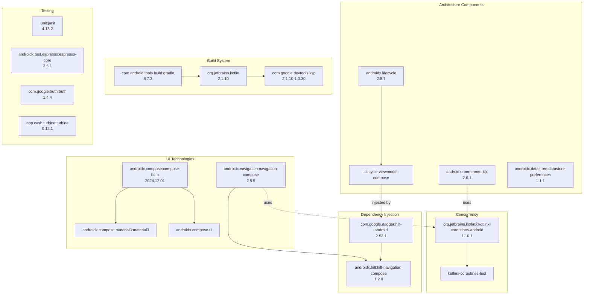
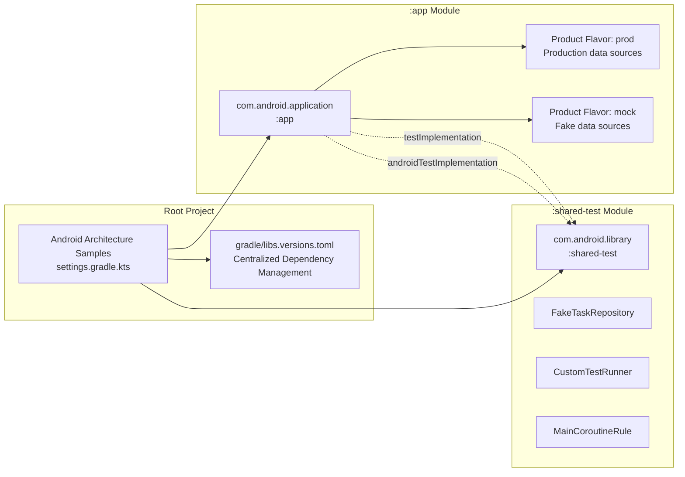
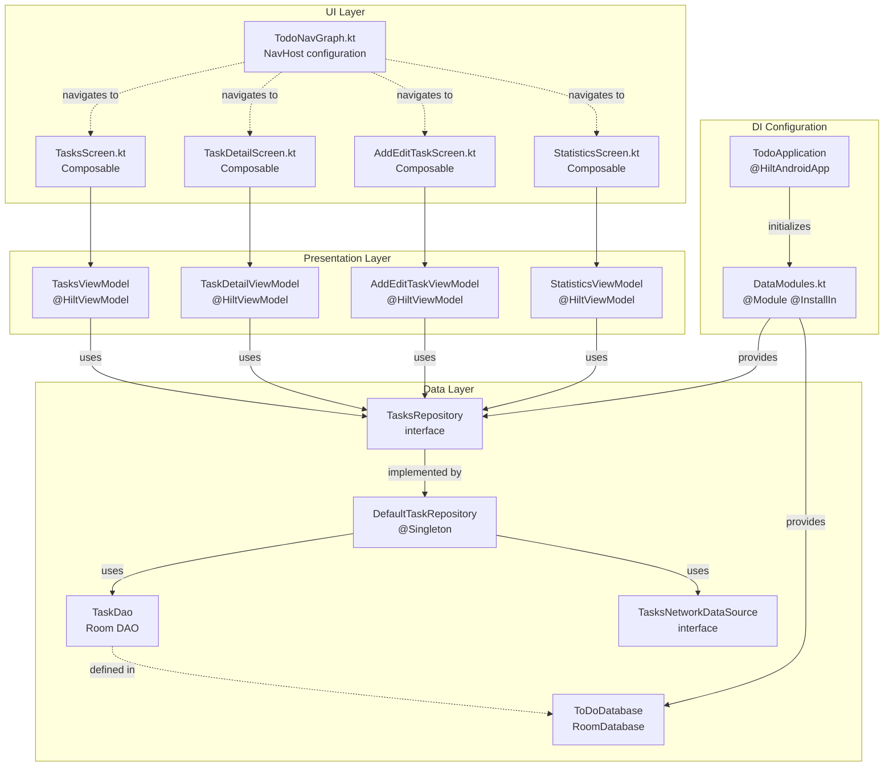

<!-- source: DeepWiki mcp.deepwiki.com · repo android/architecture-samples · page 1 Overview · fetched 2026-10-23 -->

# Overview

<details>
<summary>Relevant source files</summary>

The following files were used as context for generating this wiki page:

- [.github/workflows/build_test.yaml](.github/workflows/build_test.yaml)
- [.github/workflows/copy-branch.yml](.github/workflows/copy-branch.yml)
- [.google/packaging.yaml](.google/packaging.yaml)
- [CONTRIBUTING.md](CONTRIBUTING.md)
- [LICENSE](LICENSE)
- [README.md](README.md)
- [gradle/init.gradle.kts](gradle/init.gradle.kts)
- [gradle/libs.versions.toml](gradle/libs.versions.toml)
- [gradle/wrapper/gradle-wrapper.properties](gradle/wrapper/gradle-wrapper.properties)
- [screenshots/screenshots.png](screenshots/screenshots.png)
- [screenshots/todoapp.gif](screenshots/todoapp.gif)

</details>


This document provides an overview of the Android Architecture Samples repository, explaining its purpose as a demonstration of modern Android development best practices, the TODO application domain used as the implementation example, and the core technologies employed throughout the codebase.

For detailed information about specific architectural layers, see [Application Architecture](#2). For build configuration details, see [Build System and Project Structure](#4). For testing approaches, see [Testing Strategy](#5).

## Purpose and Scope

The Android Architecture Samples repository demonstrates modern Android application architecture patterns through a functional TODO application. The repository showcases how to structure an Android app using current best practices for maintainability, testability, and scalability. The implementation uses Jetpack Compose for UI, follows the MVVM (Model-View-ViewModel) pattern with a unidirectional data flow, and employs industry-standard libraries from the Android Jetpack ecosystem.

**Sources:** [README.md:1-22]()

## Repository Goals

This repository serves as a reference implementation demonstrating:

- **Declarative UI** with Jetpack Compose replacing traditional XML layouts
- **Single-activity architecture** using Navigation Compose for screen transitions
- **Reactive programming** with Kotlin Flow and Coroutines for asynchronous operations
- **Layered architecture** separating UI, presentation, and data concerns
- **Dependency injection** using Hilt for managing object graphs
- **Comprehensive testing** covering unit, integration, and end-to-end scenarios
- **Product flavors** for separating mock and production configurations

The implementation prioritizes architectural clarity over production-ready features. It intentionally omits complex production concerns like authentication, advanced networking, and complex business logic to maintain focus on structural patterns.

**Sources:** [README.md:3-13](), [README.md:23-26]()

## The TODO Application Domain

The application implements a task management system with the following capabilities:

| Feature | Description |
|---------|-------------|
| Task List | Display all tasks with filtering options (All, Active, Completed) |
| Task Creation | Add new tasks with title and description |
| Task Editing | Modify existing task details |
| Task Completion | Mark tasks as complete or active |
| Task Deletion | Remove tasks from the system |
| Statistics | View aggregate statistics about task completion |

The TODO app domain was chosen because it is simple enough for quick comprehension but complex enough to demonstrate realistic architectural challenges including state management, data persistence, navigation flows, and testing strategies.

**Sources:** [README.md:19-21]()

## Core Technology Stack

### Technology Stack with Versions



**Diagram: Core Dependencies with Artifact Coordinates**

The technology stack is centrally managed in the version catalog at [gradle/libs.versions.toml:1-153](). Key technologies include:

- **Jetpack Compose BOM 2024.12.01**: Manages all Compose dependencies with aligned versions
- **Kotlin 2.1.10**: Primary programming language with coroutines support
- **Hilt 2.53.1**: Dependency injection framework
- **Room 2.6.1**: Local database persistence layer
- **Navigation Compose 2.8.5**: Navigation framework for single-activity architecture
- **Kotlin Coroutines 1.10.1**: Asynchronous programming with Flow/StateFlow
- **Android Gradle Plugin 8.7.3**: Build system
- **KSP 2.1.10-1.0.30**: Kotlin Symbol Processing for annotation processing

**Sources:** [gradle/libs.versions.toml:1-60](), [gradle/libs.versions.toml:61-137]()

### SDK Configuration

| Property | Value | Purpose |
|----------|-------|---------|
| `minSdk` | 21 | Minimum supported Android version (Android 5.0 Lollipop) |
| `compileSdk` | 35 | SDK version used for compilation |
| `targetSdk` | 35 | Target SDK version for runtime behavior |
| JDK Version | 17 | Java Development Kit version |
| Gradle | 8.11.1 | Build tool version |

The minimum SDK of 21 provides broad device coverage while the compile/target SDK of 35 enables access to the latest Android platform features.

**Sources:** [gradle/libs.versions.toml:34](), [gradle/libs.versions.toml:47](), [gradle/libs.versions.toml:57](), [.github/workflows/build_test.yaml:36-37](), [gradle/wrapper/gradle-wrapper.properties:3]()

## Project Module Structure



**Diagram: Project Module Organization**

The repository contains two Gradle modules:

1. **`:app`** - The main Android application module with two product flavors:
   - **`mock`**: Uses fake/in-memory data sources for rapid development and testing
   - **`prod`**: Uses production data sources (Room database with simulated network)

2. **`:shared-test`** - A shared library module containing test utilities used by both unit tests and instrumented tests, including `FakeTaskRepository`, `FakeTaskDao`, `CustomTestRunner` for Hilt testing, and `MainCoroutineRule` for coroutine testing

Version management is centralized in [gradle/libs.versions.toml:1-153]() using Gradle's version catalog feature, ensuring consistent dependency versions across all modules.

**Sources:** [README.md:11-12](), [gradle/libs.versions.toml:1-153]()

## High-Level Architecture Overview



**Diagram: Core Application Architecture with Code Entities**

The application follows a three-layer MVVM architecture:

- **UI Layer**: Jetpack Compose screens (`TasksScreen`, `TaskDetailScreen`, `AddEditTaskScreen`, `StatisticsScreen`) render UI based on state from ViewModels. Navigation is managed by `TodoNavGraph`.

- **Presentation Layer**: ViewModels (`TasksViewModel`, `TaskDetailViewModel`, `AddEditTaskViewModel`, `StatisticsViewModel`) annotated with `@HiltViewModel` manage UI state using `StateFlow` and handle user actions. They interact exclusively with the `TasksRepository` interface.

- **Data Layer**: `DefaultTaskRepository` implements the `TasksRepository` interface and coordinates between local persistence (`TaskDao` from Room's `ToDoDatabase`) and network operations (`TasksNetworkDataSource`).

Dependency injection is configured via Hilt, with the `TodoApplication` class annotated with `@HiltAndroidApp` and data source bindings defined in `DataModules`.

**Sources:** [README.md:6-10]()

## What This Repository Is and Is Not

### What It Is

- **Architecture demonstration**: Shows how to structure an Android app with testable, maintainable patterns
- **Learning resource**: Provides clear examples of modern Android development practices
- **Reference implementation**: Illustrates proper use of Jetpack libraries and architectural components

### What It Is Not

| Not Included | Alternative Resource |
|--------------|---------------------|
| Production-ready template | [Architecture Templates](https://github.com/android/architecture-templates) |
| UI/Material Design showcase | [Compose Samples](https://github.com/android/compose-samples) |
| Complete production app with authentication, real networking | [Now in Android](https://github.com/android/nowinandroid) |

The repository deliberately omits production concerns such as:
- User authentication and authorization
- Real network APIs with error handling and retry logic
- Complex business logic and validation
- Advanced UI animations and Material Design patterns
- Multi-module feature architecture

This focus on architectural patterns rather than production features allows developers to understand core concepts without production complexity obscuring the architectural patterns.

**Sources:** [README.md:23-26]()

## Target Audience

The repository is designed for:

| Audience Level | Use Case |
|----------------|----------|
| **Intermediate developers** | Learn how to structure Android apps in a testable and maintainable way |
| **Beginners** | Understand modern Android architecture patterns through practical examples |
| **Advanced developers** | Quick reference for specific architectural patterns and testing approaches |

The codebase assumes familiarity with Kotlin and basic Android development concepts but provides clear examples of advanced patterns like reactive data flow, dependency injection, and comprehensive testing strategies.

**Sources:** [README.md:28-31]()

## Getting Started

To work with the repository:

1. Clone the repository:
   ```bash
   git clone git@github.com:android/architecture-samples.git
   ```

2. Open the `architecture-samples/` directory in Android Studio

3. The project uses Gradle Wrapper version 8.11.1, which will be automatically downloaded when building

4. Build the project to download all dependencies managed by the version catalog

The repository uses GitHub Actions for continuous integration, running builds and tests on every push to the main branch. The build configuration ensures consistent builds across development and CI environments.

**Sources:** [README.md:33-43](), [gradle/wrapper/gradle-wrapper.properties:3](), [.github/workflows/build_test.yaml:1-60]()

## License

The repository is licensed under the Apache License 2.0. All code is copyright 2024 Google, Inc. (and 2014 for the original project). Contributors must sign the Google Individual Contributor License Agreement before contributions can be accepted.

**Sources:** [README.md:45-65](), [LICENSE:1-201](), [CONTRIBUTING.md:1-30]()

---

