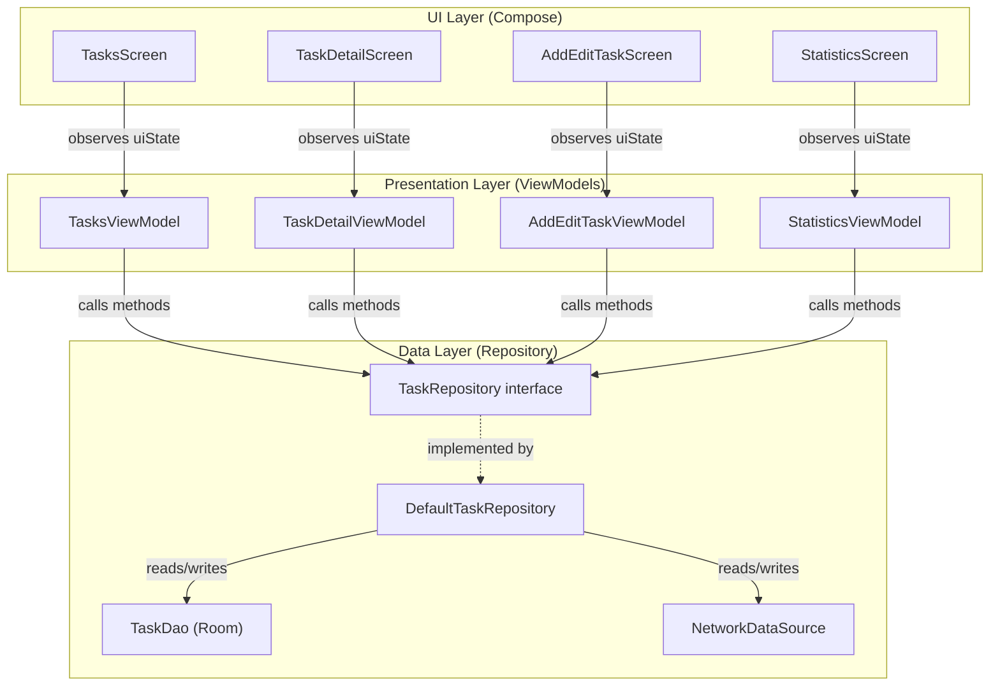
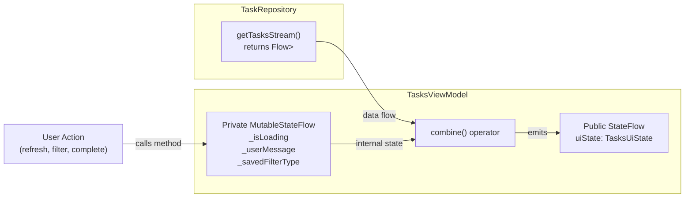
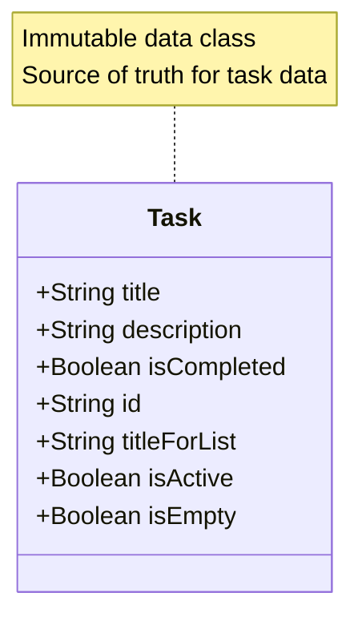
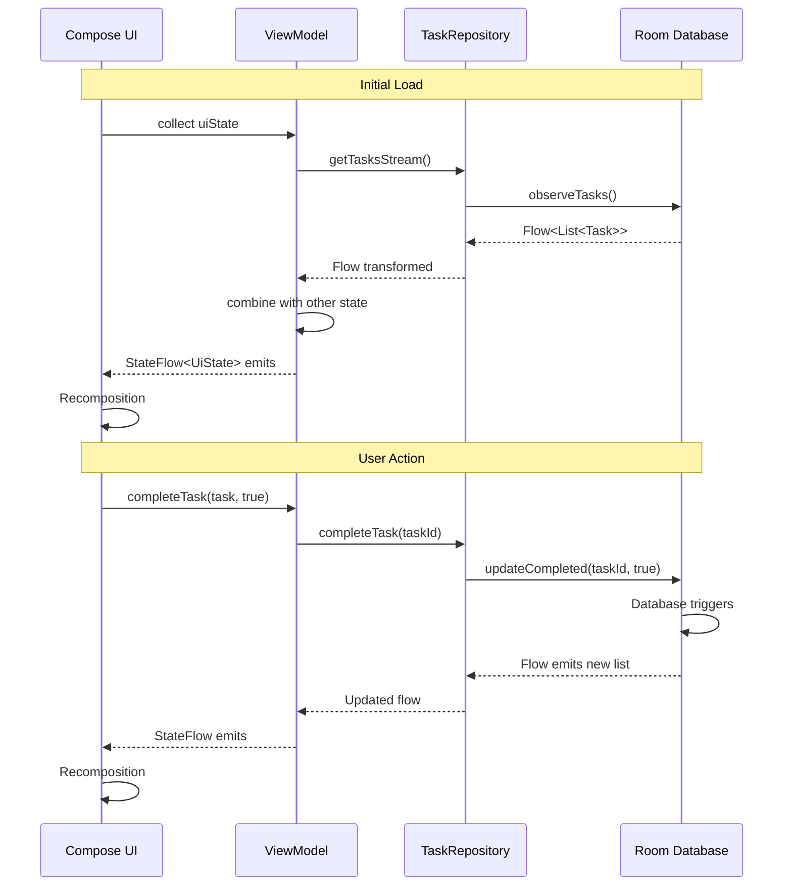
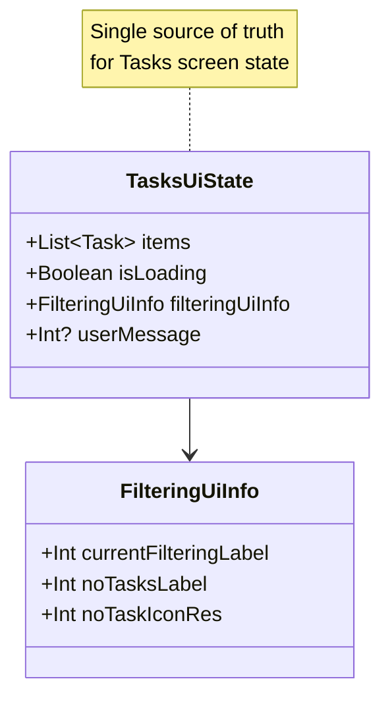
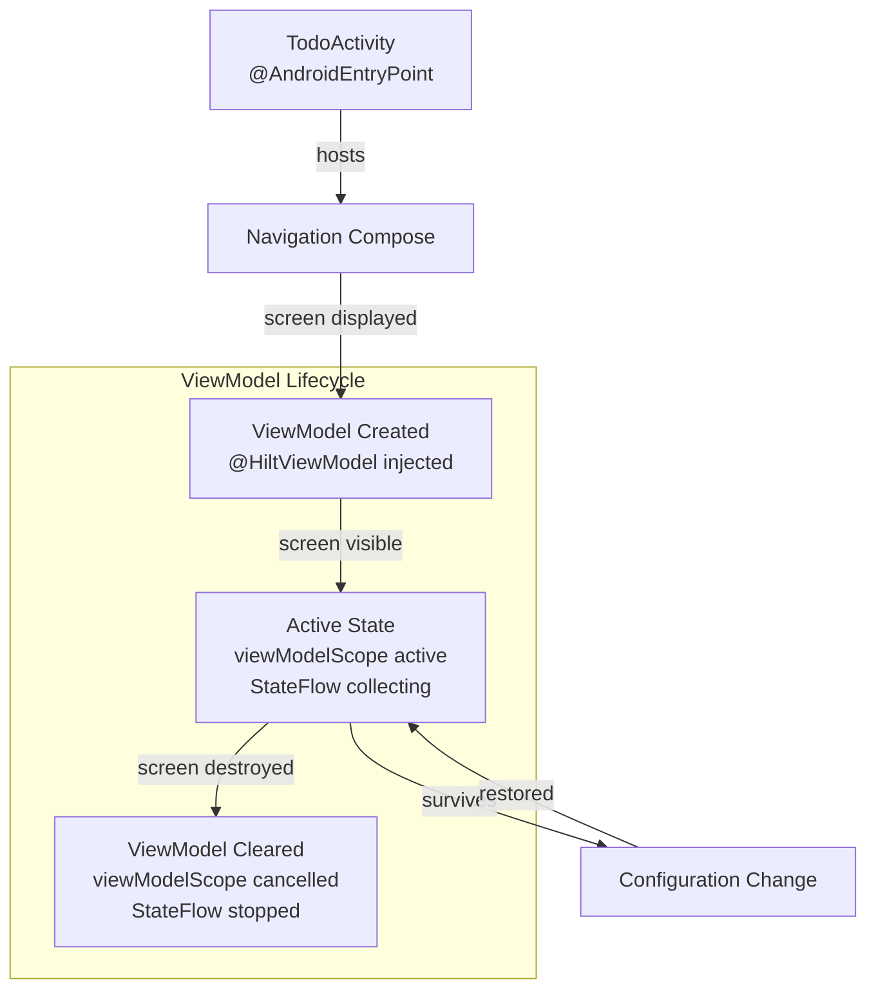
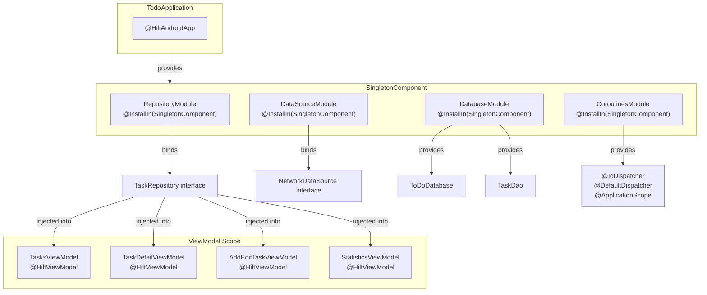
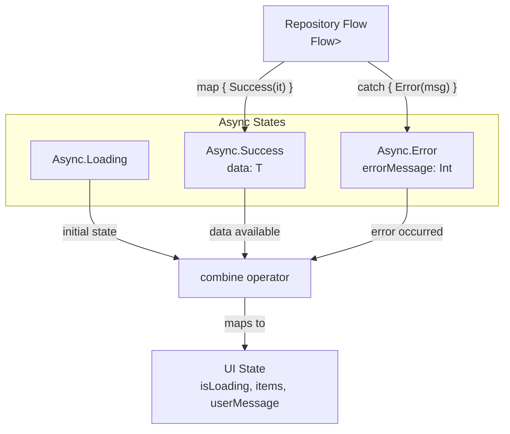
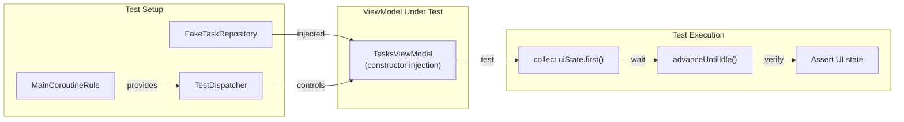

<!-- source: DeepWiki mcp.deepwiki.com · repo android/architecture-samples · page 2 Application Architecture · fetched 2026-10-23 -->

# Application Architecture

<details>
<summary>Relevant source files</summary>

The following files were used as context for generating this wiki page:

- [.google/packaging.yaml](.google/packaging.yaml)
- [CONTRIBUTING.md](CONTRIBUTING.md)
- [LICENSE](LICENSE)
- [README.md](README.md)
- [app/src/main/AndroidManifest.xml](app/src/main/AndroidManifest.xml)
- [app/src/main/java/com/example/android/architecture/blueprints/todoapp/TodoActivity.kt](app/src/main/java/com/example/android/architecture/blueprints/todoapp/TodoActivity.kt)
- [app/src/main/java/com/example/android/architecture/blueprints/todoapp/TodoNavigation.kt](app/src/main/java/com/example/android/architecture/blueprints/todoapp/TodoNavigation.kt)
- [app/src/main/java/com/example/android/architecture/blueprints/todoapp/addedittask/AddEditTaskViewModel.kt](app/src/main/java/com/example/android/architecture/blueprints/todoapp/addedittask/AddEditTaskViewModel.kt)
- [app/src/main/java/com/example/android/architecture/blueprints/todoapp/data/Task.kt](app/src/main/java/com/example/android/architecture/blueprints/todoapp/data/Task.kt)
- [app/src/main/java/com/example/android/architecture/blueprints/todoapp/di/CoroutinesModule.kt](app/src/main/java/com/example/android/architecture/blueprints/todoapp/di/CoroutinesModule.kt)
- [app/src/main/java/com/example/android/architecture/blueprints/todoapp/di/DataModules.kt](app/src/main/java/com/example/android/architecture/blueprints/todoapp/di/DataModules.kt)
- [app/src/main/java/com/example/android/architecture/blueprints/todoapp/statistics/StatisticsViewModel.kt](app/src/main/java/com/example/android/architecture/blueprints/todoapp/statistics/StatisticsViewModel.kt)
- [app/src/main/java/com/example/android/architecture/blueprints/todoapp/taskdetail/TaskDetailViewModel.kt](app/src/main/java/com/example/android/architecture/blueprints/todoapp/taskdetail/TaskDetailViewModel.kt)
- [app/src/main/java/com/example/android/architecture/blueprints/todoapp/tasks/TasksViewModel.kt](app/src/main/java/com/example/android/architecture/blueprints/todoapp/tasks/TasksViewModel.kt)
- [app/src/test/java/com/example/android/architecture/blueprints/todoapp/addedittask/AddEditTaskViewModelTest.kt](app/src/test/java/com/example/android/architecture/blueprints/todoapp/addedittask/AddEditTaskViewModelTest.kt)
- [app/src/test/java/com/example/android/architecture/blueprints/todoapp/statistics/StatisticsViewModelTest.kt](app/src/test/java/com/example/android/architecture/blueprints/todoapp/statistics/StatisticsViewModelTest.kt)
- [app/src/test/java/com/example/android/architecture/blueprints/todoapp/taskdetail/TaskDetailViewModelTest.kt](app/src/test/java/com/example/android/architecture/blueprints/todoapp/taskdetail/TaskDetailViewModelTest.kt)
- [app/src/test/java/com/example/android/architecture/blueprints/todoapp/tasks/TasksViewModelTest.kt](app/src/test/java/com/example/android/architecture/blueprints/todoapp/tasks/TasksViewModelTest.kt)
- [screenshots/screenshots.png](screenshots/screenshots.png)
- [screenshots/todoapp.gif](screenshots/todoapp.gif)

</details>


## Purpose and Scope

This document describes the high-level application architecture of the Android Architecture Samples TODO app. It explains the three-layer MVVM pattern implementation, the single-activity design with Navigation Compose, reactive data flow with Kotlin Flow/StateFlow, and how architectural components interact.

For implementation details of specific layers, see:
- UI components and Compose screens: [UI Layer with Jetpack Compose](#2.1)
- ViewModel implementations: [Presentation Layer with ViewModels](#2.2)
- Repository and data sources: [Data Layer and Repository Pattern](#2.3)
- Navigation structure and routes: [Navigation with Jetpack Navigation Compose](#2.4)

For dependency injection configuration, see [Dependency Injection with Hilt](#3).

## Architectural Layers

The application follows a three-layer MVVM (Model-View-ViewModel) architecture pattern that separates concerns and enables testability.

### Layer Separation Diagram



**Sources:** [README.md:1-66](), [app/src/main/java/com/example/android/architecture/blueprints/todoapp/tasks/TasksViewModel.kt:1-196](), [app/src/main/java/com/example/android/architecture/blueprints/todoapp/di/DataModules.kt:1-70]()

## Single-Activity Architecture

The application uses a single-activity pattern where all navigation occurs within `TodoActivity` using Jetpack Navigation Compose.

| Component | File | Purpose |
|-----------|------|---------|
| `TodoActivity` | [app/src/main/java/com/example/android/architecture/blueprints/todoapp/TodoActivity.kt:28-40]() | Single entry point, hosts `TodoNavGraph` |
| `TodoNavGraph` | Referenced in [app/src/main/java/com/example/android/architecture/blueprints/todoapp/TodoActivity.kt:36]() | Navigation graph definition |
| `TodoNavigationActions` | [app/src/main/java/com/example/android/architecture/blueprints/todoapp/TodoNavigation.kt:61-106]() | Navigation helper class |
| `TodoDestinations` | [app/src/main/java/com/example/android/architecture/blueprints/todoapp/TodoNavigation.kt:51-56]() | Route definitions |

The activity is annotated with `@AndroidEntryPoint` to enable Hilt dependency injection and calls `setContent` to launch the Compose UI.

**Sources:** [app/src/main/java/com/example/android/architecture/blueprints/todoapp/TodoActivity.kt:1-41](), [app/src/main/java/com/example/android/architecture/blueprints/todoapp/TodoNavigation.kt:1-107]()

## Presentation Layer Pattern

Each screen has a corresponding ViewModel that:
1. Exposes UI state via `StateFlow`
2. Handles user actions through public methods
3. Interacts exclusively with the `TaskRepository`
4. Never directly accesses data sources

### ViewModel State Management



Each ViewModel follows this pattern:
- **Private state holders**: `MutableStateFlow` instances for internal state
- **Repository streams**: Data flows from repository
- **State combination**: `combine()` operator merges multiple flows
- **Public state**: Immutable `StateFlow` exposed to UI

**Sources:** [app/src/main/java/com/example/android/architecture/blueprints/todoapp/tasks/TasksViewModel.kt:63-100](), [app/src/main/java/com/example/android/architecture/blueprints/todoapp/taskdetail/TaskDetailViewModel.kt:59-93]()

## Data Model

The core data model is the `Task` data class:



| Property | Type | Description |
|----------|------|-------------|
| `id` | `String` | Unique identifier |
| `title` | `String` | Task title |
| `description` | `String` | Task description |
| `isCompleted` | `Boolean` | Completion status |
| `isActive` | `Boolean` | Computed: `!isCompleted` |
| `titleForList` | `String` | Display title (fallback to description) |
| `isEmpty` | `Boolean` | Validation property |

**Sources:** [app/src/main/java/com/example/android/architecture/blueprints/todoapp/data/Task.kt:1-46]()

## Reactive Data Flow

The architecture uses Kotlin Coroutines and Flow for reactive, asynchronous data flow.

### Data Flow Pattern



### Flow Configuration

The architecture uses a specific Flow sharing strategy defined in `WhileUiSubscribed`:

| Pattern | Implementation | Purpose |
|---------|----------------|---------|
| State sharing | `stateIn(scope, started, initial)` | Converts cold Flow to hot StateFlow |
| Subscription strategy | `WhileUiSubscribed` | Stops upstream when no collectors |
| Scope | `viewModelScope` | Lifecycle-aware cancellation |
| Initial value | UI state with `isLoading = true` | Shows loading on first launch |

This pattern ensures:
- Data streams automatically stop when UI is not visible
- State is preserved during configuration changes
- No memory leaks from active subscriptions
- Automatic cancellation when ViewModel is cleared

**Sources:** [app/src/main/java/com/example/android/architecture/blueprints/todoapp/tasks/TasksViewModel.kt:76-100](), [app/src/main/java/com/example/android/architecture/blueprints/todoapp/taskdetail/TaskDetailViewModel.kt:66-93]()

## UI State Pattern

Each ViewModel exposes a single immutable `UiState` data class that represents the complete UI state.

### Example: TasksUiState



### UI State Examples

| ViewModel | UI State Class | Key Properties |
|-----------|---------------|----------------|
| `TasksViewModel` | `TasksUiState` | `items`, `isLoading`, `filteringUiInfo`, `userMessage` |
| `TaskDetailViewModel` | `TaskDetailUiState` | `task`, `isLoading`, `userMessage`, `isTaskDeleted` |
| `AddEditTaskViewModel` | `AddEditTaskUiState` | `title`, `description`, `isTaskCompleted`, `isLoading`, `isTaskSaved` |
| `StatisticsViewModel` | `StatisticsUiState` | `isEmpty`, `isLoading`, `activeTasksPercent`, `completedTasksPercent` |

**Sources:** [app/src/main/java/com/example/android/architecture/blueprints/todoapp/tasks/TasksViewModel.kt:44-52](), [app/src/main/java/com/example/android/architecture/blueprints/todoapp/taskdetail/TaskDetailViewModel.kt:38-46](), [app/src/main/java/com/example/android/architecture/blueprints/todoapp/addedittask/AddEditTaskViewModel.kt:33-43](), [app/src/main/java/com/example/android/architecture/blueprints/todoapp/statistics/StatisticsViewModel.kt:34-42]()

## ViewModel Lifecycle Management

ViewModels are lifecycle-aware and use `viewModelScope` for coroutine management.



### ViewModel Characteristics

1. **Hilt Integration**: Annotated with `@HiltViewModel` and use constructor injection
2. **Lifecycle Scope**: `viewModelScope` automatically cancels when ViewModel is cleared
3. **Configuration Survival**: ViewModels survive configuration changes (rotation, etc.)
4. **SavedStateHandle**: Used to preserve state across process death

**Sources:** [app/src/main/java/com/example/android/architecture/blueprints/todoapp/tasks/TasksViewModel.kt:57-61](), [app/src/main/java/com/example/android/architecture/blueprints/todoapp/taskdetail/TaskDetailViewModel.kt:51-55]()

## Dependency Injection Architecture

The application uses Hilt for dependency injection with module-based configuration.

### Hilt Module Structure



### Dependency Modules

| Module | Purpose | Key Bindings |
|--------|---------|--------------|
| `RepositoryModule` | Repository bindings | `DefaultTaskRepository` → `TaskRepository` |
| `DataSourceModule` | Data source bindings | `TaskNetworkDataSource` → `NetworkDataSource` |
| `DatabaseModule` | Room database | `ToDoDatabase`, `TaskDao` providers |
| `CoroutinesModule` | Coroutine configuration | `@IoDispatcher`, `@DefaultDispatcher`, `@ApplicationScope` |

### Custom Qualifiers

The application defines custom qualifier annotations for coroutine dispatchers:

```
@IoDispatcher - Dispatches.IO for I/O operations
@DefaultDispatcher - Dispatchers.Default for CPU-intensive work
@ApplicationScope - Application-scoped CoroutineScope
```

**Sources:** [app/src/main/java/com/example/android/architecture/blueprints/todoapp/di/DataModules.kt:1-70](), [app/src/main/java/com/example/android/architecture/blueprints/todoapp/di/CoroutinesModule.kt:1-61]()

## Error Handling Pattern

The architecture uses a consistent error handling pattern with the `Async` sealed class wrapper.



### Error Handling Flow

1. **Repository Stream**: Emits data or throws exception
2. **Map to Success**: `map { Async.Success(it) }` wraps successful data
3. **Catch Errors**: `catch { emit(Async.Error(message)) }` handles failures
4. **UI State Mapping**: ViewModel maps `Async` state to UI properties
5. **User Notification**: Error messages shown via `userMessage` property

Example from TasksViewModel:

```
private val _filteredTasksAsync =
    combine(taskRepository.getTasksStream(), _savedFilterType) { tasks, type ->
        filterTasks(tasks, type)
    }
        .map { Async.Success(it) }
        .catch<Async<List<Task>>> { emit(Async.Error(R.string.loading_tasks_error)) }
```

**Sources:** [app/src/main/java/com/example/android/architecture/blueprints/todoapp/tasks/TasksViewModel.kt:69-74](), [app/src/main/java/com/example/android/architecture/blueprints/todoapp/taskdetail/TaskDetailViewModel.kt:62-64]()

## State Persistence

The architecture uses `SavedStateHandle` for state preservation across process death.

### SavedStateHandle Usage

| ViewModel | Saved State | Purpose |
|-----------|-------------|---------|
| `TasksViewModel` | `TASKS_FILTER_SAVED_STATE_KEY` | Preserves selected filter (All/Active/Completed) |
| `TaskDetailViewModel` | `TASK_ID_ARG` | Task ID from navigation arguments |
| `AddEditTaskViewModel` | `TASK_ID_ARG` | Task ID for edit mode |

The `SavedStateHandle.getStateFlow()` extension creates a `StateFlow` from saved state:

```
private val _savedFilterType = 
    savedStateHandle.getStateFlow(TASKS_FILTER_SAVED_STATE_KEY, ALL_TASKS)
```

This ensures:
- Filter selection survives configuration changes
- Filter selection survives process death
- Reactive updates when state changes
- Integration with ViewModel state flows

**Sources:** [app/src/main/java/com/example/android/architecture/blueprints/todoapp/tasks/TasksViewModel.kt:58-64](), [app/src/main/java/com/example/android/architecture/blueprints/todoapp/taskdetail/TaskDetailViewModel.kt:54-57](), [app/src/main/java/com/example/android/architecture/blueprints/todoapp/addedittask/AddEditTaskViewModel.kt:49-54]()

## Testing Architecture Support

The architecture is designed for comprehensive testing with clear separation of concerns.

### ViewModel Testing Pattern



### Testing Benefits of Architecture

1. **ViewModel Independence**: ViewModels depend only on repository interface
2. **Fake Implementations**: Easy to provide fake repository for testing
3. **State Observability**: UI state exposed via StateFlow is easy to test
4. **Coroutine Control**: `MainCoroutineRule` controls coroutine execution timing
5. **Synchronous Testing**: `runTest` and `advanceUntilIdle()` make async code testable

Example test structure:
- Setup: Create `FakeTaskRepository` with test data
- Inject: Pass fake repository to ViewModel constructor
- Act: Call ViewModel methods
- Assert: Collect `uiState` and verify properties

**Sources:** [app/src/test/java/com/example/android/architecture/blueprints/todoapp/tasks/TasksViewModelTest.kt:43-66](), [app/src/test/java/com/example/android/architecture/blueprints/todoapp/taskdetail/TaskDetailViewModelTest.kt:43-66]()

## Key Architectural Decisions

### Decision Summary Table

| Aspect | Decision | Rationale |
|--------|----------|-----------|
| **Architecture Pattern** | MVVM with three layers | Clear separation of UI, business logic, and data |
| **Activity Structure** | Single Activity | Simplified navigation, consistent transitions |
| **UI Framework** | Jetpack Compose | Declarative UI, reduced boilerplate |
| **State Management** | StateFlow | Reactive, lifecycle-aware, type-safe |
| **Navigation** | Navigation Compose | Type-safe navigation, deep linking support |
| **DI Framework** | Hilt | Android-optimized, ViewModel integration |
| **Async Operations** | Kotlin Coroutines + Flow | Structured concurrency, cancellation support |
| **Database** | Room | Type-safe SQL, Flow integration |
| **Repository Pattern** | Interface abstraction | Testability, flexibility |

### Architectural Constraints

1. **Unidirectional Data Flow**: Data flows from Repository → ViewModel → UI
2. **No Business Logic in UI**: Compose functions only render state
3. **ViewModels Don't Reference UI**: No Android UI imports in ViewModels
4. **Repository Abstraction**: ViewModels depend on interface, not implementation
5. **Immutable State**: UI state data classes are immutable

**Sources:** [README.md:1-66](), [app/src/main/java/com/example/android/architecture/blueprints/todoapp/tasks/TasksViewModel.kt:1-196]()

---

