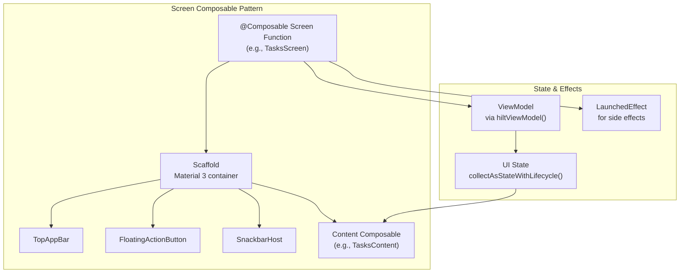
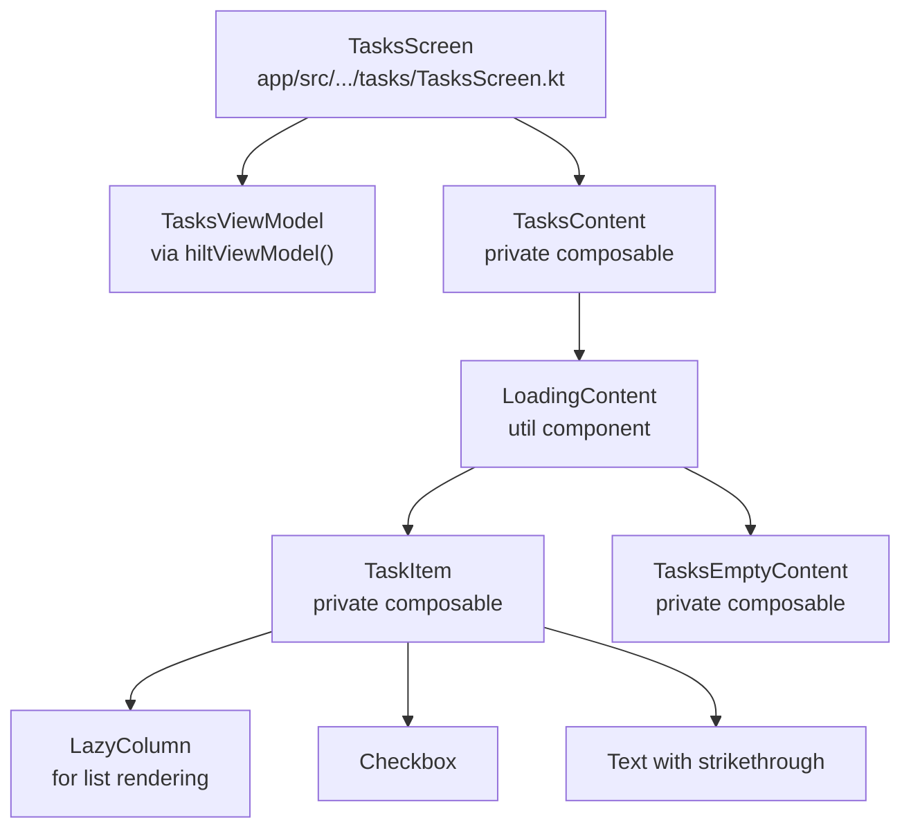
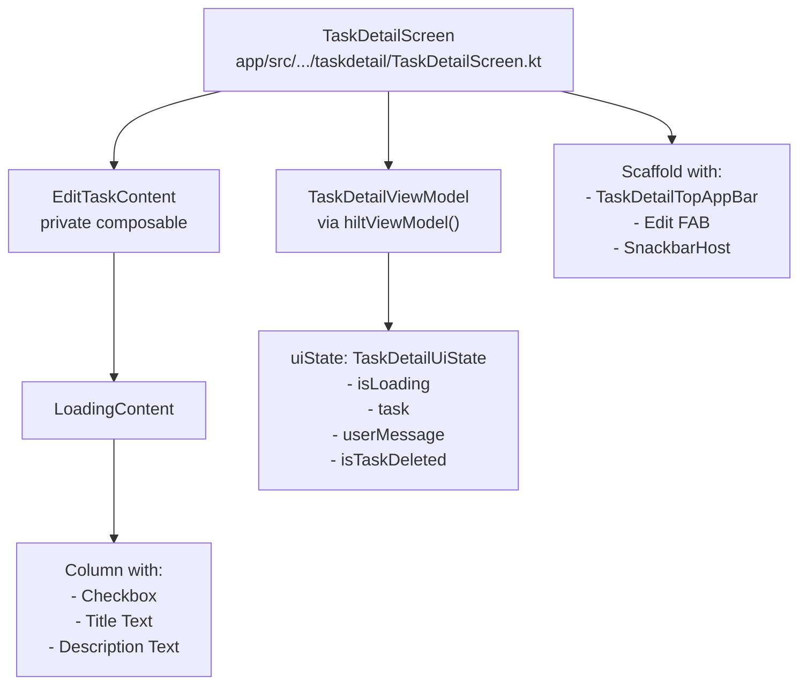
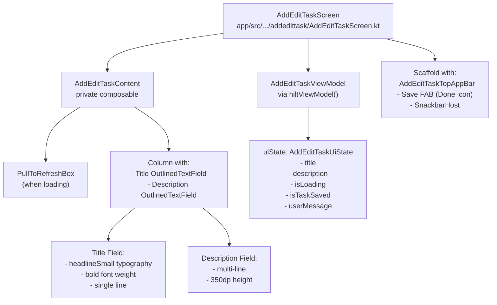
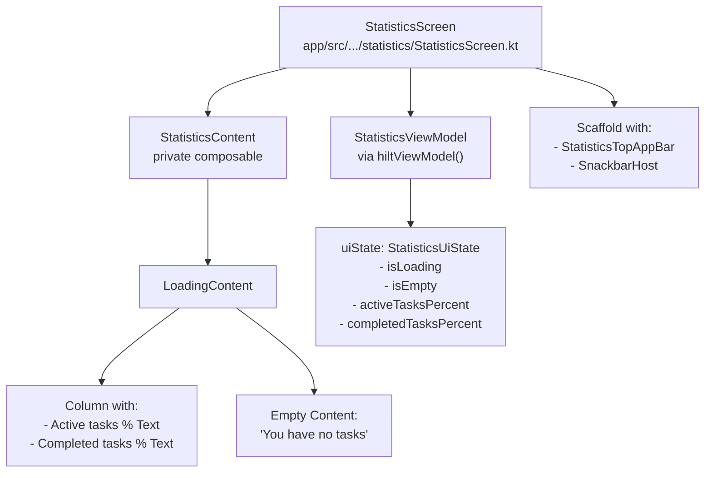
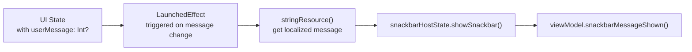
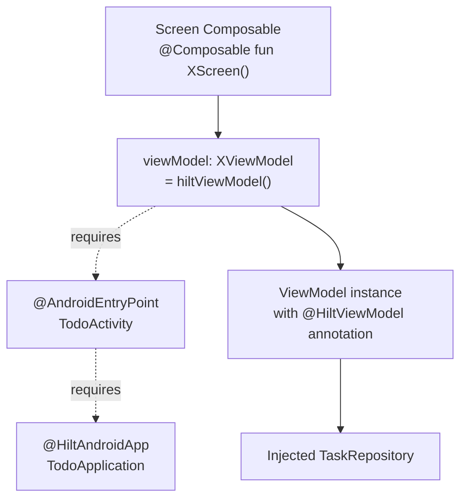
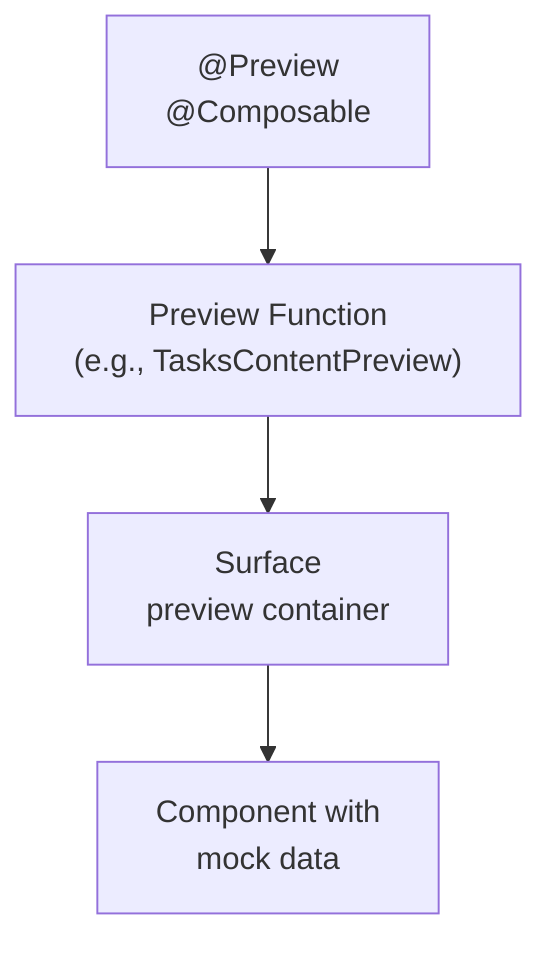
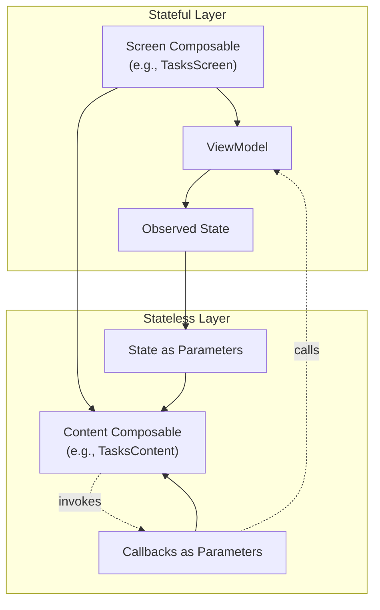

<!-- source: DeepWiki mcp.deepwiki.com · repo android/architecture-samples · page 2.1 UI Layer with Jetpack Compose · fetched 2026-10-23 -->

# UI Layer with Jetpack Compose

<details>
<summary>Relevant source files</summary>

The following files were used as context for generating this wiki page:

- [app/src/main/AndroidManifest.xml](app/src/main/AndroidManifest.xml)
- [app/src/main/java/com/example/android/architecture/blueprints/todoapp/TodoActivity.kt](app/src/main/java/com/example/android/architecture/blueprints/todoapp/TodoActivity.kt)
- [app/src/main/java/com/example/android/architecture/blueprints/todoapp/TodoNavGraph.kt](app/src/main/java/com/example/android/architecture/blueprints/todoapp/TodoNavGraph.kt)
- [app/src/main/java/com/example/android/architecture/blueprints/todoapp/TodoNavigation.kt](app/src/main/java/com/example/android/architecture/blueprints/todoapp/TodoNavigation.kt)
- [app/src/main/java/com/example/android/architecture/blueprints/todoapp/addedittask/AddEditTaskScreen.kt](app/src/main/java/com/example/android/architecture/blueprints/todoapp/addedittask/AddEditTaskScreen.kt)
- [app/src/main/java/com/example/android/architecture/blueprints/todoapp/di/CoroutinesModule.kt](app/src/main/java/com/example/android/architecture/blueprints/todoapp/di/CoroutinesModule.kt)
- [app/src/main/java/com/example/android/architecture/blueprints/todoapp/di/DataModules.kt](app/src/main/java/com/example/android/architecture/blueprints/todoapp/di/DataModules.kt)
- [app/src/main/java/com/example/android/architecture/blueprints/todoapp/statistics/StatisticsScreen.kt](app/src/main/java/com/example/android/architecture/blueprints/todoapp/statistics/StatisticsScreen.kt)
- [app/src/main/java/com/example/android/architecture/blueprints/todoapp/taskdetail/TaskDetailScreen.kt](app/src/main/java/com/example/android/architecture/blueprints/todoapp/taskdetail/TaskDetailScreen.kt)
- [app/src/main/java/com/example/android/architecture/blueprints/todoapp/tasks/TasksScreen.kt](app/src/main/java/com/example/android/architecture/blueprints/todoapp/tasks/TasksScreen.kt)
- [app/src/main/res/values/strings.xml](app/src/main/res/values/strings.xml)
- [app/src/test/java/com/example/android/architecture/blueprints/todoapp/statistics/StatisticsUtilsTest.kt](app/src/test/java/com/example/android/architecture/blueprints/todoapp/statistics/StatisticsUtilsTest.kt)

</details>


## Purpose and Scope

This document describes the UI layer implementation using Jetpack Compose in the TODO application. It covers the four main screen components (Tasks, Task Detail, Add/Edit Task, and Statistics), their composable structures, UI state handling patterns, and Material 3 theming. For information about ViewModel implementations that provide state to these screens, see [Presentation Layer with ViewModels](#2.2). For navigation between screens, see [Navigation with Jetpack Navigation Compose](#2.4).

## Overview

The UI layer is built entirely with Jetpack Compose using a single-activity architecture. All user interface is implemented as composable functions that declare UI based on state, following the declarative UI paradigm. The application uses Material 3 design components and follows modern Compose patterns including state hoisting, side effects with `LaunchedEffect`, and lifecycle-aware state collection with `collectAsStateWithLifecycle`.

The entry point for the UI is `TodoActivity`, which sets the content with the `TodoTheme` wrapper and navigation graph:

[app/src/main/java/com/example/android/architecture/blueprints/todoapp/TodoActivity.kt:31-39]()

Sources: [app/src/main/java/com/example/android/architecture/blueprints/todoapp/TodoActivity.kt]()

## Screen Architecture

The application consists of four primary screens, each implemented as a top-level composable function that follows a consistent pattern:



Sources: [app/src/main/java/com/example/android/architecture/blueprints/todoapp/tasks/TasksScreen.kt](), [app/src/main/java/com/example/android/architecture/blueprints/todoapp/taskdetail/TaskDetailScreen.kt](), [app/src/main/java/com/example/android/architecture/blueprints/todoapp/addedittask/AddEditTaskScreen.kt](), [app/src/main/java/com/example/android/architecture/blueprints/todoapp/statistics/StatisticsScreen.kt]()

### TasksScreen

The `TasksScreen` displays a filterable list of tasks with support for marking tasks complete, adding new tasks, and navigating to task details. It is the start destination of the navigation graph.



The screen structure follows this pattern:

| Component | Purpose | Location |
|-----------|---------|----------|
| `TasksScreen` | Top-level screen composable with Scaffold | [app/src/main/java/com/example/android/architecture/blueprints/todoapp/tasks/TasksScreen.kt:67-129]() |
| `TasksContent` | Content area showing loading/empty/tasks list | [app/src/main/java/com/example/android/architecture/blueprints/todoapp/tasks/TasksScreen.kt:131-173]() |
| `TaskItem` | Individual task row with checkbox | [app/src/main/java/com/example/android/architecture/blueprints/todoapp/tasks/TasksScreen.kt:175-208]() |
| `TasksEmptyContent` | Empty state with image and message | [app/src/main/java/com/example/android/architecture/blueprints/todoapp/tasks/TasksScreen.kt:210-228]() |

Key UI patterns in TasksScreen:

**Scaffold with TopAppBar and FAB:**
[app/src/main/java/com/example/android/architecture/blueprints/todoapp/tasks/TasksScreen.kt:78-95]()

**UI State Collection:**
[app/src/main/java/com/example/android/architecture/blueprints/todoapp/tasks/TasksScreen.kt:97]()

**Task List Rendering:**
[app/src/main/java/com/example/android/architecture/blueprints/todoapp/tasks/TasksScreen.kt:162-170]()

The task item displays a checkbox and text with conditional strikethrough for completed tasks:
[app/src/main/java/com/example/android/architecture/blueprints/todoapp/tasks/TasksScreen.kt:195-206]()

Sources: [app/src/main/java/com/example/android/architecture/blueprints/todoapp/tasks/TasksScreen.kt]()

### TaskDetailScreen

The `TaskDetailScreen` shows the full details of a single task, allowing users to view the title and description, toggle completion status, edit the task, or delete it.



The screen observes task deletion state to trigger navigation:
[app/src/main/java/com/example/android/architecture/blueprints/todoapp/taskdetail/TaskDetailScreen.kt:93-97]()

The content area uses `LoadingContent` to handle loading, empty, and populated states:
[app/src/main/java/com/example/android/architecture/blueprints/todoapp/taskdetail/TaskDetailScreen.kt:118-145]()

Sources: [app/src/main/java/com/example/android/architecture/blueprints/todoapp/taskdetail/TaskDetailScreen.kt]()

### AddEditTaskScreen

The `AddEditTaskScreen` provides a form for creating new tasks or editing existing ones. It uses `OutlinedTextField` components for title and description input.



The screen uses custom `OutlinedTextFieldDefaults.colors` to create transparent borders for a cleaner appearance:
[app/src/main/java/com/example/android/architecture/blueprints/todoapp/addedittask/AddEditTaskScreen.kt:133-137]()

Text fields configuration:
[app/src/main/java/com/example/android/architecture/blueprints/todoapp/addedittask/AddEditTaskScreen.kt:138-161]()

The screen monitors the `isTaskSaved` flag to trigger navigation after successful save:
[app/src/main/java/com/example/android/architecture/blueprints/todoapp/addedittask/AddEditTaskScreen.kt:91-95]()

Sources: [app/src/main/java/com/example/android/architecture/blueprints/todoapp/addedittask/AddEditTaskScreen.kt]()

### StatisticsScreen

The `StatisticsScreen` displays completion statistics showing the percentage of active and completed tasks.



The statistics are displayed using formatted string resources:
[app/src/main/java/com/example/android/architecture/blueprints/todoapp/statistics/StatisticsScreen.kt:99-105]()

Sources: [app/src/main/java/com/example/android/architecture/blueprints/todoapp/statistics/StatisticsScreen.kt]()

## Common UI Patterns

### Scaffold Structure

All screens use the Material 3 `Scaffold` composable as the root layout container, providing consistent structure for app bars, floating action buttons, and snackbars.

Typical scaffold configuration:
[app/src/main/java/com/example/android/architecture/blueprints/todoapp/tasks/TasksScreen.kt:78-96]()

Sources: [app/src/main/java/com/example/android/architecture/blueprints/todoapp/tasks/TasksScreen.kt]()

### UI State Collection

All screens follow a consistent pattern for collecting UI state from ViewModels using `collectAsStateWithLifecycle()`, which ensures the Flow collection is lifecycle-aware and automatically stops when the screen is not visible.

Pattern used across all screens:
```kotlin
val uiState by viewModel.uiState.collectAsStateWithLifecycle()
```

Examples:
- [app/src/main/java/com/example/android/architecture/blueprints/todoapp/tasks/TasksScreen.kt:97]()
- [app/src/main/java/com/example/android/architecture/blueprints/todoapp/taskdetail/TaskDetailScreen.kt:72]()
- [app/src/main/java/com/example/android/architecture/blueprints/todoapp/addedittask/AddEditTaskScreen.kt:79]()
- [app/src/main/java/com/example/android/architecture/blueprints/todoapp/statistics/StatisticsScreen.kt:55]()

Sources: [app/src/main/java/com/example/android/architecture/blueprints/todoapp/tasks/TasksScreen.kt](), [app/src/main/java/com/example/android/architecture/blueprints/todoapp/taskdetail/TaskDetailScreen.kt](), [app/src/main/java/com/example/android/architecture/blueprints/todoapp/addedittask/AddEditTaskScreen.kt](), [app/src/main/java/com/example/android/architecture/blueprints/todoapp/statistics/StatisticsScreen.kt]()

### Snackbar Message Handling

All screens implement a consistent pattern for displaying user messages via snackbars using `LaunchedEffect` to observe UI state changes.



Example implementation from TasksScreen:
[app/src/main/java/com/example/android/architecture/blueprints/todoapp/tasks/TasksScreen.kt:112-118]()

The pattern ensures messages are shown only once by clearing them after display.

Sources: [app/src/main/java/com/example/android/architecture/blueprints/todoapp/tasks/TasksScreen.kt](), [app/src/main/java/com/example/android/architecture/blueprints/todoapp/taskdetail/TaskDetailScreen.kt:84-90](), [app/src/main/java/com/example/android/architecture/blueprints/todoapp/addedittask/AddEditTaskScreen.kt:98-104]()

### Loading Content Pattern

The application uses a shared `LoadingContent` utility composable that handles three states: loading, empty, and content-populated. It integrates Material 3's `PullToRefreshBox` for manual refresh capability.

Usage pattern:
```kotlin
LoadingContent(
    loading = uiState.isLoading,
    empty = condition,
    emptyContent = { EmptyStateComposable() },
    onRefresh = viewModel::refresh
) {
    // Main content composables
}
```

Examples:
- [app/src/main/java/com/example/android/architecture/blueprints/todoapp/tasks/TasksScreen.kt:143-172]()
- [app/src/main/java/com/example/android/architecture/blueprints/todoapp/taskdetail/TaskDetailScreen.kt:118-145]()
- [app/src/main/java/com/example/android/architecture/blueprints/todoapp/statistics/StatisticsScreen.kt:81-108]()

Sources: [app/src/main/java/com/example/android/architecture/blueprints/todoapp/tasks/TasksScreen.kt](), [app/src/main/java/com/example/android/architecture/blueprints/todoapp/taskdetail/TaskDetailScreen.kt](), [app/src/main/java/com/example/android/architecture/blueprints/todoapp/statistics/StatisticsScreen.kt]()

## ViewModel Integration

All screens obtain their ViewModels through Hilt injection using the `hiltViewModel()` composable function. This integration happens at the top-level screen composable, with the ViewModel provided as a default parameter.



Pattern used consistently:
- [app/src/main/java/com/example/android/architecture/blueprints/todoapp/tasks/TasksScreen.kt:75]()
- [app/src/main/java/com/example/android/architecture/blueprints/todoapp/taskdetail/TaskDetailScreen.kt:58]()
- [app/src/main/java/com/example/android/architecture/blueprints/todoapp/addedittask/AddEditTaskScreen.kt:66]()
- [app/src/main/java/com/example/android/architecture/blueprints/todoapp/statistics/StatisticsScreen.kt:47]()

The ViewModels are lifecycle-scoped to the back stack entry by default, ensuring proper state preservation during navigation.

Sources: [app/src/main/java/com/example/android/architecture/blueprints/todoapp/tasks/TasksScreen.kt](), [app/src/main/java/com/example/android/architecture/blueprints/todoapp/taskdetail/TaskDetailScreen.kt](), [app/src/main/java/com/example/android/architecture/blueprints/todoapp/addedittask/AddEditTaskScreen.kt](), [app/src/main/java/com/example/android/architecture/blueprints/todoapp/statistics/StatisticsScreen.kt](), [app/src/main/java/com/example/android/architecture/blueprints/todoapp/TodoActivity.kt:28]()

## Material 3 Theming

The application uses Material 3 components throughout the UI layer. The `TodoTheme` composable provides the theming context for all screens.

Key Material 3 components used:

| Component | Usage | Example Location |
|-----------|-------|------------------|
| `Scaffold` | Base layout structure | All screen files |
| `TopAppBar` variants | Navigation and actions | Utility top app bars |
| `FloatingActionButton` | Primary actions (Add, Save, Edit) | All screens with FABs |
| `OutlinedTextField` | Text input | [AddEditTaskScreen.kt:138-161]() |
| `Checkbox` | Task completion toggle | [TasksScreen.kt:191-194](), [TaskDetailScreen.kt:137]() |
| `Text` | Typography with Material styles | All screens |
| `Surface` | Preview containers | Preview composables |
| `PullToRefreshBox` | Pull-to-refresh gesture | Loading content |
| `SnackbarHost` | Message display | All scaffold implementations |

Typography styles used:
- `MaterialTheme.typography.headlineSmall` - Task titles, section headers
- `MaterialTheme.typography.bodySmall` - Task descriptions

The theme is applied at the activity level:
[app/src/main/java/com/example/android/architecture/blueprints/todoapp/TodoActivity.kt:35-36]()

Sources: [app/src/main/java/com/example/android/architecture/blueprints/todoapp/TodoActivity.kt](), [app/src/main/java/com/example/android/architecture/blueprints/todoapp/tasks/TasksScreen.kt](), [app/src/main/java/com/example/android/architecture/blueprints/todoapp/addedittask/AddEditTaskScreen.kt]()

## Preview Support

All screens and major composable components include `@Preview` annotations for Compose preview functionality in Android Studio. Previews are configured to display various states including empty, loading, and populated content.



Examples of preview implementations:

**TasksScreen previews:**
- Content with tasks: [app/src/main/java/com/example/android/architecture/blueprints/todoapp/tasks/TasksScreen.kt:230-278]()
- Empty content: [app/src/main/java/com/example/android/architecture/blueprints/todoapp/tasks/TasksScreen.kt:280-297]()
- Single task item: [app/src/main/java/com/example/android/architecture/blueprints/todoapp/tasks/TasksScreen.kt:312-347]()

**TaskDetailScreen previews:**
- Active task: [app/src/main/java/com/example/android/architecture/blueprints/todoapp/taskdetail/TaskDetailScreen.kt:148-165]()
- Completed task: [app/src/main/java/com/example/android/architecture/blueprints/todoapp/taskdetail/TaskDetailScreen.kt:168-185]()
- Empty state: [app/src/main/java/com/example/android/architecture/blueprints/todoapp/taskdetail/TaskDetailScreen.kt:187-204]()

**StatisticsScreen previews:**
- With data: [app/src/main/java/com/example/android/architecture/blueprints/todoapp/statistics/StatisticsScreen.kt:111-123]()
- Empty: [app/src/main/java/com/example/android/architecture/blueprints/todoapp/statistics/StatisticsScreen.kt:125-131]()

Preview composables use mock data to demonstrate different UI states without requiring a running application or data layer dependencies.

Sources: [app/src/main/java/com/example/android/architecture/blueprints/todoapp/tasks/TasksScreen.kt](), [app/src/main/java/com/example/android/architecture/blueprints/todoapp/taskdetail/TaskDetailScreen.kt](), [app/src/main/java/com/example/android/architecture/blueprints/todoapp/statistics/StatisticsScreen.kt]()

## String Resources

All user-facing text is externalized to string resources, supporting internationalization and consistent messaging across the application.

Key string categories:

| Category | Purpose | Examples |
|----------|---------|----------|
| Navigation | Screen titles, menu items | `app_name`, `list_title`, `statistics_title` |
| Actions | Button labels, content descriptions | `add_task`, `edit_task`, `cd_save_task`, `refresh` |
| Messages | User feedback, confirmations | `task_marked_complete`, `successfully_saved_task_message` |
| Empty states | No data messages | `no_tasks_all`, `no_tasks_active`, `statistics_no_tasks` |
| Filters | Task filtering labels | `nav_all`, `nav_active`, `nav_completed` |
| Errors | Error messages | `loading_tasks_error`, `empty_task_message` |

String resources are accessed using `stringResource(id)`:
- [app/src/main/java/com/example/android/architecture/blueprints/todoapp/tasks/TasksScreen.kt:155]()
- [app/src/main/java/com/example/android/architecture/blueprints/todoapp/taskdetail/TaskDetailScreen.kt:139-140]()
- [app/src/main/java/com/example/android/architecture/blueprints/todoapp/addedittask/AddEditTaskScreen.kt:144]()

All string definitions are located in:
[app/src/main/res/values/strings.xml:17-72]()

Sources: [app/src/main/res/values/strings.xml](), [app/src/main/java/com/example/android/architecture/blueprints/todoapp/tasks/TasksScreen.kt](), [app/src/main/java/com/example/android/architecture/blueprints/todoapp/taskdetail/TaskDetailScreen.kt](), [app/src/main/java/com/example/android/architecture/blueprints/todoapp/addedittask/AddEditTaskScreen.kt]()

## State Hoisting Pattern

The application follows Compose best practices by hoisting state to the appropriate level. Screen-level composables are stateful (receiving ViewModels), while content composables are stateless (receiving state and callbacks).



Example of state hoisting:

**Stateful screen:**
[app/src/main/java/com/example/android/architecture/blueprints/todoapp/tasks/TasksScreen.kt:67-77]()

**Stateless content:**
[app/src/main/java/com/example/android/architecture/blueprints/todoapp/tasks/TasksScreen.kt:131-142]()

This pattern enables:
- Easier testing of content composables with mock data
- Reusability of content composables in previews
- Clear separation between business logic and UI rendering

Sources: [app/src/main/java/com/example/android/architecture/blueprints/todoapp/tasks/TasksScreen.kt](), [app/src/main/java/com/example/android/architecture/blueprints/todoapp/taskdetail/TaskDetailScreen.kt](), [app/src/main/java/com/example/android/architecture/blueprints/todoapp/addedittask/AddEditTaskScreen.kt]()

---

