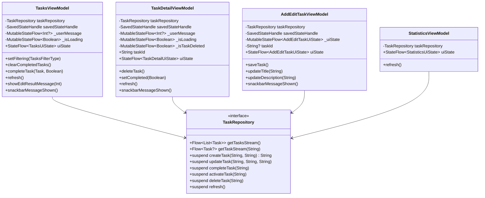
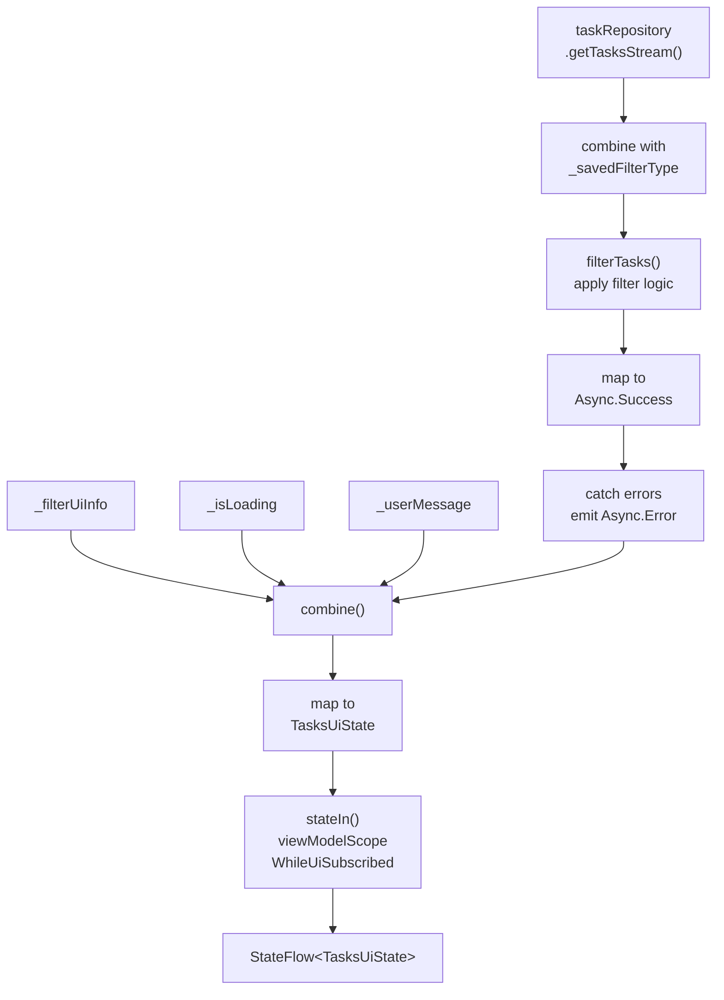
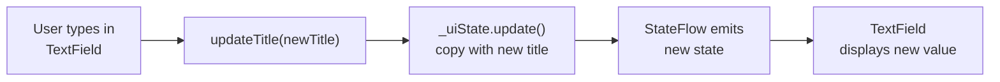
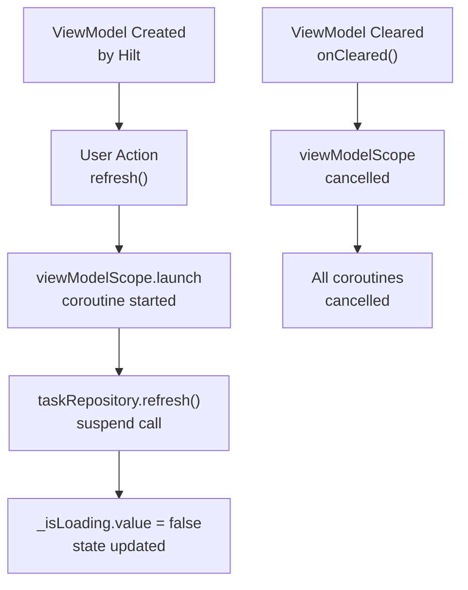
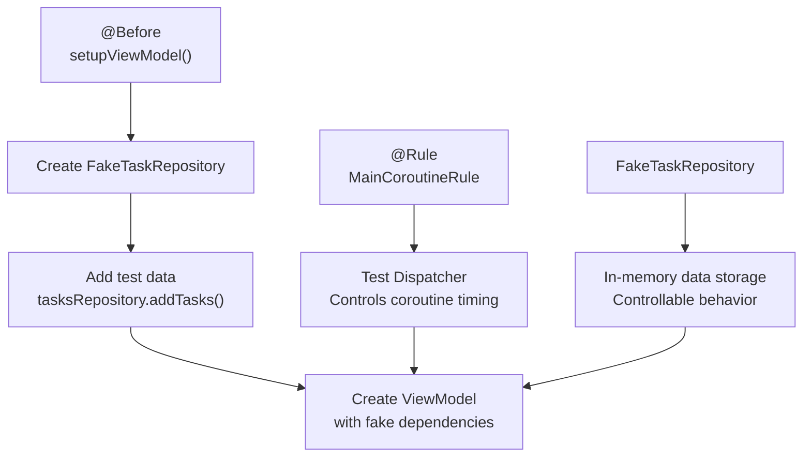
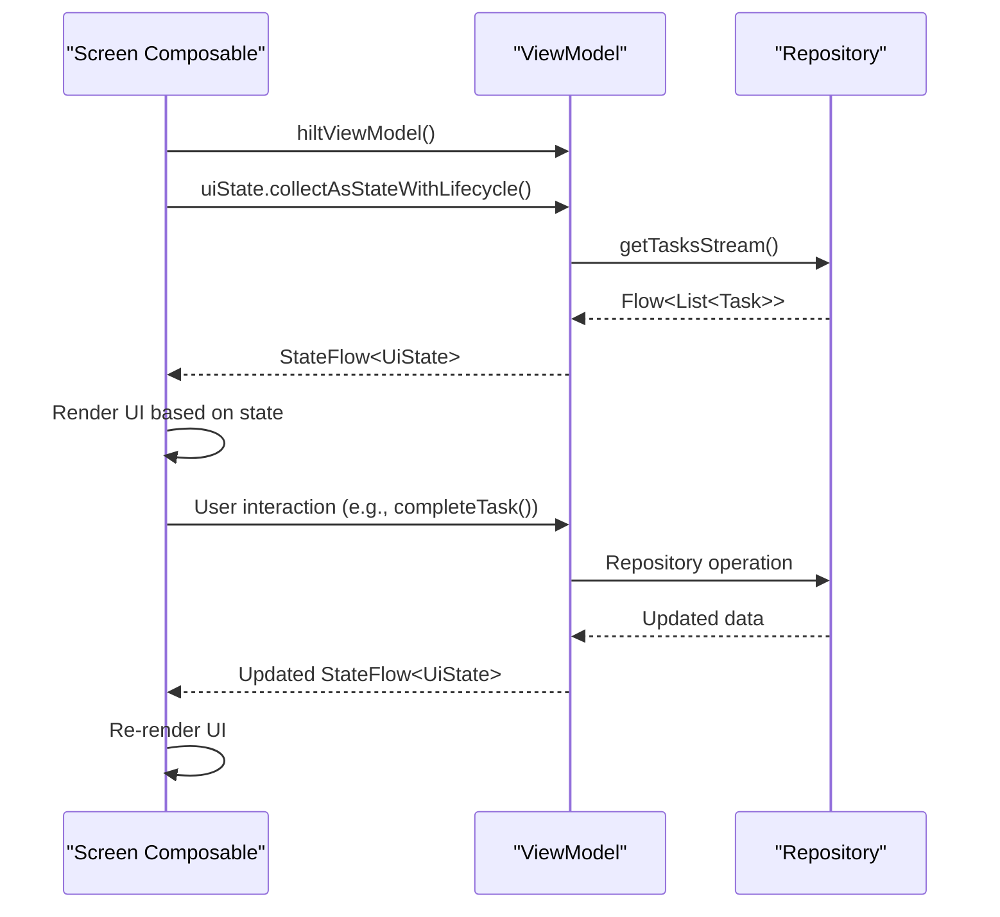

<!-- source: DeepWiki mcp.deepwiki.com · repo android/architecture-samples · page 2.2 Presentation Layer with ViewModels · fetched 2026-10-23 -->

# Presentation Layer with ViewModels

<details>
<summary>Relevant source files</summary>

The following files were used as context for generating this wiki page:

- [app/src/main/java/com/example/android/architecture/blueprints/todoapp/addedittask/AddEditTaskViewModel.kt](app/src/main/java/com/example/android/architecture/blueprints/todoapp/addedittask/AddEditTaskViewModel.kt)
- [app/src/main/java/com/example/android/architecture/blueprints/todoapp/data/Task.kt](app/src/main/java/com/example/android/architecture/blueprints/todoapp/data/Task.kt)
- [app/src/main/java/com/example/android/architecture/blueprints/todoapp/statistics/StatisticsViewModel.kt](app/src/main/java/com/example/android/architecture/blueprints/todoapp/statistics/StatisticsViewModel.kt)
- [app/src/main/java/com/example/android/architecture/blueprints/todoapp/taskdetail/TaskDetailViewModel.kt](app/src/main/java/com/example/android/architecture/blueprints/todoapp/taskdetail/TaskDetailViewModel.kt)
- [app/src/main/java/com/example/android/architecture/blueprints/todoapp/tasks/TasksViewModel.kt](app/src/main/java/com/example/android/architecture/blueprints/todoapp/tasks/TasksViewModel.kt)
- [app/src/test/java/com/example/android/architecture/blueprints/todoapp/addedittask/AddEditTaskViewModelTest.kt](app/src/test/java/com/example/android/architecture/blueprints/todoapp/addedittask/AddEditTaskViewModelTest.kt)
- [app/src/test/java/com/example/android/architecture/blueprints/todoapp/statistics/StatisticsViewModelTest.kt](app/src/test/java/com/example/android/architecture/blueprints/todoapp/statistics/StatisticsViewModelTest.kt)
- [app/src/test/java/com/example/android/architecture/blueprints/todoapp/taskdetail/TaskDetailViewModelTest.kt](app/src/test/java/com/example/android/architecture/blueprints/todoapp/taskdetail/TaskDetailViewModelTest.kt)
- [app/src/test/java/com/example/android/architecture/blueprints/todoapp/tasks/TasksViewModelTest.kt](app/src/test/java/com/example/android/architecture/blueprints/todoapp/tasks/TasksViewModelTest.kt)

</details>


The presentation layer implements ViewModels that manage UI state and coordinate data operations between the UI layer and the data layer. Each screen has a dedicated ViewModel that exposes state as `StateFlow` and handles user interactions.

## 1. ViewModel Architecture Overview

The application implements four ViewModels annotated with `@HiltViewModel` for dependency injection:

| ViewModel | Screen | Primary Responsibilities |
|-----------|--------|-------------------------|
| `TasksViewModel` | Tasks List | Filter tasks, mark complete/active, clear completed, refresh |
| `TaskDetailViewModel` | Task Detail | Load single task, mark complete/active, delete |
| `AddEditTaskViewModel` | Add/Edit Task | Create new task, update existing task, validate input |
| `StatisticsViewModel` | Statistics | Calculate completion percentages |

All ViewModels receive `TaskRepository` via constructor injection. `TasksViewModel`, `TaskDetailViewModel`, and `AddEditTaskViewModel` also receive `SavedStateHandle` for state preservation.

**Diagram: ViewModel Class Structure and Dependencies**



Sources:
- [app/src/main/java/com/example/android/architecture/blueprints/todoapp/tasks/TasksViewModel.kt:57-186]()
- [app/src/main/java/com/example/android/architecture/blueprints/todoapp/taskdetail/TaskDetailViewModel.kt:51-133]()
- [app/src/main/java/com/example/android/architecture/blueprints/todoapp/addedittask/AddEditTaskViewModel.kt:48-148]()
- [app/src/main/java/com/example/android/architecture/blueprints/todoapp/statistics/StatisticsViewModel.kt:47-88]()

## 2. UI State Management with StateFlow

Each ViewModel exposes a single `StateFlow<UiState>` that encapsulates all UI state. The state classes are immutable data classes that represent the complete UI state at any point in time.

**Diagram: State Flow Pattern from Repository to UI**

```mermaid
flowchart LR
    A["TaskRepository<br/>getTasksStream()"] --> B["Flow Operators<br/>map, combine, catch"]
    B --> C["Async Wrapper<br/>Loading/Success/Error"]
    C --> D["stateIn()<br/>WhileUiSubscribed"]
    D --> E["StateFlow&lt;TasksUiState&gt;"]
    E --> F["UI Layer<br/>collectAsStateWithLifecycle()"]
    
    G["User Actions<br/>completeTask()"] --> H["viewModelScope.launch"]
    H --> I["TaskRepository<br/>completeTask()"]
    I --> A
```



Sources:
- [app/src/main/java/com/example/android/architecture/blueprints/todoapp/tasks/TasksViewModel.kt:69-100]()
- [app/src/main/java/com/example/android/architecture/blueprints/todoapp/taskdetail/TaskDetailViewModel.kt:62-93]()

### 2.1 UI State Data Classes

| UI State Class | Properties | Purpose |
|----------------|-----------|---------|
| `TasksUiState` | `items: List<Task>`<br/>`isLoading: Boolean`<br/>`filteringUiInfo: FilteringUiInfo`<br/>`userMessage: Int?` | Contains filtered task list, loading state, filter info, and optional user message resource ID |
| `TaskDetailUiState` | `task: Task?`<br/>`isLoading: Boolean`<br/>`userMessage: Int?`<br/>`isTaskDeleted: Boolean` | Contains single task data, loading state, message, and deletion flag for navigation |
| `AddEditTaskUiState` | `title: String`<br/>`description: String`<br/>`isTaskCompleted: Boolean`<br/>`isLoading: Boolean`<br/>`userMessage: Int?`<br/>`isTaskSaved: Boolean` | Contains editable task fields, loading state, validation message, and save completion flag |
| `StatisticsUiState` | `isEmpty: Boolean`<br/>`isLoading: Boolean`<br/>`activeTasksPercent: Float`<br/>`completedTasksPercent: Float` | Contains computed statistics percentages and empty state indicator |

Sources:
- [app/src/main/java/com/example/android/architecture/blueprints/todoapp/tasks/TasksViewModel.kt:47-52]()
- [app/src/main/java/com/example/android/architecture/blueprints/todoapp/taskdetail/TaskDetailViewModel.kt:41-46]()
- [app/src/main/java/com/example/android/architecture/blueprints/todoapp/addedittask/AddEditTaskViewModel.kt:36-43]()
- [app/src/main/java/com/example/android/architecture/blueprints/todoapp/statistics/StatisticsViewModel.kt:37-42]()

### 2.2 Reactive State Transformations

ViewModels construct the `StateFlow<UiState>` by combining multiple reactive streams using Flow operators. The pattern uses:

1. **Flow from Repository** - Reactive data source (e.g., `taskRepository.getTasksStream()`)
2. **Transformations** - `map`, `combine`, `distinctUntilChanged` to process data
3. **Error Handling** - `catch` operator to convert exceptions to error state
4. **Async Wrapper** - `Async<T>` sealed class with `Loading`, `Success<T>`, and `Error` states
5. **State Conversion** - `stateIn()` with `WhileUiSubscribed` to convert Flow to StateFlow

**Diagram: TasksViewModel State Transformation Pipeline**



Sources:
- [app/src/main/java/com/example/android/architecture/blueprints/todoapp/tasks/TasksViewModel.kt:63-100]()
- [app/src/main/java/com/example/android/architecture/blueprints/todoapp/util/Async.kt]()

## 3. User Action Handling

ViewModels expose functions that UI components call to handle user actions. These functions execute operations in `viewModelScope` and update state flows.

### 3.1 Repository Operations with State Updates

Most actions trigger repository operations and update local state. The pattern uses `viewModelScope.launch` for coroutine execution:

**Diagram: Task Completion Flow**

```mermaid
sequenceDiagram
    participant UI as "TasksScreen"
    participant VM as "TasksViewModel"
    participant Repo as "TaskRepository"
    participant Flow as "StateFlow&lt;TasksUiState&gt;"
    
    UI->>VM: completeTask(task, true)
    activate VM
    VM->>VM: viewModelScope.launch
    VM->>Repo: completeTask(task.id)
    Repo-->>VM: suspend function returns
    VM->>VM: showSnackbarMessage(R.string.task_marked_complete)
    VM->>Flow: _userMessage.value = message
    deactivate VM
    Flow-->>UI: Updated state emitted
    UI->>UI: Display snackbar
    UI->>VM: snackbarMessageShown()
    VM->>Flow: _userMessage.value = null
```

The `completeTask` function in `TasksViewModel` demonstrates this pattern:

- Launches coroutine in `viewModelScope`
- Calls repository suspend function
- Updates `_userMessage` state flow
- UI observes state changes and displays feedback

Sources:
- [app/src/main/java/com/example/android/architecture/blueprints/todoapp/tasks/TasksViewModel.kt:114-122]()
- [app/src/main/java/com/example/android/architecture/blueprints/todoapp/taskdetail/TaskDetailViewModel.kt:100-109]()

### 3.2 Direct State Mutations

`AddEditTaskViewModel` uses a different pattern with a mutable `_uiState` for form field updates:

**Diagram: Form Field Update Pattern**



The `updateTitle` and `updateDescription` functions use `MutableStateFlow.update` for immediate state changes without repository calls. This provides instant UI feedback during text input.

Sources:
- [app/src/main/java/com/example/android/architecture/blueprints/todoapp/addedittask/AddEditTaskViewModel.kt:59-60]()
- [app/src/main/java/com/example/android/architecture/blueprints/todoapp/addedittask/AddEditTaskViewModel.kt:90-100]()

### 3.3 Validation and Save Logic

The `saveTask` function in `AddEditTaskViewModel` validates input before persisting:

1. Check if `title` or `description` is empty
2. If invalid, update state with error message resource ID
3. If valid, call `createNewTask()` or `updateTask()` based on whether `taskId` is null
4. Set `isTaskSaved = true` to trigger navigation in UI

Sources:
- [app/src/main/java/com/example/android/architecture/blueprints/todoapp/addedittask/AddEditTaskViewModel.kt:69-82]()
- [app/src/main/java/com/example/android/architecture/blueprints/todoapp/addedittask/AddEditTaskViewModel.kt:102-123]()

## 4. Coroutine Management and Async Operations

### 4.1 viewModelScope Lifecycle

All coroutines are launched in `viewModelScope`, which automatically cancels when the ViewModel is cleared. This prevents memory leaks and ensures operations don't continue after the UI is destroyed.

**Diagram: viewModelScope Coroutine Lifecycle**



Sources:
- [app/src/main/java/com/example/android/architecture/blueprints/todoapp/tasks/TasksViewModel.kt:140-146]()
- [app/src/main/java/com/example/android/architecture/blueprints/todoapp/taskdetail/TaskDetailViewModel.kt:111-117]()

### 4.2 Loading State Pattern

`TasksViewModel` and `TaskDetailViewModel` use a `MutableStateFlow<Boolean>` to track loading state during manual refresh operations:

The `refresh()` function pattern:
1. Set `_isLoading.value = true`
2. Launch coroutine in `viewModelScope`
3. Call repository suspend function
4. Set `_isLoading.value = false`
5. UI observes combined state that includes `isLoading`

Sources:
- [app/src/main/java/com/example/android/architecture/blueprints/todoapp/tasks/TasksViewModel.kt:68]()
- [app/src/main/java/com/example/android/architecture/blueprints/todoapp/tasks/TasksViewModel.kt:140-146]()

### 4.3 Error Handling with Async Wrapper

ViewModels use the `Async<T>` sealed class to represent asynchronous state:

```kotlin
sealed class Async<out T> {
    object Loading : Async<Nothing>()
    data class Error(val errorMessage: Int) : Async<Nothing>()
    data class Success<out T>(val data: T) : Async<T>()
}
```

Repository flows are wrapped with `Async` using `map` and `catch` operators:

1. Map successful emissions to `Async.Success(data)`
2. Catch exceptions and emit `Async.Error(messageResourceId)`
3. Transform `Async` to `UiState` in `combine` or `map`
4. Handle each case: `Loading` shows spinner, `Error` shows message, `Success` displays data

Sources:
- [app/src/main/java/com/example/android/architecture/blueprints/todoapp/tasks/TasksViewModel.kt:69-74]()
- [app/src/main/java/com/example/android/architecture/blueprints/todoapp/tasks/TasksViewModel.kt:79-94]()
- [app/src/main/java/com/example/android/architecture/blueprints/todoapp/taskdetail/TaskDetailViewModel.kt:62-87]()

### 4.4 WhileUiSubscribed Sharing Strategy

The `stateIn` operator converts Flow to StateFlow with `WhileUiSubscribed` sharing strategy:

```kotlin
val uiState: StateFlow<TasksUiState> = combine(...)
    .stateIn(
        scope = viewModelScope,
        started = WhileUiSubscribed,
        initialValue = TasksUiState(isLoading = true)
    )
```

`WhileUiSubscribed` stops upstream flows when the UI is not visible (with a 5-second timeout), conserving resources while maintaining state.

Sources:
- [app/src/main/java/com/example/android/architecture/blueprints/todoapp/tasks/TasksViewModel.kt:96-100]()
- [app/src/main/java/com/example/android/architecture/blueprints/todoapp/util/WhileUiSubscribed.kt]()

## 5. State Preservation with SavedStateHandle

`SavedStateHandle` preserves ViewModel state across configuration changes and process death. Navigation arguments are automatically saved to `SavedStateHandle` by the Navigation library.

### 5.1 Navigation Arguments

ViewModels extract navigation arguments from `SavedStateHandle`:

| ViewModel | Argument Key | Type | Usage |
|-----------|-------------|------|-------|
| `TaskDetailViewModel` | `TodoDestinationsArgs.TASK_ID_ARG` | `String` (non-null) | Load specific task from repository |
| `AddEditTaskViewModel` | `TodoDestinationsArgs.TASK_ID_ARG` | `String?` (nullable) | null = create mode, non-null = edit mode |

The argument extraction happens in constructor or property initialization:

```kotlin
// TaskDetailViewModel - task ID required
val taskId: String = savedStateHandle[TodoDestinationsArgs.TASK_ID_ARG]!!

// AddEditTaskViewModel - task ID optional
private val taskId: String? = savedStateHandle[TodoDestinationsArgs.TASK_ID_ARG]
```

Sources:
- [app/src/main/java/com/example/android/architecture/blueprints/todoapp/taskdetail/TaskDetailViewModel.kt:57]()
- [app/src/main/java/com/example/android/architecture/blueprints/todoapp/addedittask/AddEditTaskViewModel.kt:54]()
- [app/src/main/java/com/example/android/architecture/blueprints/todoapp/TodoDestinationsArgs.kt]()

### 5.2 Filter State Persistence

`TasksViewModel` persists the current filter selection using `SavedStateHandle.getStateFlow()`:

```kotlin
private val _savedFilterType = 
    savedStateHandle.getStateFlow(TASKS_FILTER_SAVED_STATE_KEY, ALL_TASKS)
```

This creates a `StateFlow` that automatically persists changes. When `setFiltering()` is called:

```kotlin
fun setFiltering(requestType: TasksFilterType) {
    savedStateHandle[TASKS_FILTER_SAVED_STATE_KEY] = requestType
}
```

The value is saved to `SavedStateHandle` and `_savedFilterType` flow emits the new value. This flow is combined with task data to filter the list reactively.

Sources:
- [app/src/main/java/com/example/android/architecture/blueprints/todoapp/tasks/TasksViewModel.kt:63-64]()
- [app/src/main/java/com/example/android/architecture/blueprints/todoapp/tasks/TasksViewModel.kt:102-104]()
- [app/src/main/java/com/example/android/architecture/blueprints/todoapp/tasks/TasksViewModel.kt:189]()

## 6. ViewModel Testing Strategy

ViewModels are unit tested using `FakeTaskRepository` and `MainCoroutineRule` to control coroutine execution.

**Diagram: ViewModel Test Setup**



Sources:
- [app/src/test/java/com/example/android/architecture/blueprints/todoapp/tasks/TasksViewModelTest.kt:45-66]()
- [app/src/test/java/com/example/android/architecture/blueprints/todoapp/taskdetail/TaskDetailViewModelTest.kt:44-66]()
- [shared-test/src/main/java/com/example/android/architecture/blueprints/todoapp/MainCoroutineRule.kt]()

### 6.1 Testing State Flows

Tests verify `StateFlow` emissions using `Flow.first()` to collect the current state:

**Common test pattern:**
1. Perform action on ViewModel
2. Collect state with `uiState.first()`
3. Assert state properties

Example from `TasksViewModelTest`:
- Test calls `tasksViewModel.completeTask(task, true)`
- Verify repository state: `tasksRepository.savedTasks.value[task.id]?.isCompleted`
- Verify ViewModel state: `tasksViewModel.uiState.first().userMessage`

Sources:
- [app/src/test/java/com/example/android/architecture/blueprints/todoapp/tasks/TasksViewModelTest.kt:196-210]()
- [app/src/test/java/com/example/android/architecture/blueprints/todoapp/taskdetail/TaskDetailViewModelTest.kt:68-74]()

### 6.2 Testing Loading States

Loading states are tested using `StandardTestDispatcher` to control coroutine timing:

1. Set `Dispatchers.setMain(StandardTestDispatcher())` for delayed execution
2. Launch collector in background coroutine
3. Assert initial loading state is `true`
4. Call `advanceUntilIdle()` to execute all pending coroutines
5. Assert final loading state is `false`

This pattern verifies that loading indicators appear and disappear correctly.

Sources:
- [app/src/test/java/com/example/android/architecture/blueprints/todoapp/taskdetail/TaskDetailViewModelTest.kt:146-166]()
- [app/src/test/java/com/example/android/architecture/blueprints/todoapp/tasks/TasksViewModelTest.kt:68-91]()
- [app/src/test/java/com/example/android/architecture/blueprints/todoapp/addedittask/AddEditTaskViewModelTest.kt:85-102]()

### 6.3 Testing Error Handling

Tests verify error states by configuring `FakeTaskRepository` to throw errors:

```kotlin
tasksRepository.setShouldThrowError(true)
```

Then assert that:
- State contains error message resource ID
- Task data is null or empty
- Error is displayed in UI state

Sources:
- [app/src/test/java/com/example/android/architecture/blueprints/todoapp/tasks/TasksViewModelTest.kt:126-140]()
- [app/src/test/java/com/example/android/architecture/blueprints/todoapp/taskdetail/TaskDetailViewModelTest.kt:111-119]()

### 6.4 Testing Validation Logic

`AddEditTaskViewModel` tests verify input validation:

- Empty title test: Assert `userMessage == R.string.empty_task_message`
- Empty description test: Assert `userMessage == R.string.empty_task_message`
- Valid input test: Assert task is saved to repository

Sources:
- [app/src/test/java/com/example/android/architecture/blueprints/todoapp/addedittask/AddEditTaskViewModelTest.kt:122-163]()

## 7. Communication with UI Layer

The UI observes the ViewModel's state using `collectAsStateWithLifecycle()` to efficiently collect the state flow:



### 7.1 Side Effects with LaunchedEffect

The UI handles side effects like messages and navigation events using `LaunchedEffect`:

```
// Handle user messages
uiState.userMessage?.let { userMessage ->
    val snackbarText = stringResource(userMessage)
    LaunchedEffect(snackbarHostState, viewModel, userMessage, snackbarText) {
        snackbarHostState.showSnackbar(snackbarText)
        viewModel.snackbarMessageShown()
    }
}

// Handle navigation when task is saved
LaunchedEffect(uiState.isTaskSaved) {
    if (uiState.isTaskSaved) {
        onTaskUpdate()
    }
}
```

Sources:
- [app/src/main/java/com/example/android/architecture/blueprints/todoapp/taskdetail/TaskDetailScreen.kt:84-97]()
- [app/src/main/java/com/example/android/architecture/blueprints/todoapp/addedittask/AddEditTaskScreen.kt:91-104]()

## Summary

The presentation layer in this architecture uses ViewModels to:

1. Encapsulate UI state in immutable data classes
2. Expose state as StateFlow for reactive UI updates
3. Handle user events and business logic
4. Communicate with the data layer through repositories
5. Manage asynchronous operations with coroutines
6. Preserve state across configuration changes with SavedStateHandle

This separation of concerns allows for clean, testable code where UI components remain focused on rendering, while ViewModels handle the business logic and state management.

---

