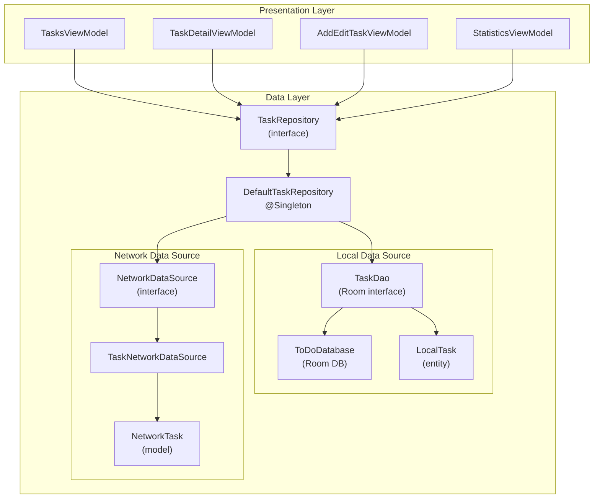
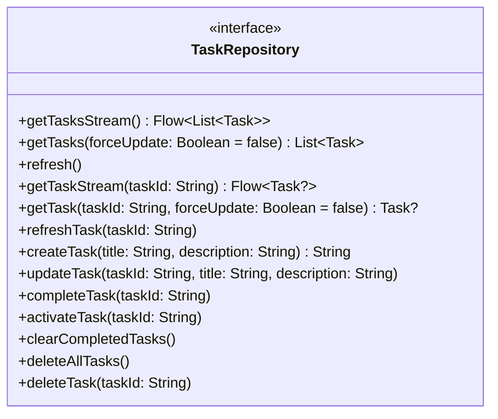
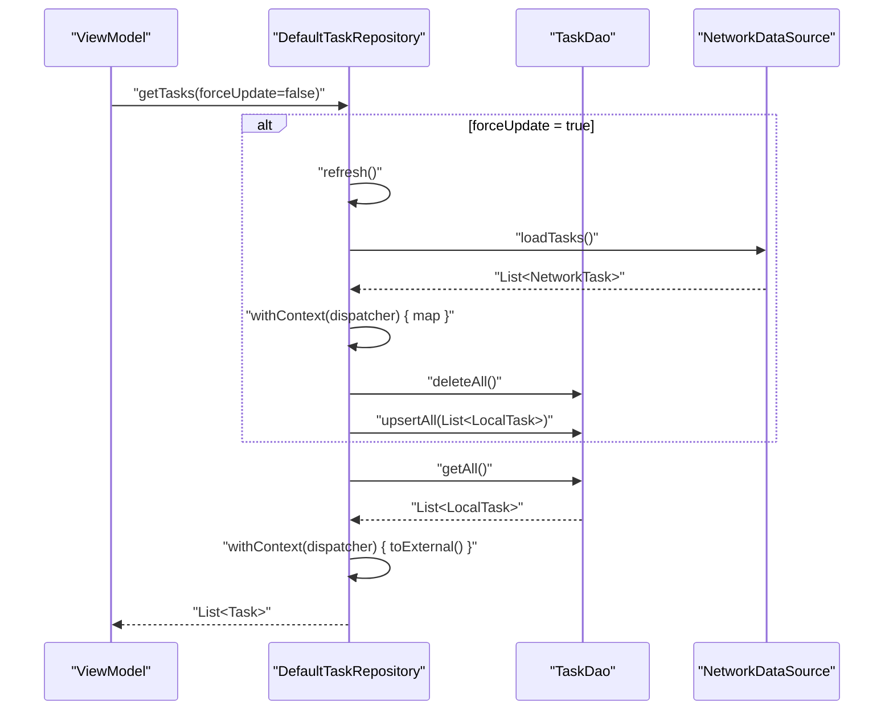
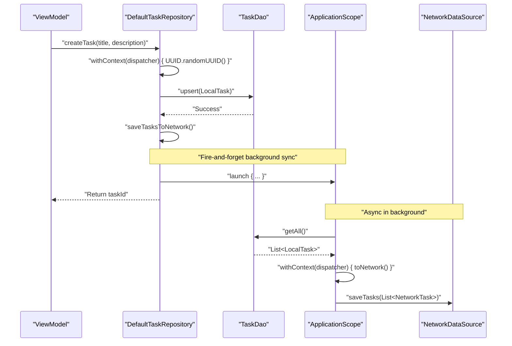
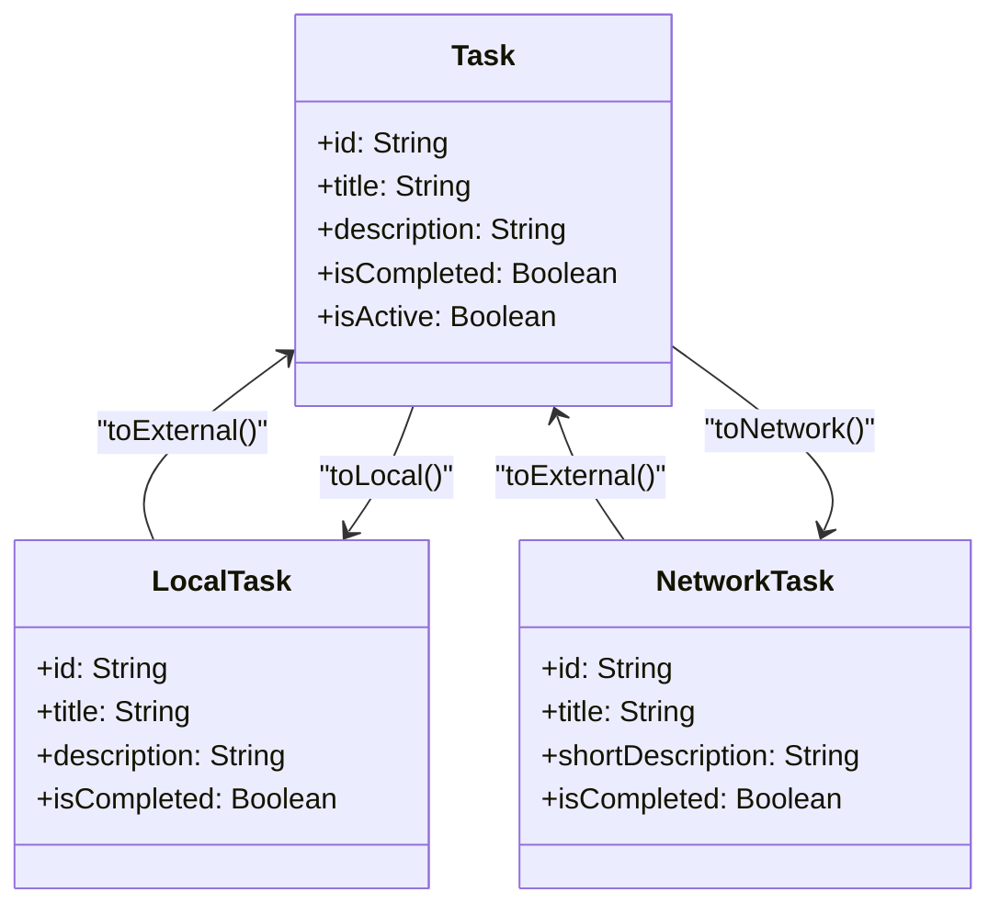
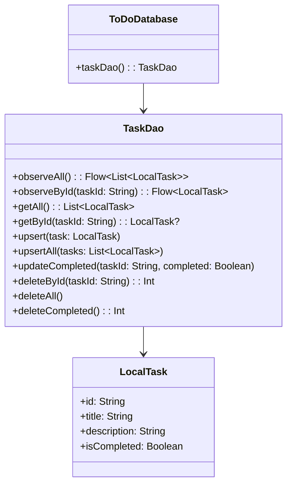
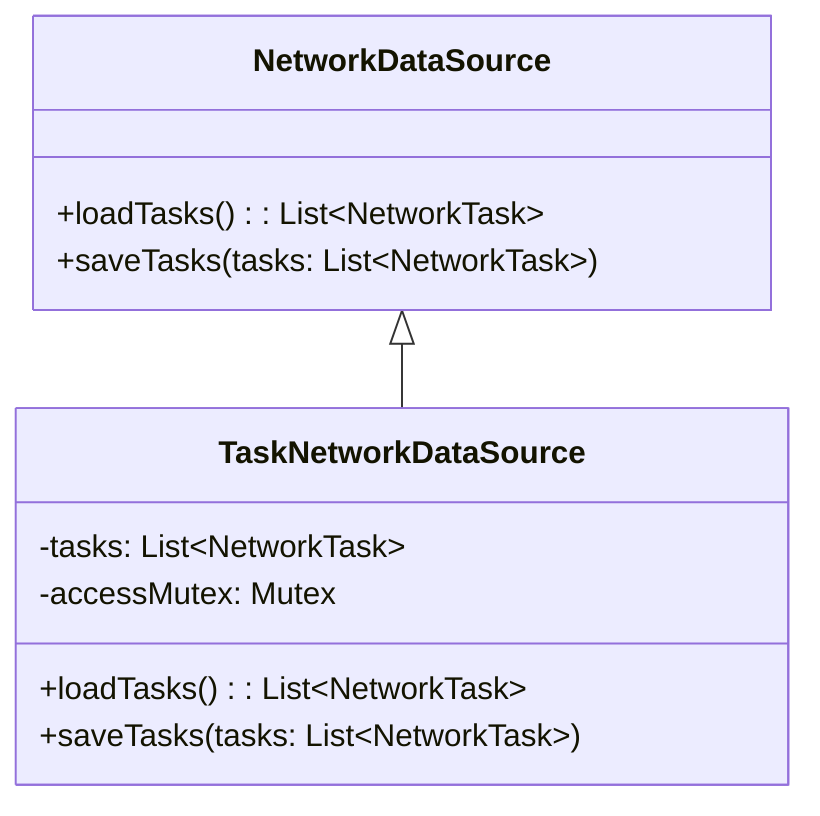
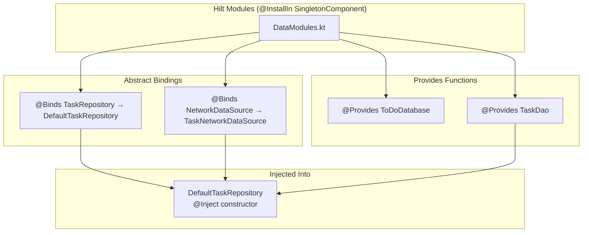

<!-- source: DeepWiki mcp.deepwiki.com · repo android/architecture-samples · page 2.3 Data Layer and Repository Pattern · fetched 2026-10-23 -->

# Data Layer and Repository Pattern

<details>
<summary>Relevant source files</summary>

The following files were used as context for generating this wiki page:

- [app/src/androidTest/java/com/example/android/architecture/blueprints/todoapp/data/source/local/TaskDaoTest.kt](app/src/androidTest/java/com/example/android/architecture/blueprints/todoapp/data/source/local/TaskDaoTest.kt)
- [app/src/main/java/com/example/android/architecture/blueprints/todoapp/TodoApplication.kt](app/src/main/java/com/example/android/architecture/blueprints/todoapp/TodoApplication.kt)
- [app/src/main/java/com/example/android/architecture/blueprints/todoapp/data/DefaultTaskRepository.kt](app/src/main/java/com/example/android/architecture/blueprints/todoapp/data/DefaultTaskRepository.kt)
- [app/src/main/java/com/example/android/architecture/blueprints/todoapp/data/TaskRepository.kt](app/src/main/java/com/example/android/architecture/blueprints/todoapp/data/TaskRepository.kt)
- [app/src/main/java/com/example/android/architecture/blueprints/todoapp/data/source/local/TaskDao.kt](app/src/main/java/com/example/android/architecture/blueprints/todoapp/data/source/local/TaskDao.kt)
- [app/src/main/java/com/example/android/architecture/blueprints/todoapp/data/source/local/ToDoDatabase.kt](app/src/main/java/com/example/android/architecture/blueprints/todoapp/data/source/local/ToDoDatabase.kt)
- [app/src/main/java/com/example/android/architecture/blueprints/todoapp/data/source/network/TaskNetworkDataSource.kt](app/src/main/java/com/example/android/architecture/blueprints/todoapp/data/source/network/TaskNetworkDataSource.kt)
- [app/src/test/java/com/example/android/architecture/blueprints/todoapp/data/DefaultTaskRepositoryTest.kt](app/src/test/java/com/example/android/architecture/blueprints/todoapp/data/DefaultTaskRepositoryTest.kt)
- [shared-test/src/main/java/com/example/android/architecture/blueprints/todoapp/data/FakeTaskRepository.kt](shared-test/src/main/java/com/example/android/architecture/blueprints/todoapp/data/FakeTaskRepository.kt)
- [shared-test/src/main/java/com/example/android/architecture/blueprints/todoapp/data/source/local/FakeTaskDao.kt](shared-test/src/main/java/com/example/android/architecture/blueprints/todoapp/data/source/local/FakeTaskDao.kt)

</details>


## Overview

The data layer implements the Repository pattern to provide a clean API for data access, abstracting local (Room) and network data sources from the rest of the application. The `DefaultTaskRepository` serves as the single source of truth, coordinating between `TaskDao` (Room database) and `NetworkDataSource` (simulated remote API). The layer handles data synchronization, model transformations between layers, and exposes reactive streams via Kotlin Flow.

This page documents the `TaskRepository` interface, `DefaultTaskRepository` implementation, local and network data sources, data model mappings, and the synchronization strategy.

For how ViewModels consume this repository, see page 2.2.

## Architecture Overview

The repository pattern centralizes data access and abstracts data sources from the presentation layer. ViewModels depend only on the `TaskRepository` interface, allowing the concrete implementation to coordinate between local and remote sources transparently.

**Diagram: Data Layer Component Architecture**



Sources: [app/src/main/java/com/example/android/architecture/blueprints/todoapp/data/TaskRepository.kt](), [app/src/main/java/com/example/android/architecture/blueprints/todoapp/data/DefaultTaskRepository.kt]()

## TaskRepository Interface

The `TaskRepository` interface defines all operations for task data access. It provides both reactive (Flow-based) and one-shot (suspend function) APIs.

**Diagram: TaskRepository Interface Contract**



### API Categories

| Category | Methods | Purpose |
|----------|---------|---------|
| **Reactive Reads** | `getTasksStream()`, `getTaskStream(taskId)` | Observe data changes via Flow |
| **One-Shot Reads** | `getTasks(forceUpdate)`, `getTask(taskId, forceUpdate)` | Fetch data synchronously |
| **Refresh** | `refresh()`, `refreshTask(taskId)` | Force network sync |
| **Write Operations** | `createTask()`, `updateTask()`, `completeTask()`, `activateTask()` | Modify individual tasks |
| **Bulk Operations** | `clearCompletedTasks()`, `deleteAllTasks()`, `deleteTask()` | Batch modifications |

The `forceUpdate` parameter controls whether data should be refreshed from the network before returning. By default, cached local data is returned.

Sources: [app/src/main/java/com/example/android/architecture/blueprints/todoapp/data/TaskRepository.kt:24-51]()

## DefaultTaskRepository Implementation

`DefaultTaskRepository` is the concrete singleton implementation that coordinates between `TaskDao` (local) and `NetworkDataSource` (remote). It implements a local-first data access pattern with background synchronization.

### Constructor and Dependencies

The repository is injected with four dependencies:

| Dependency | Type | Qualifier | Purpose |
|------------|------|-----------|---------|
| `networkDataSource` | `NetworkDataSource` | None | Remote data operations |
| `localDataSource` | `TaskDao` | None | Room database operations |
| `dispatcher` | `CoroutineDispatcher` | `@DefaultDispatcher` | Background thread for complex operations (UUID generation, mapping) |
| `scope` | `CoroutineScope` | `@ApplicationScope` | Fire-and-forget background operations (network sync) |

The `@Singleton` annotation ensures a single instance throughout the app lifecycle.

Sources: [app/src/main/java/com/example/android/architecture/blueprints/todoapp/data/DefaultTaskRepository.kt:43-49]()

### Read Operations

Read operations follow a local-first strategy with optional network refresh:

**Diagram: Read Operation Flow**



Key methods:
- `getTasks(forceUpdate)`: Returns task list, optionally refreshing from network
- `getTask(taskId, forceUpdate)`: Returns single task, optionally refreshing
- `getTasksStream()`: Returns Flow that emits on local data changes
- `getTaskStream(taskId)`: Returns Flow for single task observation

Sources: [app/src/main/java/com/example/android/architecture/blueprints/todoapp/data/DefaultTaskRepository.kt:77-113]()

### Write Operations

Write operations immediately persist to local database, then asynchronously sync to network:

**Diagram: Write Operation Flow (Local-First, Sync Later)**



Write operations include:
- `createTask(title, description)`: Generates UUID, saves locally, syncs to network
- `updateTask(taskId, title, description)`: Updates existing task
- `completeTask(taskId)` / `activateTask(taskId)`: Toggle completion status
- `deleteTask(taskId)` / `deleteAllTasks()` / `clearCompletedTasks()`: Remove tasks

All write operations follow the same pattern:
1. Generate ID if needed (using `dispatcher` for UUID generation)
2. Update `localDataSource` immediately
3. Call `saveTasksToNetwork()` for background sync
4. Return immediately (non-blocking)

Sources: [app/src/main/java/com/example/android/architecture/blueprints/todoapp/data/DefaultTaskRepository.kt:51-138]()

### Dispatcher Usage

The repository uses `@DefaultDispatcher` for CPU-intensive operations:
- **UUID generation**: `UUID.randomUUID()` on line 54-56
- **Data mapping**: `toExternal()`, `toNetwork()` transformations on lines 82, 89, 177-179

These operations run on a background thread pool to avoid blocking the main thread or I/O operations.

Sources: [app/src/main/java/com/example/android/architecture/blueprints/todoapp/data/DefaultTaskRepository.kt:54-56](), [app/src/main/java/com/example/android/architecture/blueprints/todoapp/data/DefaultTaskRepository.kt:81-90]()

## Data Models and Layer Separation

The codebase maintains three distinct data models, each optimized for its layer:

| Model | Layer | Purpose | File Location |
|-------|-------|---------|---------------|
| `Task` | Domain/Presentation | Business logic and UI state | `data/Task.kt` |
| `LocalTask` | Data (Persistence) | Room database entity with `@Entity` annotation | `data/source/local/LocalTask.kt` |
| `NetworkTask` | Data (Network) | Network API communication | `data/source/network/NetworkTask.kt` |

**Diagram: Data Model Relationships**



### Mapping Functions

The repository layer uses extension functions for transformations:

| Function | Signature | Purpose |
|----------|-----------|---------|
| `LocalTask.toExternal()` | `LocalTask -> Task` | Convert database entity to domain model |
| `List<LocalTask>.toExternal()` | `List<LocalTask> -> List<Task>` | Batch convert from database |
| `Task.toLocal()` | `Task -> LocalTask` | Convert domain model to database entity |
| `NetworkTask.toExternal()` | `NetworkTask -> Task` | Convert network model to domain model |
| `List<NetworkTask>.toExternal()` | `List<NetworkTask> -> List<Task>` | Batch convert from network |
| `Task.toNetwork()` | `Task -> NetworkTask` | Convert domain model to network model |
| `List<LocalTask>.toNetwork()` | `List<LocalTask> -> List<NetworkTask>` | Database to network for sync |

These mappings are executed on the `@DefaultDispatcher` when processing collections to avoid blocking I/O operations.

**Example mapping usage in repository:**
- Reading from database: `localDataSource.getAll().toExternal()` at line 82
- Syncing to network: `localTasks.toNetwork()` at line 178
- Refreshing from network: `remoteTasks.toLocal()` at line 161

Sources: [app/src/main/java/com/example/android/architecture/blueprints/todoapp/data/DefaultTaskRepository.kt:82](), [app/src/main/java/com/example/android/architecture/blueprints/todoapp/data/DefaultTaskRepository.kt:161](), [app/src/main/java/com/example/android/architecture/blueprints/todoapp/data/DefaultTaskRepository.kt:178]()

## Local Storage with Room

The local storage is implemented using Room, which provides an abstraction layer over SQLite.



### Room Database Definition

The `ToDoDatabase` class is a Room database that contains the `LocalTask` table:

```
@Database(entities = [LocalTask::class], version = 1, exportSchema = false)
abstract class ToDoDatabase : RoomDatabase() {
    abstract fun taskDao(): TaskDao
}
```

Sources: [app/src/main/java/com/example/android/architecture/blueprints/todoapp/data/source/local/ToDoDatabase.kt]()

### TaskDao Interface

The `TaskDao` interface defines the database operations for tasks:

```
@Dao
interface TaskDao {
    @Query("SELECT * FROM task")
    fun observeAll(): Flow<List<LocalTask>>
    
    @Query("SELECT * FROM task")
    suspend fun getAll(): List<LocalTask>
    
    // Other operations...
}
```

The DAO provides both suspend functions for one-time operations and Flow-based APIs for observing data changes.

Sources: [app/src/main/java/com/example/android/architecture/blueprints/todoapp/data/source/local/TaskDao.kt]()

## Network Data Source

The network data source is responsible for communicating with remote APIs:



### Implementation Details

In this sample app, `TaskNetworkDataSource` simulates a network data source with artificial delay:

```
class TaskNetworkDataSource @Inject constructor() : NetworkDataSource {
    // A mutex is used to ensure that reads and writes are thread-safe.
    private val accessMutex = Mutex()
    private var tasks = listOf(/* Initial tasks */)

    override suspend fun loadTasks(): List<NetworkTask> = accessMutex.withLock {
        delay(SERVICE_LATENCY_IN_MILLIS)
        return tasks
    }

    override suspend fun saveTasks(newTasks: List<NetworkTask>) = accessMutex.withLock {
        delay(SERVICE_LATENCY_IN_MILLIS)
        tasks = newTasks
    }
}
```

The implementation uses a `Mutex` to ensure thread-safety and simulates network latency with `delay()`.

Sources: [app/src/main/java/com/example/android/architecture/blueprints/todoapp/data/source/network/TaskNetworkDataSource.kt]()

## Synchronization Strategy

The repository implements a simplified bidirectional synchronization pattern. The implementation acknowledges this is a naive approach suitable for demonstration but not production use (see comments at lines 141-149).

**Diagram: Synchronization Flows**

```mermaid
flowchart TB
    subgraph "Write Path: Local-First, Sync Later"
        W1["User Action"]
        W2["DefaultTaskRepository<br/>createTask/updateTask/deleteTask"]
        W3["TaskDao.upsert/delete<br/>(immediate)"]
        W4["Return to caller<br/>(non-blocking)"]
        W5["saveTasksToNetwork()<br/>(fire-and-forget)"]
        W6["ApplicationScope.launch"]
        W7["TaskDao.getAll()"]
        W8["toNetwork() mapping"]
        W9["NetworkDataSource.saveTasks()"]
    end
    
    subgraph "Read Path: Cache-First with Refresh Option"
        R1["ViewModel.getTasks<br/>(forceUpdate=true)"]
        R2["DefaultTaskRepository.refresh()"]
        R3["NetworkDataSource.loadTasks()"]
        R4["TaskDao.deleteAll()"]
        R5["TaskDao.upsertAll()"]
        R6["TaskDao.getAll()"]
        R7["toExternal() mapping"]
        R8["Return List<Task>"]
    end
    
    W1 --> W2
    W2 --> W3
    W3 --> W4
    W2 --> W5
    W5 --> W6
    W6 --> W7
    W7 --> W8
    W8 --> W9
    
    R1 --> R2
    R2 --> R3
    R3 --> R4
    R4 --> R5
    R5 --> R6
    R6 --> R7
    R7 --> R8
```



### Write-to-Network Synchronization (Local → Remote)

After every write operation (`createTask`, `updateTask`, `completeTask`, `activateTask`, `deleteTask`, `clearCompletedTasks`, `deleteAllTasks`), the repository calls `saveTasksToNetwork()`:

1. Launches coroutine on `@ApplicationScope` (fire-and-forget)
2. Fetches all tasks from `TaskDao.getAll()`
3. Maps to network format: `localTasks.toNetwork()`
4. Sends to `NetworkDataSource.saveTasks()`
5. Catches and ignores exceptions (acknowledged limitation)

This pattern returns immediately to the caller without waiting for network completion. In production, this should use WorkManager for reliable background sync and expose network status to the UI.

Sources: [app/src/main/java/com/example/android/architecture/blueprints/todoapp/data/DefaultTaskRepository.kt:173-186]()

### Read-from-Network Synchronization (Remote → Local)

The `refresh()` method implements a "delete all and replace" strategy:

1. Calls `NetworkDataSource.loadTasks()` to fetch remote data
2. Deletes all local data: `localDataSource.deleteAll()`
3. Inserts network data: `localDataSource.upsertAll(remoteTasks.toLocal())`
4. All operations wrapped in `withContext(dispatcher)` for background execution

This is triggered by:
- `getTasks(forceUpdate = true)`
- `getTask(taskId, forceUpdate = true)`
- `refreshTask(taskId)` (refreshes all tasks, not just one)

The strategy is acknowledged as naive (line 143-145) - production apps should implement proper conflict resolution instead of wholesale replacement.

Sources: [app/src/main/java/com/example/android/architecture/blueprints/todoapp/data/DefaultTaskRepository.kt:157-163]()

### Limitations and Production Considerations

The code includes explicit comments about improvements needed for production:

1. **Proper sync strategy**: Current "one-way sync everything" should be replaced with efficient incremental sync (line 143-145)
2. **Error handling**: Network failures are caught but not exposed to UI (line 181-184)
3. **Background work**: Should use WorkManager for guaranteed delivery (line 168-171)
4. **Conflict resolution**: No handling of concurrent modifications
5. **Incremental sync**: No delta sync, always replaces entire dataset

Reference: [Android offline-first architecture guide](https://developer.android.com/topic/architecture/data-layer/offline-first) mentioned at line 144.

Sources: [app/src/main/java/com/example/android/architecture/blueprints/todoapp/data/DefaultTaskRepository.kt:140-149](), [app/src/main/java/com/example/android/architecture/blueprints/todoapp/data/DefaultTaskRepository.kt:165-172]()

## Dependency Injection with Hilt

Data layer components are provided through Hilt modules in `di/DataModules.kt`. The setup ensures singleton scoping and proper abstraction binding.

**Diagram: Hilt Module Configuration**



### Module Configuration

The data layer DI is defined in `DataModules.kt`:

| Binding | Type | Scope | Purpose |
|---------|------|-------|---------|
| `TaskRepository` | `@Binds` | `@Singleton` | Binds interface to `DefaultTaskRepository` |
| `NetworkDataSource` | `@Binds` | `@Singleton` | Binds interface to `TaskNetworkDataSource` |
| `ToDoDatabase` | `@Provides` | `@Singleton` | Creates Room database instance |
| `TaskDao` | `@Provides` | None | Extracts DAO from database |

**Database Creation:**
Room database is built with:
- Database name: `"Tasks.db"`
- Entity: `LocalTask::class`
- Version: 1
- Export schema: false (should be true in production, per line 25)

**Coroutine Dependencies:**
From `CoroutinesModule.kt`:
- `@DefaultDispatcher`: Provides `Dispatchers.Default` for CPU-bound work
- `@IoDispatcher`: Provides `Dispatchers.IO` for I/O operations
- `@ApplicationScope`: Provides `CoroutineScope(SupervisorJob() + Dispatchers.Default)` for background work

These qualifiers are used in `DefaultTaskRepository` constructor to inject the correct dispatcher and scope.

Sources: [app/src/main/java/com/example/android/architecture/blueprints/todoapp/di/DataModules.kt](), [app/src/main/java/com/example/android/architecture/blueprints/todoapp/data/source/local/ToDoDatabase.kt:22-31]()

## Summary

The data layer in the TodoApp architecture implements the repository pattern to provide a clean interface for data access. Key features include:

1. A well-defined `TaskRepository` interface that abstracts data operations
2. Offline-first architecture with Room database as the single source of truth
3. Background synchronization with a simulated network data source
4. Reactive data flow using Kotlin Flow for observing changes
5. Clear separation of data models for different layers
6. Dependency injection with Hilt for providing repository and data sources

This implementation demonstrates modern Android architecture practices, particularly showing how to create a robust, testable data layer that can handle various data sources while providing a consistent API to the rest of the application.

---

