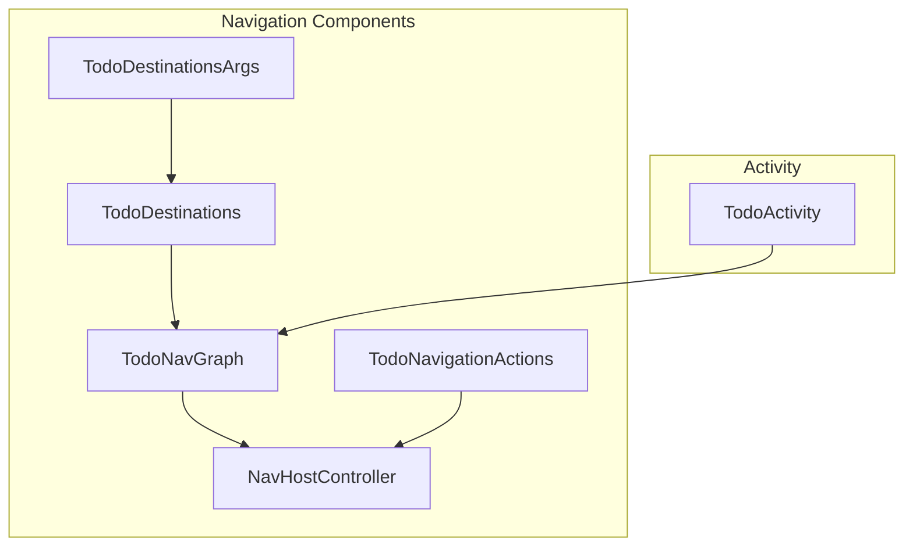
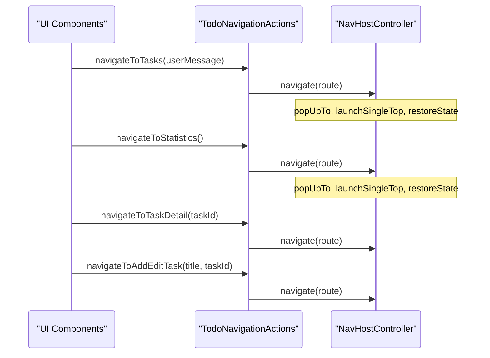
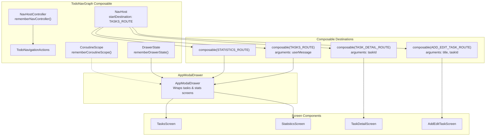
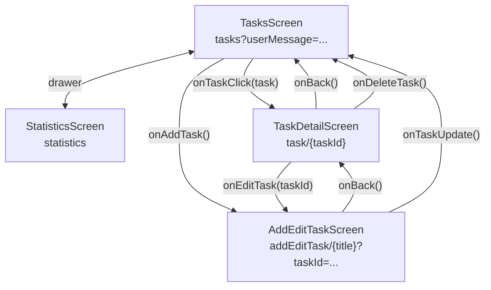
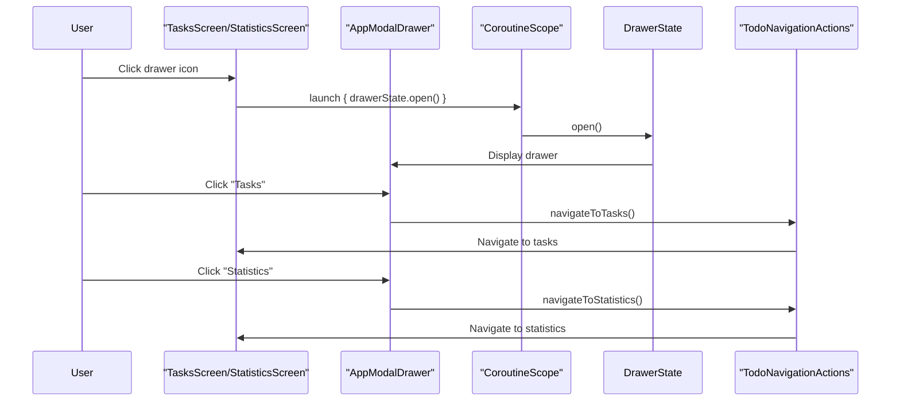
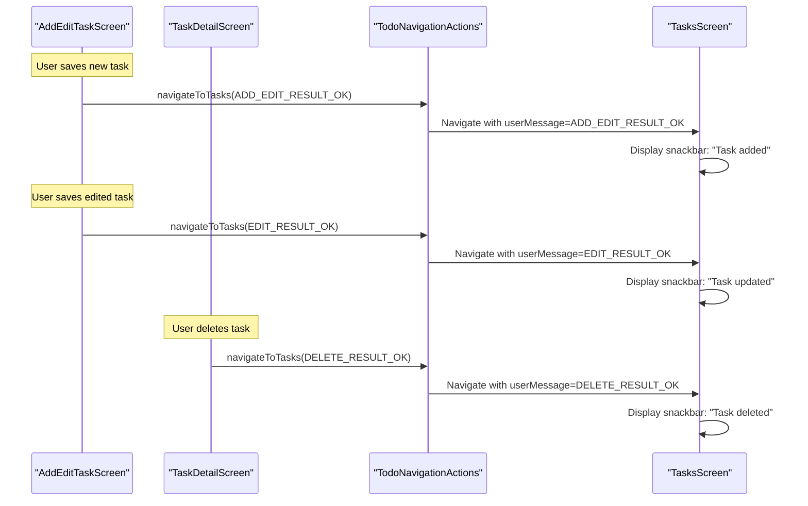

<!-- source: DeepWiki mcp.deepwiki.com · repo android/architecture-samples · page 2.4 Navigation with Jetpack Navigation Compose · fetched 2026-10-23 -->

# Navigation with Jetpack Navigation Compose

<details>
<summary>Relevant source files</summary>

The following files were used as context for generating this wiki page:

- [app/src/androidTest/java/com/example/android/architecture/blueprints/todoapp/tasks/AppNavigationTest.kt](app/src/androidTest/java/com/example/android/architecture/blueprints/todoapp/tasks/AppNavigationTest.kt)
- [app/src/main/AndroidManifest.xml](app/src/main/AndroidManifest.xml)
- [app/src/main/java/com/example/android/architecture/blueprints/todoapp/TodoActivity.kt](app/src/main/java/com/example/android/architecture/blueprints/todoapp/TodoActivity.kt)
- [app/src/main/java/com/example/android/architecture/blueprints/todoapp/TodoNavGraph.kt](app/src/main/java/com/example/android/architecture/blueprints/todoapp/TodoNavGraph.kt)
- [app/src/main/java/com/example/android/architecture/blueprints/todoapp/TodoNavigation.kt](app/src/main/java/com/example/android/architecture/blueprints/todoapp/TodoNavigation.kt)
- [app/src/main/java/com/example/android/architecture/blueprints/todoapp/addedittask/AddEditTaskScreen.kt](app/src/main/java/com/example/android/architecture/blueprints/todoapp/addedittask/AddEditTaskScreen.kt)
- [app/src/main/java/com/example/android/architecture/blueprints/todoapp/di/CoroutinesModule.kt](app/src/main/java/com/example/android/architecture/blueprints/todoapp/di/CoroutinesModule.kt)
- [app/src/main/java/com/example/android/architecture/blueprints/todoapp/di/DataModules.kt](app/src/main/java/com/example/android/architecture/blueprints/todoapp/di/DataModules.kt)
- [app/src/main/java/com/example/android/architecture/blueprints/todoapp/statistics/StatisticsScreen.kt](app/src/main/java/com/example/android/architecture/blueprints/todoapp/statistics/StatisticsScreen.kt)
- [app/src/main/java/com/example/android/architecture/blueprints/todoapp/taskdetail/TaskDetailScreen.kt](app/src/main/java/com/example/android/architecture/blueprints/todoapp/taskdetail/TaskDetailScreen.kt)
- [app/src/main/java/com/example/android/architecture/blueprints/todoapp/tasks/TasksScreen.kt](app/src/main/java/com/example/android/architecture/blueprints/todoapp/tasks/TasksScreen.kt)
- [app/src/test/java/com/example/android/architecture/blueprints/todoapp/statistics/StatisticsUtilsTest.kt](app/src/test/java/com/example/android/architecture/blueprints/todoapp/statistics/StatisticsUtilsTest.kt)

</details>


## Purpose and Scope

This document explains the single-activity navigation architecture implemented in the Todo application using Jetpack Navigation Compose. It covers the `TodoNavGraph` implementation, route definitions with navigation arguments, navigation actions with back stack management, drawer integration, and navigation result handling. For information about UI implementation with Compose, see page 2.1. For details about ViewModels that receive navigation events, see page 2.2.

## Navigation Architecture Overview

The Todo application uses Jetpack Navigation Compose to manage navigation between different screens. The navigation system is built around a central navigation graph that defines all destinations and their relationships.



**Diagram: Navigation Architecture Components**

Sources: [app/src/main/java/com/example/android/architecture/blueprints/todoapp/TodoNavigation.kt:18-106](), [app/src/main/java/com/example/android/architecture/blueprints/todoapp/TodoActivity.kt:28-40]()

## Navigation Routes and Destinations

The application defines a set of destinations with corresponding routes. Each route is a string that may include optional or required arguments.

```mermaid
classDiagram
    class TodoScreens {
        +TASKS_SCREEN: String = "tasks"
        +STATISTICS_SCREEN: String = "statistics"
        +TASK_DETAIL_SCREEN: String = "task"
        +ADD_EDIT_TASK_SCREEN: String = "addEditTask"
    }
    
    class TodoDestinationsArgs {
        +USER_MESSAGE_ARG: String = "userMessage"
        +TASK_ID_ARG: String = "taskId"
        +TITLE_ARG: String = "title"
    }
    
    class TodoDestinations {
        +TASKS_ROUTE: String = "tasks?userMessage={userMessage}"
        +STATISTICS_ROUTE: String = "statistics"
        +TASK_DETAIL_ROUTE: String = "task/{taskId}"
        +ADD_EDIT_TASK_ROUTE: String = "addEditTask/{title}?taskId={taskId}"
    }
    
    TodoScreens -- TodoDestinations
    TodoDestinationsArgs -- TodoDestinations
```

**Diagram: Navigation Routes and Arguments**

Sources: [app/src/main/java/com/example/android/architecture/blueprints/todoapp/TodoNavigation.kt:32-56]()

### Route Definitions

The application defines the following routes:

| Route Name | Route String | Description |
|------------|--------------|-------------|
| `TASKS_ROUTE` | `tasks?userMessage={userMessage}` | Main tasks list screen with optional user message |
| `STATISTICS_ROUTE` | `statistics` | Statistics screen showing task completion metrics |
| `TASK_DETAIL_ROUTE` | `task/{taskId}` | Task detail screen with required task ID parameter |
| `ADD_EDIT_TASK_ROUTE` | `addEditTask/{title}?taskId={taskId}` | Screen for adding or editing a task, with required title and optional task ID |

Sources: [app/src/main/java/com/example/android/architecture/blueprints/todoapp/TodoNavigation.kt:51-56]()

## Navigation Actions

The `TodoNavigationActions` class encapsulates navigation logic, providing methods to navigate between different screens while handling the navigation stack appropriately.



**Diagram: Navigation Actions Flow**

Sources: [app/src/main/java/com/example/android/architecture/blueprints/todoapp/TodoNavigation.kt:61-106]()

### Key Navigation Methods

The `TodoNavigationActions` class provides the following methods for navigation:

#### `navigateToTasks(userMessage: Int = 0)`

Navigates to the tasks list screen with optional result message.

**Back Stack Management**:
- Determines if navigation originates from drawer: `navigatesFromDrawer = userMessage == 0`
- When from drawer: Uses `saveState = true` and `restoreState = true` to preserve state
- When from drawer: Sets `inclusive = false` to keep the start destination
- When from screen: Sets `inclusive = true` and no state preservation
- Always uses `launchSingleTop = true` to prevent duplicate instances

Sources: [app/src/main/java/com/example/android/architecture/blueprints/todoapp/TodoNavigation.kt:63-76]()

#### `navigateToStatistics()`

Navigates to the statistics screen from the drawer.

**Back Stack Management**:
- Pops up to the graph's start destination with `popUpTo(navController.graph.findStartDestination().id)`
- Uses `saveState = true` to preserve the tasks screen state
- Uses `restoreState = true` to restore previous statistics state if returning
- Uses `launchSingleTop = true` to prevent multiple copies

Sources: [app/src/main/java/com/example/android/architecture/blueprints/todoapp/TodoNavigation.kt:79-92]()

#### `navigateToTaskDetail(taskId: String)`

Navigates to the detail screen for a specific task. Simply navigates without back stack modifications, allowing the task detail to be added to the stack.

Sources: [app/src/main/java/com/example/android/architecture/blueprints/todoapp/TodoNavigation.kt:95-96]()

#### `navigateToAddEditTask(title: Int, taskId: String?)`

Navigates to the add/edit task screen with title resource ID and optional task ID.
- `title`: String resource ID for the top bar title (R.string.add_task or R.string.edit_task)
- `taskId`: Task ID for editing (null when adding new task)

Sources: [app/src/main/java/com/example/android/architecture/blueprints/todoapp/TodoNavigation.kt:99-105]()

## TodoNavGraph Implementation

The `TodoNavGraph` composable function is the central implementation of the navigation system, setting up the `NavHost` and defining all navigation destinations.



**Diagram: TodoNavGraph Structure and Components**

The `TodoNavGraph` function sets up:
- `NavHostController` for navigation control
- `DrawerState` for managing the modal drawer
- `CoroutineScope` for launching drawer animations
- `TodoNavigationActions` wrapper around the `NavController`
- `NavHost` with four composable destinations

Sources: [app/src/main/java/com/example/android/architecture/blueprints/todoapp/TodoNavGraph.kt:46-114]()

### NavHost Setup

The `NavHost` is configured with:
- Start destination: `TodoDestinations.TASKS_ROUTE`
- Four composable destinations with type-safe argument definitions

Each destination is defined using the `composable` function with route strings and argument specifications using `navArgument` with `NavType`.

Sources: [app/src/main/java/com/example/android/architecture/blueprints/todoapp/TodoNavGraph.kt:60-113]()

### Navigation Arguments

Arguments are defined for each route using `navArgument`:

| Route | Argument | Type | Required | Default |
|-------|----------|------|----------|---------|
| `TASKS_ROUTE` | `userMessage` | `IntType` | No | `0` |
| `TASK_DETAIL_ROUTE` | `taskId` | `StringType` (path) | Yes | N/A |
| `ADD_EDIT_TASK_ROUTE` | `title` | `IntType` (path) | Yes | N/A |
| `ADD_EDIT_TASK_ROUTE` | `taskId` | `StringType` | No | `null` |

Path arguments (in curly braces) are required, while query parameters (after `?`) are optional.

Sources: [app/src/main/java/com/example/android/architecture/blueprints/todoapp/TodoNavGraph.kt:67-91]()

## Navigation Graph Screen Connections

The navigation graph connects screens through user interactions and navigation callbacks.



**Diagram: Screen Navigation Flows**

Navigation occurs through:
- **User actions**: Clicking tasks, FAB buttons, drawer items
- **Completion callbacks**: `onTaskUpdate()`, `onDeleteTask()`, `onBack()`
- **Navigation results**: Passing result codes back to the tasks screen

Sources: [app/src/main/java/com/example/android/architecture/blueprints/todoapp/TodoNavGraph.kt:65-113](), [app/src/androidTest/java/com/example/android/architecture/blueprints/todoapp/tasks/AppNavigationTest.kt:73-180]()

## Navigation Implementation in TodoActivity

The navigation system is set up in the `TodoActivity`, which is the entry point of the application.

```kotlin
@AndroidEntryPoint
class TodoActivity : ComponentActivity() {
    override fun onCreate(savedInstanceState: Bundle?) {
        super.onCreate(savedInstanceState)
        enableEdgeToEdge()
        setContent {
            TodoTheme {
                TodoNavGraph()
            }
        }
    }
}
```

The `TodoNavGraph` composable function sets up the navigation host and defines all navigation destinations in the application.

Sources: [app/src/main/java/com/example/android/architecture/blueprints/todoapp/TodoActivity.kt:28-40](), [app/src/main/AndroidManifest.xml:26-34]()

## Back Navigation Handling

The application handles back navigation properly, allowing users to navigate backward through the navigation stack.

### Back Button Navigation

The application supports back navigation through:

1. System back button press
2. Back arrow in the app bar

When navigating from the edit task screen, pressing back returns to the task detail screen. Pressing back again returns to the tasks list screen, showing the proper hierarchical navigation.

Sources: [app/src/androidTest/java/com/example/android/architecture/blueprints/todoapp/tasks/AppNavigationTest.kt:131-180]()

## Drawer Navigation and Integration

The navigation drawer is integrated into the `TodoNavGraph` through the `AppModalDrawer` composable, which wraps the tasks and statistics screens.



**Diagram: Drawer Navigation Integration**

The drawer integration involves:
- `AppModalDrawer` wrapping the tasks and statistics screens
- `DrawerState` managed by `rememberDrawerState()` in `TodoNavGraph`
- `CoroutineScope` used to launch drawer animations: `coroutineScope.launch { drawerState.open() }`
- `openDrawer` callback passed to screens, which launches the coroutine to open the drawer

Only the tasks and statistics screens are wrapped in the drawer. The task detail and add/edit screens are standalone without drawer access.

Sources: [app/src/main/java/com/example/android/architecture/blueprints/todoapp/TodoNavGraph.kt:71-84](), [app/src/androidTest/java/com/example/android/architecture/blueprints/todoapp/tasks/AppNavigationTest.kt:73-107]()

## Navigation Results

The application uses result codes to communicate navigation outcomes back to the tasks screen. These results trigger appropriate user messages (snackbars).

### Result Constants

Three result constants are defined:

```kotlin
const val ADD_EDIT_RESULT_OK = Activity.RESULT_FIRST_USER + 1
const val DELETE_RESULT_OK = Activity.RESULT_FIRST_USER + 2
const val EDIT_RESULT_OK = Activity.RESULT_FIRST_USER + 3
```

Sources: [app/src/main/java/com/example/android/architecture/blueprints/todoapp/TodoNavGraph.kt:117-119]()

### Result Flow



**Diagram: Navigation Result Flow**

Results are passed as the `userMessage` argument to the tasks route:
- After adding a task: `ADD_EDIT_RESULT_OK` is passed
- After editing a task: `EDIT_RESULT_OK` is passed
- After deleting a task: `DELETE_RESULT_OK` is passed

The `TasksScreen` receives these results and displays appropriate snackbar messages.

Sources: [app/src/main/java/com/example/android/architecture/blueprints/todoapp/TodoNavGraph.kt:96-110](), [app/src/main/java/com/example/android/architecture/blueprints/todoapp/tasks/TasksScreen.kt:120-127]()

## Testing Navigation

The application includes comprehensive tests for navigation flows in `AppNavigationTest.kt`. These tests verify:

1. Drawer navigation between tasks and statistics screens
2. Opening the drawer using the Android home icon
3. Back navigation through task detail and edit screens

```kotlin
@Test
fun drawerNavigationFromTasksToStatistics() {
    // Test navigation from tasks to statistics and back via drawer
}

@Test
fun taskDetailScreen_doubleUIBackButton() = runTest {
    // Test back navigation from edit screen to detail and then to tasks
}
```

Sources: [app/src/androidTest/java/com/example/android/architecture/blueprints/todoapp/tasks/AppNavigationTest.kt:72-194]()

## Best Practices Demonstrated

The navigation implementation in this application demonstrates several Navigation Compose best practices:

1. **Encapsulated Navigation Logic**: Navigation actions are encapsulated in a dedicated class
2. **Proper Back Stack Management**: Using `popUpTo`, `saveState`, and `restoreState` for proper back navigation
3. **Single-Top Navigation**: Using `launchSingleTop` to avoid duplicate destinations
4. **Typed Arguments**: Clear definition of navigation arguments
5. **Navigation Testing**: Comprehensive tests for navigation flows

These practices create a maintainable and predictable navigation system that provides a good user experience.

---

