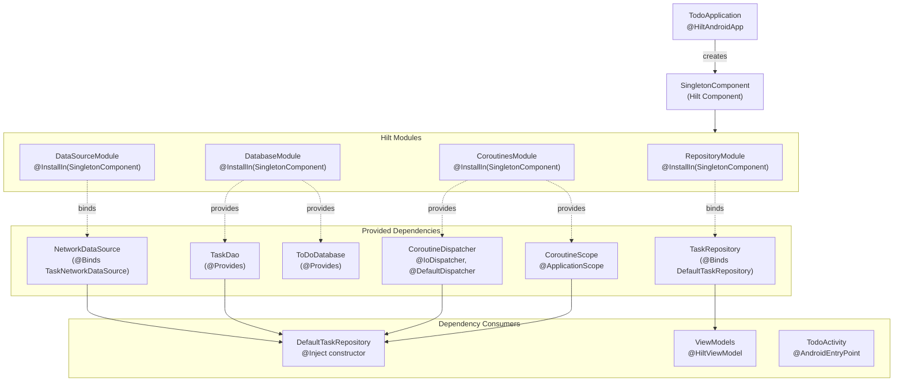
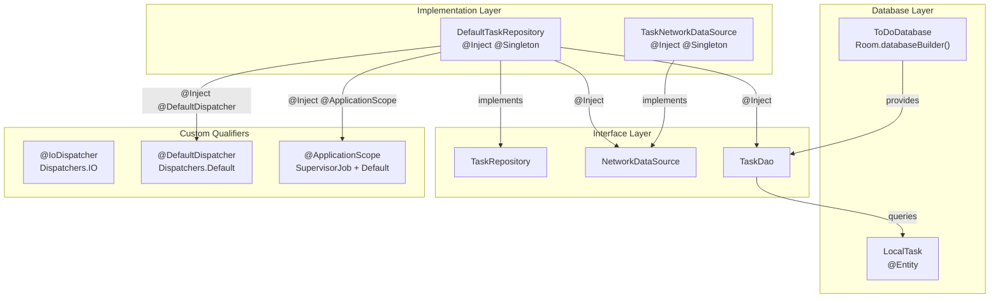
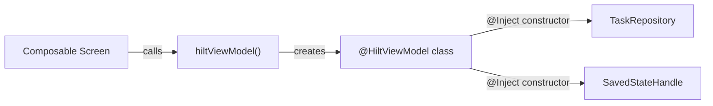
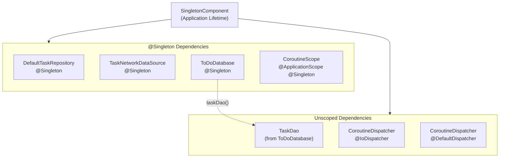
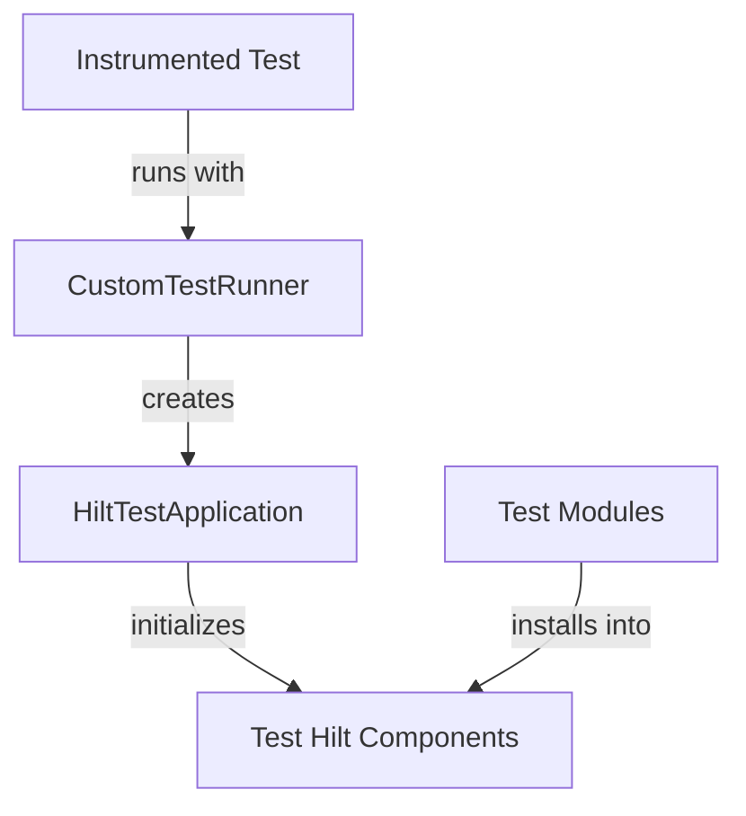

<!-- source: DeepWiki mcp.deepwiki.com · repo android/architecture-samples · page 3 Dependency Injection with Hilt · fetched 2026-10-23 -->

# Dependency Injection with Hilt

<details>
<summary>Relevant source files</summary>

The following files were used as context for generating this wiki page:

- [app/build.gradle.kts](app/build.gradle.kts)
- [app/src/main/AndroidManifest.xml](app/src/main/AndroidManifest.xml)
- [app/src/main/java/com/example/android/architecture/blueprints/todoapp/TodoActivity.kt](app/src/main/java/com/example/android/architecture/blueprints/todoapp/TodoActivity.kt)
- [app/src/main/java/com/example/android/architecture/blueprints/todoapp/TodoApplication.kt](app/src/main/java/com/example/android/architecture/blueprints/todoapp/TodoApplication.kt)
- [app/src/main/java/com/example/android/architecture/blueprints/todoapp/TodoNavigation.kt](app/src/main/java/com/example/android/architecture/blueprints/todoapp/TodoNavigation.kt)
- [app/src/main/java/com/example/android/architecture/blueprints/todoapp/data/source/local/ToDoDatabase.kt](app/src/main/java/com/example/android/architecture/blueprints/todoapp/data/source/local/ToDoDatabase.kt)
- [app/src/main/java/com/example/android/architecture/blueprints/todoapp/di/CoroutinesModule.kt](app/src/main/java/com/example/android/architecture/blueprints/todoapp/di/CoroutinesModule.kt)
- [app/src/main/java/com/example/android/architecture/blueprints/todoapp/di/DataModules.kt](app/src/main/java/com/example/android/architecture/blueprints/todoapp/di/DataModules.kt)
- [build.gradle.kts](build.gradle.kts)
- [gradle.properties](gradle.properties)
- [settings.gradle.kts](settings.gradle.kts)
- [shared-test/.gitignore](shared-test/.gitignore)
- [shared-test/build.gradle.kts](shared-test/build.gradle.kts)
- [shared-test/src/main/AndroidManifest.xml](shared-test/src/main/AndroidManifest.xml)
- [shared-test/src/main/java/com/example/android/architecture/blueprints/todoapp/CustomTestRunner.kt](shared-test/src/main/java/com/example/android/architecture/blueprints/todoapp/CustomTestRunner.kt)
- [shared-test/src/main/java/com/example/android/architecture/blueprints/todoapp/MainCoroutineRule.kt](shared-test/src/main/java/com/example/android/architecture/blueprints/todoapp/MainCoroutineRule.kt)

</details>


This document covers the implementation of dependency injection in the Android Architecture Samples Todo application using Hilt. It explains how Hilt is configured, how modules are organized, and how dependencies are provided and consumed throughout the application.

## Overview

Hilt is a dependency injection library built on top of Dagger that simplifies dependency injection in Android applications. In this Todo application, Hilt manages the creation and provision of various components including repositories, data sources, database objects, and coroutine-related dependencies.



**Title: Hilt Architecture and Dependency Flow**

Sources: [app/src/main/java/com/example/android/architecture/blueprints/todoapp/TodoApplication.kt:28-29](), [app/src/main/java/com/example/android/architecture/blueprints/todoapp/TodoActivity.kt:28](), [app/src/main/java/com/example/android/architecture/blueprints/todoapp/di/DataModules.kt:35-69](), [app/src/main/java/com/example/android/architecture/blueprints/todoapp/di/CoroutinesModule.kt:42-60]()

## Hilt Setup

### Application Configuration

The entry point for Hilt is the `TodoApplication` class, annotated with `@HiltAndroidApp`. This annotation triggers Hilt's code generation and creates the `SingletonComponent` that serves as the base for the dependency graph.

Sources: [app/src/main/java/com/example/android/architecture/blueprints/todoapp/TodoApplication.kt:28-29]()

### Activity Entry Point

The `TodoActivity` is annotated with `@AndroidEntryPoint`, which enables field injection and allows Hilt to provide dependencies to the activity and its Compose hierarchy. This annotation is required for any Android component that needs Hilt injection.

Sources: [app/src/main/java/com/example/android/architecture/blueprints/todoapp/TodoActivity.kt:28-29]()

### Build Configuration

Hilt requires the following plugins in [app/build.gradle.kts:17-23]():
- `hilt` plugin (version 2.53.1 from version catalog)
- `ksp` plugin for annotation processing

Key dependencies include:
- `hilt.android.core` for runtime support
- `androidx.hilt.navigation.compose` for Navigation integration
- `hilt.compiler` for code generation (applied with `ksp`)

The `testInstrumentationRunner` is set to `CustomTestRunner` to enable Hilt in instrumented tests.

Sources: [app/build.gradle.kts:21](), [app/build.gradle.kts:36](), [app/build.gradle.kts:127-129](), [app/build.gradle.kts:166-167](), [app/build.gradle.kts:196-197]()

## Module Structure

The application organizes its dependencies in several Hilt modules, each focused on providing a specific category of dependencies:

### Repository Module

The `RepositoryModule` is responsible for binding the concrete implementation of the repository interfaces:

```kotlin
@Module
@InstallIn(SingletonComponent::class)
abstract class RepositoryModule {
    @Singleton
    @Binds
    abstract fun bindTaskRepository(repository: DefaultTaskRepository): TaskRepository
}
```

This module uses the `@Binds` annotation to tell Hilt how to fulfill requests for a `TaskRepository` by providing the `DefaultTaskRepository` implementation.

Sources: [app/src/main/java/com/example/android/architecture/blueprints/todoapp/di/DataModules.kt:35-42]()

### DataSource Module

The `DataSourceModule` provides the network data source implementation:

```kotlin
@Module
@InstallIn(SingletonComponent::class)
abstract class DataSourceModule {
    @Singleton
    @Binds
    abstract fun bindNetworkDataSource(dataSource: TaskNetworkDataSource): NetworkDataSource
}
```

This module binds the `TaskNetworkDataSource` implementation to the `NetworkDataSource` interface.

Sources: [app/src/main/java/com/example/android/architecture/blueprints/todoapp/di/DataModules.kt:44-51]()

### Database Module

The `DatabaseModule` provides the Room database and DAO implementations:

```kotlin
@Module
@InstallIn(SingletonComponent::class)
object DatabaseModule {
    @Singleton
    @Provides
    fun provideDataBase(@ApplicationContext context: Context): ToDoDatabase {
        return Room.databaseBuilder(
            context.applicationContext,
            ToDoDatabase::class.java,
            "Tasks.db"
        ).build()
    }

    @Provides
    fun provideTaskDao(database: ToDoDatabase): TaskDao = database.taskDao()
}
```

This module uses the `@Provides` annotation because the creation of database objects requires parameters and configuration that can't be handled with `@Binds` alone.

Sources: [app/src/main/java/com/example/android/architecture/blueprints/todoapp/di/DataModules.kt:53-69]()

### Coroutines Module

The `CoroutinesModule` provides coroutine-related dependencies:

```kotlin
@Module
@InstallIn(SingletonComponent::class)
object CoroutinesModule {
    @Provides
    @IoDispatcher
    fun providesIODispatcher(): CoroutineDispatcher = Dispatchers.IO

    @Provides
    @DefaultDispatcher
    fun providesDefaultDispatcher(): CoroutineDispatcher = Dispatchers.Default

    @Provides
    @Singleton
    @ApplicationScope
    fun providesCoroutineScope(
        @DefaultDispatcher dispatcher: CoroutineDispatcher
    ): CoroutineScope = CoroutineScope(SupervisorJob() + dispatcher)
}
```

This module introduces custom qualifiers (`@IoDispatcher`, `@DefaultDispatcher`, `@ApplicationScope`) to differentiate between similar types of dependencies.

Sources: [app/src/main/java/com/example/android/architecture/blueprints/todoapp/di/CoroutinesModule.kt:30-60]()

## Dependency Diagram



**Title: Dependency Graph with Hilt Annotations**

Sources: [app/src/main/java/com/example/android/architecture/blueprints/todoapp/di/DataModules.kt:35-69](), [app/src/main/java/com/example/android/architecture/blueprints/todoapp/di/CoroutinesModule.kt:30-60]()

## Dependency Consumers

### Constructor Injection in Data Layer

Repository and data source classes use constructor injection with the `@Inject` annotation. The `DefaultTaskRepository` constructor demonstrates how to inject dependencies with custom qualifiers:

| Parameter | Type | Qualifier | Purpose |
|-----------|------|-----------|---------|
| `networkDataSource` | `NetworkDataSource` | none | Remote data access |
| `localDataSource` | `TaskDao` | none | Local database access |
| `dispatcher` | `CoroutineDispatcher` | `@DefaultDispatcher` | Background computation |
| `scope` | `CoroutineScope` | `@ApplicationScope` | Application-lifetime coroutine scope |

The `@Singleton` scope ensures only one instance exists throughout the application lifecycle.

Sources: [app/src/main/java/com/example/android/architecture/blueprints/todoapp/data/DefaultTaskRepository.kt:42-49]()

### ViewModel Injection

ViewModels use the `@HiltViewModel` annotation combined with constructor injection. Hilt automatically provides dependencies when ViewModels are created through `hiltViewModel()` in Compose.



**Title: ViewModel Dependency Injection Flow**

Sources: [app/build.gradle.kts:128]()

Example ViewModel structure (not showing actual code):
- `TasksViewModel`: Injects `TaskRepository`
- `TaskDetailViewModel`: Injects `TaskRepository` and `SavedStateHandle`
- `AddEditTaskViewModel`: Injects `TaskRepository`
- `StatisticsViewModel`: Injects `TaskRepository`

All ViewModels are scoped to their respective Compose destinations through the Navigation library integration provided by `androidx.hilt.navigation.compose`.

Sources: [app/build.gradle.kts:128]()

## Scopes and Qualifiers

### Component Scopes

The application uses the `@Singleton` scope from the `SingletonComponent` to ensure dependencies live for the entire application lifetime:

| Class | Scope | Reason |
|-------|-------|--------|
| `DefaultTaskRepository` | `@Singleton` | Single source of truth for task data |
| `TaskNetworkDataSource` | `@Singleton` | Shared network client |
| `ToDoDatabase` | `@Singleton` | Single database instance |
| `CoroutineScope` with `@ApplicationScope` | `@Singleton` | Application-lifetime coroutine scope |

Sources: [app/src/main/java/com/example/android/architecture/blueprints/todoapp/di/DataModules.kt:39](), [app/src/main/java/com/example/android/architecture/blueprints/todoapp/di/DataModules.kt:48](), [app/src/main/java/com/example/android/architecture/blueprints/todoapp/di/DataModules.kt:57](), [app/src/main/java/com/example/android/architecture/blueprints/todoapp/di/CoroutinesModule.kt:55]()

### Custom Qualifiers

Three custom qualifiers disambiguate between coroutine-related dependencies:

| Qualifier | Type | Provides | Usage |
|-----------|------|----------|-------|
| `@IoDispatcher` | `CoroutineDispatcher` | `Dispatchers.IO` | I/O operations (database, network) |
| `@DefaultDispatcher` | `CoroutineDispatcher` | `Dispatchers.Default` | CPU-intensive work |
| `@ApplicationScope` | `CoroutineScope` | `SupervisorJob() + Default` | Application-lifetime coroutines |

The qualifiers are defined in [app/src/main/java/com/example/android/architecture/blueprints/todoapp/di/CoroutinesModule.kt:30-40]() with `@Qualifier` and `@Retention(AnnotationRetention.RUNTIME)` annotations.

**Providing qualified dependencies:**
```
@Provides
@IoDispatcher
fun providesIODispatcher(): CoroutineDispatcher = Dispatchers.IO
```

**Injecting qualified dependencies:**
```
@Inject constructor(
    @DefaultDispatcher private val dispatcher: CoroutineDispatcher,
    @ApplicationScope private val scope: CoroutineScope
)
```

Sources: [app/src/main/java/com/example/android/architecture/blueprints/todoapp/di/CoroutinesModule.kt:30-60]()

## Component Hierarchy



**Title: Component Scopes and Dependency Lifetimes**

The `@Singleton` scope ensures dependencies live for the entire application lifetime. Unscoped dependencies (TaskDao, dispatchers) are created each time they're requested, though dispatchers return the same underlying `Dispatchers.IO` and `Dispatchers.Default` instances.

Sources: [app/src/main/java/com/example/android/architecture/blueprints/todoapp/di/DataModules.kt:35-69](), [app/src/main/java/com/example/android/architecture/blueprints/todoapp/di/CoroutinesModule.kt:42-60]()

## Testing Infrastructure

### CustomTestRunner for Hilt Tests

The `CustomTestRunner` enables Hilt in instrumented tests by replacing the standard `TodoApplication` with `HiltTestApplication`. This is configured as the `testInstrumentationRunner` in the app's build configuration.



**Title: Hilt Test Infrastructure Setup**

Sources: [shared-test/src/main/java/com/example/android/architecture/blueprints/todoapp/CustomTestRunner.kt:24-28](), [app/build.gradle.kts:36]()

### Writing Hilt Tests

Instrumented tests use `@HiltAndroidTest` to enable Hilt's testing features. Tests can replace production modules with test modules using `@UninstallModules` and provide test implementations using `@BindValue` or custom test modules.

The `:shared-test` module provides test utilities and fake implementations:
- `CustomTestRunner`: Configures Hilt for instrumented tests
- `FakeTaskRepository`: In-memory implementation of `TaskRepository`
- `FakeTaskDao`: In-memory implementation of `TaskDao`
- `MainCoroutineRule`: Test rule for coroutine testing

Sources: [shared-test/build.gradle.kts:16-56](), [shared-test/src/main/java/com/example/android/architecture/blueprints/todoapp/CustomTestRunner.kt:24-28]()

### Test Dependencies

The build configuration includes Hilt testing dependencies for both unit and instrumented tests:

| Test Type | Dependency | Annotation Processor |
|-----------|------------|---------------------|
| JVM Unit Tests | `hilt.android.testing` | `kspTest(hilt.compiler)` |
| Instrumented Tests | `hilt.android.testing` | `kspAndroidTest(hilt.compiler)` |

Sources: [app/build.gradle.kts:166-167](), [app/build.gradle.kts:196-197](), [shared-test/build.gradle.kts:48-50]()

## Summary

Hilt provides a structured and standardized way to implement dependency injection in the Todo application. By using modules, scopes, and qualifiers, the application achieves:

1. Clear separation of dependencies by type and purpose
2. Control over the lifecycle of dependencies
3. Disambiguation between similar types of dependencies
4. Testability through fake implementations

This approach helps maintain a clean architecture where components are loosely coupled and can be easily replaced or mocked for testing.

---

