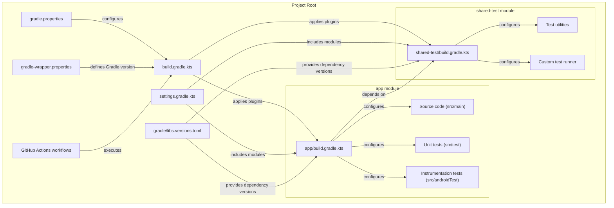
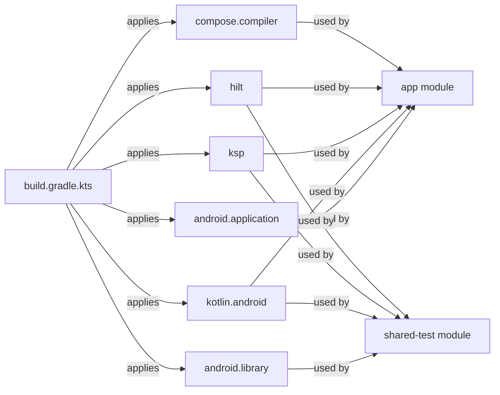
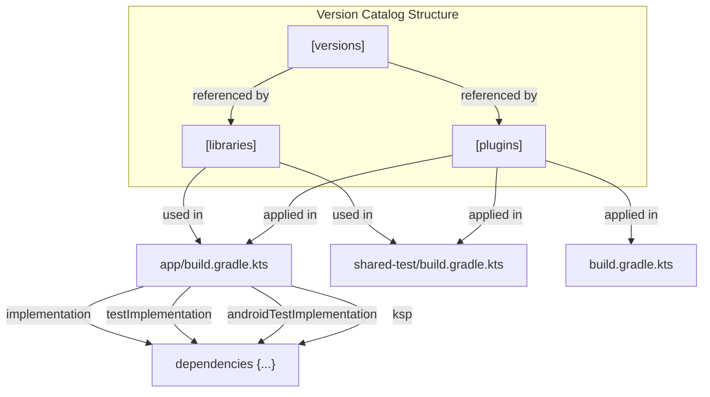
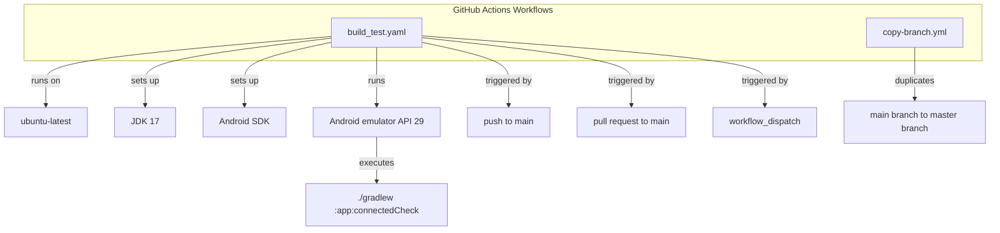

<!-- source: DeepWiki mcp.deepwiki.com · repo android/architecture-samples · page 4 Build System and Project Structure · fetched 2026-10-23 -->

# Build System and Project Structure

<details>
<summary>Relevant source files</summary>

The following files were used as context for generating this wiki page:

- [.github/ci-gradle.properties](.github/ci-gradle.properties)
- [.github/workflows/build_test.yaml](.github/workflows/build_test.yaml)
- [.github/workflows/copy-branch.yml](.github/workflows/copy-branch.yml)
- [app/build.gradle.kts](app/build.gradle.kts)
- [build.gradle.kts](build.gradle.kts)
- [gradle.properties](gradle.properties)
- [gradle/init.gradle.kts](gradle/init.gradle.kts)
- [gradle/libs.versions.toml](gradle/libs.versions.toml)
- [gradle/wrapper/gradle-wrapper.properties](gradle/wrapper/gradle-wrapper.properties)
- [settings.gradle.kts](settings.gradle.kts)
- [shared-test/.gitignore](shared-test/.gitignore)
- [shared-test/build.gradle.kts](shared-test/build.gradle.kts)
- [shared-test/src/main/AndroidManifest.xml](shared-test/src/main/AndroidManifest.xml)
- [shared-test/src/main/java/com/example/android/architecture/blueprints/todoapp/CustomTestRunner.kt](shared-test/src/main/java/com/example/android/architecture/blueprints/todoapp/CustomTestRunner.kt)
- [shared-test/src/main/java/com/example/android/architecture/blueprints/todoapp/MainCoroutineRule.kt](shared-test/src/main/java/com/example/android/architecture/blueprints/todoapp/MainCoroutineRule.kt)

</details>


## Purpose and Scope

This document details the build system configuration, project structure, and dependency management for the Android Architecture Samples repository. It explains the Gradle build system setup, project organization, and how dependencies are managed. For information about the testing approach, see [Testing Strategy](#5).

## Project Structure Overview

The Architecture Samples project follows a multi-module structure, with a main app module and a shared test module. This organization promotes separation of concerns and reusability of testing code.



Sources: [settings.gradle.kts](), [app/build.gradle.kts](), [shared-test/build.gradle.kts](), [gradle/libs.versions.toml](), [gradle.properties](), [gradle/wrapper/gradle-wrapper.properties]()

## Gradle Configuration

### Gradle Wrapper

The project uses Gradle Wrapper (version 8.11.1) to ensure build consistency across different environments:

```
distributionUrl=https\://services.gradle.org/distributions/gradle-8.11.1-bin.zip
```

Sources: [gradle/wrapper/gradle-wrapper.properties:3-3]()

### Root Build Configuration

The root `build.gradle.kts` file defines the plugins used throughout the project:



Sources: [build.gradle.kts:16-23]()

### Gradle Properties

The project defines several Gradle properties to optimize build performance:

| Property | Value | Purpose |
|----------|-------|---------|
| org.gradle.jvmargs | -Xmx2048m -Dfile.encoding=UTF-8 | Memory allocation for the Gradle daemon |
| android.enableJetifier | true | Enables Jetifier for AndroidX compatibility |
| android.useAndroidX | true | Uses AndroidX libraries |
| ksp.incremental.apt | true | Enables incremental annotation processing |
| org.gradle.unsafe.configuration-cache | true | Enables Gradle configuration cache |

Sources: [gradle.properties:13-22]()

## Version Catalog

The project uses Gradle's version catalog feature for centralized dependency management in `gradle/libs.versions.toml`:



Key aspects of the version catalog:

1. **Versions section** - Defines all dependency versions in one place
2. **Libraries section** - Defines library coordinates with references to versions
3. **Plugins section** - Defines Gradle plugins with references to versions

This approach provides several benefits:
- Centralized version management
- Consistency across modules
- Type-safe access to dependencies in build scripts

Sources: [gradle/libs.versions.toml:1-152]()

## App Module Configuration

The `app/build.gradle.kts` file contains the primary build configuration for the application module:

### Basic Configuration

```
namespace = "com.example.android.architecture.blueprints.todoapp"
compileSdk = libs.versions.compileSdk.get().toInt()

defaultConfig {
    applicationId = "com.example.android.architecture.blueprints.main"
    minSdk = libs.versions.minSdk.get().toInt()
    targetSdk = libs.versions.targetSdk.get().toInt()
    versionCode = 1
    versionName = "1.0"
    
    testInstrumentationRunner = "com.example.android.architecture.blueprints.todoapp.CustomTestRunner"
}
```

Sources: [app/build.gradle.kts:25-42]()

### Build Types

The project defines two build types with specific configurations:

| Build Type | Features |
|------------|----------|
| Debug | Minification disabled, Test coverage enabled, ProGuard configured for tests |
| Release | Minification enabled, Resource shrinking enabled, ProGuard configured |

Sources: [app/build.gradle.kts:45-59]()

### Compile Options and Feature Flags

```
compileOptions {
    sourceCompatibility = JavaVersion.VERSION_17
    targetCompatibility = JavaVersion.VERSION_17
}

kotlinOptions {
    jvmTarget = "17"
}

buildFeatures {
    compose = true
    buildConfig = true
}
```

Sources: [app/build.gradle.kts:80-92]()

## Dependency Management

The app module's dependencies are organized into logical groups:

```mermaid
flowchart TD
    subgraph "App Dependencies"
        AppDeps["Core Application Dependencies"]
        ArchDeps["Architecture Components"]
        HiltDeps["Hilt Dependency Injection"]
        ComposeDeps["Jetpack Compose"]
        TestDeps["Testing Dependencies"]
    end
    
    AppDeps -->|"includes"| Timber["timber"]
    AppDeps -->|"includes"| Coroutines["kotlinx.coroutines.android"]
    
    ArchDeps -->|"includes"| Room["room.runtime/ktx/compiler"]
    ArchDeps -->|"includes"| Lifecycle["androidx.lifecycle.*"]
    
    HiltDeps -->|"includes"| HiltAndroid["hilt.android.core"]
    HiltDeps -->|"includes"| HiltNavCompose["androidx.hilt.navigation.compose"]
    HiltDeps -->|"includes"| HiltCompiler["hilt.compiler"]
    
    ComposeDeps -->|"uses"| ComposeBom["androidx.compose.bom"]
    ComposeDeps -->|"includes"| ComposeFoundation["androidx.compose.foundation"]
    ComposeDeps -->|"includes"| ComposeMaterial["androidx.compose.material3"]
    ComposeDeps -->|"includes"| ComposeNavigation["androidx.navigation.compose"]
    
    TestDeps -->|"includes"| JUnit["junit4"]
    TestDeps -->|"includes"| TestCoroutines["kotlinx.coroutines.test"]
    TestDeps -->|"includes"| ComposeTest["androidx.compose.ui.test"]
    TestDeps -->|"includes"| HiltTest["hilt.android.testing"]
```



Key dependency categories:

1. **Core Application Dependencies** - Fundamental libraries like Kotlin Coroutines and Timber logging
2. **Architecture Components** - Room database, Lifecycle components
3. **Hilt Dependency Injection** - Core Hilt libraries and compiler
4. **Jetpack Compose** - UI toolkit components 
5. **Testing Dependencies** - JUnit, Espresso, Compose test libraries

The project uses Jetpack Compose BOM (Bill of Materials) to ensure compatible versions:

```kotlin
val composeBom = platform(libs.androidx.compose.bom)
implementation(composeBom)
```

Sources: [app/build.gradle.kts:111-197]()

## Shared Test Module

The `shared-test` module contains common test utilities used across different test types:

```
implementation(project(":app"))
implementation(libs.kotlinx.coroutines.android)
implementation(libs.kotlinx.coroutines.test)
implementation(libs.junit4)
implementation(libs.androidx.test.core.ktx)
implementation(libs.androidx.test.ext)
implementation(libs.androidx.test.rules)
implementation(libs.hilt.android.core)
implementation(libs.hilt.android.testing)
ksp(libs.hilt.compiler)

// Room
implementation(libs.room.runtime)
implementation(libs.room.ktx)
ksp(libs.room.compiler)
```

The module includes a custom test runner (`CustomTestRunner`) for Hilt and coroutine testing utilities (`MainCoroutineRule`).

Sources: [shared-test/build.gradle.kts:22-56](), [shared-test/src/main/java/com/example/android/architecture/blueprints/todoapp/CustomTestRunner.kt:24-28](), [shared-test/src/main/java/com/example/android/architecture/blueprints/todoapp/MainCoroutineRule.kt:41-54]()

## CI/CD Integration

The project uses GitHub Actions for continuous integration and delivery:



Key CI features:
- Runs on Ubuntu with JDK 17
- Sets up the Android environment
- Executes instrumentation tests on an Android emulator
- Uploads test reports as artifacts

Sources: [.github/workflows/build_test.yaml:1-60](), [.github/workflows/copy-branch.yml:1-33]()

## Repository Structure

The complete project structure:

| Path | Purpose |
|------|---------|
| `/app` | Main application module |
| `/shared-test` | Shared test utilities module |
| `/gradle` | Gradle configuration files, wrapper, and version catalog |
| `/.github` | GitHub Actions workflows and CI configuration |
| `/app/src/main` | Application source code |
| `/app/src/test` | Unit tests |
| `/app/src/androidTest` | Instrumentation tests |
| `/shared-test/src/main` | Shared test utilities |

Sources: [settings.gradle.kts:32-33]()

## Build Customization and Optimization

The project includes several build optimizations:

1. **Configuration cache** - Enabled for faster build startup
2. **Custom CI Gradle properties** - Optimizes CI build performance
3. **Spotless integration** - Code style checking via init script
4. **KSP incremental processing** - Faster annotation processing

Sources: [gradle.properties:22-22](), [.github/ci-gradle.properties:17-27](), [gradle/init.gradle.kts:17-59]()

---

