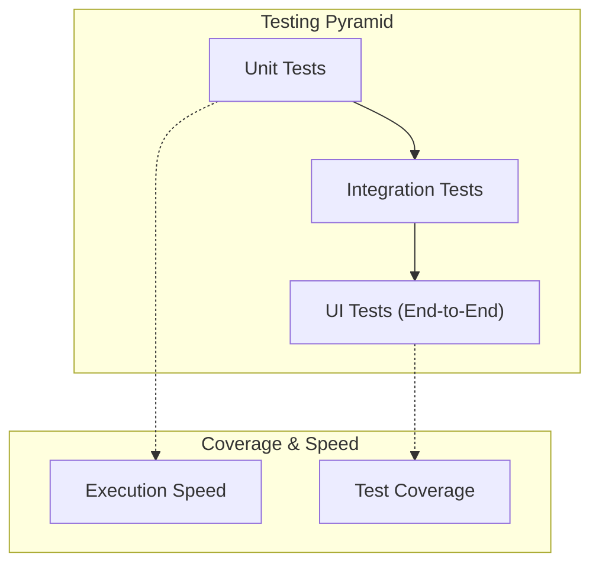
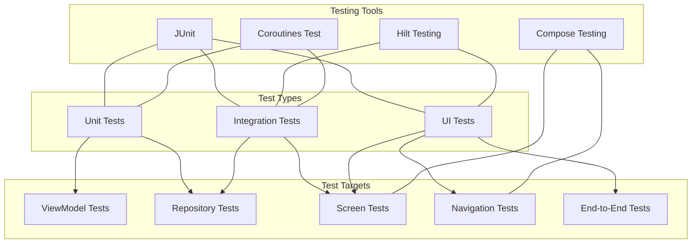
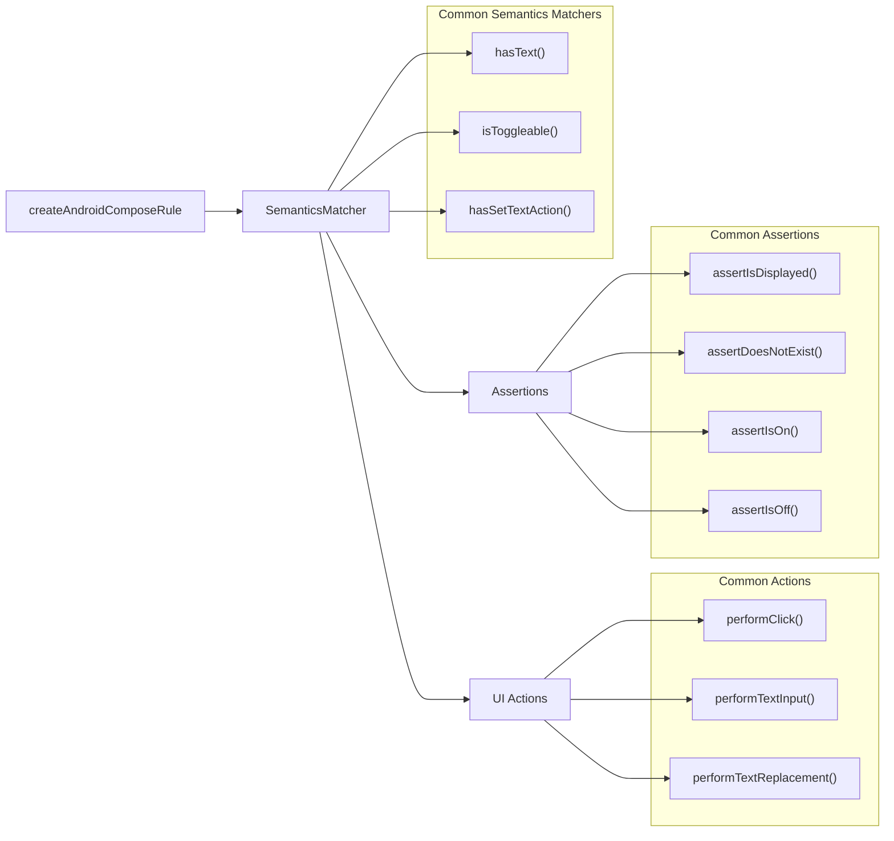
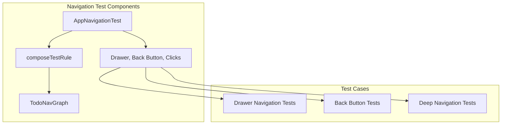

<!-- source: DeepWiki mcp.deepwiki.com · repo android/architecture-samples · page 5 Testing Strategy · fetched 2026-10-23 -->

# Testing Strategy

<details>
<summary>Relevant source files</summary>

The following files were used as context for generating this wiki page:

- [.google/packaging.yaml](.google/packaging.yaml)
- [CONTRIBUTING.md](CONTRIBUTING.md)
- [LICENSE](LICENSE)
- [README.md](README.md)
- [app/build.gradle.kts](app/build.gradle.kts)
- [app/src/main/java/com/example/android/architecture/blueprints/todoapp/addedittask/AddEditTaskViewModel.kt](app/src/main/java/com/example/android/architecture/blueprints/todoapp/addedittask/AddEditTaskViewModel.kt)
- [app/src/main/java/com/example/android/architecture/blueprints/todoapp/data/Task.kt](app/src/main/java/com/example/android/architecture/blueprints/todoapp/data/Task.kt)
- [app/src/main/java/com/example/android/architecture/blueprints/todoapp/statistics/StatisticsViewModel.kt](app/src/main/java/com/example/android/architecture/blueprints/todoapp/statistics/StatisticsViewModel.kt)
- [app/src/main/java/com/example/android/architecture/blueprints/todoapp/taskdetail/TaskDetailViewModel.kt](app/src/main/java/com/example/android/architecture/blueprints/todoapp/taskdetail/TaskDetailViewModel.kt)
- [app/src/main/java/com/example/android/architecture/blueprints/todoapp/tasks/TasksViewModel.kt](app/src/main/java/com/example/android/architecture/blueprints/todoapp/tasks/TasksViewModel.kt)
- [app/src/test/java/com/example/android/architecture/blueprints/todoapp/addedittask/AddEditTaskViewModelTest.kt](app/src/test/java/com/example/android/architecture/blueprints/todoapp/addedittask/AddEditTaskViewModelTest.kt)
- [app/src/test/java/com/example/android/architecture/blueprints/todoapp/statistics/StatisticsViewModelTest.kt](app/src/test/java/com/example/android/architecture/blueprints/todoapp/statistics/StatisticsViewModelTest.kt)
- [app/src/test/java/com/example/android/architecture/blueprints/todoapp/taskdetail/TaskDetailViewModelTest.kt](app/src/test/java/com/example/android/architecture/blueprints/todoapp/taskdetail/TaskDetailViewModelTest.kt)
- [app/src/test/java/com/example/android/architecture/blueprints/todoapp/tasks/TasksViewModelTest.kt](app/src/test/java/com/example/android/architecture/blueprints/todoapp/tasks/TasksViewModelTest.kt)
- [build.gradle.kts](build.gradle.kts)
- [gradle.properties](gradle.properties)
- [screenshots/screenshots.png](screenshots/screenshots.png)
- [screenshots/todoapp.gif](screenshots/todoapp.gif)
- [settings.gradle.kts](settings.gradle.kts)
- [shared-test/.gitignore](shared-test/.gitignore)
- [shared-test/build.gradle.kts](shared-test/build.gradle.kts)
- [shared-test/src/main/AndroidManifest.xml](shared-test/src/main/AndroidManifest.xml)
- [shared-test/src/main/java/com/example/android/architecture/blueprints/todoapp/CustomTestRunner.kt](shared-test/src/main/java/com/example/android/architecture/blueprints/todoapp/CustomTestRunner.kt)
- [shared-test/src/main/java/com/example/android/architecture/blueprints/todoapp/MainCoroutineRule.kt](shared-test/src/main/java/com/example/android/architecture/blueprints/todoapp/MainCoroutineRule.kt)

</details>


This page documents the comprehensive testing approach used in the Android Architecture Samples repository. It covers unit, integration, and UI testing methodologies implemented across the application. For specific UI testing techniques with Jetpack Compose, see [UI Testing with Compose](#5.1). For detailed unit and integration testing approaches, see [Unit and Integration Testing](#5.2).

## Testing Pyramid Overview

The project follows the testing pyramid approach, with a solid foundation of unit tests, complemented by integration tests and UI tests.



Sources: 
- [app/src/androidTest/java/com/example/android/architecture/blueprints/todoapp/tasks/TasksScreenTest.kt:42-53]()
- [app/src/androidTest/java/com/example/android/architecture/blueprints/todoapp/tasks/AppNavigationTest.kt:48-51]()
- [app/src/androidTest/java/com/example/android/architecture/blueprints/todoapp/tasks/TasksTest.kt:53-56]()

## Test Categories and Implementation

The testing strategy includes three main categories of tests, each serving a specific purpose:

| Test Type | Purpose | Location | Annotation |
|-----------|---------|----------|------------|
| **Unit Tests** | Test individual components in isolation | `src/test/` | `@SmallTest` |
| **Integration Tests** | Test interactions between components | `src/androidTest/` | `@MediumTest` |
| **UI/E2E Tests** | Test complete user flows | `src/androidTest/` | `@LargeTest` |

### Unit Tests

Unit tests focus on testing the behavior of individual components in isolation, typically using mocks or fakes for dependencies. They run on the JVM without requiring an Android device or emulator.

### Integration Tests

Integration tests verify that different components work correctly together. These tests require the Android framework and run on a device or emulator.

```kotlin
@MediumTest
@RunWith(AndroidJUnit4::class)
@HiltAndroidTest
@ExperimentalCoroutinesApi
class TaskDetailScreenTest {
    // Test implementation
}
```

Sources:
- [app/src/androidTest/java/com/example/android/architecture/blueprints/todoapp/taskdetail/TaskDetailScreenTest.kt:45-49]()
- [app/src/androidTest/java/com/example/android/architecture/blueprints/todoapp/statistics/StatisticsScreenTest.kt:42-45]()

### UI/E2E Tests

UI tests validate full user flows and interaction with the UI. They provide the highest level of confidence but run more slowly than other test types.

```kotlin
@RunWith(AndroidJUnit4::class)
@LargeTest
@HiltAndroidTest
@OptIn(ExperimentalCoroutinesApi::class)
class TasksTest {
    // End-to-end test implementation
}
```

Sources:
- [app/src/androidTest/java/com/example/android/architecture/blueprints/todoapp/tasks/TasksTest.kt:53-57]()
- [app/src/androidTest/java/com/example/android/architecture/blueprints/todoapp/tasks/AppNavigationTest.kt:48-51]()

## Testing Architecture



Sources:
- [app/src/androidTest/java/com/example/android/architecture/blueprints/todoapp/tasks/TasksScreenTest.kt:47-54]()
- [app/src/androidTest/java/com/example/android/architecture/blueprints/todoapp/tasks/AppNavigationTest.kt:48-51]()

## UI Testing with Jetpack Compose

The project uses Jetpack Compose's built-in testing capabilities to test the UI layer. The `createAndroidComposeRule` is used to set up and interact with Compose UI components.

### Key Components of Compose UI Testing



Sources:
- [app/src/androidTest/java/com/example/android/architecture/blueprints/todoapp/tasks/TasksScreenTest.kt:20-27]()
- [app/src/androidTest/java/com/example/android/architecture/blueprints/todoapp/taskdetail/TaskDetailScreenTest.kt:20-24]()

### Sample UI Test Structure

1. Test setup with Hilt and Compose
2. Create or retrieve test data
3. Set content to test
4. Perform UI interactions
5. Verify expected outcomes

```kotlin
@Test
fun displayTask_whenRepositoryHasData() = runTest {
    // GIVEN - One task already in the repository
    repository.createTask("TITLE1", "DESCRIPTION1")

    // WHEN - On startup
    setContent()

    // THEN - Verify task is displayed on screen
    composeTestRule.onNodeWithText("TITLE1").assertIsDisplayed()
}
```

Sources:
- [app/src/androidTest/java/com/example/android/architecture/blueprints/todoapp/tasks/TasksScreenTest.kt:71-81]()
- [app/src/androidTest/java/com/example/android/architecture/blueprints/todoapp/addedittask/AddEditTaskScreenTest.kt:86-98]()

## Navigation Testing

Navigation testing ensures that users can navigate correctly between different screens of the application.



Navigation tests verify:
- Drawer navigation between Tasks and Statistics screens
- Back button navigation from detail and edit screens
- UI element navigation (clicking on tasks, buttons, etc.)

Sources:
- [app/src/androidTest/java/com/example/android/architecture/blueprints/todoapp/tasks/AppNavigationTest.kt:72-107]()
- [app/src/androidTest/java/com/example/android/architecture/blueprints/todoapp/tasks/AppNavigationTest.kt:130-157]()

## End-to-End Testing

End-to-end tests validate complete user flows from start to finish. The `TasksTest` class contains large end-to-end tests that simulate user interactions across multiple screens.

Key E2E test flows include:
- Creating, editing, and deleting tasks
- Marking tasks as complete/active
- Filtering tasks by status
- Navigation between different screens

Sources:
- [app/src/androidTest/java/com/example/android/architecture/blueprints/todoapp/tasks/TasksTest.kt:79-111]()
- [app/src/androidTest/java/com/example/android/architecture/blueprints/todoapp/tasks/TasksTest.kt:114-141]()

## Testing Asynchronous Operations

The repository uses `SimpleCountingIdlingResource` to handle asynchronous operations during Espresso tests:

```kotlin
class SimpleCountingIdlingResource(private val resourceName: String) : IdlingResource {
    private val counter = AtomicInteger(0)
    
    // Indicates whether the resource is idle
    override fun isIdleNow() = counter.get() == 0
    
    // Increments the counter
    fun increment() {
        counter.getAndIncrement()
    }
    
    // Decrements the counter
    fun decrement() {
        val counterVal = counter.decrementAndGet()
        if (counterVal == 0) {
            resourceCallback?.onTransitionToIdle()
        }
    }
}
```

This utility ensures that tests wait for asynchronous operations (like database operations or network calls) to complete before continuing.

Sources:
- [app/src/main/java/com/example/android/architecture/blueprints/todoapp/util/SimpleCountingIdlingResource.kt:32-70]()

## Test Structure and Organization

Tests are organized by screen/feature and test type:

1. **Screen-specific tests**:
   - TasksScreenTest
   - AddEditTaskScreenTest
   - TaskDetailScreenTest
   - StatisticsScreenTest

2. **Cross-screen tests**:
   - AppNavigationTest
   - TasksTest (end-to-end)

Each test class follows a consistent structure:
- Setup with Hilt and Compose rules
- Test methods with clear naming
- Given-When-Then structure in test methods

Sources:
- [app/src/androidTest/java/com/example/android/architecture/blueprints/todoapp/tasks/TasksScreenTest.kt:42-54]()
- [app/src/androidTest/java/com/example/android/architecture/blueprints/todoapp/addedittask/AddEditTaskScreenTest.kt:51-62]()

## Best Practices

The testing strategy demonstrates several best practices:

1. **Clear test boundaries** - Unit, integration, and UI tests have distinct scopes
2. **Dependency injection with Hilt** - For providing test dependencies
3. **Consistent naming** - Tests follow a descriptive naming pattern
4. **Test organization** - Tests organized by feature and type
5. **Isolated tests** - Each test is independent and does not rely on others
6. **Given-When-Then structure** - Clear test stages for readability
7. **Test setup helper methods** - For common test setup operations

Sources:
- [app/src/androidTest/java/com/example/android/architecture/blueprints/todoapp/tasks/TasksScreenTest.kt:71-81]()
- [app/src/androidTest/java/com/example/android/architecture/blueprints/todoapp/tasks/TasksTest.kt:114-141]()

## Testing Tools and Libraries

| Tool/Library | Purpose | Usage |
|--------------|---------|-------|
| **JUnit4** | Basic testing framework | All test classes |
| **AndroidX Test** | Android-specific testing utilities | UI and integration tests |
| **Compose Testing** | Testing Compose UI components | All UI tests |
| **Hilt Testing** | Dependency injection in tests | All UI and integration tests |
| **Kotlinx Coroutines Test** | Testing coroutine code | Tests involving suspending functions |
| **Espresso** | UI interaction testing | Navigation and E2E tests |

---

