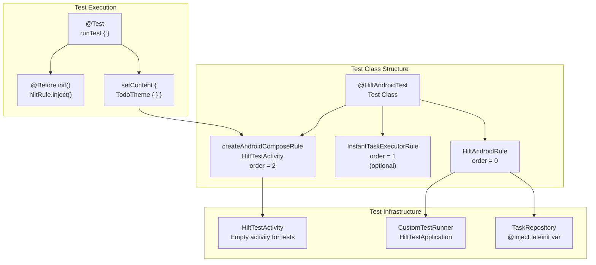
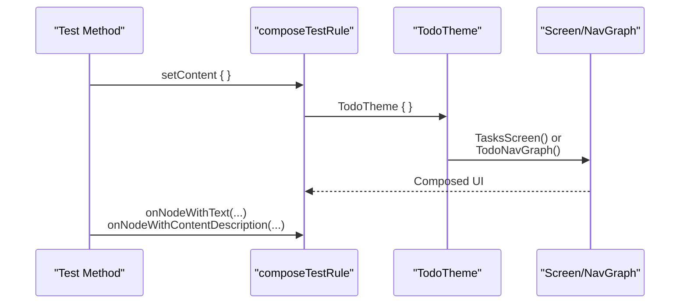
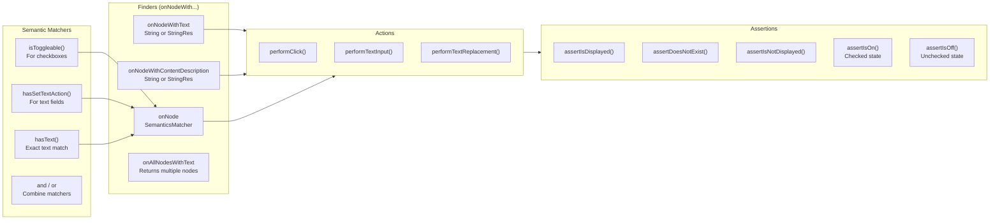
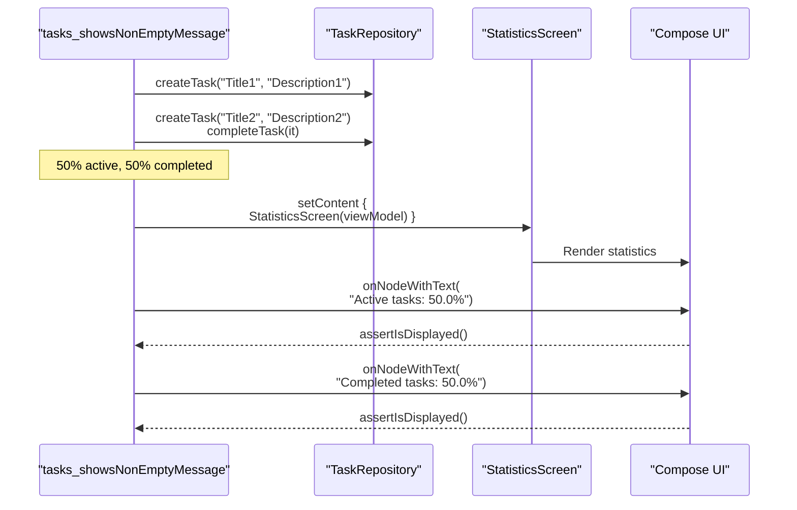
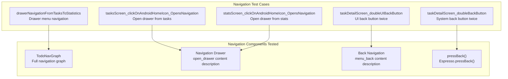
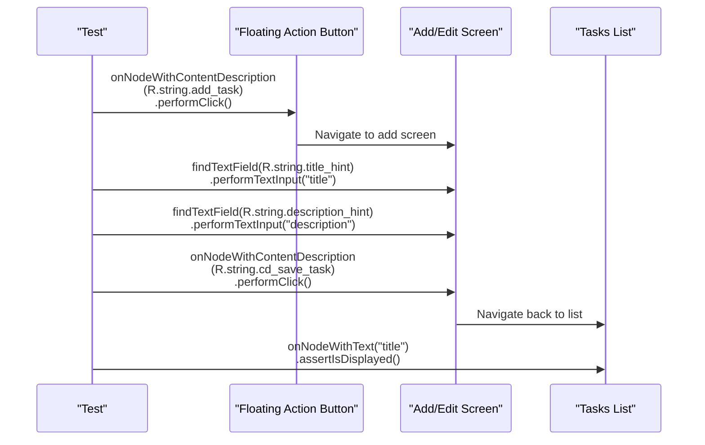
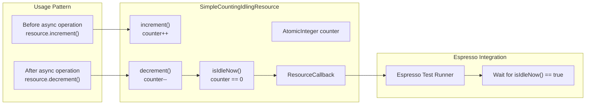

<!-- source: DeepWiki mcp.deepwiki.com · repo android/architecture-samples · page 5.1 UI Testing with Compose · fetched 2026-10-23 -->

# UI Testing with Compose

<details>
<summary>Relevant source files</summary>

The following files were used as context for generating this wiki page:

- [app/src/androidTest/java/com/example/android/architecture/blueprints/todoapp/statistics/StatisticsScreenTest.kt](app/src/androidTest/java/com/example/android/architecture/blueprints/todoapp/statistics/StatisticsScreenTest.kt)
- [app/src/androidTest/java/com/example/android/architecture/blueprints/todoapp/taskdetail/TaskDetailScreenTest.kt](app/src/androidTest/java/com/example/android/architecture/blueprints/todoapp/taskdetail/TaskDetailScreenTest.kt)
- [app/src/androidTest/java/com/example/android/architecture/blueprints/todoapp/tasks/AppNavigationTest.kt](app/src/androidTest/java/com/example/android/architecture/blueprints/todoapp/tasks/AppNavigationTest.kt)
- [app/src/androidTest/java/com/example/android/architecture/blueprints/todoapp/tasks/TasksScreenTest.kt](app/src/androidTest/java/com/example/android/architecture/blueprints/todoapp/tasks/TasksScreenTest.kt)
- [app/src/androidTest/java/com/example/android/architecture/blueprints/todoapp/tasks/TasksTest.kt](app/src/androidTest/java/com/example/android/architecture/blueprints/todoapp/tasks/TasksTest.kt)
- [app/src/main/java/com/example/android/architecture/blueprints/todoapp/util/SimpleCountingIdlingResource.kt](app/src/main/java/com/example/android/architecture/blueprints/todoapp/util/SimpleCountingIdlingResource.kt)

</details>


## Purpose and Scope

This document details the UI testing implementation for the Android Architecture Samples application using Jetpack Compose's testing APIs. It covers instrumented tests for individual screens, navigation flows, end-to-end user journeys, and integration with Espresso for synchronization. For unit and integration testing of ViewModels and repositories, see [Unit and Integration Testing](#5.2). For overall testing strategy and infrastructure, see [Testing Strategy](#5).

All UI tests in this application are instrumented tests that run on a device or emulator, leveraging the Android Test framework with Hilt for dependency injection.

## Test Infrastructure and Setup

### Test Components and Dependencies

UI tests use a standardized infrastructure consisting of JUnit rules, Hilt integration, and Compose test utilities.



**Sources:** [app/src/androidTest/java/com/example/android/architecture/blueprints/todoapp/tasks/TasksScreenTest.kt:54-69](), [app/src/androidTest/java/com/example/android/architecture/blueprints/todoapp/tasks/AppNavigationTest.kt:51-70]()

### Rule Ordering and Initialization Pattern

All UI tests follow a consistent setup pattern with ordered JUnit rules:

| Rule Order | Rule Type | Purpose |
|------------|-----------|---------|
| 0 | `HiltAndroidRule` | Initializes Hilt dependency injection for the test |
| 1 | `InstantTaskExecutorRule` | Ensures Architecture Components execute synchronously (optional, used in navigation tests) |
| 2 | `createAndroidComposeRule<HiltTestActivity>()` | Provides Compose test APIs and launches test activity |

The `@Before` method calls `hiltRule.inject()` to inject dependencies before each test. Tests marked with `@MediumTest` test individual screens, while `@LargeTest` tests cover complete user flows.

**Sources:** [app/src/androidTest/java/com/example/android/architecture/blueprints/todoapp/tasks/TasksScreenTest.kt:56-69](), [app/src/androidTest/java/com/example/android/architecture/blueprints/todoapp/tasks/AppNavigationTest.kt:53-70]()

### Test Activity and Content Setup

Tests use `HiltTestActivity`, an empty activity that serves as a host for Compose content. Content is set using `composeTestRule.setContent { }`:



For screen-level tests, the specific screen composable is set with required parameters. For end-to-end tests, `TodoNavGraph()` is set to test complete navigation flows.

**Sources:** [app/src/androidTest/java/com/example/android/architecture/blueprints/todoapp/tasks/TasksScreenTest.kt:256-271](), [app/src/androidTest/java/com/example/android/architecture/blueprints/todoapp/tasks/TasksTest.kt:292-298]()

## Compose Test APIs

### Semantic Tree Finders and Matchers

The Compose testing framework provides finders to locate nodes in the semantic tree:



**Sources:** [app/src/androidTest/java/com/example/android/architecture/blueprints/todoapp/tasks/TasksScreenTest.kt:20-26](), [app/src/androidTest/java/com/example/android/architecture/blueprints/todoapp/tasks/TasksTest.kt:20-32]()

### Common Test Patterns

The codebase demonstrates several reusable test patterns:

**Pattern 1: Finding UI elements by string resources**
```
composeTestRule.onNodeWithText(activity.getString(R.string.label_all))
composeTestRule.onNodeWithContentDescription(activity.getString(R.string.open_drawer))
```

**Pattern 2: Finding text fields using composite matchers**
```
composeTestRule.onNode(hasSetTextAction() and hasText(activity.getString(R.string.title_hint)))
```

**Pattern 3: Finding toggleable elements (checkboxes)**
```
composeTestRule.onNode(isToggleable()).performClick()
composeTestRule.onNode(isToggleable()).assertIsOff()
```

**Pattern 4: Verifying multiple nodes exist**
```
assertTrue(
    composeTestRule.onAllNodesWithText(activity.getString(R.string.statistics_title))
        .fetchSemanticsNodes().isNotEmpty()
)
```

**Sources:** [app/src/androidTest/java/com/example/android/architecture/blueprints/todoapp/tasks/TasksTest.kt:300-310](), [app/src/androidTest/java/com/example/android/architecture/blueprints/todoapp/tasks/AppNavigationTest.kt:124-127]()

## Screen-Level UI Tests

### TasksScreenTest - Task List Screen

`TasksScreenTest` provides integration tests for the main task list screen, testing filtering, task state toggling, and data display.

```mermaid
graph TB
    subgraph "TasksScreenTest Test Cases"
        DisplayTask["displayTask_whenRepositoryHasData<br/>Verify task appears on screen"]
        ActiveTask["displayActiveTask<br/>Test active filter"]
        CompletedTask["displayCompletedTask<br/>Test completed filter"]
        MarkComplete["markTaskAsComplete<br/>Toggle to completed state"]
        MarkActive["markTaskAsActive<br/>Toggle to active state"]
        ShowAll["showAllTasks<br/>Verify all filter"]
        ShowActive["showActiveTasks<br/>Verify active filter"]
        ShowCompleted["showCompletedTasks<br/>Verify completed filter"]
        ClearCompleted["clearCompletedTasks<br/>Menu action test"]
        NoTasksAll["noTasks_AllTasksFilter_AddTaskViewVisible"]
        NoTasksCompleted["noTasks_CompletedTasksFilter_AddTaskViewNotVisible"]
        NoTasksActive["noTasks_ActiveTasksFilter_AddTaskViewNotVisible"]
    end
    
    subgraph "Test Setup"
        Repository["repository.createTask()<br/>repository.completeTask()"]
        SetContent["setContent()<br/>TasksScreen with<br/>injected ViewModel"]
    end
    
    subgraph "Helper Methods"
        OpenFilter["openFilterAndSelectOption()<br/>Click filter, select option"]
    end
    
    DisplayTask --> Repository
    ActiveTask --> Repository
    CompletedTask --> Repository
    MarkComplete --> Repository
    MarkActive --> Repository
    ShowAll --> Repository
    ShowActive --> Repository
    ShowCompleted --> Repository
    ClearCompleted --> Repository
    
    DisplayTask --> SetContent
    OpenFilter --> ActiveTask
    OpenFilter --> CompletedTask
    OpenFilter --> ShowAll
```



The test manually instantiates `TasksViewModel` with the injected repository and a `SavedStateHandle`:

```
TasksScreen(
    viewModel = TasksViewModel(repository, SavedStateHandle()),
    userMessage = R.string.successfully_added_task_message,
    onUserMessageDisplayed = { },
    onAddTask = { },
    onTaskClick = { },
    openDrawer = { }
)
```

**Sources:** [app/src/androidTest/java/com/example/android/architecture/blueprints/todoapp/tasks/TasksScreenTest.kt:71-254](), [app/src/androidTest/java/com/example/android/architecture/blueprints/todoapp/tasks/TasksScreenTest.kt:256-271]()

### TaskDetailScreenTest - Task Detail Screen

`TaskDetailScreenTest` verifies the task detail screen displays task data correctly for both active and completed tasks:

| Test Case | Setup | Verification |
|-----------|-------|--------------|
| `activeTaskDetails_DisplayedInUi` | Create active task via repository | Title, description displayed; checkbox is off |
| `completedTaskDetails_DisplayedInUi` | Create and complete task via repository | Title, description displayed; checkbox is on |

Both tests create a task through the repository, then set content with `TaskDetailScreen` composable, passing a manually constructed `TaskDetailViewModel`:

```
TaskDetailScreen(
    viewModel = TaskDetailViewModel(
        repository,
        SavedStateHandle(mapOf("taskId" to activeTaskId))
    ),
    onEditTask = { /*TODO*/ },
    onBack = { },
    onDeleteTask = { },
)
```

**Sources:** [app/src/androidTest/java/com/example/android/architecture/blueprints/todoapp/taskdetail/TaskDetailScreenTest.kt:65-99](), [app/src/androidTest/java/com/example/android/architecture/blueprints/todoapp/taskdetail/TaskDetailScreenTest.kt:101-117]()

### StatisticsScreenTest - Statistics Screen

`StatisticsScreenTest` validates the statistics screen calculates and displays task completion percentages correctly:



**Sources:** [app/src/androidTest/java/com/example/android/architecture/blueprints/todoapp/statistics/StatisticsScreenTest.kt:63-91]()

## Navigation Testing

### AppNavigationTest - Navigation Flows

`AppNavigationTest` tests navigation between screens using the drawer menu and verifies back navigation behavior:



Navigation tests set the entire `TodoNavGraph` as content rather than individual screens:

```
composeTestRule.setContent {
    TodoTheme {
        TodoNavGraph()
    }
}
```

This allows testing complete navigation flows including the drawer menu, navigation to different screens, and back navigation:

**Sources:** [app/src/androidTest/java/com/example/android/architecture/blueprints/todoapp/tasks/AppNavigationTest.kt:72-89](), [app/src/androidTest/java/com/example/android/architecture/blueprints/todoapp/tasks/AppNavigationTest.kt:131-180](), [app/src/androidTest/java/com/example/android/architecture/blueprints/todoapp/tasks/AppNavigationTest.kt:182-193]()

### Drawer Navigation Pattern

Opening and navigating via the drawer follows this pattern:

1. Find and click the drawer icon by content description: `composeTestRule.onNodeWithContentDescription(activity.getString(R.string.open_drawer)).performClick()`
2. Verify drawer items are displayed/not displayed using `assertIsDisplayed()` / `assertIsNotDisplayed()`
3. Click on a menu item by text: `composeTestRule.onNodeWithText(activity.getString(R.string.statistics_title)).performClick()`
4. Verify the destination screen loaded

**Sources:** [app/src/androidTest/java/com/example/android/architecture/blueprints/todoapp/tasks/AppNavigationTest.kt:190-193](), [app/src/androidTest/java/com/example/android/architecture/blueprints/todoapp/tasks/AppNavigationTest.kt:92-107]()

### Back Navigation Testing

The codebase tests two forms of back navigation:

**UI Back Button (Compose):**
```
composeTestRule.onNodeWithContentDescription(activity.getString(R.string.menu_back))
    .performClick()
```

**System Back Button (Espresso):**
```
import androidx.test.espresso.Espresso.pressBack
pressBack()
```

Tests verify that clicking back from edit screen returns to detail screen, and clicking back again returns to the task list.

**Sources:** [app/src/androidTest/java/com/example/android/architecture/blueprints/todoapp/tasks/AppNavigationTest.kt:131-157](), [app/src/androidTest/java/com/example/android/architecture/blueprints/todoapp/tasks/AppNavigationTest.kt:159-180]()

## End-to-End Testing

### TasksTest - Complete User Journeys

`TasksTest` contains large end-to-end tests that exercise complete user workflows across multiple screens:

```mermaid
graph TB
    subgraph "E2E Test Scenarios"
        EditTask["editTask<br/>View -> Edit -> Save -> Verify"]
        CreateDelete["createOneTask_deleteTask<br/>Create -> Delete -> Verify"]
        DeleteOne["createTwoTasks_deleteOneTask<br/>Multiple tasks, delete one"]
        MarkCompleteDetail["markTaskAsCompleteOnDetailScreen_taskIsCompleteInList<br/>Detail -> List consistency"]
        MarkActiveDetail["markTaskAsActiveOnDetailScreen_taskIsActiveInList<br/>Detail -> List consistency"]
        MarkBoth1["markTaskAsCompleteAndActiveOnDetailScreen_taskIsActiveInList<br/>Toggle twice"]
        MarkBoth2["markTaskAsActiveAndCompleteOnDetailScreen_taskIsCompleteInList<br/>Toggle twice"]
        CreateTask["createTask<br/>FAB -> Create -> Verify"]
    end
    
    subgraph "Screen Flow"
        TaskList["Tasks List Screen"]
        TaskDetail["Task Detail Screen"]
        EditScreen["Add/Edit Screen"]
    end
    
    EditTask --> TaskList
    EditTask --> TaskDetail
    EditTask --> EditScreen
    
    CreateDelete --> TaskList
    CreateDelete --> TaskDetail
    
    MarkCompleteDetail --> TaskList
    MarkCompleteDetail --> TaskDetail
```



**Sources:** [app/src/androidTest/java/com/example/android/architecture/blueprints/todoapp/tasks/TasksTest.kt:78-111](), [app/src/androidTest/java/com/example/android/architecture/blueprints/todoapp/tasks/TasksTest.kt:113-141]()

### E2E Test Pattern: Edit Task Flow

The `editTask()` test demonstrates a complete multi-screen user journey:

1. **Setup:** Create task via repository: `repository.createTask("TITLE1", "DESCRIPTION")`
2. **Navigate:** Click task in list to open detail screen
3. **Verify Detail Screen:** Check title, description, completion state displayed correctly
4. **Navigate to Edit:** Click edit button by content description
5. **Edit:** Use `performTextReplacement()` on text fields found by `hasSetTextAction() and hasText()`
6. **Save:** Click save button by content description
7. **Verify List:** Check new title appears, old title doesn't exist

This pattern demonstrates finding text fields using composite semantic matchers:

```
private fun findTextField(text: String): SemanticsNodeInteraction {
    return composeTestRule.onNode(
        hasSetTextAction() and hasText(text)
    )
}
```

**Sources:** [app/src/androidTest/java/com/example/android/architecture/blueprints/todoapp/tasks/TasksTest.kt:78-111](), [app/src/androidTest/java/com/example/android/architecture/blueprints/todoapp/tasks/TasksTest.kt:306-310]()

### Create Task Flow

The `createTask()` test demonstrates creating a new task through the UI:



**Sources:** [app/src/androidTest/java/com/example/android/architecture/blueprints/todoapp/tasks/TasksTest.kt:275-290]()

## Espresso Integration and Synchronization

### SimpleCountingIdlingResource

The codebase includes `SimpleCountingIdlingResource`, a custom `IdlingResource` implementation for Espresso synchronization:



The resource maintains an atomic counter. When counter reaches 0, it transitions to idle and notifies Espresso via `resourceCallback.onTransitionToIdle()`. This ensures Espresso waits for async operations to complete before proceeding with test actions.

**Sources:** [app/src/main/java/com/example/android/architecture/blueprints/todoapp/util/SimpleCountingIdlingResource.kt:32-70]()

### Espresso and Compose API Integration

Tests combine Espresso APIs with Compose testing:

| API Source | Purpose | Example |
|------------|---------|---------|
| Espresso | System back navigation | `Espresso.pressBack()` |
| Espresso | Idling resources | `SimpleCountingIdlingResource` |
| Compose Test | UI interactions | `composeTestRule.onNodeWithText().performClick()` |
| Compose Test | Assertions | `assertIsDisplayed()`, `assertDoesNotExist()` |

The integration is seamless - Compose tests can use Espresso's `pressBack()` for system back button testing alongside Compose semantic finders for UI verification.

**Sources:** [app/src/androidTest/java/com/example/android/architecture/blueprints/todoapp/tasks/AppNavigationTest.kt:27-28](), [app/src/androidTest/java/com/example/android/architecture/blueprints/todoapp/tasks/AppNavigationTest.kt:174-179]()

### Test Annotations and Filters

UI tests use test size annotations to categorize execution time:

| Annotation | Purpose | Typical Tests |
|------------|---------|---------------|
| `@MediumTest` | Single screen integration tests | `TasksScreenTest`, `TaskDetailScreenTest`, `StatisticsScreenTest` |
| `@LargeTest` | Multi-screen E2E tests | `AppNavigationTest`, `TasksTest` |

These annotations allow selective test execution based on time constraints: `./gradlew connectedMediumTest` or `./gradlew connectedLargeTest`.

**Sources:** [app/src/androidTest/java/com/example/android/architecture/blueprints/todoapp/tasks/TasksScreenTest.kt:48-49](), [app/src/androidTest/java/com/example/android/architecture/blueprints/todoapp/tasks/TasksTest.kt:53-54](), [app/src/androidTest/java/com/example/android/architecture/blueprints/todoapp/tasks/AppNavigationTest.kt:48-49]()

---

