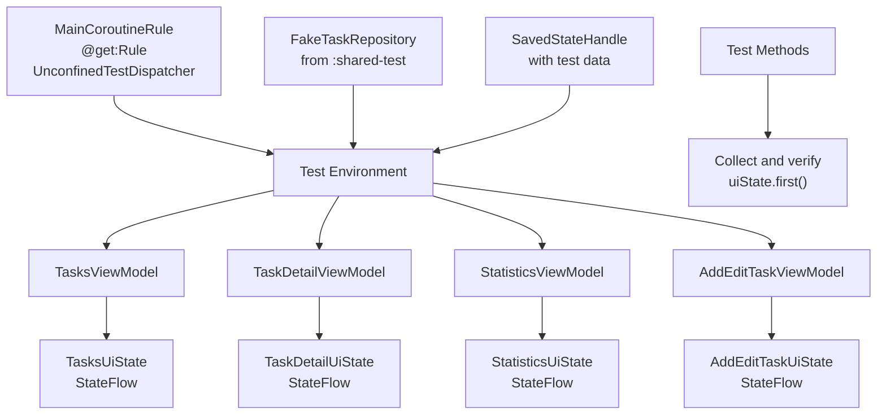
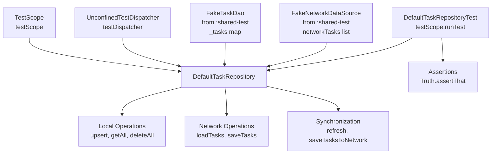
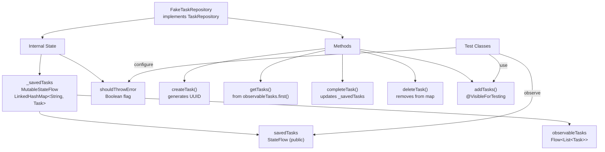
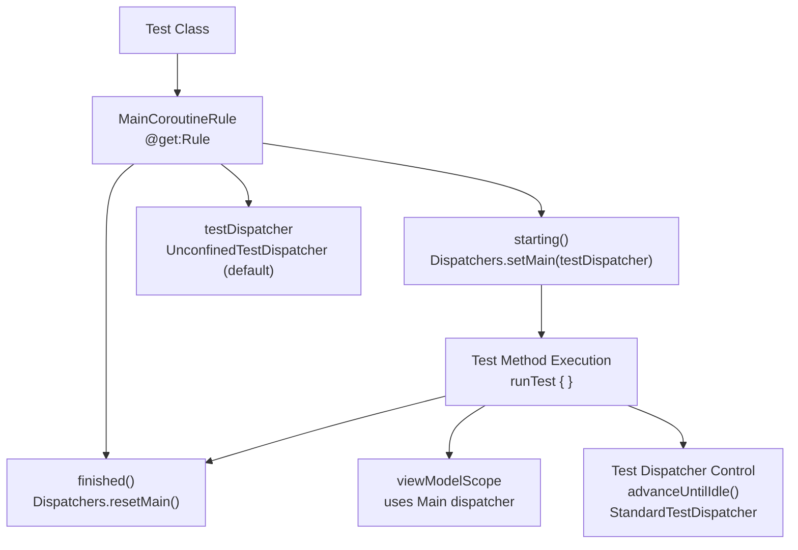

<!-- source: DeepWiki mcp.deepwiki.com · repo android/architecture-samples · page 5.2 Unit and Integration Testing · fetched 2026-10-23 -->

# Unit and Integration Testing

<details>
<summary>Relevant source files</summary>

The following files were used as context for generating this wiki page:

- [app/build.gradle.kts](app/build.gradle.kts)
- [app/src/androidTest/java/com/example/android/architecture/blueprints/todoapp/data/source/local/TaskDaoTest.kt](app/src/androidTest/java/com/example/android/architecture/blueprints/todoapp/data/source/local/TaskDaoTest.kt)
- [app/src/main/java/com/example/android/architecture/blueprints/todoapp/addedittask/AddEditTaskViewModel.kt](app/src/main/java/com/example/android/architecture/blueprints/todoapp/addedittask/AddEditTaskViewModel.kt)
- [app/src/main/java/com/example/android/architecture/blueprints/todoapp/data/DefaultTaskRepository.kt](app/src/main/java/com/example/android/architecture/blueprints/todoapp/data/DefaultTaskRepository.kt)
- [app/src/main/java/com/example/android/architecture/blueprints/todoapp/data/Task.kt](app/src/main/java/com/example/android/architecture/blueprints/todoapp/data/Task.kt)
- [app/src/main/java/com/example/android/architecture/blueprints/todoapp/data/TaskRepository.kt](app/src/main/java/com/example/android/architecture/blueprints/todoapp/data/TaskRepository.kt)
- [app/src/main/java/com/example/android/architecture/blueprints/todoapp/data/source/local/TaskDao.kt](app/src/main/java/com/example/android/architecture/blueprints/todoapp/data/source/local/TaskDao.kt)
- [app/src/main/java/com/example/android/architecture/blueprints/todoapp/data/source/network/TaskNetworkDataSource.kt](app/src/main/java/com/example/android/architecture/blueprints/todoapp/data/source/network/TaskNetworkDataSource.kt)
- [app/src/main/java/com/example/android/architecture/blueprints/todoapp/statistics/StatisticsViewModel.kt](app/src/main/java/com/example/android/architecture/blueprints/todoapp/statistics/StatisticsViewModel.kt)
- [app/src/main/java/com/example/android/architecture/blueprints/todoapp/taskdetail/TaskDetailViewModel.kt](app/src/main/java/com/example/android/architecture/blueprints/todoapp/taskdetail/TaskDetailViewModel.kt)
- [app/src/main/java/com/example/android/architecture/blueprints/todoapp/tasks/TasksViewModel.kt](app/src/main/java/com/example/android/architecture/blueprints/todoapp/tasks/TasksViewModel.kt)
- [app/src/test/java/com/example/android/architecture/blueprints/todoapp/addedittask/AddEditTaskViewModelTest.kt](app/src/test/java/com/example/android/architecture/blueprints/todoapp/addedittask/AddEditTaskViewModelTest.kt)
- [app/src/test/java/com/example/android/architecture/blueprints/todoapp/data/DefaultTaskRepositoryTest.kt](app/src/test/java/com/example/android/architecture/blueprints/todoapp/data/DefaultTaskRepositoryTest.kt)
- [app/src/test/java/com/example/android/architecture/blueprints/todoapp/statistics/StatisticsViewModelTest.kt](app/src/test/java/com/example/android/architecture/blueprints/todoapp/statistics/StatisticsViewModelTest.kt)
- [app/src/test/java/com/example/android/architecture/blueprints/todoapp/taskdetail/TaskDetailViewModelTest.kt](app/src/test/java/com/example/android/architecture/blueprints/todoapp/taskdetail/TaskDetailViewModelTest.kt)
- [app/src/test/java/com/example/android/architecture/blueprints/todoapp/tasks/TasksViewModelTest.kt](app/src/test/java/com/example/android/architecture/blueprints/todoapp/tasks/TasksViewModelTest.kt)
- [build.gradle.kts](build.gradle.kts)
- [gradle.properties](gradle.properties)
- [settings.gradle.kts](settings.gradle.kts)
- [shared-test/.gitignore](shared-test/.gitignore)
- [shared-test/build.gradle.kts](shared-test/build.gradle.kts)
- [shared-test/src/main/AndroidManifest.xml](shared-test/src/main/AndroidManifest.xml)
- [shared-test/src/main/java/com/example/android/architecture/blueprints/todoapp/CustomTestRunner.kt](shared-test/src/main/java/com/example/android/architecture/blueprints/todoapp/CustomTestRunner.kt)
- [shared-test/src/main/java/com/example/android/architecture/blueprints/todoapp/MainCoroutineRule.kt](shared-test/src/main/java/com/example/android/architecture/blueprints/todoapp/MainCoroutineRule.kt)
- [shared-test/src/main/java/com/example/android/architecture/blueprints/todoapp/data/FakeTaskRepository.kt](shared-test/src/main/java/com/example/android/architecture/blueprints/todoapp/data/FakeTaskRepository.kt)
- [shared-test/src/main/java/com/example/android/architecture/blueprints/todoapp/data/source/local/FakeTaskDao.kt](shared-test/src/main/java/com/example/android/architecture/blueprints/todoapp/data/source/local/FakeTaskDao.kt)

</details>


This page explains the unit and integration testing approach used to verify non-UI components in the Architecture Samples application. The testing strategy emphasizes fast, reliable unit tests with test doubles from the `:shared-test` module, complemented by integration tests that verify component interactions. For UI testing, see page 5.1.

## Test Organization and Scope

Tests are organized by execution environment and scope:

| Test Category | Location | Execution | Target Components | Primary Dependencies |
|--------------|----------|-----------|-------------------|---------------------|
| JVM Unit Tests | `app/src/test/` | JVM only (fast) | ViewModels, Repository logic | `testImplementation`, `:shared-test` module |
| Instrumented Tests | `app/src/androidTest/` | Device/emulator | DAO with Room, UI screens | `androidTestImplementation`, `:shared-test` module |

The `:shared-test` module at [shared-test/build.gradle.kts:1-56]() provides reusable test infrastructure including `FakeTaskRepository`, `FakeTaskDao`, `FakeNetworkDataSource`, `MainCoroutineRule`, and `CustomTestRunner`. Both JVM and instrumented tests depend on this module as declared in [app/build.gradle.kts:179]() and [app/build.gradle.kts:193]().

### Test Execution Configuration

Unit tests are configured at [app/build.gradle.kts:62-78]() to:
- Include Android resources via `isIncludeAndroidResources = true`
- Log all test events (PASSED, FAILED, SKIPPED, STANDARD_OUT, STANDARD_ERROR)
- Report detailed test results

The build configuration enables test coverage with `isTestCoverageEnabled = true` in debug builds at [app/build.gradle.kts:48]().

Sources: [app/build.gradle.kts:62-78](), [app/build.gradle.kts:152-198](), [shared-test/build.gradle.kts:1-56]()

## ViewModel Unit Testing

ViewModel unit tests verify presentation logic by replacing the `TaskRepository` dependency with `FakeTaskRepository` from the `:shared-test` module. Tests observe state via `StateFlow` and verify transformations from repository data to UI state.

### ViewModel Test Structure and Pattern

**Diagram: ViewModel Testing Architecture**


All ViewModel tests follow this pattern from [app/src/test/java/com/example/android/architecture/blueprints/todoapp/tasks/TasksViewModelTest.kt:43-66]():
1. Declare `MainCoroutineRule` as a JUnit `@Rule` to control coroutine execution
2. Initialize `FakeTaskRepository` in `@Before` setup with test data
3. Create ViewModel with fake repository and `SavedStateHandle`
4. Invoke ViewModel methods that trigger state changes
5. Collect from `uiState` StateFlow using `.first()` and assert with Truth library

### TasksViewModel Testing

`TasksViewModelTest` at [app/src/test/java/com/example/android/architecture/blueprints/todoapp/tasks/TasksViewModelTest.kt:1-228]() tests the tasks list screen logic:

**Test: Loading State Toggle**
- Uses `StandardTestDispatcher` via `Dispatchers.setMain()` at [app/src/test/java/com/example/android/architecture/blueprints/todoapp/tasks/TasksViewModelTest.kt:71]() to prevent eager execution
- Calls `refresh()` at [app/src/test/java/com/example/android/architecture/blueprints/todoapp/tasks/TasksViewModelTest.kt:78]()
- Asserts `isLoading` is true before `advanceUntilIdle()` at [app/src/test/java/com/example/android/architecture/blueprints/todoapp/tasks/TasksViewModelTest.kt:81]()
- Asserts `isLoading` is false after coroutines complete at [app/src/test/java/com/example/android/architecture/blueprints/todoapp/tasks/TasksViewModelTest.kt:87]()

**Test: Filtering Active/Completed Tasks**
- Tests filtering logic at [app/src/test/java/com/example/android/architecture/blueprints/todoapp/tasks/TasksViewModelTest.kt:94-123]()
- Verifies `setFiltering(TasksFilterType.ACTIVE_TASKS)` at [app/src/test/java/com/example/android/architecture/blueprints/todoapp/tasks/TasksViewModelTest.kt:97]() correctly filters to 1 active task
- Verifies `setFiltering(TasksFilterType.COMPLETED_TASKS)` filters to 2 completed tasks

**Test: Error Handling**
- Configures `FakeTaskRepository.setShouldThrowError(true)` at [app/src/test/java/com/example/android/architecture/blueprints/todoapp/tasks/TasksViewModelTest.kt:128]()
- Verifies empty items list and error message in UI state at [app/src/test/java/com/example/android/architecture/blueprints/todoapp/tasks/TasksViewModelTest.kt:138-139]()

**Test: Task Actions**
- Tests `completeTask()` at [app/src/test/java/com/example/android/architecture/blueprints/todoapp/tasks/TasksViewModelTest.kt:196-210]() updates repository and shows snackbar
- Tests `clearCompletedTasks()` at [app/src/test/java/com/example/android/architecture/blueprints/todoapp/tasks/TasksViewModelTest.kt:143-163]() removes completed tasks

Sources: [app/src/test/java/com/example/android/architecture/blueprints/todoapp/tasks/TasksViewModelTest.kt:1-228](), [app/src/main/java/com/example/android/architecture/blueprints/todoapp/tasks/TasksViewModel.kt:44-186]()

### TaskDetailViewModel Testing

`TaskDetailViewModelTest` at [app/src/test/java/com/example/android/architecture/blueprints/todoapp/taskdetail/TaskDetailViewModelTest.kt:1-167]() verifies task detail screen logic:

**Test: Task Retrieval**
- Tests `getActiveTaskFromRepositoryAndLoadIntoView()` at [app/src/test/java/com/example/android/architecture/blueprints/todoapp/taskdetail/TaskDetailViewModelTest.kt:69-74]()
- ViewModel constructed with `SavedStateHandle(mapOf(TodoDestinationsArgs.TASK_ID_ARG to "0"))` at [app/src/test/java/com/example/android/architecture/blueprints/todoapp/taskdetail/TaskDetailViewModelTest.kt:64]()
- Verifies `uiState.first().task` matches expected title and description

**Test: Complete/Activate Actions**
- Tests `setCompleted(true)` at [app/src/test/java/com/example/android/architecture/blueprints/todoapp/taskdetail/TaskDetailViewModelTest.kt:83]() marks task complete
- Tests `setCompleted(false)` at [app/src/test/java/com/example/android/architecture/blueprints/todoapp/taskdetail/TaskDetailViewModelTest.kt:101]() activates task
- Verifies repository state changes and snackbar messages

**Test: Error Scenarios**
- Tests repository error handling at [app/src/test/java/com/example/android/architecture/blueprints/todoapp/taskdetail/TaskDetailViewModelTest.kt:111-119]()
- Tests task not found scenario at [app/src/test/java/com/example/android/architecture/blueprints/todoapp/taskdetail/TaskDetailViewModelTest.kt:122-133]()
- Verifies correct error messages in `userMessage` field

**Test: Task Deletion**
- Tests `deleteTask()` at [app/src/test/java/com/example/android/architecture/blueprints/todoapp/taskdetail/TaskDetailViewModelTest.kt:136-143]()
- Verifies task removed from repository using `FakeTaskRepository.savedTasks` at [app/src/test/java/com/example/android/architecture/blueprints/todoapp/taskdetail/TaskDetailViewModelTest.kt:142]()

Sources: [app/src/test/java/com/example/android/architecture/blueprints/todoapp/taskdetail/TaskDetailViewModelTest.kt:1-167](), [app/src/main/java/com/example/android/architecture/blueprints/todoapp/taskdetail/TaskDetailViewModel.kt:38-133]()

### StatisticsViewModel Testing

`StatisticsViewModelTest` at [app/src/test/java/com/example/android/architecture/blueprints/todoapp/statistics/StatisticsViewModelTest.kt:1-106]() verifies statistics calculation:

**Test: Empty Results**
- Tests empty repository at [app/src/test/java/com/example/android/architecture/blueprints/todoapp/statistics/StatisticsViewModelTest.kt:59-65]()
- Verifies `uiState.isEmpty` is true

**Test: Statistics Calculation**
- Tests with 1 active and 3 completed tasks at [app/src/test/java/com/example/android/architecture/blueprints/todoapp/statistics/StatisticsViewModelTest.kt:68-82]()
- Verifies `activeTasksPercent` equals 25f and `completedTasksPercent` equals 75f at [app/src/test/java/com/example/android/architecture/blueprints/todoapp/statistics/StatisticsViewModelTest.kt:79-80]()

**Test: Loading State**
- Uses `StandardTestDispatcher` to control timing at [app/src/test/java/com/example/android/architecture/blueprints/todoapp/statistics/StatisticsViewModelTest.kt:87]()
- Collects `isLoading` in a launch block at [app/src/test/java/com/example/android/architecture/blueprints/todoapp/statistics/StatisticsViewModelTest.kt:90-94]()
- Verifies loading true initially, then false after `advanceUntilIdle()` at [app/src/test/java/com/example/android/architecture/blueprints/todoapp/statistics/StatisticsViewModelTest.kt:97-103]()

Sources: [app/src/test/java/com/example/android/architecture/blueprints/todoapp/statistics/StatisticsViewModelTest.kt:1-106](), [app/src/main/java/com/example/android/architecture/blueprints/todoapp/statistics/StatisticsViewModel.kt:34-88]()

### AddEditTaskViewModel Testing

`AddEditTaskViewModelTest` at [app/src/test/java/com/example/android/architecture/blueprints/todoapp/addedittask/AddEditTaskViewModelTest.kt:1-164]() tests task creation and editing:

**Test: Task Creation**
- Tests `saveTask()` with valid title and description at [app/src/test/java/com/example/android/architecture/blueprints/todoapp/addedittask/AddEditTaskViewModelTest.kt:63-82]()
- Uses `updateTitle()` and `updateDescription()` at [app/src/test/java/com/example/android/architecture/blueprints/todoapp/addedittask/AddEditTaskViewModelTest.kt:72-73]() to modify state
- Verifies task saved in `FakeTaskRepository.savedTasks.value` at [app/src/test/java/com/example/android/architecture/blueprints/todoapp/addedittask/AddEditTaskViewModelTest.kt:77]()

**Test: Task Loading for Edit**
- Tests loading existing task at [app/src/test/java/com/example/android/architecture/blueprints/todoapp/addedittask/AddEditTaskViewModelTest.kt:105-119]()
- ViewModel loads task in `init` block based on `SavedStateHandle` at [app/src/main/java/com/example/android/architecture/blueprints/todoapp/addedittask/AddEditTaskViewModel.kt:62-66]()
- Verifies loaded state matches repository data

**Test: Validation Errors**
- Tests empty title at [app/src/test/java/com/example/android/architecture/blueprints/todoapp/addedittask/AddEditTaskViewModelTest.kt:122-129]()
- Tests empty description at [app/src/test/java/com/example/android/architecture/blueprints/todoapp/addedittask/AddEditTaskViewModelTest.kt:132-139]()
- Tests both empty at [app/src/test/java/com/example/android/architecture/blueprints/todoapp/addedittask/AddEditTaskViewModelTest.kt:142-149]()
- All verify `userMessage` equals `R.string.empty_task_message` at [app/src/test/java/com/example/android/architecture/blueprints/todoapp/addedittask/AddEditTaskViewModelTest.kt:162]()

Sources: [app/src/test/java/com/example/android/architecture/blueprints/todoapp/addedittask/AddEditTaskViewModelTest.kt:1-164](), [app/src/main/java/com/example/android/architecture/blueprints/todoapp/addedittask/AddEditTaskViewModel.kt:33-148]()

## Repository Integration Testing

Repository integration tests verify the `DefaultTaskRepository` implementation by testing its coordination between local (`TaskDao`) and remote (`NetworkDataSource`) data sources. These tests use `FakeTaskDao` and `FakeNetworkDataSource` from `:shared-test` module.

**Diagram: Repository Integration Test Architecture**


### Repository Test Setup

`DefaultTaskRepositoryTest` at [app/src/test/java/com/example/android/architecture/blueprints/todoapp/data/DefaultTaskRepositoryTest.kt:1-285]() initializes test infrastructure:

```
@ExperimentalCoroutinesApi
@Before
fun createRepository() {
    networkDataSource = FakeNetworkDataSource(networkTasks.toMutableList())
    localDataSource = FakeTaskDao(localTasks)
    taskRepository = DefaultTaskRepository(
        networkDataSource = networkDataSource,
        localDataSource = localDataSource,
        dispatcher = testDispatcher,
        scope = testScope
    )
}
```

The test uses:
- `UnconfinedTestDispatcher` at [app/src/test/java/com/example/android/architecture/blueprints/todoapp/data/DefaultTaskRepositoryTest.kt:52]() for immediate coroutine execution
- `TestScope` at [app/src/test/java/com/example/android/architecture/blueprints/todoapp/data/DefaultTaskRepositoryTest.kt:53]() to control test coroutine lifecycle
- `testScope.runTest {}` wrapper for each test at [app/src/test/java/com/example/android/architecture/blueprints/todoapp/data/DefaultTaskRepositoryTest.kt:74]()

Sources: [app/src/test/java/com/example/android/architecture/blueprints/todoapp/data/DefaultTaskRepositoryTest.kt:34-70]()

### Repository Caching Tests

**Test: Caching After First API Call**
- Tests that `getTasks(forceUpdate=true)` at [app/src/test/java/com/example/android/architecture/blueprints/todoapp/data/DefaultTaskRepositoryTest.kt:84]() fetches from network
- Modifies `networkDataSource.tasks` after first call at [app/src/test/java/com/example/android/architecture/blueprints/todoapp/data/DefaultTaskRepositoryTest.kt:87]()
- Second `getTasks()` call without force update at [app/src/test/java/com/example/android/architecture/blueprints/todoapp/data/DefaultTaskRepositoryTest.kt:90]() returns cached data
- Asserts second result equals initial result at [app/src/test/java/com/example/android/architecture/blueprints/todoapp/data/DefaultTaskRepositoryTest.kt:94]()

**Test: Force Refresh Overrides Cache**
- Tests `getTasks(forceUpdate=true)` at [app/src/test/java/com/example/android/architecture/blueprints/todoapp/data/DefaultTaskRepositoryTest.kt:129]() after cache is populated
- Verifies refreshed tasks match new network data at [app/src/test/java/com/example/android/architecture/blueprints/todoapp/data/DefaultTaskRepositoryTest.kt:132]()

Sources: [app/src/test/java/com/example/android/architecture/blueprints/todoapp/data/DefaultTaskRepositoryTest.kt:82-133]()

### Repository Data Synchronization Tests

**Test: Save to Local and Remote**
- Tests `createTask()` at [app/src/test/java/com/example/android/architecture/blueprints/todoapp/data/DefaultTaskRepositoryTest.kt:109]() saves to both sources
- Verifies `networkDataSource.tasks` contains new task ID at [app/src/test/java/com/example/android/architecture/blueprints/todoapp/data/DefaultTaskRepositoryTest.kt:112]()
- Verifies `localDataSource.tasks` contains new task ID at [app/src/test/java/com/example/android/architecture/blueprints/todoapp/data/DefaultTaskRepositoryTest.kt:113]()

**Test: Refresh Replaces Local Data**
- Tests `refresh()` implementation at [app/src/test/java/com/example/android/architecture/blueprints/todoapp/data/DefaultTaskRepositoryTest.kt:167-175]()
- Verifies `getTasks(true)` replaces local with network data
- Confirms local data source matches network data after refresh at [app/src/test/java/com/example/android/architecture/blueprints/todoapp/data/DefaultTaskRepositoryTest.kt:174]()

Sources: [app/src/test/java/com/example/android/architecture/blueprints/todoapp/data/DefaultTaskRepositoryTest.kt:107-175]()

### Repository Task Operations Tests

**Test: Complete/Activate Task**
- Tests `completeTask()` at [app/src/test/java/com/example/android/architecture/blueprints/todoapp/data/DefaultTaskRepositoryTest.kt:178-190]()
- Verifies task marked complete in repository at [app/src/test/java/com/example/android/architecture/blueprints/todoapp/data/DefaultTaskRepositoryTest.kt:189]()
- Tests `activateTask()` at [app/src/test/java/com/example/android/architecture/blueprints/todoapp/data/DefaultTaskRepositoryTest.kt:193-206]()
- Verifies task marked active at [app/src/test/java/com/example/android/architecture/blueprints/todoapp/data/DefaultTaskRepositoryTest.kt:205]()

**Test: Clear Completed Tasks**
- Tests `clearCompletedTasks()` at [app/src/test/java/com/example/android/architecture/blueprints/todoapp/data/DefaultTaskRepositoryTest.kt:244-254]()
- Sets up completed and active tasks at [app/src/test/java/com/example/android/architecture/blueprints/todoapp/data/DefaultTaskRepositoryTest.kt:246]()
- Verifies only active tasks remain at [app/src/test/java/com/example/android/architecture/blueprints/todoapp/data/DefaultTaskRepositoryTest.kt:251-253]()

**Test: Delete Operations**
- Tests `deleteAllTasks()` at [app/src/test/java/com/example/android/architecture/blueprints/todoapp/data/DefaultTaskRepositoryTest.kt:257-269]()
- Tests `deleteTask()` at [app/src/test/java/com/example/android/architecture/blueprints/todoapp/data/DefaultTaskRepositoryTest.kt:272-284]()
- Verifies repository returns empty list or excludes deleted task

Sources: [app/src/test/java/com/example/android/architecture/blueprints/todoapp/data/DefaultTaskRepositoryTest.kt:178-284]()

### Repository Error Handling Tests

**Test: Network Unavailable Falls Back to Local**
- Sets `networkDataSource.tasks = null` at [app/src/test/java/com/example/android/architecture/blueprints/todoapp/data/DefaultTaskRepositoryTest.kt:150]()
- Tests `getTasks()` without force update at [app/src/test/java/com/example/android/architecture/blueprints/todoapp/data/DefaultTaskRepositoryTest.kt:153]()
- Verifies repository returns local data at [app/src/test/java/com/example/android/architecture/blueprints/todoapp/data/DefaultTaskRepositoryTest.kt:153]()

**Test: Network Error with Force Update**
- Tests that `getTasks(true)` at [app/src/test/java/com/example/android/architecture/blueprints/todoapp/data/DefaultTaskRepositoryTest.kt:141]() throws exception when network unavailable
- Declares `@Test(expected = Exception::class)` at [app/src/test/java/com/example/android/architecture/blueprints/todoapp/data/DefaultTaskRepositoryTest.kt:135]()

**Test: Both Sources Unavailable**
- Sets both `networkDataSource.tasks = null` and `localDataSource.tasks = null` at [app/src/test/java/com/example/android/architecture/blueprints/todoapp/data/DefaultTaskRepositoryTest.kt:159-160]()
- Expects exception when calling `getTasks()` at [app/src/test/java/com/example/android/architecture/blueprints/todoapp/data/DefaultTaskRepositoryTest.kt:163]()

Sources: [app/src/test/java/com/example/android/architecture/blueprints/todoapp/data/DefaultTaskRepositoryTest.kt:135-164]()

## Test Infrastructure: Shared-Test Module

The `:shared-test` module at [shared-test/build.gradle.kts:1-56]() provides reusable test doubles and utilities. It depends on the `:app` module at [shared-test/build.gradle.kts:41]() and includes coroutine testing, JUnit, AndroidX Test, and Hilt testing libraries.

### FakeTaskRepository

`FakeTaskRepository` at [shared-test/src/main/java/com/example/android/architecture/blueprints/todoapp/data/FakeTaskRepository.kt:1-152]() is an in-memory implementation of `TaskRepository` used for ViewModel testing.

**Diagram: FakeTaskRepository Internal Structure**


**Key Implementation Details:**
- Uses `LinkedHashMap<String, Task>` at [shared-test/src/main/java/com/example/android/architecture/blueprints/todoapp/data/FakeTaskRepository.kt:36]() to maintain insertion order
- Exposes `savedTasks: StateFlow` at [shared-test/src/main/java/com/example/android/architecture/blueprints/todoapp/data/FakeTaskRepository.kt:37]() for test verification
- Provides `setShouldThrowError(Boolean)` at [shared-test/src/main/java/com/example/android/architecture/blueprints/todoapp/data/FakeTaskRepository.kt:47-49]() to simulate error conditions
- Implements `observableTasks` at [shared-test/src/main/java/com/example/android/architecture/blueprints/todoapp/data/FakeTaskRepository.kt:39-45]() that throws if error flag set
- Provides `addTasks(vararg tasks: Task)` at [shared-test/src/main/java/com/example/android/architecture/blueprints/todoapp/data/FakeTaskRepository.kt:143-151]() marked `@VisibleForTesting` for test setup
- No-op implementation for `refresh()` and `refreshTask()` at [shared-test/src/main/java/com/example/android/architecture/blueprints/todoapp/data/FakeTaskRepository.kt:51-57]()

Sources: [shared-test/src/main/java/com/example/android/architecture/blueprints/todoapp/data/FakeTaskRepository.kt:1-152]()

### FakeTaskDao

`FakeTaskDao` at [shared-test/src/main/java/com/example/android/architecture/blueprints/todoapp/data/source/local/FakeTaskDao.kt:1-79]() is an in-memory implementation of `TaskDao` used for repository testing.

**Implementation Details:**
- Uses `MutableMap<String, LocalTask>` at [shared-test/src/main/java/com/example/android/architecture/blueprints/todoapp/data/source/local/FakeTaskDao.kt:23]() for storage
- Provides getter/setter for `tasks: List<LocalTask>?` at [shared-test/src/main/java/com/example/android/architecture/blueprints/todoapp/data/source/local/FakeTaskDao.kt:25-29]() to allow null for error testing
- Implements all `TaskDao` methods except `observeAll()` and `observeById()` which throw `TODO("Not implemented")` at [shared-test/src/main/java/com/example/android/architecture/blueprints/todoapp/data/source/local/FakeTaskDao.kt:72-78]()
- Used in `DefaultTaskRepositoryTest` to replace Room database

Sources: [shared-test/src/main/java/com/example/android/architecture/blueprints/todoapp/data/source/local/FakeTaskDao.kt:1-79]()

### FakeNetworkDataSource

While not explicitly shown in provided files, `FakeNetworkDataSource` is used in `DefaultTaskRepositoryTest` at [app/src/test/java/com/example/android/architecture/blueprints/todoapp/data/DefaultTaskRepositoryTest.kt:49]() to replace the real network data source. It allows setting `tasks` to null to simulate network unavailability.

Sources: [app/src/test/java/com/example/android/architecture/blueprints/todoapp/data/DefaultTaskRepositoryTest.kt:49-61]()

### Test Double Comparison

| Test Double | Implementation | Location | Primary Use | State Management |
|-------------|---------------|----------|-------------|------------------|
| `FakeTaskRepository` | Full working implementation | `:shared-test` | ViewModel tests | In-memory map with StateFlow |
| `FakeTaskDao` | Partial implementation | `:shared-test` | Repository tests | In-memory map |
| `FakeNetworkDataSource` | Mutable list wrapper | `:shared-test` | Repository tests | Mutable list |

Sources: [shared-test/src/main/java/com/example/android/architecture/blueprints/todoapp/data/FakeTaskRepository.kt:32](), [shared-test/src/main/java/com/example/android/architecture/blueprints/todoapp/data/source/local/FakeTaskDao.kt:21]()

## Coroutine Testing with MainCoroutineRule

All unit tests use `MainCoroutineRule` from the `:shared-test` module to control coroutine execution and timing.

**Diagram: MainCoroutineRule in Test Execution**


### MainCoroutineRule Implementation

`MainCoroutineRule` at [shared-test/src/main/java/com/example/android/architecture/blueprints/todoapp/MainCoroutineRule.kt:1-54]() is a JUnit `TestWatcher` that:

1. **Sets Main Dispatcher**: Calls `Dispatchers.setMain(testDispatcher)` in `starting()` at [shared-test/src/main/java/com/example/android/architecture/blueprints/todoapp/MainCoroutineRule.kt:45-48]()
2. **Resets Main Dispatcher**: Calls `Dispatchers.resetMain()` in `finished()` at [shared-test/src/main/java/com/example/android/architecture/blueprints/todoapp/MainCoroutineRule.kt:50-53]()
3. **Default Dispatcher**: Uses `UnconfinedTestDispatcher()` by default at [shared-test/src/main/java/com/example/android/architecture/blueprints/todoapp/MainCoroutineRule.kt:42]()

**Usage Pattern in Tests:**
```
@ExperimentalCoroutinesApi
@get:Rule
val mainCoroutineRule = MainCoroutineRule()
```

This declaration appears in:
- [app/src/test/java/com/example/android/architecture/blueprints/todoapp/tasks/TasksViewModelTest.kt:52-54]()
- [app/src/test/java/com/example/android/architecture/blueprints/todoapp/taskdetail/TaskDetailViewModelTest.kt:46-48]()
- [app/src/test/java/com/example/android/architecture/blueprints/todoapp/statistics/StatisticsViewModelTest.kt:48-50]()
- [app/src/test/java/com/example/android/architecture/blueprints/todoapp/addedittask/AddEditTaskViewModelTest.kt:50-52]()

Sources: [shared-test/src/main/java/com/example/android/architecture/blueprints/todoapp/MainCoroutineRule.kt:1-54]()

### Controlling Coroutine Timing

**UnconfinedTestDispatcher (Default Behavior):**
- Executes coroutines eagerly and immediately
- ViewModels initialize and complete synchronously
- Used in most tests for simplicity

**StandardTestDispatcher (Explicit Control):**
Some tests require explicit timing control using `StandardTestDispatcher`:

```kotlin
Dispatchers.setMain(StandardTestDispatcher())
```

This pattern is used in:
- `TasksViewModelTest.loadAllTasksFromRepository_loadingTogglesAndDataLoaded()` at [app/src/test/java/com/example/android/architecture/blueprints/todoapp/tasks/TasksViewModelTest.kt:71]()
- `TaskDetailViewModelTest.loadTask_loading()` at [app/src/test/java/com/example/android/architecture/blueprints/todoapp/taskdetail/TaskDetailViewModelTest.kt:148]()
- `StatisticsViewModelTest.loadTasks_loading()` at [app/src/test/java/com/example/android/architecture/blueprints/todoapp/statistics/StatisticsViewModelTest.kt:87]()

These tests use `advanceUntilIdle()` to execute pending coroutines at [app/src/test/java/com/example/android/architecture/blueprints/todoapp/tasks/TasksViewModelTest.kt:84](), [app/src/test/java/com/example/android/architecture/blueprints/todoapp/taskdetail/TaskDetailViewModelTest.kt:161](), [app/src/test/java/com/example/android/architecture/blueprints/todoapp/statistics/StatisticsViewModelTest.kt:100](), allowing verification of loading states before and after async operations complete.

Sources: [app/src/test/java/com/example/android/architecture/blueprints/todoapp/tasks/TasksViewModelTest.kt:69-91](), [app/src/test/java/com/example/android/architecture/blueprints/todoapp/taskdetail/TaskDetailViewModelTest.kt:146-166](), [app/src/test/java/com/example/android/architecture/blueprints/todoapp/statistics/StatisticsViewModelTest.kt:85-105]()

### StateFlow Testing Pattern

All ViewModels expose `uiState: StateFlow<*UiState>` which tests collect using `.first()`:

**Collection Pattern:**
```kotlin
val uiState = viewModel.uiState.first()
assertThat(uiState.property).isEqualTo(expectedValue)
```

This pattern appears throughout:
- `TasksViewModelTest` at [app/src/test/java/com/example/android/architecture/blueprints/todoapp/tasks/TasksViewModelTest.kt:81]()
- `TaskDetailViewModelTest` at [app/src/test/java/com/example/android/architecture/blueprints/todoapp/taskdetail/TaskDetailViewModelTest.kt:70]()
- `StatisticsViewModelTest` at [app/src/test/java/com/example/android/architecture/blueprints/todoapp/statistics/StatisticsViewModelTest.kt:63]()

The `.first()` suspending function waits for the first emission from the StateFlow, which is appropriate for tests using `runTest {}` coroutine test scope.

For continuous collection (testing multiple emissions), tests use:
```kotlin
val job = launch {
    viewModel.uiState.collect { /* assertions */ }
}
// ... perform actions
job.cancel()
```

This pattern is used in loading state tests at [app/src/test/java/com/example/android/architecture/blueprints/todoapp/taskdetail/TaskDetailViewModelTest.kt:151-155]() and [app/src/test/java/com/example/android/architecture/blueprints/todoapp/statistics/StatisticsViewModelTest.kt:90-94]().

Sources: [app/src/test/java/com/example/android/architecture/blueprints/todoapp/tasks/TasksViewModelTest.kt:69-91](), [app/src/test/java/com/example/android/architecture/blueprints/todoapp/taskdetail/TaskDetailViewModelTest.kt:146-166]()

## Testing Utilities

The project includes utilities to help with testing:

1. **SimpleCountingIdlingResource** - For synchronizing with asynchronous operations in tests
2. **Test Rules** - For setting up test environments

Sources: app/src/main/java/com/example/android/architecture/blueprints/todoapp/util/SimpleCountingIdlingResource.kt

## Best Practices

Based on the codebase, here are the testing best practices demonstrated:

1. **Test Structure** - Follow the Given-When-Then pattern
2. **Naming Conventions** - Clear, descriptive test names
3. **Test Isolation** - Each test should be independent
4. **Coverage** - Test both happy paths and edge cases
5. **Readability** - Keep tests simple and focused

Example test pattern from StatisticsUtilsTest:

```
@Test
fun functionName_condition_expectedResult() {
    // Given
    val input = ...
    
    // When
    val result = functionUnderTest(input)
    
    // Then
    assertThat(result.property, is(expectedValue))
}
```

Sources: app/src/test/java/com/example/android/architecture/blueprints/todoapp/statistics/StatisticsUtilsTest.kt

## Running Tests

Unit tests can be run using:

```
./gradlew test
```

Integration tests can be run using:

```
./gradlew connectedAndroidTest
```

The project's CI/CD pipeline automatically runs these tests on each commit. For more details on the CI/CD setup, see [CI/CD Pipeline](#6).

---

