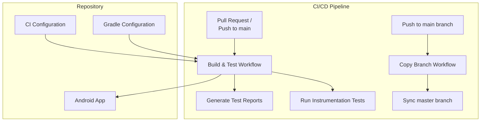
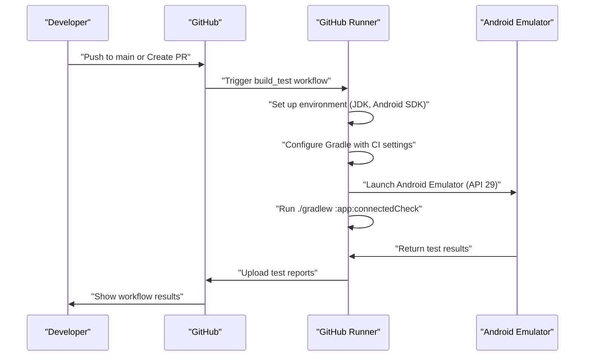
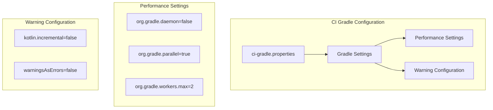
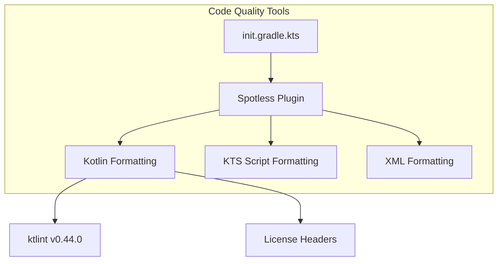
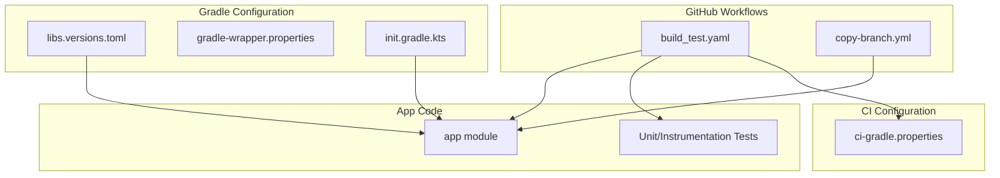
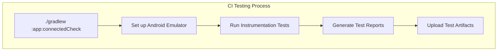

<!-- source: DeepWiki mcp.deepwiki.com · repo android/architecture-samples · page 6 CI/CD Pipeline · fetched 2026-10-23 -->

# CI/CD Pipeline

Relevant source files

The following files were used as context for generating this wiki page:

- [.github/ci-gradle.properties](.github/ci-gradle.properties)
- [.github/workflows/build_test.yaml](.github/workflows/build_test.yaml)
- [.github/workflows/copy-branch.yml](.github/workflows/copy-branch.yml)
- [gradle/init.gradle.kts](gradle/init.gradle.kts)
- [gradle/libs.versions.toml](gradle/libs.versions.toml)
- [gradle/wrapper/gradle-wrapper.properties](gradle/wrapper/gradle-wrapper.properties)

This document describes the Continuous Integration and Continuous Delivery (CI/CD) setup for the Android Architecture Samples repository. It covers the GitHub Actions workflows, CI configuration, and build processes used to ensure code quality and automate testing.

## Overview

The CI/CD pipeline for this project is implemented using GitHub Actions and consists of multiple workflows for building, testing, and managing branches. These automated processes help maintain code quality by running tests on every code change and ensuring consistent code formatting.

Sources: [.github/workflows/build_test.yaml](), [.github/workflows/copy-branch.yml]()

## GitHub Actions Workflows

The project uses the following GitHub Actions workflows:

| Workflow | File | Purpose |
|----------|------|---------|
| Build and Test | `.github/workflows/build_test.yaml` | Builds the application and runs instrumentation tests |
| Copy Branch | `.github/workflows/copy-branch.yml` | Duplicates main branch to the old master branch for compatibility |

### Build and Test Workflow

The primary workflow that builds the project and runs automated tests whenever code is pushed to the main branch or a pull request is created.

The workflow performs the following steps:
1. Checks out the code repository
2. Sets up KVM permissions for the Android emulator
3. Configures Gradle with CI-specific properties
4. Sets up JDK 17
5. Configures Gradle and Android SDK
6. Runs instrumentation tests on an Android emulator (API level 29)
7. Uploads test reports as artifacts

Sources: [.github/workflows/build_test.yaml:12-60]()

### Copy Branch Workflow

This workflow is triggered whenever code is pushed to the main branch. It helps maintain backward compatibility by duplicating the main branch to the old master branch.

Sources: [.github/workflows/copy-branch.yml:1-33]()

## CI Configuration

### Gradle Properties for CI

The CI environment uses specific Gradle properties to optimize build performance and handling of warnings:

Key CI Gradle properties include:
- Disabling the Gradle daemon for CI environments
- Enabling parallel execution with limited worker threads
- Disabling Kotlin incremental compilation
- Configuring warning handling

Sources: [.github/ci-gradle.properties:17-27]()

## Build System Configuration

The project uses a modern Gradle configuration with version catalogs for dependency management:

### Gradle Version

The project uses Gradle 8.11.1, defined in the Gradle wrapper properties:

Sources: [gradle/wrapper/gradle-wrapper.properties:1-6]()

### Dependency Management

Dependencies and plugin versions are managed centrally in the `libs.versions.toml` file, which:
- Defines version numbers for all libraries and tools
- Organizes dependencies into logical groups
- Configures Gradle plugins used in the project

This approach ensures consistent dependencies across all modules and simplifies updates.

Sources: [gradle/libs.versions.toml:1-153]()

## Code Quality Tools

### Spotless Integration

The project uses Spotless for code formatting, which is integrated via an initialization script to ensure compatibility with Gradle's configuration cache:

The initialization script:
1. Applies the Spotless plugin to all subprojects
2. Configures Kotlin formatting using ktlint
3. Sets up license header verification for Kotlin, KTS, and XML files

Sources: [gradle/init.gradle.kts:17-59]()

## CI/CD Component Integration

This diagram shows how the CI/CD components interact with the project's code structure:

Sources: [.github/workflows/build_test.yaml](), [.github/workflows/copy-branch.yml](), [.github/ci-gradle.properties](), [gradle/libs.versions.toml](), [gradle/wrapper/gradle-wrapper.properties](), [gradle/init.gradle.kts]()

## Workflow Triggers

GitHub Actions workflows are triggered by different events:

| Workflow | Triggered By |
|----------|-------------|
| Build and Test | - Manual dispatch - Push to main branch - Pull request to main branch |
| Copy Branch | - Manual dispatch - Push to main branch |

Sources: [.github/workflows/build_test.yaml:3-10](), [.github/workflows/copy-branch.yml:7-10]()

## Testing in CI

The CI pipeline places special emphasis on automated testing through:

1. **Instrumentation Tests** - Run on an Android emulator with API level 29
2. **Test Reporting** - Test reports are uploaded as artifacts for review

Sources: [.github/workflows/build_test.yaml:46-59]()

## Summary

The CI/CD pipeline for the Android Architecture Samples project provides:

1. Automated building and testing on code changes
2. Branch synchronization for backward compatibility
3. Consistent code formatting through Spotless
4. Centralized dependency management
5. Optimized Gradle configuration for CI environments

This setup ensures code quality and provides quick feedback to developers when issues are introduced.