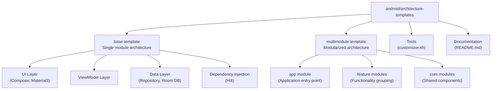
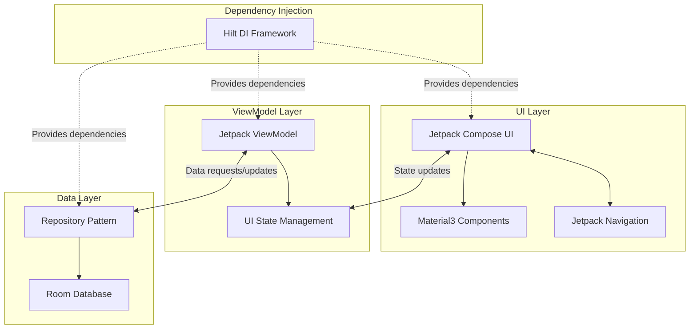

<!-- source: DeepWiki mcp.deepwiki.com · repo android/architecture-templates · page 1 Overview · fetched 2026-10-23 -->

# Overview

Relevant source files

The following files were used as context for generating this wiki page:

- [.google/packaging.yaml](.google/packaging.yaml)
- [README.md](README.md)
- [screenshots.png](screenshots.png)

This wiki provides detailed documentation for the Android Architecture Starter Templates repository, a collection of production-ready architecture templates designed for new Android projects. These templates implement modern Android development practices and architectural patterns, enabling developers to quickly bootstrap applications with a solid foundation.

For specific information about template options and their differences, see [Template Options](#2). For details on architectural patterns implemented in the templates, see [Architecture Patterns](#3).

## Repository Purpose

The Android Architecture Starter Templates serve as ready-to-use starting points for Android application development, implementing the recommended architecture from the [Guide to app architecture](https://developer.android.com/topic/architecture). Unlike educational samples (such as Architecture Samples or Now In Android), these templates are designed for immediate use in real projects.

The repository provides two template variants: a single-module base template and a multimodule template, each preconfigured with a complete architecture stack that follows Android best practices.

Sources: [README.md:4-7]()

## Repository Structure

Sources: [README.md:11-14]()

## Architectural Foundation

The templates implement a layered reactive architecture with clear separation of concerns, following modern Android development practices:

Sources: [README.md:32-44]()

## Key Technical Features

The templates incorporate a comprehensive set of modern Android development components:

| Category | Components |
|----------|------------|
| UI | Jetpack Compose, Material3, Jetpack Navigation |
| Architecture | ViewModel, Repository pattern, Reactive data layer |
| Data Storage | Room Database |
| Asynchronous Programming | Kotlin Coroutines, Flow |
| Dependency Injection | Hilt |
| Testing | Unit tests, UI tests with fake data and Hilt |
| Build System | KTS Gradle files, Version catalog |

Sources: [README.md:22-44]()

## Template Use Case

These templates are specifically designed for:

1. **New Android projects** - Providing a solid architectural foundation from the outset
2. **Quick experiments** - Enabling rapid prototyping with a complete architecture in place
3. **Modern Android development** - Implementing the latest recommended approaches and libraries

The templates offer a balance between structure and flexibility, allowing developers to focus on building features rather than setting up architecture.

Sources: [README.md:4-7]()

## Template Customization

The repository includes a customizer script that allows developers to tailor the templates to their specific needs. The script supports:

- Customizing the package name
- Renaming the main data item type
- Setting the application name

This customization should be performed before opening the project in Android Studio.

Sources: [README.md:46-72]()

## Template Variations

The repository offers two main template variations:

1. **Base Template**: A single-module architecture that includes all the features in a unified codebase, suitable for smaller projects or teams.

2. **Multimodule Template**: Extends the base template with a modular architecture, separating the codebase into multiple modules (app, feature, and core modules) for better scalability and build performance in larger projects.

For more details on these template options, see [Template Options](#2).

Sources: [README.md:11-14]()

## Core Architecture Principles

Both templates adhere to these fundamental principles:

1. **Separation of concerns** - Clear boundaries between UI, business logic, and data
2. **Reactive data flow** - Using Kotlin Flow to propagate data changes throughout the system
3. **Single source of truth** - Database serves as the authoritative data source
4. **Testability** - Architecture designed to support comprehensive testing
5. **Dependency injection** - Using Hilt to manage component dependencies

For more detailed information about these architectural patterns, see [Architecture Patterns](#3).

Sources: [README.md:32-44]()

---

