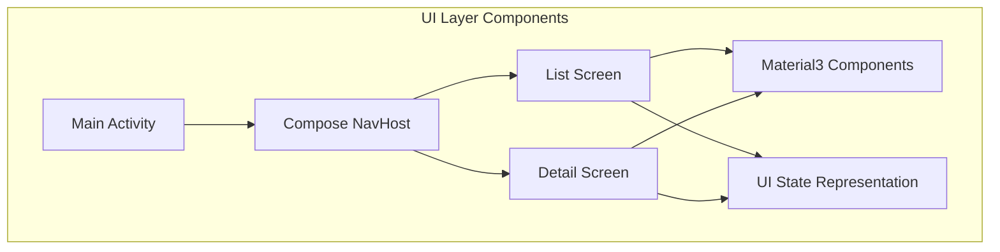
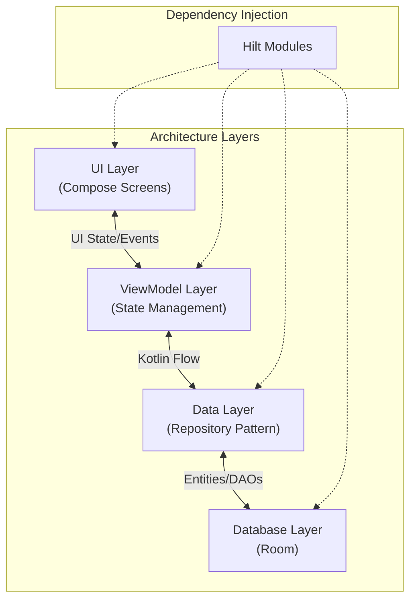
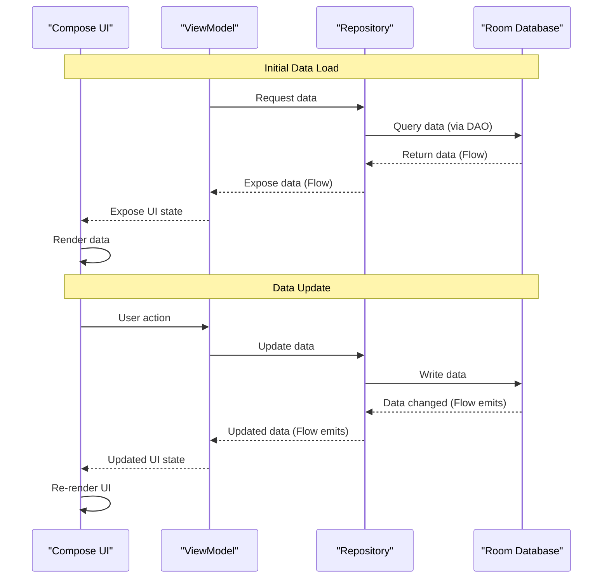
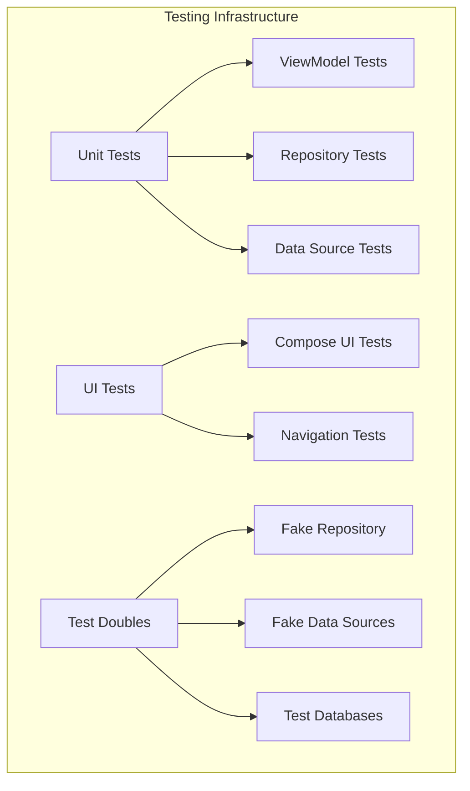

<!-- source: DeepWiki mcp.deepwiki.com · repo android/architecture-templates · page 1.1 Key Features · fetched 2026-10-23 -->

# Key Features

Relevant source files

The following files were used as context for generating this wiki page:

- [.google/packaging.yaml](.google/packaging.yaml)
- [README.md](README.md)

This document provides a comprehensive overview of the key features and capabilities of the Android Architecture Starter Templates. It focuses on the technical aspects of the templates, including their architecture, components, and implementation details. For visual examples of applications built with these templates, see [Visual Overview](#1.2).

## Overview of Template Options

The Android Architecture Starter Templates repository offers two main template options to accommodate different project requirements:

| Template | Description |
|----------|-------------|
| Base | Reactive architecture, Compose UI, Room database, single module |
| Multimodule | Base template features + modular architecture |

Both templates implement modern Android development practices and follow Google's recommended [Guide to app architecture](https://developer.android.com/topic/architecture).

Sources: [README.md:11-14]()

## UI Components

The templates feature a modern UI implementation with the following characteristics:

- Built entirely with Jetpack Compose
- Material 3 design system integration
- Sample screens demonstrating list and detail views
- Navigation between screens using Jetpack Navigation

Sources: [README.md:22-25](), [README.md:37-39]()

## Architectural Foundation

The templates implement a clean, layered architecture pattern that separates concerns and promotes testability.

Key architectural components include:

- **Layered Architecture**: Clear separation between UI, ViewModel, and Data layers
- **Room Database**: Persistent storage solution with type-safe queries
- **Reactive Data Flow**: Data changes propagate automatically through the system using Kotlin Flows
- **Dependency Injection**: Hilt provides centralized dependency management

Sources: [README.md:32-41]()

## Reactive Data Flow

One of the core features of the templates is the reactive data flow pattern, which establishes a unidirectional data flow throughout the application.

This reactive approach is implemented using:
- Kotlin Coroutines for asynchronous programming
- Flow for observable data streams
- StateFlow/SharedFlow for UI state management

Sources: [README.md:40-41]()

## Build System Features

The templates incorporate modern build system practices:

- **Kotlin DSL Build Scripts**: Using KTS gradle files for improved type safety and IDE support 
- **Version Catalog**: Centralized dependency management to ensure consistent versions across modules

Sources: [README.md:27-30]()

## Testing Infrastructure

The templates come with a comprehensive testing infrastructure:

| Test Type | Tools | Features |
|-----------|-------|----------|
| Unit Tests | JUnit, Turbine | ViewModel, Repository, and other business logic tests |
| UI Tests | Compose Testing, Hilt Testing | Component-level and integration tests |
| Test Doubles | Hilt Test Modules | Fake implementations for testing isolation |

The testing approach allows for:
- Testing each layer in isolation
- Integration testing across layers
- UI testing with controlled test data

Sources: [README.md:42-44]()

## Template Customization

The templates support easy customization via a script that allows you to specify:

- Package name
- Data item type (entity name)
- Application name

This makes it simple to adapt the templates to specific project needs without manual refactoring.

Sources: [README.md:46-66]()

## Technology Stack Summary

The following table summarizes the key technologies used in the templates:

| Category | Technologies |
|----------|--------------|
| UI | Jetpack Compose, Material 3, Jetpack Navigation |
| Architecture | ViewModel, Repository Pattern, Room |
| Asynchronous | Kotlin Coroutines, Flow |
| Dependency Injection | Hilt |
| Testing | JUnit, Compose Testing, Hilt Testing |
| Build | KTS Gradle Files, Version Catalog |

Sources: [README.md:28-44]()

This combination of technologies represents modern Android development best practices and provides a solid foundation for building maintainable, testable, and scalable Android applications.

---

