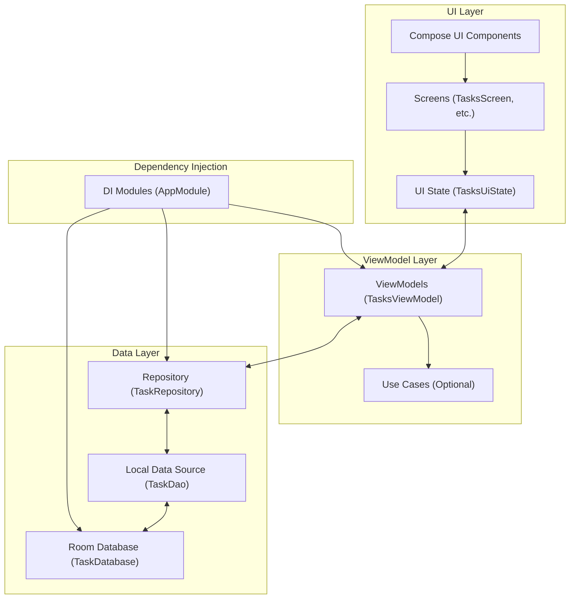
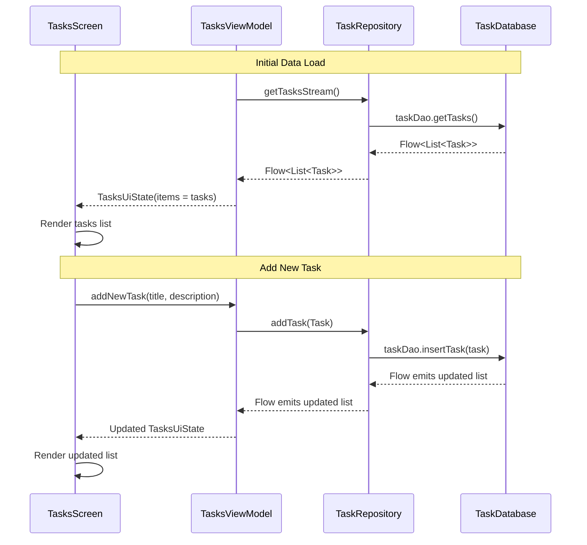
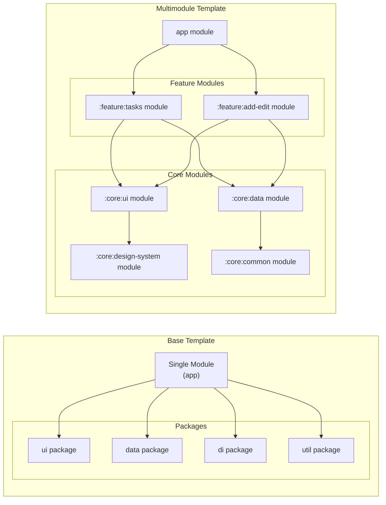
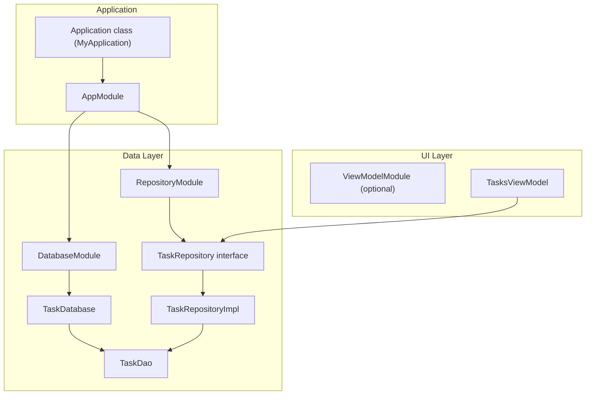

<!-- source: DeepWiki mcp.deepwiki.com · repo android/architecture-templates · page 1.2 Visual Overview · fetched 2026-10-23 -->

# Visual Overview

<details>
<summary>Relevant source files</summary>

The following files were used as context for generating this wiki page:

- [screenshot.png](screenshot.png)
- [screenshots.png](screenshots.png)

</details>


This page provides visual examples of applications built with the Android Architecture Templates. It illustrates how applications created using these templates look visually and how their components interact architecturally. For information about the architectural patterns implemented in these templates, see [Architecture Patterns](#3).

## Sample Application UI

Applications built with the Android Architecture Templates follow Material 3 design principles and use Jetpack Compose for the user interface. Below is a screenshot of a sample application built using these templates:


The sample application showcases a simple "My Tasks" app that demonstrates the architecture patterns and UI components provided by the templates. The UI features:

- Material 3 design components
- A top app bar with title and actions
- A list of items displayed in a vertical layout
- Floating action button (FAB) for adding new items
- Individual item cards with interactive elements

Sources: screenshot.png

## Architecture Component Visualization

The following diagram shows the key architectural components in applications built with these templates and how they relate to each other:



This architecture follows a unidirectional data flow pattern, with clear separation between UI, logic, and data layers.

Sources: screenshot.png, Repository Structure Overview diagrams from introduction

## UI Component Hierarchy

The following diagram illustrates the hierarchy of UI components in a typical screen built with these templates:

```mermaid
flowchart TD
    subgraph "TasksScreen"
        TasksRoute["TasksRoute(viewModel: TasksViewModel)"]
        TasksScreen["TasksScreen(uiState, onAddTask, onTaskClick, etc.)"]
        
        subgraph "Components"
            TopBar["TopAppBar(title: 'Tasks')"]
            TasksList["TasksList(items: List<Task>)"]
            TaskItem["TaskItem(task: Task, onTaskClick)"]
            AddTaskFAB["FloatingActionButton(onAddTask)"]
        end
    end
    
    TasksRoute --> TasksViewModel["TasksViewModel"]
    TasksRoute --> TasksScreen
    TasksScreen --> TopBar
    TasksScreen --> TasksList
    TasksList --> TaskItem
    TasksScreen --> AddTaskFAB
    
    TasksViewModel --> TasksUiState["TasksUiState(isLoading, items)"]
    TasksUiState --> TasksScreen
```

This diagram shows how UI components are structured in the Jetpack Compose hierarchy, with clear separation between route functions, screen composables, and individual UI components.

Sources: screenshot.png, Layered Architecture Pattern diagram from introduction

## Data Flow Visualization

The reactive data flow in applications built with these templates is visualized below:



This diagram illustrates how data flows reactively through the system, with Kotlin Flows enabling automatic UI updates when data changes.

Sources: Reactive Data Flow diagram from introduction

## Base vs. Multimodule Template Structure

The templates are available in two variants: a base template and a multimodule template. The following diagram shows the structural differences between them:



This diagram shows how the single-module base template organizes code into packages, while the multimodule template separates concerns into dedicated modules.

Sources: Template Comparison: Base vs. Multimodule diagram from introduction

## Dependency Injection Structure

The following diagram illustrates how dependency injection is implemented using Hilt in these templates:



This diagram shows how Hilt manages dependencies throughout the application, following a clean architecture approach.

Sources: Dependency Injection Structure diagram from introduction

## Theme and UI Components

The templates provide a Material 3 theme and reusable UI components:

```mermaid
flowchart TD
    subgraph "Theme"
        Theme["AppTheme"]
        ColorScheme["AppColorScheme"]
        Typography["AppTypography"]
    end
    
    subgraph "Common Components"
        LoadingIndicator["LoadingIndicator"]
        ErrorMessage["ErrorMessage"]
        TasksList["TasksList"]
        TaskItem["TaskItem"]
    end
    
    subgraph "Screens"
        TasksScreen["TasksScreen"]
        AddEditTaskScreen["AddEditTaskScreen"]
    end
    
    Theme --> ColorScheme
    Theme --> Typography
    Theme --> TasksScreen
    Theme --> AddEditTaskScreen
    TasksScreen --> TasksList
    TasksList --> TaskItem
    TasksScreen --> LoadingIndicator
    TasksScreen --> ErrorMessage
```

This diagram shows how the theming and UI components are structured and used throughout the application.

Sources: screenshot.png

## Conclusion

The visual examples provided in this page demonstrate how applications built with the Android Architecture Templates look and how their components interact. These templates follow modern Android development best practices, including:

- Material 3 design for a polished user interface
- Jetpack Compose for declarative UI
- Clean architecture with separation of concerns
- Reactive data flow using Kotlin Flows
- Dependency injection with Hilt

For more detailed information about the architectural patterns implemented in these templates, see [Architecture Patterns](#3).

---

