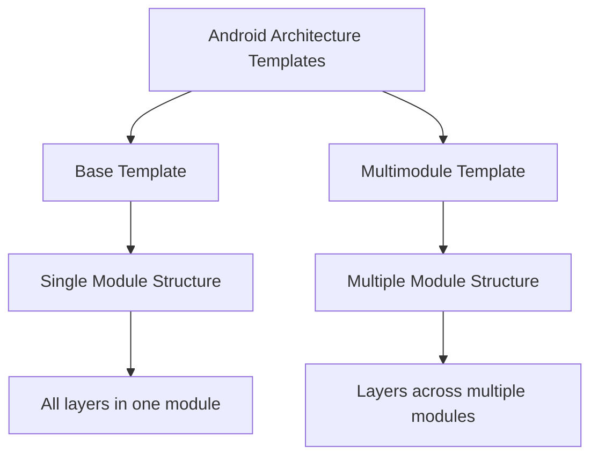
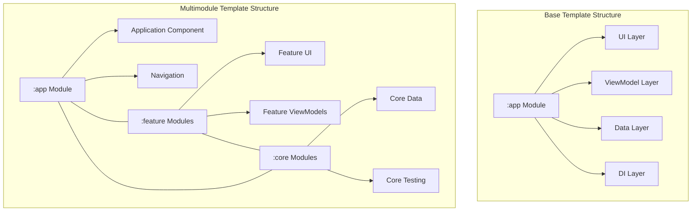
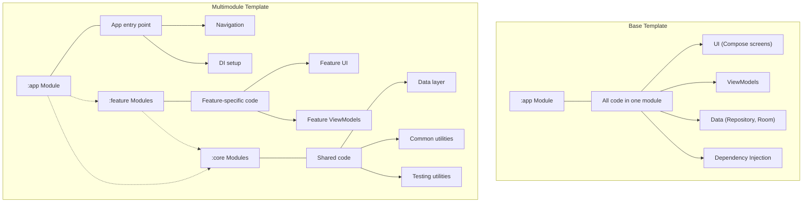
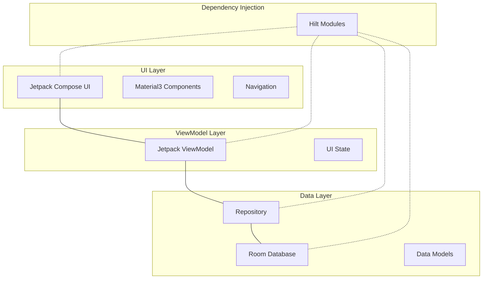

<!-- source: DeepWiki mcp.deepwiki.com · repo android/architecture-templates · page 2 Template Options · fetched 2026-10-23 -->

# Template Options

Relevant source files

The following files were used as context for generating this wiki page:

- [README.md](README.md)

This page compares the available template options in the Android Architecture Templates repository and provides guidance on when to use each option. The repository offers two main template types: the Base (single-module) template and the Multimodule template. For detailed information about the specific implementation of each template, see [Base Template](#2.1) and [Multimodule Template](#2.2).

## Available Templates

The Android Architecture Templates repository provides two template options as starting points for Android applications:

**Template Options Overview**

Sources: [README.md:11-14]()

### Base Template

The Base template provides a single-module architecture with the following components:
- Reactive architecture with Kotlin Flows
- Jetpack Compose UI
- Room database for local storage
- Hilt for dependency injection
- All code contained within a single app module

### Multimodule Template

The Multimodule template extends the Base template by distributing the code across multiple modules:
- `app` module (application entry point)
- `feature` modules (grouped by functionality)
- `core` modules (shared components)

## Architectural Comparison

Both templates implement the same layered architecture but differ in how the code is organized across modules.

**High-Level Architecture Comparison**

Sources: [README.md:32-44]()

## Module Structure Comparison

The key difference between the templates is how code is organized across modules.

**Detailed Module Structure Comparison**

Sources: [README.md:32-44]()

## Architecture Implementation

Both templates implement the same layered architecture pattern, following Android's recommended architecture:

**Shared Architecture Layers**

Sources: [README.md:32-44]()

## Technical Trade-offs

| Aspect | Base Template | Multimodule Template |
|--------|---------------|----------------------|
| Project Structure | Single module | Multiple modules (app, feature, core) |
| Code Organization | Package-based separation | Module-based separation |
| Build Speed | Faster for small projects | Better for large projects with incremental builds |
| Module Boundaries | No explicit boundaries | Clear explicit boundaries |
| Dependency Management | Simpler, all in one place | More complex, distributed across modules |
| Feature Isolation | Less isolation | Better isolation |
| Testing | All tests in one module | Tests distributed by module |
| Team Collaboration | Potential for merge conflicts | Reduced merge conflicts between teams |
| CI Build Time | Shorter for small projects | Can be optimized for larger projects |
| Gradle Configuration | Simpler, fewer files | More complex, multiple build files |

Sources: [README.md:32-44]()

## Selection Criteria

### When to Choose the Base Template

Choose the Base template when:
- Building smaller applications with a limited number of features
- Working with a small development team
- Rapid prototyping or quick proof-of-concept development
- Minimizing build configuration complexity is a priority
- Application scope is well-defined and unlikely to grow significantly

### When to Choose the Multimodule Template

Choose the Multimodule template when:
- Building larger applications with many features
- Working with larger development teams that need to work on separate features
- Clear module boundaries are needed for better code organization
- Improved build times through parallel and incremental compilation are important
- Need for selective feature inclusion/exclusion in different app variants
- Planning for feature modules that could be reused across different applications
- Need to scale the codebase as the application grows

## Summary

Both templates implement the same layered architecture and follow the same architectural principles but differ in project structure complexity:

- The **Base template** offers simplicity with everything in a single module, making it ideal for smaller projects or quick starts.
- The **Multimodule template** provides a scalable structure with clear boundaries between modules, making it better suited for larger projects and teams.

For detailed implementation information about each template, see [Base Template](#2.1) and [Multimodule Template](#2.2).

For instructions on using and customizing these templates, see [Using the Customizer Script](#4.1).

Sources: [README.md:46-72]()

---

