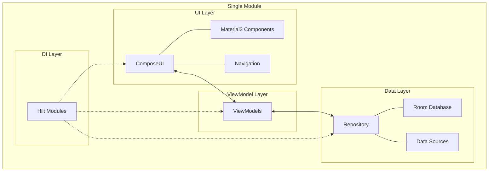
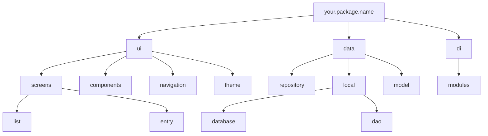
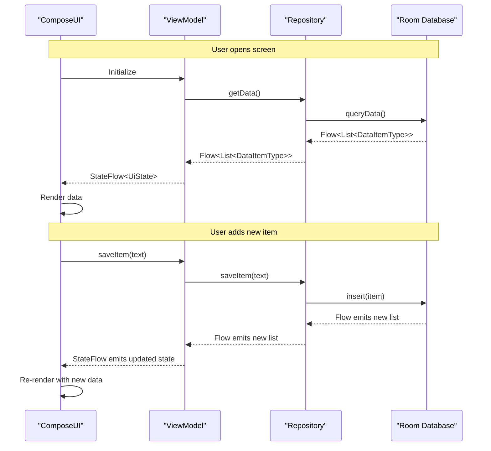
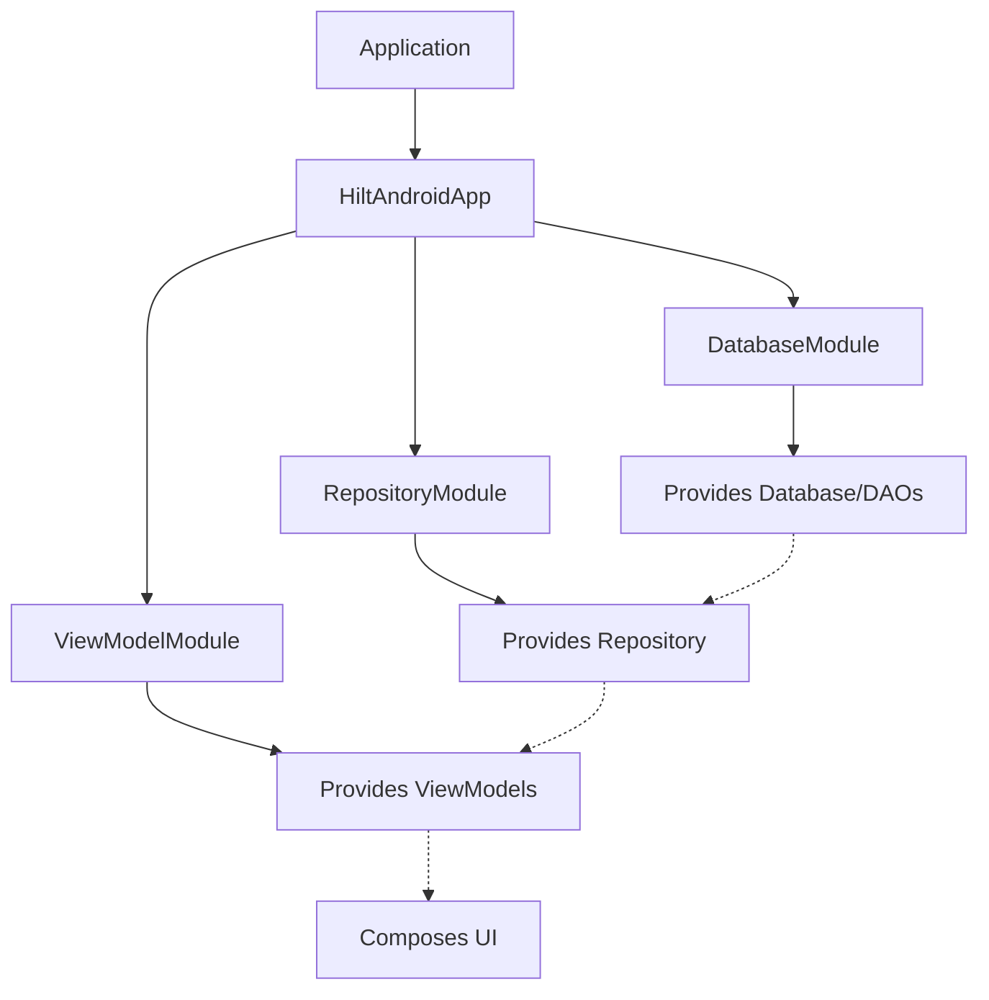

<!-- source: DeepWiki mcp.deepwiki.com · repo android/architecture-templates · page 2.1 Base Template · fetched 2026-10-23 -->

# Base Template

Relevant source files

The following files were used as context for generating this wiki page:

- [README.md](README.md)

## Purpose and Scope

The Base Template provides a single-module architecture foundation for Android applications following the [Guide to app architecture](https://developer.android.com/topic/architecture). It implements a layered architecture with clean separation of concerns, reactive data flow, and modern Android development practices. This document explains the structure, components, and appropriate use cases for the Base Template.

For information about the modularized version with feature and core modules, see [Multimodule Template](#2.2).

Sources: [README.md:12-14]()

## Overview

The Base Template is designed for small to medium-sized applications or quick experiments where simplicity and a single-module approach are preferred. It contains a complete architecture stack with UI, ViewModel, and Data layers all within a single module.

### Key Characteristics

- **Single Module**: All code resides in a single app module
- **Layered Architecture**: Clear separation between UI, ViewModel, and Data layers
- **Reactive Data Flow**: Uses Kotlin Flows for reactive data propagation
- **Modern Android Stack**: Jetpack Compose, Room, Hilt, and other recommended libraries

### Template Structure

**Base Template Architecture**

Sources: [README.md:32-44]()

## Package Structure

The Base Template organizes code by architectural layer within a single module. This promotes separation of concerns while keeping the project structure simple.

**Package Organization**

Sources: [README.md:32-44]()

## Data Flow Pattern

The Base Template implements a reactive data flow pattern using Kotlin Coroutines and Flow. This creates a responsive application where data changes automatically propagate from the data layer to the UI.

**Reactive Data Flow**

Sources: [README.md:40-41]()

## Key Components

### UI Layer

The UI layer is built with Jetpack Compose and Material3, providing a modern, declarative UI approach. It consists of:

- **Screens**: Compose screens that display data and capture user interactions
- **Components**: Reusable Compose UI components
- **Navigation**: Jetpack Navigation for Compose to manage screen navigation
- **Theme**: Material3 theming resources

The UI observes UI state from the ViewModel and renders accordingly, while sending user events back to the ViewModel.

Sources: [README.md:22-25](), [README.md:37-39]()

### ViewModel Layer

The ViewModel layer manages UI state and business logic:

- Exposes UI state via StateFlow
- Processes user events
- Communicates with the data layer
- Survives configuration changes
- Preserves state during navigation

ViewModels are injected into Compose screens using Hilt.

Sources: [README.md:36]()

### Data Layer

The data layer manages all data operations and contains:

- **Repository**: Coordinates data operations and provides a clean API to the ViewModel
- **Room Database**: Provides local persistence using SQLite
- **DAOs**: Data Access Objects for database operations
- **Models**: Data classes representing the application's data entities

All data operations are exposed as Flows to enable reactive updates.

Sources: [README.md:34](), [README.md:40]()

### Dependency Injection

Hilt provides dependency injection throughout the application:

**Dependency Injection Structure**

Sources: [README.md:35]()

## Testing Approach

The Base Template includes a comprehensive testing strategy:

### Unit Tests

- Tests for ViewModels
- Tests for Repository
- Tests for Data sources

### UI Tests

- Compose UI testing
- Uses fake data providers with Hilt test modules
- Tests navigation flows and UI interactions

Sources: [README.md:42-44]()

## Use Cases

The Base Template is ideal for:

- Small to medium-sized applications
- Rapid prototypes and quick experiments
- Single-developer projects
- Applications with a focused feature set

When your application grows beyond these bounds, consider migrating to the [Multimodule Template](#2.2) for better scalability and team collaboration.

**Feature-to-Code Mapping**

| Feature | Key Implementation Files |
|---------|--------------------------|
| UI Layer | Compose screens and components |
| Navigation | Navigation graphs and routes |
| State Management | ViewModels with UI state |
| Data Persistence | Room database, DAOs, and entities |
| Dependency Injection | Hilt modules |
| Business Logic | Repository implementation |

Sources: [README.md:11-14]()

## Getting Started

To use the Base Template:

1. Clone the repository branch `base`
2. Run the customizer script to configure package name and entity type
3. Open in Android Studio

For detailed instructions on customization, see [Using the Customizer Script](#4.1).

Sources: [README.md:46-72]()

## Limitations

While the Base Template provides a solid foundation, be aware of these limitations:

- All code resides in a single module, which may become unwieldy as the application grows
- Limited isolation between features, which can lead to tight coupling
- May be challenging for large teams working simultaneously on different features

When these limitations become apparent, consider migrating to the [Multimodule Template](#2.2).

Sources: [README.md:11-14]()

---

