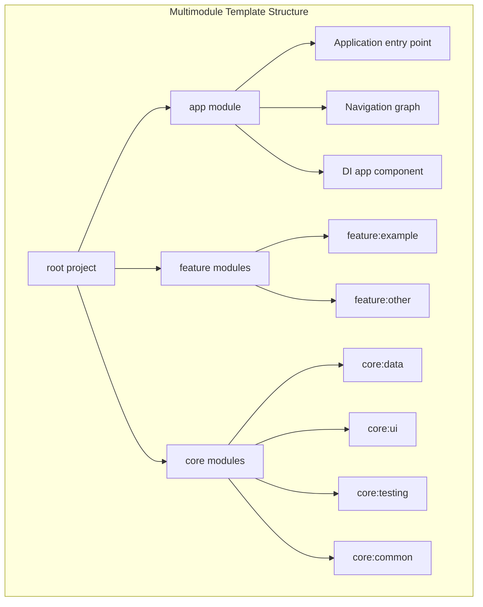
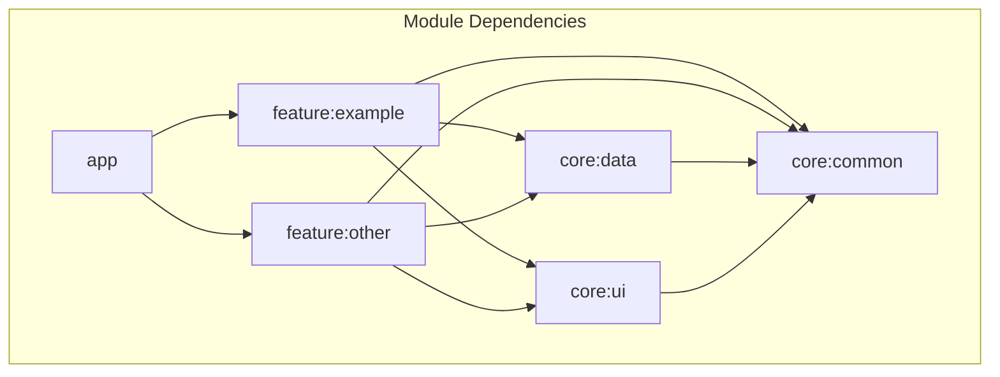
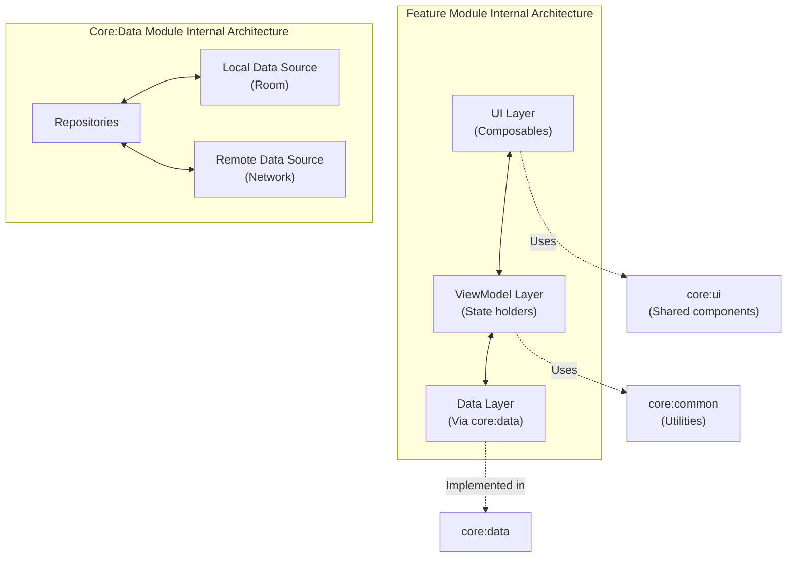
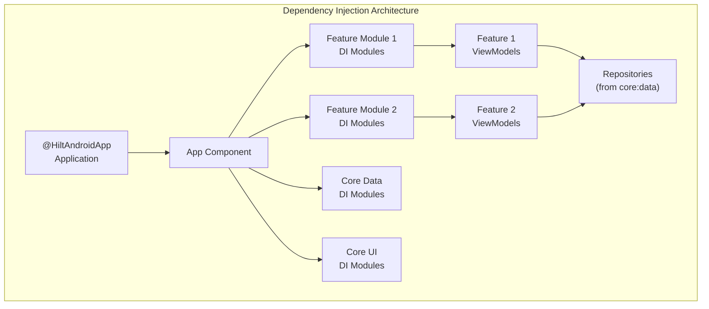

<!-- source: DeepWiki mcp.deepwiki.com · repo android/architecture-templates · page 2.2 Multimodule Template · fetched 2026-10-23 -->

# Multimodule Template

<details>
<summary>Relevant source files</summary>

The following files were used as context for generating this wiki page:

- [README.md](README.md)

</details>


This document explains the structure, organization, and communication patterns of the multimodule template from the Android Architecture Starter Templates repository. The multimodule template extends the [Base Template](#2.1) by splitting the application into multiple Gradle modules, enabling better separation of concerns, improved build performance, and scalability for larger codebases and teams.

## 1. Overview and Purpose

The multimodule template implements a modular architecture that organizes code into distinct, purpose-specific modules. This approach offers several advantages over single-module architecture:

- **Improved build performance**: Only modified modules need to be recompiled
- **Better separation of concerns**: Clear module boundaries enforce architectural patterns
- **Parallel development**: Multiple developers can work on different modules simultaneously
- **Feature isolation**: Features can be developed, tested, and maintained independently
- **Reusability**: Core modules can be shared across projects

The template demonstrates how to apply modularization principles to Android app development while maintaining the same layered architecture patterns as the base template.

Sources: [README.md:13-14]()

## 2. Module Structure

The multimodule template divides the application into three main categories of modules:



### 2.1 App Module

The app module serves as the application's entry point and orchestrator, containing:

- The `Application` class with Hilt setup
- Main navigation graph that connects feature modules
- App-level dependency injection components
- Final Android application packaging configuration

The app module depends on all feature modules and necessary core modules but contains minimal business logic itself.

### 2.2 Feature Modules

Feature modules encapsulate specific functionality or user journeys within the application. Each feature module typically contains its own UI, ViewModels, and feature-specific logic, following the same layered architecture as the base template but scoped to a particular feature.

Feature modules generally follow this pattern:
- UI components built with Jetpack Compose
- Feature-specific ViewModels
- Feature-specific navigation components
- Feature-specific state holders
- Feature-specific unit and UI tests

Feature modules may depend on core modules but should not depend on other feature modules to maintain proper separation of concerns.

### 2.3 Core Modules

Core modules contain shared functionality used across multiple feature modules. The template typically includes the following core modules:

- **core:data**: Contains repositories, data sources, database definitions, and network services
- **core:ui**: Shared UI components, theme definitions, and common UI utilities
- **core:common**: Utilities, extensions, and common code used throughout the application
- **core:testing**: Testing utilities and fake implementations for tests

Core modules should be designed with clear responsibilities and APIs to keep the architecture maintainable.

Sources: [README.md:32-44]()

## 3. Module Dependencies and Communication

The module dependency structure follows a specific pattern to ensure architectural integrity:



Key communication patterns:

1. **App to Features**: The app module navigates between features but doesn't access their internal implementation
2. **Feature to Core**: Features use core modules for data access and shared functionality
3. **Feature to Feature**: Features don't communicate directly with each other; they interact through:
   - Navigation (via the app module)
   - Shared data (via core:data module)

### 3.1 Dependency Rules

To maintain clean architecture, the template follows these dependency rules:

1. App module depends on all feature modules
2. Feature modules depend on core modules, but not on other feature modules
3. Core modules may depend on other core modules but never on feature or app modules
4. Dependencies always point inward (from more specific to more general modules)

These rules prevent circular dependencies and ensure that each module can be reasoned about independently.

### 3.2 Public API Boundaries

Each module defines clear public API boundaries that determine what is accessible to other modules:

- Internal implementation details are hidden using Kotlin's `internal` visibility modifier
- Only necessary interfaces and models are exposed as public APIs
- Communication between modules happens through well-defined interfaces

Sources: [README.md:32-42]()

## 4. Architecture Within Modules

Each module maintains the layered architecture pattern of the base template, with separation between UI, ViewModel, and Data layers.



### 4.1 Example Feature Module Structure

A typical feature module contains:

```
feature:example/
├── src/
│   ├── main/
│   │   ├── kotlin/
│   │   │   └── com.example.app.feature.example/
│   │   │       ├── navigation/
│   │   │       │   └── ExampleNavigation.kt
│   │   │       ├── ui/
│   │   │       │   ├── ExampleScreen.kt
│   │   │       │   └── components/
│   │   │       └── ExampleViewModel.kt
│   │   └── AndroidManifest.xml
│   └── test/
│       └── kotlin/
│           └── com.example.app.feature.example/
│               └── ExampleViewModelTest.kt
└── build.gradle.kts
```

### 4.2 Example Core Module Structure

A typical core data module contains:

```
core:data/
├── src/
│   ├── main/
│   │   ├── kotlin/
│   │   │   └── com.example.app.core.data/
│   │   │       ├── repository/
│   │   │       │   ├── ExampleRepository.kt
│   │   │       │   └── ExampleRepositoryImpl.kt
│   │   │       ├── local/
│   │   │       │   ├── database/
│   │   │       │   │   ├── AppDatabase.kt
│   │   │       │   │   └── ExampleDao.kt
│   │   │       │   └── model/
│   │   │       │       └── ExampleEntity.kt
│   │   │       └── di/
│   │   │           └── DataModule.kt
│   │   └── AndroidManifest.xml
│   └── test/
│       └── kotlin/
│           └── com.example.app.core.data/
│               └── repository/
│                   └── ExampleRepositoryTest.kt
└── build.gradle.kts
```

Sources: [README.md:32-44]()

## 5. Dependency Injection in Multimodule

The template uses Hilt for dependency injection, which works well with the multimodule structure. Each module contributes to the dependency graph while maintaining proper encapsulation.



Key DI patterns in the multimodule template:

1. Each module provides its own Hilt modules to contribute to the dependency graph
2. The app module contains the `@HiltAndroidApp` entry point
3. Feature modules use `@AndroidEntryPoint` and `@HiltViewModel` for their components
4. Core modules expose interfaces through DI and provide implementations
5. Testing modules provide test-specific implementations for DI

Sources: [README.md:35-36]()

## 6. Testing in Multimodule Architecture

The multimodule template maintains the same testing strategy as the base template but distributes tests across modules:

1. Each module contains its own unit tests for module-specific code
2. UI tests remain primarily in the app module but can use test helpers from feature modules
3. The core:testing module provides shared testing utilities, fakes, and test rules
4. Hilt is used for dependency injection in tests, with test doubles replacing real implementations

This approach allows for thorough testing while maintaining module boundaries.

Sources: [README.md:42-44]()

## 7. When to Use the Multimodule Template

Consider using the multimodule template when:

- Your project is expected to grow beyond a few screens or features
- Multiple developers will be working on the codebase simultaneously
- You need to improve build times as the project scales
- You want to enforce stricter architectural boundaries
- You're building a large application with multiple distinct features

For simpler applications or quick prototypes, the [Base Template](#2.1) might be more appropriate due to its simpler setup.

Sources: [README.md:13-14]()

## 8. Summary

The multimodule template provides a robust foundation for building modular Android applications with clear architectural boundaries. It extends the base template's layered architecture across multiple Gradle modules, improving scalability, build performance, and team collaboration. Through careful organization into app, feature, and core modules, along with well-defined dependency rules, the template demonstrates how to implement a maintainable modular architecture while leveraging modern Android development practices.

---

