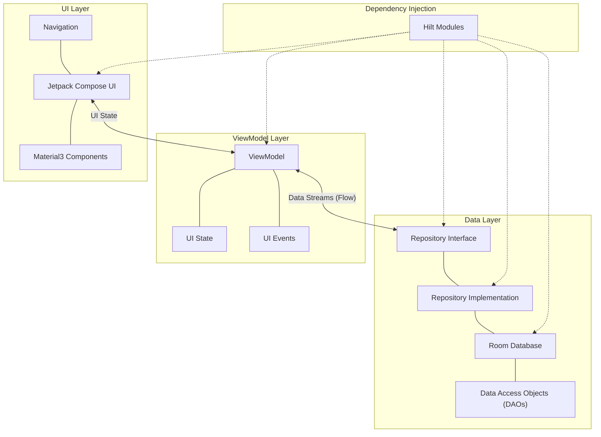
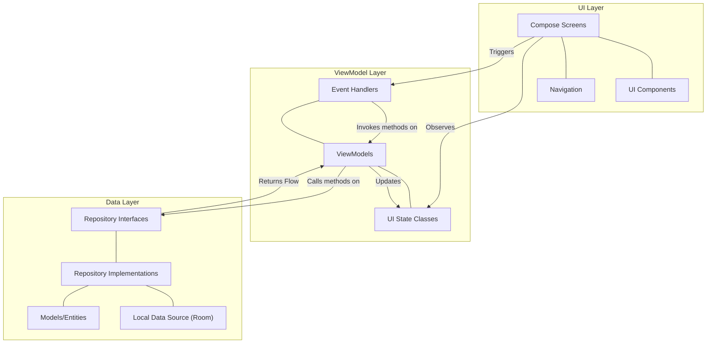
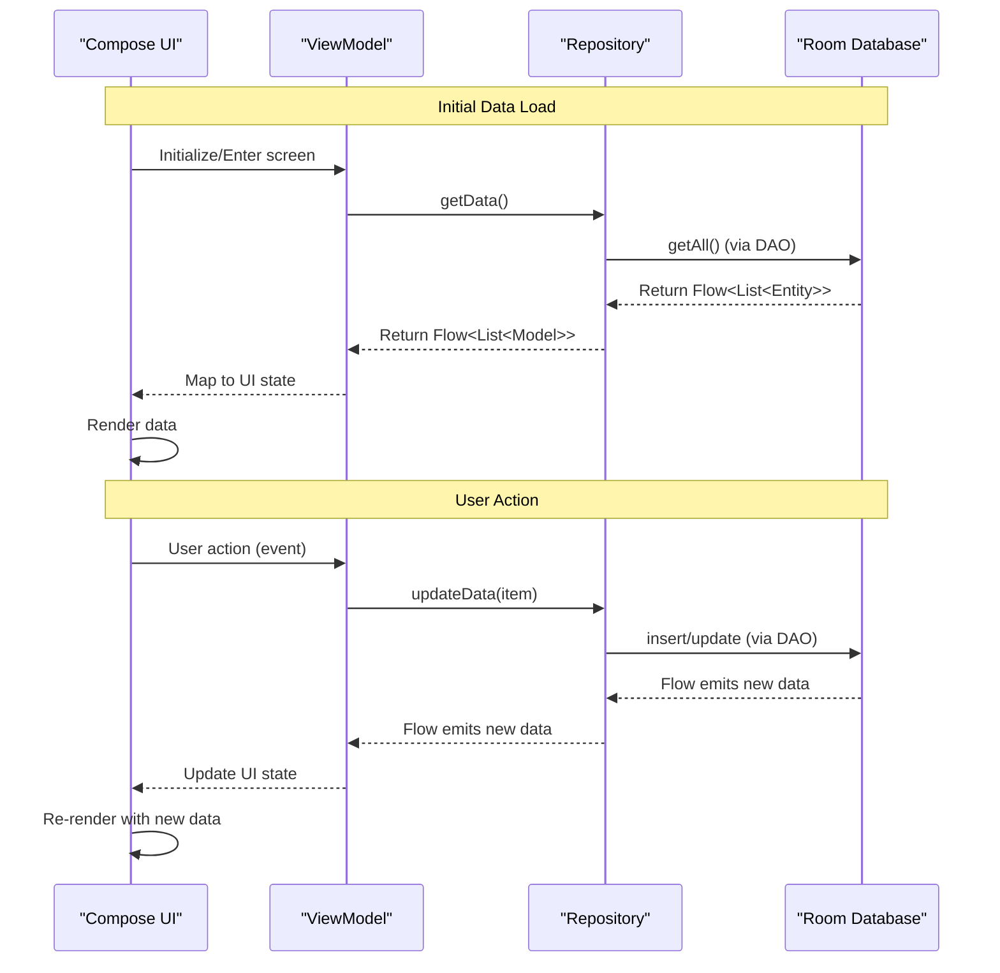
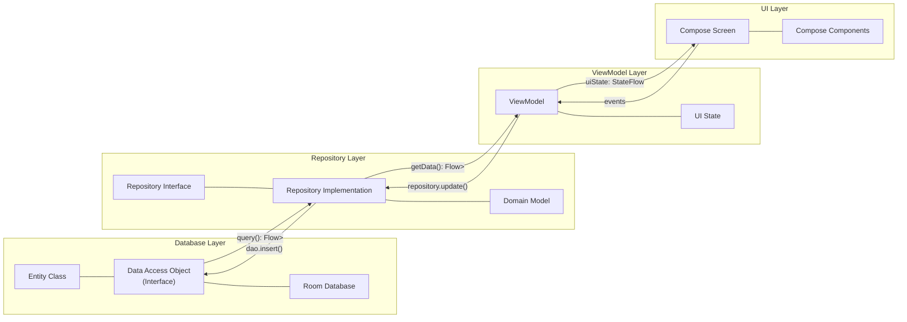
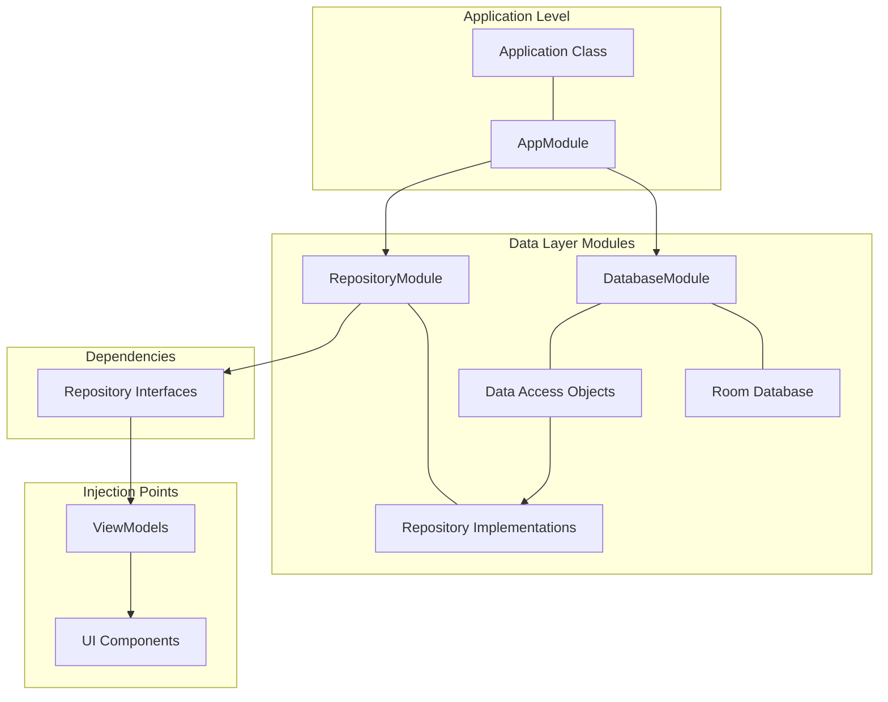

<!-- source: DeepWiki mcp.deepwiki.com · repo android/architecture-templates · page 3 Architecture Patterns · fetched 2026-10-23 -->

# Architecture Patterns

Relevant source files

The following files were used as context for generating this wiki page:

- [README.md](README.md)

This page provides an overview of the architectural patterns implemented in the Android Architecture Starter Templates. These patterns form the foundation of both the base and multimodule templates, ensuring a consistent approach to Android application development following Google's [Guide to app architecture](https://developer.android.com/topic/architecture).

For specific information about the different template options, see [Template Options](#2). For details on how to get started with these templates, see [Getting Started](#4).

## Core Architecture Overview

The templates implement a layered architecture with a unidirectional, reactive data flow. This approach separates concerns, improves testability, and creates a consistent pattern for data management throughout the application.

### High-Level Architecture Diagram

Sources: README.md:32-41

The architecture is structured into three primary layers, each with distinct responsibilities:

1. **UI Layer**: Responsible for displaying data to the user and capturing user interactions
2. **ViewModel Layer**: Manages UI-related data, handles UI logic, and communicates with the data layer
3. **Data Layer**: Manages data operations, including database access and potentially remote data sources

Dependency injection with Hilt ensures proper separation of concerns and facilitates testing.

## Layered Architecture

The templates strictly separate the application into three main layers, each with specific responsibilities and components.

### Layer Structure and Responsibilities

Sources: README.md:32-41

### UI Layer
The UI layer is built with Jetpack Compose and Material3, providing a modern declarative UI system. It consists of:

- **Compose screens**: Full-screen UI elements that represent destinations in the app
- **UI components**: Reusable Compose elements that make up the screens
- **Navigation**: Handled by Jetpack Navigation for Compose

The UI observes UI state from ViewModels and dispatches user events to the ViewModel layer.

### ViewModel Layer
The ViewModel layer uses Jetpack ViewModel to manage UI-related data in a lifecycle-conscious way:

- **ViewModels**: Hold UI state and handle UI logic
- **UI State classes**: Immutable data classes representing the state of a screen
- **Event handlers**: Methods triggered by user actions from the UI

ViewModels interact with the data layer through repository interfaces, transforming data into UI state.

### Data Layer
The data layer is responsible for data operations and abstraction:

- **Repository interfaces**: Define data operations without implementation details
- **Repository implementations**: Concrete implementations of repository interfaces
- **Local data source**: Room database for persistent storage
- **Model classes/entities**: Data classes representing the core data structures

The data layer exposes reactive data streams using Kotlin Flow, ensuring updates propagate through the system automatically.

Sources: README.md:34-37, 40

## Reactive Data Flow

The templates implement a reactive data flow architecture using Kotlin Coroutines and Flow, creating a consistent pattern for handling data changes and updates throughout the application.

### Data Flow Diagram

Sources: README.md:40-41

Key aspects of the reactive data flow:

1. **Unidirectional data flow**: Data flows in one direction, from the database through repositories and ViewModels to the UI
2. **Reactive updates**: Data changes trigger automatic updates through the system using Kotlin Flow
3. **State-based UI**: The UI observes state from ViewModels and renders based on that state
4. **Event-based actions**: User interactions are captured as events and processed by ViewModels

This reactive pattern ensures that the UI always reflects the current state of the data, without manual synchronization.

### Code Entity Relationships

Sources: README.md:34-41

## Dependency Injection

The templates use Hilt for dependency injection, providing a standardized way to manage dependencies throughout the application and enabling easier testing.

### Dependency Injection Structure

Sources: README.md:35

Key aspects of the dependency injection system:

1. **Hilt modules**: Define how to provide dependencies
2. **Constructor injection**: Primary method for injecting dependencies
3. **Interface abstraction**: Dependencies are provided through interfaces rather than concrete implementations
4. **Testing support**: Enables replacing real implementations with fakes for testing

This dependency injection approach:
- Reduces boilerplate code
- Improves testability
- Enforces separation of concerns
- Manages the lifecycle of dependencies

### Testing with Dependency Injection

The architecture is designed to support both unit testing and UI testing through its dependency injection system:

- **Unit tests**: Test individual components with mock dependencies
- **UI tests**: Use fake data sources injected through Hilt test modules

Hilt's testing utilities allow for replacing production dependencies with test alternatives, ensuring tests are reliable and focused.

Sources: README.md:42-44

## Summary

The architecture patterns implemented in these templates provide:

1. **Clear separation of concerns** through a layered architecture
2. **Reactive data handling** with Kotlin Flow
3. **Dependency management** with Hilt
4. **Testability** at all levels

Together, these patterns create a solid foundation for building maintainable, testable, and scalable Android applications following modern best practices.

For more detailed information about specific aspects of the architecture, see:
- [Layered Architecture](#3.1)
- [Reactive Data Flow](#3.2)
- [Dependency Injection](#3.3)

Sources: README.md:4-5, 32-41

---

