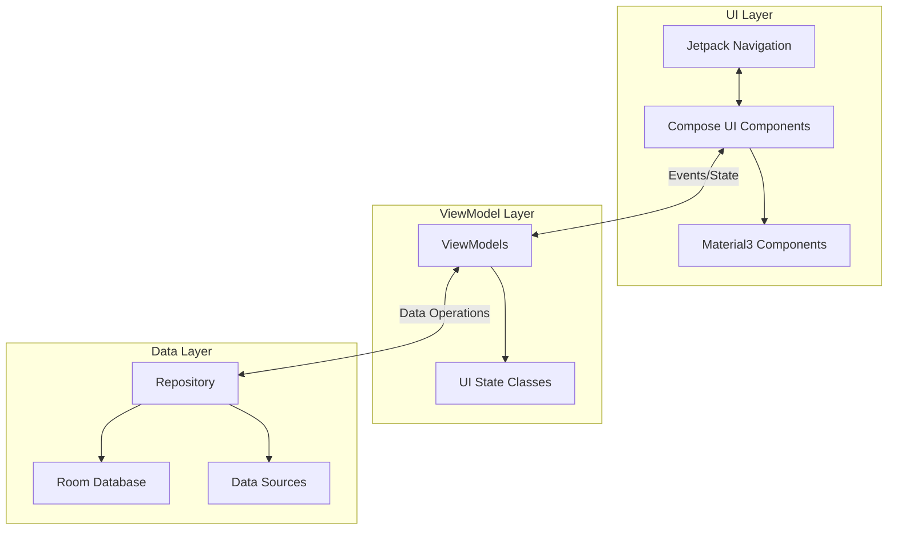
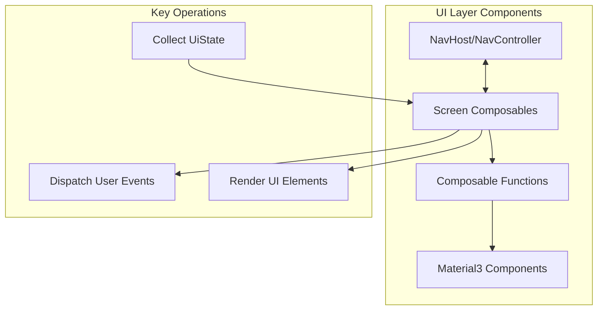
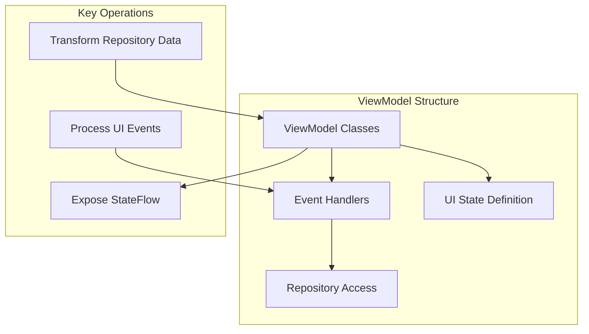
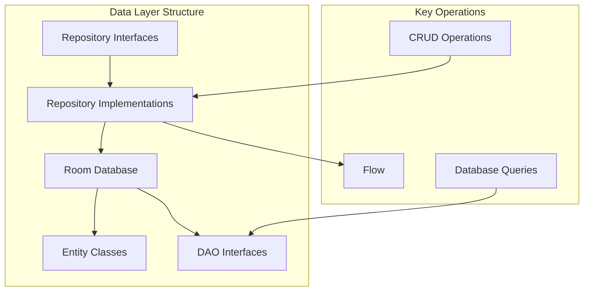
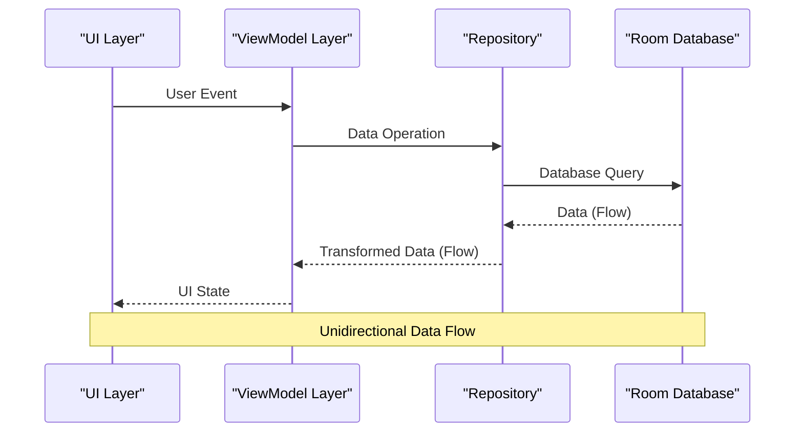
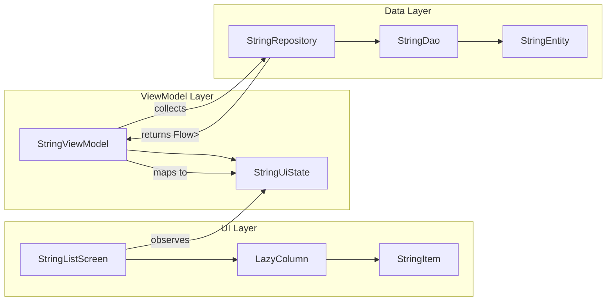

<!-- source: DeepWiki mcp.deepwiki.com · repo android/architecture-templates · page 3.1 Layered Architecture · fetched 2026-10-23 -->

# Layered Architecture

Relevant source files

The following files were used as context for generating this wiki page:

- [README.md](README.md)

This document explains the layered architecture implemented in the Android Architecture Starter Templates. It focuses on the separation of UI, ViewModel, and Data layers and their respective responsibilities. For information about how data flows reactively through these layers, see [Reactive Data Flow](#3.2). For details on how dependencies are injected throughout the application, see [Dependency Injection](#3.3).

## Architecture Overview

The templates implement a three-layer architecture that separates concerns, promotes testability, and facilitates maintainability:

Sources: README.md:32-44

This layered design offers several benefits:

| Benefit | Description |
|---------|-------------|
| Separation of Concerns | Each layer has a specific responsibility, making the code more modular |
| Testability | Layers can be tested in isolation with clear boundaries |
| Maintainability | Changes in one layer have minimal impact on other layers |
| Scalability | New features can be added more easily within the established structure |

## UI Layer

The UI layer is responsible for displaying data to the user and capturing user interactions. In the templates, this layer is implemented using Jetpack Compose and Material3.

### Key Components and Responsibilities

- **Screen Composables**: Define the screen structure and collect UI state
- **Composable Functions**: Reusable UI components built with Compose
- **Material3 Components**: Pre-designed Material Design components
- **Navigation**: Handles screen transitions using Jetpack Navigation

The UI layer observes UI state from the ViewModel and renders the appropriate UI components. When users interact with the UI, events are dispatched to the ViewModel for processing.

Sources: README.md:37-39

## ViewModel Layer

The ViewModel layer serves as the bridge between the UI and Data layers. It processes data for display and handles UI logic without direct references to the UI components.

### Key Components and Responsibilities

- **ViewModel Classes**: Extend Android's Jetpack ViewModel class
- **UI State Classes**: Define the state of the UI as immutable data classes
- **Event Handlers**: Process user events from the UI layer
- **Data Transformation**: Convert repository data to UI-friendly formats

ViewModels are responsible for:
- Collecting data from repositories
- Transforming data into UI state
- Exposing UI state to the UI layer
- Processing user events
- Initiating data operations via repositories
- Surviving configuration changes

Sources: README.md:36

## Data Layer

The Data layer manages application data and provides a clean API to the ViewModel layer.

### Key Components and Responsibilities

- **Repository Pattern**: Centralizes data access logic
- **Room Database**: Local data persistence
- **Entity Classes**: Define database tables
- **Data Access Objects (DAOs)**: Define database operations
- **Data Sources**: Abstract different data origins (local, remote, etc.)

The Data layer is responsible for:
- Providing a clean API to the rest of the application
- Abstracting data sources
- Managing data persistence
- Providing reactive data streams using Kotlin Flow
- Handling data operations and transformations

Sources: README.md:34,40-41

## Cross-Layer Communication

Communication between layers follows specific patterns to maintain separation of concerns:

### Communication Patterns

- **UI to ViewModel**: User events trigger ViewModel methods
- **ViewModel to Repository**: Data operations are delegated to the repository
- **Repository to Data Sources**: Repositories coordinate data operations across sources
- **Data Flow Up**: Data flows upward from the Data layer to the UI layer
- **Dependency Injection**: Hilt provides dependencies to all layers

Sources: README.md:35,41

## Implementation in Templates

The layered architecture is implemented in both the base and multimodule templates:

| Template | Implementation Approach |
|----------|------------------------|
| Base | All layers in a single module, organized by packages |
| Multimodule | UI and ViewModel in feature modules, Data layer in core modules |

Both templates follow the same architectural principles, ensuring a consistent development experience regardless of the chosen template structure.

Sources: README.md:11-14

## Data-Driven UI Example

Below is a simplified example of how the layered architecture works in the context of displaying a list of saved strings:

The UI displays a list of strings, the ViewModel transforms the raw data into UI state, and the Data layer handles the storage and retrieval of the strings from the Room database.

Sources: README.md:24-25,34-41

---

