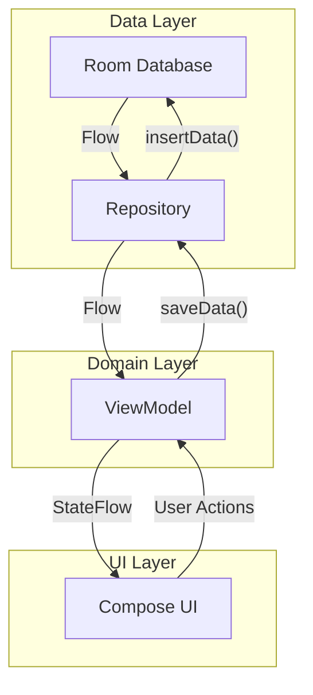
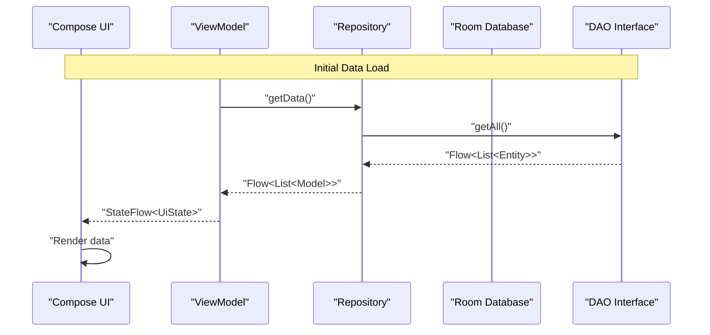
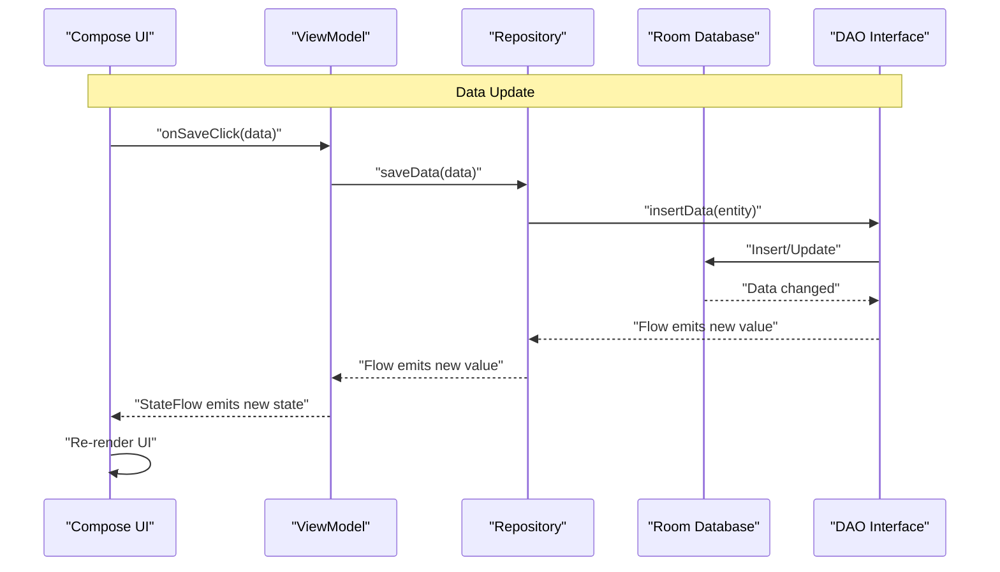

<!-- source: DeepWiki mcp.deepwiki.com · repo android/architecture-templates · page 3.2 Reactive Data Flow · fetched 2026-10-23 -->

# Reactive Data Flow

<details>
<summary>Relevant source files</summary>

The following files were used as context for generating this wiki page:

- [README.md](README.md)

</details>


This page details how the Android Architecture Templates implement reactive data flow using Kotlin Flows, explaining the patterns and mechanisms that enable automatic data propagation through the application's layers. For information about the general layered architecture, see [Layered Architecture](#3.1).

## Purpose and Overview

Reactive data flow in these templates creates a system where:
- Data changes in the database automatically propagate to the UI
- User actions in the UI flow down to update the database
- Each layer communicates through reactive streams (Kotlin Flows)

This approach implements the reactive programming paradigm, where data changes are automatically propagated to interested observers without manual event handling or callbacks.

## Architecture Components in Reactive Flow



The reactive data flow involves these key components:

1. **Room Database**: Persists data and provides observability through Flow
2. **Repository**: Mediates between data sources and exposes data as Flows
3. **ViewModel**: Transforms repository data into UI state using StateFlow
4. **Compose UI**: Consumes the UI state and renders accordingly

Sources: [README.md:34-41]()

## Data Reading Flow Pattern

The following diagram shows how data flows when reading from the database:



When the application starts or navigates to a screen:

1. The ViewModel requests data from the Repository
2. The Repository queries the Room Database through the DAO interface
3. The DAO returns a Flow of entity objects
4. The Repository transforms entities to domain models and exposes them as Flow
5. The ViewModel converts the Flow to a StateFlow of UiState
6. The Compose UI renders based on the UiState

Sources: [README.md:34-38]()

## Data Writing Flow Pattern

The following diagram shows how data flows when writing to the database:



When the user performs an action:

1. The UI triggers an action in the ViewModel
2. The ViewModel calls the Repository to update the data
3. The Repository converts domain models to entities and writes to the database
4. Room automatically triggers the Flow to emit a new value
5. This new value flows through the Repository to the ViewModel
6. The ViewModel updates the UI state
7. The Compose UI re-renders with the new state

Sources: [README.md:34-41]()

## Implementation Details

### Room Database Layer Implementation

Room provides built-in support for returning query results as Flows:

```kotlin
@Dao
interface DataDao {
    @Query("SELECT * FROM data_table")
    fun getAll(): Flow<List<DataEntity>>
    
    @Insert(onConflict = OnConflictStrategy.REPLACE)
    suspend fun insertData(dataEntity: DataEntity)
}
```

When data in the database changes, the Flow automatically emits a new value containing the updated data.

Sources: [README.md:34]()

### Repository Layer Implementation

The Repository layer exposes data from the database as Flows and handles data transformations:

```kotlin
class DataRepository(private val dataDao: DataDao) {
    // Exposes database data as a Flow of domain models
    fun getData(): Flow<List<Data>> = 
        dataDao.getAll().map { entities -> 
            entities.map { it.toData() } 
        }
        
    // Updates the database (uses suspend function for coroutine context)
    suspend fun saveData(data: Data) {
        dataDao.insertData(data.toEntity())
    }
}
```

The Repository layer typically uses the `map` operator to transform entity objects into domain models.

Sources: [README.md:40]()

### ViewModel Layer Implementation

The ViewModel collects Flows from the Repository and exposes UI state:

```kotlin
class DataViewModel(private val repository: DataRepository) : ViewModel() {
    // Transforms repository Flow into UI state
    val uiState: StateFlow<UiState> = repository.getData()
        .map { data -> UiState.Success(data) }
        .catch { error -> UiState.Error(error) }
        .stateIn(
            viewModelScope,
            SharingStarted.WhileSubscribed(5000),
            UiState.Loading
        )
        
    // Triggers data updates
    fun saveData(data: Data) {
        viewModelScope.launch {
            repository.saveData(data)
        }
    }
}
```

Key Flow operators used in the ViewModel layer:
- `map`: Transforms data models into UI state
- `catch`: Handles errors in the data stream
- `stateIn`: Converts Flow to StateFlow with configuration for UI consumption

Sources: [README.md:36-41]()

### Compose UI Layer Implementation

The Compose UI collects the UI state and renders accordingly:

```kotlin
@Composable
fun DataScreen(viewModel: DataViewModel) {
    val uiState by viewModel.uiState.collectAsState()
    
    when (uiState) {
        is UiState.Loading -> LoadingIndicator()
        is UiState.Success -> DataList(uiState.data) { data ->
            viewModel.saveData(data)
        }
        is UiState.Error -> ErrorMessage(uiState.error)
    }
}
```

The `collectAsState()` function in Jetpack Compose converts a Flow into a state object that triggers recomposition when the Flow emits a new value.

Sources: [README.md:37-38]()

## Benefits of Reactive Data Flow

| Benefit | Description |
|---------|-------------|
| **Consistency** | The UI automatically reflects the latest data state without manual update logic |
| **Separation of concerns** | Each layer has clear responsibilities in the data flow |
| **Testability** | Flow-based APIs are easier to test with testing utilities like `TestCoroutineDispatcher` |
| **Reduced boilerplate** | Automatic propagation eliminates manual observer registration and notification |
| **Lifecycle awareness** | Using `stateIn` with `viewModelScope` ensures proper lifecycle handling |
| **Concurrency handling** | Coroutines provide a structured way to handle async operations with Flow |

This reactive data flow architecture, implemented using Kotlin Flows and Room's built-in Flow support, provides a seamless way to handle data changes and user interactions in Android applications.

Sources: [README.md:40-42]()

---

