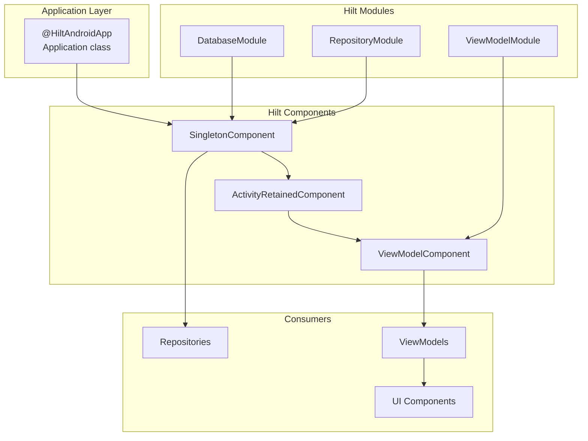
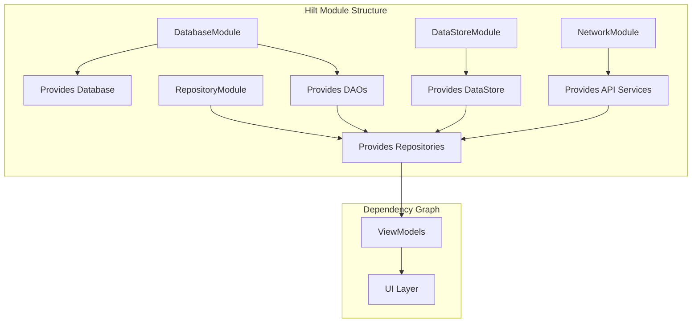
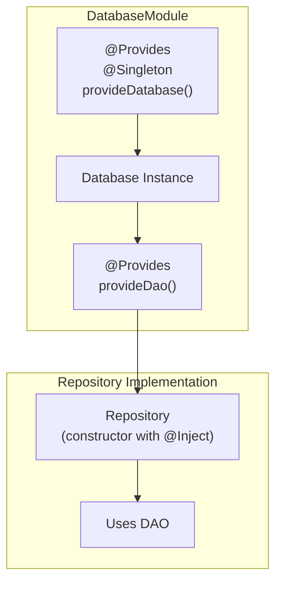
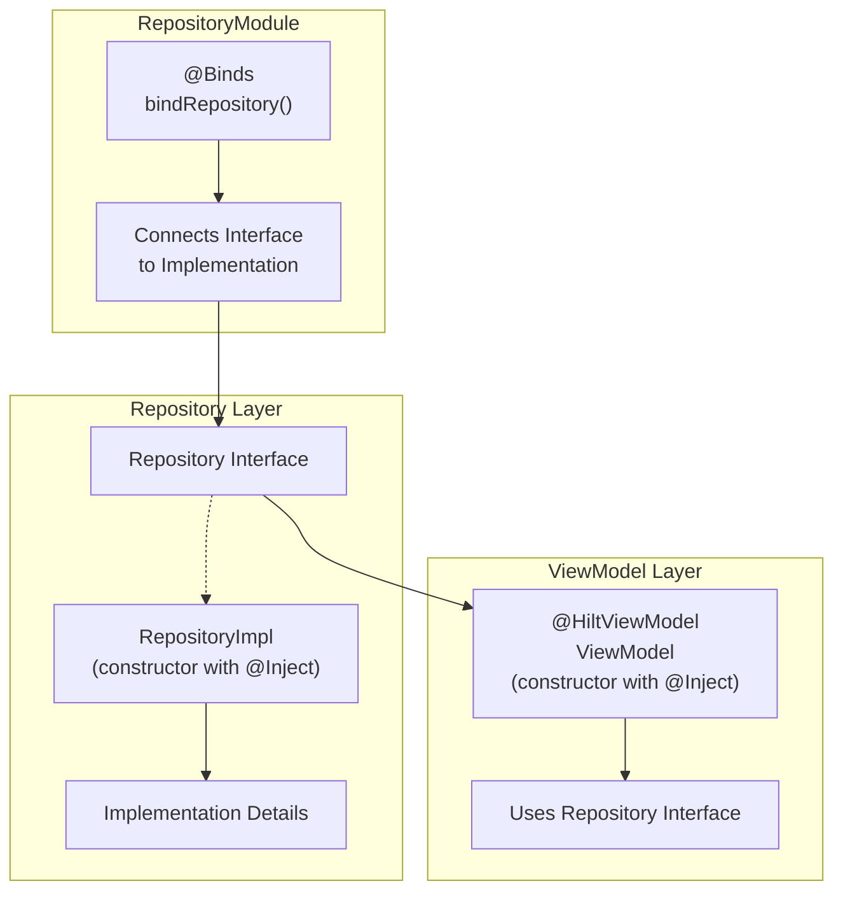
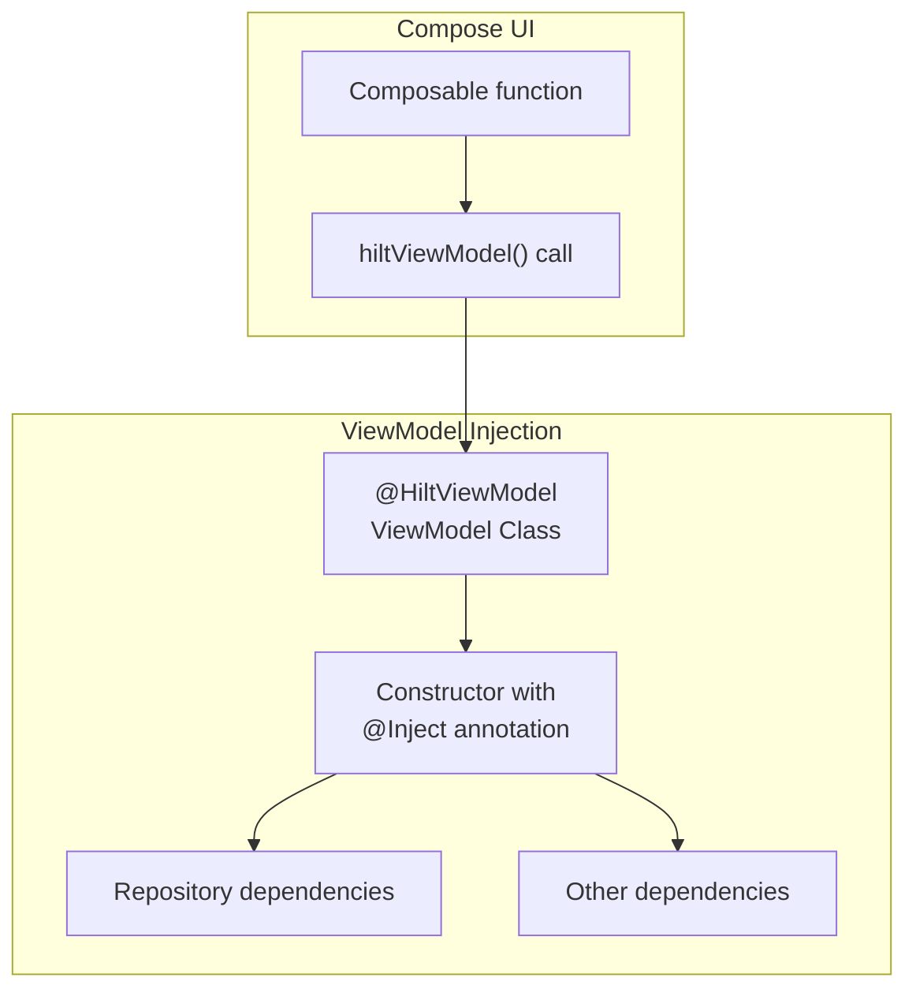
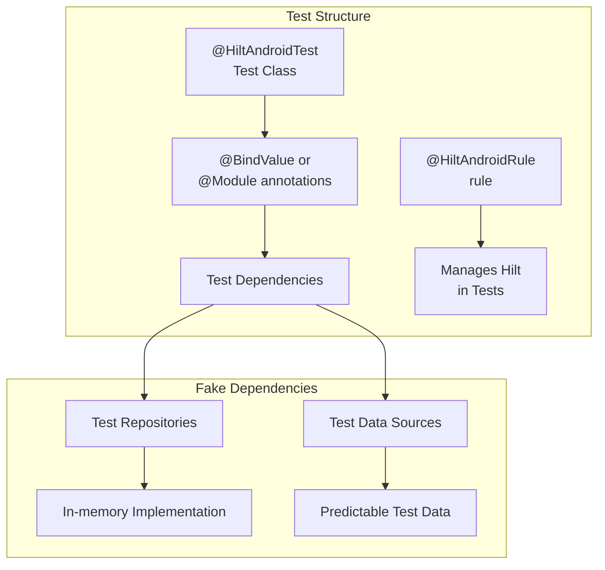
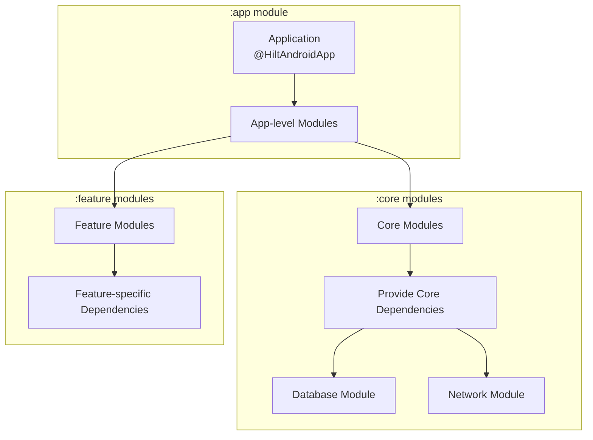

<!-- source: DeepWiki mcp.deepwiki.com · repo android/architecture-templates · page 3.3 Dependency Injection · fetched 2026-10-23 -->

# Dependency Injection

Relevant source files

The following files were used as context for generating this wiki page:

- [README.md](README.md)

This page explains how Dependency Injection (DI) is implemented in the Android Architecture Starter Templates using Hilt. It covers the DI structure, module organization, and how dependencies are provided and consumed across different layers of the application.

For information about the overall layered architecture, see [Layered Architecture](#3.1). For details on how data flows through the system, see [Reactive Data Flow](#3.2).

## Overview

The templates use Hilt, Google's recommended DI solution for Android applications, to manage dependencies throughout the codebase. Hilt provides a standardized way to:

- Inject dependencies into Android components (Activities, Fragments, ViewModels, etc.)
- Manage the lifecycle of dependencies
- Facilitate testing by allowing dependency substitution

Hilt builds on top of the Dagger DI library, simplifying configuration while maintaining Dagger's compile-time correctness, runtime performance, and scalability.

Sources: README.md

## Hilt Integration Structure

The following diagram illustrates how Hilt is integrated into the application architecture:

Sources: README.md

## Hilt Module Organization

The templates organize dependencies into logical modules that align with the application's layered architecture:

Sources: README.md

## Key Dependency Injection Components

The dependency injection system in the templates consists of three primary components:

1. **Module Definitions**: Classes annotated with `@Module` and `@InstallIn` that define how to create instances of dependencies
2. **Injection Points**: Classes where dependencies are consumed, using `@Inject` constructor or field injection
3. **Bindings**: Interfaces and their implementations are connected using `@Binds` methods

The following table summarizes the main DI components likely found in the templates:

| Component Type | Purpose | Typical Location |
|----------------|---------|------------------|
| Application Module | Entry point for Hilt with `@HiltAndroidApp` | Application class |
| Database Module | Provides database and DAO instances | DI package |
| Repository Module | Provides repository implementations | DI package |
| ViewModel Factory | Manages ViewModel creation with injected dependencies | Implicit with `@HiltViewModel` |

Sources: README.md

## Database Injection Pattern

The following diagram shows how the database dependencies are typically provided and consumed:

Sources: README.md

## Repository Injection Pattern

Repositories are provided through a module and consumed by ViewModels:

Sources: README.md

## ViewModel Injection

ViewModels receive dependencies through constructor injection and are created using Hilt's ViewModel integration:

Sources: README.md

## Code Structure in Templates

The dependency injection code is structured as follows:

1. **Application Class**: Annotated with `@HiltAndroidApp` to enable Hilt
2. **Modules Package**: Contains all Hilt module definitions
3. **Implementation Classes**: Use constructor injection with `@Inject`
4. **ViewModels**: Annotated with `@HiltViewModel` and use constructor injection

## Dependency Injection in Testing

The templates provide support for DI in tests through Hilt's testing utilities:

Sources: README.md

## Base vs. Multimodule Implementation

The two templates have different approaches to organizing dependency injection:

### Base Template
In the base template, all DI modules and components are defined within the single application module.

### Multimodule Template 
The multimodule template distributes DI responsibilities:

The multimodule approach uses Hilt's component hierarchy to ensure dependencies are available across module boundaries while maintaining proper encapsulation.

Sources: README.md

## Key Benefits of the DI Implementation

The dependency injection approach used in the templates provides several advantages:

1. **Separation of Concerns**: Components focus on their core responsibilities without managing their dependencies
2. **Testability**: Dependencies can be easily replaced with test doubles
3. **Scalability**: New features can be added without changing existing code
4. **Maintainability**: Dependencies are defined in a centralized location
5. **Standardization**: Following Hilt conventions makes the codebase more accessible to other Android developers

Sources: README.md

## Common Dependency Injection Patterns

The templates demonstrate several DI patterns:

1. **Constructor Injection**: Primary method for receiving dependencies
2. **Interface Binding**: Abstractions are bound to implementations via `@Binds`
3. **Scoped Instances**: Singletons and other scoped objects are managed by Hilt
4. **Qualified Injections**: When multiple instances of the same type are needed, qualifiers distinguish them

Sources: README.md

This dependency injection structure creates a flexible, maintainable foundation that supports the reactive architecture pattern used throughout the templates.

---

