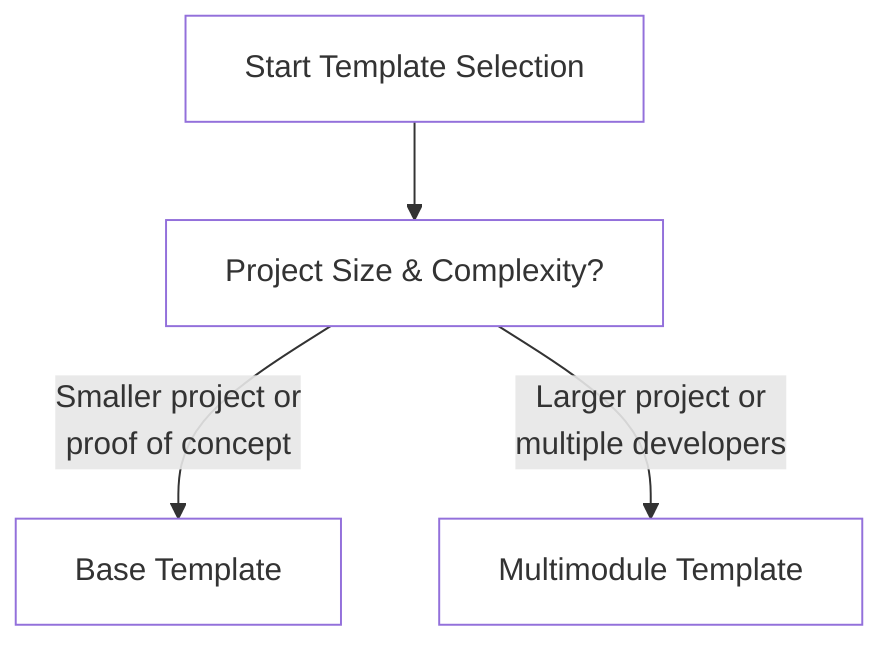
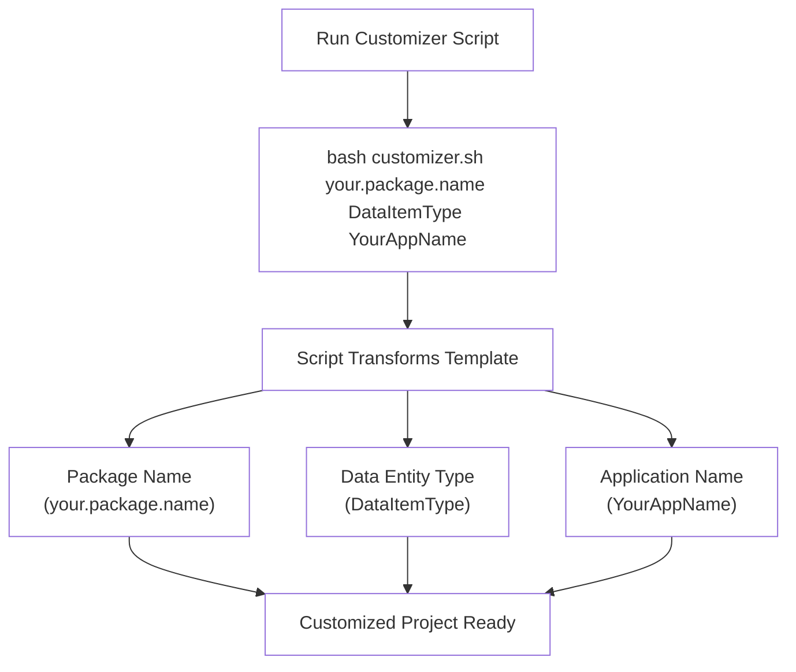
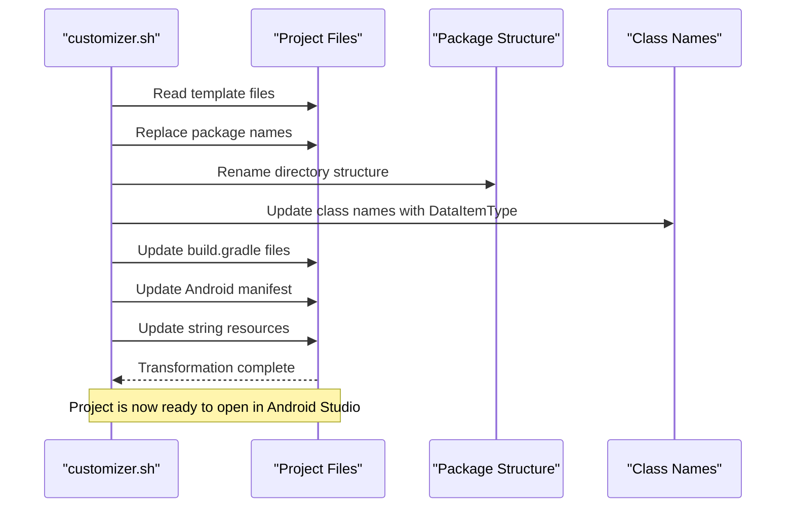

<!-- source: DeepWiki mcp.deepwiki.com · repo android/architecture-templates · page 4 Getting Started · fetched 2026-10-23 -->

# Getting Started

<details>
<summary>Relevant source files</summary>

The following files were used as context for generating this wiki page:

- [README.md](README.md)

</details>


This page provides step-by-step instructions for setting up and customizing the Android Architecture Starter Templates for your new project. We'll cover how to clone the repository, run the customizer script, and prepare your project for development. For details about specific template options, see [Template Options](#2).

## Prerequisites

Before getting started, ensure you have:

- Git installed on your system
- Bash shell (version 4 or above)
- Android Studio (latest stable version)

For macOS users who need to update bash:
```bash
brew install bash
```

Sources: [README.md:67-71]()

## Template Selection Process

First, decide which template to use based on your project needs:



- **Base Template**: Single-module architecture with reactive patterns, Compose UI, and database support
- **Multimodule Template**: Same as base but with modular architecture for better separation of concerns

Sources: [README.md:11-14]()

## Setup Process

### Step 1: Clone the Repository

Choose the appropriate branch based on your template selection:

```bash
git clone https://github.com/android/architecture-templates.git --branch <template-branch> <target-directory>
```

Replace:
- `<template-branch>` with either `base` or `multimodule`
- `<target-directory>` with your desired project directory name

**Important**: Do not open the project in Android Studio yet, as this will interfere with the customization process.

Sources: [README.md:48-54]()

### Step 2: Run the Customizer Script

The customizer script modifies the template to use your package name, preferred data type, and app name.



Execute the script with your custom parameters:

```bash
bash customizer.sh your.package.name DataItemType [YourAppName]
```

Parameter details:
- `your.package.name`: Your application ID (must be lowercase)
- `DataItemType`: The name for your data entity (use PascalCase, e.g., "Task", "Note", "Product")
- `YourAppName`: Optional app name (use PascalCase)

Sources: [README.md:56-65]()

## Customization Effects

The customizer script makes the following changes to the template:

| Parameter | Effect |
|-----------|--------|
| Package Name | Updates all package declarations, manifest entries, and build files to use your specified package name |
| DataItemType | Renames the example data classes, database entities, repositories, and UI components to use your specified data type name |
| App Name | Updates the application name in strings resources and manifest |

## What Happens During Customization

The customizer script performs these transformations:



Sources: [README.md:56-65]()

## After Customization

Once the customization script completes successfully:

1. Open the project in Android Studio
2. Allow Gradle sync to complete
3. Review the generated code structure
4. Verify that all package names and class names match your specifications

## Example Project Structure

After customization with parameters `com.example.myapp`, `Task`, and `MyTodoApp`, you would get:

Base Template:
```
com.example.myapp/
├── data/
│   ├── TaskRepository.kt
│   └── local/
│       ├── TaskDao.kt
│       └── TaskDatabase.kt
├── ui/
│   ├── TaskScreen.kt
│   └── TaskViewModel.kt
└── MainActivity.kt
```

Multimodule Template:
```
app/
├── com.example.myapp/
│   └── MainActivity.kt
feature/
├── task/
│   ├── com.example.myapp.feature.task/
│   │   ├── TaskScreen.kt
│   │   └── TaskViewModel.kt
core/
├── data/
│   ├── com.example.myapp.core.data/
│   │   └── TaskRepository.kt
└── database/
    ├── com.example.myapp.core.database/
        ├── TaskDao.kt
        └── TaskDatabase.kt
```

## Next Steps

After setting up your project:

1. Explore the architecture to understand how the components interact
2. Modify the data entity to match your application needs
3. Add additional screens and features as required

For more detailed information about:
- The available templates, see [Template Options](#2)
- The architecture patterns, see [Architecture Patterns](#3)
- The customizer script details, see [Using the Customizer Script](#4.1)
- The testing approach, see [Testing Strategy](#5)

Sources: [README.md:1-77]()

---

