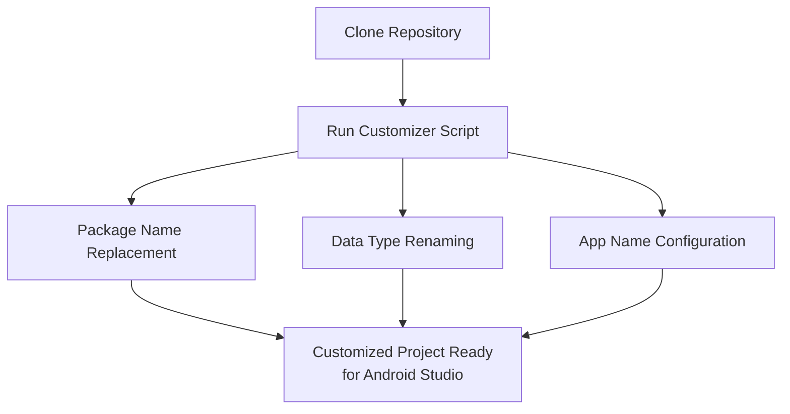
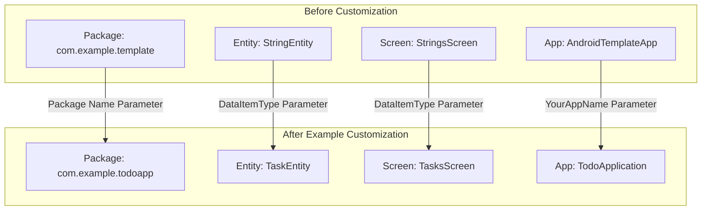
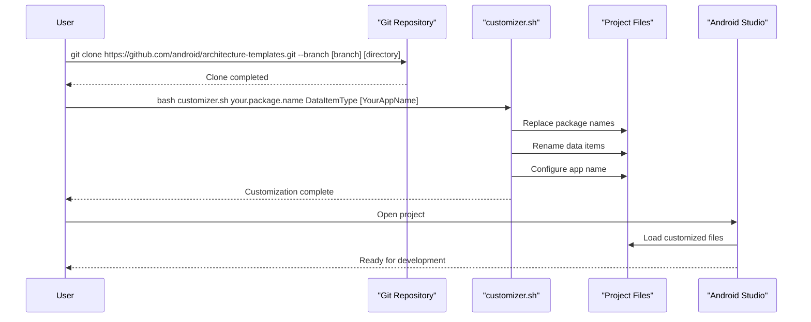

<!-- source: DeepWiki mcp.deepwiki.com · repo android/architecture-templates · page 4.1 Using the Customizer Script · fetched 2026-10-23 -->

# Using the Customizer Script

<details>
<summary>Relevant source files</summary>

The following files were used as context for generating this wiki page:

- [README.md](README.md)

</details>


This document explains how to use the `customizer.sh` script to configure Android Architecture Starter Templates for your specific project needs. The customizer script is a critical first step in adopting these templates, as it properly sets up package names, data entity types, and application names throughout the codebase.

For information about choosing between different template options, see [Template Options](#2).

## Purpose of the Customizer Script

The customizer script transforms the generic template into a project tailored to your specific application requirements. It performs global replacements across the codebase to ensure consistency in naming and package structures. Running this script is a mandatory step before opening the project in Android Studio.

Sources: [README.md:54-56]()

## Prerequisites

Before using the customizer script, you need:

1. A cloned repository of the Android Architecture Template (either base or multimodule branch)
2. Bash version 4 or above
   - macOS users may need to install a newer bash version: `brew install bash`

Sources: [README.md:48-52](), [README.md:67-71]()

## How the Customizer Works

The customizer script performs a series of transformations on the template code to create your custom project:



Sources: [README.md:56-65]()

## Using the Script

### Basic Usage

The customizer script follows this syntax:

```
bash customizer.sh your.package.name DataItemType [YourAppName]
```

Where:
- `your.package.name` is your app ID (must be lowercase)
- `DataItemType` is the name used for screens, state objects, and database entities (must be PascalCase)
- `YourAppName` is an optional name for your application (must be PascalCase)

Sources: [README.md:58-65]()

### Example Usage

```
bash customizer.sh com.example.todoapp Task TodoApplication
```

This will:
1. Set the package name to `com.example.todoapp`
2. Name data entities, screens, and related components using `Task` (such as TaskScreen, TaskViewModel, etc.)
3. Set the application name to "TodoApplication"

Sources: [README.md:58-65]()

## Customization Effects

The following diagram illustrates how the customizer transforms different components in the codebase:



Sources: [README.md:58-65]()

## Important Considerations

1. **Run Before Opening in Android Studio**: The customizer must be run before opening the project in Android Studio to ensure all references are properly updated.

2. **Case Sensitivity Matters**: 
   - Package name must be lowercase (e.g., `com.example.myapp`)
   - Data item type must be PascalCase (e.g., `Task`, `TodoItem`)
   - App name must be PascalCase (e.g., `MyApplication`, `TodoApp`)

3. **Affected Areas**: The customization affects:
   - Package structure
   - Class and file names
   - Database entity names
   - Screen names and navigation
   - References in manifest files and build scripts

Sources: [README.md:54-65]()

## Complete Workflow

This diagram shows the complete workflow from cloning the repository to opening the customized project in Android Studio:



Sources: [README.md:48-65]()

## Troubleshooting

### Common Issues

1. **Script Fails on macOS**: If you encounter errors on macOS, you may need to install a newer version of bash:
   ```
   brew install bash
   ```

2. **Case Sensitivity Errors**: Ensure you're following the case guidelines for each parameter:
   - Package name: lowercase
   - Data item type: PascalCase
   - App name: PascalCase

3. **Inconsistent Naming**: If you see inconsistent naming in your project after customization, you may have opened the project in Android Studio before running the customizer. In this case, clone a fresh copy of the repository and start over.

Sources: [README.md:67-71]()

## Code Transformation Example

The customizer script transforms code entities throughout the project. Here's a conceptual view of how key files get transformed:

| Component Type | Before Customization | After Customization (Example) |
|----------------|----------------------|-------------------------------|
| Package Declaration | `package com.example.template` | `package com.example.todoapp` |
| Data Entity Class | `StringEntity` | `TaskEntity` |
| Database | `StringDatabase` | `TaskDatabase` |
| Repository | `StringRepository` | `TaskRepository` |
| ViewModel | `StringViewModel` | `TaskViewModel` |
| Screen | `StringsScreen` | `TasksScreen` |
| App Class | `TemplateApplication` | `TodoApplication` |

Sources: [README.md:58-65]()

## Summary

The customizer script is an essential first step when using the Android Architecture Starter Templates. It properly configures the templates with your application's specific package name, data entity type, and application name. By running this script before opening the project in Android Studio, you ensure that all references throughout the codebase are consistently updated to match your application's requirements.

After successfully running the customizer script, you'll have a properly configured project that follows Android architectural best practices and is ready for you to start implementing your application-specific features.

Sources: [README.md:48-65]()

---

