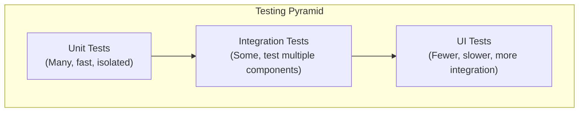
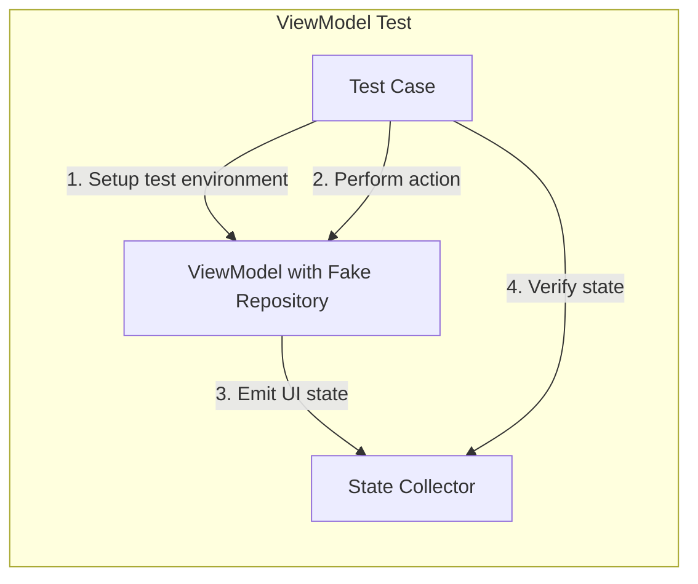
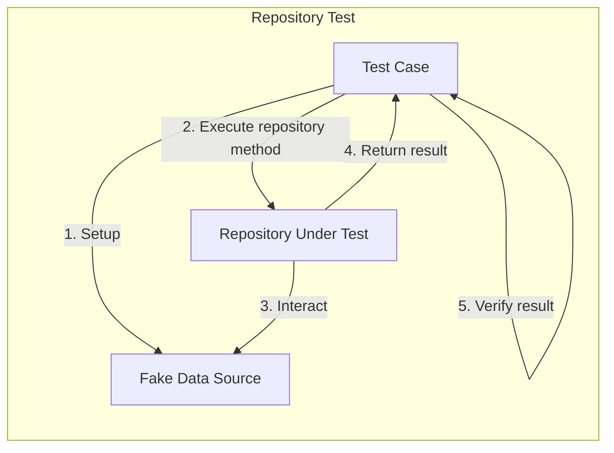
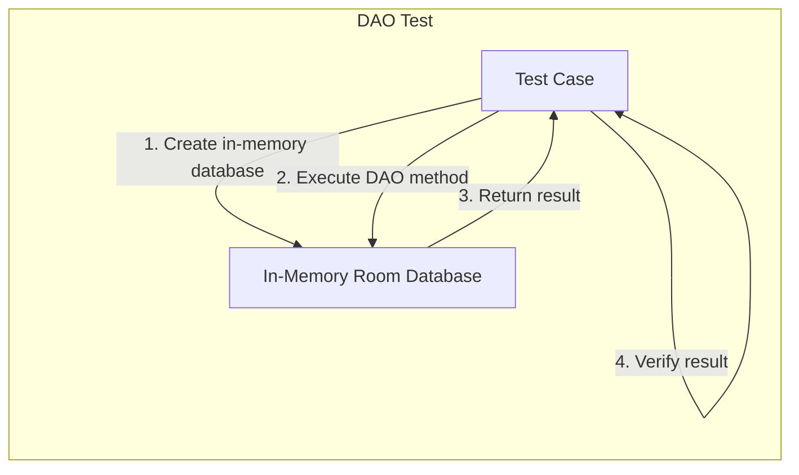
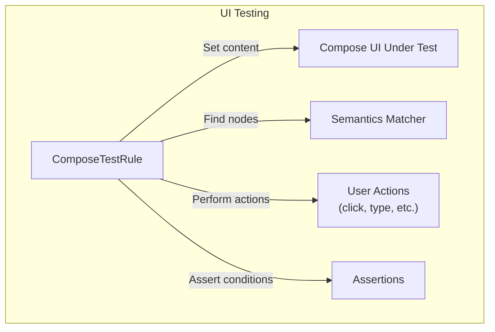
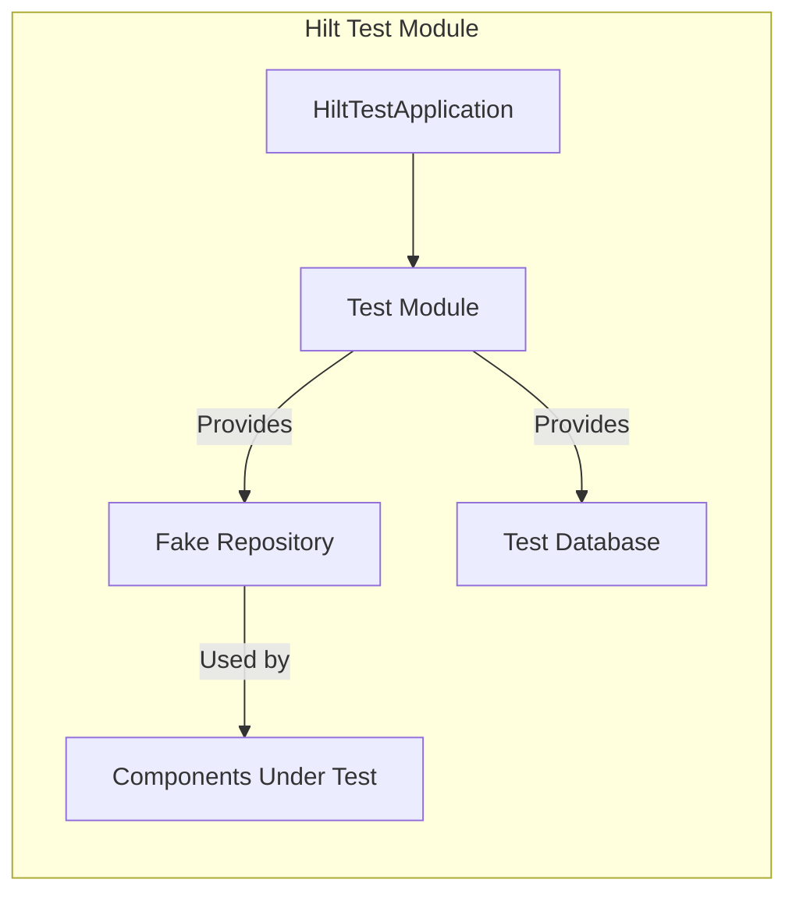
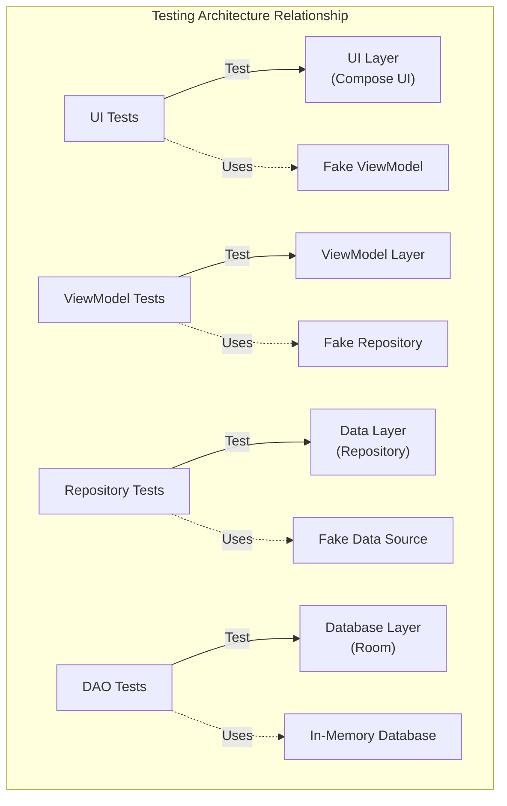

<!-- source: DeepWiki mcp.deepwiki.com · repo android/architecture-templates · page 5 Testing Strategy · fetched 2026-10-23 -->

# Testing Strategy

Relevant source files

The following files were used as context for generating this wiki page:

- [README.md](README.md)

This document outlines the testing approach used in the Android Architecture Starter Templates. It explains the testing pyramid implementation, unit testing strategies for different architectural layers, UI testing with Compose, and the use of test doubles. For information about the overall architecture patterns, see [Architecture Patterns](#3).

## Testing Pyramid

The Android Architecture Starter Templates follow the testing pyramid approach, which emphasizes having more unit tests than integration tests, and more integration tests than UI tests. This strategy provides a balance between testing speed, reliability, and coverage.

Sources: README.md:42-44

## Unit Testing

Unit tests focus on testing individual components in isolation. The templates provide structure for unit testing each layer of the architecture.

### ViewModel Testing

ViewModels are tested by observing state changes in response to actions, verifying the business logic works correctly without dependencies on the UI layer.

Key testing aspects:
- Using `TestCoroutineScheduler` to control coroutine execution
- Collecting UI state as a flow to verify state transitions
- Using fake repositories to isolate the ViewModel

### Repository Testing

Repository tests verify that the repository correctly interfaces with data sources and transforms data as expected.

Key testing aspects:
- Using fake data sources to control test conditions
- Testing error handling and edge cases
- Verifying data transformations

### Data Source Testing

The local data source (Room Database) is tested using in-memory database instances to verify correct database operations.

Sources: README.md:42

## UI Testing with Compose

The templates include Compose UI tests that verify the correct rendering of UI components and user interactions.

### Test Dependencies with Hilt

Hilt is used to provide fake implementations for testing, allowing UI tests to run with controlled test data.

Key aspects of UI testing:
- Using `HiltTestRule` to set up dependency injection
- Providing fake implementations of repositories and data sources
- Testing UI components in isolation or in integration
- Verifying UI state rendering and user interactions

Sources: README.md:43-44

## Test Doubles

The templates use various test doubles to isolate components during testing:

| Test Double Type | Purpose | Example Use |
|------------------|---------|-------------|
| Fakes | Simplified implementations with working behavior | Fake repositories with in-memory data |
| Mocks | Objects that verify interactions | Verifying repository calls from ViewModel |
| Stubs | Provide canned answers to calls | Stubbing database responses |
| In-Memory Database | Fast, isolated database testing | Testing Room DAOs without real database |

### Relationship to Architecture Layers

Sources: README.md:34-41

## Testing Best Practices

The templates demonstrate these testing best practices:

1. **Separation of concerns**: Each layer is testable in isolation
2. **Dependency injection**: Hilt makes it easy to replace real implementations with test doubles
3. **Testability by design**: The architecture is designed with testing in mind
4. **Reactive testing**: Support for testing reactive flows
5. **Predictable state management**: UI state is explicit and testable

This testing strategy ensures that the templates provide a robust foundation for building testable Android applications that follow modern architecture principles.

Sources: README.md:34-44

---

