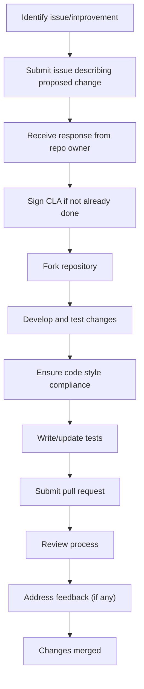
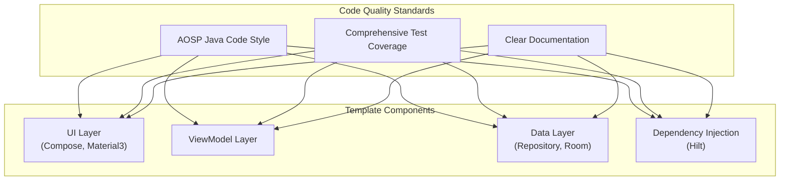
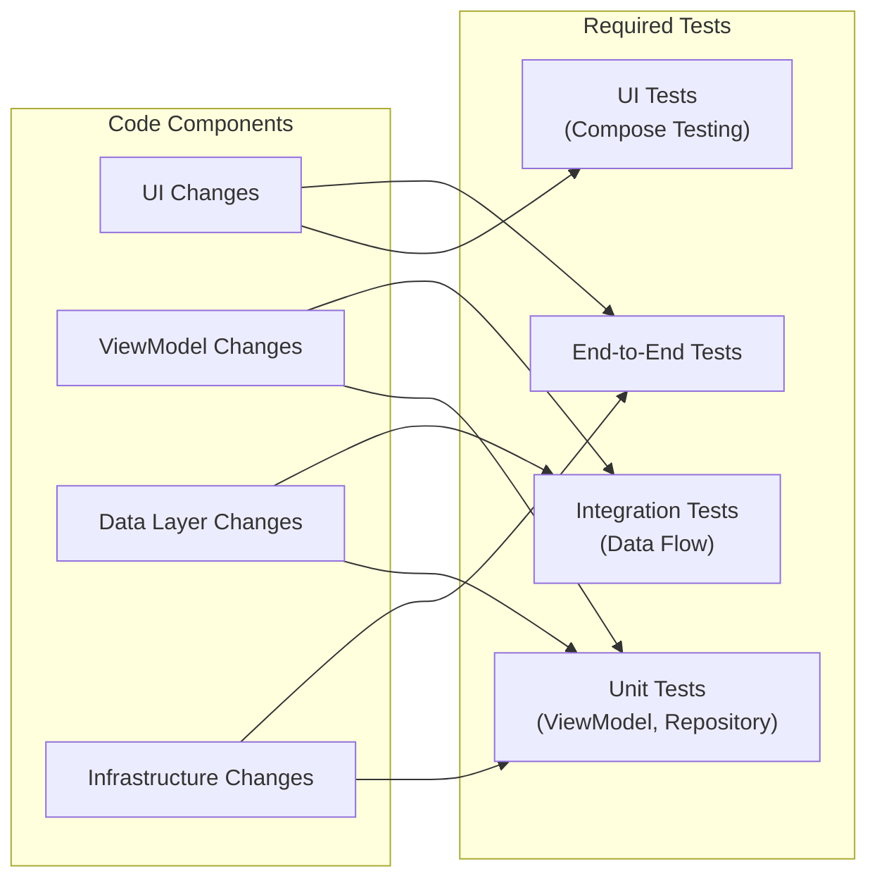
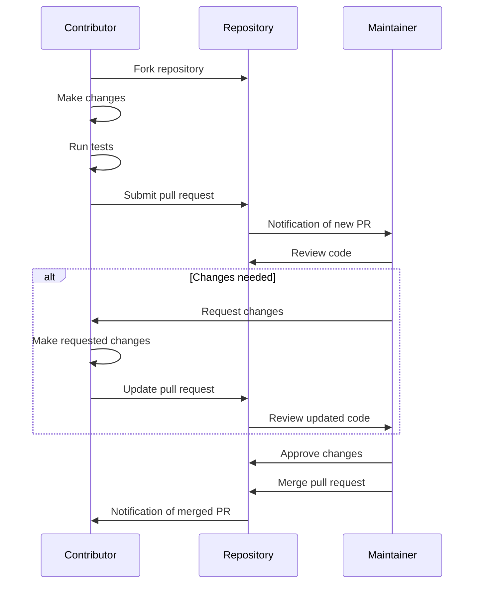
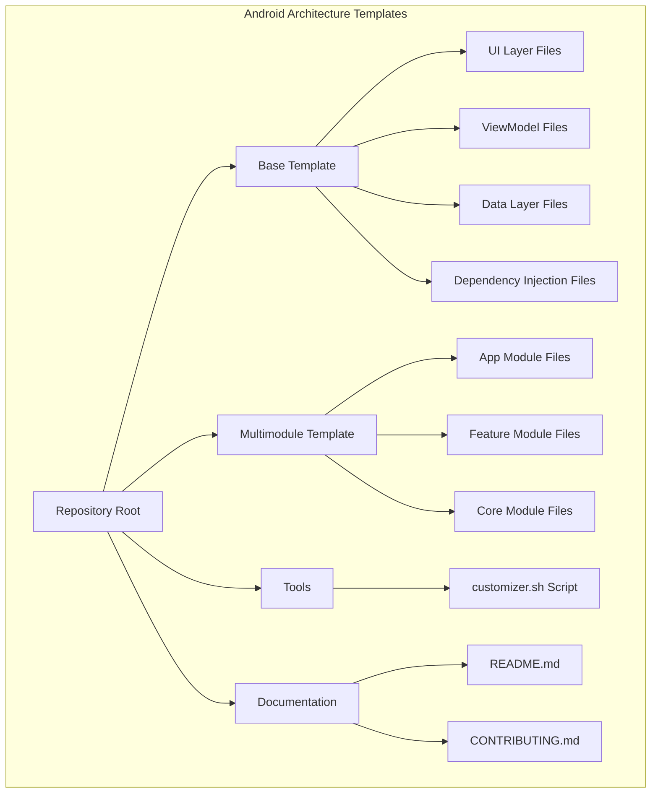

<!-- source: DeepWiki mcp.deepwiki.com · repo android/architecture-templates · page 6 Contributing · fetched 2026-10-23 -->

# Contributing

Relevant source files

The following files were used as context for generating this wiki page:

- [CONTRIBUTING.md](CONTRIBUTING.md)

This document outlines the process and guidelines for contributing to the Android Architecture Starter Templates repository. It covers the legal requirements, contribution workflow, coding standards, and pull request process. For information about using the templates in your own projects, see [Getting Started](#4).

## Prerequisites

Before contributing to the Android Architecture Templates repository, you need to complete some legal requirements by signing a Contributor License Agreement (CLA).

### Contributor License Agreements

Google requires all contributors to sign a Contributor License Agreement before accepting contributions:

- **Individual contributors**: If you're writing original source code and own the intellectual property, sign the [individual CLA]() (external link).
- **Corporate contributors**: If you're contributing on behalf of your company, sign the [corporate CLA]() (external link).

After signing the appropriate CLA, you'll be able to submit pull requests to the repository.

Sources: [CONTRIBUTING.md:3-18]()

## Contribution Workflow

The following diagram illustrates the standard workflow for contributing to the repository:

**Contribution Process Diagram**

Sources: [CONTRIBUTING.md:20-32]()

### Step-by-Step Contribution Guide

1. **Submit an issue** describing your proposed change to the repository
2. **Wait for a response** from the repository owner regarding your issue
3. **Sign a CLA** if your proposed change is accepted and you haven't already signed one
4. **Fork the repository** to create your own copy for development
5. **Develop and test** your code changes
6. **Ensure style compliance** with the existing codebase style guidelines
7. **Write appropriate tests** for your changes and ensure all tests pass
8. **Submit a pull request** for review

Sources: [CONTRIBUTING.md:20-32]()

## Coding Standards

All contributions must adhere to the existing style in the Android Architecture Starter Templates. The repository follows the [AOSP Java Code Style for Contributors]() (external link).

The following diagram illustrates how coding standards apply to different components of the templates:

**Code Standards Application Diagram**

Sources: [CONTRIBUTING.md:27-30]()

## Testing Requirements

All contributions must include appropriate tests. The following diagram shows the relationship between code components and testing requirements:

**Testing Requirements Diagram**

Sources: [CONTRIBUTING.md:31]()

## Pull Request Process

When submitting a pull request to the Android Architecture Starter Templates repository, ensure you:

1. **Reference the issue** that your pull request addresses
2. **Document your changes** clearly in the pull request description
3. **Verify all tests pass** before submission
4. **Be responsive** to feedback and questions during the review process

The following diagram illustrates the pull request lifecycle:

**Pull Request Lifecycle Diagram**

Sources: [CONTRIBUTING.md:32]()

## Repository Structure and Contributing Areas

The following diagram shows the main components of the repository where you might contribute, and how they relate to specific files and directories:

**Repository Structure Diagram**

Sources: [CONTRIBUTING.md]()

## Conclusion

Contributing to the Android Architecture Starter Templates helps improve the quality and usefulness of these templates for the Android developer community. By following the guidelines in this document, you can ensure that your contributions meet the standards required for inclusion in the repository.

If you have any questions about the contribution process, please open an issue in the repository for clarification before submitting your pull request.

---

