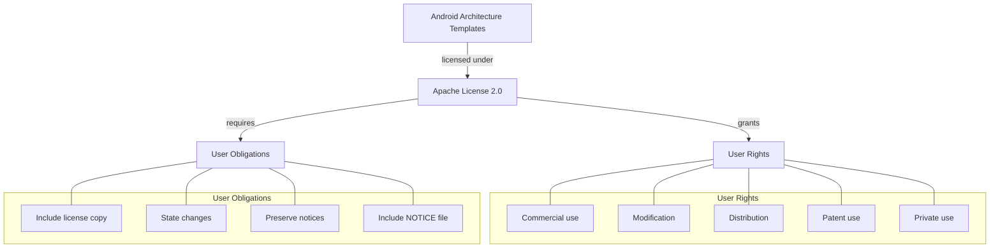
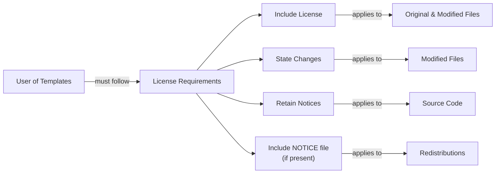
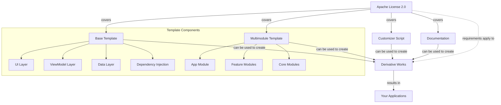

<!-- source: DeepWiki mcp.deepwiki.com · repo android/architecture-templates · page 7 License · fetched 2026-10-23 -->

# License

Relevant source files

The following files were used as context for generating this wiki page:

- [LICENSE](LICENSE)

This page provides detailed information about the licensing terms that govern the use, modification, and distribution of the Android Architecture Templates repository. For information about contributing to the repository, see [Contributing](#6).

## License Overview

The Android Architecture Templates repository is licensed under the Apache License, Version 2.0 (Apache 2.0). This is an open-source license that provides significant freedom to users while including certain protections for contributors.

Sources: [LICENSE:1-203]()

## Key License Permissions

The Apache License 2.0 grants you the following permissions when using the Android Architecture Templates:

| Permission | Description |
|------------|-------------|
| Use | You can use the templates for any purpose, including commercial applications |
| Modify | You can modify the templates to suit your needs |
| Distribute | You can distribute original or modified versions of the templates |
| Sublicense | You can apply different license terms to your own contributions |
| Patent Rights | Contributors grant patent rights for their contributions |

These permissions apply to both the base template and multimodule template structures, giving you flexibility in how you incorporate the architecture patterns into your Android applications.

Sources: [LICENSE:67-88]()

## License Requirements

When using the Android Architecture Templates, you must comply with the following requirements:

### Detailed Requirements

1. **Include a copy of the license**: When you distribute the templates or derivative work, you must provide a copy of the Apache License 2.0.

2. **State changes**: Modified files must carry prominent notices stating that you changed the files.

3. **Retain notices**: You must retain all copyright, patent, trademark, and attribution notices from the source code.

4. **Include NOTICE file**: If the original work includes a NOTICE text file, you must include a copy of this file in any derivative works you distribute.

Sources: [LICENSE:90-129]()

## License Limitations

The Apache License 2.0 includes important limitations that users of the Android Architecture Templates should be aware of:

| Limitation | Description |
|------------|-------------|
| Trademark use | The license does not grant permission to use the trade names, trademarks, service marks, or product names of Google or other contributors |
| Liability | Contributors are not liable for damages arising from the use of the templates |
| Warranty | The templates are provided "as is" without warranties or conditions |

Sources: [LICENSE:139-163]()

## Relationship to Template Components

The following diagram illustrates how the Apache License 2.0 applies to various components of the Android Architecture Templates:

Sources: [LICENSE:1-203]()

## How to Comply with the License

When using the Android Architecture Templates for your projects, follow these guidelines to ensure compliance with the Apache License 2.0:

1. **Keep the license file**: Include a copy of the LICENSE file with any distribution of the templates or derivative works.

2. **Modification notices**: If you modify template files, add clear notices stating that you have made changes.

3. **Attribution**: Retain all copyright and attribution notices in source files.

4. **NOTICE file handling**: If applicable, include the contents of any NOTICE file with your distribution.

5. **No endorsement**: Do not use the names of contributors for endorsement without specific permission.

The license allows you to freely adapt the templates to your needs while respecting the intellectual property of the contributors.

Sources: [LICENSE:90-129](), [LICENSE:179-202]()

## License Text

The full text of the Apache License 2.0 can be found in the [LICENSE]() file in the repository root. The license was authored by the Apache Software Foundation and is available at http://www.apache.org/licenses/.

Sources: [LICENSE:1-203]()