# Page: Overview

# Overview

<details>
<summary>Relevant source files</summary>

The following files were used as context for generating this wiki page:

- [.google/packaging.yaml](.google/packaging.yaml)
- [README.md](README.md)
- [screenshots.png](screenshots.png)

</details>


This wiki provides detailed documentation for the Android Architecture Starter Templates repository, a collection of production-ready architecture templates designed for new Android projects. These templates implement modern Android development practices and architectural patterns, enabling developers to quickly bootstrap applications with a solid foundation.

For specific information about template options and their differences, see [Template Options](#2). For details on architectural patterns implemented in the templates, see [Architecture Patterns](#3).

## Repository Purpose

The Android Architecture Starter Templates serve as ready-to-use starting points for Android application development, implementing the recommended architecture from the [Guide to app architecture](https://developer.android.com/topic/architecture). Unlike educational samples (such as Architecture Samples or Now In Android), these templates are designed for immediate use in real projects.

The repository provides two template variants: a single-module base template and a multimodule template, each preconfigured with a complete architecture stack that follows Android best practices.

Sources: [README.md:4-7]()

## Repository Structure

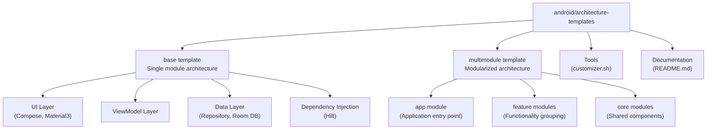

Sources: [README.md:11-14]()

## Architectural Foundation

The templates implement a layered reactive architecture with clear separation of concerns, following modern Android development practices:

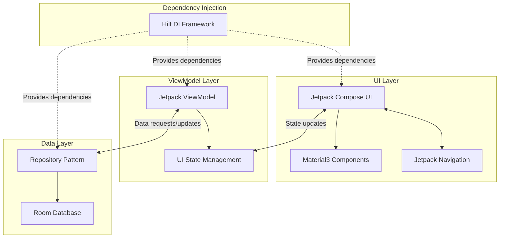

Sources: [README.md:32-44]()

## Key Technical Features

The templates incorporate a comprehensive set of modern Android development components:

| Category | Components |
|----------|------------|
| UI | Jetpack Compose, Material3, Jetpack Navigation |
| Architecture | ViewModel, Repository pattern, Reactive data layer |
| Data Storage | Room Database |
| Asynchronous Programming | Kotlin Coroutines, Flow |
| Dependency Injection | Hilt |
| Testing | Unit tests, UI tests with fake data and Hilt |
| Build System | KTS Gradle files, Version catalog |

Sources: [README.md:22-44]()

## Template Use Case

These templates are specifically designed for:

1. **New Android projects** - Providing a solid architectural foundation from the outset
2. **Quick experiments** - Enabling rapid prototyping with a complete architecture in place
3. **Modern Android development** - Implementing the latest recommended approaches and libraries

The templates offer a balance between structure and flexibility, allowing developers to focus on building features rather than setting up architecture.

Sources: [README.md:4-7]()

## Template Customization

The repository includes a customizer script that allows developers to tailor the templates to their specific needs. The script supports:

- Customizing the package name
- Renaming the main data item type
- Setting the application name

This customization should be performed before opening the project in Android Studio.

Sources: [README.md:46-72]()

## Template Variations

The repository offers two main template variations:

1. **Base Template**: A single-module architecture that includes all the features in a unified codebase, suitable for smaller projects or teams.

2. **Multimodule Template**: Extends the base template with a modular architecture, separating the codebase into multiple modules (app, feature, and core modules) for better scalability and build performance in larger projects.

For more details on these template options, see [Template Options](#2).

Sources: [README.md:11-14]()

## Core Architecture Principles

Both templates adhere to these fundamental principles:

1. **Separation of concerns** - Clear boundaries between UI, business logic, and data
2. **Reactive data flow** - Using Kotlin Flow to propagate data changes throughout the system
3. **Single source of truth** - Database serves as the authoritative data source
4. **Testability** - Architecture designed to support comprehensive testing
5. **Dependency injection** - Using Hilt to manage component dependencies

For more detailed information about these architectural patterns, see [Architecture Patterns](#3).

Sources: [README.md:32-44]()

---

# Page: Key Features

# Key Features

<details>
<summary>Relevant source files</summary>

The following files were used as context for generating this wiki page:

- [.google/packaging.yaml](.google/packaging.yaml)
- [README.md](README.md)

</details>


This document provides a comprehensive overview of the key features and capabilities of the Android Architecture Starter Templates. It focuses on the technical aspects of the templates, including their architecture, components, and implementation details. For visual examples of applications built with these templates, see [Visual Overview](#1.2).

## Overview of Template Options

The Android Architecture Starter Templates repository offers two main template options to accommodate different project requirements:

| Template | Description |
|----------|-------------|
| Base | Reactive architecture, Compose UI, Room database, single module |
| Multimodule | Base template features + modular architecture |

Both templates implement modern Android development practices and follow Google's recommended [Guide to app architecture](https://developer.android.com/topic/architecture).

Sources: [README.md:11-14]()

## UI Components

The templates feature a modern UI implementation with the following characteristics:

- Built entirely with Jetpack Compose
- Material 3 design system integration
- Sample screens demonstrating list and detail views
- Navigation between screens using Jetpack Navigation

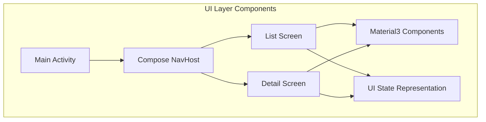

Sources: [README.md:22-25](), [README.md:37-39]()

## Architectural Foundation

The templates implement a clean, layered architecture pattern that separates concerns and promotes testability.

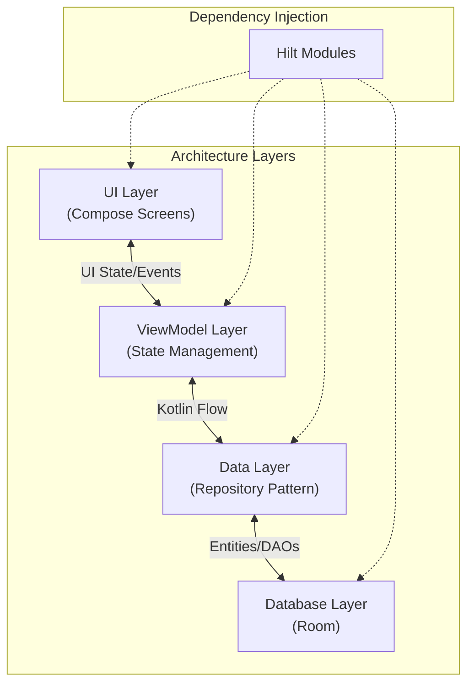

Key architectural components include:

- **Layered Architecture**: Clear separation between UI, ViewModel, and Data layers
- **Room Database**: Persistent storage solution with type-safe queries
- **Reactive Data Flow**: Data changes propagate automatically through the system using Kotlin Flows
- **Dependency Injection**: Hilt provides centralized dependency management

Sources: [README.md:32-41]()

## Reactive Data Flow

One of the core features of the templates is the reactive data flow pattern, which establishes a unidirectional data flow throughout the application.

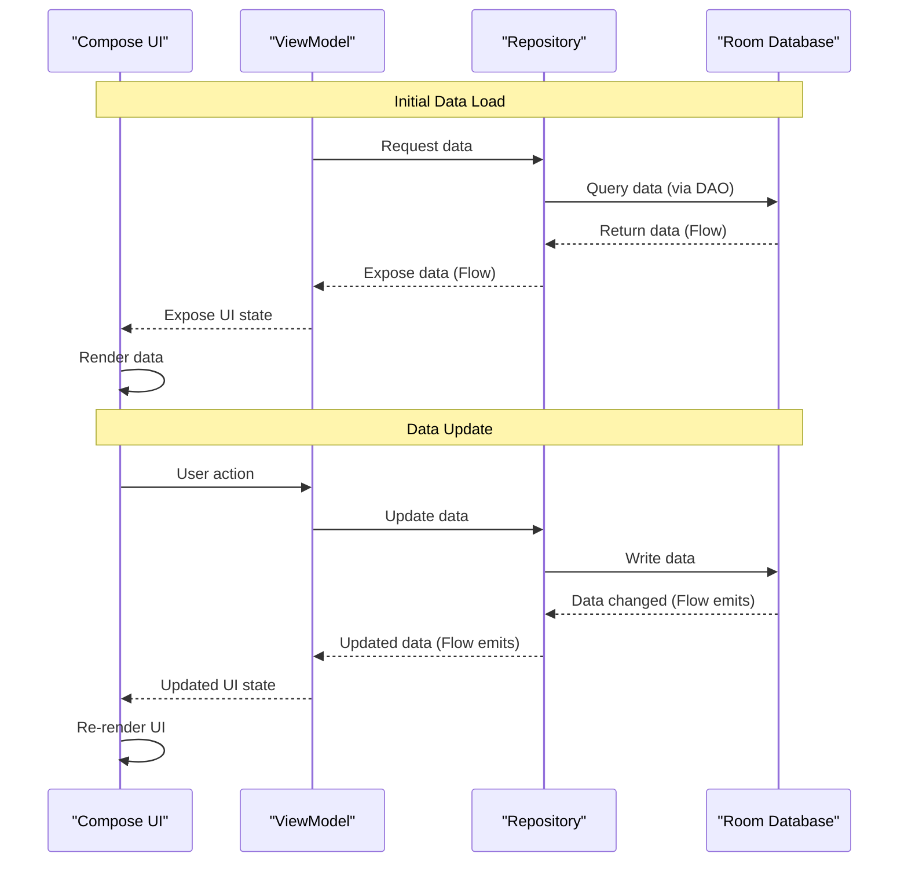

This reactive approach is implemented using:
- Kotlin Coroutines for asynchronous programming
- Flow for observable data streams
- StateFlow/SharedFlow for UI state management

Sources: [README.md:40-41]()

## Build System Features

The templates incorporate modern build system practices:

- **Kotlin DSL Build Scripts**: Using KTS gradle files for improved type safety and IDE support 
- **Version Catalog**: Centralized dependency management to ensure consistent versions across modules

Sources: [README.md:27-30]()

## Testing Infrastructure

The templates come with a comprehensive testing infrastructure:

| Test Type | Tools | Features |
|-----------|-------|----------|
| Unit Tests | JUnit, Turbine | ViewModel, Repository, and other business logic tests |
| UI Tests | Compose Testing, Hilt Testing | Component-level and integration tests |
| Test Doubles | Hilt Test Modules | Fake implementations for testing isolation |

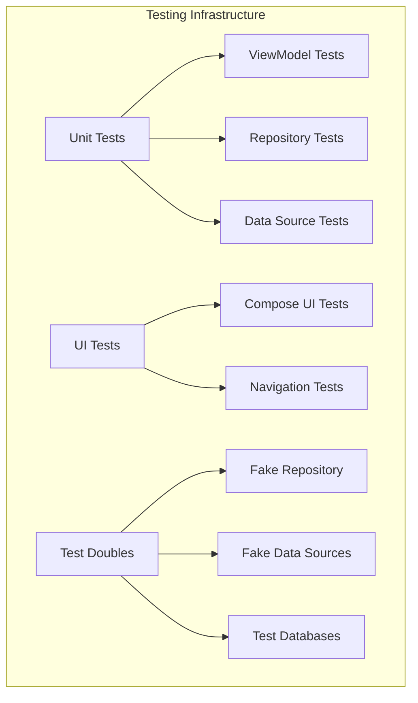

The testing approach allows for:
- Testing each layer in isolation
- Integration testing across layers
- UI testing with controlled test data

Sources: [README.md:42-44]()

## Template Customization

The templates support easy customization via a script that allows you to specify:

- Package name
- Data item type (entity name)
- Application name

This makes it simple to adapt the templates to specific project needs without manual refactoring.

Sources: [README.md:46-66]()

## Technology Stack Summary

The following table summarizes the key technologies used in the templates:

| Category | Technologies |
|----------|--------------|
| UI | Jetpack Compose, Material 3, Jetpack Navigation |
| Architecture | ViewModel, Repository Pattern, Room |
| Asynchronous | Kotlin Coroutines, Flow |
| Dependency Injection | Hilt |
| Testing | JUnit, Compose Testing, Hilt Testing |
| Build | KTS Gradle Files, Version Catalog |

Sources: [README.md:28-44]()

This combination of technologies represents modern Android development best practices and provides a solid foundation for building maintainable, testable, and scalable Android applications.

---

# Page: Visual Overview

# Visual Overview

<details>
<summary>Relevant source files</summary>

The following files were used as context for generating this wiki page:

- [screenshot.png](screenshot.png)
- [screenshots.png](screenshots.png)

</details>


This page provides visual examples of applications built with the Android Architecture Templates. It illustrates how applications created using these templates look visually and how their components interact architecturally. For information about the architectural patterns implemented in these templates, see [Architecture Patterns](#3).

## Sample Application UI

Applications built with the Android Architecture Templates follow Material 3 design principles and use Jetpack Compose for the user interface. Below is a screenshot of a sample application built using these templates:


The sample application showcases a simple "My Tasks" app that demonstrates the architecture patterns and UI components provided by the templates. The UI features:

- Material 3 design components
- A top app bar with title and actions
- A list of items displayed in a vertical layout
- Floating action button (FAB) for adding new items
- Individual item cards with interactive elements

Sources: screenshot.png

## Architecture Component Visualization

The following diagram shows the key architectural components in applications built with these templates and how they relate to each other:

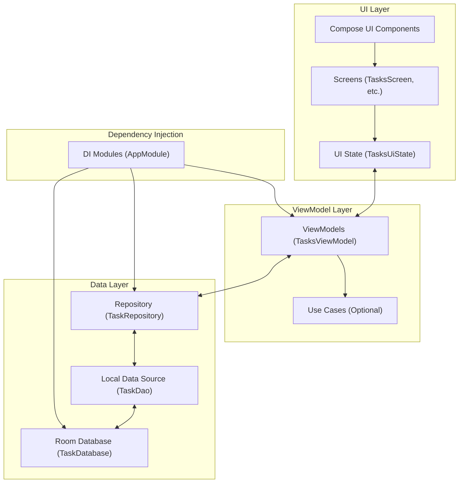

This architecture follows a unidirectional data flow pattern, with clear separation between UI, logic, and data layers.

Sources: screenshot.png, Repository Structure Overview diagrams from introduction

## UI Component Hierarchy

The following diagram illustrates the hierarchy of UI components in a typical screen built with these templates:

```mermaid
flowchart TD
    subgraph "TasksScreen"
        TasksRoute["TasksRoute(viewModel: TasksViewModel)"]
        TasksScreen["TasksScreen(uiState, onAddTask, onTaskClick, etc.)"]
        
        subgraph "Components"
            TopBar["TopAppBar(title: 'Tasks')"]
            TasksList["TasksList(items: List<Task>)"]
            TaskItem["TaskItem(task: Task, onTaskClick)"]
            AddTaskFAB["FloatingActionButton(onAddTask)"]
        end
    end
    
    TasksRoute --> TasksViewModel["TasksViewModel"]
    TasksRoute --> TasksScreen
    TasksScreen --> TopBar
    TasksScreen --> TasksList
    TasksList --> TaskItem
    TasksScreen --> AddTaskFAB
    
    TasksViewModel --> TasksUiState["TasksUiState(isLoading, items)"]
    TasksUiState --> TasksScreen
```

This diagram shows how UI components are structured in the Jetpack Compose hierarchy, with clear separation between route functions, screen composables, and individual UI components.

Sources: screenshot.png, Layered Architecture Pattern diagram from introduction

## Data Flow Visualization

The reactive data flow in applications built with these templates is visualized below:

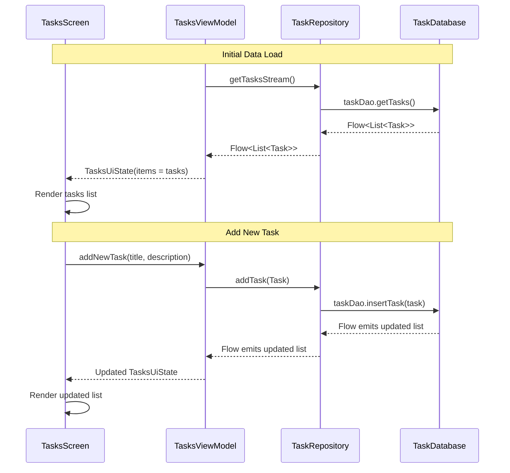

This diagram illustrates how data flows reactively through the system, with Kotlin Flows enabling automatic UI updates when data changes.

Sources: Reactive Data Flow diagram from introduction

## Base vs. Multimodule Template Structure

The templates are available in two variants: a base template and a multimodule template. The following diagram shows the structural differences between them:

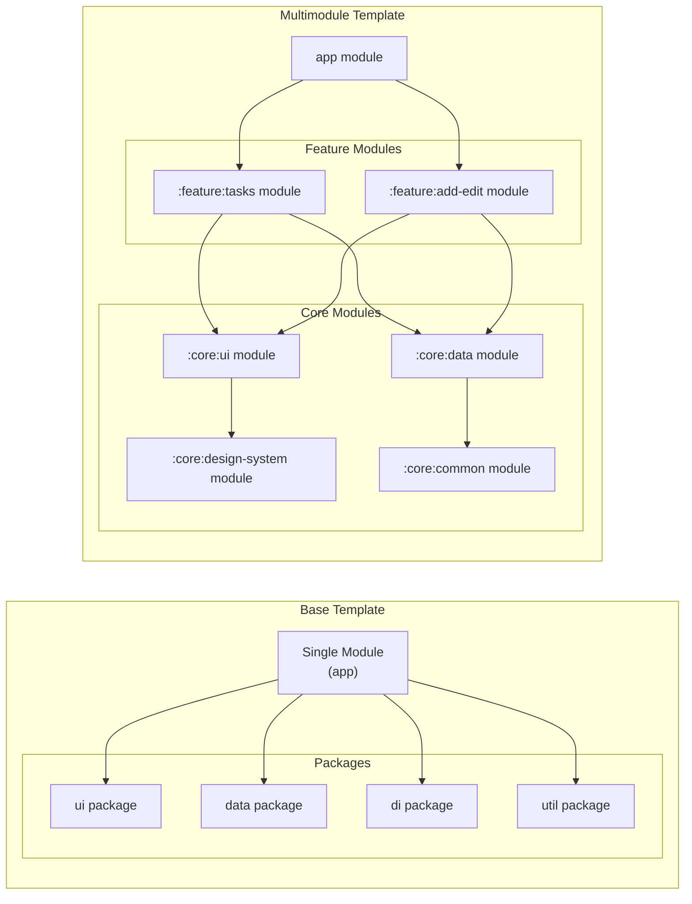

This diagram shows how the single-module base template organizes code into packages, while the multimodule template separates concerns into dedicated modules.

Sources: Template Comparison: Base vs. Multimodule diagram from introduction

## Dependency Injection Structure

The following diagram illustrates how dependency injection is implemented using Hilt in these templates:

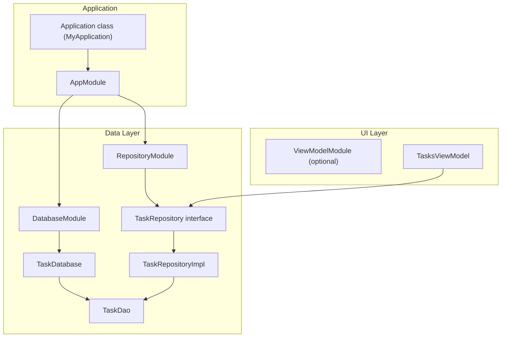

This diagram shows how Hilt manages dependencies throughout the application, following a clean architecture approach.

Sources: Dependency Injection Structure diagram from introduction

## Theme and UI Components

The templates provide a Material 3 theme and reusable UI components:

```mermaid
flowchart TD
    subgraph "Theme"
        Theme["AppTheme"]
        ColorScheme["AppColorScheme"]
        Typography["AppTypography"]
    end
    
    subgraph "Common Components"
        LoadingIndicator["LoadingIndicator"]
        ErrorMessage["ErrorMessage"]
        TasksList["TasksList"]
        TaskItem["TaskItem"]
    end
    
    subgraph "Screens"
        TasksScreen["TasksScreen"]
        AddEditTaskScreen["AddEditTaskScreen"]
    end
    
    Theme --> ColorScheme
    Theme --> Typography
    Theme --> TasksScreen
    Theme --> AddEditTaskScreen
    TasksScreen --> TasksList
    TasksList --> TaskItem
    TasksScreen --> LoadingIndicator
    TasksScreen --> ErrorMessage
```

This diagram shows how the theming and UI components are structured and used throughout the application.

Sources: screenshot.png

## Conclusion

The visual examples provided in this page demonstrate how applications built with the Android Architecture Templates look and how their components interact. These templates follow modern Android development best practices, including:

- Material 3 design for a polished user interface
- Jetpack Compose for declarative UI
- Clean architecture with separation of concerns
- Reactive data flow using Kotlin Flows
- Dependency injection with Hilt

For more detailed information about the architectural patterns implemented in these templates, see [Architecture Patterns](#3).

---

# Page: Template Options

# Template Options

<details>
<summary>Relevant source files</summary>

The following files were used as context for generating this wiki page:

- [README.md](README.md)

</details>


This page compares the available template options in the Android Architecture Templates repository and provides guidance on when to use each option. The repository offers two main template types: the Base (single-module) template and the Multimodule template. For detailed information about the specific implementation of each template, see [Base Template](#2.1) and [Multimodule Template](#2.2).

## Available Templates

The Android Architecture Templates repository provides two template options as starting points for Android applications:

**Template Options Overview**
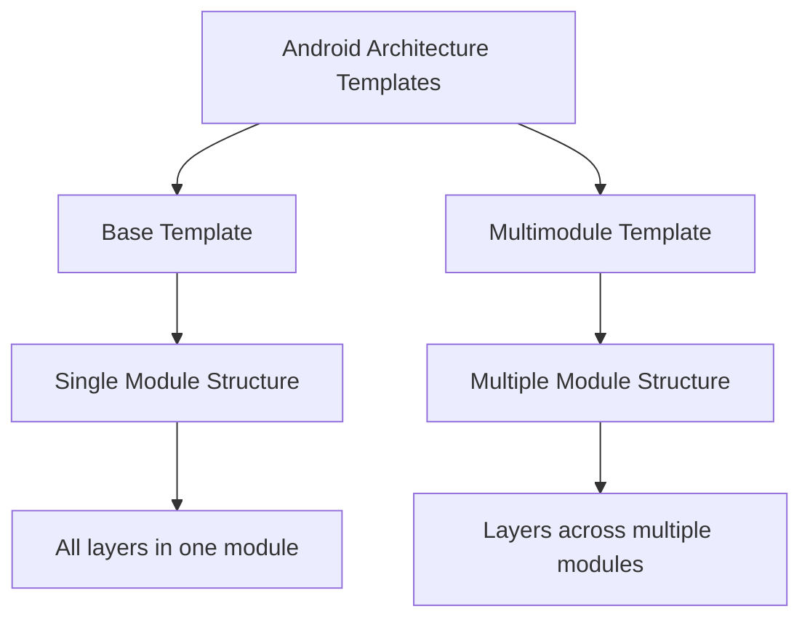

Sources: [README.md:11-14]()

### Base Template

The Base template provides a single-module architecture with the following components:
- Reactive architecture with Kotlin Flows
- Jetpack Compose UI
- Room database for local storage
- Hilt for dependency injection
- All code contained within a single app module

### Multimodule Template

The Multimodule template extends the Base template by distributing the code across multiple modules:
- `app` module (application entry point)
- `feature` modules (grouped by functionality)
- `core` modules (shared components)

## Architectural Comparison

Both templates implement the same layered architecture but differ in how the code is organized across modules.

**High-Level Architecture Comparison**
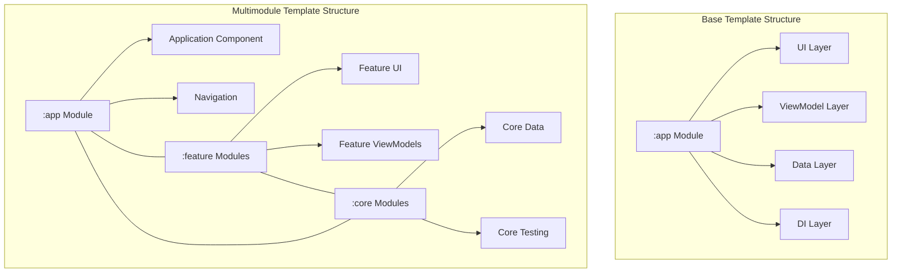

Sources: [README.md:32-44]()

## Module Structure Comparison

The key difference between the templates is how code is organized across modules.

**Detailed Module Structure Comparison**
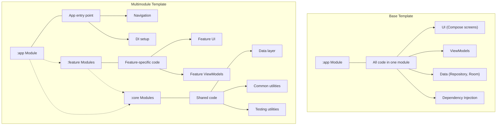

Sources: [README.md:32-44]()

## Architecture Implementation

Both templates implement the same layered architecture pattern, following Android's recommended architecture:

**Shared Architecture Layers**
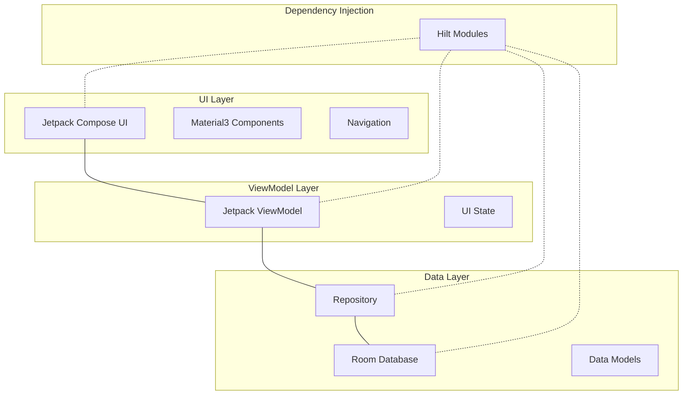

Sources: [README.md:32-44]()

## Technical Trade-offs

| Aspect | Base Template | Multimodule Template |
|--------|---------------|----------------------|
| Project Structure | Single module | Multiple modules (app, feature, core) |
| Code Organization | Package-based separation | Module-based separation |
| Build Speed | Faster for small projects | Better for large projects with incremental builds |
| Module Boundaries | No explicit boundaries | Clear explicit boundaries |
| Dependency Management | Simpler, all in one place | More complex, distributed across modules |
| Feature Isolation | Less isolation | Better isolation |
| Testing | All tests in one module | Tests distributed by module |
| Team Collaboration | Potential for merge conflicts | Reduced merge conflicts between teams |
| CI Build Time | Shorter for small projects | Can be optimized for larger projects |
| Gradle Configuration | Simpler, fewer files | More complex, multiple build files |

Sources: [README.md:32-44]()

## Selection Criteria

### When to Choose the Base Template

Choose the Base template when:
- Building smaller applications with a limited number of features
- Working with a small development team
- Rapid prototyping or quick proof-of-concept development
- Minimizing build configuration complexity is a priority
- Application scope is well-defined and unlikely to grow significantly

### When to Choose the Multimodule Template

Choose the Multimodule template when:
- Building larger applications with many features
- Working with larger development teams that need to work on separate features
- Clear module boundaries are needed for better code organization
- Improved build times through parallel and incremental compilation are important
- Need for selective feature inclusion/exclusion in different app variants
- Planning for feature modules that could be reused across different applications
- Need to scale the codebase as the application grows

## Summary

Both templates implement the same layered architecture and follow the same architectural principles but differ in project structure complexity:

- The **Base template** offers simplicity with everything in a single module, making it ideal for smaller projects or quick starts.
- The **Multimodule template** provides a scalable structure with clear boundaries between modules, making it better suited for larger projects and teams.

For detailed implementation information about each template, see [Base Template](#2.1) and [Multimodule Template](#2.2).

For instructions on using and customizing these templates, see [Using the Customizer Script](#4.1).

Sources: [README.md:46-72]()

---

# Page: Base Template

# Base Template

<details>
<summary>Relevant source files</summary>

The following files were used as context for generating this wiki page:

- [README.md](README.md)

</details>


## Purpose and Scope

The Base Template provides a single-module architecture foundation for Android applications following the [Guide to app architecture](https://developer.android.com/topic/architecture). It implements a layered architecture with clean separation of concerns, reactive data flow, and modern Android development practices. This document explains the structure, components, and appropriate use cases for the Base Template.

For information about the modularized version with feature and core modules, see [Multimodule Template](#2.2).

Sources: [README.md:12-14]()

## Overview

The Base Template is designed for small to medium-sized applications or quick experiments where simplicity and a single-module approach are preferred. It contains a complete architecture stack with UI, ViewModel, and Data layers all within a single module.

### Key Characteristics

- **Single Module**: All code resides in a single app module
- **Layered Architecture**: Clear separation between UI, ViewModel, and Data layers
- **Reactive Data Flow**: Uses Kotlin Flows for reactive data propagation
- **Modern Android Stack**: Jetpack Compose, Room, Hilt, and other recommended libraries

### Template Structure

**Base Template Architecture**

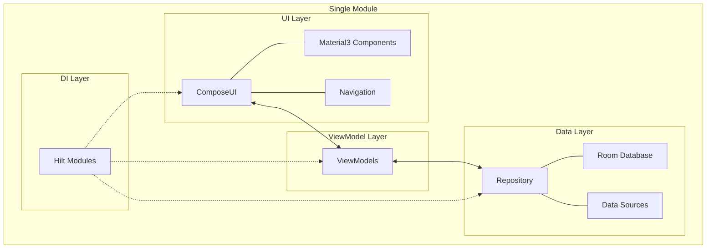

Sources: [README.md:32-44]()

## Package Structure

The Base Template organizes code by architectural layer within a single module. This promotes separation of concerns while keeping the project structure simple.

**Package Organization**

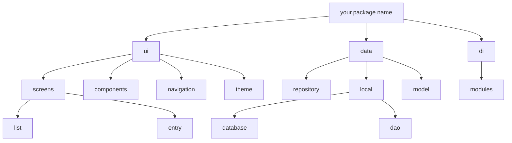

Sources: [README.md:32-44]()

## Data Flow Pattern

The Base Template implements a reactive data flow pattern using Kotlin Coroutines and Flow. This creates a responsive application where data changes automatically propagate from the data layer to the UI.

**Reactive Data Flow**

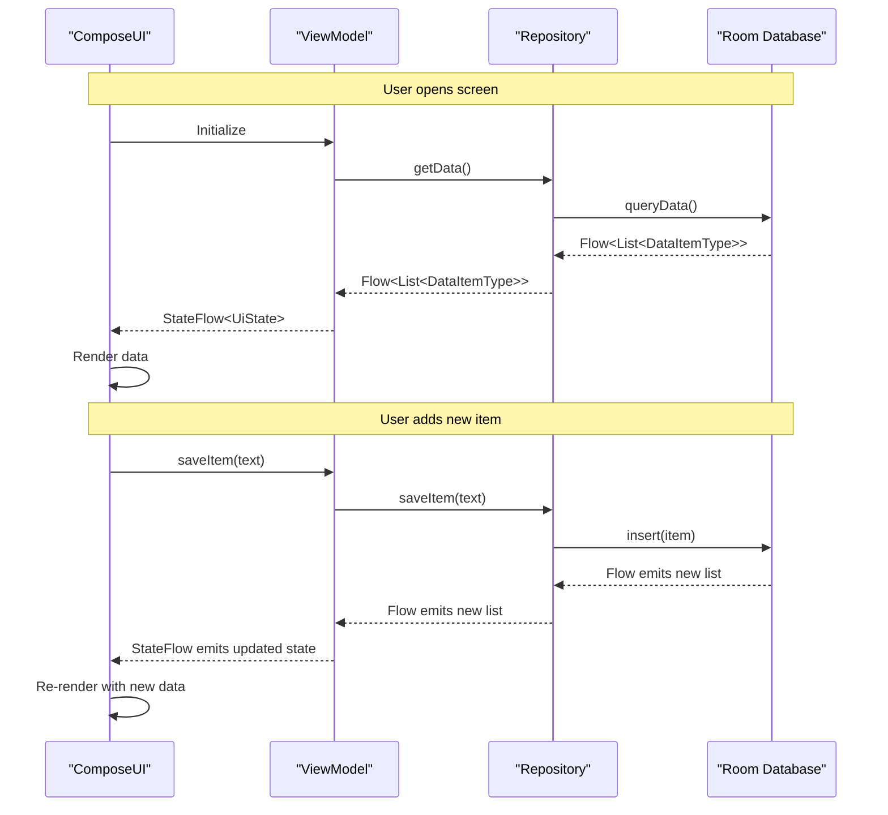

Sources: [README.md:40-41]()

## Key Components

### UI Layer

The UI layer is built with Jetpack Compose and Material3, providing a modern, declarative UI approach. It consists of:

- **Screens**: Compose screens that display data and capture user interactions
- **Components**: Reusable Compose UI components
- **Navigation**: Jetpack Navigation for Compose to manage screen navigation
- **Theme**: Material3 theming resources

The UI observes UI state from the ViewModel and renders accordingly, while sending user events back to the ViewModel.

Sources: [README.md:22-25](), [README.md:37-39]()

### ViewModel Layer

The ViewModel layer manages UI state and business logic:

- Exposes UI state via StateFlow
- Processes user events
- Communicates with the data layer
- Survives configuration changes
- Preserves state during navigation

ViewModels are injected into Compose screens using Hilt.

Sources: [README.md:36]()

### Data Layer

The data layer manages all data operations and contains:

- **Repository**: Coordinates data operations and provides a clean API to the ViewModel
- **Room Database**: Provides local persistence using SQLite
- **DAOs**: Data Access Objects for database operations
- **Models**: Data classes representing the application's data entities

All data operations are exposed as Flows to enable reactive updates.

Sources: [README.md:34](), [README.md:40]()

### Dependency Injection

Hilt provides dependency injection throughout the application:

**Dependency Injection Structure**

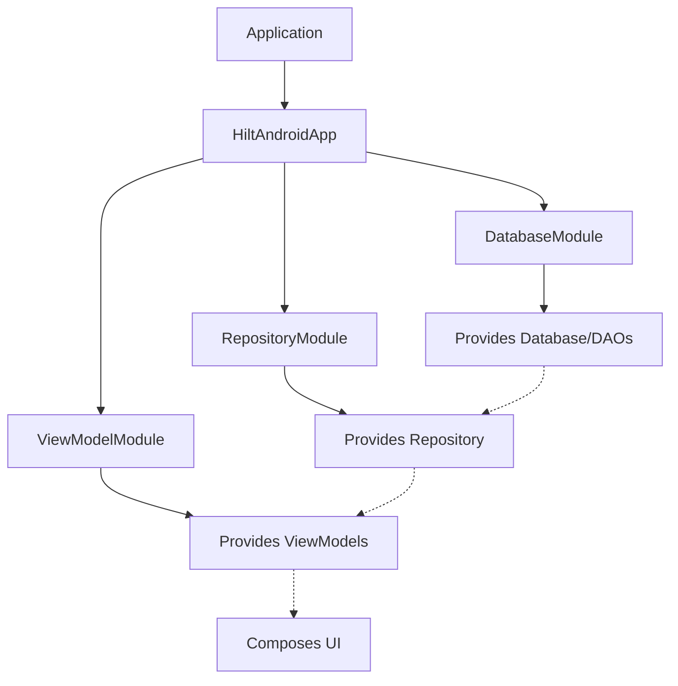

Sources: [README.md:35]()

## Testing Approach

The Base Template includes a comprehensive testing strategy:

### Unit Tests

- Tests for ViewModels
- Tests for Repository
- Tests for Data sources

### UI Tests

- Compose UI testing
- Uses fake data providers with Hilt test modules
- Tests navigation flows and UI interactions

Sources: [README.md:42-44]()

## Use Cases

The Base Template is ideal for:

- Small to medium-sized applications
- Rapid prototypes and quick experiments
- Single-developer projects
- Applications with a focused feature set

When your application grows beyond these bounds, consider migrating to the [Multimodule Template](#2.2) for better scalability and team collaboration.

**Feature-to-Code Mapping**

| Feature | Key Implementation Files |
|---------|--------------------------|
| UI Layer | Compose screens and components |
| Navigation | Navigation graphs and routes |
| State Management | ViewModels with UI state |
| Data Persistence | Room database, DAOs, and entities |
| Dependency Injection | Hilt modules |
| Business Logic | Repository implementation |

Sources: [README.md:11-14]()

## Getting Started

To use the Base Template:

1. Clone the repository branch `base`
2. Run the customizer script to configure package name and entity type
3. Open in Android Studio

For detailed instructions on customization, see [Using the Customizer Script](#4.1).

Sources: [README.md:46-72]()

## Limitations

While the Base Template provides a solid foundation, be aware of these limitations:

- All code resides in a single module, which may become unwieldy as the application grows
- Limited isolation between features, which can lead to tight coupling
- May be challenging for large teams working simultaneously on different features

When these limitations become apparent, consider migrating to the [Multimodule Template](#2.2).

Sources: [README.md:11-14]()

---

# Page: Multimodule Template

# Multimodule Template

<details>
<summary>Relevant source files</summary>

The following files were used as context for generating this wiki page:

- [README.md](README.md)

</details>


This document explains the structure, organization, and communication patterns of the multimodule template from the Android Architecture Starter Templates repository. The multimodule template extends the [Base Template](#2.1) by splitting the application into multiple Gradle modules, enabling better separation of concerns, improved build performance, and scalability for larger codebases and teams.

## 1. Overview and Purpose

The multimodule template implements a modular architecture that organizes code into distinct, purpose-specific modules. This approach offers several advantages over single-module architecture:

- **Improved build performance**: Only modified modules need to be recompiled
- **Better separation of concerns**: Clear module boundaries enforce architectural patterns
- **Parallel development**: Multiple developers can work on different modules simultaneously
- **Feature isolation**: Features can be developed, tested, and maintained independently
- **Reusability**: Core modules can be shared across projects

The template demonstrates how to apply modularization principles to Android app development while maintaining the same layered architecture patterns as the base template.

Sources: [README.md:13-14]()

## 2. Module Structure

The multimodule template divides the application into three main categories of modules:

```mermaid
flowchart TD
    subgraph "Multimodule Template Structure"
        A["root project"] --> B["app module"]
        A --> C["feature modules"]
        A --> D["core modules"]
        
        B --> B1["Application entry point"]
        B --> B2["Navigation graph"]
        B --> B3["DI app component"]
        
        C --> C1["feature:example"]
        C --> C2["feature:other"]
        
        D --> D1["core:data"]
        D --> D2["core:ui"]
        D --> D3["core:testing"]
        D --> D4["core:common"]
    end
```

### 2.1 App Module

The app module serves as the application's entry point and orchestrator, containing:

- The `Application` class with Hilt setup
- Main navigation graph that connects feature modules
- App-level dependency injection components
- Final Android application packaging configuration

The app module depends on all feature modules and necessary core modules but contains minimal business logic itself.

### 2.2 Feature Modules

Feature modules encapsulate specific functionality or user journeys within the application. Each feature module typically contains its own UI, ViewModels, and feature-specific logic, following the same layered architecture as the base template but scoped to a particular feature.

Feature modules generally follow this pattern:
- UI components built with Jetpack Compose
- Feature-specific ViewModels
- Feature-specific navigation components
- Feature-specific state holders
- Feature-specific unit and UI tests

Feature modules may depend on core modules but should not depend on other feature modules to maintain proper separation of concerns.

### 2.3 Core Modules

Core modules contain shared functionality used across multiple feature modules. The template typically includes the following core modules:

- **core:data**: Contains repositories, data sources, database definitions, and network services
- **core:ui**: Shared UI components, theme definitions, and common UI utilities
- **core:common**: Utilities, extensions, and common code used throughout the application
- **core:testing**: Testing utilities and fake implementations for tests

Core modules should be designed with clear responsibilities and APIs to keep the architecture maintainable.

Sources: [README.md:32-44]()

## 3. Module Dependencies and Communication

The module dependency structure follows a specific pattern to ensure architectural integrity:

```mermaid
flowchart TD
    subgraph "Module Dependencies"
        A["app"] --> F1["feature:example"]
        A --> F2["feature:other"]
        
        F1 --> C1["core:data"]
        F1 --> C2["core:ui"]
        F1 --> C3["core:common"]
        
        F2 --> C1
        F2 --> C2
        F2 --> C3
        
        C1 --> C3
        C2 --> C3
    end
```

Key communication patterns:

1. **App to Features**: The app module navigates between features but doesn't access their internal implementation
2. **Feature to Core**: Features use core modules for data access and shared functionality
3. **Feature to Feature**: Features don't communicate directly with each other; they interact through:
   - Navigation (via the app module)
   - Shared data (via core:data module)

### 3.1 Dependency Rules

To maintain clean architecture, the template follows these dependency rules:

1. App module depends on all feature modules
2. Feature modules depend on core modules, but not on other feature modules
3. Core modules may depend on other core modules but never on feature or app modules
4. Dependencies always point inward (from more specific to more general modules)

These rules prevent circular dependencies and ensure that each module can be reasoned about independently.

### 3.2 Public API Boundaries

Each module defines clear public API boundaries that determine what is accessible to other modules:

- Internal implementation details are hidden using Kotlin's `internal` visibility modifier
- Only necessary interfaces and models are exposed as public APIs
- Communication between modules happens through well-defined interfaces

Sources: [README.md:32-42]()

## 4. Architecture Within Modules

Each module maintains the layered architecture pattern of the base template, with separation between UI, ViewModel, and Data layers.

```mermaid
flowchart TD
    subgraph "Feature Module Internal Architecture"
        UI["UI Layer\n(Composables)"] <--> VM["ViewModel Layer\n(State holders)"]
        VM <--> Data["Data Layer\n(Via core:data)"]
    end
    
    subgraph "Core:Data Module Internal Architecture"
        Repo["Repositories"] <--> DS1["Local Data Source\n(Room)"]
        Repo <--> DS2["Remote Data Source\n(Network)"]
    end
    
    UI -. "Uses" .-> CD["core:ui\n(Shared components)"]
    VM -. "Uses" .-> CC["core:common\n(Utilities)"]
    Data -. "Implemented in" .-> CD2["core:data"]
```

### 4.1 Example Feature Module Structure

A typical feature module contains:

```
feature:example/
├── src/
│   ├── main/
│   │   ├── kotlin/
│   │   │   └── com.example.app.feature.example/
│   │   │       ├── navigation/
│   │   │       │   └── ExampleNavigation.kt
│   │   │       ├── ui/
│   │   │       │   ├── ExampleScreen.kt
│   │   │       │   └── components/
│   │   │       └── ExampleViewModel.kt
│   │   └── AndroidManifest.xml
│   └── test/
│       └── kotlin/
│           └── com.example.app.feature.example/
│               └── ExampleViewModelTest.kt
└── build.gradle.kts
```

### 4.2 Example Core Module Structure

A typical core data module contains:

```
core:data/
├── src/
│   ├── main/
│   │   ├── kotlin/
│   │   │   └── com.example.app.core.data/
│   │   │       ├── repository/
│   │   │       │   ├── ExampleRepository.kt
│   │   │       │   └── ExampleRepositoryImpl.kt
│   │   │       ├── local/
│   │   │       │   ├── database/
│   │   │       │   │   ├── AppDatabase.kt
│   │   │       │   │   └── ExampleDao.kt
│   │   │       │   └── model/
│   │   │       │       └── ExampleEntity.kt
│   │   │       └── di/
│   │   │           └── DataModule.kt
│   │   └── AndroidManifest.xml
│   └── test/
│       └── kotlin/
│           └── com.example.app.core.data/
│               └── repository/
│                   └── ExampleRepositoryTest.kt
└── build.gradle.kts
```

Sources: [README.md:32-44]()

## 5. Dependency Injection in Multimodule

The template uses Hilt for dependency injection, which works well with the multimodule structure. Each module contributes to the dependency graph while maintaining proper encapsulation.

```mermaid
flowchart TD
    subgraph "Dependency Injection Architecture"
        App["@HiltAndroidApp\nApplication"] --> AppComp["App Component"]
        
        AppComp --> FM1["Feature Module 1\nDI Modules"]
        AppComp --> FM2["Feature Module 2\nDI Modules"]
        AppComp --> CM1["Core Data\nDI Modules"]
        AppComp --> CM2["Core UI\nDI Modules"]
        
        FM1 --> FVM1["Feature 1\nViewModels"]
        FM2 --> FVM2["Feature 2\nViewModels"]
        
        FVM1 --> Rep["Repositories\n(from core:data)"]
        FVM2 --> Rep
    end
```

Key DI patterns in the multimodule template:

1. Each module provides its own Hilt modules to contribute to the dependency graph
2. The app module contains the `@HiltAndroidApp` entry point
3. Feature modules use `@AndroidEntryPoint` and `@HiltViewModel` for their components
4. Core modules expose interfaces through DI and provide implementations
5. Testing modules provide test-specific implementations for DI

Sources: [README.md:35-36]()

## 6. Testing in Multimodule Architecture

The multimodule template maintains the same testing strategy as the base template but distributes tests across modules:

1. Each module contains its own unit tests for module-specific code
2. UI tests remain primarily in the app module but can use test helpers from feature modules
3. The core:testing module provides shared testing utilities, fakes, and test rules
4. Hilt is used for dependency injection in tests, with test doubles replacing real implementations

This approach allows for thorough testing while maintaining module boundaries.

Sources: [README.md:42-44]()

## 7. When to Use the Multimodule Template

Consider using the multimodule template when:

- Your project is expected to grow beyond a few screens or features
- Multiple developers will be working on the codebase simultaneously
- You need to improve build times as the project scales
- You want to enforce stricter architectural boundaries
- You're building a large application with multiple distinct features

For simpler applications or quick prototypes, the [Base Template](#2.1) might be more appropriate due to its simpler setup.

Sources: [README.md:13-14]()

## 8. Summary

The multimodule template provides a robust foundation for building modular Android applications with clear architectural boundaries. It extends the base template's layered architecture across multiple Gradle modules, improving scalability, build performance, and team collaboration. Through careful organization into app, feature, and core modules, along with well-defined dependency rules, the template demonstrates how to implement a maintainable modular architecture while leveraging modern Android development practices.

---

# Page: Architecture Patterns

# Architecture Patterns

<details>
<summary>Relevant source files</summary>

The following files were used as context for generating this wiki page:

- [README.md](README.md)

</details>


This page provides an overview of the architectural patterns implemented in the Android Architecture Starter Templates. These patterns form the foundation of both the base and multimodule templates, ensuring a consistent approach to Android application development following Google's [Guide to app architecture](https://developer.android.com/topic/architecture).

For specific information about the different template options, see [Template Options](#2). For details on how to get started with these templates, see [Getting Started](#4).

## Core Architecture Overview

The templates implement a layered architecture with a unidirectional, reactive data flow. This approach separates concerns, improves testability, and creates a consistent pattern for data management throughout the application.

### High-Level Architecture Diagram

```mermaid
flowchart TD
    subgraph "UI Layer"
        A["Jetpack Compose UI"]
        B["Material3 Components"]
        N["Navigation"]
        A --- B
        N --- A
    end
    
    subgraph "ViewModel Layer"
        C["ViewModel"]
        C1["UI State"]
        C2["UI Events"]
        C --- C1
        C --- C2
    end
    
    subgraph "Data Layer"
        D["Repository Interface"]
        E["Repository Implementation"]
        F["Room Database"]
        G["Data Access Objects (DAOs)"]
        D --- E
        E --- F
        F --- G
    end
    
    A <--> |"UI State"| C
    C <--> |"Data Streams (Flow)"| D
    
    subgraph "Dependency Injection"
        H["Hilt Modules"]
    end
    
    H -.-> A
    H -.-> C
    H -.-> D
    H -.-> E
    H -.-> F
```

Sources: README.md:32-41

The architecture is structured into three primary layers, each with distinct responsibilities:

1. **UI Layer**: Responsible for displaying data to the user and capturing user interactions
2. **ViewModel Layer**: Manages UI-related data, handles UI logic, and communicates with the data layer
3. **Data Layer**: Manages data operations, including database access and potentially remote data sources

Dependency injection with Hilt ensures proper separation of concerns and facilitates testing.

## Layered Architecture

The templates strictly separate the application into three main layers, each with specific responsibilities and components.

### Layer Structure and Responsibilities

```mermaid
flowchart TD
    subgraph "UI Layer"
        A1["Compose Screens"]
        A2["UI Components"]
        A3["Navigation"]
        A1 --- A2
        A1 --- A3
    end
    
    subgraph "ViewModel Layer"
        B1["ViewModels"]
        B2["UI State Classes"]
        B3["Event Handlers"]
        B1 --- B2
        B1 --- B3
    end
    
    subgraph "Data Layer"
        C1["Repository Interfaces"]
        C2["Repository Implementations"]
        C3["Local Data Source (Room)"]
        C4["Models/Entities"]
        C1 --- C2
        C2 --- C3
        C2 --- C4
    end
    
    A1 --> |"Observes"| B2
    A1 --> |"Triggers"| B3
    B1 --> |"Updates"| B2
    B3 --> |"Invokes methods on"| B1
    B1 --> |"Calls methods on"| C1
    C1 --> |"Returns Flow<Data>"| B1
```

Sources: README.md:32-41

### UI Layer
The UI layer is built with Jetpack Compose and Material3, providing a modern declarative UI system. It consists of:

- **Compose screens**: Full-screen UI elements that represent destinations in the app
- **UI components**: Reusable Compose elements that make up the screens
- **Navigation**: Handled by Jetpack Navigation for Compose

The UI observes UI state from ViewModels and dispatches user events to the ViewModel layer.

### ViewModel Layer
The ViewModel layer uses Jetpack ViewModel to manage UI-related data in a lifecycle-conscious way:

- **ViewModels**: Hold UI state and handle UI logic
- **UI State classes**: Immutable data classes representing the state of a screen
- **Event handlers**: Methods triggered by user actions from the UI

ViewModels interact with the data layer through repository interfaces, transforming data into UI state.

### Data Layer
The data layer is responsible for data operations and abstraction:

- **Repository interfaces**: Define data operations without implementation details
- **Repository implementations**: Concrete implementations of repository interfaces
- **Local data source**: Room database for persistent storage
- **Model classes/entities**: Data classes representing the core data structures

The data layer exposes reactive data streams using Kotlin Flow, ensuring updates propagate through the system automatically.

Sources: README.md:34-37, 40

## Reactive Data Flow

The templates implement a reactive data flow architecture using Kotlin Coroutines and Flow, creating a consistent pattern for handling data changes and updates throughout the application.

### Data Flow Diagram

```mermaid
sequenceDiagram
    participant UI as "Compose UI"
    participant VM as "ViewModel"
    participant RP as "Repository"
    participant DB as "Room Database"
    
    Note over UI,DB: Initial Data Load
    UI->>VM: Initialize/Enter screen
    VM->>RP: getData()
    RP->>DB: getAll() (via DAO)
    DB-->>RP: Return Flow<List<Entity>>
    RP-->>VM: Return Flow<List<Model>>
    VM-->>UI: Map to UI state
    UI->>UI: Render data
    
    Note over UI,DB: User Action
    UI->>VM: User action (event)
    VM->>RP: updateData(item)
    RP->>DB: insert/update (via DAO)
    DB-->>RP: Flow emits new data
    RP-->>VM: Flow emits new data
    VM-->>UI: Update UI state
    UI->>UI: Re-render with new data
```

Sources: README.md:40-41

Key aspects of the reactive data flow:

1. **Unidirectional data flow**: Data flows in one direction, from the database through repositories and ViewModels to the UI
2. **Reactive updates**: Data changes trigger automatic updates through the system using Kotlin Flow
3. **State-based UI**: The UI observes state from ViewModels and renders based on that state
4. **Event-based actions**: User interactions are captured as events and processed by ViewModels

This reactive pattern ensures that the UI always reflects the current state of the data, without manual synchronization.

### Code Entity Relationships

```mermaid
flowchart LR
    subgraph "Database Layer"
        DAO["Data Access Object\n(Interface)"]
        Entity["Entity Class"]
        DB["Room Database"]
        DAO --- DB
        Entity --- DAO
    end
    
    subgraph "Repository Layer"
        RI["Repository Interface"]
        RImpl["Repository Implementation"]
        Model["Domain Model"]
        RI --- RImpl
        RImpl --- Model
    end
    
    subgraph "ViewModel Layer"
        VM["ViewModel"]
        UIS["UI State"]
        VM --- UIS
    end
    
    subgraph "UI Layer"
        Screen["Compose Screen"]
        Comp["Compose Components"]
        Screen --- Comp
    end
    
    DAO --> |"query(): Flow<List<Entity>>"| RImpl
    RImpl --> |"getData(): Flow<List<Model>>"| VM
    VM --> |"uiState: StateFlow<UiState>"| Screen
    Screen --> |"events"| VM
    VM --> |"repository.update()"| RImpl
    RImpl --> |"dao.insert()"| DAO
```

Sources: README.md:34-41

## Dependency Injection

The templates use Hilt for dependency injection, providing a standardized way to manage dependencies throughout the application and enabling easier testing.

### Dependency Injection Structure

```mermaid
flowchart TD
    subgraph "Application Level"
        App["Application Class"]
        AppMod["AppModule"]
        App --- AppMod
    end
    
    subgraph "Data Layer Modules"
        DaoMod["DatabaseModule"]
        RepoMod["RepositoryModule"]
        DaoMod --- DB["Room Database"]
        DaoMod --- DAO["Data Access Objects"]
        RepoMod --- RepImpl["Repository Implementations"]
    end
    
    subgraph "Dependencies"
        DB
        DAO
        RepImpl
        RepInt["Repository Interfaces"]
    end
    
    subgraph "Injection Points"
        VM["ViewModels"]
        UI["UI Components"]
    end
    
    AppMod --> DaoMod
    AppMod --> RepoMod
    RepoMod --> RepInt
    DAO --> RepImpl
    RepInt --> VM
    VM --> UI
```

Sources: README.md:35

Key aspects of the dependency injection system:

1. **Hilt modules**: Define how to provide dependencies
2. **Constructor injection**: Primary method for injecting dependencies
3. **Interface abstraction**: Dependencies are provided through interfaces rather than concrete implementations
4. **Testing support**: Enables replacing real implementations with fakes for testing

This dependency injection approach:
- Reduces boilerplate code
- Improves testability
- Enforces separation of concerns
- Manages the lifecycle of dependencies

### Testing with Dependency Injection

The architecture is designed to support both unit testing and UI testing through its dependency injection system:

- **Unit tests**: Test individual components with mock dependencies
- **UI tests**: Use fake data sources injected through Hilt test modules

Hilt's testing utilities allow for replacing production dependencies with test alternatives, ensuring tests are reliable and focused.

Sources: README.md:42-44

## Summary

The architecture patterns implemented in these templates provide:

1. **Clear separation of concerns** through a layered architecture
2. **Reactive data handling** with Kotlin Flow
3. **Dependency management** with Hilt
4. **Testability** at all levels

Together, these patterns create a solid foundation for building maintainable, testable, and scalable Android applications following modern best practices.

For more detailed information about specific aspects of the architecture, see:
- [Layered Architecture](#3.1)
- [Reactive Data Flow](#3.2)
- [Dependency Injection](#3.3)

Sources: README.md:4-5, 32-41

---

# Page: Layered Architecture

# Layered Architecture

<details>
<summary>Relevant source files</summary>

The following files were used as context for generating this wiki page:

- [README.md](README.md)

</details>


This document explains the layered architecture implemented in the Android Architecture Starter Templates. It focuses on the separation of UI, ViewModel, and Data layers and their respective responsibilities. For information about how data flows reactively through these layers, see [Reactive Data Flow](#3.2). For details on how dependencies are injected throughout the application, see [Dependency Injection](#3.3).

## Architecture Overview

The templates implement a three-layer architecture that separates concerns, promotes testability, and facilitates maintainability:

```mermaid
flowchart TD
    subgraph "UI Layer"
        A["Compose UI Components"] --> B["Material3 Components"]
        C["Jetpack Navigation"] <--> A
    end
    
    subgraph "ViewModel Layer"
        D["ViewModels"]
        E["UI State Classes"]
    end
    
    subgraph "Data Layer"
        F["Repository"] --> G["Room Database"]
        F --> H["Data Sources"]
    end
    
    A <--> |"Events/State"| D
    D <--> |"Data Operations"| F
    D --> E
```

Sources: README.md:32-44

This layered design offers several benefits:

| Benefit | Description |
|---------|-------------|
| Separation of Concerns | Each layer has a specific responsibility, making the code more modular |
| Testability | Layers can be tested in isolation with clear boundaries |
| Maintainability | Changes in one layer have minimal impact on other layers |
| Scalability | New features can be added more easily within the established structure |

## UI Layer

The UI layer is responsible for displaying data to the user and capturing user interactions. In the templates, this layer is implemented using Jetpack Compose and Material3.

```mermaid
flowchart TD
    subgraph "UI Layer Components"
        A["Screen Composables"] --> B["Composable Functions"]
        B --> C["Material3 Components"]
        D["NavHost/NavController"] <--> A
    end
    
    subgraph "Key Operations"
        E["Collect UiState"] --> A
        A --> F["Dispatch User Events"]
        A --> G["Render UI Elements"]
    end
```

### Key Components and Responsibilities

- **Screen Composables**: Define the screen structure and collect UI state
- **Composable Functions**: Reusable UI components built with Compose
- **Material3 Components**: Pre-designed Material Design components
- **Navigation**: Handles screen transitions using Jetpack Navigation

The UI layer observes UI state from the ViewModel and renders the appropriate UI components. When users interact with the UI, events are dispatched to the ViewModel for processing.

Sources: README.md:37-39

## ViewModel Layer

The ViewModel layer serves as the bridge between the UI and Data layers. It processes data for display and handles UI logic without direct references to the UI components.

```mermaid
flowchart TD
    subgraph "ViewModel Structure"
        A["ViewModel Classes"] --> B["UI State Definition"]
        A --> C["Event Handlers"]
        C --> D["Repository Access"]
    end
    
    subgraph "Key Operations"
        E["Transform Repository Data"] --> A
        A --> F["Expose StateFlow<UiState>"]
        G["Process UI Events"] --> C
    end
```

### Key Components and Responsibilities

- **ViewModel Classes**: Extend Android's Jetpack ViewModel class
- **UI State Classes**: Define the state of the UI as immutable data classes
- **Event Handlers**: Process user events from the UI layer
- **Data Transformation**: Convert repository data to UI-friendly formats

ViewModels are responsible for:
- Collecting data from repositories
- Transforming data into UI state
- Exposing UI state to the UI layer
- Processing user events
- Initiating data operations via repositories
- Surviving configuration changes

Sources: README.md:36

## Data Layer

The Data layer manages application data and provides a clean API to the ViewModel layer.

```mermaid
flowchart TD
    subgraph "Data Layer Structure"
        A["Repository Interfaces"] --> B["Repository Implementations"]
        B --> C["Room Database"]
        C --> D["Entity Classes"]
        C --> E["DAO Interfaces"]
    end
    
    subgraph "Key Operations"
        F["CRUD Operations"] --> B
        B --> G["Flow<Data>"]
        H["Database Queries"] --> E
    end
```

### Key Components and Responsibilities

- **Repository Pattern**: Centralizes data access logic
- **Room Database**: Local data persistence
- **Entity Classes**: Define database tables
- **Data Access Objects (DAOs)**: Define database operations
- **Data Sources**: Abstract different data origins (local, remote, etc.)

The Data layer is responsible for:
- Providing a clean API to the rest of the application
- Abstracting data sources
- Managing data persistence
- Providing reactive data streams using Kotlin Flow
- Handling data operations and transformations

Sources: README.md:34,40-41

## Cross-Layer Communication

Communication between layers follows specific patterns to maintain separation of concerns:

```mermaid
sequenceDiagram
    participant UI as "UI Layer"
    participant VM as "ViewModel Layer"
    participant Repo as "Repository"
    participant DB as "Room Database"
    
    UI->>VM: User Event
    VM->>Repo: Data Operation
    Repo->>DB: Database Query
    DB-->>Repo: Data (Flow)
    Repo-->>VM: Transformed Data (Flow)
    VM-->>UI: UI State
    
    Note over UI,DB: Unidirectional Data Flow
```

### Communication Patterns

- **UI to ViewModel**: User events trigger ViewModel methods
- **ViewModel to Repository**: Data operations are delegated to the repository
- **Repository to Data Sources**: Repositories coordinate data operations across sources
- **Data Flow Up**: Data flows upward from the Data layer to the UI layer
- **Dependency Injection**: Hilt provides dependencies to all layers

Sources: README.md:35,41

## Implementation in Templates

The layered architecture is implemented in both the base and multimodule templates:

| Template | Implementation Approach |
|----------|------------------------|
| Base | All layers in a single module, organized by packages |
| Multimodule | UI and ViewModel in feature modules, Data layer in core modules |

Both templates follow the same architectural principles, ensuring a consistent development experience regardless of the chosen template structure.

Sources: README.md:11-14

## Data-Driven UI Example

Below is a simplified example of how the layered architecture works in the context of displaying a list of saved strings:

```mermaid
flowchart LR
    subgraph "UI Layer"
        A["StringListScreen"] --> B["LazyColumn"]
        B --> C["StringItem"]
    end
    
    subgraph "ViewModel Layer"
        D["StringViewModel"] --> E["StringUiState"]
    end
    
    subgraph "Data Layer"
        F["StringRepository"] --> G["StringDao"]
        G --> H["StringEntity"]
    end
    
    A -->|"observes"| E
    D -->|"collects"| F
    F -->|"returns Flow<List<String>>"| D
    D -->|"maps to"| E
```

The UI displays a list of strings, the ViewModel transforms the raw data into UI state, and the Data layer handles the storage and retrieval of the strings from the Room database.

Sources: README.md:24-25,34-41

---

# Page: Reactive Data Flow

# Reactive Data Flow

<details>
<summary>Relevant source files</summary>

The following files were used as context for generating this wiki page:

- [README.md](README.md)

</details>


This page details how the Android Architecture Templates implement reactive data flow using Kotlin Flows, explaining the patterns and mechanisms that enable automatic data propagation through the application's layers. For information about the general layered architecture, see [Layered Architecture](#3.1).

## Purpose and Overview

Reactive data flow in these templates creates a system where:
- Data changes in the database automatically propagate to the UI
- User actions in the UI flow down to update the database
- Each layer communicates through reactive streams (Kotlin Flows)

This approach implements the reactive programming paradigm, where data changes are automatically propagated to interested observers without manual event handling or callbacks.

## Architecture Components in Reactive Flow

```mermaid
flowchart TD
    subgraph "Data Layer"
        A["Room Database"] -->|"Flow<EntityType>"| B["Repository"]
    end
    
    subgraph "Domain Layer"
        B -->|"Flow<ModelType>"| C["ViewModel"]
    end
    
    subgraph "UI Layer"
        C -->|"StateFlow<UiState>"| D["Compose UI"]
        D -->|"User Actions"| C
    end
    
    C -->|"saveData()"| B
    B -->|"insertData()"| A
```

The reactive data flow involves these key components:

1. **Room Database**: Persists data and provides observability through Flow
2. **Repository**: Mediates between data sources and exposes data as Flows
3. **ViewModel**: Transforms repository data into UI state using StateFlow
4. **Compose UI**: Consumes the UI state and renders accordingly

Sources: [README.md:34-41]()

## Data Reading Flow Pattern

The following diagram shows how data flows when reading from the database:

```mermaid
sequenceDiagram
    participant UI as "Compose UI"
    participant VM as "ViewModel"
    participant Repo as "Repository"
    participant DB as "Room Database"
    participant DAO as "DAO Interface"
    
    Note over UI,DAO: Initial Data Load
    VM->>Repo: "getData()"
    Repo->>DAO: "getAll()"
    DAO-->>Repo: "Flow<List<Entity>>"
    Repo-->>VM: "Flow<List<Model>>"
    VM-->>UI: "StateFlow<UiState>"
    UI->>UI: "Render data"
```

When the application starts or navigates to a screen:

1. The ViewModel requests data from the Repository
2. The Repository queries the Room Database through the DAO interface
3. The DAO returns a Flow of entity objects
4. The Repository transforms entities to domain models and exposes them as Flow
5. The ViewModel converts the Flow to a StateFlow of UiState
6. The Compose UI renders based on the UiState

Sources: [README.md:34-38]()

## Data Writing Flow Pattern

The following diagram shows how data flows when writing to the database:

```mermaid
sequenceDiagram
    participant UI as "Compose UI"
    participant VM as "ViewModel"
    participant Repo as "Repository"
    participant DB as "Room Database"
    participant DAO as "DAO Interface"
    
    Note over UI,DAO: Data Update
    UI->>VM: "onSaveClick(data)"
    VM->>Repo: "saveData(data)"
    Repo->>DAO: "insertData(entity)"
    DAO->>DB: "Insert/Update"
    DB-->>DAO: "Data changed"
    DAO-->>Repo: "Flow emits new value"
    Repo-->>VM: "Flow emits new value"
    VM-->>UI: "StateFlow emits new state"
    UI->>UI: "Re-render UI"
```

When the user performs an action:

1. The UI triggers an action in the ViewModel
2. The ViewModel calls the Repository to update the data
3. The Repository converts domain models to entities and writes to the database
4. Room automatically triggers the Flow to emit a new value
5. This new value flows through the Repository to the ViewModel
6. The ViewModel updates the UI state
7. The Compose UI re-renders with the new state

Sources: [README.md:34-41]()

## Implementation Details

### Room Database Layer Implementation

Room provides built-in support for returning query results as Flows:

```kotlin
@Dao
interface DataDao {
    @Query("SELECT * FROM data_table")
    fun getAll(): Flow<List<DataEntity>>
    
    @Insert(onConflict = OnConflictStrategy.REPLACE)
    suspend fun insertData(dataEntity: DataEntity)
}
```

When data in the database changes, the Flow automatically emits a new value containing the updated data.

Sources: [README.md:34]()

### Repository Layer Implementation

The Repository layer exposes data from the database as Flows and handles data transformations:

```kotlin
class DataRepository(private val dataDao: DataDao) {
    // Exposes database data as a Flow of domain models
    fun getData(): Flow<List<Data>> = 
        dataDao.getAll().map { entities -> 
            entities.map { it.toData() } 
        }
        
    // Updates the database (uses suspend function for coroutine context)
    suspend fun saveData(data: Data) {
        dataDao.insertData(data.toEntity())
    }
}
```

The Repository layer typically uses the `map` operator to transform entity objects into domain models.

Sources: [README.md:40]()

### ViewModel Layer Implementation

The ViewModel collects Flows from the Repository and exposes UI state:

```kotlin
class DataViewModel(private val repository: DataRepository) : ViewModel() {
    // Transforms repository Flow into UI state
    val uiState: StateFlow<UiState> = repository.getData()
        .map { data -> UiState.Success(data) }
        .catch { error -> UiState.Error(error) }
        .stateIn(
            viewModelScope,
            SharingStarted.WhileSubscribed(5000),
            UiState.Loading
        )
        
    // Triggers data updates
    fun saveData(data: Data) {
        viewModelScope.launch {
            repository.saveData(data)
        }
    }
}
```

Key Flow operators used in the ViewModel layer:
- `map`: Transforms data models into UI state
- `catch`: Handles errors in the data stream
- `stateIn`: Converts Flow to StateFlow with configuration for UI consumption

Sources: [README.md:36-41]()

### Compose UI Layer Implementation

The Compose UI collects the UI state and renders accordingly:

```kotlin
@Composable
fun DataScreen(viewModel: DataViewModel) {
    val uiState by viewModel.uiState.collectAsState()
    
    when (uiState) {
        is UiState.Loading -> LoadingIndicator()
        is UiState.Success -> DataList(uiState.data) { data ->
            viewModel.saveData(data)
        }
        is UiState.Error -> ErrorMessage(uiState.error)
    }
}
```

The `collectAsState()` function in Jetpack Compose converts a Flow into a state object that triggers recomposition when the Flow emits a new value.

Sources: [README.md:37-38]()

## Benefits of Reactive Data Flow

| Benefit | Description |
|---------|-------------|
| **Consistency** | The UI automatically reflects the latest data state without manual update logic |
| **Separation of concerns** | Each layer has clear responsibilities in the data flow |
| **Testability** | Flow-based APIs are easier to test with testing utilities like `TestCoroutineDispatcher` |
| **Reduced boilerplate** | Automatic propagation eliminates manual observer registration and notification |
| **Lifecycle awareness** | Using `stateIn` with `viewModelScope` ensures proper lifecycle handling |
| **Concurrency handling** | Coroutines provide a structured way to handle async operations with Flow |

This reactive data flow architecture, implemented using Kotlin Flows and Room's built-in Flow support, provides a seamless way to handle data changes and user interactions in Android applications.

Sources: [README.md:40-42]()

---

# Page: Dependency Injection

# Dependency Injection

<details>
<summary>Relevant source files</summary>

The following files were used as context for generating this wiki page:

- [README.md](README.md)

</details>


This page explains how Dependency Injection (DI) is implemented in the Android Architecture Starter Templates using Hilt. It covers the DI structure, module organization, and how dependencies are provided and consumed across different layers of the application.

For information about the overall layered architecture, see [Layered Architecture](#3.1). For details on how data flows through the system, see [Reactive Data Flow](#3.2).

## Overview

The templates use Hilt, Google's recommended DI solution for Android applications, to manage dependencies throughout the codebase. Hilt provides a standardized way to:

- Inject dependencies into Android components (Activities, Fragments, ViewModels, etc.)
- Manage the lifecycle of dependencies
- Facilitate testing by allowing dependency substitution

Hilt builds on top of the Dagger DI library, simplifying configuration while maintaining Dagger's compile-time correctness, runtime performance, and scalability.

Sources: README.md

## Hilt Integration Structure

The following diagram illustrates how Hilt is integrated into the application architecture:

```mermaid
flowchart TD
    subgraph "Application Layer"
        A["@HiltAndroidApp\nApplication class"]
    end
    
    subgraph "Hilt Components"
        B["SingletonComponent"]
        C["ActivityRetainedComponent"]
        D["ViewModelComponent"]
    end
    
    subgraph "Hilt Modules"
        E["DatabaseModule"]
        F["RepositoryModule"]
        G["ViewModelModule"]
    end
    
    subgraph "Consumers"
        H["Repositories"]
        I["ViewModels"]
        J["UI Components"]
    end
    
    A --> B
    B --> C
    C --> D
    
    E --> B
    F --> B
    G --> D
    
    B --> H
    D --> I
    I --> J
```

Sources: README.md

## Hilt Module Organization

The templates organize dependencies into logical modules that align with the application's layered architecture:

```mermaid
flowchart TD
    subgraph "Hilt Module Structure"
        A["DatabaseModule"] --> A1["Provides Database"]
        A --> A2["Provides DAOs"]
        
        B["RepositoryModule"] --> B1["Provides Repositories"]
        
        C["DataStoreModule"] --> C1["Provides DataStore"]
        
        D["NetworkModule"] --> D1["Provides API Services"]
    end
    
    subgraph "Dependency Graph"
        A2 --> B1
        C1 --> B1
        D1 --> B1
        
        B1 --> E["ViewModels"]
        E --> F["UI Layer"]
    end
```

Sources: README.md

## Key Dependency Injection Components

The dependency injection system in the templates consists of three primary components:

1. **Module Definitions**: Classes annotated with `@Module` and `@InstallIn` that define how to create instances of dependencies
2. **Injection Points**: Classes where dependencies are consumed, using `@Inject` constructor or field injection
3. **Bindings**: Interfaces and their implementations are connected using `@Binds` methods

The following table summarizes the main DI components likely found in the templates:

| Component Type | Purpose | Typical Location |
|----------------|---------|------------------|
| Application Module | Entry point for Hilt with `@HiltAndroidApp` | Application class |
| Database Module | Provides database and DAO instances | DI package |
| Repository Module | Provides repository implementations | DI package |
| ViewModel Factory | Manages ViewModel creation with injected dependencies | Implicit with `@HiltViewModel` |

Sources: README.md

## Database Injection Pattern

The following diagram shows how the database dependencies are typically provided and consumed:

```mermaid
flowchart TD
    subgraph "DatabaseModule"
        A["@Provides\n@Singleton\nprovideDatabase()"] --> B["Database Instance"]
        B --> C["@Provides\nprovideDao()"]
    end
    
    subgraph "Repository Implementation"
        D["Repository\n(constructor with @Inject)"] --> E["Uses DAO"]
    end
    
    C --> D
```

Sources: README.md

## Repository Injection Pattern

Repositories are provided through a module and consumed by ViewModels:

```mermaid
flowchart TD
    subgraph "RepositoryModule"
        A["@Binds\nbindRepository()"] --> B["Connects Interface\nto Implementation"]
    end
    
    subgraph "Repository Layer"
        C["RepositoryImpl\n(constructor with @Inject)"] --> D["Implementation Details"]
        E["Repository Interface"] -.-> C
    end
    
    subgraph "ViewModel Layer"
        F["@HiltViewModel\nViewModel\n(constructor with @Inject)"] --> G["Uses Repository Interface"]
    end
    
    B --> E
    E --> F
```

Sources: README.md

## ViewModel Injection

ViewModels receive dependencies through constructor injection and are created using Hilt's ViewModel integration:

```mermaid
flowchart TD
    subgraph "ViewModel Injection"
        A["@HiltViewModel\nViewModel Class"] --> B["Constructor with\n@Inject annotation"]
        B --> C["Repository dependencies"]
        B --> D["Other dependencies"]
    end
    
    subgraph "Compose UI"
        E["Composable function"] --> F["hiltViewModel() call"]
        F --> A
    end
```

Sources: README.md

## Code Structure in Templates

The dependency injection code is structured as follows:

1. **Application Class**: Annotated with `@HiltAndroidApp` to enable Hilt
2. **Modules Package**: Contains all Hilt module definitions
3. **Implementation Classes**: Use constructor injection with `@Inject`
4. **ViewModels**: Annotated with `@HiltViewModel` and use constructor injection

## Dependency Injection in Testing

The templates provide support for DI in tests through Hilt's testing utilities:

```mermaid
flowchart TD
    subgraph "Test Structure"
        A["@HiltAndroidTest\nTest Class"] --> B["@BindValue or\n@Module annotations"]
        B --> C["Test Dependencies"]
        
        D["@HiltAndroidRule\nrule"] --> E["Manages Hilt\nin Tests"]
    end
    
    subgraph "Fake Dependencies"
        F["Test Repositories"] --> G["In-memory Implementation"]
        H["Test Data Sources"] --> I["Predictable Test Data"]
    end
    
    C --> F
    C --> H
```

Sources: README.md

## Base vs. Multimodule Implementation

The two templates have different approaches to organizing dependency injection:

### Base Template
In the base template, all DI modules and components are defined within the single application module.

### Multimodule Template 
The multimodule template distributes DI responsibilities:

```mermaid
flowchart TD
    subgraph ":app module"
        A["Application\n@HiltAndroidApp"] --> B["App-level Modules"]
    end
    
    subgraph ":core modules"
        C["Core Modules"] --> C1["Provide Core Dependencies"]
        C1 --> C2["Database Module"]
        C1 --> C3["Network Module"]
    end
    
    subgraph ":feature modules"
        D["Feature Modules"] --> D1["Feature-specific Dependencies"]
    end
    
    B --> C
    B --> D
```

The multimodule approach uses Hilt's component hierarchy to ensure dependencies are available across module boundaries while maintaining proper encapsulation.

Sources: README.md

## Key Benefits of the DI Implementation

The dependency injection approach used in the templates provides several advantages:

1. **Separation of Concerns**: Components focus on their core responsibilities without managing their dependencies
2. **Testability**: Dependencies can be easily replaced with test doubles
3. **Scalability**: New features can be added without changing existing code
4. **Maintainability**: Dependencies are defined in a centralized location
5. **Standardization**: Following Hilt conventions makes the codebase more accessible to other Android developers

Sources: README.md

## Common Dependency Injection Patterns

The templates demonstrate several DI patterns:

1. **Constructor Injection**: Primary method for receiving dependencies
2. **Interface Binding**: Abstractions are bound to implementations via `@Binds`
3. **Scoped Instances**: Singletons and other scoped objects are managed by Hilt
4. **Qualified Injections**: When multiple instances of the same type are needed, qualifiers distinguish them

Sources: README.md

This dependency injection structure creates a flexible, maintainable foundation that supports the reactive architecture pattern used throughout the templates.

---

# Page: Getting Started

# Getting Started

<details>
<summary>Relevant source files</summary>

The following files were used as context for generating this wiki page:

- [README.md](README.md)

</details>


This page provides step-by-step instructions for setting up and customizing the Android Architecture Starter Templates for your new project. We'll cover how to clone the repository, run the customizer script, and prepare your project for development. For details about specific template options, see [Template Options](#2).

## Prerequisites

Before getting started, ensure you have:

- Git installed on your system
- Bash shell (version 4 or above)
- Android Studio (latest stable version)

For macOS users who need to update bash:
```bash
brew install bash
```

Sources: [README.md:67-71]()

## Template Selection Process

First, decide which template to use based on your project needs:

```mermaid
flowchart TD
    A["Start Template Selection"]
    B["Project Size & Complexity?"]
    C["Base Template"]
    D["Multimodule Template"]
    
    A --> B
    B -->|"Smaller project or\nproof of concept"| C
    B -->|"Larger project or\nmultiple developers"| D
    
    style A fill:white
    style B fill:white
    style C fill:white
    style D fill:white
```

- **Base Template**: Single-module architecture with reactive patterns, Compose UI, and database support
- **Multimodule Template**: Same as base but with modular architecture for better separation of concerns

Sources: [README.md:11-14]()

## Setup Process

### Step 1: Clone the Repository

Choose the appropriate branch based on your template selection:

```bash
git clone https://github.com/android/architecture-templates.git --branch <template-branch> <target-directory>
```

Replace:
- `<template-branch>` with either `base` or `multimodule`
- `<target-directory>` with your desired project directory name

**Important**: Do not open the project in Android Studio yet, as this will interfere with the customization process.

Sources: [README.md:48-54]()

### Step 2: Run the Customizer Script

The customizer script modifies the template to use your package name, preferred data type, and app name.

```mermaid
flowchart TD
    A["Run Customizer Script"]
    B["bash customizer.sh your.package.name DataItemType YourAppName"]
    C["Script Transforms Template"]
    D["Package Name\n(your.package.name)"]
    E["Data Entity Type\n(DataItemType)"]
    F["Application Name\n(YourAppName)"]
    G["Customized Project Ready"]
    
    A --> B
    B --> C
    C --> D
    C --> E
    C --> F
    D --> G
    E --> G
    F --> G
    
    style A fill:white
    style B fill:white
    style C fill:white
    style D fill:white
    style E fill:white
    style F fill:white
    style G fill:white
```

Execute the script with your custom parameters:

```bash
bash customizer.sh your.package.name DataItemType [YourAppName]
```

Parameter details:
- `your.package.name`: Your application ID (must be lowercase)
- `DataItemType`: The name for your data entity (use PascalCase, e.g., "Task", "Note", "Product")
- `YourAppName`: Optional app name (use PascalCase)

Sources: [README.md:56-65]()

## Customization Effects

The customizer script makes the following changes to the template:

| Parameter | Effect |
|-----------|--------|
| Package Name | Updates all package declarations, manifest entries, and build files to use your specified package name |
| DataItemType | Renames the example data classes, database entities, repositories, and UI components to use your specified data type name |
| App Name | Updates the application name in strings resources and manifest |

## What Happens During Customization

The customizer script performs these transformations:

```mermaid
sequenceDiagram
    participant Script as "customizer.sh"
    participant Files as "Project Files"
    participant Packages as "Package Structure"
    participant Classes as "Class Names"
    
    Script->>Files: Read template files
    Script->>Files: Replace package names
    Script->>Packages: Rename directory structure
    Script->>Classes: Update class names with DataItemType
    Script->>Files: Update build.gradle files
    Script->>Files: Update Android manifest
    Script->>Files: Update string resources
    Files-->>Script: Transformation complete
    
    Note over Script,Files: Project is now ready to open in Android Studio
```

Sources: [README.md:56-65]()

## After Customization

Once the customization script completes successfully:

1. Open the project in Android Studio
2. Allow Gradle sync to complete
3. Review the generated code structure
4. Verify that all package names and class names match your specifications

## Example Project Structure

After customization with parameters `com.example.myapp`, `Task`, and `MyTodoApp`, you would get:

Base Template:
```
com.example.myapp/
├── data/
│   ├── TaskRepository.kt
│   └── local/
│       ├── TaskDao.kt
│       └── TaskDatabase.kt
├── ui/
│   ├── TaskScreen.kt
│   └── TaskViewModel.kt
└── MainActivity.kt
```

Multimodule Template:
```
app/
├── com.example.myapp/
│   └── MainActivity.kt
feature/
├── task/
│   ├── com.example.myapp.feature.task/
│   │   ├── TaskScreen.kt
│   │   └── TaskViewModel.kt
core/
├── data/
│   ├── com.example.myapp.core.data/
│   │   └── TaskRepository.kt
└── database/
    ├── com.example.myapp.core.database/
        ├── TaskDao.kt
        └── TaskDatabase.kt
```

## Next Steps

After setting up your project:

1. Explore the architecture to understand how the components interact
2. Modify the data entity to match your application needs
3. Add additional screens and features as required

For more detailed information about:
- The available templates, see [Template Options](#2)
- The architecture patterns, see [Architecture Patterns](#3)
- The customizer script details, see [Using the Customizer Script](#4.1)
- The testing approach, see [Testing Strategy](#5)

Sources: [README.md:1-77]()

---

# Page: Using the Customizer Script

# Using the Customizer Script

<details>
<summary>Relevant source files</summary>

The following files were used as context for generating this wiki page:

- [README.md](README.md)

</details>


This document explains how to use the `customizer.sh` script to configure Android Architecture Starter Templates for your specific project needs. The customizer script is a critical first step in adopting these templates, as it properly sets up package names, data entity types, and application names throughout the codebase.

For information about choosing between different template options, see [Template Options](#2).

## Purpose of the Customizer Script

The customizer script transforms the generic template into a project tailored to your specific application requirements. It performs global replacements across the codebase to ensure consistency in naming and package structures. Running this script is a mandatory step before opening the project in Android Studio.

Sources: [README.md:54-56]()

## Prerequisites

Before using the customizer script, you need:

1. A cloned repository of the Android Architecture Template (either base or multimodule branch)
2. Bash version 4 or above
   - macOS users may need to install a newer bash version: `brew install bash`

Sources: [README.md:48-52](), [README.md:67-71]()

## How the Customizer Works

The customizer script performs a series of transformations on the template code to create your custom project:

```mermaid
flowchart TD
    A["Clone Repository"] --> B["Run Customizer Script"]
    B --> C["Package Name Replacement"]
    B --> D["Data Type Renaming"]
    B --> E["App Name Configuration"]
    C --> F["Customized Project Ready\nfor Android Studio"]
    D --> F
    E --> F
```

Sources: [README.md:56-65]()

## Using the Script

### Basic Usage

The customizer script follows this syntax:

```
bash customizer.sh your.package.name DataItemType [YourAppName]
```

Where:
- `your.package.name` is your app ID (must be lowercase)
- `DataItemType` is the name used for screens, state objects, and database entities (must be PascalCase)
- `YourAppName` is an optional name for your application (must be PascalCase)

Sources: [README.md:58-65]()

### Example Usage

```
bash customizer.sh com.example.todoapp Task TodoApplication
```

This will:
1. Set the package name to `com.example.todoapp`
2. Name data entities, screens, and related components using `Task` (such as TaskScreen, TaskViewModel, etc.)
3. Set the application name to "TodoApplication"

Sources: [README.md:58-65]()

## Customization Effects

The following diagram illustrates how the customizer transforms different components in the codebase:

```mermaid
graph TD
    subgraph "Before Customization"
        A1["Package: com.example.template"]
        B1["Entity: StringEntity"]
        C1["Screen: StringsScreen"]
        D1["App: AndroidTemplateApp"]
    end
    
    subgraph "After Example Customization"
        A2["Package: com.example.todoapp"]
        B2["Entity: TaskEntity"]
        C2["Screen: TasksScreen"]
        D2["App: TodoApplication"]
    end
    
    A1 --> |"Package Name Parameter"| A2
    B1 --> |"DataItemType Parameter"| B2
    C1 --> |"DataItemType Parameter"| C2
    D1 --> |"YourAppName Parameter"| D2
```

Sources: [README.md:58-65]()

## Important Considerations

1. **Run Before Opening in Android Studio**: The customizer must be run before opening the project in Android Studio to ensure all references are properly updated.

2. **Case Sensitivity Matters**: 
   - Package name must be lowercase (e.g., `com.example.myapp`)
   - Data item type must be PascalCase (e.g., `Task`, `TodoItem`)
   - App name must be PascalCase (e.g., `MyApplication`, `TodoApp`)

3. **Affected Areas**: The customization affects:
   - Package structure
   - Class and file names
   - Database entity names
   - Screen names and navigation
   - References in manifest files and build scripts

Sources: [README.md:54-65]()

## Complete Workflow

This diagram shows the complete workflow from cloning the repository to opening the customized project in Android Studio:

```mermaid
sequenceDiagram
    participant User
    participant Git as "Git Repository"
    participant Script as "customizer.sh"
    participant Project as "Project Files"
    participant IDE as "Android Studio"
    
    User->>Git: git clone https://github.com/android/architecture-templates.git --branch [branch] [directory]
    Git-->>User: Clone completed
    User->>Script: bash customizer.sh your.package.name DataItemType [YourAppName]
    Script->>Project: Replace package names
    Script->>Project: Rename data items
    Script->>Project: Configure app name
    Script-->>User: Customization complete
    User->>IDE: Open project
    IDE->>Project: Load customized files
    IDE-->>User: Ready for development
```

Sources: [README.md:48-65]()

## Troubleshooting

### Common Issues

1. **Script Fails on macOS**: If you encounter errors on macOS, you may need to install a newer version of bash:
   ```
   brew install bash
   ```

2. **Case Sensitivity Errors**: Ensure you're following the case guidelines for each parameter:
   - Package name: lowercase
   - Data item type: PascalCase
   - App name: PascalCase

3. **Inconsistent Naming**: If you see inconsistent naming in your project after customization, you may have opened the project in Android Studio before running the customizer. In this case, clone a fresh copy of the repository and start over.

Sources: [README.md:67-71]()

## Code Transformation Example

The customizer script transforms code entities throughout the project. Here's a conceptual view of how key files get transformed:

| Component Type | Before Customization | After Customization (Example) |
|----------------|----------------------|-------------------------------|
| Package Declaration | `package com.example.template` | `package com.example.todoapp` |
| Data Entity Class | `StringEntity` | `TaskEntity` |
| Database | `StringDatabase` | `TaskDatabase` |
| Repository | `StringRepository` | `TaskRepository` |
| ViewModel | `StringViewModel` | `TaskViewModel` |
| Screen | `StringsScreen` | `TasksScreen` |
| App Class | `TemplateApplication` | `TodoApplication` |

Sources: [README.md:58-65]()

## Summary

The customizer script is an essential first step when using the Android Architecture Starter Templates. It properly configures the templates with your application's specific package name, data entity type, and application name. By running this script before opening the project in Android Studio, you ensure that all references throughout the codebase are consistently updated to match your application's requirements.

After successfully running the customizer script, you'll have a properly configured project that follows Android architectural best practices and is ready for you to start implementing your application-specific features.

Sources: [README.md:48-65]()

---

# Page: Testing Strategy

# Testing Strategy

<details>
<summary>Relevant source files</summary>

The following files were used as context for generating this wiki page:

- [README.md](README.md)

</details>


This document outlines the testing approach used in the Android Architecture Starter Templates. It explains the testing pyramid implementation, unit testing strategies for different architectural layers, UI testing with Compose, and the use of test doubles. For information about the overall architecture patterns, see [Architecture Patterns](#3).

## Testing Pyramid

The Android Architecture Starter Templates follow the testing pyramid approach, which emphasizes having more unit tests than integration tests, and more integration tests than UI tests. This strategy provides a balance between testing speed, reliability, and coverage.

```mermaid
flowchart TD
    subgraph "Testing Pyramid"
        UI["UI Tests\n(Fewer, slower, more integration)"]
        Integration["Integration Tests\n(Some, test multiple components)"]
        Unit["Unit Tests\n(Many, fast, isolated)"]
    end
    
    Unit --> Integration --> UI
```

Sources: README.md:42-44

## Unit Testing

Unit tests focus on testing individual components in isolation. The templates provide structure for unit testing each layer of the architecture.

### ViewModel Testing

ViewModels are tested by observing state changes in response to actions, verifying the business logic works correctly without dependencies on the UI layer.

```mermaid
flowchart LR
    subgraph "ViewModel Test"
        TestCase["Test Case"] --> |"1. Setup test environment"| TestViewModel["ViewModel with Fake Repository"]
        TestCase --> |"2. Perform action"| TestViewModel
        TestViewModel --> |"3. Emit UI state"| StateCollector["State Collector"]
        TestCase --> |"4. Verify state"| StateCollector
    end
```

Key testing aspects:
- Using `TestCoroutineScheduler` to control coroutine execution
- Collecting UI state as a flow to verify state transitions
- Using fake repositories to isolate the ViewModel

### Repository Testing

Repository tests verify that the repository correctly interfaces with data sources and transforms data as expected.

```mermaid
flowchart LR
    subgraph "Repository Test"
        TestCase["Test Case"] --> |"1. Setup"| FakeDataSource["Fake Data Source"]
        TestCase --> |"2. Execute repository method"| RepositoryUnderTest["Repository Under Test"]
        RepositoryUnderTest --> |"3. Interact"| FakeDataSource
        RepositoryUnderTest --> |"4. Return result"| TestCase
        TestCase --> |"5. Verify result"| TestCase
    end
```

Key testing aspects:
- Using fake data sources to control test conditions
- Testing error handling and edge cases
- Verifying data transformations

### Data Source Testing

The local data source (Room Database) is tested using in-memory database instances to verify correct database operations.

```mermaid
flowchart LR
    subgraph "DAO Test"
        TestCase["Test Case"] --> |"1. Create in-memory database"| InMemoryDB["In-Memory Room Database"]
        TestCase --> |"2. Execute DAO method"| InMemoryDB
        InMemoryDB --> |"3. Return result"| TestCase
        TestCase --> |"4. Verify result"| TestCase
    end
```

Sources: README.md:42

## UI Testing with Compose

The templates include Compose UI tests that verify the correct rendering of UI components and user interactions.

```mermaid
flowchart TD
    subgraph "UI Testing"
        ComposeTestRule["ComposeTestRule"] --> |"Set content"| ComposeUI["Compose UI Under Test"]
        ComposeTestRule --> |"Find nodes"| SemanticsMatcher["Semantics Matcher"]
        ComposeTestRule --> |"Perform actions"| UserActions["User Actions\n(click, type, etc.)"]
        ComposeTestRule --> |"Assert conditions"| Assertions["Assertions"]
    end
```

### Test Dependencies with Hilt

Hilt is used to provide fake implementations for testing, allowing UI tests to run with controlled test data.

```mermaid
flowchart LR
    subgraph "Hilt Test Module"
        HiltTestApp["HiltTestApplication"] --> TestModule["Test Module"]
        TestModule --> |"Provides"| FakeRepository["Fake Repository"]
        TestModule --> |"Provides"| TestDatabase["Test Database"]
        FakeRepository --> |"Used by"| TestedComponents["Components Under Test"]
    end
```

Key aspects of UI testing:
- Using `HiltTestRule` to set up dependency injection
- Providing fake implementations of repositories and data sources
- Testing UI components in isolation or in integration
- Verifying UI state rendering and user interactions

Sources: README.md:43-44

## Test Doubles

The templates use various test doubles to isolate components during testing:

| Test Double Type | Purpose | Example Use |
|------------------|---------|-------------|
| Fakes | Simplified implementations with working behavior | Fake repositories with in-memory data |
| Mocks | Objects that verify interactions | Verifying repository calls from ViewModel |
| Stubs | Provide canned answers to calls | Stubbing database responses |
| In-Memory Database | Fast, isolated database testing | Testing Room DAOs without real database |

### Relationship to Architecture Layers

```mermaid
flowchart TD
    subgraph "Testing Architecture Relationship"
        UITests["UI Tests"] --> |"Test"| UILayer["UI Layer\n(Compose UI)"]
        ViewModelTests["ViewModel Tests"] --> |"Test"| ViewModelLayer["ViewModel Layer"]
        RepositoryTests["Repository Tests"] --> |"Test"| DataLayer["Data Layer\n(Repository)"]
        DAOTests["DAO Tests"] --> |"Test"| DatabaseLayer["Database Layer\n(Room)"]
        
        UITests -.-> |"Uses"| FakeViewModel["Fake ViewModel"]
        ViewModelTests -.-> |"Uses"| FakeRepository["Fake Repository"]
        RepositoryTests -.-> |"Uses"| FakeDataSource["Fake Data Source"]
        DAOTests -.-> |"Uses"| InMemoryDB["In-Memory Database"]
    end
```

Sources: README.md:34-41

## Testing Best Practices

The templates demonstrate these testing best practices:

1. **Separation of concerns**: Each layer is testable in isolation
2. **Dependency injection**: Hilt makes it easy to replace real implementations with test doubles
3. **Testability by design**: The architecture is designed with testing in mind
4. **Reactive testing**: Support for testing reactive flows
5. **Predictable state management**: UI state is explicit and testable

This testing strategy ensures that the templates provide a robust foundation for building testable Android applications that follow modern architecture principles.

Sources: README.md:34-44

---

# Page: Contributing

# Contributing

<details>
<summary>Relevant source files</summary>

The following files were used as context for generating this wiki page:

- [CONTRIBUTING.md](CONTRIBUTING.md)

</details>


This document outlines the process and guidelines for contributing to the Android Architecture Starter Templates repository. It covers the legal requirements, contribution workflow, coding standards, and pull request process. For information about using the templates in your own projects, see [Getting Started](#4).

## Prerequisites

Before contributing to the Android Architecture Templates repository, you need to complete some legal requirements by signing a Contributor License Agreement (CLA).

### Contributor License Agreements

Google requires all contributors to sign a Contributor License Agreement before accepting contributions:

- **Individual contributors**: If you're writing original source code and own the intellectual property, sign the [individual CLA]() (external link).
- **Corporate contributors**: If you're contributing on behalf of your company, sign the [corporate CLA]() (external link).

After signing the appropriate CLA, you'll be able to submit pull requests to the repository.

Sources: [CONTRIBUTING.md:3-18]()

## Contribution Workflow

The following diagram illustrates the standard workflow for contributing to the repository:

```mermaid
flowchart TD
    A["Identify issue/improvement"] --> B["Submit issue describing proposed change"]
    B --> C["Receive response from repo owner"]
    C --> D["Sign CLA if not already done"]
    D --> E["Fork repository"]
    E --> F["Develop and test changes"]
    F --> G["Ensure code style compliance"]
    G --> H["Write/update tests"]
    H --> I["Submit pull request"]
    I --> J["Review process"]
    J --> K["Address feedback (if any)"]
    K --> L["Changes merged"]
```

**Contribution Process Diagram**

Sources: [CONTRIBUTING.md:20-32]()

### Step-by-Step Contribution Guide

1. **Submit an issue** describing your proposed change to the repository
2. **Wait for a response** from the repository owner regarding your issue
3. **Sign a CLA** if your proposed change is accepted and you haven't already signed one
4. **Fork the repository** to create your own copy for development
5. **Develop and test** your code changes
6. **Ensure style compliance** with the existing codebase style guidelines
7. **Write appropriate tests** for your changes and ensure all tests pass
8. **Submit a pull request** for review

Sources: [CONTRIBUTING.md:20-32]()

## Coding Standards

All contributions must adhere to the existing style in the Android Architecture Starter Templates. The repository follows the [AOSP Java Code Style for Contributors]() (external link).

The following diagram illustrates how coding standards apply to different components of the templates:

```mermaid
flowchart TD
    subgraph "Code Quality Standards"
        Style["AOSP Java Code Style"]
        Tests["Comprehensive Test Coverage"]
        Doc["Clear Documentation"]
    end

    subgraph "Template Components"
        UI["UI Layer\n(Compose, Material3)"]
        VM["ViewModel Layer"]
        Data["Data Layer\n(Repository, Room)"]
        DI["Dependency Injection\n(Hilt)"]
    end

    Style --> UI
    Style --> VM
    Style --> Data
    Style --> DI
    
    Tests --> UI
    Tests --> VM
    Tests --> Data
    Tests --> DI
    
    Doc --> UI
    Doc --> VM
    Doc --> Data
    Doc --> DI
```

**Code Standards Application Diagram**

Sources: [CONTRIBUTING.md:27-30]()

## Testing Requirements

All contributions must include appropriate tests. The following diagram shows the relationship between code components and testing requirements:

```mermaid
flowchart LR
    subgraph "Code Components"
        UIChanges["UI Changes"]
        ViewModelChanges["ViewModel Changes"]
        DataLayerChanges["Data Layer Changes"]
        InfraChanges["Infrastructure Changes"]
    end

    subgraph "Required Tests"
        UITests["UI Tests\n(Compose Testing)"]
        UnitTests["Unit Tests\n(ViewModel, Repository)"]
        IntegrationTests["Integration Tests\n(Data Flow)"]
        E2ETests["End-to-End Tests"]
    end

    UIChanges --> UITests
    UIChanges --> E2ETests
    
    ViewModelChanges --> UnitTests
    ViewModelChanges --> IntegrationTests
    
    DataLayerChanges --> UnitTests
    DataLayerChanges --> IntegrationTests
    
    InfraChanges --> UnitTests
    InfraChanges --> E2ETests
```

**Testing Requirements Diagram**

Sources: [CONTRIBUTING.md:31]()

## Pull Request Process

When submitting a pull request to the Android Architecture Starter Templates repository, ensure you:

1. **Reference the issue** that your pull request addresses
2. **Document your changes** clearly in the pull request description
3. **Verify all tests pass** before submission
4. **Be responsive** to feedback and questions during the review process

The following diagram illustrates the pull request lifecycle:

```mermaid
sequenceDiagram
    participant C as Contributor
    participant R as Repository
    participant M as Maintainer
    
    C->>R: Fork repository
    C->>C: Make changes
    C->>C: Run tests
    C->>R: Submit pull request
    R->>M: Notification of new PR
    M->>R: Review code
    
    alt Changes needed
        M->>C: Request changes
        C->>C: Make requested changes
        C->>R: Update pull request
        R->>M: Review updated code
    end
    
    M->>R: Approve changes
    M->>R: Merge pull request
    R->>C: Notification of merged PR
```

**Pull Request Lifecycle Diagram**

Sources: [CONTRIBUTING.md:32]()

## Repository Structure and Contributing Areas

The following diagram shows the main components of the repository where you might contribute, and how they relate to specific files and directories:

```mermaid
flowchart TD
    subgraph "Android Architecture Templates"
        Root["Repository Root"]
        
        Root --> Base["Base Template"]
        Root --> Multi["Multimodule Template"]
        Root --> Tools["Tools"]
        Root --> Docs["Documentation"]
        
        Base --> BaseUI["UI Layer Files"]
        Base --> BaseVM["ViewModel Files"]
        Base --> BaseData["Data Layer Files"]
        Base --> BaseDI["Dependency Injection Files"]
        
        Multi --> AppModule["App Module Files"]
        Multi --> FeatureModules["Feature Module Files"]
        Multi --> CoreModules["Core Module Files"]
        
        Tools --> CustomizerScript["customizer.sh Script"]
        
        Docs --> README["README.md"]
        Docs --> Contributing["CONTRIBUTING.md"]
    end
```

**Repository Structure Diagram**

Sources: [CONTRIBUTING.md]()

## Conclusion

Contributing to the Android Architecture Starter Templates helps improve the quality and usefulness of these templates for the Android developer community. By following the guidelines in this document, you can ensure that your contributions meet the standards required for inclusion in the repository.

If you have any questions about the contribution process, please open an issue in the repository for clarification before submitting your pull request.

---

# Page: License

# License

<details>
<summary>Relevant source files</summary>

The following files were used as context for generating this wiki page:

- [LICENSE](LICENSE)

</details>


This page provides detailed information about the licensing terms that govern the use, modification, and distribution of the Android Architecture Templates repository. For information about contributing to the repository, see [Contributing](#6).

## License Overview

The Android Architecture Templates repository is licensed under the Apache License, Version 2.0 (Apache 2.0). This is an open-source license that provides significant freedom to users while including certain protections for contributors.

```mermaid
flowchart TD
    A["Android Architecture Templates"]
    B["Apache License 2.0"]
    C["User Rights"]
    D["User Obligations"]
    
    A -->|"licensed under"| B
    B -->|"grants"| C
    B -->|"requires"| D
    
    subgraph "User Rights"
        C1["Commercial use"]
        C2["Modification"]
        C3["Distribution"]
        C4["Patent use"]
        C5["Private use"]
    end
    
    subgraph "User Obligations"
        D1["Include license copy"]
        D2["State changes"]
        D3["Preserve notices"]
        D4["Include NOTICE file"]
    end
    
    C --- C1 & C2 & C3 & C4 & C5
    D --- D1 & D2 & D3 & D4
```

Sources: [LICENSE:1-203]()

## Key License Permissions

The Apache License 2.0 grants you the following permissions when using the Android Architecture Templates:

| Permission | Description |
|------------|-------------|
| Use | You can use the templates for any purpose, including commercial applications |
| Modify | You can modify the templates to suit your needs |
| Distribute | You can distribute original or modified versions of the templates |
| Sublicense | You can apply different license terms to your own contributions |
| Patent Rights | Contributors grant patent rights for their contributions |

These permissions apply to both the base template and multimodule template structures, giving you flexibility in how you incorporate the architecture patterns into your Android applications.

Sources: [LICENSE:67-88]()

## License Requirements

When using the Android Architecture Templates, you must comply with the following requirements:

```mermaid
flowchart LR
    A["User of Templates"]
    B["License Requirements"]
    
    A -->|"must follow"| B
    
    B --> C["Include License"]
    B --> D["State Changes"]
    B --> E["Retain Notices"]
    B --> F["Include NOTICE file\n(if present)"]
    
    C -->|"applies to"| G["Original & Modified Files"]
    D -->|"applies to"| H["Modified Files"]
    E -->|"applies to"| I["Source Code"]
    F -->|"applies to"| J["Redistributions"]
```

### Detailed Requirements

1. **Include a copy of the license**: When you distribute the templates or derivative work, you must provide a copy of the Apache License 2.0.

2. **State changes**: Modified files must carry prominent notices stating that you changed the files.

3. **Retain notices**: You must retain all copyright, patent, trademark, and attribution notices from the source code.

4. **Include NOTICE file**: If the original work includes a NOTICE text file, you must include a copy of this file in any derivative works you distribute.

Sources: [LICENSE:90-129]()

## License Limitations

The Apache License 2.0 includes important limitations that users of the Android Architecture Templates should be aware of:

| Limitation | Description |
|------------|-------------|
| Trademark use | The license does not grant permission to use the trade names, trademarks, service marks, or product names of Google or other contributors |
| Liability | Contributors are not liable for damages arising from the use of the templates |
| Warranty | The templates are provided "as is" without warranties or conditions |

Sources: [LICENSE:139-163]()

## Relationship to Template Components

The following diagram illustrates how the Apache License 2.0 applies to various components of the Android Architecture Templates:

```mermaid
flowchart TD
    A["Apache License 2.0"]
    
    A -->|"covers"| B["Base Template"]
    A -->|"covers"| C["Multimodule Template"]
    A -->|"covers"| D["Customizer Script"]
    A -->|"covers"| E["Documentation"]
    
    subgraph "Template Components"
        B --> B1["UI Layer"]
        B --> B2["ViewModel Layer"]
        B --> B3["Data Layer"]
        B --> B4["Dependency Injection"]
        
        C --> C1["App Module"]
        C --> C2["Feature Modules"]
        C --> C3["Core Modules"]
    end
    
    F["Derivative Works"]
    G["Your Applications"]
    
    B & C & D & E -->|"can be used to create"| F
    F -->|"results in"| G
    
    A -.->|"requirements apply to"| F
```

Sources: [LICENSE:1-203]()

## How to Comply with the License

When using the Android Architecture Templates for your projects, follow these guidelines to ensure compliance with the Apache License 2.0:

1. **Keep the license file**: Include a copy of the LICENSE file with any distribution of the templates or derivative works.

2. **Modification notices**: If you modify template files, add clear notices stating that you have made changes.

3. **Attribution**: Retain all copyright and attribution notices in source files.

4. **NOTICE file handling**: If applicable, include the contents of any NOTICE file with your distribution.

5. **No endorsement**: Do not use the names of contributors for endorsement without specific permission.

The license allows you to freely adapt the templates to your needs while respecting the intellectual property of the contributors.

Sources: [LICENSE:90-129](), [LICENSE:179-202]()

## License Text

The full text of the Apache License 2.0 can be found in the [LICENSE]() file in the repository root. The license was authored by the Apache Software Foundation and is available at http://www.apache.org/licenses/.

Sources: [LICENSE:1-203]()