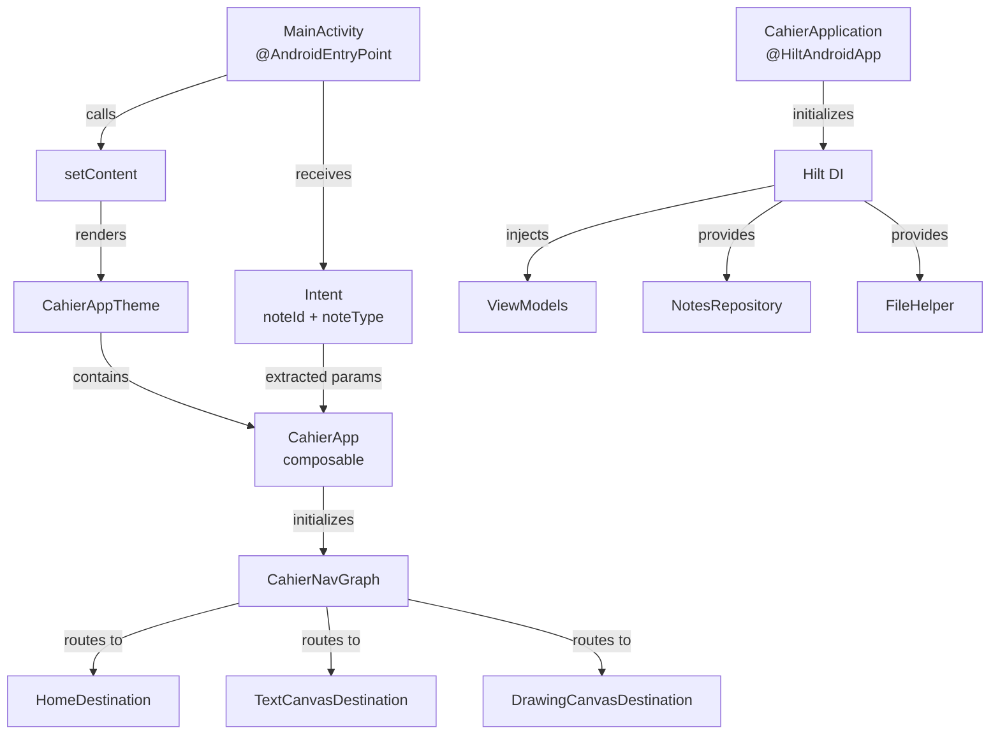
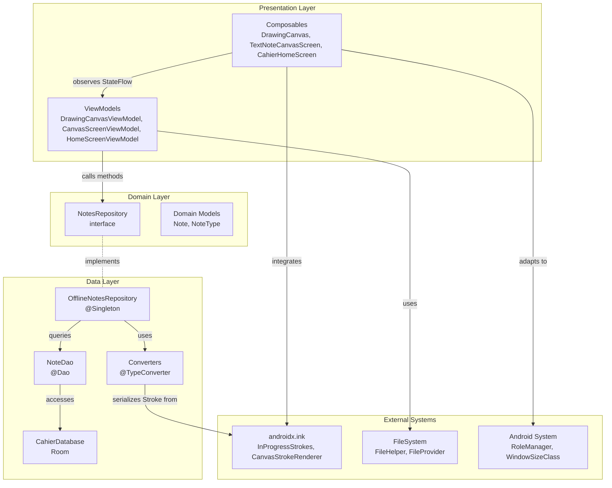
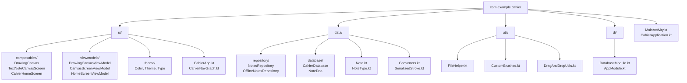
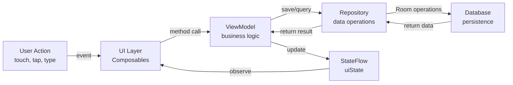

<!-- source: DeepWiki mcp.deepwiki.com · repo android/cahier · page 1 Overview · fetched 2026-10-23 -->

# Overview

<details>
<summary>Relevant source files</summary>

The following files were used as context for generating this wiki page:

- [app/build.gradle.kts](app/build.gradle.kts)
- [app/src/main/AndroidManifest.xml](app/src/main/AndroidManifest.xml)
- [app/src/main/java/com/example/cahier/MainActivity.kt](app/src/main/java/com/example/cahier/MainActivity.kt)
- [app/src/main/java/com/example/cahier/ui/viewmodels/SettingsViewModel.kt](app/src/main/java/com/example/cahier/ui/viewmodels/SettingsViewModel.kt)
- [gradle/libs.versions.toml](gradle/libs.versions.toml)

</details>


This page provides a high-level introduction to the Cahier note-taking application, including its purpose, core features, architectural approach, and technology stack. For detailed information about specific subsystems, see the Architecture ([#2](#2)), Core Features ([#3](#3)), and Data Layer ([#4](#4)) sections.

## Application Purpose

Cahier is an Android note-taking application that specializes in digital ink and drawing capabilities. The application provides two primary note-taking modalities:

1. **Drawing Notes** - Canvas-based notes with advanced ink rendering using the androidx.ink library, supporting custom brushes, colors, sizes, and undo/redo functionality
2. **Text Notes** - Traditional text-based notes with title/body fields and image attachment support

The application is designed as a reference implementation demonstrating best practices for digital ink integration on Android, adaptive UI layouts, and modern Android architecture patterns.

**Sources:** [app/src/main/AndroidManifest.xml:1-63](), [app/src/main/java/com/example/cahier/MainActivity.kt:1-63]()

## Core Features Summary

| Feature | Description | Key Components |
|---------|-------------|----------------|
| Drawing Canvas | High-performance ink rendering with brush customization | `DrawingCanvas`, `DrawingSurface`, `InProgressStrokes` |
| Text Notes | Title/body text editing with image attachments | `TextNoteCanvasScreen`, `CanvasScreenViewModel` |
| Note Management | List/detail view with favorites, deletion, and search | `HomeScreenViewModel`, `CahierHomeScreen` |
| Adaptive Layouts | Responsive UI for phones and tablets | `WindowSizeClass`, `ListDetailPaneScaffold` |
| Custom Brushes | Compressed brush assets loaded from resources | `CustomBrushes` singleton |
| Stroke Persistence | JSON-based serialization of drawing data | `Converters`, `SerializedStroke` |
| Image Management | URI-based image handling with FileProvider | `FileHelper` |
| Multi-Window Support | Multiple note windows via Intent extras | `newWindowEvent` channel |
| Default Notes App | Android ROLE_NOTES integration (API 34+) | `SettingsViewModel`, `RoleManager` |

**Sources:** [app/build.gradle.kts:65-151](), [gradle/libs.versions.toml:1-102]()

## Application Entry Point

The application follows standard Android architecture with a single activity hosting Compose UI:



**Application Initialization Flow:**

1. `CahierApplication` class initializes Hilt dependency injection at app launch [app/src/main/AndroidManifest.xml:21]()
2. `MainActivity` is annotated with `@AndroidEntryPoint` for dependency injection [app/src/main/java/com/example/cahier/MainActivity.kt:35]()
3. Intent data extracts `noteId` and `noteType` parameters for deep linking [app/src/main/java/com/example/cahier/MainActivity.kt:41-50]()
4. `CahierApp` composable initializes the navigation graph and routing [app/src/main/java/com/example/cahier/MainActivity.kt:58]()

**Sources:** [app/src/main/java/com/example/cahier/MainActivity.kt:35-62](), [app/src/main/AndroidManifest.xml:20-30]()

## Architecture Overview

Cahier implements a three-tier MVVM architecture with clear separation of concerns:



**Architectural Patterns:**

| Pattern | Implementation | Purpose |
|---------|----------------|---------|
| MVVM | `ViewModel` classes with `StateFlow` properties | Separate UI state from business logic |
| Repository Pattern | `NotesRepository` interface with `OfflineNotesRepository` | Abstract data source implementation |
| Dependency Injection | Hilt/Dagger with `@HiltViewModel`, `@Inject` | Provide testable dependencies |
| Unidirectional Data Flow | UI observes StateFlow, events flow to ViewModel | Predictable state management |
| Single Activity | One `MainActivity` with Compose Navigation | Simplified navigation and lifecycle |

**Sources:** [app/build.gradle.kts:16-23](), [gradle/libs.versions.toml:7-8]()

## Technology Stack

### Core Framework
```
Platform: Android (minSdk 26, targetSdk 36)
UI: Jetpack Compose (BOM 2025.09.01)
Language: Kotlin 2.2.20
Build: Gradle with KSP
```

### Key Dependencies

| Library | Version | Purpose |
|---------|---------|---------|
| androidx.ink | 1.0.0-beta01 | Digital ink rendering and stroke management |
| androidx.room | 2.8.1 | Local database persistence |
| Hilt | 2.57.1 | Dependency injection |
| Coil3 | 3.3.0 | Image loading |
| Gson | 2.13.2 | JSON serialization |
| androidx.navigation | 2.9.5 | Compose navigation |
| androidx.adaptive | 1.1.0 | Responsive layouts |
| androidx.input-motionprediction | 1.0.0-beta06 | Touch prediction for ink rendering |

**Ink Library Components:**
- `ink-authoring` - Stroke capture and input handling
- `ink-rendering` - High-performance stroke rendering
- `ink-strokes` - Stroke data structures
- `ink-brush` - Brush definitions and management
- `ink-geometry` - Geometric primitives
- `ink-storage` - Stroke serialization

**Sources:** [gradle/libs.versions.toml:1-102](), [app/build.gradle.kts:65-151]()

## Project Structure



**Package Organization:**

- **`ui/`** - Presentation layer with Composables, ViewModels, and navigation
- **`data/`** - Data layer with repository, database, and domain models
- **`util/`** - Utility classes for file management, brushes, and drag-and-drop
- **`di/`** - Hilt modules for dependency injection configuration

**Sources:** [app/src/main/java/com/example/cahier/MainActivity.kt:19]()

## System Integration Points

Cahier integrates with several Android system features:

**Intent Handling:**
- Responds to `ACTION_CREATE_NOTE` intent for system-wide note creation [app/src/main/AndroidManifest.xml:46]()
- Supports deep linking with `noteId` and `noteType` parameters [app/src/main/java/com/example/cahier/MainActivity.kt:41-50]()

**Multi-Window Support:**
- Declares `resizeableActivity="true"` [app/src/main/AndroidManifest.xml:38]()
- Supports `PROPERTY_SUPPORTS_MULTI_INSTANCE_SYSTEM_UI` [app/src/main/AndroidManifest.xml:42]()
- Uses `launchMode="singleInstancePerTask"` for proper window management [app/src/main/AndroidManifest.xml:39]()

**File Sharing:**
- Configures `FileProvider` with custom authority [app/src/main/AndroidManifest.xml:54-62]()
- Enables secure URI sharing for images and exported drawings

**Default Notes App (API 34+):**
- Integrates with `RoleManager.ROLE_NOTES` system role [app/src/main/java/com/example/cahier/ui/viewmodels/SettingsViewModel.kt:64-67]()
- Allows user to set Cahier as default notes app via `SettingsViewModel`

**Sources:** [app/src/main/AndroidManifest.xml:31-63](), [app/src/main/java/com/example/cahier/ui/viewmodels/SettingsViewModel.kt:39-127]()

## Data Flow Overview

The application follows a unidirectional data flow pattern:



**Flow Characteristics:**
1. **User Input** → UI captures touch, keyboard, or picker events
2. **Event Handling** → UI calls ViewModel methods (e.g., `updateNoteTitle`, `onStrokesFinished`)
3. **State Update** → ViewModel updates `StateFlow` properties
4. **UI Reaction** → Composables recompose based on observed state
5. **Persistence** → ViewModel triggers repository operations for data persistence

**Sources:** [app/build.gradle.kts:75-77]()

## Build Configuration

**Gradle Setup:**
```
AGP: 8.13.0
Kotlin: 2.2.20
Compose Compiler: 2.2.20
KSP: 2.2.20-2.0.3
Target SDK: 36
Min SDK: 26
```

**Build Plugins:**
- `com.android.application` - Android application plugin [app/build.gradle.kts:17]()
- `org.jetbrains.kotlin.android` - Kotlin Android plugin [app/build.gradle.kts:18]()
- `com.google.devtools.ksp` - Kotlin Symbol Processing for Room and Hilt [app/build.gradle.kts:19]()
- `org.jetbrains.kotlin.plugin.compose` - Compose compiler plugin [app/build.gradle.kts:20]()
- `kotlin-parcelize` - Parcelable generation [app/build.gradle.kts:21]()
- `com.google.dagger.hilt.android` - Hilt dependency injection [app/build.gradle.kts:22]()

**Compiler Options:**
- Java toolchain: Version 17 [app/build.gradle.kts:153-155]()
- Vector drawable support library enabled [app/build.gradle.kts:37-39]()
- Compose build features enabled [app/build.gradle.kts:55-57]()

**Sources:** [app/build.gradle.kts:16-63](), [gradle/libs.versions.toml:1-102]()

## Testing Infrastructure

**Testing Strategy:**

| Test Type | Framework | Purpose |
|-----------|-----------|---------|
| Unit Tests | JUnit 4, Mockito, Turbine | ViewModel logic and Flow testing |
| Instrumented Tests | AndroidX Test, Espresso, Hilt Testing | UI and database integration |

**Key Testing Libraries:**
- **Turbine 1.2.1** - Flow testing with clean assertion APIs [gradle/libs.versions.toml:37]()
- **Mockito 5.20.0** - Mock object creation for unit tests [gradle/libs.versions.toml:33]()
- **Hilt Testing** - Dependency injection in tests [gradle/libs.versions.toml:93]()
- **AndroidX Arch Core Testing** - InstantTaskExecutorRule for LiveData/Flow [gradle/libs.versions.toml:35]()

**Test Configuration:**
- Custom `HiltTestRunner` for instrumented tests [app/build.gradle.kts:36]()
- KSP annotation processing for test dependencies [app/build.gradle.kts:115]()

**Sources:** [app/build.gradle.kts:92-116](), [gradle/libs.versions.toml:32-96]()

## Navigation Summary

The application uses type-safe Compose Navigation with three primary destinations:

1. **HomeDestination** - Note list and selection screen (route: `"home"`)
2. **TextCanvasDestination** - Text note editor (route: `"note_canvas/{id}"`)
3. **DrawingCanvasDestination** - Drawing canvas editor (route: `"drawing_canvas/{id}"`)

Navigation adapts based on `WindowSizeClass`:
- **Compact devices** (phones) - Full-screen transitions with back navigation
- **Expanded devices** (tablets) - List-detail layout with simultaneous display

For detailed navigation architecture, see [Navigation System](#2.3).

**Sources:** [app/build.gradle.kts:77-78]()

---

