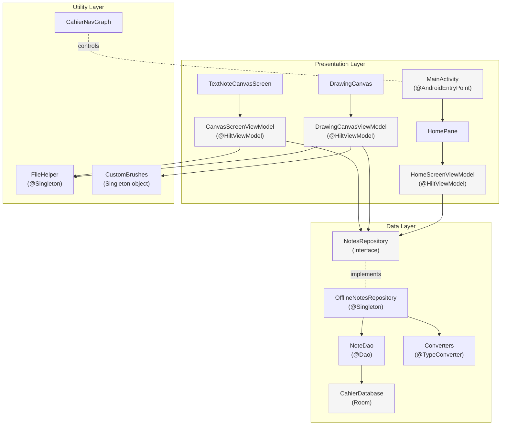
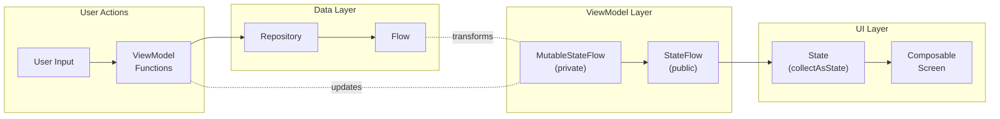
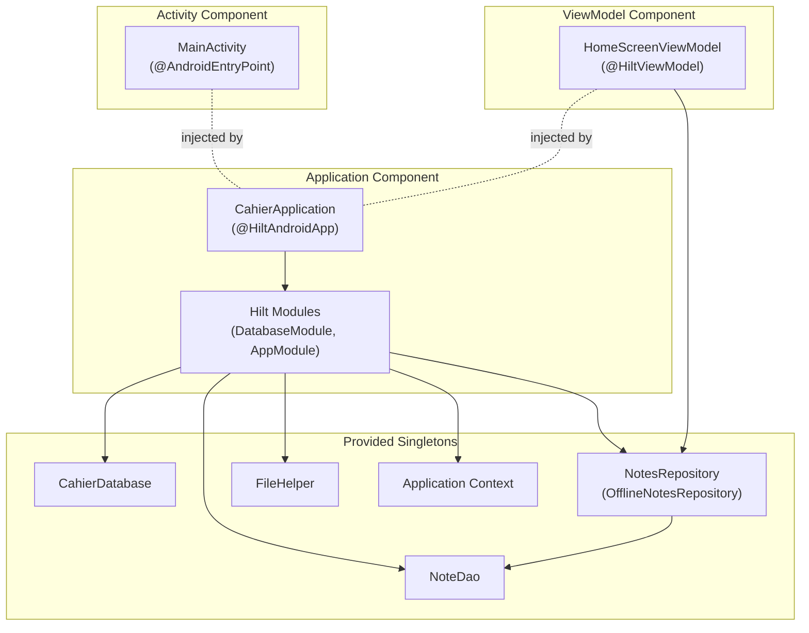
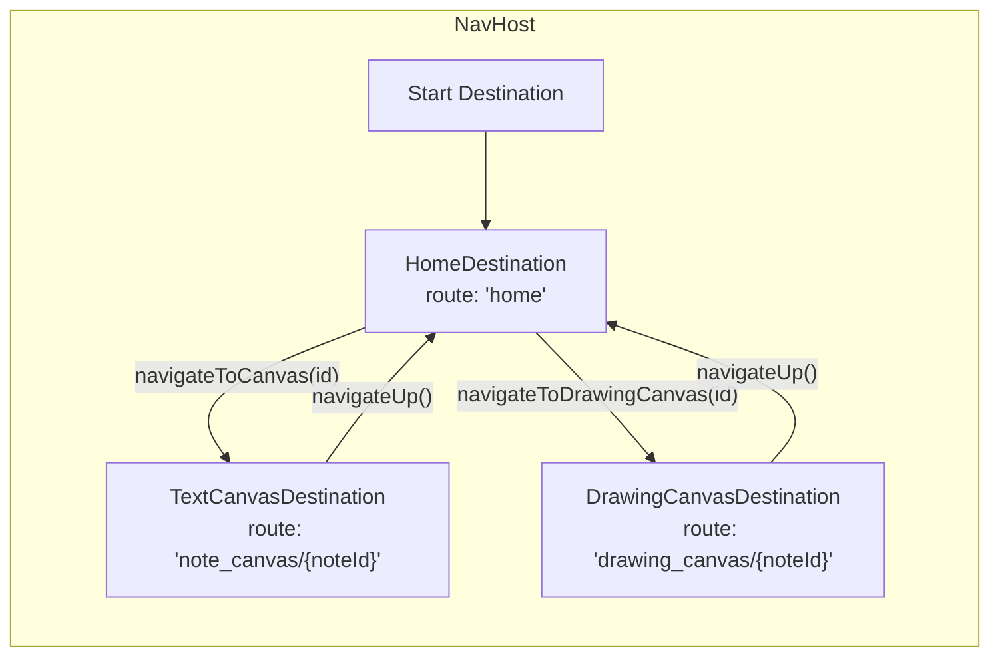
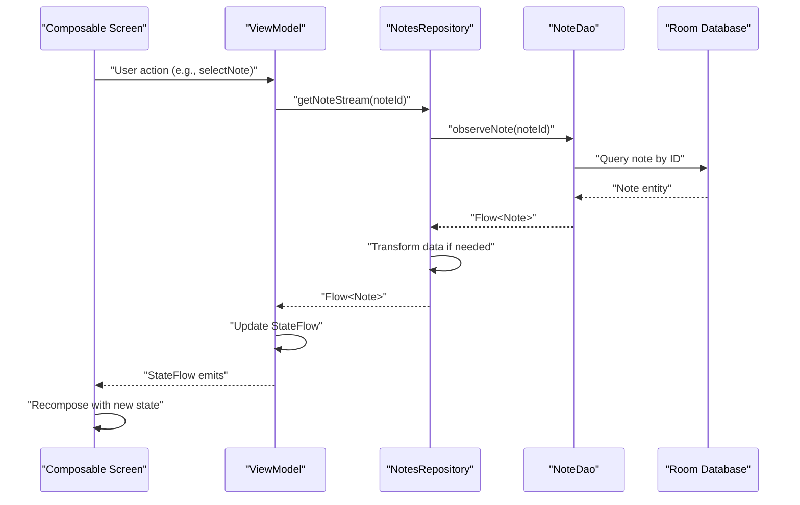

<!-- source: DeepWiki mcp.deepwiki.com · repo android/cahier · page 2 Architecture · fetched 2026-10-23 -->

# Architecture

<details>
<summary>Relevant source files</summary>

The following files were used as context for generating this wiki page:

- [app/build.gradle.kts](app/build.gradle.kts)
- [app/src/androidTest/java/com/example/cahier/utils/FileHelperTest.kt](app/src/androidTest/java/com/example/cahier/utils/FileHelperTest.kt)
- [app/src/main/java/com/example/cahier/MainActivity.kt](app/src/main/java/com/example/cahier/MainActivity.kt)
- [app/src/main/java/com/example/cahier/navigation/CahierNavGraph.kt](app/src/main/java/com/example/cahier/navigation/CahierNavGraph.kt)
- [app/src/main/java/com/example/cahier/ui/ColorPickerDialog.kt](app/src/main/java/com/example/cahier/ui/ColorPickerDialog.kt)
- [app/src/main/java/com/example/cahier/ui/viewmodels/HomeScreenViewModel.kt](app/src/main/java/com/example/cahier/ui/viewmodels/HomeScreenViewModel.kt)
- [app/src/test/java/com/example/cahier/ui/viewmodels/HomeScreenViewModelTest.kt](app/src/test/java/com/example/cahier/ui/viewmodels/HomeScreenViewModelTest.kt)
- [gradle/libs.versions.toml](gradle/libs.versions.toml)

</details>


## Purpose and Scope

This document provides an overview of the architectural patterns and structural organization of the Cahier application. It describes the three-tier architecture, the MVVM pattern implementation, dependency injection setup, and navigation structure. For detailed information on specific aspects of the architecture, see:
- MVVM pattern and state management details: [MVVM Pattern & State Management](#2.1)
- Hilt configuration and dependency graphs: [Dependency Injection with Hilt](#2.2)
- Navigation routes and screen transitions: [Navigation System](#2.3)

---

## Architectural Overview

Cahier follows a three-tier architecture pattern that separates concerns into distinct layers:

| Layer | Responsibilities | Key Components |
|-------|-----------------|----------------|
| **Presentation Layer** | UI rendering, user interactions, state observation | Composable screens, ViewModels, UI state classes |
| **Data Layer** | Data persistence, business logic, data transformation | Repository interfaces/implementations, Room database, DAOs |
| **Utility Layer** | Cross-cutting concerns, helper functions | FileHelper, CustomBrushes, Converters |

The architecture enforces unidirectional data flow: user actions flow from UI → ViewModel → Repository → Database, while data updates flow back through Repository → ViewModel → UI via StateFlows.

### Three-Tier Architecture Diagram



**Sources:** [app/src/main/java/com/example/cahier/MainActivity.kt:35-36](), [app/src/main/java/com/example/cahier/ui/viewmodels/HomeScreenViewModel.kt:43-46](), [app/src/main/java/com/example/cahier/navigation/CahierNavGraph.kt:37-80]()

---

## MVVM Pattern Implementation

The application implements the Model-View-ViewModel (MVVM) architectural pattern using Jetpack Compose and Kotlin coroutines.

### Components

**ViewModels** serve as the intermediary between UI and data layers. All ViewModels are annotated with `@HiltViewModel` for dependency injection:

- `HomeScreenViewModel` - Manages note list state and note selection [app/src/main/java/com/example/cahier/ui/viewmodels/HomeScreenViewModel.kt:43-46]()
- `DrawingCanvasViewModel` - Manages drawing strokes, brush state, and history (not shown in provided files, but referenced in diagrams)
- `CanvasScreenViewModel` - Manages text note content and images (not shown in provided files, but referenced in diagrams)

**State Management** uses Kotlin StateFlows for reactive UI updates. ViewModels expose immutable `StateFlow<T>` instances to UI components:

```kotlin
// Example from HomeScreenViewModel
private val _uiState = MutableStateFlow(CahierUiState())
val uiState: StateFlow<CahierUiState> = _uiState.asStateFlow()
```

**Views** are implemented as Composable functions that observe ViewModel state using `collectAsState()` or `collectAsStateWithLifecycle()`.

### State Flow Pattern



**Sources:** [app/src/main/java/com/example/cahier/ui/viewmodels/HomeScreenViewModel.kt:48-49](), [app/src/main/java/com/example/cahier/ui/viewmodels/HomeScreenViewModel.kt:59-65]()

---

## Dependency Injection with Hilt

The application uses Hilt (built on Dagger) for compile-time dependency injection. This enables:
- Constructor injection for ViewModels and repositories
- Singleton lifecycle management
- Testability through interface abstractions

### Hilt Configuration

The dependency injection graph is established through annotations:

| Annotation | Applied To | Purpose |
|------------|-----------|---------|
| `@HiltAndroidApp` | `CahierApplication` | Triggers Hilt code generation, initializes DI container |
| `@AndroidEntryPoint` | `MainActivity` | Enables injection into Android components |
| `@HiltViewModel` | ViewModel classes | Enables ViewModel injection via ViewModelProvider |
| `@InstallIn(SingletonComponent::class)` | Module classes | Specifies component scope for provided dependencies |

### Dependency Graph Example



The `@Inject` constructor annotation declares dependencies:

[app/src/main/java/com/example/cahier/ui/viewmodels/HomeScreenViewModel.kt:44-46]()
```kotlin
@HiltViewModel
class HomeScreenViewModel @Inject constructor(
    private val noteRepository: NotesRepository
) : ViewModel()
```

**Sources:** [app/src/main/java/com/example/cahier/MainActivity.kt:35-36](), [app/src/main/java/com/example/cahier/ui/viewmodels/HomeScreenViewModel.kt:43-46](), [app/build.gradle.kts:22](), [gradle/libs.versions.toml:7](), [gradle/libs.versions.toml:58-59]()

For detailed Hilt module configuration and testing setup, see [Dependency Injection with Hilt](#2.2).

---

## Navigation Structure

Navigation is implemented using Jetpack Navigation Compose with type-safe route definitions.

### Navigation Destinations

The application defines three navigation destinations in [app/src/main/java/com/example/cahier/navigation/CahierNavGraph.kt:30-93]():

| Destination | Route | Arguments | Screen |
|-------------|-------|-----------|--------|
| `HomeDestination` | `"home"` | None | `HomePane` (note list/detail) |
| `TextCanvasDestination` | `"note_canvas/{noteId}"` | `noteId: Long` | `TextNoteCanvasScreen` |
| `DrawingCanvasDestination` | `"drawing_canvas/{noteId}"` | `noteId: Long` | `DrawingCanvas` |

### Navigation Graph Structure



### Navigation Implementation

The `CahierNavHost` composable defines the navigation graph:

[app/src/main/java/com/example/cahier/navigation/CahierNavGraph.kt:41-45]()
```kotlin
NavHost(
    navController = navController,
    startDestination = HomeDestination.route,
    modifier = modifier
)
```

Navigation arguments are extracted using `SavedStateHandle` in ViewModels (pattern not shown in provided files but referenced in architecture diagrams).

**Sources:** [app/src/main/java/com/example/cahier/navigation/CahierNavGraph.kt:37-93](), [app/src/main/java/com/example/cahier/MainActivity.kt:41-50]()

For details on navigation implementation and argument passing, see [Navigation System](#2.3).

---

## Key Architectural Components

### Entry Point: MainActivity

`MainActivity` serves as the application entry point and Hilt injection point:

[app/src/main/java/com/example/cahier/MainActivity.kt:35-39]()
```kotlin
@AndroidEntryPoint
class MainActivity : ComponentActivity() {
    override fun onCreate(savedInstanceState: Bundle?) {
        super.onCreate(savedInstanceState)
        enableEdgeToEdge()
```

The activity:
1. Extracts Intent extras for multi-window support (`noteId`, `noteType`)
2. Initializes the Compose UI with `CahierApp`
3. Applies Material Design 3 theming via `CahierAppTheme`

### Repository Pattern

The data layer uses the repository pattern to abstract data sources:

- **Interface:** `NotesRepository` defines data operations (not in provided files)
- **Implementation:** `OfflineNotesRepository` implements Room database access (not in provided files)
- **DAO:** `NoteDao` provides Room query methods (not in provided files)

ViewModels depend only on the `NotesRepository` interface, enabling test doubles:

[app/src/main/java/com/example/cahier/ui/viewmodels/HomeScreenViewModel.kt:44-46]()

### Component Interaction Flow



**Sources:** [app/src/main/java/com/example/cahier/ui/viewmodels/HomeScreenViewModel.kt:67-89]()

---

## Technology Stack

The architecture leverages the following key libraries and frameworks:

### Core Framework Dependencies

| Library | Version | Purpose |
|---------|---------|---------|
| Jetpack Compose | BOM 2025.09.01 | Declarative UI framework |
| Kotlin | 2.2.20 | Primary programming language |
| Coroutines | (via Kotlin stdlib) | Asynchronous programming |

### Architecture Components

| Library | Version | Purpose |
|---------|---------|---------|
| Hilt | 2.57.1 | Dependency injection |
| Navigation Compose | 2.9.5 | Type-safe navigation |
| Lifecycle ViewModel Compose | 2.9.4 | ViewModel integration |
| Room | 2.8.1 | SQLite abstraction |

### Drawing System

| Library | Version | Purpose |
|---------|---------|---------|
| androidx.ink.* | 1.0.0-beta01 | Ink rendering and stroke management |
| Input Motion Prediction | 1.0.0-beta06 | Stylus input prediction |

### Supporting Libraries

| Library | Version | Purpose |
|---------|---------|---------|
| Coil | 3.3.0 | Image loading |
| Gson | 2.13.2 | JSON serialization |
| Material3 Adaptive | 1.4.0 | Responsive layouts |

**Sources:** [gradle/libs.versions.toml:1-97](), [app/build.gradle.kts:65-151]()

---

## Testing Architecture

The architecture supports two testing strategies:

### Unit Testing
- Uses `FakeNotesRepository` implementation for isolated ViewModel tests
- Turbine library for testing Kotlin Flows
- Mockito for mocking dependencies
- Example: [app/src/test/java/com/example/cahier/ui/viewmodels/HomeScreenViewModelTest.kt:45-136]()

### Instrumented Testing
- Uses `HiltTestRunner` for dependency injection in Android tests
- Enables replacement of production modules with test doubles
- Tests real Room database interactions
- Example: [app/src/androidTest/java/com/example/cahier/utils/FileHelperTest.kt:47-108]()

**Test Configuration:**

[app/build.gradle.kts:36]()
```kotlin
testInstrumentationRunner = "com.example.cahier.HiltTestRunner"
```

[app/build.gradle.kts:113-115]()
```kotlin
// Hilt Testing
androidTestImplementation(libs.hilt.android.testing)
kspAndroidTest(libs.hilt.android.compiler)
```

**Sources:** [app/build.gradle.kts:36](), [app/build.gradle.kts:92-115](), [gradle/libs.versions.toml:88-96]()

---

## Build Configuration

The application uses Kotlin DSL for Gradle configuration with the following plugins:

[app/build.gradle.kts:16-23]()
```kotlin
plugins {
    alias(libs.plugins.androidApplication)
    alias(libs.plugins.jetbrainsKotlinAndroid)
    alias(libs.plugins.ksp)
    id("org.jetbrains.kotlin.plugin.compose") version "2.2.20"
    id("kotlin-parcelize")
    id("com.google.dagger.hilt.android")
}
```

| Plugin | Purpose |
|--------|---------|
| Android Application | Android app build configuration |
| Kotlin Android | Kotlin compilation for Android |
| KSP | Kotlin Symbol Processing (Room, Hilt) |
| Compose Compiler | Jetpack Compose compilation |
| Parcelize | Parcelable code generation |
| Hilt Android | Hilt dependency injection |

**Minimum SDK:** 26 (Android 8.0)  
**Target/Compile SDK:** 36  
**Java Compatibility:** Java 17

**Sources:** [app/build.gradle.kts:16-63](), [gradle/libs.versions.toml:98-102]()

---

