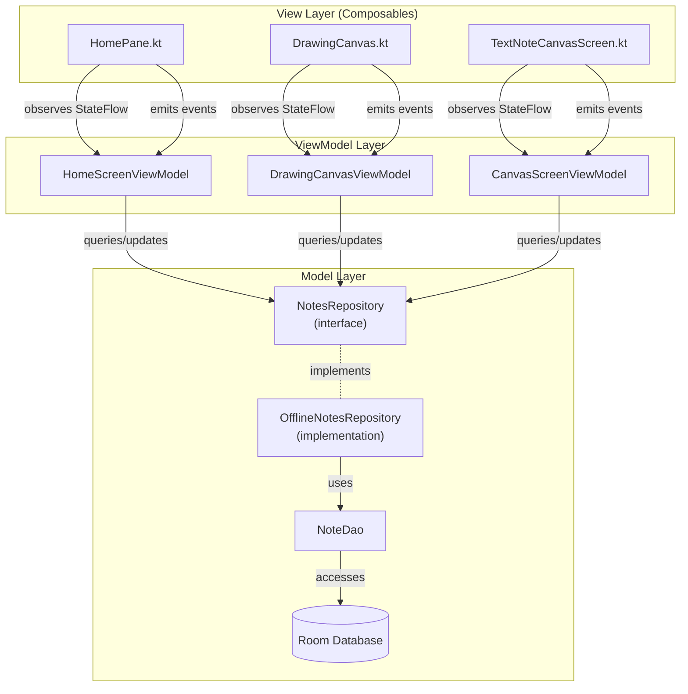
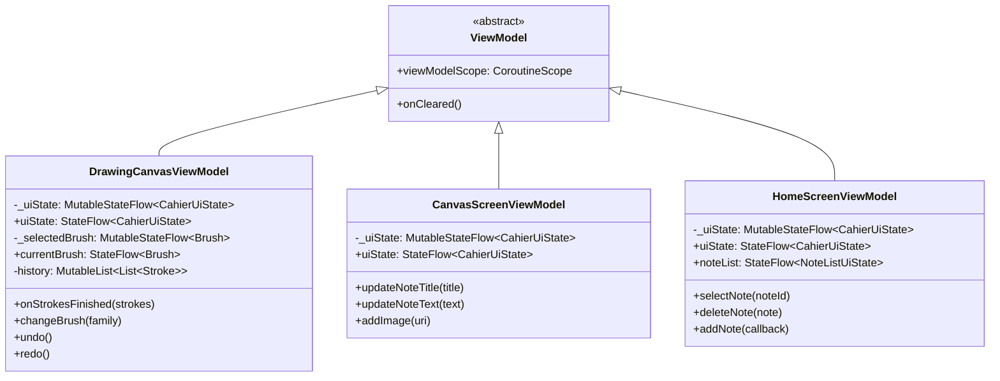
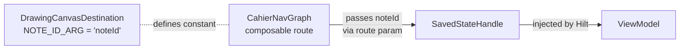
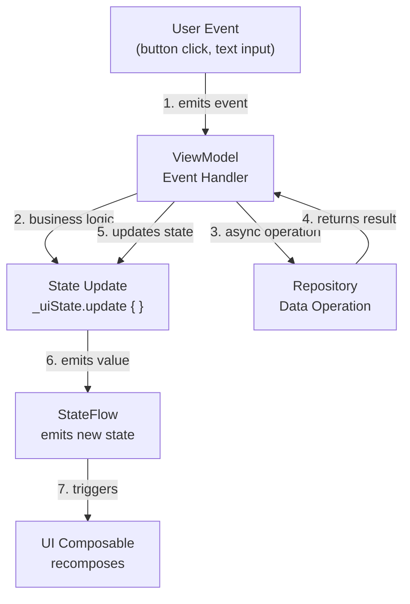
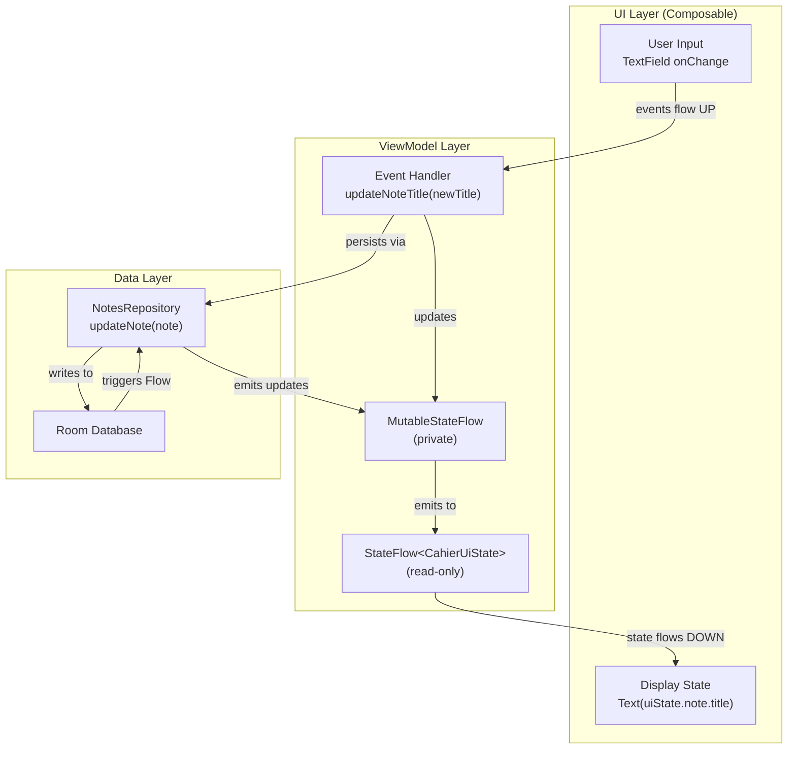
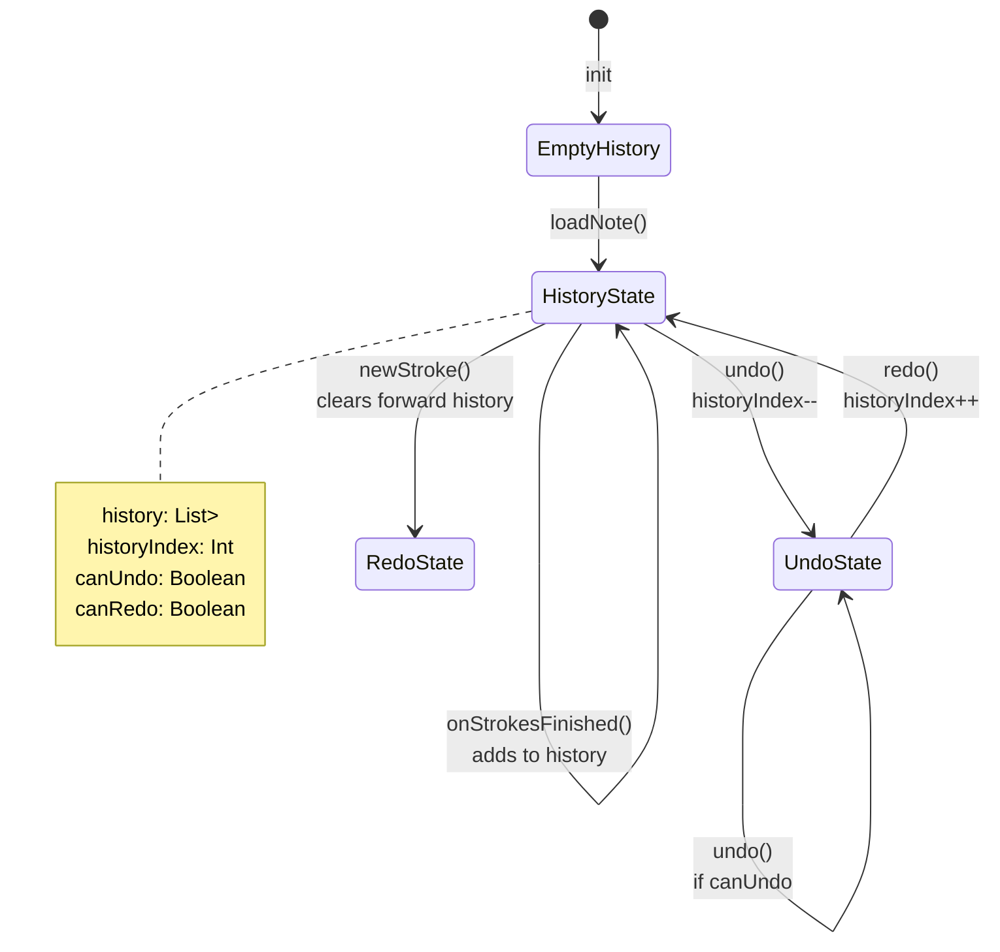
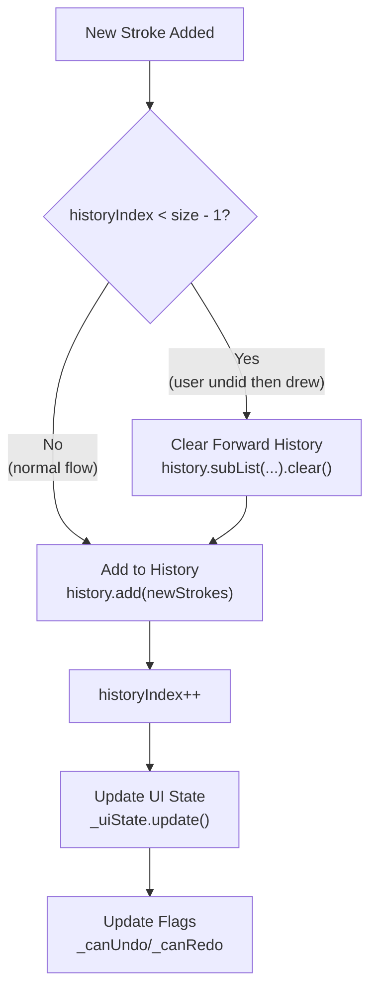

<!-- source: DeepWiki mcp.deepwiki.com · repo android/cahier · page 2.1 MVVM Pattern & State Management · fetched 2026-10-23 -->

# MVVM Pattern & State Management

<details>
<summary>Relevant source files</summary>

The following files were used as context for generating this wiki page:

- [app/src/androidTest/java/com/example/cahier/utils/FileHelperTest.kt](app/src/androidTest/java/com/example/cahier/utils/FileHelperTest.kt)
- [app/src/main/java/com/example/cahier/navigation/CahierNavGraph.kt](app/src/main/java/com/example/cahier/navigation/CahierNavGraph.kt)
- [app/src/main/java/com/example/cahier/ui/ColorPickerDialog.kt](app/src/main/java/com/example/cahier/ui/ColorPickerDialog.kt)
- [app/src/main/java/com/example/cahier/ui/viewmodels/CanvasScreenViewModel.kt](app/src/main/java/com/example/cahier/ui/viewmodels/CanvasScreenViewModel.kt)
- [app/src/main/java/com/example/cahier/ui/viewmodels/DrawingCanvasViewModel.kt](app/src/main/java/com/example/cahier/ui/viewmodels/DrawingCanvasViewModel.kt)
- [app/src/main/java/com/example/cahier/ui/viewmodels/HomeScreenViewModel.kt](app/src/main/java/com/example/cahier/ui/viewmodels/HomeScreenViewModel.kt)
- [app/src/test/java/com/example/cahier/ui/viewmodels/HomeScreenViewModelTest.kt](app/src/test/java/com/example/cahier/ui/viewmodels/HomeScreenViewModelTest.kt)

</details>


## Purpose and Scope

This document explains how the Cahier application implements the Model-View-ViewModel (MVVM) architectural pattern and manages application state through reactive data flows. It covers the structure of ViewModels, the use of `StateFlow` for state management, and the unidirectional data flow pattern that ensures predictable state updates.

For information about dependency injection into ViewModels, see [Dependency Injection with Hilt](#2.2). For navigation setup and routing, see [Navigation System](#2.3). For repository patterns and data persistence, see [Repository Pattern & NotesRepository](#4.1).

---

## MVVM Architecture Overview

Cahier implements a strict three-layer MVVM architecture where each layer has distinct responsibilities:

- **View Layer**: Composable UI functions that observe state and emit user events
- **ViewModel Layer**: Business logic controllers that manage UI state and coordinate data operations
- **Model Layer**: Repository abstractions and data sources (Room database, file system)

**MVVM Layers and Communication Flow**



**Sources:** [app/src/main/java/com/example/cahier/ui/viewmodels/HomeScreenViewModel.kt](), [app/src/main/java/com/example/cahier/ui/viewmodels/DrawingCanvasViewModel.kt](), [app/src/main/java/com/example/cahier/ui/viewmodels/CanvasScreenViewModel.kt]()

---

## ViewModel Layer Structure

### Core ViewModels

The application contains three primary ViewModels, each managing state for a specific screen:

| ViewModel | Screen | Primary Responsibility | State Complexity |
|-----------|--------|------------------------|------------------|
| `HomeScreenViewModel` | Home screen with note list | Note list management, note selection, note creation/deletion | Low - Simple note list |
| `DrawingCanvasViewModel` | Drawing canvas | Stroke rendering, brush management, undo/redo history, image handling | High - Complex drawing state |
| `CanvasScreenViewModel` | Text note canvas | Text editing, title updates, image attachments | Medium - Text and images |

### ViewModel Base Structure

All ViewModels follow a consistent structure using Hilt for dependency injection:

**ViewModel Declaration Pattern**



**Sources:** [app/src/main/java/com/example/cahier/ui/viewmodels/DrawingCanvasViewModel.kt:66-73](), [app/src/main/java/com/example/cahier/ui/viewmodels/CanvasScreenViewModel.kt:43-48](), [app/src/main/java/com/example/cahier/ui/viewmodels/HomeScreenViewModel.kt:43-46]()

### Dependency Injection

All ViewModels use the `@HiltViewModel` annotation and constructor injection:

```kotlin
@HiltViewModel
class DrawingCanvasViewModel @Inject constructor(
    @ApplicationContext private val context: Context,
    savedStateHandle: SavedStateHandle,
    private val noteRepository: NotesRepository,
    val fileHelper: FileHelper,
    private val imageLoader: ImageLoader
) : ViewModel()
```

**Common Dependencies:**

- `NotesRepository`: Data access for note CRUD operations
- `SavedStateHandle`: Access to navigation arguments (noteId)
- `FileHelper`: File operations for images
- `Context`: System services (DrawingCanvasViewModel only)
- `ImageLoader`: Coil image loading (DrawingCanvasViewModel only)

**Sources:** [app/src/main/java/com/example/cahier/ui/viewmodels/DrawingCanvasViewModel.kt:66-73](), [app/src/main/java/com/example/cahier/ui/viewmodels/CanvasScreenViewModel.kt:43-48]()

### Navigation Arguments via SavedStateHandle

ViewModels receive navigation arguments through `SavedStateHandle`, which provides type-safe access to route parameters:

**Navigation Argument Pattern**



Example from DrawingCanvasViewModel:

```kotlin
private val noteId: Long = savedStateHandle[DrawingCanvasDestination.NOTE_ID_ARG] ?: 0L
```

**Sources:** [app/src/main/java/com/example/cahier/ui/viewmodels/DrawingCanvasViewModel.kt:78](), [app/src/main/java/com/example/cahier/ui/viewmodels/CanvasScreenViewModel.kt:52](), [app/src/main/java/com/example/cahier/navigation/CahierNavGraph.kt:82-93]()

---

## State Management with StateFlow

### Immutable State Pattern

The application uses `StateFlow` for reactive state management, following an immutable state pattern where state is never modified directly:

**StateFlow Declaration Pattern**

```kotlin
// Private mutable state - only ViewModel can write
private val _uiState = MutableStateFlow(CahierUiState())

// Public immutable state - UI can only read
val uiState: StateFlow<CahierUiState> = _uiState.asStateFlow()
```

This pattern ensures:
- **Single source of truth**: Only the ViewModel can modify state
- **Predictable updates**: UI receives state changes through reactive streams
- **Thread safety**: StateFlow handles synchronization automatically

**Sources:** [app/src/main/java/com/example/cahier/ui/viewmodels/DrawingCanvasViewModel.kt:75-76](), [app/src/main/java/com/example/cahier/ui/viewmodels/CanvasScreenViewModel.kt:49-50](), [app/src/main/java/com/example/cahier/ui/viewmodels/HomeScreenViewModel.kt:48-49]()

### State Update Mechanisms

**State Flow Update Patterns**



**Update Pattern 1: Immediate State Update**

Used for UI-only changes that don't require persistence:

```kotlin
// Example from DrawingCanvasViewModel
fun setEraserMode(enabled: Boolean) {
    _isEraserMode.update { enabled }
}
```

**Update Pattern 2: State Update with Repository Sync**

Used for changes that must be persisted:

```kotlin
// Example from CanvasScreenViewModel
fun updateNoteTitle(title: String) {
    updateNoteField(title) { note, value -> note.copy(title = value) }
}

private fun <T> updateNoteField(value: T, updater: (Note, T) -> Note) {
    _uiState.value = _uiState.value.copy(
        note = updater(_uiState.value.note, value)
    )
    viewModelScope.launch {
        if (noteId != null)
            noteRepository.updateNote(_uiState.value.note)
    }
}
```

**Update Pattern 3: State Update with History**

Used in DrawingCanvasViewModel for undo/redo support:

```kotlin
private fun updateStrokes(newStrokes: List<Stroke>) {
    // Clear forward history if user makes new change
    if (historyIndex < history.size - 1) {
        history.subList(historyIndex + 1, history.size).clear()
    }
    history.add(newStrokes)
    historyIndex++
    
    _uiState.update { it.copy(strokes = newStrokes) }
    updateUndoRedoState()
}
```

**Sources:** [app/src/main/java/com/example/cahier/ui/viewmodels/DrawingCanvasViewModel.kt:168-177](), [app/src/main/java/com/example/cahier/ui/viewmodels/CanvasScreenViewModel.kt:74-94](), [app/src/main/java/com/example/cahier/ui/viewmodels/DrawingCanvasViewModel.kt:404-406]()

### State Observation in UI

Composables observe StateFlow using `collectAsState()`:

```kotlin
@Composable
fun DrawingCanvas() {
    val viewModel: DrawingCanvasViewModel = hiltViewModel()
    val uiState by viewModel.uiState.collectAsState()
    val currentBrush by viewModel.currentBrush.collectAsState()
    
    // UI recomposes when state changes
    DrawingSurface(
        strokes = uiState.strokes,
        currentBrush = currentBrush
    )
}
```

**Sources:** Based on common Compose patterns used throughout UI layer

---

## Unidirectional Data Flow

The application enforces unidirectional data flow: events flow up, state flows down.

**Unidirectional Data Flow Architecture**



**Key Principles:**

1. **Events Flow Up**: UI components emit events (function calls) to ViewModels
2. **State Flows Down**: ViewModels emit state (StateFlow) to UI components
3. **No Direct State Mutation**: UI never modifies state directly
4. **Single Source of Truth**: ViewModel owns the state

**Example Flow: Title Update in Text Note**

1. User types in TextField → `onChange` callback invoked
2. UI calls `viewModel.updateNoteTitle(newTitle)`
3. ViewModel updates internal `_uiState` with new title
4. ViewModel launches coroutine to persist via `noteRepository.updateNote()`
5. Repository updates database
6. StateFlow emits new state to UI
7. UI recomposes with updated title

**Sources:** [app/src/main/java/com/example/cahier/ui/viewmodels/CanvasScreenViewModel.kt:74-94]()

---

## Complex State Management: Drawing History System

The `DrawingCanvasViewModel` demonstrates sophisticated state management with undo/redo functionality, illustrating how complex state transitions are handled.

**Drawing History State Management**



### History State Structure

The history system maintains multiple StateFlows for coordinated state:

```kotlin
// History data structures
private val history = mutableListOf<List<Stroke>>()
private var historyIndex = -1

// Undo/redo capability state
private val _canUndo = MutableStateFlow(false)
val canUndo: StateFlow<Boolean> = _canUndo.asStateFlow()

private val _canRedo = MutableStateFlow(false)
val canRedo: StateFlow<Boolean> = _canRedo.asStateFlow()
```

**Sources:** [app/src/main/java/com/example/cahier/ui/viewmodels/DrawingCanvasViewModel.kt:101-106]()

### History Update Logic

**Undo/Redo State Machine**



Implementation:

```kotlin
private fun updateStrokes(newStrokes: List<Stroke>) {
    if (historyIndex < history.size - 1) {
        history.subList(historyIndex + 1, history.size).clear()
    }
    history.add(newStrokes)
    historyIndex++
    
    _uiState.update { it.copy(strokes = newStrokes) }
    updateUndoRedoState()
}

private fun updateUndoRedoState() {
    _canUndo.value = historyIndex > 0
    _canRedo.value = historyIndex < history.size - 1
}
```

**Sources:** [app/src/main/java/com/example/cahier/ui/viewmodels/DrawingCanvasViewModel.kt:168-182]()

### Undo/Redo Operations

Undo and redo operations navigate the history list and update all related state:

```kotlin
fun undo() {
    if (canUndo.value) {
        historyIndex--
        _uiState.update { it.copy(strokes = history[historyIndex]) }
        updateUndoRedoState()
        viewModelScope.launch { saveStrokes() }
    }
}

fun redo() {
    if (canRedo.value) {
        historyIndex++
        _uiState.update { it.copy(strokes = history[historyIndex]) }
        updateUndoRedoState()
        viewModelScope.launch { saveStrokes() }
    }
}
```

This demonstrates key state management principles:
- **Multiple coordinated StateFlows**: `uiState`, `canUndo`, `canRedo` all update together
- **Async persistence**: State updates happen immediately for UI responsiveness, persistence happens asynchronously
- **Guard conditions**: Operations check state flags before executing

**Sources:** [app/src/main/java/com/example/cahier/ui/viewmodels/DrawingCanvasViewModel.kt:184-200]()

---

## Lifecycle Management

### ViewModel Lifecycle Hooks

ViewModels use lifecycle callbacks to handle cleanup and final persistence:

```kotlin
override fun onCleared() {
    super.onCleared()
    viewModelScope.launch {
        saveStrokes()
    }
}
```

This ensures drawing data is saved when:
- User navigates away
- Configuration change occurs
- Process is terminated

**Sources:** [app/src/main/java/com/example/cahier/ui/viewmodels/DrawingCanvasViewModel.kt:448-453]()

### ViewModelScope for Coroutines

All async operations use `viewModelScope`, which automatically cancels coroutines when the ViewModel is cleared:

```kotlin
fun toggleFavorite() {
    viewModelScope.launch {
        noteRepository.toggleFavorite(noteId)
    }
}
```

**Benefits:**
- Automatic cancellation prevents memory leaks
- Structured concurrency ensures operations complete or cancel cleanly
- No manual coroutine management required

**Sources:** [app/src/main/java/com/example/cahier/ui/viewmodels/DrawingCanvasViewModel.kt:202-206](), [app/src/main/java/com/example/cahier/ui/viewmodels/CanvasScreenViewModel.kt:124-128]()

---

## State Initialization Patterns

### Stream-Based Initialization

ViewModels initialize state by collecting from repository streams:

```kotlin
init {
    viewModelScope.launch {
        noteRepository.getNoteStream(noteId)
            .filterNotNull()
            .collect { note ->
                val initialStrokes = if (note.strokesData != null) {
                    noteRepository.getNoteStrokes(note.id)
                } else {
                    emptyList()
                }
                _uiState.update {
                    it.copy(note = note, strokes = initialStrokes)
                }
            }
    }
}
```

**Pattern Benefits:**
- Reactive updates: UI automatically updates when database changes
- Null safety: `filterNotNull()` ensures valid data
- Lazy loading: Strokes only loaded if they exist

**Sources:** [app/src/main/java/com/example/cahier/ui/viewmodels/DrawingCanvasViewModel.kt:116-157](), [app/src/main/java/com/example/cahier/ui/viewmodels/CanvasScreenViewModel.kt:54-72]()

### Derived State Streams

`HomeScreenViewModel` demonstrates deriving StateFlow from repository streams:

```kotlin
val noteList: StateFlow<NoteListUiState> =
    noteRepository.getAllNotesStream().map { NoteListUiState(it) }
        .stateIn(
            scope = viewModelScope,
            started = SharingStarted.WhileSubscribed(TIMEOUT_MILLIS),
            initialValue = NoteListUiState()
        )
```

**Key Aspects:**
- **Transformation**: Maps domain models to UI state
- **Lifecycle awareness**: `WhileSubscribed` stops collection when no observers
- **Timeout**: 5-second timeout keeps stream alive during config changes
- **Initial value**: Provides immediate state for UI

**Sources:** [app/src/main/java/com/example/cahier/ui/viewmodels/HomeScreenViewModel.kt:59-65]()

---

## Testing State Management

The test suite demonstrates how StateFlow-based architecture enables straightforward testing:

**ViewModel Testing Pattern**

```kotlin
@Test
fun selectNote_updates_uiState_with_the_correct_note() = runTest {
    val noteId = runBlocking {
        notesRepository.addNote(Note(title = "Selected Note"))
    }
    
    viewModel.selectNote(noteId)
    
    viewModel.uiState.test {
        val state = awaitItem()
        assertEquals(noteId, state.note.id)
        assertEquals("Selected Note", state.note.title)
    }
}
```

**Testing Benefits:**
- **Turbine library**: Simplifies Flow testing with `test { }` syntax
- **Deterministic**: StateFlow emissions are predictable and ordered
- **Fake repositories**: Repository interface enables test doubles
- **No UI required**: ViewModels tested independently

**Sources:** [app/src/test/java/com/example/cahier/ui/viewmodels/HomeScreenViewModelTest.kt:69-88]()

---

## Summary

The Cahier application implements MVVM with strict separation of concerns:

| Layer | Responsibility | Key Classes |
|-------|----------------|-------------|
| View | Display state, emit events | `HomePane`, `DrawingCanvas`, `TextNoteCanvasScreen` |
| ViewModel | Business logic, state management | `HomeScreenViewModel`, `DrawingCanvasViewModel`, `CanvasScreenViewModel` |
| Model | Data persistence, domain logic | `NotesRepository`, `OfflineNotesRepository` |

**State Management Patterns:**
- **StateFlow**: Immutable, reactive state with single source of truth
- **Unidirectional flow**: Events up, state down
- **Coordinated updates**: Multiple StateFlows updated atomically
- **History management**: Complex state with undo/redo support
- **Lifecycle safety**: ViewModelScope ensures proper cleanup

**Sources:** All ViewModel files and test files referenced throughout this document

---

