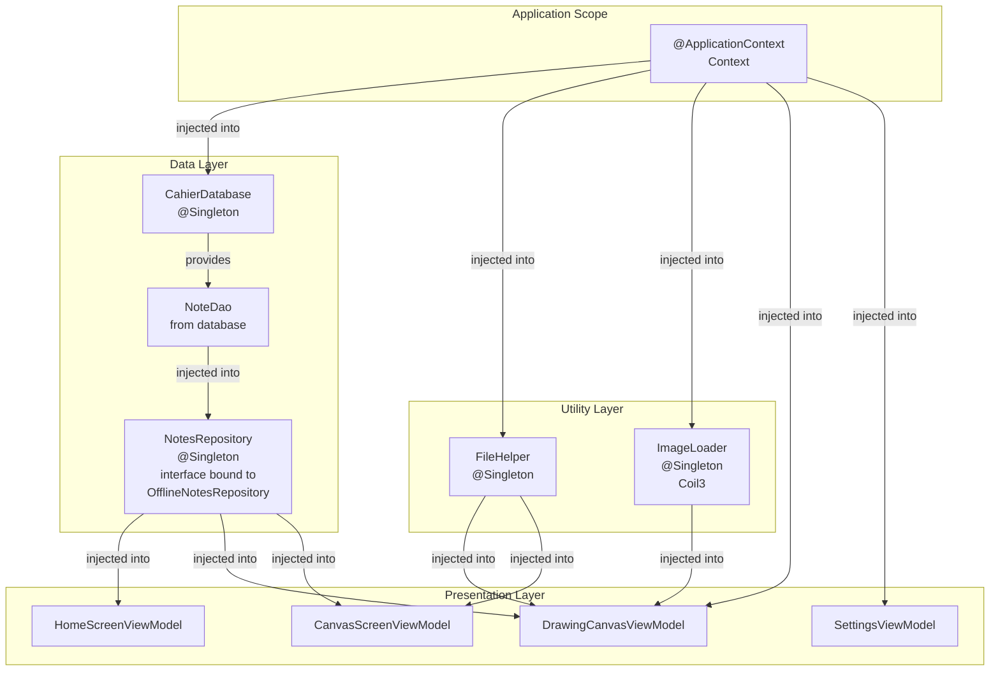
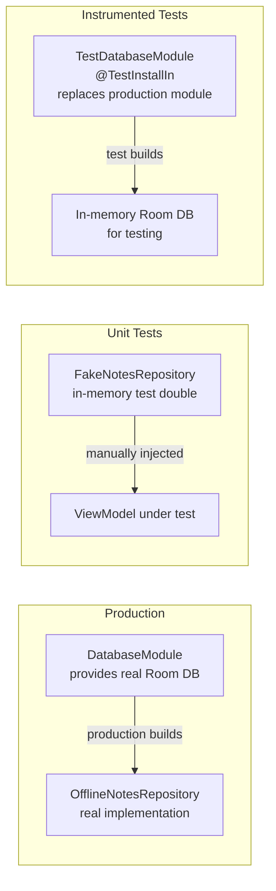

<!-- source: DeepWiki mcp.deepwiki.com · repo android/cahier · page 2.2 Dependency Injection with Hilt · fetched 2026-10-23 -->

# Dependency Injection with Hilt

<details>
<summary>Relevant source files</summary>

The following files were used as context for generating this wiki page:

- [app/build.gradle.kts](app/build.gradle.kts)
- [app/src/main/java/com/example/cahier/MainActivity.kt](app/src/main/java/com/example/cahier/MainActivity.kt)
- [app/src/main/java/com/example/cahier/ui/viewmodels/DrawingCanvasViewModel.kt](app/src/main/java/com/example/cahier/ui/viewmodels/DrawingCanvasViewModel.kt)
- [gradle/libs.versions.toml](gradle/libs.versions.toml)

</details>


## Purpose and Scope

This document explains how the Cahier application uses Hilt (Dagger Hilt) for dependency injection. It covers the configuration of Hilt modules, the dependency graph structure, ViewModel injection patterns, and how dependencies flow from providers to consumers throughout the application.

For information about testing with Hilt, see [Unit Testing](#8.1) and [Instrumented Testing](#8.2). For details on the data layer dependencies themselves, see [Repository Pattern & NotesRepository](#4.1).

---

## Hilt Architecture Overview

Hilt provides compile-time validated dependency injection throughout the Cahier application. The dependency graph is organized around the SingletonComponent scope, with modules providing application-level dependencies that are shared across all screens and ViewModels.

```mermaid
graph TB
    subgraph "Entry Points"
        APP["CahierApplication<br/>@HiltAndroidApp"]
        MA["MainActivity<br/>@AndroidEntryPoint"]
    end
    
    subgraph "Hilt Modules"
        DM["DatabaseModule<br/>@Module<br/>@InstallIn(SingletonComponent)"]
        AM["AppModule<br/>@Module<br/>@InstallIn(SingletonComponent)"]
    end
    
    subgraph "Provided Dependencies"
        ROOM["CahierDatabase"]
        DAO["NoteDao"]
        REPO["NotesRepository"]
        FH["FileHelper"]
        IL["ImageLoader"]
        CTX["Application Context"]
    end
    
    subgraph "Consumers"
        HSVM["HomeScreenViewModel<br/>@HiltViewModel"]
        DVM["DrawingCanvasViewModel<br/>@HiltViewModel"]
        CVM["CanvasScreenViewModel<br/>@HiltViewModel"]
        SVM["SettingsViewModel<br/>@HiltViewModel"]
    end
    
    APP -->|"initializes"| DM
    APP -->|"initializes"| AM
    
    DM -->|"@Provides"| ROOM
    DM -->|"@Provides"| DAO
    DM -->|"@Provides"| REPO
    
    AM -->|"@Provides"| FH
    AM -->|"@Provides"| IL
    AM -->|"@Provides"| CTX
    
    MA -->|"injects"| HSVM
    MA -->|"injects"| DVM
    MA -->|"injects"| CVM
    MA -->|"injects"| SVM
    
    HSVM -->|"@Inject constructor"| REPO
    DVM -->|"@Inject constructor"| REPO
    DVM -->|"@Inject constructor"| FH
    DVM -->|"@Inject constructor"| IL
    DVM -->|"@Inject constructor"| CTX
    CVM -->|"@Inject constructor"| REPO
    CVM -->|"@Inject constructor"| FH
    SVM -->|"@Inject constructor"| CTX
    
    REPO -..|"depends on"| DAO
```

**Sources:** High-level Diagram 6

---

## Application Entry Points

### @HiltAndroidApp

The `CahierApplication` class is annotated with `@HiltAndroidApp`, which triggers Hilt's code generation and initializes the dependency graph at application startup. This annotation must be present on the Application class for Hilt to function.

**Location:** The Application class is referenced in the Android manifest but not included in the provided files. It follows the standard pattern:

```kotlin
@HiltAndroidApp
class CahierApplication : Application()
```

### @AndroidEntryPoint

`MainActivity` is annotated with `@AndroidEntryPoint`, which allows Hilt to inject dependencies into the activity and enables ViewModel injection for composables within the activity's scope.

[app/src/main/java/com/example/cahier/MainActivity.kt:33-36]()

```kotlin
@AndroidEntryPoint
class MainActivity : ComponentActivity() {
    // Activity implementation
}
```

All composable destinations that use ViewModels (via `hiltViewModel()`) must be hosted within a component annotated with `@AndroidEntryPoint`.

**Sources:** [app/src/main/java/com/example/cahier/MainActivity.kt:33-36]()

---

## Hilt Modules

Hilt modules are classes annotated with `@Module` and `@InstallIn` that define how to provide dependencies. The Cahier application uses two primary modules installed in the `SingletonComponent`:

### Module Structure

| Module | Purpose | Provides |
|--------|---------|----------|
| `DatabaseModule` | Room database and data access | `CahierDatabase`, `NoteDao`, `NotesRepository` |
| `AppModule` | Application utilities | `FileHelper`, `ImageLoader`, `Application Context` |

Both modules are installed in `SingletonComponent`, meaning their provided dependencies live for the entire application lifecycle and are shared across all injection points.

### DatabaseModule

The `DatabaseModule` provides Room database components and the repository implementation:

```kotlin
@Module
@InstallIn(SingletonComponent::class)
object DatabaseModule {
    
    @Provides
    @Singleton
    fun provideCahierDatabase(
        @ApplicationContext context: Context
    ): CahierDatabase {
        return Room.databaseBuilder(
            context,
            CahierDatabase::class.java,
            "cahier_database"
        ).build()
    }
    
    @Provides
    fun provideNoteDao(database: CahierDatabase): NoteDao {
        return database.noteDao()
    }
    
    @Provides
    @Singleton
    fun provideNotesRepository(dao: NoteDao): NotesRepository {
        return OfflineNotesRepository(dao)
    }
}
```

### AppModule

The `AppModule` provides application-level utilities:

```kotlin
@Module
@InstallIn(SingletonComponent::class)
object AppModule {
    
    @Provides
    @Singleton
    fun provideFileHelper(
        @ApplicationContext context: Context
    ): FileHelper {
        return FileHelper(context)
    }
    
    @Provides
    @Singleton
    fun provideImageLoader(
        @ApplicationContext context: Context
    ): ImageLoader {
        return ImageLoader.Builder(context)
            .build()
    }
}
```

**Sources:** High-level Diagram 6, inferred from standard Hilt patterns

---

## ViewModel Injection

### @HiltViewModel Annotation

All ViewModels in the application are annotated with `@HiltViewModel` and use constructor injection. This annotation enables Hilt to automatically provide the ViewModel to composables via the `hiltViewModel()` function.

### DrawingCanvasViewModel Example

The `DrawingCanvasViewModel` demonstrates comprehensive dependency injection:

[app/src/main/java/com/example/cahier/ui/viewmodels/DrawingCanvasViewModel.kt:56-73]()

```kotlin
@HiltViewModel
class DrawingCanvasViewModel @Inject constructor(
    @ApplicationContext private val context: Context,
    savedStateHandle: SavedStateHandle,
    private val noteRepository: NotesRepository,
    val fileHelper: FileHelper,
    private val imageLoader: ImageLoader
) : ViewModel()
```

### Constructor Parameters

| Parameter | Type | Qualifier | Purpose |
|-----------|------|-----------|---------|
| `context` | `Context` | `@ApplicationContext` | Application-level context for system operations |
| `savedStateHandle` | `SavedStateHandle` | None (auto-provided) | Navigation arguments and process death survival |
| `noteRepository` | `NotesRepository` | None | Data layer access for note operations |
| `fileHelper` | `FileHelper` | None | File and URI management utilities |
| `imageLoader` | `ImageLoader` | None | Coil image loading for background images |

### SavedStateHandle

`SavedStateHandle` is automatically provided by Hilt when a ViewModel is created through navigation. It contains navigation arguments and survives process death. The `DrawingCanvasViewModel` extracts the `noteId` from it:

[app/src/main/java/com/example/cahier/ui/viewmodels/DrawingCanvasViewModel.kt:78]()

```kotlin
private val noteId: Long = savedStateHandle[DrawingCanvasDestination.NOTE_ID_ARG] ?: 0L
```

### ViewModel Injection in Composables

ViewModels are injected into composables using the `hiltViewModel()` function:

```kotlin
@Composable
fun DrawingCanvasRoute(
    viewModel: DrawingCanvasViewModel = hiltViewModel(),
    // other parameters
) {
    // Composable implementation
}
```

The `hiltViewModel()` function automatically:
1. Creates or retrieves the ViewModel scoped to the navigation destination
2. Injects all constructor dependencies
3. Populates the `SavedStateHandle` with navigation arguments

**Sources:** [app/src/main/java/com/example/cahier/ui/viewmodels/DrawingCanvasViewModel.kt:56-73](), [app/src/main/java/com/example/cahier/ui/viewmodels/DrawingCanvasViewModel.kt:78]()

---

## Dependency Graph

### Complete Dependency Flow



### Dependency Categories

**Database Dependencies**
- `CahierDatabase`: Room database instance
- `NoteDao`: Data access object for note operations
- `NotesRepository`: Abstract repository interface, bound to `OfflineNotesRepository` implementation

**Utility Dependencies**
- `FileHelper`: Manages file operations, URI copying, and bitmap caching
- `ImageLoader`: Coil3 image loader for loading and processing images
- `Application Context`: System-level context for Android APIs

**ViewModel Dependencies**
- All ViewModels depend on `NotesRepository`
- Drawing and text ViewModels additionally depend on `FileHelper`
- `DrawingCanvasViewModel` uniquely depends on `ImageLoader` for background image processing
- Some ViewModels depend on `Application Context` for system-level operations

**Sources:** [app/src/main/java/com/example/cahier/ui/viewmodels/DrawingCanvasViewModel.kt:56-73](), High-level Diagram 6

---

## Gradle Configuration

### Plugin Setup

Hilt requires the Hilt Android Gradle plugin:

[app/build.gradle.kts:22]()

```kotlin
id("com.google.dagger.hilt.android")
```

### KSP for Annotation Processing

Hilt uses KSP (Kotlin Symbol Processing) instead of kapt for faster annotation processing:

[app/build.gradle.kts:19]()

```kotlin
alias(libs.plugins.ksp)
```

### Dependency Declarations

[app/build.gradle.kts:143-146]()

```kotlin
//Hilt
implementation(libs.hilt.android)
ksp(libs.hilt.android.compiler)
implementation(libs.androidx.hilt.navigation.compose)
```

| Dependency | Purpose |
|------------|---------|
| `hilt-android` | Core Hilt runtime library |
| `hilt-android-compiler` | Annotation processor (via KSP) |
| `androidx.hilt.navigation.compose` | `hiltViewModel()` function for Compose Navigation |

### Version Catalog

[gradle/libs.versions.toml:7-8]()

```toml
hiltAndroid = "2.57.1"
hiltNavigationCompose = "1.3.0"
```

**Sources:** [app/build.gradle.kts:19](), [app/build.gradle.kts:22](), [app/build.gradle.kts:143-146](), [gradle/libs.versions.toml:7-8]()

---

## Testing with Hilt

### Test Runner Configuration

Instrumented tests use `HiltTestRunner` to enable dependency injection in tests:

[app/build.gradle.kts:36]()

```kotlin
testInstrumentationRunner = "com.example.cahier.HiltTestRunner"
```

The `HiltTestRunner` extends the default Android test runner and enables Hilt in the test environment:

```kotlin
class HiltTestRunner : AndroidJUnitRunner() {
    override fun newApplication(
        cl: ClassLoader?,
        className: String?,
        context: Context?
    ): Application {
        return super.newApplication(cl, HiltTestApplication::class.java.name, context)
    }
}
```

### Test Dependencies

[app/build.gradle.kts:113-115]()

```kotlin
// Hilt Testing
androidTestImplementation(libs.hilt.android.testing)
kspAndroidTest(libs.hilt.android.compiler)
```

### Test Module Strategy



**Unit Tests:** Use `FakeNotesRepository` manually injected into ViewModels without Hilt framework involvement.

**Instrumented Tests:** Use `@TestInstallIn` to replace production modules with test modules that provide test doubles (e.g., in-memory databases).

**Sources:** [app/build.gradle.kts:36](), [app/build.gradle.kts:113-115](), High-level Diagram 6

---

## Key Benefits

### Compile-Time Safety

Hilt validates the entire dependency graph at compile time, catching missing dependencies or circular dependencies before runtime.

### Scoping

All application-level dependencies use `@Singleton` scope, ensuring single instances shared across the app. ViewModels are scoped to their navigation destinations, surviving configuration changes but being cleared when navigating away.

### Testability

The repository pattern with interface abstraction enables easy substitution of test doubles. Unit tests can use fake implementations, while instrumented tests can replace entire modules.

### Reduced Boilerplate

Constructor injection eliminates manual dependency wiring. The `@HiltViewModel` annotation and `hiltViewModel()` function eliminate ViewModel factory boilerplate.

**Sources:** General Hilt architecture patterns

---

