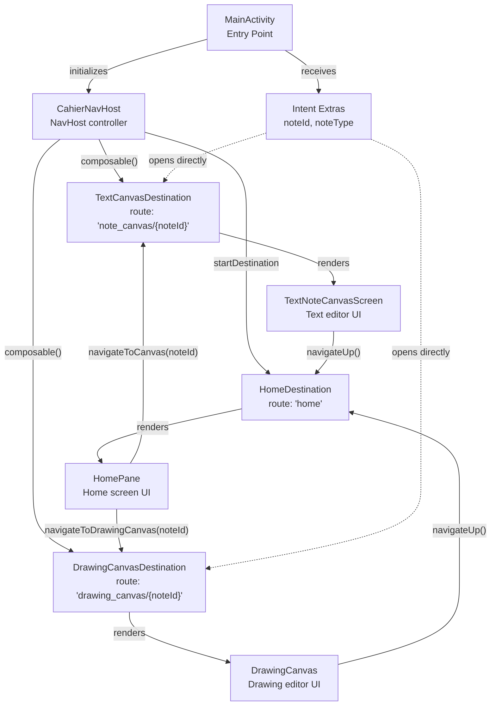
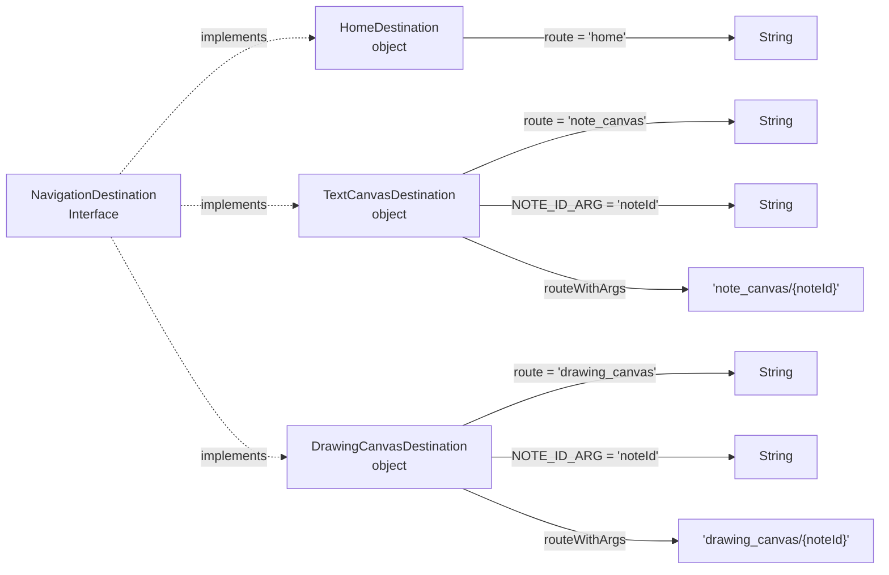
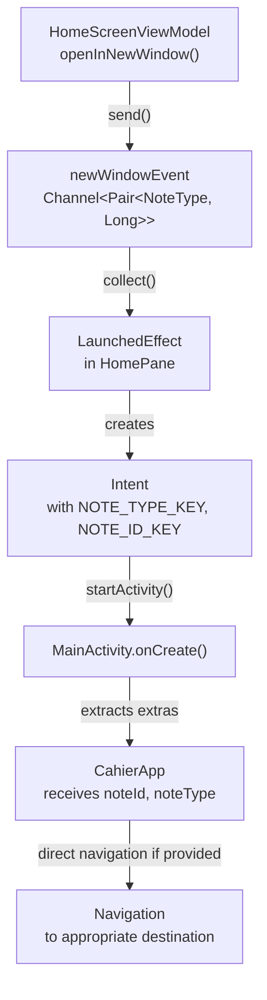
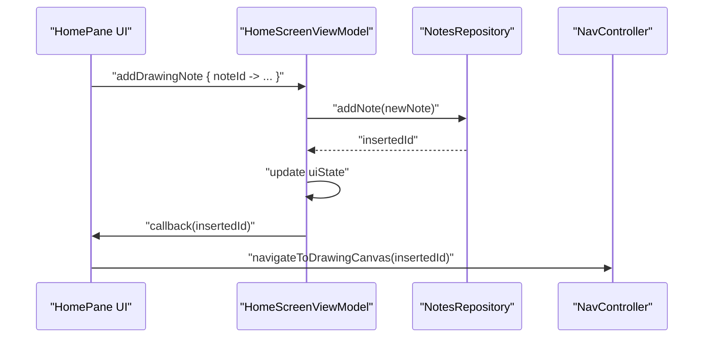

<!-- source: DeepWiki mcp.deepwiki.com · repo android/cahier · page 2.3 Navigation System · fetched 2026-10-23 -->

# Navigation System

<details>
<summary>Relevant source files</summary>

The following files were used as context for generating this wiki page:

- [app/src/androidTest/java/com/example/cahier/utils/FileHelperTest.kt](app/src/androidTest/java/com/example/cahier/utils/FileHelperTest.kt)
- [app/src/main/java/com/example/cahier/MainActivity.kt](app/src/main/java/com/example/cahier/MainActivity.kt)
- [app/src/main/java/com/example/cahier/navigation/CahierNavGraph.kt](app/src/main/java/com/example/cahier/navigation/CahierNavGraph.kt)
- [app/src/main/java/com/example/cahier/ui/CahierHomeScreen.kt](app/src/main/java/com/example/cahier/ui/CahierHomeScreen.kt)
- [app/src/main/java/com/example/cahier/ui/ColorPickerDialog.kt](app/src/main/java/com/example/cahier/ui/ColorPickerDialog.kt)
- [app/src/main/java/com/example/cahier/ui/viewmodels/HomeScreenViewModel.kt](app/src/main/java/com/example/cahier/ui/viewmodels/HomeScreenViewModel.kt)
- [app/src/test/java/com/example/cahier/ui/viewmodels/HomeScreenViewModelTest.kt](app/src/test/java/com/example/cahier/ui/viewmodels/HomeScreenViewModelTest.kt)

</details>


## Purpose and Scope

This document describes the navigation architecture of the Cahier application, including the navigation graph structure, route definitions, navigation between screens (home, text notes, drawing notes), and adaptive navigation behavior. For information about the MVVM pattern and state management used by individual screens, see [MVVM Pattern & State Management](#2.1). For details on adaptive UI layouts, see [Adaptive Layouts](#5.1).

---

## Navigation Architecture Overview

The Cahier application implements a **hub-and-spoke navigation pattern** using Jetpack Compose Navigation. The home screen (`HomeDestination`) serves as the central hub, with navigation paths to text note editing (`TextCanvasDestination`) and drawing note editing (`DrawingCanvasDestination`). All navigation flows return to the home screen.

### Navigation Flow Diagram



**Sources:** [app/src/main/java/com/example/cahier/navigation/CahierNavGraph.kt:1-93](), [app/src/main/java/com/example/cahier/MainActivity.kt:1-63]()

---

## Navigation Destinations

The application defines three primary navigation destinations, each implementing the `NavigationDestination` interface:

| Destination | Route | Arguments | Purpose |
|------------|-------|-----------|---------|
| `HomeDestination` | `"home"` | None | Displays note list and selected note detail |
| `TextCanvasDestination` | `"note_canvas/{noteId}"` | `noteId: Long` | Text note editing screen |
| `DrawingCanvasDestination` | `"drawing_canvas/{noteId}"` | `noteId: Long` | Drawing note editing screen |

### Destination Code Entities



**Sources:** [app/src/main/java/com/example/cahier/navigation/CahierNavGraph.kt:82-93](), [app/src/main/java/com/example/cahier/ui/CahierHomeScreen.kt:75-77]()

---

## Navigation Graph Structure

The navigation graph is configured in the `CahierNavHost` composable, which creates a `NavHost` with three composable destinations.

### NavHost Configuration

The `CahierNavHost` function [app/src/main/java/com/example/cahier/navigation/CahierNavGraph.kt:37-80]() establishes the navigation graph:

- **Start Destination:** `HomeDestination.route` (`"home"`)
- **Navigation Controller:** `NavHostController` parameter passed from parent

### Composable Route Definitions

Each destination is registered using the `composable()` function:

**HomeDestination** [app/src/main/java/com/example/cahier/navigation/CahierNavGraph.kt:46-58]():
```
composable(HomeDestination.route)
```
Renders `HomePane` with navigation callbacks for moving to text or drawing canvases.

**TextCanvasDestination** [app/src/main/java/com/example/cahier/navigation/CahierNavGraph.kt:59-68]():
```
composable(
    route = TextCanvasDestination.routeWithArgs,
    arguments = listOf(navArgument(TextCanvasDestination.NOTE_ID_ARG) {
        type = NavType.LongType
    })
)
```
Renders `TextNoteCanvasScreen` with the `noteId` argument extracted from the route.

**DrawingCanvasDestination** [app/src/main/java/com/example/cahier/navigation/CahierNavGraph.kt:69-78]():
```
composable(
    route = DrawingCanvasDestination.routeWithArgs,
    arguments = listOf(navArgument(DrawingCanvasDestination.NOTE_ID_ARG) {
        type = NavType.LongType
    })
)
```
Renders `DrawingCanvas` with the `noteId` argument extracted from the route.

**Sources:** [app/src/main/java/com/example/cahier/navigation/CahierNavGraph.kt:37-80]()

---

## Route Parameters and Type Safety

### Argument Declaration

Both text and drawing destinations use a path parameter for the note ID:

- **Argument Name:** `NOTE_ID_ARG` (value: `"noteId"`)
- **Argument Type:** `NavType.LongType`
- **Route Pattern:** `"{noteId}"` embedded in the route string

The `routeWithArgs` property combines the base route with the argument placeholder:
- Text: `"note_canvas/{noteId}"`
- Drawing: `"drawing_canvas/{noteId}"`

### Argument Retrieval in ViewModels

ViewModels receive navigation arguments via `SavedStateHandle`, which is automatically injected by Hilt. The note ID is retrieved using the constant argument name:

```kotlin
class DrawingCanvasViewModel @Inject constructor(
    savedStateHandle: SavedStateHandle,
    // ... other dependencies
) {
    private val noteId: Long = 
        checkNotNull(savedStateHandle[DrawingCanvasDestination.NOTE_ID_ARG])
}
```

**Sources:** [app/src/main/java/com/example/cahier/navigation/CahierNavGraph.kt:59-78](), [app/src/main/java/com/example/cahier/navigation/CahierNavGraph.kt:82-93]()

---

## Navigation Invocation Patterns

### Forward Navigation from Home Screen

The `HomePane` composable receives navigation callbacks as parameters [app/src/main/java/com/example/cahier/ui/CahierHomeScreen.kt:103-109]():

```kotlin
fun HomePane(
    navigateToCanvas: (Long) -> Unit,
    navigateToDrawingCanvas: (Long) -> Unit,
    navigateUp: () -> Unit,
    // ...
)
```

These callbacks are invoked from `CahierNavHost` [app/src/main/java/com/example/cahier/navigation/CahierNavGraph.kt:48-53]():

```kotlin
HomePane(
    navigateToCanvas = { noteId ->
        navController.navigate("${TextCanvasDestination.route}/$noteId")
    },
    navigateToDrawingCanvas = { noteId ->
        navController.navigate("${DrawingCanvasDestination.route}/$noteId")
    },
    // ...
)
```

### Navigation Triggers

Navigation is triggered in several contexts:

1. **Note Selection in List** [app/src/main/java/com/example/cahier/ui/CahierHomeScreen.kt:254-263]():
   - Compact mode: Direct navigation to edit screen
   - Expanded mode: Updates detail pane in-place

2. **Creating New Notes** [app/src/main/java/com/example/cahier/ui/CahierHomeScreen.kt:265-273]():
   - Creates note via `HomeScreenViewModel`
   - Navigates to edit screen in callback

3. **Detail Pane "Edit" Action** [app/src/main/java/com/example/cahier/ui/CahierHomeScreen.kt:293-298]():
   - Expanded mode only
   - Opens full editing screen

### Backward Navigation

Both text and drawing screens implement `navigateUp()` callback:

```kotlin
TextNoteCanvasScreen(
    onExit = { navController.navigateUp() }
)

DrawingCanvas(
    navigateUp = { navController.navigateUp() }
)
```

This returns to the home screen by popping the back stack.

**Sources:** [app/src/main/java/com/example/cahier/navigation/CahierNavGraph.kt:46-78](), [app/src/main/java/com/example/cahier/ui/CahierHomeScreen.kt:103-109](), [app/src/main/java/com/example/cahier/ui/CahierHomeScreen.kt:248-303]()

---

## Multi-Window Navigation

### Intent-Based Window Creation

The application supports opening notes in separate windows on multi-window capable devices. This is implemented via Android Intents with specific flags [app/src/main/java/com/example/cahier/ui/CahierHomeScreen.kt:125-136]():

```kotlin
LaunchedEffect(Unit) {
    homeScreenViewModel.newWindowEvent.collect { (noteType, noteId) ->
        val intent = Intent(context, MainActivity::class.java).apply {
            putExtra(AppArgs.NOTE_TYPE_KEY, noteType)
            putExtra(AppArgs.NOTE_ID_KEY, noteId)
            flags = Intent.FLAG_ACTIVITY_NEW_TASK or
                    Intent.FLAG_ACTIVITY_MULTIPLE_TASK or
                    Intent.FLAG_ACTIVITY_LAUNCH_ADJACENT
        }
        context.startActivity(intent)
    }
}
```

### Intent Processing Flow



### ViewModel Channel Implementation

`HomeScreenViewModel` exposes a `newWindowEvent` channel [app/src/main/java/com/example/cahier/ui/viewmodels/HomeScreenViewModel.kt:51-52]():

```kotlin
private val _newWindowEvent = Channel<Pair<NoteType, Long>>()
val newWindowEvent = _newWindowEvent.receiveAsFlow()
```

The `openInNewWindow()` function sends events [app/src/main/java/com/example/cahier/ui/viewmodels/HomeScreenViewModel.kt:158-162]():

```kotlin
fun openInNewWindow(note: Note) {
    viewModelScope.launch {
        _newWindowEvent.send(Pair(note.type, note.id))
    }
}
```

### MainActivity Intent Handling

`MainActivity` extracts intent extras to determine the initial destination [app/src/main/java/com/example/cahier/MainActivity.kt:41-50]():

```kotlin
val noteId = intent.getLongExtra(AppArgs.NOTE_ID_KEY, -1)
val noteType = if (Build.VERSION.SDK_INT >= Build.VERSION_CODES.TIRAMISU) {
    intent.getParcelableExtra(AppArgs.NOTE_TYPE_KEY, NoteType::class.java)
} else {
    @Suppress("DEPRECATION")
    intent.getParcelableExtra(AppArgs.NOTE_TYPE_KEY) as NoteType?
}
```

These values are passed to `CahierApp`, which can then navigate directly to the appropriate note editing screen on app initialization.

**Sources:** [app/src/main/java/com/example/cahier/ui/CahierHomeScreen.kt:125-136](), [app/src/main/java/com/example/cahier/ui/viewmodels/HomeScreenViewModel.kt:51-62](), [app/src/main/java/com/example/cahier/ui/viewmodels/HomeScreenViewModel.kt:158-162](), [app/src/main/java/com/example/cahier/MainActivity.kt:41-50]()

---

## Adaptive Navigation Behavior

### Window Size Class Detection

The home screen adapts its navigation behavior based on `WindowSizeClass` [app/src/main/java/com/example/cahier/ui/CahierHomeScreen.kt:116-121]():

```kotlin
val activity = LocalActivity.current
val windowSizeClass = activity?.let { calculateWindowSizeClass(it) }
val isCompact = windowSizeClass?.widthSizeClass == WindowWidthSizeClass.Compact
```

### Compact Mode (Phones)

In compact mode (`isCompact = true`):

1. **Single-pane navigation:** Full-screen transitions between list and detail
2. **Note selection:** Directly navigates to edit screen [app/src/main/java/com/example/cahier/ui/CahierHomeScreen.kt:255-260]()
3. **Back navigation:** Standard `navigateUp()` behavior
4. **No detail pane:** Detail view is replaced by navigation to edit screen

### Expanded Mode (Tablets)

In expanded mode (`isCompact = false`):

1. **List-detail layout:** Uses `ListDetailPaneScaffold` [app/src/main/java/com/example/cahier/ui/CahierHomeScreen.kt:231-304]()
2. **Note selection:** Updates detail pane in-place [app/src/main/java/com/example/cahier/ui/CahierHomeScreen.kt:262]()
3. **Detail pane interaction:** Clicking "Edit" navigates to full editor [app/src/main/java/com/example/cahier/ui/CahierHomeScreen.kt:293-299]()
4. **Automatic selection:** First note is auto-selected on load [app/src/main/java/com/example/cahier/ui/CahierHomeScreen.kt:145-149]()

### Mode Synchronization

State is synchronized when window size class changes [app/src/main/java/com/example/cahier/ui/CahierHomeScreen.kt:138-143]():

```kotlin
LaunchedEffect(isCompact) {
    if (isCompact) {
        homeScreenViewModel.clearSelection()
        navigator.navigateTo(ListDetailPaneScaffoldRole.List)
    }
}
```

### Navigation Suite Scaffold

The home screen uses `NavigationSuiteScaffold` [app/src/main/java/com/example/cahier/ui/CahierHomeScreen.kt:197-226]() for app-level navigation between Home and Settings destinations. This scaffold automatically adapts to display:
- **Bottom navigation bar** on compact screens
- **Navigation rail** on medium screens  
- **Navigation drawer** on large screens

**Sources:** [app/src/main/java/com/example/cahier/ui/CahierHomeScreen.kt:116-121](), [app/src/main/java/com/example/cahier/ui/CahierHomeScreen.kt:138-149](), [app/src/main/java/com/example/cahier/ui/CahierHomeScreen.kt:197-316]()

---

## Back Handler Integration

### List-Detail Pane Back Navigation

The home screen implements `BackHandler` to manage navigation within the `ListDetailPaneScaffold` [app/src/main/java/com/example/cahier/ui/CahierHomeScreen.kt:158-162]():

```kotlin
BackHandler(navigator.canNavigateBack()) {
    coroutineScope.launch {
        navigator.navigateBack()
    }
}
```

This enables:
- Transitioning from detail pane back to list pane in expanded mode
- Proper back stack management for multi-pane layouts

### Note Editor Back Navigation

Note editing screens (text and drawing) implement back navigation by calling the `navigateUp()` or `onExit()` callback provided by `CahierNavHost`, which delegates to `navController.navigateUp()`.

**Sources:** [app/src/main/java/com/example/cahier/ui/CahierHomeScreen.kt:158-162](), [app/src/main/java/com/example/cahier/navigation/CahierNavGraph.kt:54-56](), [app/src/main/java/com/example/cahier/navigation/CahierNavGraph.kt:66-67](), [app/src/main/java/com/example/cahier/navigation/CahierNavGraph.kt:76-77]()

---

## Navigation and ViewModel Interaction

### Note Creation Flow

When creating a new note, navigation occurs via callback pattern:

1. UI triggers `HomeScreenViewModel.addNote()` or `addDrawingNote()` [app/src/main/java/com/example/cahier/ui/viewmodels/HomeScreenViewModel.kt:91-107]()
2. ViewModel creates note in repository [app/src/main/java/com/example/cahier/ui/viewmodels/HomeScreenViewModel.kt:109-126]()
3. ViewModel invokes callback with new note ID
4. UI navigation callback executes with the ID [app/src/main/java/com/example/cahier/ui/CahierHomeScreen.kt:265-273]()



### Note Selection Flow

Note selection in expanded mode does not trigger navigation, but updates ViewModel state:

1. UI calls `homeScreenViewModel.selectNote(noteId)` [app/src/main/java/com/example/cahier/ui/CahierHomeScreen.kt:262]()
2. ViewModel loads note and strokes from repository [app/src/main/java/com/example/cahier/ui/viewmodels/HomeScreenViewModel.kt:67-89]()
3. ViewModel updates `uiState` StateFlow
4. Detail pane observes `uiState` and recomposes [app/src/main/java/com/example/cahier/ui/CahierHomeScreen.kt:289-301]()

**Sources:** [app/src/main/java/com/example/cahier/ui/viewmodels/HomeScreenViewModel.kt:67-126](), [app/src/main/java/com/example/cahier/ui/CahierHomeScreen.kt:254-273]()

---

