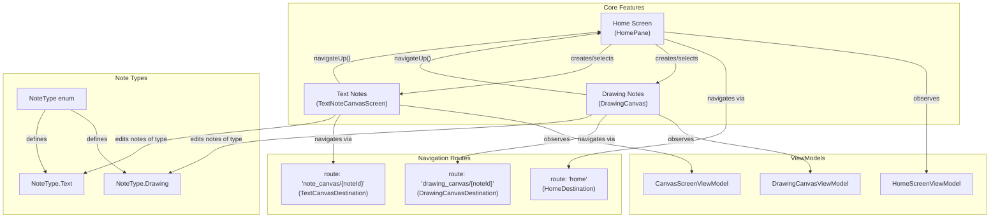
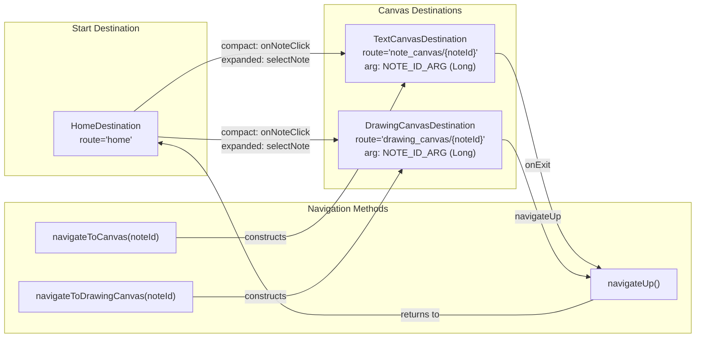
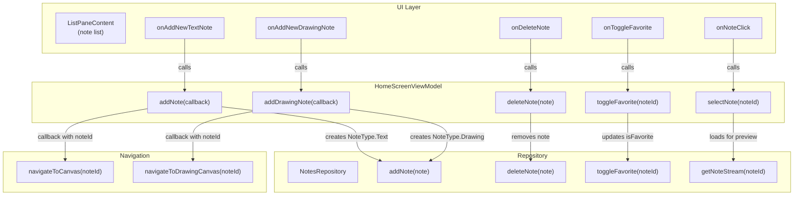
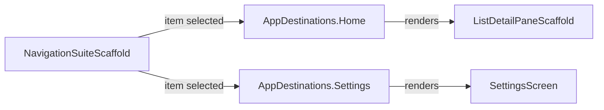

<!-- source: DeepWiki mcp.deepwiki.com · repo android/cahier · page 3 Core Features · fetched 2026-10-23 -->

# Core Features

<details>
<summary>Relevant source files</summary>

The following files were used as context for generating this wiki page:

- [app/src/androidTest/java/com/example/cahier/utils/FileHelperTest.kt](app/src/androidTest/java/com/example/cahier/utils/FileHelperTest.kt)
- [app/src/main/java/com/example/cahier/navigation/CahierNavGraph.kt](app/src/main/java/com/example/cahier/navigation/CahierNavGraph.kt)
- [app/src/main/java/com/example/cahier/ui/CahierHomeScreen.kt](app/src/main/java/com/example/cahier/ui/CahierHomeScreen.kt)
- [app/src/main/java/com/example/cahier/ui/ColorPickerDialog.kt](app/src/main/java/com/example/cahier/ui/ColorPickerDialog.kt)
- [app/src/main/java/com/example/cahier/ui/viewmodels/HomeScreenViewModel.kt](app/src/main/java/com/example/cahier/ui/viewmodels/HomeScreenViewModel.kt)
- [app/src/test/java/com/example/cahier/ui/viewmodels/HomeScreenViewModelTest.kt](app/src/test/java/com/example/cahier/ui/viewmodels/HomeScreenViewModelTest.kt)

</details>


## Purpose and Scope

This document provides an overview of the three primary functional areas of the Cahier application: **drawing notes**, **text notes**, and **note management**. These features form the core user-facing functionality of the application.

For detailed information about specific subsystems:
- Drawing system implementation details: see [Drawing Notes System](#3.1)
- Text note editing interface: see [Text Notes System](#3.2)
- Home screen UI and note list management: see [Home Screen & Note Management](#3.3)
- Architecture patterns (MVVM, dependency injection): see [Architecture](#2)
- Data persistence and serialization: see [Data Layer](#4)

---

## Feature Overview

The Cahier application is organized around three main feature areas, each implemented as a distinct screen with its own ViewModel and navigation route.

### Feature Map



**Sources:** [app/src/main/java/com/example/cahier/ui/CahierHomeScreen.kt:75-77](), [app/src/main/java/com/example/cahier/navigation/CahierNavGraph.kt:82-93]()

---

## Note Type System

The application supports two distinct note types, defined by the `NoteType` enum. Each type has different editing capabilities and storage requirements.

| Note Type | Enum Value | Primary Content | Canvas Screen | ViewModel | Route |
|-----------|-----------|-----------------|---------------|-----------|-------|
| **Drawing** | `NoteType.Drawing` | Ink strokes | `DrawingCanvas` | `DrawingCanvasViewModel` | `drawing_canvas/{noteId}` |
| **Text** | `NoteType.Text` | Title and body text | `TextNoteCanvasScreen` | `CanvasScreenViewModel` | `note_canvas/{noteId}` |

Both note types share common metadata fields (`id`, `title`, `isFavorite`, `imageUriList`, `createdAt`, `lastModifiedAt`) but differ in their content fields:
- Drawing notes: Store `strokesData` (serialized JSON) and have null `text`
- Text notes: Store `text` (plain string) and have null `strokesData`

**Sources:** [app/src/main/java/com/example/cahier/ui/CahierHomeScreen.kt:68](), [app/src/main/java/com/example/cahier/navigation/CahierNavGraph.kt:82-93]()

---

## Navigation Flow

The application uses a hub-and-spoke navigation pattern where the home screen acts as the central hub, and note editing screens (drawing and text) are the spokes.

### Navigation Graph Structure



**Navigation Route Construction:**
- Text note route: `"${TextCanvasDestination.route}/$noteId"` → `"note_canvas/123"`
- Drawing note route: `"${DrawingCanvasDestination.route}/$noteId"` → `"drawing_canvas/456"`

**Sources:** [app/src/main/java/com/example/cahier/navigation/CahierNavGraph.kt:41-80](), [app/src/main/java/com/example/cahier/ui/CahierHomeScreen.kt:254-263]()

---

## Core Note Operations

The application supports standard CRUD (Create, Read, Update, Delete) operations on notes, plus a favorite/unfavorite toggle. These operations are initiated from the home screen and managed by `HomeScreenViewModel`.

### Operation Flow Diagram



**Sources:** [app/src/main/java/com/example/cahier/ui/viewmodels/HomeScreenViewModel.kt:91-126](), [app/src/main/java/com/example/cahier/ui/CahierHomeScreen.kt:265-284]()

### Create Operations

**Creating a Text Note:**
```
1. User clicks "Add Text Note" button
2. ListPaneContent calls onAddNewTextNote
3. HomeScreenViewModel.addNote() creates Note(type=NoteType.Text)
4. Repository.addNote() inserts into database, returns noteId
5. Callback invokes navigateToCanvas(noteId)
6. Navigation routes to "note_canvas/{noteId}"
```

**Creating a Drawing Note:**
```
1. User clicks "Add Drawing Note" button
2. ListPaneContent calls onAddNewDrawingNote
3. HomeScreenViewModel.addDrawingNote() creates Note(type=NoteType.Drawing)
4. Repository.addNote() inserts into database, returns noteId
5. Callback invokes navigateToDrawingCanvas(noteId)
6. Navigation routes to "drawing_canvas/{noteId}"
```

**Sources:** [app/src/main/java/com/example/cahier/ui/viewmodels/HomeScreenViewModel.kt:91-126](), [app/src/main/java/com/example/cahier/ui/CahierHomeScreen.kt:265-273]()

### Read Operations

**Note List Display:**
- `HomeScreenViewModel.noteList` is a `StateFlow<NoteListUiState>` that streams all notes from the repository
- The flow is mapped from `NotesRepository.getAllNotesStream()` and maintained with a 5-second timeout
- Notes are partitioned into favorites and non-favorites in the UI layer

**Note Selection (Expanded Layout):**
- On non-compact devices, `HomeScreenViewModel.selectNote(noteId)` loads the selected note into `uiState`
- For drawing notes, strokes are also loaded via `NotesRepository.getNoteStrokes(noteId)`
- The detail pane displays a preview of the selected note content

**Sources:** [app/src/main/java/com/example/cahier/ui/viewmodels/HomeScreenViewModel.kt:54-89](), [app/src/main/java/com/example/cahier/ui/CahierHomeScreen.kt:287-303]()

### Update Operations

Note content updates are handled by the respective canvas ViewModels:
- `DrawingCanvasViewModel` updates stroke data for drawing notes
- `CanvasScreenViewModel` updates title and text for text notes

See [Drawing Notes System](#3.1) and [Text Notes System](#3.2) for details.

### Delete Operations

```
1. User selects "Delete" from note context menu
2. ListPaneContent calls onDeleteNote(note)
3. HomeScreenViewModel.deleteNote() calls repository
4. Repository.deleteNote() removes note from database
5. noteList StateFlow automatically updates to reflect deletion
```

**Sources:** [app/src/main/java/com/example/cahier/ui/viewmodels/HomeScreenViewModel.kt:128-138](), [app/src/main/java/com/example/cahier/ui/CahierHomeScreen.kt:275-277]()

### Favorite Toggle

```
1. User clicks favorite icon on note card
2. ListPaneContent calls onToggleFavorite(noteId)
3. HomeScreenViewModel.toggleFavorite() calls repository
4. Repository.toggleFavorite() flips isFavorite boolean
5. If note is selected in detail pane, uiState is updated
6. noteList StateFlow automatically updates to reflect change
```

**Sources:** [app/src/main/java/com/example/cahier/ui/viewmodels/HomeScreenViewModel.kt:140-152](), [app/src/main/java/com/example/cahier/ui/CahierHomeScreen.kt:279-281]()

---

## Adaptive Layout Behavior

The home screen adapts its behavior based on screen size, affecting how note operations work:

### Compact Layout (Phones)
- Single-pane navigation
- Clicking a note navigates to full-screen canvas
- No note selection state maintained
- Uses `NavController.navigate()` for transitions

### Expanded Layout (Tablets)
- Dual-pane with `ListDetailPaneScaffold`
- Clicking a note shows preview in detail pane
- First note auto-selected on initial load
- Navigation to canvas replaces current window
- Detail pane proportions: 30% list, 70% detail (configurable via drag handle)

**Implementation Details:**
- Screen size determined by `WindowSizeClass.widthSizeClass`
- Compact mode detected: `windowSizeClass?.widthSizeClass == WindowWidthSizeClass.Compact`
- Selection cleared when switching to compact mode
- Pane expansion managed by `PaneExpansionState`

**Sources:** [app/src/main/java/com/example/cahier/ui/CahierHomeScreen.kt:116-156](), [app/src/main/java/com/example/cahier/ui/CahierHomeScreen.kt:231-304]()

---

## Multi-Window Support

The application supports opening notes in separate windows on compatible Android devices (API 34+). This enables users to view multiple notes simultaneously.

**Flow:**
```
1. User selects "Open in new window" from note context menu
2. ListPaneContent calls onNewWindow(note)
3. HomeScreenViewModel.openInNewWindow() sends event to newWindowEvent channel
4. HomePane collects from channel and creates new Intent
5. Intent includes NOTE_TYPE_KEY and NOTE_ID_KEY extras
6. Intent flags: FLAG_ACTIVITY_NEW_TASK | FLAG_ACTIVITY_MULTIPLE_TASK | FLAG_ACTIVITY_LAUNCH_ADJACENT
7. New MainActivity instance launched with note data
```

**Sources:** [app/src/main/java/com/example/cahier/ui/viewmodels/HomeScreenViewModel.kt:158-162](), [app/src/main/java/com/example/cahier/ui/CahierHomeScreen.kt:125-136](), [app/src/main/java/com/example/cahier/ui/CahierHomeScreen.kt:282-284]()

---

## Settings Integration

The home screen includes a navigation item for the Settings screen, which is accessed via the bottom navigation bar (compact) or navigation rail (expanded).

**Navigation:**


The settings destination is not part of the main navigation graph but is rendered directly within the `NavigationSuiteScaffold` content lambda based on `currentDestination` state.

**Sources:** [app/src/main/java/com/example/cahier/ui/CahierHomeScreen.kt:79-94](), [app/src/main/java/com/example/cahier/ui/CahierHomeScreen.kt:229-312]()

---

## Summary

The Cahier application's core features are organized around:

1. **Two Note Types**: Drawing notes (`NoteType.Drawing`) and text notes (`NoteType.Text`), each with dedicated editing interfaces
2. **Three Main Screens**: Home screen for management, drawing canvas for ink input, text canvas for text editing
3. **Hub-and-Spoke Navigation**: Home screen as central hub, canvas screens as editing spokes
4. **CRUD Operations**: Managed by `HomeScreenViewModel` with immediate UI updates via StateFlows
5. **Adaptive Layouts**: Single-pane for phones, dual-pane for tablets
6. **Multi-Window Support**: Open multiple notes simultaneously in separate windows

For implementation details of each feature area, see the respective child pages: [Drawing Notes System](#3.1), [Text Notes System](#3.2), and [Home Screen & Note Management](#3.3).

---

