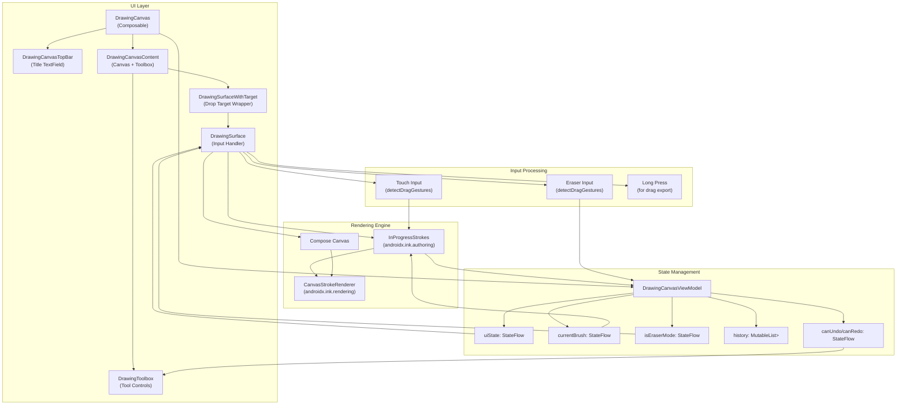
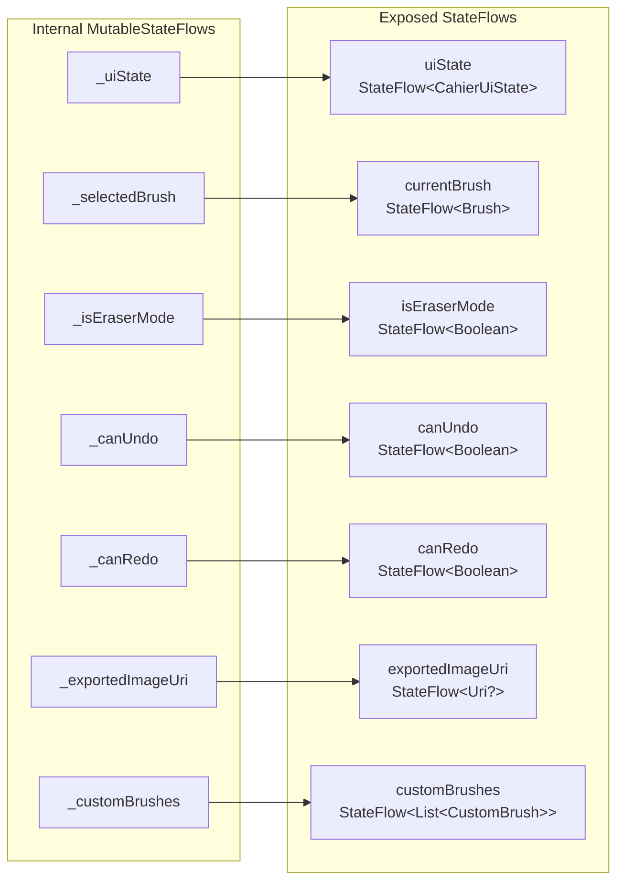
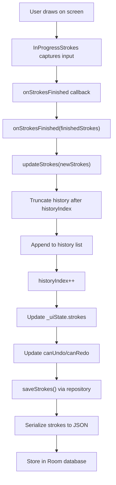
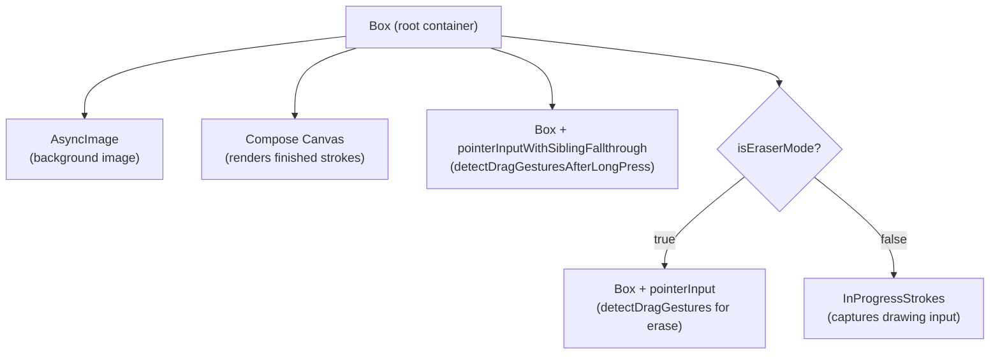
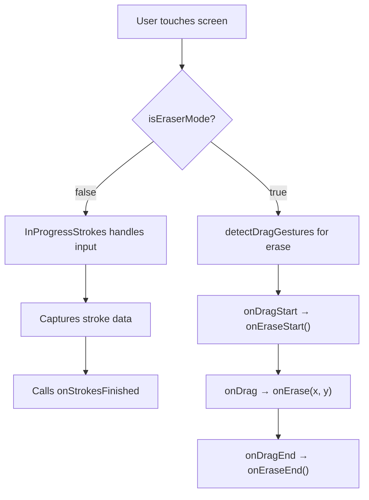
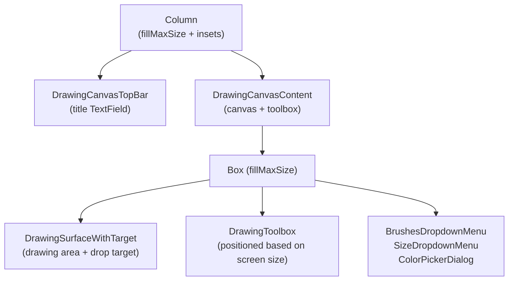
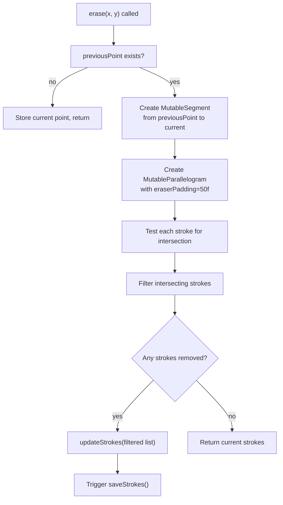
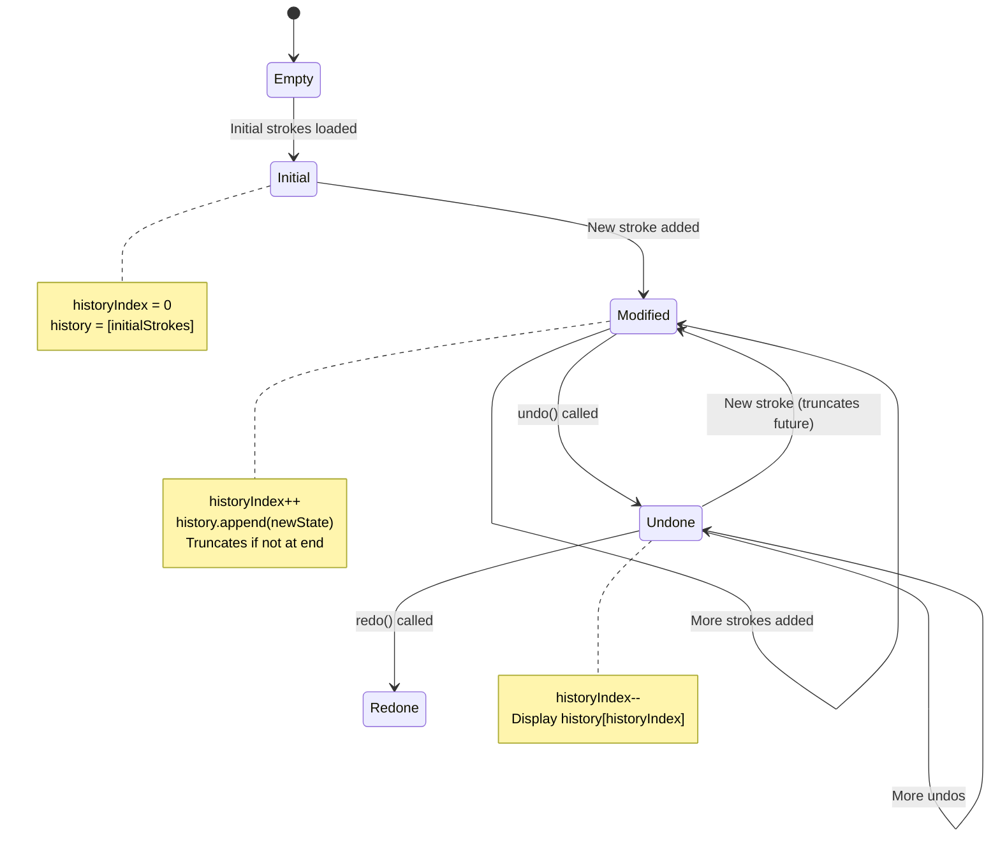
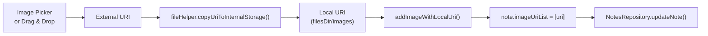
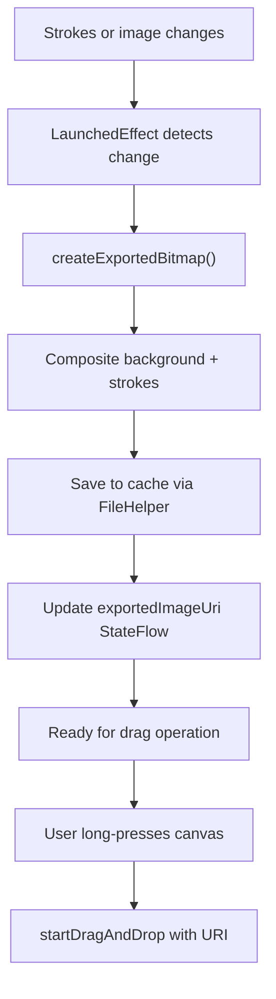

<!-- source: DeepWiki mcp.deepwiki.com · repo android/cahier · page 3.1 Drawing Notes System · fetched 2026-10-23 -->

# Drawing Notes System

<details>
<summary>Relevant source files</summary>

The following files were used as context for generating this wiki page:

- [app/src/main/java/com/example/cahier/ui/DrawingCanvas.kt](app/src/main/java/com/example/cahier/ui/DrawingCanvas.kt)
- [app/src/main/java/com/example/cahier/ui/DrawingSurface.kt](app/src/main/java/com/example/cahier/ui/DrawingSurface.kt)
- [app/src/main/java/com/example/cahier/ui/utils/DragAndDropUtils.kt](app/src/main/java/com/example/cahier/ui/utils/DragAndDropUtils.kt)
- [app/src/main/java/com/example/cahier/ui/viewmodels/DrawingCanvasViewModel.kt](app/src/main/java/com/example/cahier/ui/viewmodels/DrawingCanvasViewModel.kt)

</details>


## Purpose and Scope

The Drawing Notes System provides comprehensive ink-based note-taking functionality using the androidx.ink library. This system enables users to draw freehand strokes with various brushes, erase content, manage stroke history with undo/redo, and overlay drawings on background images. The system is built around `DrawingCanvasViewModel` for state management and `DrawingSurface` for input capture and rendering.

For text-based note-taking functionality, see [Text Notes System](#3.2). For general note management and listing, see [Home Screen & Note Management](#3.3). For the underlying data persistence layer, see [Stroke Serialization](#4.3).

## System Architecture

### Component Overview

The drawing system consists of three primary architectural layers: UI composition, state management, and rendering.

**Architecture Diagram: Drawing System Components**



**Sources:** [app/src/main/java/com/example/cahier/ui/DrawingCanvas.kt:88-140](), [app/src/main/java/com/example/cahier/ui/viewmodels/DrawingCanvasViewModel.kt:66-113](), [app/src/main/java/com/example/cahier/ui/DrawingSurface.kt:52-140]()

### Core Components Table

| Component | Type | Responsibility |
|-----------|------|---------------|
| `DrawingCanvas` | Composable | Root container, orchestrates layout and navigation |
| `DrawingCanvasViewModel` | ViewModel | State management, business logic, data persistence |
| `DrawingSurface` | Composable | Input capture, stroke rendering, eraser handling |
| `InProgressStrokes` | androidx.ink | Real-time stroke capture and rendering |
| `CanvasStrokeRenderer` | androidx.ink | High-performance stroke drawing |
| `DrawingToolbox` | Composable | User controls for brushes, colors, sizes |

**Sources:** [app/src/main/java/com/example/cahier/ui/DrawingCanvas.kt:88-140](), [app/src/main/java/com/example/cahier/ui/viewmodels/DrawingCanvasViewModel.kt:66-73](), [app/src/main/java/com/example/cahier/ui/DrawingSurface.kt:52-66]()

## DrawingCanvasViewModel

`DrawingCanvasViewModel` is the central state manager, annotated with `@HiltViewModel` for dependency injection. It receives dependencies through constructor injection.

### Dependencies and Initialization

```
@HiltViewModel
class DrawingCanvasViewModel @Inject constructor(
    @ApplicationContext private val context: Context,
    savedStateHandle: SavedStateHandle,
    private val noteRepository: NotesRepository,
    val fileHelper: FileHelper,
    private val imageLoader: ImageLoader
)
```

**Dependency Table**

| Dependency | Purpose |
|------------|---------|
| `context` | Image loading, custom brush loading, bitmap export |
| `savedStateHandle` | Extract `noteId` from navigation arguments |
| `noteRepository` | Load and persist strokes, update note metadata |
| `fileHelper` | Copy image URIs to internal storage, save bitmaps to cache |
| `imageLoader` | Load background images for bitmap export (Coil3) |

The `noteId` is extracted from `savedStateHandle` using the `NOTE_ID_ARG` constant defined in `DrawingCanvasDestination`.

**Sources:** [app/src/main/java/com/example/cahier/ui/viewmodels/DrawingCanvasViewModel.kt:67-73](), [app/src/main/java/com/example/cahier/ui/viewmodels/DrawingCanvasViewModel.kt:78]()

### State Flow Architecture

**State Flow Diagram**



The ViewModel maintains internal `MutableStateFlow` instances prefixed with underscore and exposes immutable `StateFlow` views via `asStateFlow()`. This ensures unidirectional data flow where only the ViewModel can modify state.

**Sources:** [app/src/main/java/com/example/cahier/ui/viewmodels/DrawingCanvasViewModel.kt:75-112]()

### Brush State Management

The default brush is initialized based on the system's night mode setting:

```
private val _defaultBrush = MutableStateFlow(
    Brush.createWithComposeColor(
        family = StockBrushes.pressurePen(),
        color = if (currentNightMode == AppCompatDelegate.MODE_NIGHT_YES)
            Color.White else Color.Gray,
        size = 5F,
        epsilon = 0.1F
    )
)
```

The brush can be modified through several methods:

| Method | Parameters | Behavior |
|--------|-----------|----------|
| `changeBrush()` | `BrushFamily` | Changes brush family, disables eraser, adjusts alpha for highlighter |
| `changeBrushColor()` | `Color` | Updates color, maintains 0.3f alpha for highlighter |
| `changeBrushSize()` | `Float` | Updates size only |
| `changeBrushAndSize()` | `BrushFamily, Float` | Changes both family and size atomically |

All brush change methods set `isBrushSelectedInSession = true` to prevent the saved brush from overriding user selections during the session.

**Sources:** [app/src/main/java/com/example/cahier/ui/viewmodels/DrawingCanvasViewModel.kt:82-93](), [app/src/main/java/com/example/cahier/ui/viewmodels/DrawingCanvasViewModel.kt:358-402]()

### Stroke Lifecycle

**Stroke Processing Flow**



When `onStrokesFinished()` is called by `InProgressStrokes`, the ViewModel:
1. Retrieves current strokes from history at `historyIndex`
2. Concatenates finished strokes
3. Truncates future history if not at the end (for redo invalidation)
4. Appends new state to history
5. Increments `historyIndex`
6. Updates UI state and undo/redo flags
7. Persists to repository

**Sources:** [app/src/main/java/com/example/cahier/ui/viewmodels/DrawingCanvasViewModel.kt:301-309](), [app/src/main/java/com/example/cahier/ui/viewmodels/DrawingCanvasViewModel.kt:168-182]()

## DrawingSurface Component

`DrawingSurface` is a composable that integrates the androidx.ink library for stroke rendering and handles both drawing and erasing input modes.

### Component Structure

**DrawingSurface Layout**



**Sources:** [app/src/main/java/com/example/cahier/ui/DrawingSurface.kt:67-139]()

### Rendering Pipeline

The rendering pipeline uses `CanvasStrokeRenderer` from androidx.ink for high-performance stroke drawing:

```kotlin
Canvas(modifier = Modifier.fillMaxSize()) {
    val canvas = drawContext.canvas.nativeCanvas
    strokes.forEach { stroke ->
        val blendMode = if (stroke.brush.family == StockBrushes.highlighter()) {
            BlendMode.Multiply
        } else {
            BlendMode.SrcOver
        }
        drawContext.canvas.withSaveLayer(...) {
            canvas.withSave {
                canvasStrokeRenderer.draw(
                    stroke = stroke,
                    canvas = this,
                    strokeToScreenTransform = Matrix()
                )
            }
        }
    }
}
```

**Stroke Rendering Features**

| Feature | Implementation |
|---------|---------------|
| Background Image | `AsyncImage` with `ContentScale.Crop` positioned behind canvas |
| Finished Strokes | Rendered via `CanvasStrokeRenderer.draw()` with native Canvas |
| In-Progress Strokes | Handled by `InProgressStrokes` composable (overlays finished strokes) |
| Highlighter Blend | Uses `BlendMode.Multiply` for semi-transparent effect |
| Other Brushes | Uses `BlendMode.SrcOver` for standard compositing |

**Sources:** [app/src/main/java/com/example/cahier/ui/DrawingSurface.kt:77-98]()

### Input Handling Modes

**Input Mode Branching**



**Drawing Mode**
- `InProgressStrokes` composable captures touch/stylus input
- Uses `defaultBrush` and `nextBrush` callbacks for brush configuration
- Automatically renders in-progress strokes with motion prediction
- Fires `onStrokesFinished` callback when stroke completes

**Eraser Mode**
- Custom `Box` with `pointerInput(Unit)` modifier
- Uses `detectDragGestures` to track drag path
- Calls `onErase(x, y)` for each position along the drag path
- Calls `onEraseStart()` and `onEraseEnd()` for lifecycle management

**Sources:** [app/src/main/java/com/example/cahier/ui/DrawingSurface.kt:118-138](), [app/src/main/java/com/example/cahier/ui/DrawingSurface.kt:133-137]()

### Long Press for Drag-to-Export

A separate input layer captures long-press gestures for drag-and-drop export without interfering with ink input:

```kotlin
Box(modifier = Modifier
    .fillMaxSize()
    .pointerInputWithSiblingFallthrough {
        detectDragGesturesAfterLongPress(
            onDragStart = { onStartDrag() },
            onDrag = { change, _ -> change.consume() },
            onDragEnd = { }
        )
    }
)
```

The `pointerInputWithSiblingFallthrough` modifier allows this gesture detector to coexist with the ink drawing layer below it. When long-press is detected, `onStartDrag()` triggers the system drag-and-drop API with the exported bitmap URI.

**Sources:** [app/src/main/java/com/example/cahier/ui/DrawingSurface.kt:100-116]()

## DrawingCanvas Composition

`DrawingCanvas` is the top-level composable that orchestrates the drawing UI, combining the title bar, drawing surface, and toolbox.

### Layout Structure

**DrawingCanvas Hierarchy**



**Sources:** [app/src/main/java/com/example/cahier/ui/DrawingCanvas.kt:126-139](), [app/src/main/java/com/example/cahier/ui/DrawingCanvas.kt:191-265]()

### Title Bar with Focus Management

The title bar contains a `TextField` for note titles with focus management:

```kotlin
val titleFocusRequester = remember { FocusRequester() }
var focusedFieldEnum by rememberSaveable { mutableStateOf(FocusedFieldEnum.None) }

LaunchedEffect(focusedFieldEnum) {
    if (focusedFieldEnum == FocusedFieldEnum.Title) {
        titleFocusRequester.requestFocus()
    }
}

TextField(
    value = titleState,
    onValueChange = { newTitle ->
        titleState = newTitle
        drawingCanvasViewModel.onTitleChanged(newTitle.text)
    },
    modifier = Modifier
        .weight(1f)
        .focusRequester(titleFocusRequester)
        .onFocusChanged { focusState ->
            if (focusState.isFocused) {
                focusedFieldEnum = FocusedFieldEnum.Title
            }
        }
)
```

Title changes are immediately propagated to the ViewModel via `onTitleChanged()`, which updates the repository.

**Sources:** [app/src/main/java/com/example/cahier/ui/DrawingCanvas.kt:143-184]()

### Adaptive Toolbox Positioning

Toolbox position adapts based on `WindowSizeClass`:

| Screen Size | Toolbox Position | Orientation |
|-------------|-----------------|-------------|
| Compact (phone) | `Alignment.CenterEnd` with 8.dp end padding | Vertical |
| Medium/Expanded (tablet) | `Alignment.TopCenter` with 8.dp padding | Horizontal |

```kotlin
val toolboxModifier = if (isCompact) {
    Modifier.align(Alignment.CenterEnd).padding(end = 8.dp)
} else {
    Modifier.align(Alignment.TopCenter).padding(8.dp)
}

DrawingToolbox(
    isVertical = isCompact,
    modifier = toolboxModifier,
    // ...
)
```

**Sources:** [app/src/main/java/com/example/cahier/ui/DrawingCanvas.kt:198-235]()

### Image Replacement Confirmation

When adding an image to a note that already has an image, a confirmation dialog appears:

```kotlin
val imagePickerLauncher = rememberLauncherForActivityResult(
    contract = ActivityResultContracts.PickVisualMedia()
) { uri: Uri? ->
    uri?.let {
        if (uiState.note.imageUriList?.isNotEmpty() == true) {
            pendingImageUri = it
            showConfirmationDialog = true
        } else {
            drawingCanvasViewModel.processAndAddImageFromPicker(it)
        }
    }
}
```

The dialog prompts the user to confirm replacement before calling `replaceImage()`.

**Sources:** [app/src/main/java/com/example/cahier/ui/DrawingCanvas.kt:97-124]()

## Eraser Mode Implementation

Eraser mode uses geometric intersection testing to remove strokes that intersect with the eraser path.

### Eraser Algorithm

**Eraser Intersection Testing**



**Implementation Details**

| Component | Purpose |
|-----------|---------|
| `previousPoint: MutableVec?` | Tracks previous eraser position for path segment creation |
| `eraserPadding = 50f` | Defines eraser width (padding around segment centerline) |
| `MutableSegment` | Represents eraser path between two consecutive positions |
| `MutableParallelogram` | Bounding shape for intersection testing |
| `stroke.shape.intersects()` | androidx.ink geometry intersection test |

**Code Reference:**
```kotlin
private fun eraseIntersectingStrokes(
    currentX: Float,
    currentY: Float,
    currentStrokes: List<Stroke>,
): List<Stroke> {
    val prev = previousPoint
    previousPoint = MutableVec(currentX, currentY)
    
    if (prev == null) return currentStrokes
    
    val segment = MutableSegment(prev, MutableVec(currentX, currentY))
    val parallelogram = MutableParallelogram()
        .populateFromSegmentAndPadding(segment, eraserPadding)
    
    val strokesToRemove = currentStrokes.filter { stroke ->
        stroke.shape.intersects(parallelogram, AffineTransform.IDENTITY)
    }
    
    return if (strokesToRemove.isNotEmpty()) {
        currentStrokes - strokesToRemove.toSet()
    } else {
        currentStrokes
    }
}
```

**Sources:** [app/src/main/java/com/example/cahier/ui/viewmodels/DrawingCanvasViewModel.kt:98-99](), [app/src/main/java/com/example/cahier/ui/viewmodels/DrawingCanvasViewModel.kt:321-356]()

### Eraser Lifecycle Management

| Event | Method | Action |
|-------|--------|--------|
| Drag Start | `startErase()` | Resets `previousPoint = null` |
| Drag Move | `erase(x, y)` | Tests intersections, updates strokes if hits found |
| Drag End | `endErase()` | Resets `previousPoint`, calls `saveStrokes()` |

The `previousPoint` reset at start ensures the first eraser position doesn't create a segment from a stale position.

**Sources:** [app/src/main/java/com/example/cahier/ui/viewmodels/DrawingCanvasViewModel.kt:311-318]()

### Mode Toggling

```kotlin
fun setEraserMode(enabled: Boolean) {
    _isEraserMode.update { enabled }
}
```

When eraser mode is activated, `DrawingSurface` conditionally renders the eraser input layer instead of `InProgressStrokes`. Changing brush via `changeBrush()` automatically disables eraser mode:

```kotlin
fun changeBrush(brushFamily: BrushFamily) {
    setEraserMode(false)
    // ... update brush
}
```

**Sources:** [app/src/main/java/com/example/cahier/ui/viewmodels/DrawingCanvasViewModel.kt:404-406](), [app/src/main/java/com/example/cahier/ui/viewmodels/DrawingCanvasViewModel.kt:358-370]()

## Undo/Redo History System

The history system maintains a list-based stack with a movable index pointer for undo/redo operations.

### History Data Structure

**History State Machine**



**Internal State Variables**

| Variable | Type | Purpose |
|----------|------|---------|
| `history` | `MutableList<List<Stroke>>` | Stores all stroke states |
| `historyIndex` | `Int` | Current position in history (-1 when empty) |
| `_canUndo` | `MutableStateFlow<Boolean>` | True when `historyIndex > 0` |
| `_canRedo` | `MutableStateFlow<Boolean>` | True when `historyIndex < history.size - 1` |

**Sources:** [app/src/main/java/com/example/cahier/ui/viewmodels/DrawingCanvasViewModel.kt:101-106]()

### History Operations

**Undo Operation Flow**

```kotlin
fun undo() {
    if (canUndo.value) {
        historyIndex--
        _uiState.update { it.copy(strokes = history[historyIndex]) }
        updateUndoRedoState()
        viewModelScope.launch { saveStrokes() }
    }
}
```

**Redo Operation Flow**

```kotlin
fun redo() {
    if (canRedo.value) {
        historyIndex++
        _uiState.update { it.copy(strokes = history[historyIndex]) }
        updateUndoRedoState()
        viewModelScope.launch { saveStrokes() }
    }
}
```

Both operations update the UI state synchronously and persist to the database asynchronously.

**Sources:** [app/src/main/java/com/example/cahier/ui/viewmodels/DrawingCanvasViewModel.kt:184-200]()

### Future History Truncation

When a new stroke is added while not at the end of history (i.e., user has performed undo), all future history is discarded:

```kotlin
private fun updateStrokes(newStrokes: List<Stroke>) {
    if (historyIndex < history.size - 1) {
        history.subList(historyIndex + 1, history.size).clear()
    }
    history.add(newStrokes)
    historyIndex++
    // ...
}
```

This implements standard undo/redo semantics where new actions invalidate the redo stack.

**Sources:** [app/src/main/java/com/example/cahier/ui/viewmodels/DrawingCanvasViewModel.kt:168-177]()

### State Flag Updates

```kotlin
private fun updateUndoRedoState() {
    _canUndo.value = historyIndex > 0
    _canRedo.value = historyIndex < history.size - 1
}
```

Called after every history modification to ensure UI buttons reflect current capabilities.

**Sources:** [app/src/main/java/com/example/cahier/ui/viewmodels/DrawingCanvasViewModel.kt:179-182]()

## Image Integration

Drawing notes support a single background image that strokes are rendered over.

### Image URI Management

Images are stored as URI strings in `note.imageUriList`. The list is limited to a single item for drawing notes:

```kotlin
fun addImageWithLocalUri(localUri: Uri?) {
    if (localUri == null) return
    val newImageUri = localUri.toString()
    val updatedNote = _uiState.value.note.copy(imageUriList = listOf(newImageUri))
    viewModelScope.launch {
        noteRepository.updateNote(updatedNote)
    }
}
```

**Image Processing Pipeline**



**Sources:** [app/src/main/java/com/example/cahier/ui/viewmodels/DrawingCanvasViewModel.kt:159-166](), [app/src/main/java/com/example/cahier/ui/viewmodels/DrawingCanvasViewModel.kt:208-218]()

### Image Display in DrawingSurface

The background image is rendered using Coil's `AsyncImage`:

```kotlin
backgroundImageUri?.let {
    AsyncImage(
        model = it,
        contentDescription = "Background Image",
        modifier = Modifier.fillMaxSize(),
        contentScale = ContentScale.Crop
    )
}
```

The `Crop` content scale ensures the image fills the canvas while maintaining aspect ratio, with clipping if necessary.

**Sources:** [app/src/main/java/com/example/cahier/ui/DrawingSurface.kt:68-75]()

### Bitmap Export with Background

When exporting to bitmap (for drag-and-drop or sharing), the background image is composited with strokes:

```kotlin
suspend fun createExportedBitmap(width: Int, height: Int) {
    val backgroundImageUri = _uiState.value.note.imageUriList?.firstOrNull()
    val strokes = _uiState.value.strokes
    
    // Load background bitmap
    val backgroundBitmap = if (backgroundImageUri != null) {
        val request = ImageRequest.Builder(context)
            .data(backgroundImageUri.toUri())
            .allowHardware(false)
            .build()
        imageLoader.execute(request).image?.toBitmap()
    } else {
        null
    }
    
    val exportBitmap = createBitmap(width, height)
    val canvas = Canvas(exportBitmap)
    
    // Draw background color (black/white based on theme)
    canvas.drawColor(backgroundColor)
    
    // Draw and scale background image if present
    backgroundBitmap?.let { /* ... scaling and drawing */ }
    
    // Draw all strokes
    val strokeRenderer = CanvasStrokeRenderer.create(forcePathRendering = true)
    strokes.forEach { stroke ->
        strokeRenderer.draw(canvas, stroke, android.graphics.Matrix())
    }
    
    _exportedImageUri.value = fileHelper.saveBitmapToCache(exportBitmap)
}
```

The exported bitmap is saved to cache and its URI is exposed via `exportedImageUri` StateFlow for drag-and-drop operations.

**Sources:** [app/src/main/java/com/example/cahier/ui/viewmodels/DrawingCanvasViewModel.kt:226-277]()

### Image Clearing

```kotlin
fun clearImages() {
    val updatedNote = _uiState.value.note.copy(imageUriList = emptyList())
    viewModelScope.launch {
        noteRepository.updateNote(updatedNote)
    }
}

fun clearScreen() {
    clearStrokes()
    clearImages()
}
```

`clearScreen()` is exposed to UI for resetting the entire canvas.

**Sources:** [app/src/main/java/com/example/cahier/ui/viewmodels/DrawingCanvasViewModel.kt:415-425]()

## Drag and Drop Integration

The drawing system supports both drag-in (image import) and drag-out (canvas export) operations.

### Drop Target Implementation

`DrawingSurfaceWithTarget` wraps `DrawingSurface` with a `dragAndDropTarget` modifier:

```kotlin
val dropTarget = remember {
    createDropTarget(activity) { uri, permissions ->
        drawingCanvasViewModel.handleDroppedUri(uri, permissions)
    }
}

Box(
    modifier = modifier
        .fillMaxSize()
        .dragAndDropTarget(
            shouldStartDragAndDrop = { event ->
                event.mimeTypes().any { it.startsWith("image/") }
            },
            target = dropTarget
        )
)
```

The `createDropTarget` utility function (see [Drag and Drop System](#6.3)) handles permission management and URI extraction.

**Sources:** [app/src/main/java/com/example/cahier/ui/DrawingCanvas.kt:283-319](), [app/src/main/java/com/example/cahier/ui/utils/DragAndDropUtils.kt:30-45]()

### URI Handling on Drop

```kotlin
fun handleDroppedUri(uri: Uri, permissions: android.view.DragAndDropPermissions?) {
    viewModelScope.launch {
        try {
            val localUri = fileHelper.copyUriToInternalStorage(uri)
            addImageWithLocalUri(localUri)
        } finally {
            permissions?.release()
        }
    }
}
```

The dropped URI is copied to internal storage before being added to the note. The `DragAndDropPermissions` object is released in a `finally` block to ensure cleanup.

**Sources:** [app/src/main/java/com/example/cahier/ui/viewmodels/DrawingCanvasViewModel.kt:427-436]()

### Drag-Out for Export

Long-press gesture initiates drag-out using the Android View system:

```kotlin
onStartDrag = {
    exportedUri?.let { uri ->
        val clipData = ClipData(
            ClipDescription("Image", arrayOf("image/png")),
            ClipData.Item(uri)
        )
        val dragShadowBuilder = View.DragShadowBuilder(view)
        view.startDragAndDrop(
            clipData,
            dragShadowBuilder,
            null,
            View.DRAG_FLAG_GLOBAL or View.DRAG_FLAG_GLOBAL_URI_READ
        )
    }
}
```

**Why not use Compose's dragAndDropSource?**

The comment in the code explains: "While Jetpack Compose offers the `dragAndDropSource` modifier, a custom implementation using the Android View system's `startDragAndDrop` is necessary here. This is because the Ink API's drawing gestures conflict with the long-press-to-drag gesture when using the standard Compose modifier, preventing drag detection."

**Sources:** [app/src/main/java/com/example/cahier/ui/DrawingCanvas.kt:331-357]()

### Export Bitmap Lifecycle

**Export Flow Diagram**



The exported bitmap is regenerated whenever strokes or images change, ensuring the dragged content is always current.

**Sources:** [app/src/main/java/com/example/cahier/ui/DrawingCanvas.kt:296-308](), [app/src/main/java/com/example/cahier/ui/DrawingCanvas.kt:331-357]()

## Custom Brushes Integration

Custom brushes are loaded from compressed resources and made available alongside stock brushes.

### Loading Custom Brushes

```kotlin
private fun loadCustomBrushes() {
    viewModelScope.launch {
        _customBrushes.value = CustomBrushes.getBrushes(context)
    }
}
```

Called in `init` block, this populates the `customBrushes` StateFlow. The `CustomBrushes` singleton (see [Custom Brushes](#6.2)) loads brush definitions from `.gz` files in raw resources.

**Sources:** [app/src/main/java/com/example/cahier/ui/viewmodels/DrawingCanvasViewModel.kt:442-446](), [app/src/main/java/com/example/cahier/ui/viewmodels/DrawingCanvasViewModel.kt:156]()

### Restoring Saved Custom Brush

When a note is loaded, if it has a `clientBrushFamilyId`, the ViewModel attempts to restore the custom brush:

```kotlin
note.clientBrushFamilyId?.let { id ->
    if (!isBrushSelectedInSession) {
        val customBrush = customBrushes.value.find {
            it.brushFamily.clientBrushFamilyId == id
        }
        customBrush?.let {
            _selectedBrush.value = _selectedBrush.value.copy(family = it.brushFamily)
        }
    }
}
```

The `isBrushSelectedInSession` flag prevents the saved brush from overriding user selections during the current session.

**Sources:** [app/src/main/java/com/example/cahier/ui/viewmodels/DrawingCanvasViewModel.kt:127-137]()

### Brush Family Persistence

When strokes are saved, the `clientBrushFamilyId` is extracted and stored:

```kotlin
suspend fun saveStrokes() {
    if (historyIndex >= 0 && historyIndex < history.size) {
        val strokesToSave = history[historyIndex]
        val clientBrushFamilyId =
            strokesToSave.firstOrNull()?.brush?.family?.clientBrushFamilyId
        noteRepository.updateNoteStrokes(noteId, strokesToSave, clientBrushFamilyId)
    }
}
```

This allows the custom brush to be restored when the note is reopened.

**Sources:** [app/src/main/java/com/example/cahier/ui/viewmodels/DrawingCanvasViewModel.kt:279-288]()

## Data Persistence

Strokes are persisted through the `NotesRepository` abstraction layer.

### Persistence Timing

| Event | Trigger | Method Called |
|-------|---------|---------------|
| Stroke finished | `onStrokesFinished()` callback | `saveStrokes()` |
| Undo | `undo()` button | `saveStrokes()` |
| Redo | `redo()` button | `saveStrokes()` |
| Erase end | `endErase()` callback | `saveStrokes()` |
| Clear strokes | `clearStrokes()` button | `saveStrokes()` |
| ViewModel cleared | `onCleared()` lifecycle | `saveStrokes()` |

All saves are asynchronous via `viewModelScope.launch { saveStrokes() }`.

**Sources:** [app/src/main/java/com/example/cahier/ui/viewmodels/DrawingCanvasViewModel.kt:306-308](), [app/src/main/java/com/example/cahier/ui/viewmodels/DrawingCanvasViewModel.kt:189](), [app/src/main/java/com/example/cahier/ui/viewmodels/DrawingCanvasViewModel.kt:198](), [app/src/main/java/com/example/cahier/ui/viewmodels/DrawingCanvasViewModel.kt:317](), [app/src/main/java/com/example/cahier/ui/viewmodels/DrawingCanvasViewModel.kt:411](), [app/src/main/java/com/example/cahier/ui/viewmodels/DrawingCanvasViewModel.kt:448-453]()

### Repository Interface

```kotlin
// From NotesRepository interface
suspend fun updateNoteStrokes(
    noteId: Long,
    strokes: List<Stroke>,
    clientBrushFamilyId: String?
)
```

The repository handles serialization (via `Converters`, see [Stroke Serialization](#4.3)) and database updates. The strokes are converted to JSON and stored in the `strokesData` field of the `Note` entity.

**Sources:** [app/src/main/java/com/example/cahier/ui/viewmodels/DrawingCanvasViewModel.kt:279-288]()

### Initial Load

Strokes are loaded reactively when the ViewModel is initialized:

```kotlin
init {
    viewModelScope.launch {
        noteRepository.getNoteStream(noteId)
            .filterNotNull()
            .collect { note ->
                val initialStrokes = if (note.strokesData != null) {
                    noteRepository.getNoteStrokes(note.id)
                } else {
                    emptyList()
                }
                // ... update UI state and history
            }
    }
}
```

The `getNoteStream()` returns a Flow that emits updates when the note changes, enabling reactive UI updates. The `getNoteStrokes()` method deserializes the JSON `strokesData` field back into `List<Stroke>`.

**Sources:** [app/src/main/java/com/example/cahier/ui/viewmodels/DrawingCanvasViewModel.kt:116-154]()

## Summary

The Drawing Notes System integrates the androidx.ink library with Jetpack Compose to provide a full-featured ink-based note-taking experience. The architecture follows MVVM patterns with `DrawingCanvasViewModel` as the central state manager, `DrawingSurface` for rendering and input capture, and `DrawingCanvas` for UI composition. The system supports brush customization, eraser mode with geometric intersection testing, undo/redo history, background images, and drag-and-drop operations. All drawing data is persisted through the repository layer with JSON serialization of stroke data.

**Sources:** [app/src/main/java/com/example/cahier/ui/viewmodels/DrawingCanvasViewModel.kt:1-459](), [app/src/main/java/com/example/cahier/ui/DrawingSurface.kt:1-170](), [app/src/main/java/com/example/cahier/ui/DrawingCanvas.kt:1-413]()

---

