<!-- source: DeepWiki mcp.deepwiki.com · repo android/cahier · page 3.2 Text Notes System · fetched 2026-10-23 -->

# Text Notes System

<details>
<summary>Relevant source files</summary>

The following files were used as context for generating this wiki page:

- [app/src/main/java/com/example/cahier/ui/TextNoteCanvasScreen.kt](app/src/main/java/com/example/cahier/ui/TextNoteCanvasScreen.kt)
- [app/src/main/java/com/example/cahier/ui/viewmodels/CanvasScreenViewModel.kt](app/src/main/java/com/example/cahier/ui/viewmodels/CanvasScreenViewModel.kt)

</details>


## Purpose and Scope

The Text Notes System provides text-based note-taking functionality in the Cahier application. It allows users to create and edit notes with a title, body text, and optional image attachments. This system handles user input, image management, focus coordination, and data persistence for text notes.

For drawing-based notes with ink strokes and brushes, see [Drawing Notes System](#3.1). For image management details shared across both note types, see [Image Management](#3.4).

**Sources:** [app/src/main/java/com/example/cahier/ui/TextNoteCanvasScreen.kt:1-482](), [app/src/main/java/com/example/cahier/ui/viewmodels/CanvasScreenViewModel.kt:1-156]()

---

## Architecture Overview

The Text Notes System follows the MVVM (Model-View-ViewModel) pattern with clear separation between UI presentation and business logic. The system consists of two primary components:

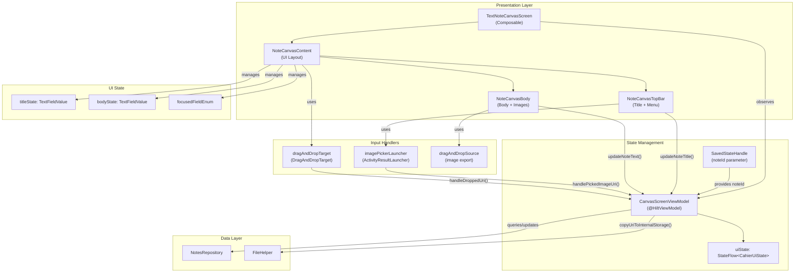

**Sources:** [app/src/main/java/com/example/cahier/ui/TextNoteCanvasScreen.kt:89-149](), [app/src/main/java/com/example/cahier/ui/viewmodels/CanvasScreenViewModel.kt:43-72]()

---

## CanvasScreenViewModel

The `CanvasScreenViewModel` manages all business logic and state for text notes.

### State Management

The ViewModel maintains a single `StateFlow<CahierUiState>` that holds the current note and UI state:

| Property | Type | Purpose |
|----------|------|---------|
| `_uiState` | `MutableStateFlow<CahierUiState>` | Private mutable state |
| `uiState` | `StateFlow<CahierUiState>` | Public immutable state exposed to UI |
| `noteId` | `Long?` | Note identifier from navigation arguments |

**Sources:** [app/src/main/java/com/example/cahier/ui/viewmodels/CanvasScreenViewModel.kt:49-52]()

### Note Loading

On initialization, the ViewModel loads the note from the repository if a valid `noteId` is provided:

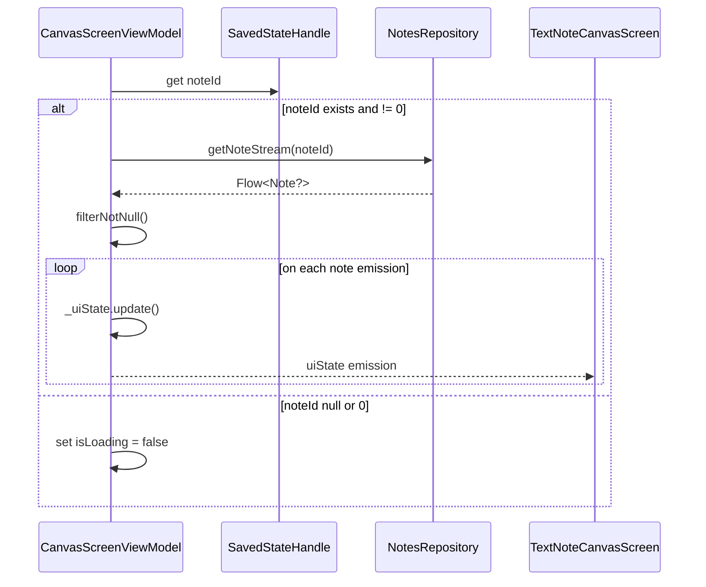

The note is loaded reactively using `getNoteStream()`, which returns a `Flow<Note?>`. The ViewModel filters out null values and updates the UI state on each emission, enabling real-time updates when the note changes in the database.

**Sources:** [app/src/main/java/com/example/cahier/ui/viewmodels/CanvasScreenViewModel.kt:54-72]()

### Field Updates

The ViewModel provides two public methods for updating note fields:

- `updateNoteTitle(title: String)` - Updates the note title
- `updateNoteText(text: String)` - Updates the note body text

Both methods use a generic `updateNoteField()` helper that:
1. Updates the in-memory state immediately
2. Persists the change to the repository asynchronously

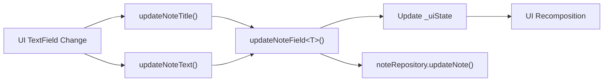

This pattern ensures immediate UI feedback while persisting changes in the background.

**Sources:** [app/src/main/java/com/example/cahier/ui/viewmodels/CanvasScreenViewModel.kt:74-94]()

### Image Management

The ViewModel handles image attachments through several methods:

| Method | Parameters | Purpose |
|--------|-----------|---------|
| `addImage()` | `localUri: Uri?` | Adds an image URI to the note's image list |
| `handlePickedImageUri()` | `uri: Uri` | Processes image from picker, copies to internal storage |
| `handleDroppedUri()` | `uri: Uri, permissions: DragAndDropPermissions?` | Processes dragged image, copies to internal storage |
| `createShareableUri()` | `imageUriString: String` | Creates shareable URI for drag-and-drop export |

The image handling flow follows this pattern:

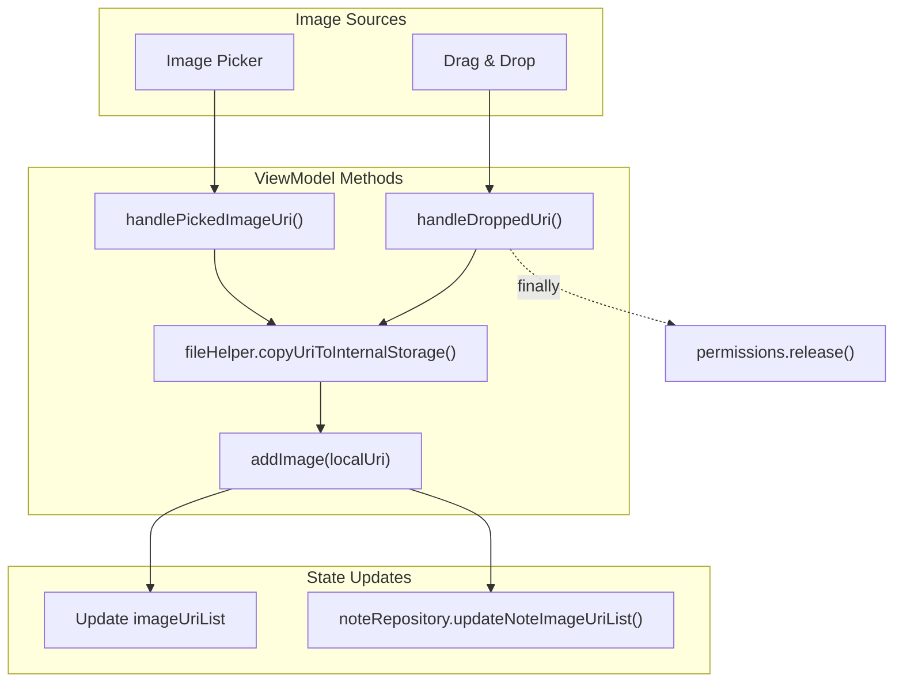

Images are always copied to internal storage before being added to the note, ensuring persistent access even if the original URI becomes invalid.

**Sources:** [app/src/main/java/com/example/cahier/ui/viewmodels/CanvasScreenViewModel.kt:96-151]()

### Other Operations

- `toggleFavorite()` - Toggles the favorite status of the current note through the repository

**Sources:** [app/src/main/java/com/example/cahier/ui/viewmodels/CanvasScreenViewModel.kt:124-128]()

---

## TextNoteCanvasScreen UI

The `TextNoteCanvasScreen` composable is the main entry point for the text note editing UI.

### Component Hierarchy

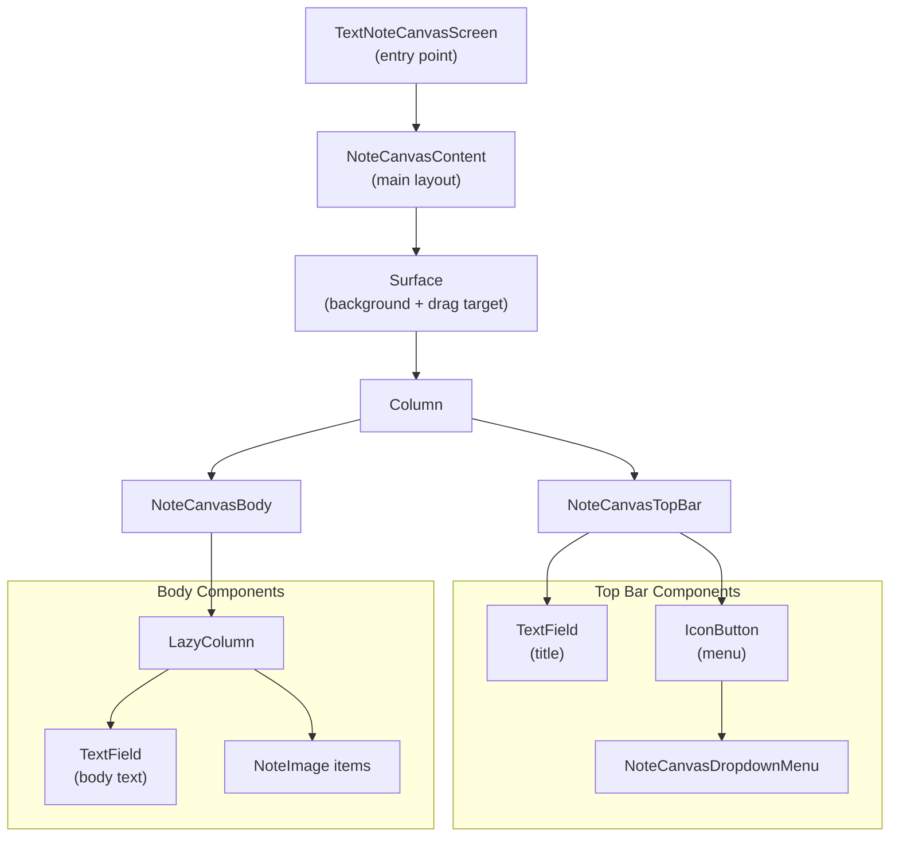

**Sources:** [app/src/main/java/com/example/cahier/ui/TextNoteCanvasScreen.kt:89-234]()

### State Preservation

The UI maintains its own text field state using `TextFieldValue` to preserve cursor position and selection:

```kotlin
var titleState by rememberSaveable(stateSaver = TextFieldValue.Saver) {
    mutableStateOf(TextFieldValue(uiState.note.title))
}

var bodyState by rememberSaveable(stateSaver = TextFieldValue.Saver) {
    mutableStateOf(TextFieldValue(uiState.note.text ?: ""))
}
```

A `LaunchedEffect` synchronizes these local states with the ViewModel's state when the note ID changes, ensuring consistency when navigating between notes.

**Sources:** [app/src/main/java/com/example/cahier/ui/TextNoteCanvasScreen.kt:98-113]()

### NoteCanvasTopBar

The top bar contains the title field and options menu:

| Component | Purpose |
|-----------|---------|
| `TextField` (title) | Editable note title with large typography |
| `IconButton` | Opens dropdown menu |
| `NoteCanvasDropdownMenu` | Contains upload image, favorite, and exit actions |

The title field uses:
- `KeyboardCapitalization.Sentences` for automatic capitalization
- `MaterialTheme.typography.titleLarge` for visual hierarchy
- `FocusRequester` for programmatic focus control

**Sources:** [app/src/main/java/com/example/cahier/ui/TextNoteCanvasScreen.kt:236-294]()

### NoteCanvasDropdownMenu

The dropdown menu provides three actions:

| Menu Item | Icon | Action |
|-----------|------|--------|
| Upload Image | `image_24px` | Launches image picker |
| Favorite/Unfavorite | `favorite_24px` or `favorite_24px_filled` | Toggles favorite status |
| Exit | `exit_to_app_24px` | Navigates back to home screen |

The favorite icon changes based on the note's favorite status and uses `MaterialTheme.colorScheme.primary` tint when favorited.

**Sources:** [app/src/main/java/com/example/cahier/ui/TextNoteCanvasScreen.kt:296-366]()

### NoteCanvasBody

The body section uses a `LazyColumn` to efficiently render the text field and image list:

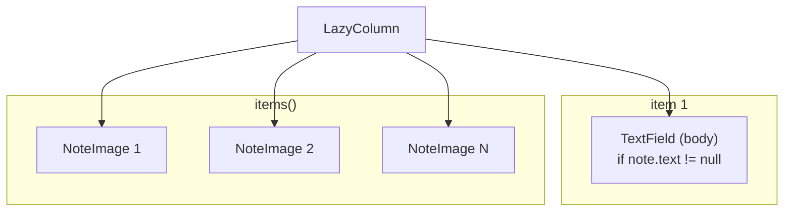

The body text field:
- Only renders if `note.text` is not null
- Uses `KeyboardCapitalization.Sentences`
- Uses `MaterialTheme.typography.bodyLarge`
- Has its own `FocusRequester` for programmatic focus

Images are rendered as `NoteImage` composables with drag-and-drop source capability for exporting.

**Sources:** [app/src/main/java/com/example/cahier/ui/TextNoteCanvasScreen.kt:368-411]()

### NoteImage Composable

Each image is displayed using Coil's `AsyncImage` and supports drag-and-drop export:

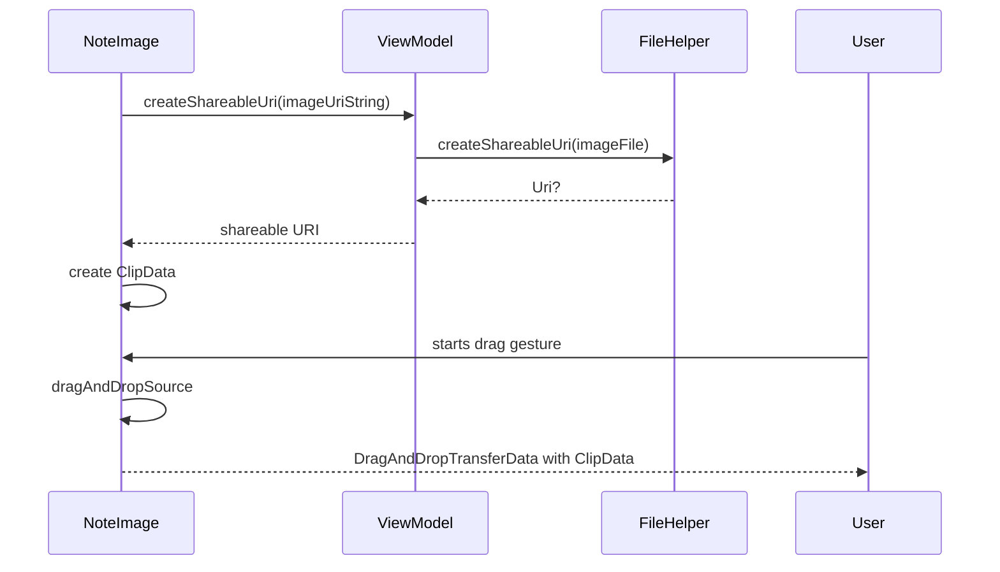

The shareable URI is created in a `LaunchedEffect` when the image is composed, allowing images to be dragged out of the app to other applications with appropriate read permissions.

**Sources:** [app/src/main/java/com/example/cahier/ui/TextNoteCanvasScreen.kt:413-457]()

---

## Focus Management System

The text note UI implements explicit focus management to coordinate between the title and body fields.

### FocusedFieldEnum

An internal enum tracks which field currently has focus:

```kotlin
enum class FocusedFieldEnum {
    None,
    Title,
    Body
}
```

**Sources:** [app/src/main/java/com/example/cahier/ui/TextNoteCanvasScreen.kt:166]()

### Focus Flow

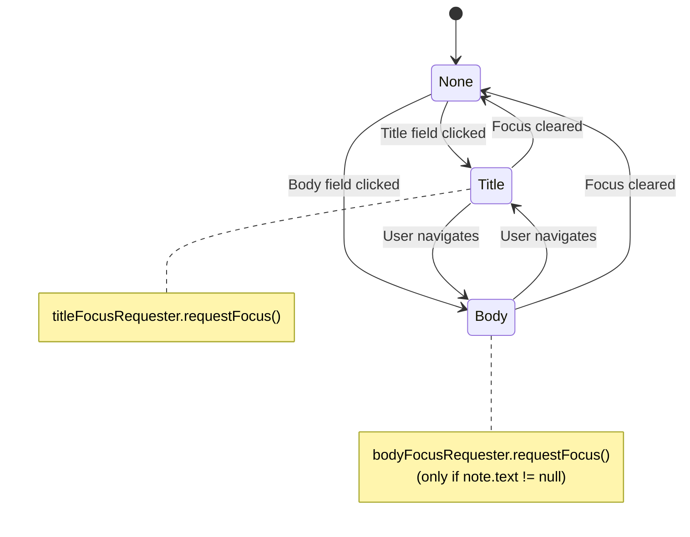

A `LaunchedEffect` responds to `focusedFieldEnum` changes:

- When `FocusedFieldEnum.Title` → requests focus on title field
- When `FocusedFieldEnum.Body` → requests focus on body field if `note.text != null`, otherwise resets to `None`
- When `FocusedFieldEnum.None` → no action taken

Each `TextField` has an `onFocusChanged` callback that updates the enum when focus is gained.

**Sources:** [app/src/main/java/com/example/cahier/ui/TextNoteCanvasScreen.kt:166-186](), [app/src/main/java/com/example/cahier/ui/TextNoteCanvasScreen.kt:214-217](), [app/src/main/java/com/example/cahier/ui/TextNoteCanvasScreen.kt:229]()

---

## Drag and Drop Integration

The text note screen supports drag-and-drop for both importing and exporting images.

### Import: Drag-and-Drop Target

The entire `Surface` acts as a drag-and-drop target:

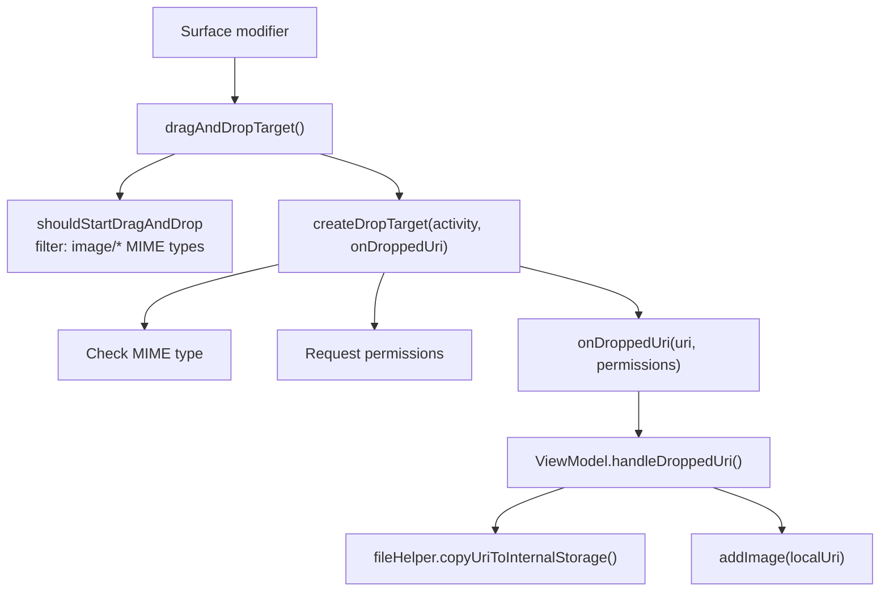

The `createDropTarget()` utility function (from `ui.utils` package) handles:
- MIME type validation
- Drag-and-drop permission management
- URI extraction from drag events
- Callback invocation with URI and permissions

**Sources:** [app/src/main/java/com/example/cahier/ui/TextNoteCanvasScreen.kt:188-200]()

### Export: Drag-and-Drop Source

Each `NoteImage` composable acts as a drag-and-drop source:

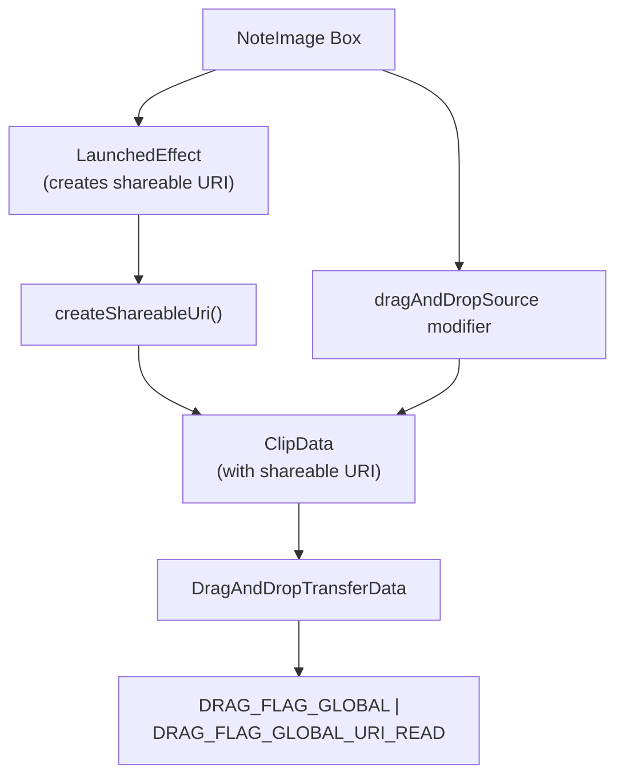

The process:
1. `LaunchedEffect` calls `createShareableUri()` to convert internal URI to shareable URI
2. Creates `ClipData` with MIME type `"image/*"`
3. `dragAndDropSource` modifier provides the `DragAndDropTransferData` with global read permissions
4. Other apps can receive and read the image

**Sources:** [app/src/main/java/com/example/cahier/ui/TextNoteCanvasScreen.kt:420-445]()

---

## Image Picker Integration

The image picker uses the Activity Result API with `PickVisualMedia` contract:

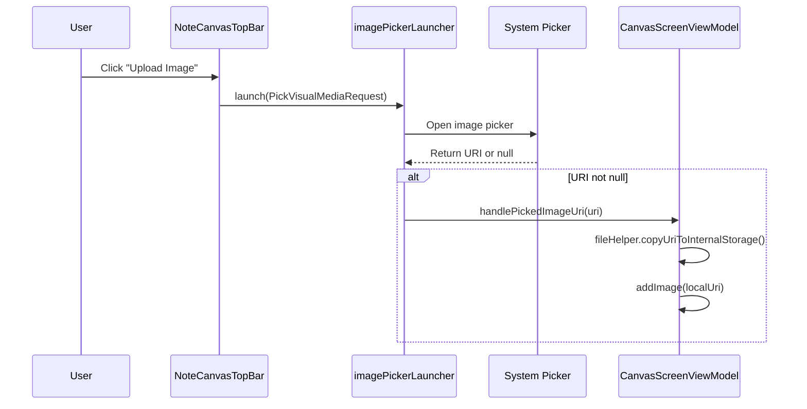

The launcher is created with:

```kotlin
val imagePickerLauncher = rememberLauncherForActivityResult(
    contract = ActivityResultContracts.PickVisualMedia()
) { uri: Uri? ->
    uri?.let {
        canvasScreenViewModel.handlePickedImageUri(it)
    }
}
```

And launched with:

```kotlin
imagePickerLauncher.launch(
    PickVisualMediaRequest(
        ActivityResultContracts.PickVisualMedia.ImageOnly
    )
)
```

This restricts the picker to images only and provides a consistent cross-platform experience.

**Sources:** [app/src/main/java/com/example/cahier/ui/TextNoteCanvasScreen.kt:115-121](), [app/src/main/java/com/example/cahier/ui/TextNoteCanvasScreen.kt:282-286]()

---

## Data Persistence Flow

All data changes flow through the ViewModel to the repository:

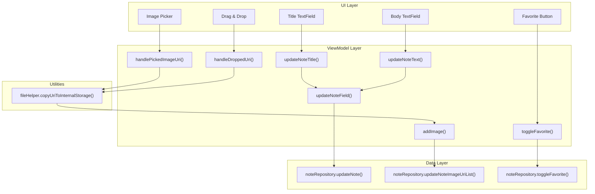

All updates are performed asynchronously in `viewModelScope.launch { }` blocks to avoid blocking the UI thread. The repository abstracts the underlying Room database, allowing for clean separation of concerns.

**Sources:** [app/src/main/java/com/example/cahier/ui/viewmodels/CanvasScreenViewModel.kt:74-151]()

---

## Navigation Integration

The `TextNoteCanvasScreen` is registered in the navigation graph as `TextCanvasDestination`:

| Property | Value |
|----------|-------|
| Route | `"note_canvas/{noteId}"` |
| Argument | `noteId: Long` (from `NOTE_ID_ARG`) |

The `SavedStateHandle` automatically provides the `noteId` argument to the ViewModel:

```kotlin
private val noteId: Long? = savedStateHandle[TextCanvasDestination.NOTE_ID_ARG]
```

When a new note is created (noteId = 0 or null), the ViewModel skips loading and allows immediate editing of an empty note. The note is created/updated on the first field change.

**Sources:** [app/src/main/java/com/example/cahier/ui/viewmodels/CanvasScreenViewModel.kt:52](), [app/src/main/java/com/example/cahier/ui/viewmodels/CanvasScreenViewModel.kt:54-72]()

---

## Summary

The Text Notes System provides a complete text editing experience with:

- **Clean MVVM architecture** separating UI from business logic
- **Reactive state management** using StateFlow for automatic UI updates
- **Comprehensive image support** via picker and drag-and-drop
- **Explicit focus management** for coordinated multi-field editing
- **Bidirectional drag-and-drop** for importing and exporting images
- **Persistent storage** through the repository abstraction
- **Type-safe navigation** with argument passing through SavedStateHandle

The system integrates with the broader Cahier application through shared components like `NotesRepository`, `FileHelper`, and the navigation graph, while maintaining clear boundaries and single responsibility principles.

**Sources:** [app/src/main/java/com/example/cahier/ui/TextNoteCanvasScreen.kt:1-482](), [app/src/main/java/com/example/cahier/ui/viewmodels/CanvasScreenViewModel.kt:1-156]()

---

