<!-- source: DeepWiki mcp.deepwiki.com · repo android/cahier · page 3.3 Home Screen & Note Management · fetched 2026-10-23 -->

# Home Screen & Note Management

Relevant source files

The following files were used as context for generating this wiki page:

- [app/src/androidTest/java/com/example/cahier/utils/FileHelperTest.kt](app/src/androidTest/java/com/example/cahier/utils/FileHelperTest.kt)
- [app/src/main/java/com/example/cahier/navigation/CahierNavGraph.kt](app/src/main/java/com/example/cahier/navigation/CahierNavGraph.kt)
- [app/src/main/java/com/example/cahier/ui/CahierHomeScreen.kt](app/src/main/java/com/example/cahier/ui/CahierHomeScreen.kt)
- [app/src/main/java/com/example/cahier/ui/ColorPickerDialog.kt](app/src/main/java/com/example/cahier/ui/ColorPickerDialog.kt)
- [app/src/main/java/com/example/cahier/ui/DrawingDetailThumbnail.kt](app/src/main/java/com/example/cahier/ui/DrawingDetailThumbnail.kt)
- [app/src/main/java/com/example/cahier/ui/viewmodels/HomeScreenViewModel.kt](app/src/main/java/com/example/cahier/ui/viewmodels/HomeScreenViewModel.kt)
- [app/src/test/java/com/example/cahier/ui/viewmodels/HomeScreenViewModelTest.kt](app/src/test/java/com/example/cahier/ui/viewmodels/HomeScreenViewModelTest.kt)

## Purpose and Scope

This document explains the home screen UI, note list display, note selection system, favorites management, deletion operations, and adaptive layout behavior for different screen sizes. The home screen serves as the central hub for viewing and managing all notes in the Cahier application.

For navigation routing details, see [Navigation System](#2.3). For drawing note editing, see [Drawing Notes System](#3.1). For text note editing, see [Text Notes System](#3.2). For adaptive layout implementation details, see [Adaptive Layouts](#5.1).

---

## Architecture Overview

The home screen implements a list-detail pattern with adaptive layouts. On compact devices (phones), it shows a single pane that navigates to full-screen note editors. On expanded devices (tablets/foldables), it displays a two-pane layout with the note list on the left and a preview on the right.

### Component Hierarchy

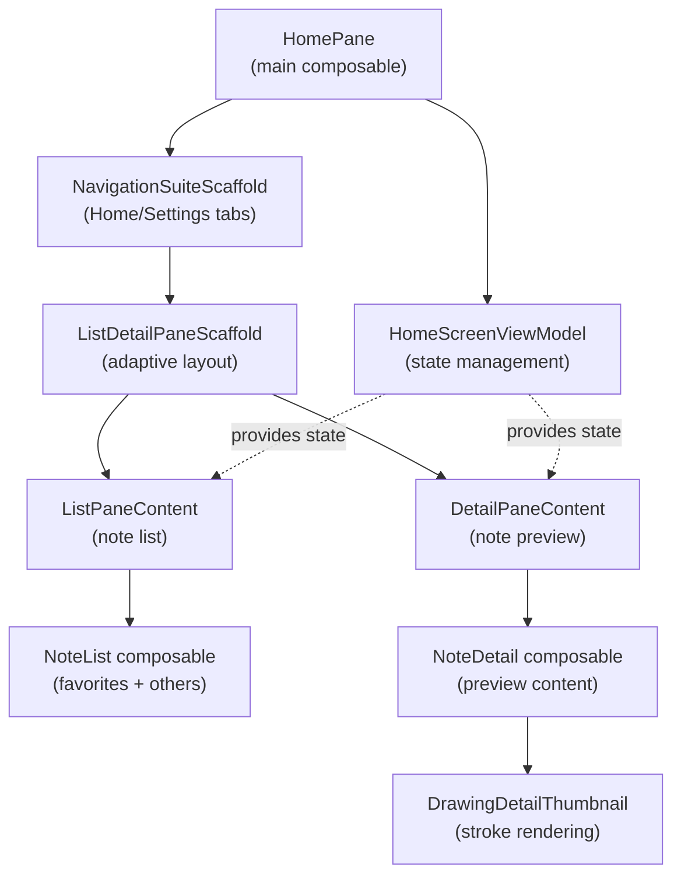

**Sources:** [app/src/main/java/com/example/cahier/ui/CahierHomeScreen.kt:103-178]()

---

## HomePane Component

`HomePane` is the root composable for the home screen, responsible for orchestrating the entire UI hierarchy and managing adaptive layout behavior.

### Key Responsibilities

| Responsibility | Implementation |
|---------------|----------------|
| **Adaptive Layout Detection** | Uses `calculateWindowSizeClass` to determine `WindowWidthSizeClass` |
| **Navigation State** | Manages `ListDetailPaneScaffoldNavigator<Note>` for list-detail pane navigation |
| **ViewModel Integration** | Injects `HomeScreenViewModel` via `hiltViewModel()` |
| **Multi-Window Support** | Listens to `newWindowEvent` channel and launches new activity instances |
| **Pane Expansion** | Controls initial pane proportions (30% list, 70% detail) |

### State Collection

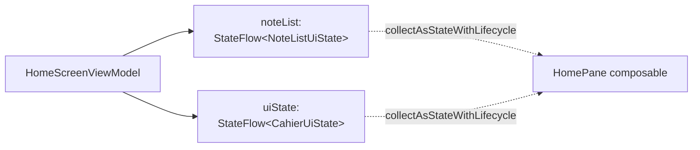

**Sources:** [app/src/main/java/com/example/cahier/ui/CahierHomeScreen.kt:103-178](), [app/src/main/java/com/example/cahier/ui/viewmodels/HomeScreenViewModel.kt:44-66]()

---

## Navigation Structure

The home screen uses a two-level navigation system: top-level navigation between Home and Settings destinations, and secondary navigation for list-detail pane management.

### Top-Level Navigation

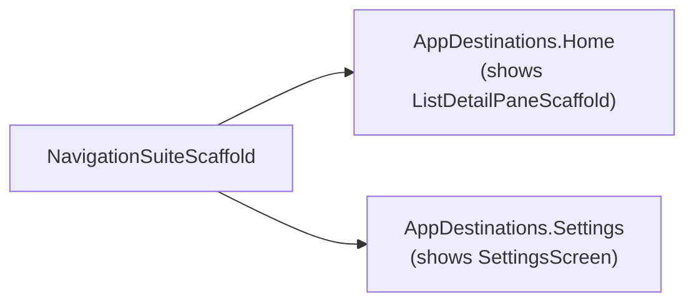

The `NavigationSuiteScaffold` automatically adapts its presentation:
- **Compact devices**: Bottom navigation bar
- **Medium devices**: Navigation rail
- **Expanded devices**: Navigation drawer

**Sources:** [app/src/main/java/com/example/cahier/ui/CahierHomeScreen.kt:79-94](), [app/src/main/java/com/example/cahier/ui/CahierHomeScreen.kt:197-316]()

### List-Detail Pane Navigation

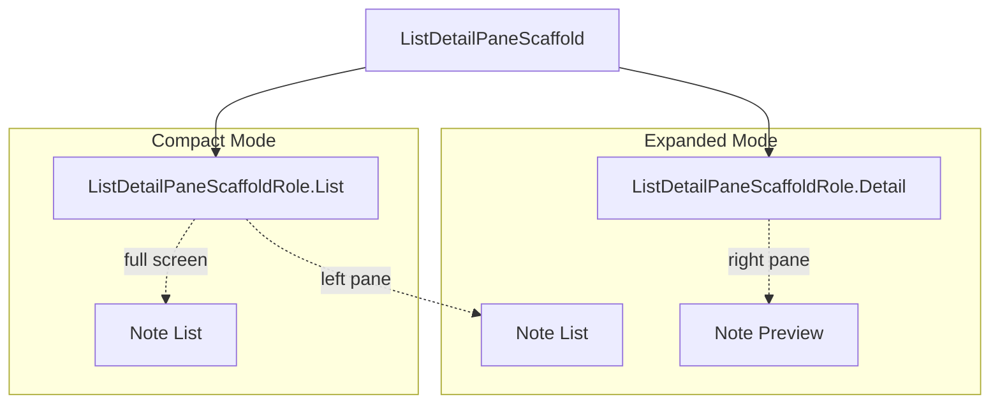

**Sources:** [app/src/main/java/com/example/cahier/ui/CahierHomeScreen.kt:231-304]()

---

## State Management: HomeScreenViewModel

`HomeScreenViewModel` manages all state and operations for the home screen.

### State Flows

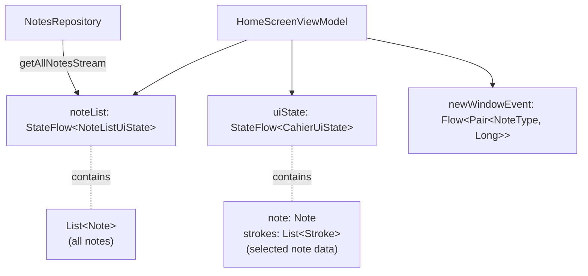

### Primary Operations

| Operation | Method | Description |
|-----------|--------|-------------|
| **Select Note** | `selectNote(noteId: Long)` | Loads note and strokes (if drawing) into `uiState` |
| **Add Text Note** | `addNote(callback: (Long) -> Unit)` | Creates new `NoteType.Text`, invokes callback with ID |
| **Add Drawing Note** | `addDrawingNote(callback: (Long) -> Unit)` | Creates new `NoteType.Drawing`, invokes callback with ID |
| **Delete Note** | `deleteNote(note: Note)` | Removes note from repository |
| **Toggle Favorite** | `toggleFavorite(noteId: Long)` | Toggles `isFavorite` flag, updates `uiState` if selected |
| **Clear Selection** | `clearSelection()` | Resets `uiState` to empty `CahierUiState()` |
| **Open in New Window** | `openInNewWindow(note: Note)` | Sends event to `newWindowEvent` channel |

**Sources:** [app/src/main/java/com/example/cahier/ui/viewmodels/HomeScreenViewModel.kt:44-168]()

### Note Selection Flow

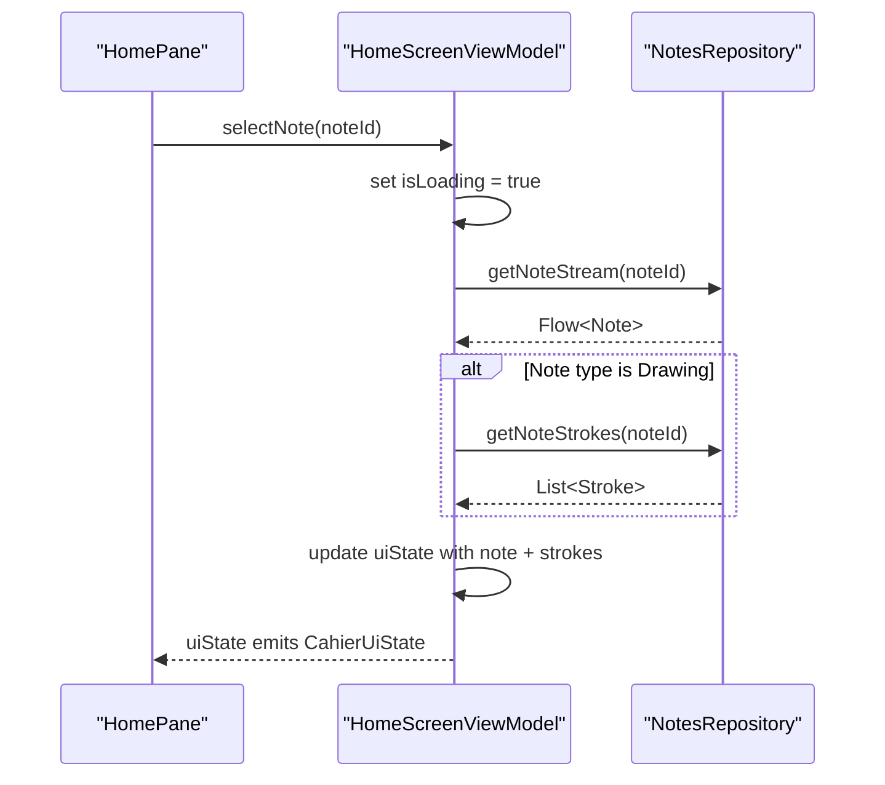

**Sources:** [app/src/main/java/com/example/cahier/ui/viewmodels/HomeScreenViewModel.kt:67-89]()

---

## Note List Display

The note list is displayed via `ListPaneContent`, which partitions notes into favorites and regular notes.

### List Partitioning

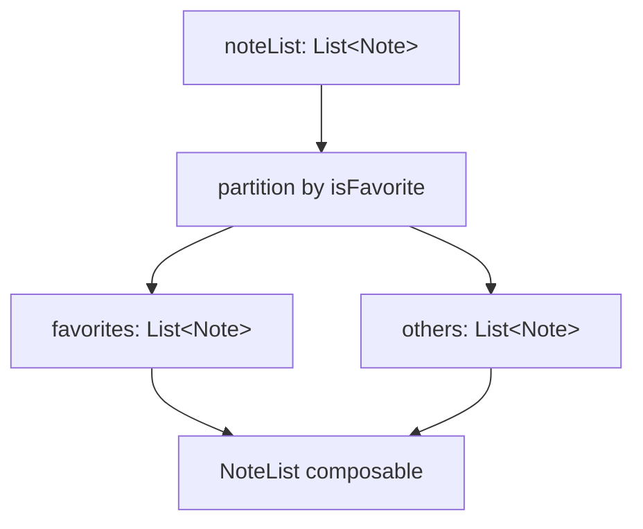

**Implementation:** [app/src/main/java/com/example/cahier/ui/CahierHomeScreen.kt:320-347]()

### Note Item Callbacks

The `ListPaneContent` provides the following callbacks to `NoteList`:

| Callback | Compact Mode Behavior | Expanded Mode Behavior |
|----------|----------------------|------------------------|
| `onNoteClick` | Navigate to full editor screen | Call `selectNote()` to update detail pane |
| `onAddNewTextNote` | Navigate to new text note editor | Navigate to new text note editor |
| `onAddNewDrawingNote` | Navigate to new drawing note editor | Navigate to new drawing note editor |
| `onDeleteNote` | Delete note, navigate up | Delete note, navigate up |
| `onToggleFavorite` | Toggle favorite status | Toggle favorite status |
| `onNewWindow` | Open note in new window | Open note in new window |

**Sources:** [app/src/main/java/com/example/cahier/ui/CahierHomeScreen.kt:248-286]()

---

## Note Selection and Detail Pane

In expanded mode, the detail pane displays a preview of the selected note via `DetailPaneContent`.

### Detail Pane Content

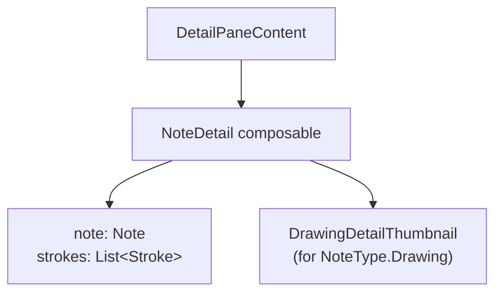

**Sources:** [app/src/main/java/com/example/cahier/ui/CahierHomeScreen.kt:349-362]()

### Drawing Thumbnail Rendering

`DrawingDetailThumbnail` renders stroke previews using `CanvasStrokeRenderer` from the androidx.ink library.

**Key Implementation Details:**
- Uses `CanvasStrokeRenderer.create()` for stroke rendering
- Renders background image if `backgroundImageUri` is provided
- Applies identity `Matrix()` for `strokeToScreenTransform` (no scaling/translation)
- Clickable to navigate to full editor

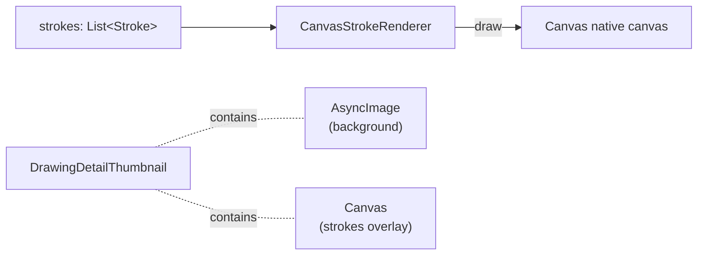

**Sources:** [app/src/main/java/com/example/cahier/ui/DrawingDetailThumbnail.kt:40-78]()

---

## Adaptive Layout Behavior

The home screen adapts its behavior based on `WindowWidthSizeClass`.

### Compact Mode (Phones)

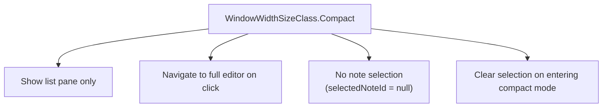

**Behavior Characteristics:**
1. Only list pane is shown (full screen)
2. Clicking a note navigates to full editor screen
3. No detail pane preview
4. Selection is cleared when entering compact mode

**Sources:** [app/src/main/java/com/example/cahier/ui/CahierHomeScreen.kt:138-143](), [app/src/main/java/com/example/cahier/ui/CahierHomeScreen.kt:252-260]()

### Expanded Mode (Tablets/Foldables)

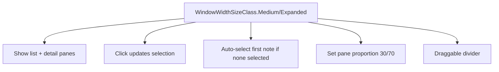

**Behavior Characteristics:**
1. Two-pane layout (list on left, detail on right)
2. Clicking a note selects it and updates detail pane
3. First note is auto-selected if list is non-empty
4. Initial pane proportion is 30% list, 70% detail
5. User can drag divider to resize panes
6. Clicking edit button in detail pane navigates to full editor

**Sources:** [app/src/main/java/com/example/cahier/ui/CahierHomeScreen.kt:145-156](), [app/src/main/java/com/example/cahier/ui/CahierHomeScreen.kt:261-263]()

### Pane Expansion State

The pane expansion state is managed via `rememberPaneExpansionState()` and allows users to resize panes:

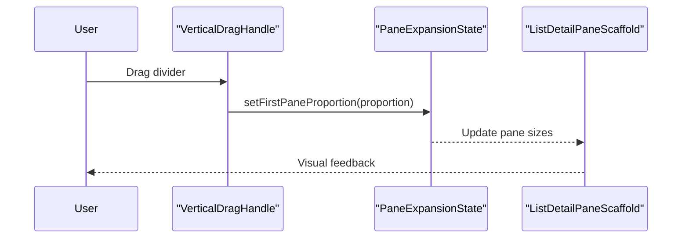

**Sources:** [app/src/main/java/com/example/cahier/ui/CahierHomeScreen.kt:117-156](), [app/src/main/java/com/example/cahier/ui/CahierHomeScreen.kt:235-247]()

---

## Note Management Operations

### Creating Notes

Notes can be created as either text or drawing type:

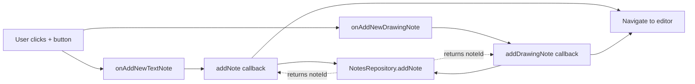

The ViewModel creates a new `Note` with empty content and invokes the callback with the inserted ID, which triggers navigation to the appropriate editor screen.

**Sources:** [app/src/main/java/com/example/cahier/ui/viewmodels/HomeScreenViewModel.kt:91-126](), [app/src/main/java/com/example/cahier/ui/CahierHomeScreen.kt:265-273]()

### Deleting Notes

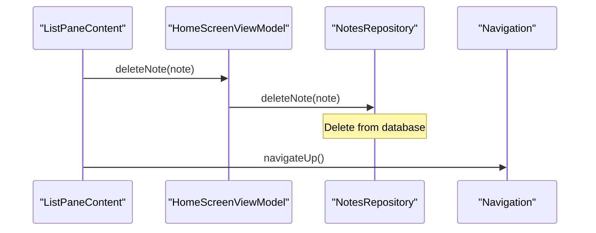

After deletion, the UI always calls `navigateUp()` to ensure the user isn't viewing a deleted note.

**Sources:** [app/src/main/java/com/example/cahier/ui/viewmodels/HomeScreenViewModel.kt:128-138](), [app/src/main/java/com/example/cahier/ui/CahierHomeScreen.kt:275-277]()

### Toggling Favorites

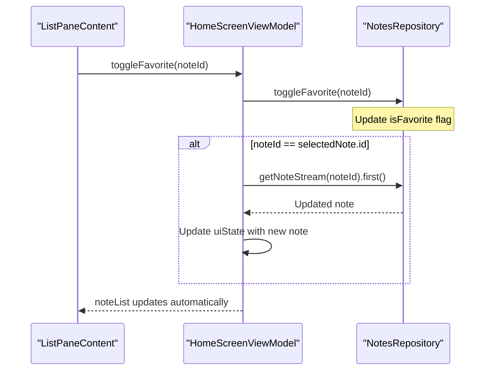

When a favorite is toggled, the note list automatically updates via the `noteList` StateFlow. If the toggled note is currently selected, the ViewModel also updates `uiState` to reflect the change.

**Sources:** [app/src/main/java/com/example/cahier/ui/viewmodels/HomeScreenViewModel.kt:140-152](), [app/src/main/java/com/example/cahier/ui/CahierHomeScreen.kt:279-281]()

---

## Multi-Window Support

The home screen supports opening notes in separate windows on devices that support multi-window mode.

### Multi-Window Flow

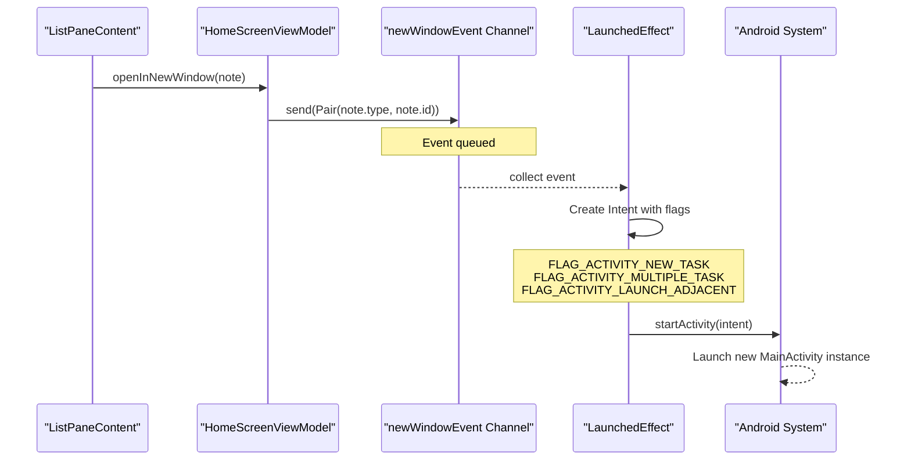

**Key Implementation Details:**
- Uses `Channel<Pair<NoteType, Long>>` for event communication
- `LaunchedEffect` collects from `newWindowEvent.receiveAsFlow()`
- Intent includes `NOTE_TYPE_KEY` and `NOTE_ID_KEY` extras
- Uses `FLAG_ACTIVITY_LAUNCH_ADJACENT` to request side-by-side placement

**Sources:** [app/src/main/java/com/example/cahier/ui/viewmodels/HomeScreenViewModel.kt:51-52](), [app/src/main/java/com/example/cahier/ui/viewmodels/HomeScreenViewModel.kt:158-162](), [app/src/main/java/com/example/cahier/ui/CahierHomeScreen.kt:125-136]()

---

## Navigation Flow

### Navigation Destinations

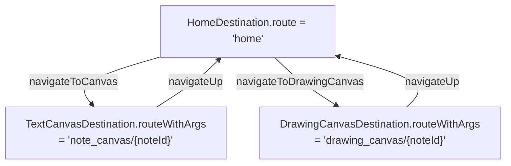

**Sources:** [app/src/main/java/com/example/cahier/navigation/CahierNavGraph.kt:46-79](), [app/src/main/java/com/example/cahier/ui/CahierHomeScreen.kt:75-77]()

### Navigation Mode Differences

| Mode | Click Behavior | Navigation Action |
|------|---------------|-------------------|
| **Compact** | Click note | Navigate to full editor screen via `navigateToCanvas()` or `navigateToDrawingCanvas()` |
| **Expanded** | Click note | Call `selectNote()` to update detail pane |
| **Expanded** | Click edit in detail pane | Navigate to full editor screen |

**Sources:** [app/src/main/java/com/example/cahier/ui/CahierHomeScreen.kt:254-263](), [app/src/main/java/com/example/cahier/ui/CahierHomeScreen.kt:293-299]()

---

## Testing

### Unit Tests

The `HomeScreenViewModelTest` validates state management operations:

| Test | Validates |
|------|-----------|
| `selectNote_updates_uiState_with_the_correct_note` | Note selection updates `uiState` with correct note and strokes |
| `addDrawingNote_adds_a_drawing_note_to_repository` | Creating drawing notes adds `NoteType.Drawing` to repository |
| `deleteNote_removes_note_from_repository` | Note deletion removes note from repository |
| `toggleFavorite_toggles_favorite_status_in_repository` | Toggling favorite updates repository state |
| `clearSelection_clears_selection_in_uiState` | Clear selection resets `uiState` to empty state |

Uses **Turbine** library for Flow testing and **FakeNotesRepository** for isolated testing.

**Sources:** [app/src/test/java/com/example/cahier/ui/viewmodels/HomeScreenViewModelTest.kt:68-136]()

---

## Summary

The home screen implements a sophisticated list-detail pattern with adaptive layouts:

- **State Management**: `HomeScreenViewModel` exposes `noteList` and `uiState` StateFlows
- **Adaptive UI**: `ListDetailPaneScaffold` adapts between single-pane (compact) and two-pane (expanded) layouts
- **Note Operations**: Create, delete, favorite, and multi-window launching
- **Navigation**: Different behaviors in compact vs expanded modes
- **Drawing Previews**: `DrawingDetailThumbnail` renders stroke previews using `CanvasStrokeRenderer`

The architecture maintains clean separation between UI (composables), state management (ViewModel), and data persistence (repository), following MVVM patterns with reactive state flows.

---

