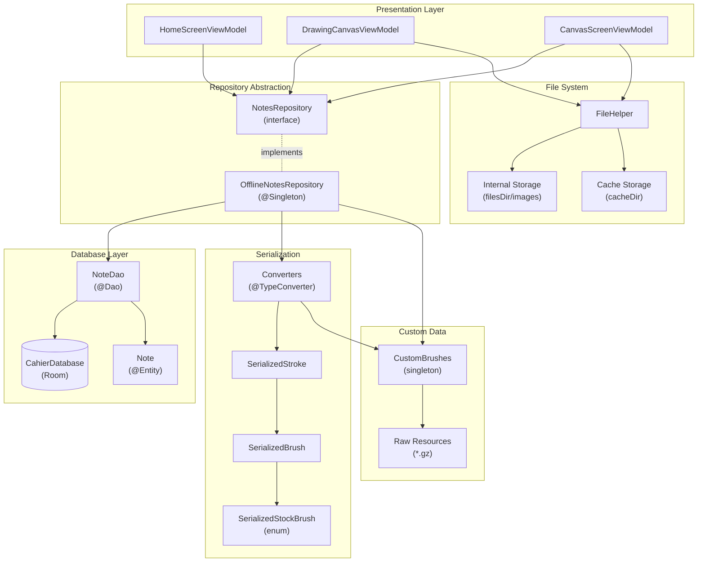
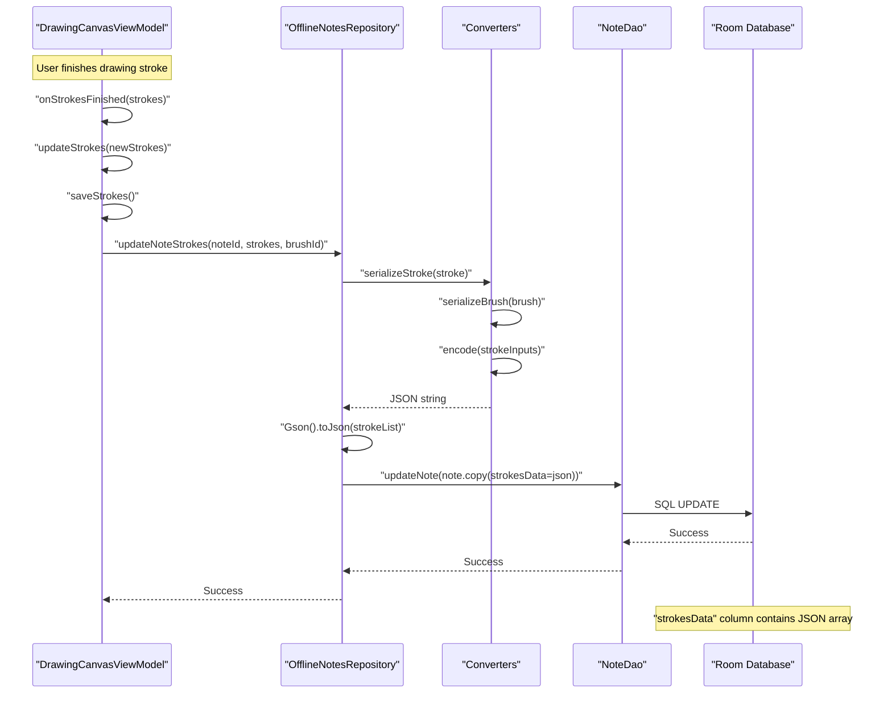
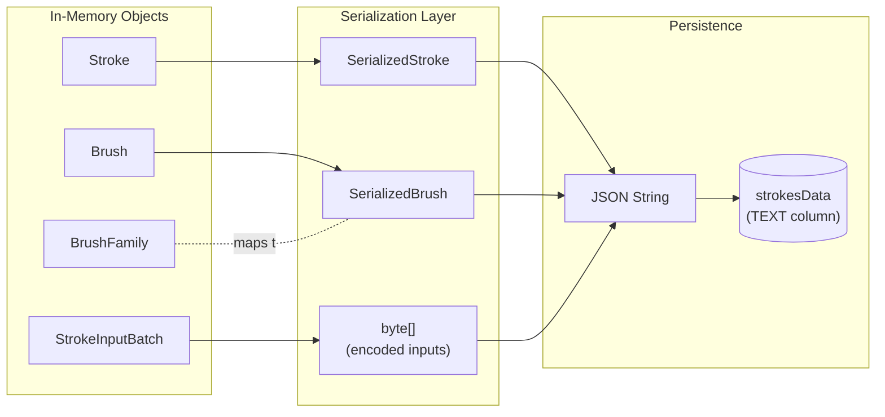
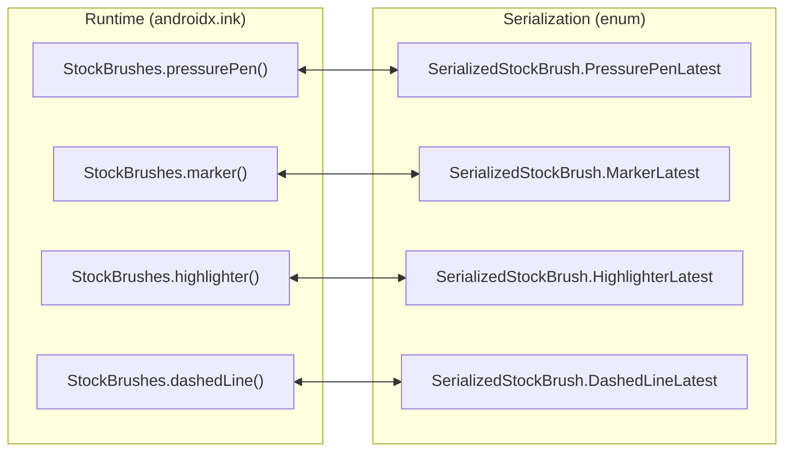
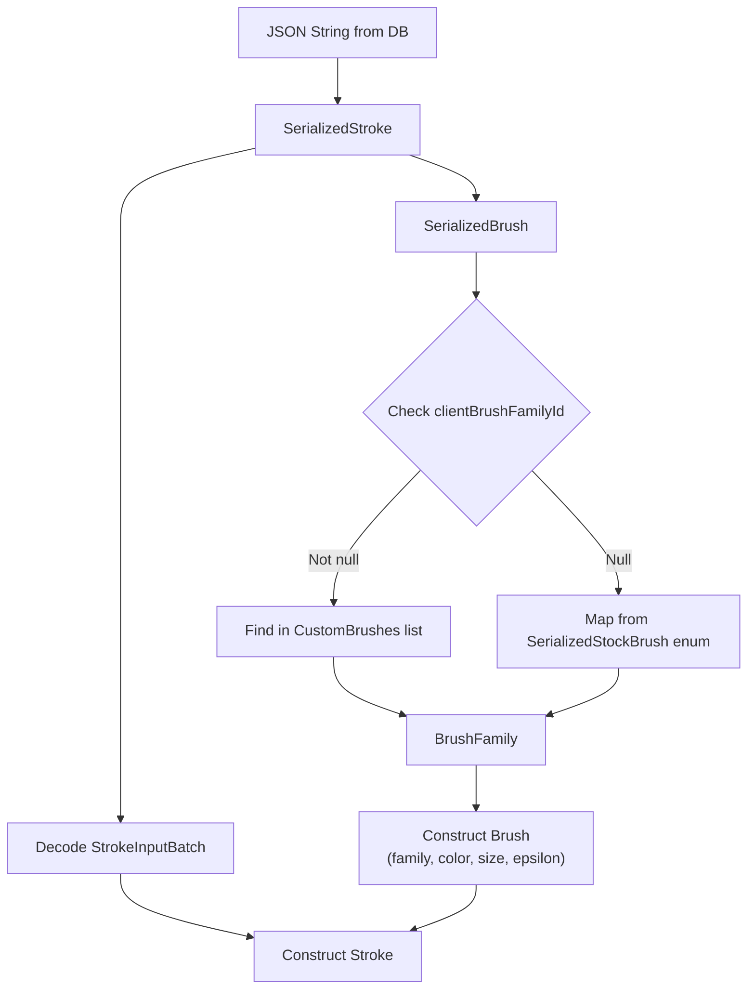
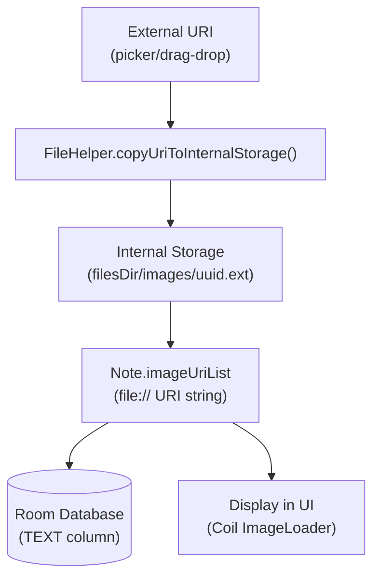
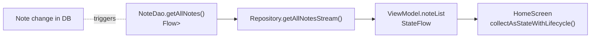

<!-- source: DeepWiki mcp.deepwiki.com · repo android/cahier · page 4 Data Layer · fetched 2026-10-23 -->

# Data Layer

<details>
<summary>Relevant source files</summary>

The following files were used as context for generating this wiki page:

- [app/src/androidTest/java/com/example/cahier/data/OfflineNotesRepositoryTest.kt](app/src/androidTest/java/com/example/cahier/data/OfflineNotesRepositoryTest.kt)
- [app/src/main/java/com/example/cahier/ui/Converters.kt](app/src/main/java/com/example/cahier/ui/Converters.kt)
- [app/src/main/java/com/example/cahier/ui/DrawingToolbox.kt](app/src/main/java/com/example/cahier/ui/DrawingToolbox.kt)
- [app/src/main/java/com/example/cahier/ui/viewmodels/DrawingCanvasViewModel.kt](app/src/main/java/com/example/cahier/ui/viewmodels/DrawingCanvasViewModel.kt)

</details>


## Purpose and Scope

The Data Layer is responsible for all data persistence in the Cahier application, including note storage, stroke serialization, and file management. This encompasses the repository abstraction, Room database implementation, complex serialization strategies for ink strokes, and file system operations for image attachments.

For details on how the data layer integrates with dependency injection, see [Dependency Injection with Hilt](#2.2). For information on how ViewModels interact with the data layer, see [MVVM Pattern & State Management](#2.1).

## Architecture Overview

The data layer follows a clean architecture pattern with clear separation between abstract interfaces and concrete implementations. The repository pattern provides a unified API for data access, abstracting away implementation details from the UI layer.

**Data Layer Component Architecture**



Sources: [app/src/main/java/com/example/cahier/ui/viewmodels/DrawingCanvasViewModel.kt:67-73](), [app/src/androidTest/java/com/example/cahier/data/OfflineNotesRepositoryTest.kt:31-44]()

## Core Components

### NotesRepository Interface

The `NotesRepository` interface defines the contract for all data operations in the application. It provides methods for CRUD operations on notes, stroke management, and data streams.

**Key Responsibilities:**
- Provide reactive streams of notes via Kotlin Flow
- Manage note lifecycle (insert, update, delete)
- Handle stroke serialization/deserialization
- Toggle note favorite status

Sources: [app/src/main/java/com/example/cahier/ui/viewmodels/DrawingCanvasViewModel.kt:70]()

### OfflineNotesRepository Implementation

`OfflineNotesRepository` is the Room-backed implementation of `NotesRepository`, marked as `@Singleton` for dependency injection. It coordinates between the DAO, converters, and custom brush system.

**Implementation Details:**

| Method | Purpose | Return Type |
|--------|---------|-------------|
| `getAllNotesStream()` | Stream of all notes | `Flow<List<Note>>` |
| `getNoteStream(id)` | Stream of single note | `Flow<Note?>` |
| `getNoteStrokes(id)` | Deserialize strokes from JSON | `List<Stroke>` |
| `updateNoteStrokes(id, strokes, brushId)` | Serialize and save strokes | `Unit` |
| `updateNote(note)` | Update note metadata | `Unit` |
| `insertNote(note)` | Create new note | `Unit` |
| `deleteNote(note)` | Remove note | `Unit` |
| `toggleFavorite(id)` | Toggle favorite status | `Unit` |

Sources: [app/src/androidTest/java/com/example/cahier/data/OfflineNotesRepositoryTest.kt:37-44](), [app/src/androidTest/java/com/example/cahier/data/OfflineNotesRepositoryTest.kt:52-78]()

### Room Database

The Room database stores the `Note` entity with the following schema:

**Note Entity Fields:**

| Field | Type | Purpose |
|-------|------|---------|
| `id` | `Long` | Primary key |
| `title` | `String` | Note title |
| `noteType` | `String` | "drawing" or "text" |
| `text` | `String?` | Text content (text notes) |
| `strokesData` | `String?` | Serialized strokes JSON (drawing notes) |
| `imageUriList` | `List<String>?` | Attached image URIs |
| `isFavorite` | `Boolean` | Favorite status |
| `clientBrushFamilyId` | `String?` | Custom brush identifier |
| `lastModified` | `Long` | Timestamp |

Sources: [app/src/androidTest/java/com/example/cahier/data/OfflineNotesRepositoryTest.kt:58](), [app/src/main/java/com/example/cahier/ui/viewmodels/DrawingCanvasViewModel.kt:139-141]()

### NoteDao Interface

`NoteDao` is marked with `@Dao` and provides Room database access methods. It returns `Flow` types for reactive data streams and suspending functions for write operations.

Sources: [app/src/androidTest/java/com/example/cahier/data/OfflineNotesRepositoryTest.kt:38]()

## Data Flow Architecture

**ViewModel to Database Data Flow**



Sources: [app/src/main/java/com/example/cahier/ui/viewmodels/DrawingCanvasViewModel.kt:279-288](), [app/src/androidTest/java/com/example/cahier/data/OfflineNotesRepositoryTest.kt:68-77]()

## Stroke Serialization System

The serialization system converts androidx.ink `Stroke` objects into JSON strings for database storage. This is one of the most complex aspects of the data layer due to the need to preserve both stroke input data and brush configurations.

### Serialization Process

**Stroke Serialization Flow**



Sources: [app/src/main/java/com/example/cahier/ui/Converters.kt:71-83]()

### Converters Class

The `Converters` class is marked with `@TypeConverter` for Room integration and handles all serialization logic.

**Key Methods:**

```
serializeStroke(stroke: Stroke): String
  ├─ serializeBrush(stroke.brush): SerializedBrush
  │  ├─ size, color, epsilon from Brush
  │  ├─ stockBrush enum mapping
  │  └─ clientBrushFamilyId for custom brushes
  └─ stroke.inputs.encode(): ByteArray
     └─ Returns JSON string
```

Sources: [app/src/main/java/com/example/cahier/ui/Converters.kt:61-83]()

### SerializedStroke Structure

The `SerializedStroke` data class contains two fields:

| Field | Type | Description |
|-------|------|-------------|
| `inputs` | `ByteArray` | Encoded stroke input batch (touch points, pressure, etc.) |
| `brush` | `SerializedBrush` | Brush configuration |

Sources: [app/src/main/java/com/example/cahier/ui/Converters.kt:78-81]()

### SerializedBrush Structure

The `SerializedBrush` data class contains:

| Field | Type | Description |
|-------|------|-------------|
| `size` | `Float` | Brush stroke width |
| `color` | `Long` | Color as packed long (ARGB) |
| `epsilon` | `Float` | Smoothing parameter |
| `stockBrush` | `SerializedStockBrush` | Enum for stock brushes |
| `clientBrushFamilyId` | `String?` | Identifier for custom brushes |

Sources: [app/src/main/java/com/example/cahier/ui/Converters.kt:61-68]()

### Stock Brush Mapping

Stock brushes are mapped bidirectionally between `BrushFamily` instances and enum values:

**Stock Brush Enum Mapping**



Sources: [app/src/main/java/com/example/cahier/ui/Converters.kt:50-58]()

The mapping is implemented using two companion object maps:
- `stockBrushToEnumValues`: Maps `BrushFamily` → `SerializedStockBrush` (for serialization)
- `enumToStockBrush`: Maps `SerializedStockBrush` → `BrushFamily` (for deserialization)

Sources: [app/src/main/java/com/example/cahier/ui/Converters.kt:50-58]()

### Deserialization Process

Deserialization reverses the process, with special handling for custom brushes:

**Deserialization Logic**



Sources: [app/src/main/java/com/example/cahier/ui/Converters.kt:85-118]()

The `deserializeBrush()` method implements the following logic:
1. Check if `clientBrushFamilyId` is present in `SerializedBrush`
2. If present, search the `customBrushes` list for matching custom brush
3. If not found or null, fall back to stock brush enum mapping
4. If enum not found, default to `StockBrushes.marker()`

Sources: [app/src/main/java/com/example/cahier/ui/Converters.kt:96-113]()

### Custom Brush Integration

Custom brushes are loaded from compressed raw resources by the `CustomBrushes` singleton. The repository requires access to the custom brush list during deserialization to resolve `clientBrushFamilyId` references.

**Custom Brush Resolution:**
- `OfflineNotesRepository` gets custom brushes from `CustomBrushes.getBrushes(context)`
- Passes the list to `Converters.deserializeStrokeFromString(data, customBrushes)`
- Converters matches by `clientBrushFamilyId` field

Sources: [app/src/main/java/com/example/cahier/ui/Converters.kt:101-103](), [app/src/main/java/com/example/cahier/ui/viewmodels/DrawingCanvasViewModel.kt:129-130]()

## File Management

The `FileHelper` utility class manages file system operations for image attachments. It is injected into ViewModels and provides the following functionality:

**FileHelper Operations:**

| Method | Purpose | Storage Location |
|--------|---------|------------------|
| `copyUriToInternalStorage(uri)` | Copy external URI to app storage | `filesDir/images/` |
| `saveBitmapToCache(bitmap)` | Save bitmap for temporary use | `cacheDir/images/` |
| `createShareableUri(localUri)` | Create content URI for sharing | `cacheDir/shares/` |

Sources: [app/src/main/java/com/example/cahier/ui/viewmodels/DrawingCanvasViewModel.kt:71](), [app/src/main/java/com/example/cahier/ui/viewmodels/DrawingCanvasViewModel.kt:216]()

### URI Handling Flow

**Image URI Processing**



Sources: [app/src/main/java/com/example/cahier/ui/viewmodels/DrawingCanvasViewModel.kt:214-218](), [app/src/main/java/com/example/cahier/ui/viewmodels/DrawingCanvasViewModel.kt:159-166]()

The `imageUriList` field in the `Note` entity stores file URIs as strings, which are converted to/from JSON by the `Converters.fromStringList()` and `Converters.toStringList()` type converters.

Sources: [app/src/main/java/com/example/cahier/ui/Converters.kt:120-140]()

## Data Persistence Patterns

### ViewModel Data Saving

ViewModels are responsible for triggering data persistence at appropriate times:

**DrawingCanvasViewModel Save Points:**
- After each stroke is completed: [app/src/main/java/com/example/cahier/ui/viewmodels/DrawingCanvasViewModel.kt:306-308]()
- After undo/redo operations: [app/src/main/java/com/example/cahier/ui/viewmodels/DrawingCanvasViewModel.kt:189](), [app/src/main/java/com/example/cahier/ui/viewmodels/DrawingCanvasViewModel.kt:198]()
- After eraser operations end: [app/src/main/java/com/example/cahier/ui/viewmodels/DrawingCanvasViewModel.kt:317]()
- After clearing strokes: [app/src/main/java/com/example/cahier/ui/viewmodels/DrawingCanvasViewModel.kt:411]()
- In `onCleared()` lifecycle hook: [app/src/main/java/com/example/cahier/ui/viewmodels/DrawingCanvasViewModel.kt:448-453]()

Sources: [app/src/main/java/com/example/cahier/ui/viewmodels/DrawingCanvasViewModel.kt:279-288]()

### Reactive Data Streams

The repository provides reactive data streams using Kotlin Flow:



Sources: [app/src/androidTest/java/com/example/cahier/data/OfflineNotesRepositoryTest.kt:91-99](), [app/src/main/java/com/example/cahier/ui/viewmodels/DrawingCanvasViewModel.kt:117-154]()

The Flow-based architecture ensures the UI automatically updates when the database changes, maintaining consistency between the data layer and presentation layer.

## Testing Infrastructure

The data layer includes comprehensive testing support:

**OfflineNotesRepositoryTest Coverage:**
- Stroke serialization/deserialization: [app/src/androidTest/java/com/example/cahier/data/OfflineNotesRepositoryTest.kt:53-65]()
- Note CRUD operations: [app/src/androidTest/java/com/example/cahier/data/OfflineNotesRepositoryTest.kt:68-78]()
- Favorite toggling: [app/src/androidTest/java/com/example/cahier/data/OfflineNotesRepositoryTest.kt:81-88]()
- Flow-based data streams: [app/src/androidTest/java/com/example/cahier/data/OfflineNotesRepositoryTest.kt:91-99]()

The tests use Mockito for DAO mocking and coroutine test utilities for async operations.

Sources: [app/src/androidTest/java/com/example/cahier/data/OfflineNotesRepositoryTest.kt:31-99]()

## Summary

The Data Layer implements a clean, testable architecture with the following characteristics:

- **Abstraction**: Repository pattern separates interface from implementation
- **Serialization**: Complex two-stage serialization for ink strokes (brush configuration + input data)
- **Reactivity**: Flow-based streams for automatic UI updates
- **File Management**: Centralized file operations with proper URI handling
- **Extensibility**: Custom brush support via pluggable brush resolution
- **Type Safety**: Room type converters for complex data types

The serialization system is particularly notable for its handling of both stock and custom brushes, ensuring strokes can be accurately reconstructed regardless of the brush family used.

---

