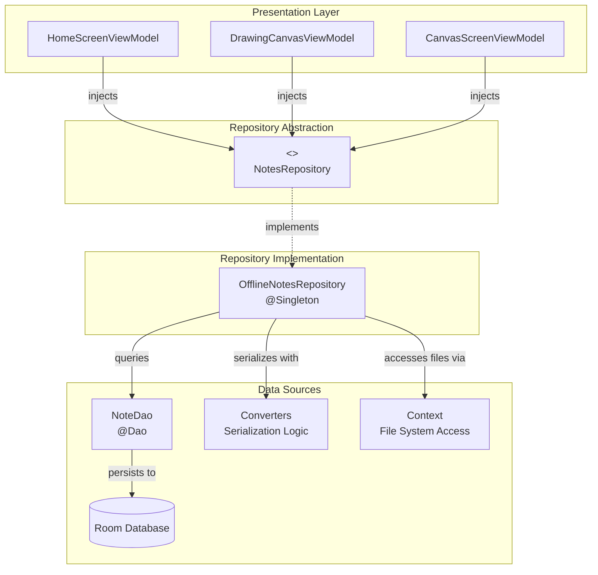
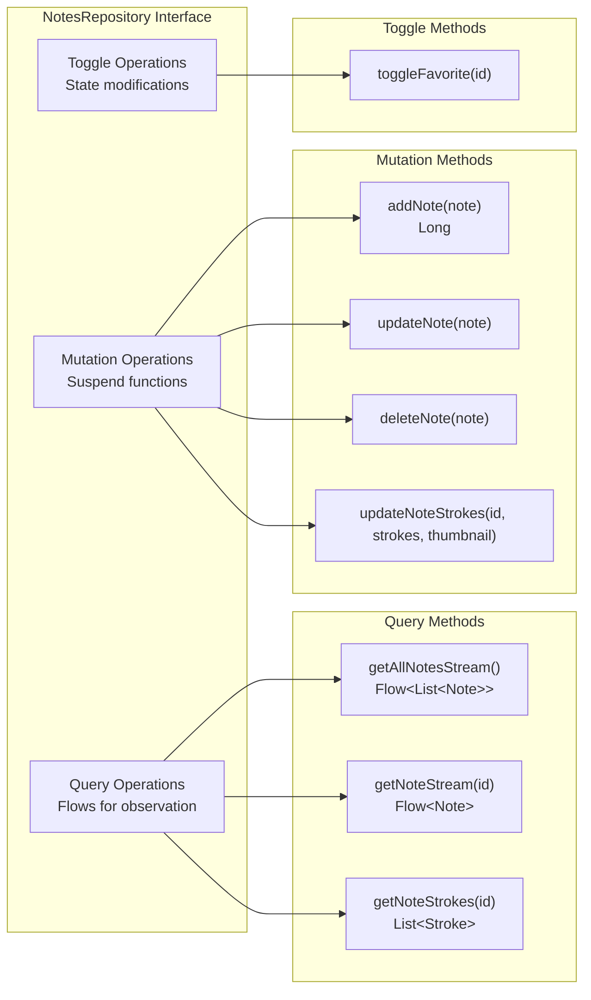
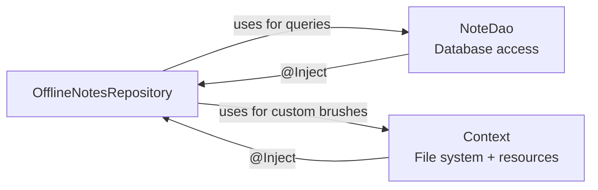
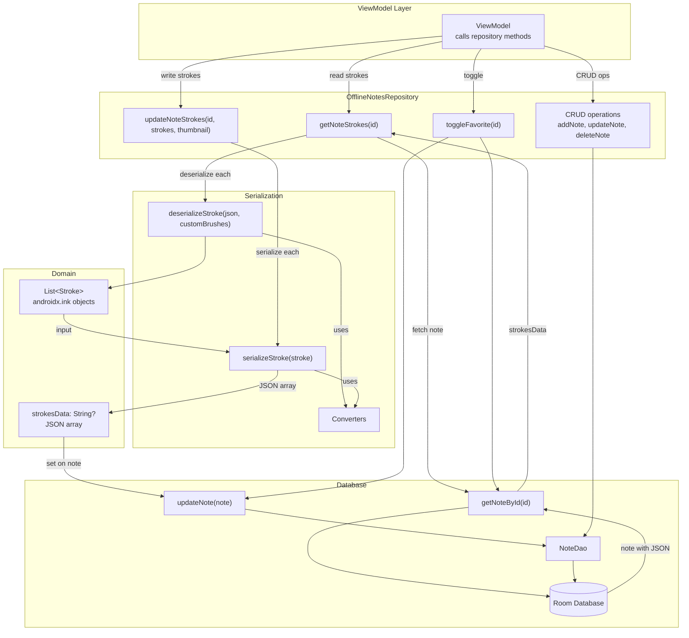
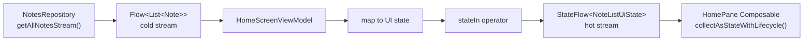
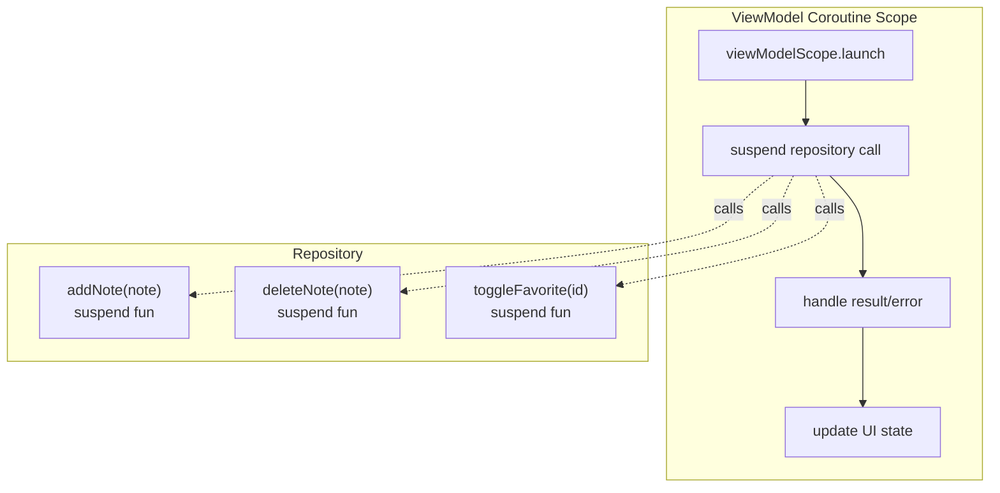
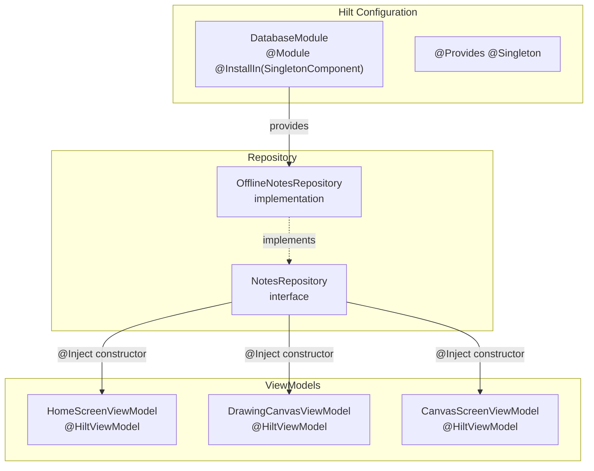
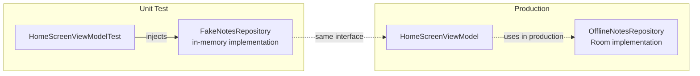
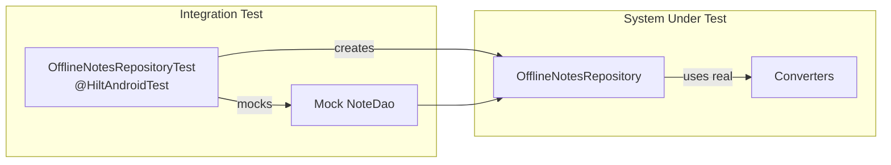

<!-- source: DeepWiki mcp.deepwiki.com · repo android/cahier · page 4.1 Repository Pattern & NotesRepository · fetched 2026-10-23 -->

# Repository Pattern & NotesRepository

<details>
<summary>Relevant source files</summary>

The following files were used as context for generating this wiki page:

- [app/src/androidTest/java/com/example/cahier/data/OfflineNotesRepositoryTest.kt](app/src/androidTest/java/com/example/cahier/data/OfflineNotesRepositoryTest.kt)
- [app/src/androidTest/java/com/example/cahier/utils/FileHelperTest.kt](app/src/androidTest/java/com/example/cahier/utils/FileHelperTest.kt)
- [app/src/main/java/com/example/cahier/navigation/CahierNavGraph.kt](app/src/main/java/com/example/cahier/navigation/CahierNavGraph.kt)
- [app/src/main/java/com/example/cahier/ui/ColorPickerDialog.kt](app/src/main/java/com/example/cahier/ui/ColorPickerDialog.kt)
- [app/src/main/java/com/example/cahier/ui/Converters.kt](app/src/main/java/com/example/cahier/ui/Converters.kt)
- [app/src/main/java/com/example/cahier/ui/DrawingToolbox.kt](app/src/main/java/com/example/cahier/ui/DrawingToolbox.kt)
- [app/src/main/java/com/example/cahier/ui/viewmodels/HomeScreenViewModel.kt](app/src/main/java/com/example/cahier/ui/viewmodels/HomeScreenViewModel.kt)
- [app/src/test/java/com/example/cahier/ui/viewmodels/HomeScreenViewModelTest.kt](app/src/test/java/com/example/cahier/ui/viewmodels/HomeScreenViewModelTest.kt)

</details>


## Purpose and Scope

This document explains the repository pattern implementation in Cahier, focusing on the `NotesRepository` interface and its concrete implementation `OfflineNotesRepository`. It covers the abstraction layer between the data sources and the application's business logic, detailing data access patterns, method contracts, and integration with ViewModels.

For information about the underlying Room database schema and entity definitions, see [Room Database Schema](#4.2). For details on how strokes are serialized and deserialized for storage, see [Stroke Serialization](#4.3). For dependency injection configuration, see [Dependency Injection with Hilt](#2.2).

---

## Repository Pattern Overview

Cahier implements the repository pattern to provide a clean abstraction over data sources. This pattern offers several benefits:

| Benefit | Description |
|---------|-------------|
| **Abstraction** | ViewModels interact with a simple interface without knowing about Room, SQLite, or serialization details |
| **Testability** | Mock implementations can replace the real repository in unit tests |
| **Flexibility** | Data source implementations can change without affecting ViewModels |
| **Single Source of Truth** | All data access flows through one controlled interface |

The repository serves as the boundary between the data layer and the presentation layer, handling all persistence operations including CRUD operations, stroke serialization, and reactive data streams.

**Repository Pattern Architecture**



Sources: [app/src/main/java/com/example/cahier/ui/viewmodels/HomeScreenViewModel.kt:44-46](), [app/src/androidTest/java/com/example/cahier/data/OfflineNotesRepositoryTest.kt:37-44]()

---

## NotesRepository Interface

The `NotesRepository` interface defines the contract for all note-related data operations. It is structured around two primary access patterns: reactive streams (using `Flow`) for data observation and suspend functions for mutations.

**Interface Method Categories**



Sources: [app/src/main/java/com/example/cahier/ui/viewmodels/HomeScreenViewModel.kt:60-65](), [app/src/androidTest/java/com/example/cahier/data/OfflineNotesRepositoryTest.kt:53-98]()

### Query Operations

Query operations return reactive data streams or snapshots:

| Method | Return Type | Purpose |
|--------|-------------|---------|
| `getAllNotesStream()` | `Flow<List<Note>>` | Streams all notes, automatically updating when data changes |
| `getNoteStream(noteId: Long)` | `Flow<Note>` | Streams a single note by ID, updating reactively |
| `getNoteStrokes(noteId: Long)` | `List<Stroke>` | Retrieves deserialized strokes for a drawing note (blocking) |

The use of `Flow` for note queries enables reactive UI updates. When the underlying database changes, ViewModels automatically receive updated data without manual refresh logic.

Sources: [app/src/main/java/com/example/cahier/ui/viewmodels/HomeScreenViewModel.kt:59-65](), [app/src/androidTest/java/com/example/cahier/data/OfflineNotesRepositoryTest.kt:91-99]()

### Mutation Operations

Mutation operations are suspend functions that modify data:

| Method | Return Type | Purpose |
|--------|-------------|---------|
| `addNote(note: Note)` | `Long` | Inserts a new note, returns generated ID |
| `updateNote(note: Note)` | `Unit` | Updates an existing note's fields |
| `deleteNote(note: Note)` | `Unit` | Removes a note from storage |
| `updateNoteStrokes(noteId, strokes, thumbnail)` | `Unit` | Serializes and stores strokes for a drawing note |

All mutation operations are suspend functions, allowing them to be called from coroutines without blocking the main thread.

Sources: [app/src/androidTest/java/com/example/cahier/data/OfflineNotesRepositoryTest.kt:68-78](), [app/src/main/java/com/example/cahier/ui/viewmodels/HomeScreenViewModel.kt:109-126]()

### Toggle Operations

| Method | Purpose |
|--------|---------|
| `toggleFavorite(noteId: Long)` | Inverts the `isFavorite` flag for the specified note |

Sources: [app/src/androidTest/java/com/example/cahier/data/OfflineNotesRepositoryTest.kt:81-88](), [app/src/main/java/com/example/cahier/ui/viewmodels/HomeScreenViewModel.kt:140-152]()

---

## OfflineNotesRepository Implementation

`OfflineNotesRepository` is the concrete implementation of `NotesRepository`, providing Room-backed persistence with stroke serialization support.

### Constructor Dependencies



The constructor accepts:
- `NoteDao`: Provides direct access to Room database operations
- `Context`: Enables loading custom brush resources for stroke deserialization

Sources: [app/src/androidTest/java/com/example/cahier/data/OfflineNotesRepositoryTest.kt:42-44]()

### Implementation Details

**Data Flow in OfflineNotesRepository**



Sources: [app/src/androidTest/java/com/example/cahier/data/OfflineNotesRepositoryTest.kt:53-78]()

### Key Implementation Patterns

#### Stroke Deserialization

When retrieving strokes from the database:

1. Fetch the `Note` entity from `NoteDao`
2. Extract the `strokesData` JSON string
3. Parse JSON array into individual serialized stroke objects
4. Load custom brushes from resources via `Context`
5. Deserialize each stroke using `Converters.deserializeStrokeFromString()`
6. Return `List<Stroke>` containing androidx.ink objects

Sources: [app/src/androidTest/java/com/example/cahier/data/OfflineNotesRepositoryTest.kt:53-65](), [app/src/main/java/com/example/cahier/ui/Converters.kt:115-118]()

#### Stroke Serialization

When saving strokes to the database:

1. Accept `List<Stroke>` from ViewModel
2. Serialize each stroke using `Converters.serializeStroke()`
3. Combine serialized strokes into JSON array
4. Fetch existing `Note` from `NoteDao`
5. Update `Note.strokesData` with JSON string
6. Update `Note.thumbnail` if provided
7. Call `NoteDao.updateNote()`

Sources: [app/src/androidTest/java/com/example/cahier/data/OfflineNotesRepositoryTest.kt:68-78](), [app/src/main/java/com/example/cahier/ui/Converters.kt:71-83]()

#### Favorite Toggle

The `toggleFavorite` operation demonstrates the repository's mutation pattern:

1. Fetch current `Note` using `NoteDao.getNoteById()`
2. Invert the `isFavorite` boolean
3. Call `NoteDao.updateNote()` with modified note

This pattern ensures the repository reads current state before modification, preventing race conditions.

Sources: [app/src/androidTest/java/com/example/cahier/data/OfflineNotesRepositoryTest.kt:81-88]()

---

## Data Access Patterns

### Reactive Streams with StateFlow

ViewModels transform repository `Flow` objects into `StateFlow` for UI observation:



The pattern used in `HomeScreenViewModel`:

1. Call `noteRepository.getAllNotesStream()` to get cold `Flow<List<Note>>`
2. Transform with `.map { NoteListUiState(it) }`
3. Convert to hot StateFlow with `.stateIn(viewModelScope, SharingStarted.WhileSubscribed, initialValue)`
4. UI observes via `collectAsStateWithLifecycle()`

This ensures:
- Database changes automatically propagate to UI
- No manual refresh logic needed
- Lifecycle-aware collection (stops when UI not visible)
- Initial value available immediately

Sources: [app/src/main/java/com/example/cahier/ui/viewmodels/HomeScreenViewModel.kt:59-65]()

### Suspend Function Mutations

Mutation operations use suspend functions within ViewModels:



Example from `HomeScreenViewModel.addNote()`:

1. Launch coroutine in `viewModelScope`
2. Create `Note` instance with default values
3. Call `noteRepository.addNote(note)` (suspend)
4. Receive generated ID
5. Update `_uiState` with new note
6. Invoke callback with ID for navigation

The suspend function pattern ensures:
- Main thread never blocked
- Sequential execution within coroutine
- Automatic cancellation when ViewModel cleared
- Exception handling with try-catch

Sources: [app/src/main/java/com/example/cahier/ui/viewmodels/HomeScreenViewModel.kt:91-126]()

### Error Handling Pattern

The repository delegates error handling to ViewModels:

| Layer | Responsibility |
|-------|----------------|
| **Repository** | Throws exceptions from Room/serialization failures |
| **ViewModel** | Catches exceptions, logs errors, updates UI state with error messages |
| **UI** | Displays error state to user |

Example error handling in `HomeScreenViewModel.selectNote()`:

```
viewModelScope.launch {
    _uiState.value = _uiState.value.copy(isLoading = true)
    try {
        noteRepository.getNoteStream(noteId)
            .filterNotNull()
            .collect { note -> /* update state */ }
    } catch (e: Exception) {
        _uiState.value = _uiState.value.copy(
            error = "Error retrieving note: ${e.message}",
            isLoading = false
        )
        Log.e(TAG, "Error retrieving note: ${e.message}")
    }
}
```

Sources: [app/src/main/java/com/example/cahier/ui/viewmodels/HomeScreenViewModel.kt:67-89]()

---

## Integration with ViewModels

### Dependency Injection

The repository is injected into ViewModels via Hilt:



ViewModel constructor injection pattern:

```
@HiltViewModel
class HomeScreenViewModel @Inject constructor(
    private val noteRepository: NotesRepository
) : ViewModel()
```

Hilt automatically provides the `OfflineNotesRepository` singleton implementation.

Sources: [app/src/main/java/com/example/cahier/ui/viewmodels/HomeScreenViewModel.kt:43-46]()

### Usage Examples in ViewModels

**HomeScreenViewModel Usage**

| Operation | Repository Method | Pattern |
|-----------|------------------|---------|
| Load all notes | `getAllNotesStream()` | Transform to StateFlow with `.stateIn()` |
| Select note | `getNoteStream(id)`, `getNoteStrokes(id)` | Collect in coroutine, update UI state |
| Add note | `addNote(note)` | Suspend call in `viewModelScope.launch` |
| Delete note | `deleteNote(note)` | Suspend call in `viewModelScope.launch` |
| Toggle favorite | `toggleFavorite(id)` | Suspend call, then refresh UI state |

The repository provides a consistent interface across all note operations, abstracting the complexity of Room queries, stroke serialization, and file system access.

Sources: [app/src/main/java/com/example/cahier/ui/viewmodels/HomeScreenViewModel.kt]()

---

## Testing Strategy

The repository abstraction enables two testing approaches:

### Mock Repository for Unit Tests

Unit tests use `FakeNotesRepository` to test ViewModels in isolation:



The fake repository maintains an in-memory list of notes, providing identical method signatures without database dependencies. This allows fast, isolated testing of ViewModel logic.

Sources: [app/src/test/java/com/example/cahier/ui/viewmodels/HomeScreenViewModelTest.kt:52-60]()

### Integration Tests with Real Repository

Integration tests use the actual `OfflineNotesRepository` with an in-memory Room database:



Integration tests verify:
- Stroke serialization/deserialization correctness
- DAO method invocations with correct parameters
- Data transformation between domain models and database entities

Sources: [app/src/androidTest/java/com/example/cahier/data/OfflineNotesRepositoryTest.kt:31-100]()

### Test Coverage

| Test Type | File | Coverage |
|-----------|------|----------|
| Unit | `HomeScreenViewModelTest.kt` | ViewModel logic with fake repository |
| Integration | `OfflineNotesRepositoryTest.kt` | Repository implementation with mocked DAO |

Key test cases in `OfflineNotesRepositoryTest`:
- `getNoteStrokes_deserializes_strokes_correctly`: Verifies stroke deserialization from JSON
- `updateNoteStrokes_calls_DAO_with_serialized_strokes`: Verifies stroke serialization to JSON
- `toggleFavorite_updates_the_note_correctly`: Verifies toggle operation logic
- `getAllNotesStream_returns_flow_from_DAO`: Verifies Flow delegation pattern

Sources: [app/src/androidTest/java/com/example/cahier/data/OfflineNotesRepositoryTest.kt:52-99](), [app/src/test/java/com/example/cahier/ui/viewmodels/HomeScreenViewModelTest.kt:68-135]()

---

## Summary

The repository pattern in Cahier provides:

1. **Clean Abstraction**: `NotesRepository` interface hides database and serialization complexity
2. **Reactive Data**: `Flow` streams enable automatic UI updates
3. **Testability**: Interface-based design allows mock implementations for unit tests
4. **Consistent API**: All ViewModels use the same data access patterns
5. **Separation of Concerns**: Data access logic isolated from presentation logic

The `OfflineNotesRepository` implementation integrates Room database access, stroke serialization via `Converters`, and custom brush loading, presenting a unified interface to the application's ViewModels.

---

