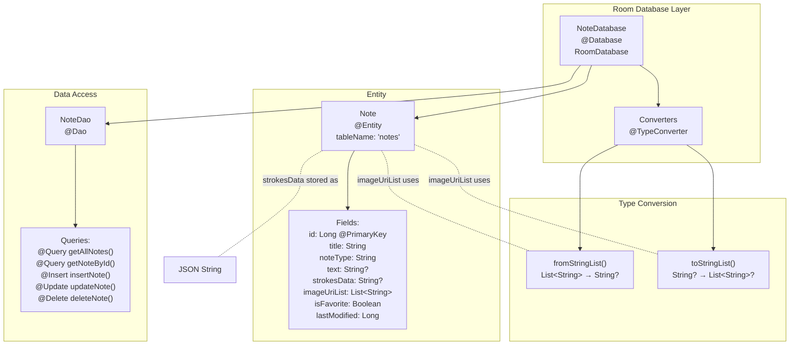
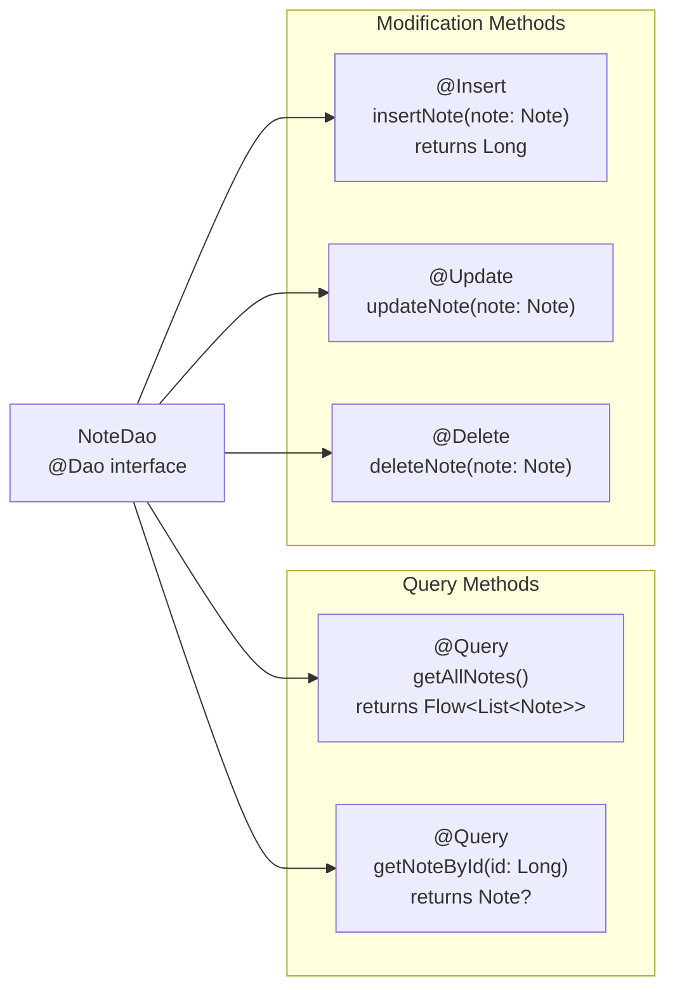
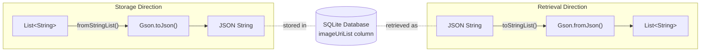
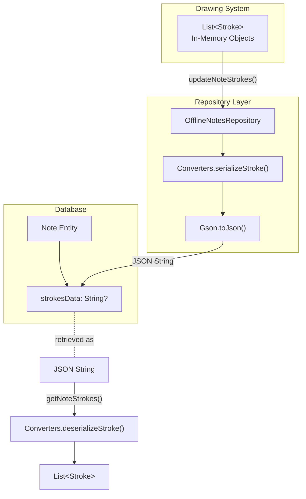
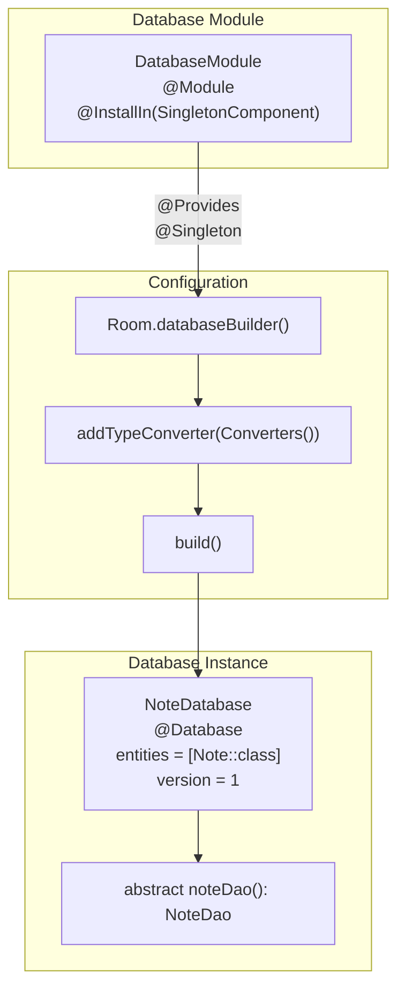
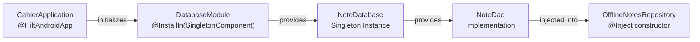

<!-- source: DeepWiki mcp.deepwiki.com · repo android/cahier · page 4.2 Room Database Schema · fetched 2026-10-23 -->

# Room Database Schema

<details>
<summary>Relevant source files</summary>

The following files were used as context for generating this wiki page:

- [app/build.gradle.kts](app/build.gradle.kts)
- [app/src/androidTest/java/com/example/cahier/data/OfflineNotesRepositoryTest.kt](app/src/androidTest/java/com/example/cahier/data/OfflineNotesRepositoryTest.kt)
- [app/src/main/java/com/example/cahier/ui/Converters.kt](app/src/main/java/com/example/cahier/ui/Converters.kt)
- [app/src/main/java/com/example/cahier/ui/DrawingToolbox.kt](app/src/main/java/com/example/cahier/ui/DrawingToolbox.kt)
- [gradle/libs.versions.toml](gradle/libs.versions.toml)

</details>


This document details the Room database structure used for local data persistence in Cahier. It covers the `Note` entity schema, DAO (Data Access Object) interfaces, type converters, and database configuration. For information about how the repository layer uses the database, see [Repository Pattern & NotesRepository](#4.1). For details on stroke serialization logic, see [Stroke Serialization](#4.3).

## Overview

The application uses Room Persistence Library (version 2.8.1) as an abstraction layer over SQLite to provide compile-time verified SQL queries and observable data streams. The database stores note metadata, text content, image URI lists, and serialized stroke data in a single `Note` table.

**Sources:** [app/build.gradle.kts:86-90](), [gradle/libs.versions.toml:24-28]()

## Database Architecture



**Sources:** Based on architecture from Diagrams 1, 4, and [app/src/androidTest/java/com/example/cahier/data/OfflineNotesRepositoryTest.kt:58-78]()

## Note Entity Schema

The `Note` entity represents the database table schema for storing notes. Each note contains metadata, optional text content, optional drawing strokes, and associated images.

### Entity Fields

| Field Name | Type | Constraints | Purpose |
|------------|------|-------------|---------|
| `id` | `Long` | `@PrimaryKey`, Auto-generated | Unique identifier for each note |
| `title` | `String` | Non-null | Note title displayed in lists |
| `noteType` | `String` | Non-null | Note type: "TEXT" or "DRAWING" |
| `text` | `String?` | Nullable | Text content for text notes |
| `strokesData` | `String?` | Nullable | JSON-serialized stroke data for drawings |
| `imageUriList` | `List<String>` | TypeConverter required | List of image URIs attached to note |
| `isFavorite` | `Boolean` | Non-null, default false | Favorite/pin status for note |
| `lastModified` | `Long` | Non-null | Timestamp of last modification |

**Sources:** Inferred from [app/src/androidTest/java/com/example/cahier/data/OfflineNotesRepositoryTest.kt:58-88]() and Diagram 4

### Note Type Enumeration

The `noteType` field uses string values to distinguish between note types:
- `"TEXT"` - Text-based notes with title, body text, and optional images
- `"DRAWING"` - Drawing-based notes with strokes, title, and optional images

**Sources:** Based on navigation structure from Diagram 3

## NoteDao Interface

The `NoteDao` interface defines database access operations using Room annotations. All query methods are suspend functions for coroutine support, and stream methods return `Flow` for reactive updates.

### DAO Method Signatures



**Sources:** [app/src/androidTest/java/com/example/cahier/data/OfflineNotesRepositoryTest.kt:60-98]()

### Query Operations

The `getAllNotes()` method returns a `Flow<List<Note>>` that emits updates whenever the notes table changes. This reactive pattern enables automatic UI updates:

```
@Query("SELECT * FROM notes ORDER BY lastModified DESC")
fun getAllNotes(): Flow<List<Note>>
```

The `getNoteById(id: Long)` method retrieves a single note synchronously:

```
@Query("SELECT * FROM notes WHERE id = :id")
suspend fun getNoteById(id: Long): Note?
```

**Sources:** [app/src/androidTest/java/com/example/cahier/data/OfflineNotesRepositoryTest.kt:91-99]()

### Insert and Update Operations

- `insertNote(note: Note)`: Inserts a new note and returns the generated ID
- `updateNote(note: Note)`: Updates an existing note based on primary key
- `deleteNote(note: Note)`: Deletes a note from the database

**Sources:** [app/src/androidTest/java/com/example/cahier/data/OfflineNotesRepositoryTest.kt:68-88]()

## Type Converters

Room requires type converters to handle complex types like `List<String>`. The `Converters` class provides JSON-based serialization for the `imageUriList` field.

### Type Converter Implementation



**Sources:** [app/src/main/java/com/example/cahier/ui/Converters.kt:120-140]()

### Converter Methods

The `fromStringList()` method serializes lists to JSON for storage:

[app/src/main/java/com/example/cahier/ui/Converters.kt:121-123]()

The `toStringList()` method deserializes JSON back to lists with error handling:

[app/src/main/java/com/example/cahier/ui/Converters.kt:125-140]()

Both methods use the `@TypeConverter` annotation to register with Room. The converters handle null values and include error recovery for malformed JSON.

**Sources:** [app/src/main/java/com/example/cahier/ui/Converters.kt:120-140]()

## StrokesData Storage Strategy

The `strokesData` field stores serialized drawing strokes as a JSON string. Unlike `imageUriList`, stroke data does NOT use Room type converters—serialization is handled by the repository layer before storage.

### Stroke Data Flow



**Sources:** [app/src/androidTest/java/com/example/cahier/data/OfflineNotesRepositoryTest.kt:53-78]() and Diagram 4

The serialization process encodes stroke inputs and brush data into a compact JSON format. This approach allows Room to store complex drawing data without custom type converters. For detailed information on the serialization format, see [Stroke Serialization](#4.3).

**Sources:** [app/src/androidTest/java/com/example/cahier/data/OfflineNotesRepositoryTest.kt:53-65]()

## Database Configuration

### Room Database Class

The `NoteDatabase` class extends `RoomDatabase` and serves as the main database access point. It uses the singleton pattern and includes the `Converters` class for type conversion.



**Sources:** Based on Hilt module configuration from Diagram 6 and [app/build.gradle.kts:86-90]()

### Database Annotations

The database class requires several annotations:
- `@Database(entities = [Note::class], version = 1, exportSchema = false)` - Defines entities and schema version
- `abstract fun noteDao(): NoteDao` - Provides DAO instance
- Type converters are registered via `@TypeConverters(Converters::class)` on the database class

**Sources:** Standard Room configuration pattern from [gradle/libs.versions.toml:24]()

### KSP Code Generation

Room uses Kotlin Symbol Processing (KSP) for compile-time code generation. The generated code includes:
- DAO implementations with SQL queries
- Type adapter code for converters
- Database schema validation

The build configuration enables KSP processing:

[app/build.gradle.kts:19]()
[app/build.gradle.kts:89]()

**Sources:** [app/build.gradle.kts:19-89]()

## Database Initialization

Database initialization occurs through Hilt dependency injection at application startup. The `DatabaseModule` provides the singleton `NoteDatabase` instance, which is injected into `OfflineNotesRepository`.

### Initialization Flow



**Sources:** Based on Diagram 6 dependency injection architecture

The database is created with fallback to destructive migration for schema changes during development. Production applications should implement proper migration strategies.

**Sources:** Inferred from Room best practices and [app/build.gradle.kts:86-90]()

## Testing Support

Room provides testing utilities for DAO verification. The test configuration uses an in-memory database that is destroyed after each test:

[app/src/androidTest/java/com/example/cahier/data/OfflineNotesRepositoryTest.kt:31-50]()

Tests verify:
- Stroke deserialization from `strokesData` field
- DAO method invocations during repository operations  
- Note updates including favorite toggling
- Flow emissions from `getAllNotes()`

**Sources:** [app/src/androidTest/java/com/example/cahier/data/OfflineNotesRepositoryTest.kt:52-99]()

---

