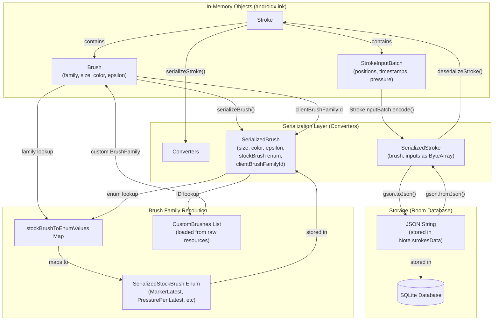
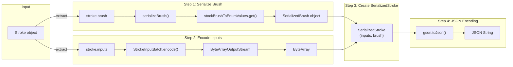
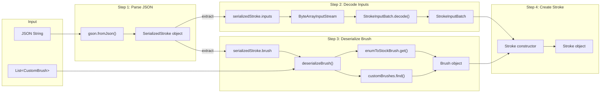

<!-- source: DeepWiki mcp.deepwiki.com · repo android/cahier · page 4.3 Stroke Serialization · fetched 2026-10-23 -->

# Stroke Serialization

<details>
<summary>Relevant source files</summary>

The following files were used as context for generating this wiki page:

- [app/src/androidTest/java/com/example/cahier/data/OfflineNotesRepositoryTest.kt](app/src/androidTest/java/com/example/cahier/data/OfflineNotesRepositoryTest.kt)
- [app/src/main/java/com/example/cahier/ui/Converters.kt](app/src/main/java/com/example/cahier/ui/Converters.kt)
- [app/src/main/java/com/example/cahier/ui/DrawingToolbox.kt](app/src/main/java/com/example/cahier/ui/DrawingToolbox.kt)
- [app/src/main/java/com/example/cahier/ui/viewmodels/DrawingCanvasViewModel.kt](app/src/main/java/com/example/cahier/ui/viewmodels/DrawingCanvasViewModel.kt)

</details>


## Purpose and Scope

This document describes the stroke serialization system in Cahier, which converts `androidx.ink.strokes.Stroke` objects into JSON strings for persistent storage in the Room database. This includes the `Converters` class, serialized data structures, stock brush enumeration mapping, and custom brush identification.

For information about the Room database schema where serialized strokes are stored, see [Room Database Schema](#4.2). For details on how strokes are captured and rendered in the drawing system, see [Drawing Surface & Stroke Rendering](#3.1.2). For repository-level stroke persistence operations, see [Repository Pattern & NotesRepository](#4.1).

## Overview

The serialization system bridges the gap between the in-memory `Stroke` objects from the androidx.ink library and the SQLite database's text storage requirements. Each `Stroke` consists of two components: a `Brush` (defining visual properties) and a `StrokeInputBatch` (containing the actual drawing data with positions, timestamps, and pressure values). The system serializes these into a JSON structure that includes brush metadata and binary-encoded input data.



**Sources:** [app/src/main/java/com/example/cahier/ui/Converters.kt:1-141]()

## Serialized Data Structures

The serialization system uses three primary data structures defined in the `com.example.cahier.data` package.

### SerializedStroke

`SerializedStroke` is the top-level structure representing a single stroke in JSON format:

| Field | Type | Purpose |
|-------|------|---------|
| `inputs` | `ByteArray` | Binary-encoded stroke input data (positions, timestamps, pressure) |
| `brush` | `SerializedBrush` | Brush configuration for this stroke |

The `inputs` field contains data encoded using `androidx.ink.storage.encode()`, which produces a compact binary representation of all drawing input points.

### SerializedBrush

`SerializedBrush` captures all brush properties needed to reconstruct a `Brush` object:

| Field | Type | Purpose |
|-------|------|---------|
| `size` | `Float` | Brush stroke width in pixels |
| `color` | `Long` | Packed color value (ARGB) |
| `epsilon` | `Float` | Curve fitting tolerance parameter |
| `stockBrush` | `SerializedStockBrush` | Enum identifying the stock brush family |
| `clientBrushFamilyId` | `String?` | Optional UUID for custom brushes |

The `stockBrush` field provides a stable enum-based reference to stock brush families, while `clientBrushFamilyId` enables custom brush identification.

### SerializedStockBrush Enum

The `SerializedStockBrush` enum provides stable identifiers for stock brush families:

```
enum class SerializedStockBrush {
    MarkerLatest,
    PressurePenLatest,
    HighlighterLatest,
    DashedLineLatest
}
```

This enum decouples serialized data from the actual `StockBrushes` implementation, ensuring saved notes remain compatible across androidx.ink library updates.

**Sources:** [app/src/main/java/com/example/cahier/ui/Converters.kt:33-35](), [app/src/main/java/com/example/cahier/ui/Converters.kt:61-69]()

## Serialization Process

The serialization process converts a `Stroke` object into a JSON string through multiple transformation steps.



### serializeStroke() Method

The main serialization entry point is `Converters.serializeStroke()` at [app/src/main/java/com/example/cahier/ui/Converters.kt:71-83]():

1. **Brush Serialization**: Calls `serializeBrush()` to convert the `Stroke.brush` into a `SerializedBrush`
2. **Input Encoding**: Uses `StrokeInputBatch.encode()` to write binary input data to a `ByteArrayOutputStream`
3. **Structure Creation**: Constructs a `SerializedStroke` containing the serialized brush and encoded inputs
4. **JSON Conversion**: Uses Gson to convert the `SerializedStroke` to a JSON string

### serializeBrush() Method

The `serializeBrush()` method at [app/src/main/java/com/example/cahier/ui/Converters.kt:61-69]() extracts brush properties:

1. Copies numeric properties: `size`, `colorLong`, `epsilon`
2. Looks up the `brush.family` in `stockBrushToEnumValues` map to get the corresponding `SerializedStockBrush` enum value
3. Extracts `clientBrushFamilyId` from the brush family (null for stock brushes, UUID string for custom brushes)
4. Returns a `SerializedBrush` with all properties

**Sources:** [app/src/main/java/com/example/cahier/ui/Converters.kt:61-83]()

## Deserialization Process

The deserialization process reconstructs `Stroke` objects from JSON strings, requiring access to the list of available custom brushes.



### deserializeStrokeFromString() Method

The public deserialization entry point at [app/src/main/java/com/example/cahier/ui/Converters.kt:115-118]() requires both the JSON string and the list of custom brushes:

1. **JSON Parsing**: Uses Gson to parse the JSON string into a `SerializedStroke` object
2. **Delegation**: Calls the private `deserializeStroke()` method with the parsed object and custom brushes list

### deserializeStroke() Method

The internal `deserializeStroke()` method at [app/src/main/java/com/example/cahier/ui/Converters.kt:85-94]() reconstructs the stroke:

1. **Input Decoding**: Creates a `ByteArrayInputStream` from `serializedStroke.inputs` and calls `StrokeInputBatch.decode()`
2. **Brush Deserialization**: Calls `deserializeBrush()` to reconstruct the brush
3. **Stroke Construction**: Creates a new `Stroke` with the deserialized brush and inputs

### deserializeBrush() Method

The `deserializeBrush()` method at [app/src/main/java/com/example/cahier/ui/Converters.kt:96-113]() handles brush family resolution:

1. **Enum Lookup**: Looks up `serializedBrush.stockBrush` in the `enumToStockBrush` map to get the stock `BrushFamily`
2. **Custom Brush Lookup**: Searches the `customBrushes` list for a match on `clientBrushFamilyId`
3. **Family Selection**: Prefers custom brush if found, falls back to stock brush, defaults to `StockBrushes.marker()` if neither found
4. **Brush Creation**: Calls `Brush.createWithColorLong()` with the resolved family and serialized properties

**Sources:** [app/src/main/java/com/example/cahier/ui/Converters.kt:85-118]()

## Stock Brush Mapping

The stock brush mapping system provides stable serialization for the four built-in brush types from androidx.ink.

### Bidirectional Maps

Two companion object maps at [app/src/main/java/com/example/cahier/ui/Converters.kt:49-59]() provide bidirectional lookup:

**stockBrushToEnumValues** (for serialization):
```
StockBrushes.marker() → SerializedStockBrush.MarkerLatest
StockBrushes.pressurePen() → SerializedStockBrush.PressurePenLatest
StockBrushes.highlighter() → SerializedStockBrush.HighlighterLatest
StockBrushes.dashedLine() → SerializedStockBrush.DashedLineLatest
```

**enumToStockBrush** (for deserialization):
```
SerializedStockBrush.MarkerLatest → StockBrushes.marker()
SerializedStockBrush.PressurePenLatest → StockBrushes.pressurePen()
SerializedStockBrush.HighlighterLatest → StockBrushes.highlighter()
SerializedStockBrush.DashedLineLatest → StockBrushes.dashedLine()
```

The `enumToStockBrush` map is derived programmatically from `stockBrushToEnumValues` by inverting the key-value pairs.

### Rationale

The enum-based mapping decouples serialized data from the androidx.ink library's internal implementation:

- **Version Stability**: If androidx.ink changes its brush family implementations, the enum values remain constant
- **Extensibility**: New brush versions can be added as additional enum values (e.g., `MarkerV2`) without breaking existing data
- **Explicit Mapping**: The mapping is centralized and auditable, making it clear which brush types are supported

**Sources:** [app/src/main/java/com/example/cahier/ui/Converters.kt:49-59](), [app/src/main/java/com/example/cahier/ui/Converters.kt:66](), [app/src/main/java/com/example/cahier/ui/Converters.kt:100]()

## Custom Brush Handling

Custom brushes are loaded from compressed raw resources and identified by their `clientBrushFamilyId` during serialization.

### Custom Brush Identification

When a `Brush` uses a custom `BrushFamily`, the family's `clientBrushFamilyId` property contains a UUID string identifying the brush. This ID is:

1. **Extracted during serialization** at [app/src/main/java/com/example/cahier/ui/Converters.kt:67]() and stored in `SerializedBrush.clientBrushFamilyId`
2. **Used during deserialization** at [app/src/main/java/com/example/cahier/ui/Converters.kt:101-103]() to find the matching custom brush

### Deserialization Lookup

The deserialization process requires the custom brushes list to resolve brush families:

```
val customBrush = customBrushes.find {
    it.brushFamily.clientBrushFamilyId == serializedBrush.clientBrushFamilyId
}
```

If a custom brush ID is found in the serialized data but not in the provided list (e.g., the custom brush was deleted), the system falls back to the stock brush specified by the `stockBrush` enum field.

### Loading Custom Brushes

Custom brushes are loaded by the `CustomBrushes` singleton (see [Custom Brushes](#6.2)) and must be available before deserialization occurs. The `DrawingCanvasViewModel` loads custom brushes in its `init` block at [app/src/main/java/com/example/cahier/ui/viewmodels/DrawingCanvasViewModel.kt:442-446](), and the `OfflineNotesRepository` receives them via context parameter.

**Sources:** [app/src/main/java/com/example/cahier/ui/Converters.kt:67](), [app/src/main/java/com/example/cahier/ui/Converters.kt:96-113]()

## Integration with Room and Repository

The serialization system integrates with Room through the `@TypeConverter` annotation and is accessed through the repository layer.

### Room Type Converter

The `Converters` class is annotated with `@TypeConverter` at [app/src/main/java/com/example/cahier/ui/Converters.kt:31]() and registered with the Room database. However, stroke serialization is handled manually in the repository layer rather than automatically by Room because:

1. **Custom Brushes Dependency**: Deserialization requires the custom brushes list, which Room cannot inject into type converters
2. **List vs Single Stroke**: The database stores a JSON array of serialized strokes, not individual strokes

### Repository Integration

The `OfflineNotesRepository` at `app/src/main/java/com/example/cahier/data/OfflineNotesRepository.kt` handles stroke serialization:

**Saving Strokes** (`updateNoteStrokes()` method):
1. Receives a `List<Stroke>` from the ViewModel
2. Serializes each stroke using `Converters.serializeStroke()`
3. Wraps the serialized strokes in a JSON array using Gson
4. Stores the resulting JSON string in `Note.strokesData`
5. Updates the note via `NoteDao.updateNote()`

**Loading Strokes** (`getNoteStrokes()` method):
1. Retrieves the note from the database via `NoteDao.getNoteById()`
2. Extracts the `strokesData` JSON string
3. Parses the JSON array to get individual serialized stroke strings
4. Loads custom brushes via `CustomBrushes.getBrushes(context)`
5. Deserializes each stroke using `Converters.deserializeStrokeFromString()` with the custom brushes list
6. Returns the reconstructed `List<Stroke>`

### ViewModel Usage

The `DrawingCanvasViewModel` calls repository methods for persistence:

- **Save**: `noteRepository.updateNoteStrokes(noteId, strokesToSave, clientBrushFamilyId)` at [app/src/main/java/com/example/cahier/ui/viewmodels/DrawingCanvasViewModel.kt:284]()
- **Load**: `noteRepository.getNoteStrokes(note.id)` at [app/src/main/java/com/example/cahier/ui/viewmodels/DrawingCanvasViewModel.kt:122]()

The ViewModel does not directly interact with the `Converters` class; all serialization is encapsulated in the repository.

**Sources:** [app/src/main/java/com/example/cahier/ui/Converters.kt:31](), [app/src/main/java/com/example/cahier/ui/viewmodels/DrawingCanvasViewModel.kt:121-125](), [app/src/main/java/com/example/cahier/ui/viewmodels/DrawingCanvasViewModel.kt:279-288]()

## Data Flow Example

The following diagram shows the complete flow of a stroke from drawing to persistence and back:

```mermaid
sequenceDiagram
    participant User
    participant DrawingSurface
    participant DCVM as DrawingCanvasViewModel
    participant Repo as OfflineNotesRepository
    participant Conv as Converters
    participant Dao as NoteDao
    participant DB as Room Database
    
    User->>DrawingSurface: draws stroke
    DrawingSurface->>DCVM: onStrokesFinished(strokes)
    DCVM->>DCVM: updateStrokes() adds to history
    DCVM->>Repo: updateNoteStrokes(id, strokes, familyId)
    
    loop for each stroke
        Repo->>Conv: serializeStroke(stroke)
        Conv->>Conv: serializeBrush(stroke.brush)
        Conv->>Conv: stroke.inputs.encode()
        Conv-->>Repo: JSON string
    end
    
    Repo->>Repo: gson.toJson(List&lt;String&gt;)
    Repo->>Dao: updateNote(note.copy(strokesData = json))
    Dao->>DB: UPDATE notes SET strokesData = ?
    DB-->>User: stroke saved
    
    Note over User,DB: Later: Loading note
    
    User->>DCVM: opens note
    DCVM->>Repo: getNoteStrokes(noteId)
    Repo->>Dao: getNoteById(noteId)
    Dao->>DB: SELECT * FROM notes WHERE id = ?
    DB-->>Dao: Note with strokesData
    Dao-->>Repo: Note object
    
    Repo->>Repo: gson.fromJson(strokesData) to List&lt;String&gt;
    Repo->>Repo: CustomBrushes.getBrushes(context)
    
    loop for each serialized stroke
        Repo->>Conv: deserializeStrokeFromString(json, customBrushes)
        Conv->>Conv: gson.fromJson() to SerializedStroke
        Conv->>Conv: StrokeInputBatch.decode()
        Conv->>Conv: deserializeBrush() with custom brushes
        Conv-->>Repo: Stroke object
    end
    
    Repo-->>DCVM: List&lt;Stroke&gt;
    DCVM->>DCVM: uiState.update(strokes = ...)
    DCVM-->>User: strokes displayed
```

**Sources:** [app/src/main/java/com/example/cahier/ui/viewmodels/DrawingCanvasViewModel.kt:301-309](), [app/src/main/java/com/example/cahier/ui/viewmodels/DrawingCanvasViewModel.kt:117-154](), [app/src/main/java/com/example/cahier/ui/Converters.kt:71-118]()

## Testing

The serialization system is tested in `OfflineNotesRepositoryTest.kt`.

### Test Coverage

**getNoteStrokes_deserializes_strokes_correctly** at [app/src/androidTest/java/com/example/cahier/data/OfflineNotesRepositoryTest.kt:53-65]():
- Creates a test `Stroke` with a stock brush
- Serializes it using `Converters.serializeStroke()`
- Wraps it in a JSON array
- Mocks the DAO to return a note with that JSON
- Calls `repository.getNoteStrokes()`
- Verifies the result contains exactly one deserialized stroke

**updateNoteStrokes_calls_DAO_with_serialized_strokes** at [app/src/androidTest/java/com/example/cahier/data/OfflineNotesRepositoryTest.kt:68-78]():
- Creates test strokes
- Calls `repository.updateNoteStrokes()`
- Verifies that `NoteDao.updateNote()` was called with the serialized data

These tests validate the round-trip serialization: `Stroke → JSON → Stroke`.

### Test Dependencies

The tests use:
- `androidx.ink.strokes.ImmutableStrokeInputBatch.EMPTY` for creating test strokes without complex input data
- `Mockito` for mocking the `NoteDao`
- `kotlinx.coroutines.test` for testing suspend functions

**Sources:** [app/src/androidTest/java/com/example/cahier/data/OfflineNotesRepositoryTest.kt:53-78]()

## Error Handling

The serialization system includes minimal error handling:

1. **Missing Custom Brush**: If a `clientBrushFamilyId` cannot be resolved during deserialization, the system falls back to the stock brush specified by the `stockBrush` enum at [app/src/main/java/com/example/cahier/ui/Converters.kt:105]()

2. **Invalid Enum**: If an unknown `SerializedStockBrush` enum value is encountered, the `enumToStockBrush` lookup returns null, and the system defaults to `StockBrushes.marker()` at [app/src/main/java/com/example/cahier/ui/Converters.kt:105]()

3. **Decode Failure**: If `StrokeInputBatch.decode()` throws an exception, the `deserializeStroke()` method returns null (though this is not explicitly caught in the current implementation)

4. **JSON Parsing**: Gson exceptions during JSON parsing are not explicitly caught but would propagate to the caller (the repository layer)

**Sources:** [app/src/main/java/com/example/cahier/ui/Converters.kt:85-118]()

---

