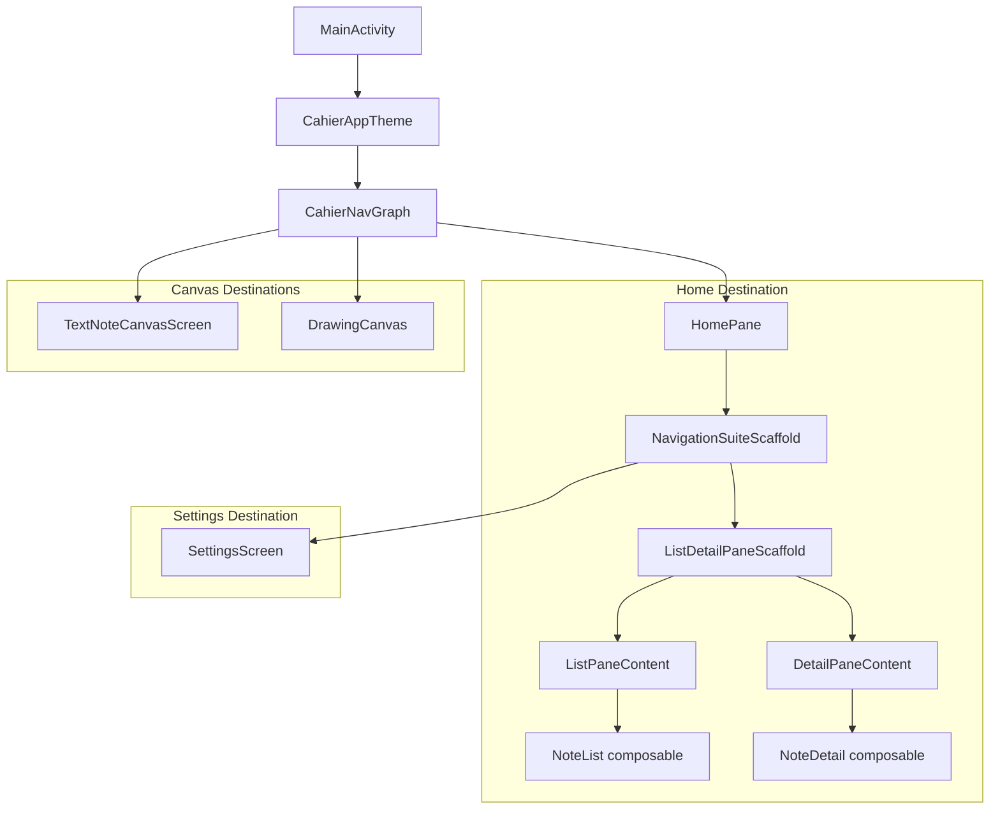
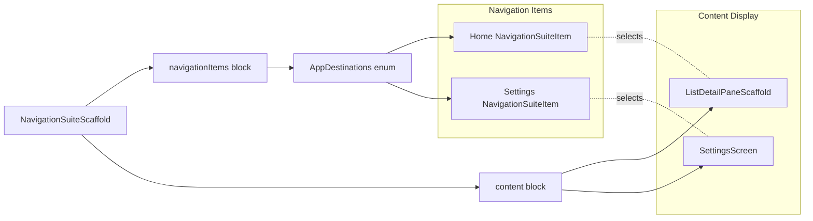
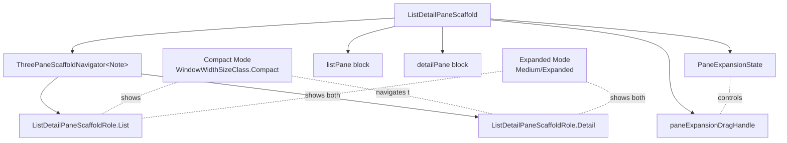
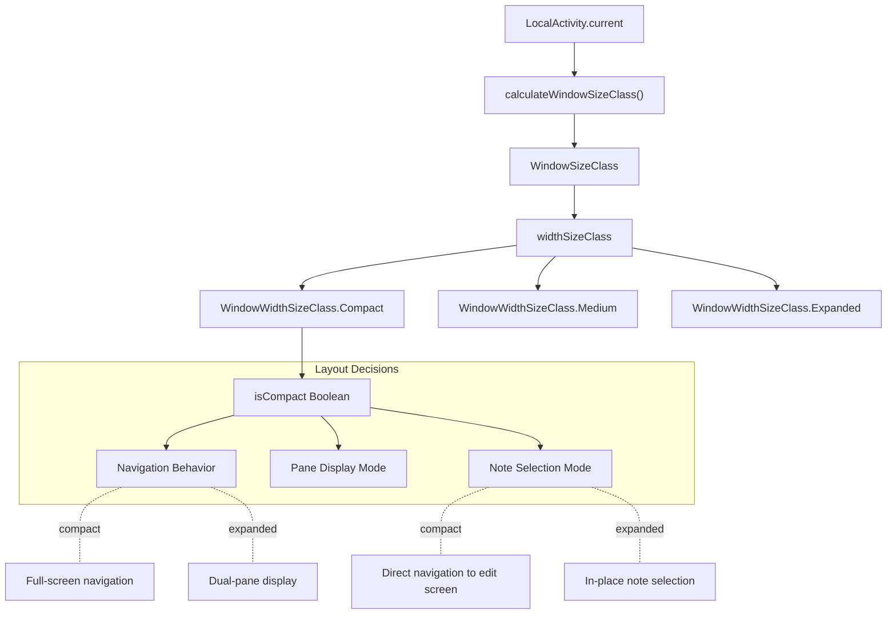
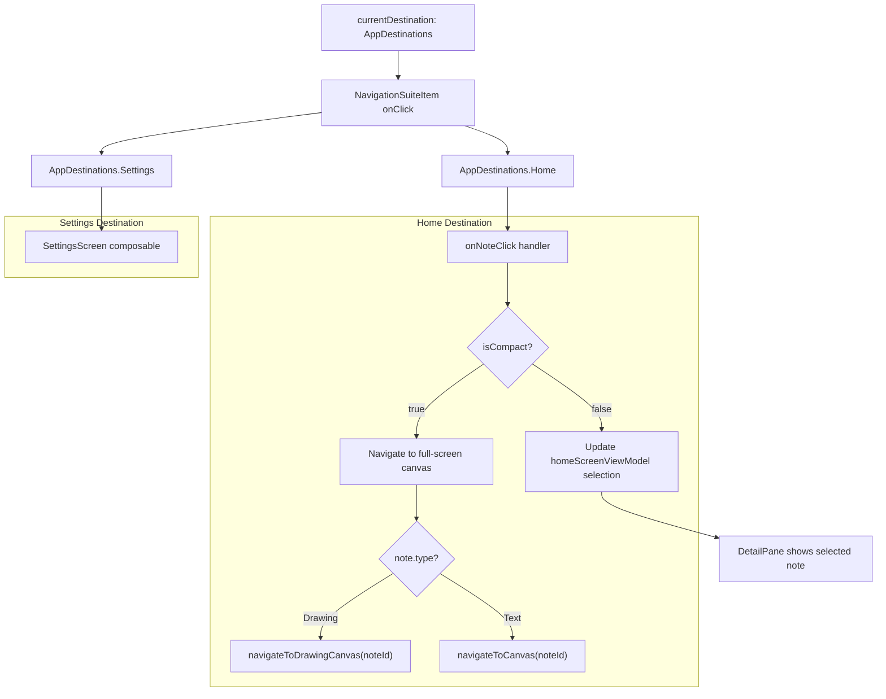
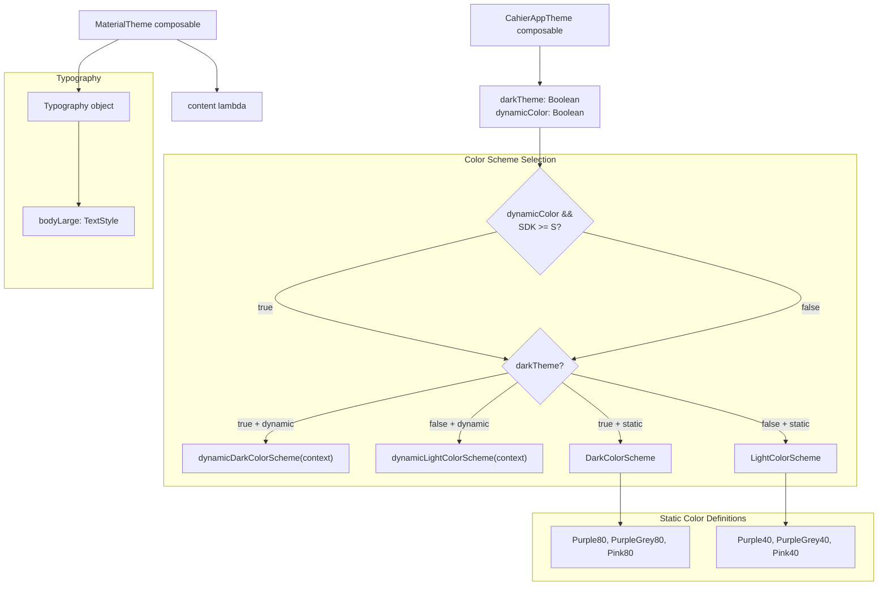
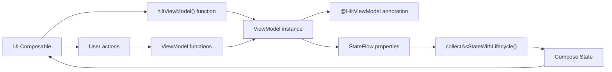
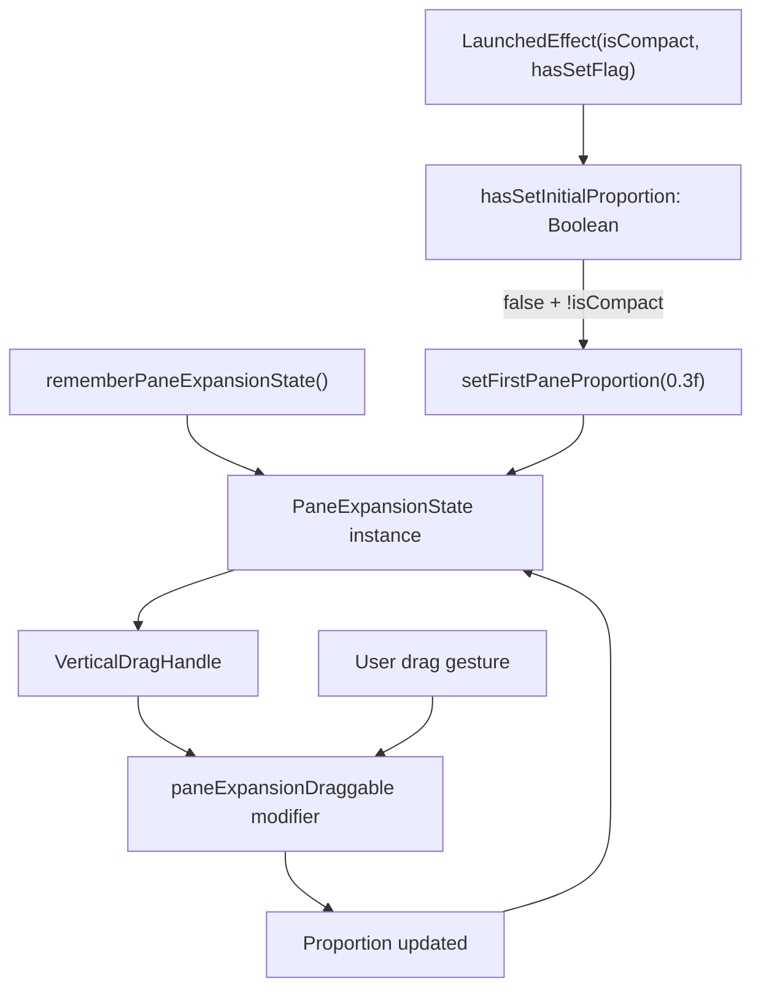
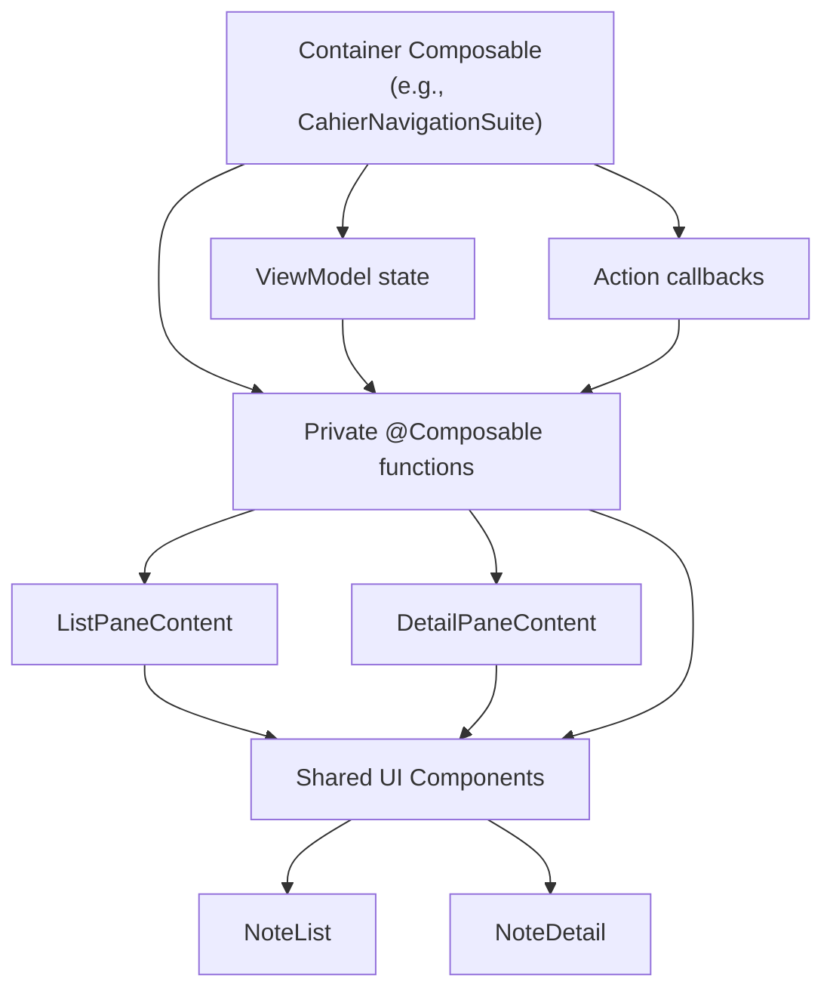

<!-- source: DeepWiki mcp.deepwiki.com · repo android/cahier · page 5 UI Components · fetched 2026-10-23 -->

# UI Components

Relevant source files

The following files were used as context for generating this wiki page:

- [app/src/main/java/com/example/cahier/ui/CahierHomeScreen.kt](app/src/main/java/com/example/cahier/ui/CahierHomeScreen.kt)
- [app/src/main/java/com/example/cahier/ui/theme/Color.kt](app/src/main/java/com/example/cahier/ui/theme/Color.kt)
- [app/src/main/java/com/example/cahier/ui/theme/Theme.kt](app/src/main/java/com/example/cahier/ui/theme/Theme.kt)
- [app/src/main/java/com/example/cahier/ui/theme/Type.kt](app/src/main/java/com/example/cahier/ui/theme/Type.kt)

## Purpose and Scope

This page provides an overview of the UI component architecture in the Cahier application, focusing on the structural organization, Material3 integration, and component composition patterns. The application uses Jetpack Compose with Material3 adaptive components to create a responsive interface that adapts to different form factors.

For detailed information about specific subsystems:
- Adaptive layout strategies and form factor handling: see [Adaptive Layouts](#5.1)
- Theme configuration and Material3 customization: see [Theme System](#5.2)
- Individual reusable UI components: see [Shared UI Components](#5.3)

## Component Architecture Overview

The Cahier UI is built on a hierarchical component structure that separates navigation, layout scaffolding, and content presentation. The architecture follows Material3 design principles with adaptive layout support.

### Core UI Hierarchy

**Component Hierarchy**: `MainActivity` initializes the theme wrapper and navigation graph. `HomePane` serves as the primary container, using `NavigationSuiteScaffold` for app-level navigation and `ListDetailPaneScaffold` for the list-detail pattern. Canvas destinations are independent full-screen composables.

Sources: [app/src/main/java/com/example/cahier/ui/CahierHomeScreen.kt:103-178]()

## Material3 Adaptive Components

The application leverages Material3's adaptive component library to create responsive layouts that adjust to device characteristics. Two primary scaffolds provide the structural foundation.

### Navigation Suite Integration

**NavigationSuiteScaffold Structure**: The scaffold automatically adapts navigation chrome (bottom bar on phones, navigation rail on tablets, navigation drawer on large screens) based on window size. The `AppDestinations` enum defines available destinations.

Sources: [app/src/main/java/com/example/cahier/ui/CahierHomeScreen.kt:79-94](), [app/src/main/java/com/example/cahier/ui/CahierHomeScreen.kt:197-316]()

| Component | Purpose | Adaptive Behavior |
|-----------|---------|-------------------|
| `NavigationSuiteScaffold` | App-level navigation container | Auto-selects bottom bar, rail, or drawer |
| `ListDetailPaneScaffold` | List-detail pattern implementation | Shows single pane (compact) or dual pane (expanded) |
| `NavigationSuiteItem` | Individual navigation destination | Renders as appropriate for current navigation type |
| `VerticalDragHandle` | Pane resize control | Only visible in expanded mode with resizable panes |

### List-Detail Pane Architecture

**Pane Navigation**: `ThreePaneScaffoldNavigator` manages navigation between list and detail panes. In compact mode, only one pane is visible at a time; in expanded mode, both panes display simultaneously with a draggable divider.

Sources: [app/src/main/java/com/example/cahier/ui/CahierHomeScreen.kt:111-117](), [app/src/main/java/com/example/cahier/ui/CahierHomeScreen.kt:231-304]()

## Window Size Class Integration

The application uses `WindowSizeClass` to determine layout behavior at runtime, enabling adaptive responses to device characteristics and multi-window scenarios.

**Window Size Determination**: The `calculateWindowSizeClass` function is called on the activity instance to obtain current window dimensions. The `isCompact` Boolean derived from `WindowWidthSizeClass.Compact` drives multiple layout decisions throughout the UI.

Sources: [app/src/main/java/com/example/cahier/ui/CahierHomeScreen.kt:116-121](), [app/src/main/java/com/example/cahier/ui/CahierHomeScreen.kt:138-156]()

## Navigation State Management

Navigation within the home screen involves coordinating between `AppDestinations` (top-level), `ThreePaneScaffoldNavigator` (list-detail panes), and actual route navigation to canvas screens.

### Navigation Decision Flow

**Navigation Logic**: In compact mode, note clicks trigger full-screen navigation using route navigation functions. In expanded mode, clicks update the ViewModel's selected note, causing the detail pane to re-render.

Sources: [app/src/main/java/com/example/cahier/ui/CahierHomeScreen.kt:254-263](), [app/src/main/java/com/example/cahier/ui/CahierHomeScreen.kt:293-299]()

## Theme System Architecture

The theme system integrates Material3 theming with dynamic color support and adaptive dark mode. The `CahierAppTheme` composable wraps the entire application.

### Theme Component Structure

**Theme Configuration**: The theme selector prioritizes dynamic colors on Android 12+ (SDK S), falling back to static color schemes. The `isSystemInDarkTheme()` function determines the default dark mode state.

Sources: [app/src/main/java/com/example/cahier/ui/theme/Theme.kt:47-74](), [app/src/main/java/com/example/cahier/ui/theme/Color.kt:23-29](), [app/src/main/java/com/example/cahier/ui/theme/Type.kt:28-36]()

| Theme Element | File Location | Configuration |
|---------------|---------------|---------------|
| Color schemes | `ui/theme/Color.kt` | Purple/Pink palette with 40/80 variants |
| Typography | `ui/theme/Type.kt` | Material3 Typography with bodyLarge defined |
| Theme wrapper | `ui/theme/Theme.kt` | `CahierAppTheme` with dynamic color support |
| Status bar appearance | `ui/theme/Theme.kt:62-68` | Adaptive based on dark/light theme |

## Composition Patterns

The application follows consistent patterns for composable structure, state management, and data flow.

### ViewModel Integration Pattern

**ViewModel Access**: UI composables use `hiltViewModel()` to obtain ViewModel instances with Hilt dependency injection. StateFlows are collected using `collectAsStateWithLifecycle()` for lifecycle-aware observation.

Sources: [app/src/main/java/com/example/cahier/ui/CahierHomeScreen.kt:108](), [app/src/main/java/com/example/cahier/ui/CahierHomeScreen.kt:112-113]()

### Pane Expansion State Management

The application manages pane expansion state for the list-detail layout with persistent proportions across recompositions:

**Expansion Management**: The `rememberPaneExpansionState()` creates a persistent state holder for pane proportions. Initial proportion (30% list, 70% detail) is set once via `LaunchedEffect`. The drag handle updates proportions through the `paneExpansionDraggable` modifier.

Sources: [app/src/main/java/com/example/cahier/ui/CahierHomeScreen.kt:117-156](), [app/src/main/java/com/example/cahier/ui/CahierHomeScreen.kt:235-246]()

## Component Reuse Strategy

The UI architecture separates presentational components from container components, enabling reuse across different contexts.

### Content Extraction Pattern

**Separation Strategy**: Container composables like `HomePane` handle scaffolding and state, while private content functions (`ListPaneContent`, `DetailPaneContent`) bridge to shared components (`NoteList`, `NoteDetail`) that are defined elsewhere and potentially reusable.

Sources: [app/src/main/java/com/example/cahier/ui/CahierHomeScreen.kt:320-347](), [app/src/main/java/com/example/cahier/ui/CahierHomeScreen.kt:350-362]()

## LaunchedEffect for Lifecycle Integration

The UI uses `LaunchedEffect` to coordinate UI state with business logic and handle external events.

### Multi-Window Event Handling

```mermaid
graph LR
    LaunchedEff["LaunchedEffect(Unit)"]
    EventFlow["homeScreenViewModel.newWindowEvent"]
    Collector["Flow.collect"]
    
    EventData["(noteType, noteId) pair"]
    IntentCreation["Intent(MainActivity::class)"]
    IntentFlags["FLAG_ACTIVITY_NEW_TASK<br/>FLAG_ACTIVITY_MULTIPLE_TASK<br/>FLAG_ACTIVITY_LAUNCH_ADJACENT"]
    StartActivity["context.startActivity(intent)"]
    
    LaunchedEff --> EventFlow
    EventFlow --> Collector
    Collector --> EventData
    
    EventData --> IntentCreation
    IntentCreation --> IntentFlags
    IntentFlags --> StartActivity
```

**Event-Driven Windows**: The `newWindowEvent` SharedFlow emits when the user requests opening a note in a new window. `LaunchedEffect(Unit)` ensures the collector runs once per composition, creating new activity instances with the `LAUNCH_ADJACENT` flag.

Sources: [app/src/main/java/com/example/cahier/ui/CahierHomeScreen.kt:125-136]()

### Responsive Layout Synchronization

Multiple `LaunchedEffect` blocks coordinate UI state with window size changes:

| Effect Key | Purpose | Action |
|------------|---------|--------|
| `isCompact` | Clear selection on compact mode | Calls `homeScreenViewModel.clearSelection()` and navigates to list pane |
| `isCompact, noteList` | Auto-select first note in expanded mode | Selects first note if list is non-empty and no note selected |
| `isCompact, hasSetInitialProportion` | Set initial pane proportion | Sets list pane to 30% width on first expanded display |

Sources: [app/src/main/java/com/example/cahier/ui/CahierHomeScreen.kt:138-156]()

---

